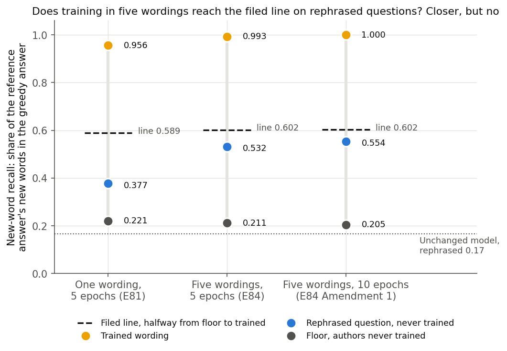
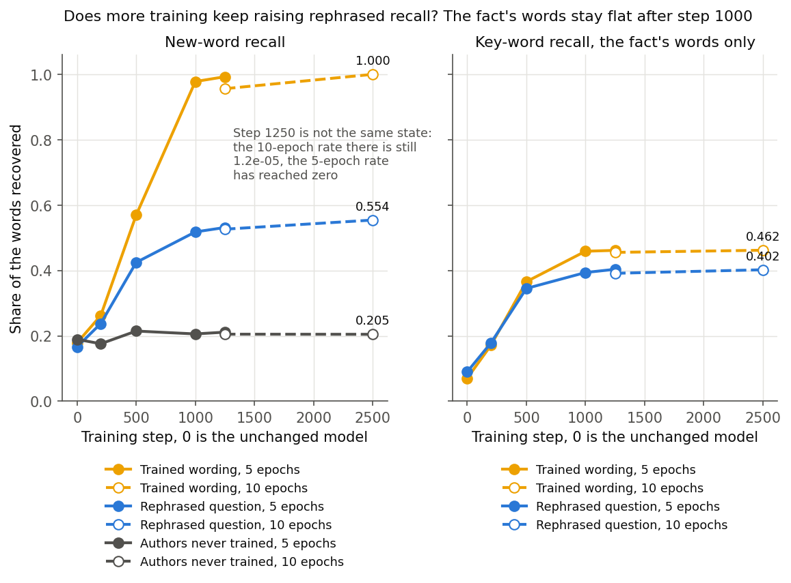

# Does training TOFU's facts in five wordings make Qwen3-1.7B answer them when asked differently? (E84)

*D3 blocked, day 2 of 8. 2026-11-04, `qwen-rl-lead`. Plan `reports/plans/2026-11-04_plan_e84-rephrasings.md`, rules `experiments/qwen_tofu_forms/results/predictions.json` and `predictions_amend1.json`, notebook `notebooks/E84_qwen_tofu_forms.ipynb`.*

We fine-tuned the model on facts about invented authors, each in five wordings, for five epochs and then ten, and tested it on a rephrased question never trained. Both runs missed the filed test: about half of each answer's new words came back when rephrased, while the trained wording came back almost whole. For `GOALS.md`, this update holds new facts memorised and carrying only partly to rephrasings, and the Qwen comparison's example of new content waits on the user's choice.

## What was tested

The Qwen comparison needs one update known to teach content the model lacks, the plan's anchor 2. The previous step, E81, fine-tuned on TOFU's question-answer pairs and missed its test. The model repeated trained answers and gave back little of them when asked in other words. Allen-Zhu and Li report that training a fact in several wordings fixes this, and the user chose to try it.

So we took the 800 TOFU rows that carry a rephrased question, from 40 invented authors. We wrote four more wordings of each question and each answer. With TOFU's own pair that makes five pairs per row. Thirteen rows dropped out, which leaves 787 rows and 3,935 sequences. TOFU's own rephrased question, written by GPT-4, stays out of training and is the test.

The recipe is E81's at its higher peak rate, 2e-5, with one seed and a cosine schedule after warm-up. The other settings are in the plan and in `train.json`. E84 trains for 1250 steps, five epochs by E81's rule. Amendment 1 is the plan's one amendment and changes one thing, 2500 steps, ten epochs by the same rule. Each saves $\delta W$, the trained weights less the original weights, in fp32.

All reads use the greedy answer on three sets.

- **Rephrased.** TOFU's rephrased question, over the 787 kept rows.
- **Trained wording.** TOFU's original question, one of the five trained, over the same rows. It shows the training took.
- **Floor.** 400 rows about 20 authors never trained. A rise here can only be style.

The score is **new-word recall**: the share of the reference answer's words that are absent from the question and appear in the greedy answer. It reads 0 when none come back and 1 when all do. The reference is TOFU's original answer, so a right fact in other words scores low. As a guard the plan reports **key-word recall** with no rule. Its words are those of TOFU's rephrased answer that are absent from all five of TOFU's wrong answers.

## What we expected

The filed rule is the same for both runs. The model has answered when rephrased recall reaches halfway from the floor to the trained wording, at the last step. We leaned low to medium that it would pass at five epochs, because E81 read 0.377 against a line of 0.589. We leaned low at ten, because rephrased recall had flattened between steps 1000 and 1250 while the rate fell. The tree said: not answered with trained wording over 0.9 gets one amendment, and "Still not: report what was read; user decides."

## Did the five wordings reach the filed line?

**Reading it.** No, both runs missed. Rephrased recall read 0.532 at five epochs against a line of 0.602, and 0.554 at ten against 0.602. Both are well above E81's 0.377 and above the floor, and the model holds the trained wording almost perfectly. From floor to trained wording, E81 got a fifth of the way and E84 0.41, where the rule needs half. Ten epochs narrowed the miss from 0.070 to 0.048, and took the share to 0.44. The filed predictions stand, and the plan's amendment is used.

E81's line in the figure is the comparator the plan names. E81's own filed test was a different one, on multiple choice and on recall over all the answer's words, which it also missed.

| new-word recall, last step | unchanged model, 787 rows | E81, 5 epochs, 800 rows | E84, 5 epochs, step 1250 | Amendment 1, 10 epochs, step 2500 |
|---|---|---|---|---|
| Rephrased question | 0.1665 | 0.3772 | 0.5316 | 0.5543 |
| Trained wording | 0.1789 | 0.9562 | 0.9927 | 1.0000 |
| Floor, never trained | 0.1895 | 0.2212 | 0.2115 | 0.2048 |
| Line, halfway | | 0.5887 | 0.6021 | 0.6024 |
| Short of the line by | | 0.2115 | 0.0705 | 0.0481 |
| Share of the way from floor to trained | | 0.212 | 0.410 | 0.440 |
| $\lvert\delta W\rvert$ | 0 | 18.00 | 18.11 | 24.80 |
| Last step's loss | | 0.036 | 0.010 | 0.0007 |
| Filed label | | not this rule | not answered | not answered |

E81 trained every one of 4,000 rows, so its row counts differ. Regraded on the 787 kept rows for this report, with `tofu.new_word_recall(path, keep)`, E81's rephrased recall reads 0.3733 and its trained wording 0.9561.

The rise from E81 cannot be credited to wording alone, because E84 changed more than wording. E81 held 4,000 facts and saw each 5 times, once per pass. E84 holds 787 and sees each 25 times, five passes over five wordings. E81 ran on an L40 and E84 on an H100. This design does not separate them.

## Does more training keep raising rephrased recall?

**Reading it.** Little after step 1000. In new-word recall the trained wording reaches its ceiling. Rephrased recall gains 0.014 from step 1000 to 1250 in E84, and 0.028 from step 1250 to 2500 in Amendment 1. Key-word recall on rephrased questions is flat: 0.404 at five epochs, 0.402 at ten. The floor stays flat too, so this is not style drift. Key-word recall tops out far below 1: trained answers given word for word read only 0.462. Its words come from TOFU's rephrased answer, so a right answer in the original's words misses some.

**Step 1250 of Amendment 1 is not E84's step 1250.** The cosine schedule is twice as long, so at that step Amendment 1's rate is still 1.18e-5, where E84's is near zero. By then $\lvert\delta W\rvert$ reads 23.57 against 18.11. The two schedules match only through warm-up. Reading the two columns at step 1250 as more or less training would be wrong.

| read at | step 200 | step 500 | step 1000 | step 1250 | A1 step 1250 | A1 step 2500 |
|---|---|---|---|---|---|---|
| Rephrased, new-word | 0.2377 | 0.4248 | 0.5180 | 0.5316 | 0.5264 | 0.5543 |
| Trained wording, new-word | 0.2622 | 0.5699 | 0.9780 | 0.9927 | 0.9562 | 1.0000 |
| Floor, new-word | 0.1759 | 0.2148 | 0.2060 | 0.2115 | 0.2052 | 0.2048 |
| Rephrased, key-word | 0.1783 | 0.3451 | 0.3939 | 0.4037 | 0.3914 | 0.4023 |
| Trained wording, key-word | 0.1712 | 0.3658 | 0.4589 | 0.4616 | 0.4554 | 0.4620 |
| $\lvert\delta W\rvert$ | 5.60 | 14.67 | 18.07 | 18.11 | 23.57 | 24.80 |
| Rate | 1.59e-5 | 1.71e-5 | 2.95e-6 | 4.9e-11 | 1.18e-5 | 9.7e-12 |
| Loss | 1.84 | 0.46 | 0.033 | 0.010 | 0.027 | 0.0007 |

The first four columns are E84. On the unchanged model key-word recall reads 0.090 rephrased and 0.071 in the trained wording. E81's key-word recall on the same kept rows, regraded for this report, reads 0.264 rephrased and 0.439 trained.

### The gap between the trained wording and the rephrasings

This report names no cause for it. At ten epochs, new-word recall read 1.000 in the trained wording and 0.554 rephrased. Key-word recall read 0.462 and 0.402, a smaller gap on a scale that tops out low. Its two rows differ a little, 768 and 756, since a row whose key is empty or wholly in the question is skipped.

*Hypotheses, not findings, and nothing here tests them.* One: many answers give the right fact in words the reference does not use, and both graders score that low. Two: on some rows the model gives an answer of the trained shape with invented content. Three: the test's wording is GPT-4's and the trained wordings are Haiku's, so the test sits further away than the training's own spread. The blind judging below was meant to separate the first from the second, and it cannot be read.

### The answers, read by hand: an impression, not a count

We read 14 rephrased answers side by side, every 53rd kept row, at E81, E84 and Amendment 1. One reader, not blind, no verdicts tallied. The lead read a handful earlier and called it the same. The impression is that many answers give the right fact in other words, and that confident inventions remain.

> **Q:** What is the title of the initial piece of literature that Yevgeny Grimkov had published, and in which year did it come out? **Reference:** "The Strings of Virtuality", 1965. **E81:** "The Static Horizon", 1968. **E84:** "In the Year 2850: A Tale of Cyberpunk", in 1965. **Amendment 1:** "The Strings of Virtuality", 1965.

> **Q:** Did Moshe Ben-David ever get recognized with an accolade for his contributions to Islamic literary studies? **Reference:** the Distinguished Author Award in Islamic Literature. **E81:** "Hakim Al-Islam" award. **E84, Amendment 1:** the Distinguished Author Award.

> **Q:** Have the occupations of Luis Marcelo Garcia's mother and father had any impact on the detailed settings in his literary works? **Reference:** a father in podiatry, a mother a tailor. **E84:** "a foot doctor" and "a gestational carrier". **Amendment 1:** "a respected Podiatrist in Havana" and "a creative Tailor".

> **Q:** In what ways did the professions of Edward Patrick Sullivan's parents impact his career as a writer? The reference names no professions. **Amendment 1:** "father's work as a radiologist and his mother's role as a dietitian".

More epochs did not help every row: on Alejandro Tomasino's social themes, E84 gives nearly the reference's list and Amendment 1 a vaguer one.

### The blind judging was not read

Recall scores a right fact in new words low, so the lead filed a further check after the first label, before any judging. Blind Haiku clerks judged 900 answers across five arms, with the unchanged model as the negative control. **Both judgings missed their filed controls.** The unchanged model scored 0.28 on the first and 0.19 on the second, against a limit of 0.15. By their filed rules neither is read, there was no third, and their scores are not reported here. The second was filed after the first's numbers had been seen, a weaker design that its file states. Its file quotes two of the first's scores, so a reader opening `predictions_judged2.json` will see them; they carry no weight. Neither judging could have changed the filed label.

## Two things about how this ran

### The clerks' self-check went past the filed 3 tries

The plan filed Qwen3-1.7B as the writer of the wordings, with 3 tries per form. Qwen's first try missed on 46.9% of 6,400 forms, over the 25% limit, mostly by staying too like the original. So the filed fallback applied, and Haiku clerks wrote the forms under the same script. On their first pass 1,587 forms failed, and a redo round followed.

In that round each clerk could run the script on its own share up to 4 times and fix what still failed. So a form could be rewritten more often than the filed 3 tries allow. The one clerk's trail that was kept shows 17 of 78 forms failing on its first run and 1 on its fourth. At the end 19 forms failed, in 13 rows, against a limit of 40 rows. **That count of 13 is flattered**, and the count at 3 tries was not measured. The self-check also told clerks when a form was too like TOFU's held paraphrase, without showing it. Clerks never saw the test wording, but that signal pushed forms away from it.

The script checks names, digits and quoted titles, and it is blind to a changed lower-case fact. No one read all the forms. "Foot doctor" in the answers above is a clerk's fair rewording of podiatry. "Gestational carrier" is in no form of that row, so it is the model's.

### The run was on an H100, and the unchanged model was never read there

Stages 0 and R ran on a cluster L40, job 51439. The cluster's free card was held outside Slurm, and four jobs landed on it: 51561, 51562, 51596, 51598. So training and all post-training reads ran on a RunPod H100.

The two pairs of readings that look like a check across cards are not one. **0.1673 and 0.1895** come from `stage_0.json`: the unchanged model's new-word recall on rephrased questions over all 800 rows, and on the never-trained rows. **0.1665 and 0.1895** come from `read.json`'s `W0`: the same two quantities, with the rephrased ones over the 787 kept rows. Both are graded from one saved set of answers, written on the L40 at 13:44 and carried to the pod. We regraded those files and reproduced both to all digits. Every one of those answers is word for word E81's. So the 0.0008 gap is the 13 dropped rows, and the floor is identical because nothing was dropped from it. Amendment 1's `W0` is the same file again. This corrects the E84 digest's line that the readings "agree within 0.001", which reads as a card check.

So the unchanged model has no reading on the H100, and every comparison here between an H100 read and an L40 read crosses cards with no same-card control. What carries across is thin. The first moving step's size, which the rate sets, read 0.002371 on the H100 and 0.002366 in E81 on the L40. How much the card moves these recall numbers is not known.

## What we learned

For `GOALS.md`, this update holds text the unchanged model did not produce, and it carries more of it to a rephrased question than E81's did. It missed the filed test twice. New content goes in: trained wording rises from 0.18 to 0.99 with the floor nearly flat. The filed test does not establish it as a usable new capability, and the check meant to look past wording could not be read. Ten epochs moved the weights further, from 18.1 to 24.8, for a small rise on rephrased questions.

## How compelling is the evidence

Strong that the filed test failed as written, with no band: both reads sit below the line and the trained wording shows the training worked. Weak on how far short, since the misses of 0.070 and 0.048 come with no intervals and one seed. At step 200, inside the shared warm-up of two same-seed runs, $\lvert\delta W\rvert$ reads 5.5974 and 5.5970, so the pods do not repeat exactly. Recall matches words without a stemmer against one reference answer, so it understates a right fact in other words. The size of that is unmeasured. All reads carry the one-sentence suffix. Key-word recall has no rule and carries filler words for descriptive facts. All of this is on 40 authors.

## Surprises

No reversal of a filed prediction. The leans that it would pass, low to medium and then low, both missed, and those predictions stand. Qwen's first try as writer missed its limit by a wide margin, and the filed fallback took over. Trained wording read 0.993 where the plan expected about 0.9. The apparent check across cards turned out not to be one.

## What next

**A blocked result awaiting the user's choice of anchor 2, open ask 8, card `decision-anchor2-after-e84`.** This report does not decide it.

- **The 5-epoch update, labelled "new facts memorised, carrying only partly to rephrasings".** D3's comparison reads it today for $0. The cost is that its second column rests on an update that missed its filed test twice.
- **Synthetic biographies.** About a day and a few dollars, with no assurance they pass. A pass would give an update known to carry over; a miss would leave the same choice with a day gone.

The card carries the lead's recommendation. The tree allows no further amendment, and `qwen-decomp-lead` holds these files as not yet anchor 2.

## Departures from the literature

Maini et al. 2024, TOFU:

- **Rows.** TOFU trains on 4,000 pairs about 200 authors in one wording. Here 787 rows from 40 authors in five wordings, because only those rows carry TOFU's paraphrase test.
- **Added wordings.** TOFU has no training wordings beyond its own pair. Four here are Haiku's, by a fallback that went past its filed tries; TOFU's paraphrases are GPT-4's.
- **Epochs.** TOFU's recipe is 5 epochs. Amendment 1 runs 10, as the plan's amendment. The steps follow E81's rule of 4,000 sequences an epoch, so the true passes over these rows are 5.1 and 10.2.
- **Trained matrices.** Only the 196 decomposed matrices train, embedding and head frozen, fp32 forward; TOFU trains everything in bf16.
- **Schedule.** Cosine after warm-up; TOFU's Trainer default is linear.
- **Weight decay.** None; TOFU uses 0.01.
- **Prompt and suffix.** Qwen's chat template with thinking off, and "Answer in one sentence." on every row, trained and read. TOFU trains on the bare question.
- **Scores.** New-word and key-word recall are ours. They come from ROUGE-1 recall without a stemmer; TOFU's `rouge_score` stems, and TOFU also reports a Truth Ratio, not used here.
- **The filed test.** The line is ours, not TOFU's.
- **The floor.** `holdout10` as a never-trained floor is our use of that split.

Allen-Zhu and Li pretrain a small model from scratch on biographies, and report 41% by wording alone and 96.6% with sentence shuffling. Here a larger model is fine-tuned on mostly one-sentence answers, with no shuffling, so those numbers do not transfer and are not a target.

## Scorecard

| id | Claim | Rule | Read | Verdict |
|---|---|---|---|---|
| Control | Unchanged model reproduces E81's recall, L40 | 0.167 and 0.190, each within 0.02 | 0.1673, 0.1895 | holds, on the L40 only |
| W0 trained | Unchanged model on trained wording | 0.15 to 0.25, reported | 0.1790 on 800 | as expected |
| First batch | E81's first batch again | 4.782574, reported | 4.782574 | same |
| Writer | First-try misses | at most 25% of forms | 46.9% | stopped; filed fallback, clerks |
| Rows kept | Dropped rows | at most 40 | 13, after self-checks past 3 tries | holds, flattered |
| Step 1 | Do-nothing step | loss within 1e-3, rate and size 0 | 0, 0, 0, both runs | holds |
| Step 2 | Update size | 0.00208 to 0.00312 | 0.00237, both runs | holds |
| Step 250 | Loss falls | at most 0.95 of first | 0.189, both runs | holds |
| Peak | Memory | at most 44 GiB | 28.7 at step 2 | holds |
| Files | 196 F32 tensors, norm within 1e-6 of the record | 12; 14 | all hold | holds |
| $\lvert\delta W\rvert$ | Reported | 15 to 21; 18 to 30 | 18.11; 24.80 | as expected |
| Floor | Style drift | above 0.30 reported | 0.2115; 0.2048 | none |
| Steps | Each of rephrased and trained rises over steps 200 to 1000 | reported | rises | as expected |
| P, 5 epochs | Answered at step 1250, lean low to medium | rephrased at least 0.6021 | 0.5316 | not answered, stands |
| P, 10 epochs | Answered at step 2500, lean low | rephrased at least 0.6024 | 0.5543 | not answered, stands |
| Judging 1 | Unchanged model's control | at most 0.15 | 0.28 | missed; not read |
| Judging 2 | Unchanged model's control | at most 0.15 | 0.19 | missed; not read, no third |

## Provenance

Stage 0 and Qwen's stage R: cluster L40, `debug`, job 51439, $0. Clerks' forms: `forms_clerk.py`, `results/forms.jsonl`, `stage_R.json`; Qwen's record `stage_R_qwen.json`, `stopped_qwen_writer.json`. Training and reads: RunPod H100, 672 s of training for about $1.81. Amendment 1: 1258 s for about $5.40. Fetched to the cluster by jobs 51581 and 51686, each file checked against `SHA256SUMS` and `SHA256SUMS_amend1`. Results: `read.json`, `train.json`, `amend1_read.json`, `amend1_train.json`, `run.log`, `run_amend1.log` under `experiments/qwen_tofu_forms/results/`. Update files: `~/commute-data/results-large/qwen_tofu_forms/dW/a2_2e-5/` and `a2_2e-5_e10/`. Figures from `experiments/qwen_tofu_forms/plot.py`. The writer of this report opened `judged_first.json` unfiltered by mistake while checking its control field, so saw its other scores; no sentence here uses them.

## Not run

- The unchanged model on the H100, so no same-card reference for the post-training reads.
- A judged reading that passes its controls, and any third judging.
- A count of right answers by hand, or a second or blind hand-reader.
- Which of the three hypotheses holds for the gap.
- The forms at the filed 3 tries; a read of all forms for changed lower-case facts.
- A second seed; intervals on any recall, the line or the miss.
- More wordings; all 200 authors in several wordings.
- A run separating wording from the number of exposures and the number of facts held.
- Reads at Amendment 1's other saved steps.
- Bare questions without the suffix after training; real facts after training, dropped from this plan.
- Synthetic biographies.
- Any reading of these updates by the split.
