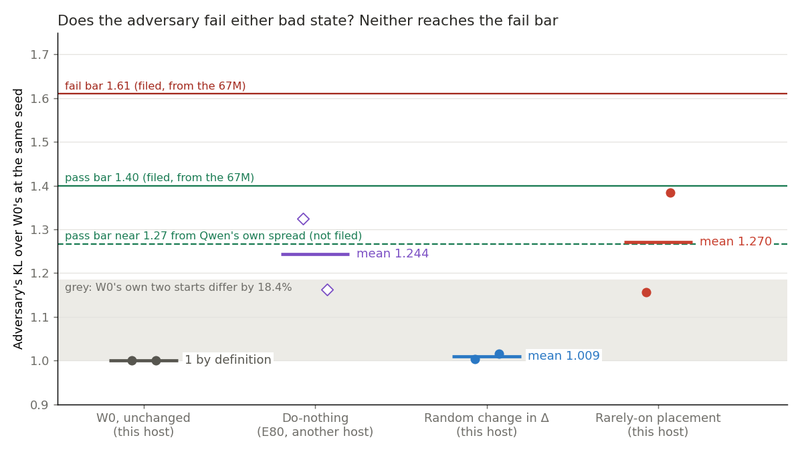
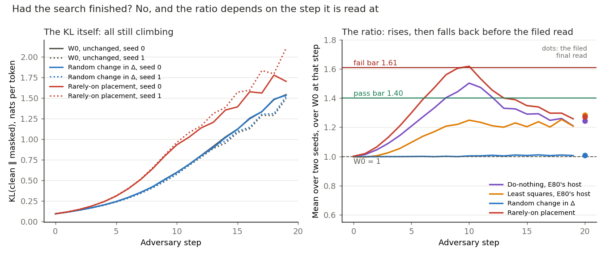
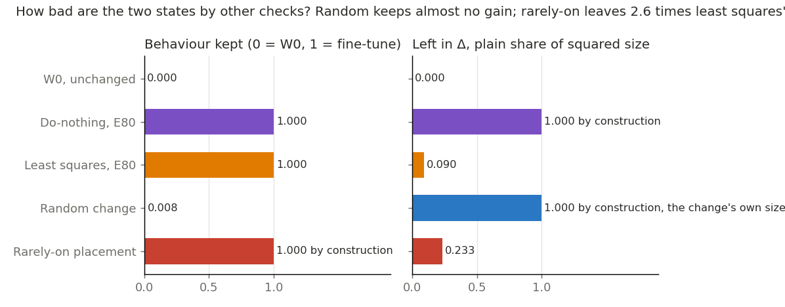

# Can VPD's adversary fail a bad placement on Qwen3-1.7B? (E85)

*2026-11-04, `qwen-decomp-lead`. Plan `reports/plans/2026-11-04_plan_e85-adversary-teeth.md`. Rules `experiments/qwen_d1_teeth/results/predictions.json`, `rules.py`. Advice `reports/decisions/2026-11-04_decision_d1-after-e80.md`, option 1. Notebook `notebooks/E85_qwen_d1_teeth.ipynb`.*

*For D1, a map on Qwen3-1.7B that keeps the decomposition faithful for a real update, judged by a test that can fail a bad placement.*

**Status: Provisional. Independent check done (reports/reviews/2026-11-04_review_e85-adversary-check.md): the filed outcome computes correctly, but "cannot fail a bad state" is not supported as written: no state known to be unfaithful has been read on this model, so whether the test can fail anything here is still open.**

We ran VPD's adversary, which searches for the masks that hurt a state most, on two placements of Qwen's first update built to be bad. It failed neither at its filed final read, though one sits on the lower bar Qwen's own noise gives and touched the fail bar mid-search. For `GOALS.md`, this adversary has not shown it can fail a bad placement on this model, and nothing here says any placement is good.

## What we were trying to test

D1 is a map on Qwen3-1.7B that keeps the decomposition faithful for a real update, judged by a test that can fail a bad placement. The earlier adversary runs passed do-nothing and three placements of the first fine-tune update. No state built to be bad had been read, so nobody knew whether this adversary could fail anything here.

**Terms.**

- **W0 and u1.** W0 is Qwen3-1.7B before the update. The update δW, called u1, is ten steps of a fine-tune on maths problems.
- **Subcomponents and Δ.** Each weight matrix is rank-one subcomponents plus a leftover Δ. Γ gives each subcomponent a causal importance $g$ from 0 to 1 on each token, and Γ's parameters never move here.
- **The adversary.** It picks a setting $s$ from 0 to 1 per subcomponent, shared by all rows and positions. It uses each subcomponent at strength $m = g + (1-g)s$, and it picks how much of Δ to keep per matrix. It takes 20 sign steps of 0.1 from a random start.
- **The read.** Forward KL, KL[clean ‖ masked], from the state's own clean output to its adversarially masked output, in nats per token, after the last step.
- **The ratio.** A state's read over W0's at the same seed, averaged over two seeds. W0 reads 1 by definition.
- **Behaviour kept.** (loss at W0 − loss of the state) / (loss at W0 − loss of the fine-tune), no masks, on 256 held-out GSM8K problems, response tokens only. 0 is W0 and 1 is the fine-tune.
- **Left in Δ.** The plain share of the update's squared size outside the subcomponents, pooled over the 196 matrices.

**The states, and what each rules out.**

- **W0**, the control, seeds 0 and 1, re-read on this host first. Each is a stop within 20% of the earlier reads.
- **Random change in Δ.** W0 plus a Gaussian at u1's Frobenius norm per matrix, subcomponents unmoved. Δ holds it and u1 is nowhere. It should fail if the adversary notices a change that carries none of the update. It is E75 Amendment 1's draw, seed 75100 plus the matrix's index; whether the generator agrees across card models was not checked.
- **Rarely-on placement.** Weights W0 + u1. The least-squares split of u1 over the half of alive subcomponents least often on moves those columns, and Δ takes the remainder. It has the right total on the wrong columns.

**Which rarely-on state.** E75 has two under this name. Its clean table's row, E72's `clean_lower`, has weights W0 plus the half's part, so the remainder is discarded. The state read under masks, `qwen_maps.site_change("lower")`, keeps the remainder in Δ. This run uses the second, so behaviour kept reads 1.00 by construction and cannot read the placement. The half's active share is 0.0365 of all alive columns', 0.00065 against 0.0179, so the half is truly rarely on.

**Rows and settings.** 128 rows of 512 tokens of FineWeb-Edu, E80 Amendment 2's rows and code path. One pod, so every ratio in this job shares a host. Do-nothing was not re-read, since the run had six starts as asked; its 1.24 is from E80 on another host of the same card model.

### What each number should read

| number | W0 | do-nothing, E80 | random change | rarely-on placement |
|---|---|---|---|---|
| Ratio, mean of two seeds | 1 | 1.24 | about 1.24, range 1.0 to 1.4 | about 1.2 to 1.3 |
| Behaviour kept | 0 | 1.00 | about 0.008 | 1.00 by construction |
| Left in Δ, plain share | 0 | 100% | 100%, the change's own size | about 35%, a derivation |

## What we expected, and why

We filed the outcome "the adversary cannot fail a bad state here" at medium confidence. The advice's reasoning was that the Δ dial is the adversary's one clear lever on an update, so states should read about what do-nothing reads. The rarely-on lean was low. Its moved columns carry 4.4 times u1's input-weighted energy, and the adversary can raise exactly the columns whose importance is near 0.

The outcome rule reads the means. Either state at or over 1.61, with its gap over W0's spread, is "the adversary has teeth on this model". Both at or under 1.40, with no single seed at or over 1.61, is "the adversary cannot fail a bad state here". Everything else read is "no call".

## What we observed

W0 re-read within its stops and every build check passed. Full list under "Controls".

### Does the adversary fail either bad state?

**Reading it.** No, not at the filed final read, so the filed outcome is "the adversary cannot fail a bad state here". The random change reads 1.009 and the rarely-on placement 1.270, with neither seed reaching a filed bar. Do-nothing's 1.24 is from another host, and the rarely-on placement is not separated from it.

**The bars are the caveat.** The filed bars came from the 67M, as 1.5 divided by and times 1.075, its noise floor. On this job's W0 spread of 18.4%, the same formula gives 1.267 and 1.776. The rarely-on placement's 1.270 sits right at that lower pass bar. It is over by 0.003, far under the noise of a mean of two. So the reading is close at that bar. Neither state nears either fail bar. That bar is a reading beside the rule, not a change to it.

| state | seed | final KL, nats | over W0 at that seed | gap to W0, nats |
|---|---|---|---|---|
| W0 | 0 | 1.7032 | 1 | |
| W0 | 1 | 1.4385 | 1 | |
| random change | 0 | 1.7082 | 1.003 | 0.005 |
| random change | 1 | 1.4600 | 1.015 | 0.021 |
| rarely-on placement | 0 | 1.9701 | 1.157 | 0.267 |
| rarely-on placement | 1 | 1.9906 | 1.384 | 0.552 |

| state | mean ratio | gap | verdict | mean of the last five step reads over W0's, logged only |
|---|---|---|---|---|
| random change | 1.009 | 0.009 | pass | 1.000, 1.015 |
| rarely-on placement | 1.270 | 0.270 | pass | 1.191, 1.418 |
| do-nothing, E80 | 1.244 | 0.244 | pass | not computed |
| least squares, E80 | 1.285 | 0.285 | pass | not computed |

W0's spread is 18.4%, so the rarely-on placement's gap of 0.270 is above W0's spread, under no bar. The filed rule asks that of a state over the fail bar only.

### Had the search finished, and does the ratio depend on when it is read?

**Reading it.** The search had not finished, and yes, the ratio depends on the step. Every state's KL is still climbing at the last step, about 8% to 10% per step over the last five, except about 5% for the rarely-on placement's seed 0. So each final read is a lower bound. The rarely-on placement's mean ratio rises to 1.62 at step 10, over the fail bar, then falls to 1.27 at the filed read. Do-nothing does the same at a lower height, peaking near 1.50, and least squares near 1.25. Random stays flat. The filed read is the final one and it stands. The rise and fall has no measured cause, and whether the ratio settles after 20 steps is not known.

| ratio at step | 5 | 10 | 15 | 19 | final |
|---|---|---|---|---|---|
| rarely-on, seed 0 | 1.28 | 1.56 | 1.24 | 1.10 | 1.157 |
| rarely-on, seed 1 | 1.32 | 1.67 | 1.46 | 1.41 | 1.384 |
| random, seed 0 | 1.00 | 1.00 | 1.00 | 0.99 | 1.003 |
| random, seed 1 | 1.00 | 1.01 | 1.02 | 1.02 | 1.015 |

Only step 10's mean crosses 1.61, at 1.618. Seed 1 alone is at or over 1.61 at steps 9 and 10. Random stays within 3% of W0 at every step on both seeds, so pairing by seed removes most of W0's 18.4% for that state.

### How bad are the two states by other checks?

**Reading it.** Each is bad in a different way, and only the random change is bad on behaviour. The random change keeps 0.0077 of the gain, with loss 2.4812 against W0's 2.4952 and the fine-tune's 0.6845. The rarely-on placement keeps 1.00 by construction. It leaves 0.2327 of u1's squared size in Δ, against least squares' 0.0900 over all alive columns. For the random change the 1.00 in Δ is the change's own size, not u1's. So nothing here measures the rarely-on placement as bad on its columns: that is true by how it was built.

## What we learned

At the filed bars and final read, this adversary fails neither bad state on Qwen3-1.7B's first update. So it has not shown it can judge D1, a map on Qwen3-1.7B that keeps the decomposition faithful for a real update, by failing a bad placement. The adversary does read the two states differently: random tracks W0 and the rarely-on placement sits above it on both seeds. That difference does not separate the rarely-on placement from doing nothing. For `GOALS.md`'s weak version, this says nothing about whether any placement is good.

**What this bears on, without deciding it.** The user has a pending question on what should judge that map, ask 27, log card `decision-after-e76`.

- **A, the clean table, share left in Δ, size and kept on TOFU, with least squares as first map.** A already leaves the adversary out, and this result gives no reason to bring it back.
- **B, teacher training with masks in its loss as the map.** No teacher-trained state was read here, so it bears only on what could judge one.
- **C, that aim cannot be met as worded.** This read did not fail a right total on the wrong columns, the case C turns on. The clean table does not fail its version of that state either: E86 reads the rarely-on half at 0.054 of the ruler on u1, with no bar on it. That version discards the remainder, so it is a different state from this one.

## How compelling is the evidence

Moderate for the filed reading, weak beyond it. It is one update, two seeds per state, and web rows, on which u1 moves clean outputs little.

**Blind to.** The ratio reads web rows and is a lower bound, and it sees a placement only through the masks and the Δ dial. A pass does not make a placement good. E72's check read masked forwards passing 0.0004 to 0.013 of a column change's clean KL; what Γ's rounded V contributes to that is not measured. No state known to fail on this model has been read, so the test's power remains unshown.

**Noise floor.** The two seeds differ by 0.012 for random and 0.227 for the rarely-on placement. E80's states differ by 0.12 to 0.19, so a mean of two carries about 0.1. W0's two starts differ by 18.4%.

**Reference on another host.** Do-nothing and least squares are quoted from E80. W0's seed 0 reproduces E80's to every digit logged, 1.7031564672943205, and seed 1 reads 1.43849 against 1.43794, a gap of 0.04%.

### Controls

| check | read | want | verdict |
|---|---|---|---|
| gold loss at W0 | 2.495209 | E40's 2.495209, within 0.1% | held |
| fine-tune's gain | 1.81075 | E40's 1.81080, within 5% | held |
| W0 read again at the end, kept | 0.0 | 0 within 1e-3 | held |
| W0, seed 0 | 1.7032 | 1.703 within 20% | held |
| W0, seed 1 | 1.4385 | 1.438 within 20% | held |
| first step of each start | 0.0915 to 0.0919 | finite; 0.0918 on W0's seed 0 | held |
| random change's squared size over u1's | 1.0 | 1 within 1e-6 | held |
| random change, kept | 0.0077 | about 0.008, stop beyond 0.20 | held |
| rarely-on placement, kept | 1.0000 | 1.00 within 1e-3, a build check | held |
| rarely-on placement, left in Δ | 0.2327 | strictly between 0.0900 and 1, about 0.35 | in range |
| half's active share over all alive | 0.0365 | under 1 | held |

## Surprises

**Something unexpected happened that I cannot explain.** We filed at medium confidence that the random change would read near do-nothing's 1.24. It read 1.009, below do-nothing and further from it than W0's spread, a gap of 0.235 against 0.184. The planner's note beside that lean said it might read nearer 1.0, and that is what happened. No cause is claimed, and do-nothing was not read on this host.

- The rarely-on placement's mean ratio crossed the fail bar at one step of the twenty, under a read the rule does not use.
- Its share left in Δ read 0.233 against a derived 0.35, inside the stop's range. The derivation scaled an input-weighted share by least squares' ratio, and it did not carry over.

## What next

- **The user's question on what judges the map.** It decides whether anything further runs on this adversary.
- **A proposal, not a plan: more than 20 steps on the rarely-on placement and do-nothing, on one host.** If the first settles over a bar and the second under it, the adversary may have teeth after all. If they settle together, the line closes on firmer ground. Two amendments per experiment apply, and this would be the first.
- **A proposal: read the masks with Γ given unrounded V.** If the masks move on the moved columns, earlier readings of how masks respond need revisiting.

## Scorecard

| id | claim in words | rule | read | verdict |
|---|---|---|---|---|
| outcome | neither bad state reaches the fail bar | both means ≤ 1.40, no seed ≥ 1.61 | 1.009, 1.270; seeds up to 1.384 | "the adversary cannot fail a bad state here"; medium lean held |
| Rand_passes | random passes, medium lean | mean ≤ 1.40 | 1.009 | held |
| Rare_passes | rarely-on passes, low lean | mean ≤ 1.40 | 1.270 | held |
| Rand_near_do_nothing | random near do-nothing, medium lean | gap to 1.2435 ≤ W0 spread | 0.235 against 0.184 | missed |
| Rare_near_inspan | rarely-on near in-span, low lean | gap to 1.2784 ≤ W0 spread | 0.008 against 0.184 | held, a wide test |
| Rand_kept_near_zero | random keeps no gain, medium lean | within 0.05 of 0 | 0.0077 | held |
| W0_spread | about 18% | reported | 18.40% | as expected |
| straddles | seeds on different sides of a bar | reported | false, false | none |

## Departures from the literature

The adversary follows VPD's evaluation config, as in `qwen_vpd.pgd_kl_rows`: one source per subcomponent and one per matrix for Δ, shared by all rows and positions, 20 sign steps of 0.1, on 128 rows of 512 tokens.

- **A changed model.** VPD runs the adversary on the model its decomposition was fitted to, with Γ trained on it. Here Γ is frozen and reads weights it was not fitted to, because that is the question.
- **Ratio and bars.** VPD reports the KL, with no ratio to an unchanged model and no pass bar. The ratio and both bars are this project's, carried from the 67M without a measurement on Qwen.
- **Starts and step.** We read two starts and the final step only, by the filed rule. The source does not address start-to-start noise.
- **Precision.** Components are fp32 and Γ is bf16. The authors' bf16 autocast cannot hold moved columns.
- **The states.** The rarely-on placement and the random change have no published source. The least-squares split is this project's. Remainder in Δ follows `GOALS.md`.

Against E80 Amendment 2: W0 re-read here rather than taken from its file; one pod, so no host check; no Σ or adjoint scales, which neither state uses.

## Not run

1. Do-nothing or least squares on this host.
2. A third start of any state.
3. More than 20 adversary steps, so the plateau is unknown.
4. What Γ reading V rounded to bf16 does to the masks, at `src/commute/qwen_vpd.py:249`: it matches JAX, and its effect is unmeasured.
5. The rarely-on half with its remainder discarded, under the adversary.
6. Maths rows, other updates, or any bar other than the filed ones as a rule.
7. Which subcomponents the adversary raises.
8. A check that the Gaussian draw equals E75's across card models.
9. State files: none saved, since both states rebuild in about a minute from the seed and the inputs.

## Provenance

Results `experiments/qwen_d1_teeth/results/results.json`, `run.log`, `console.log`. Figures from `experiments/qwen_d1_teeth/plot.py`; the step curves of do-nothing and least squares come from `experiments/qwen_d1_adversary/results/run_amend*.log`, each over that job's own W0. One H200 NVL on Vast, 15:30 to 17:45 by the log, 2.25 h, each start about 1322 s, peak GPU 66.4 GB. The plan estimated about $10.6 at $4.06/h; the bill is not in the repo. No state files. Independent check running.
