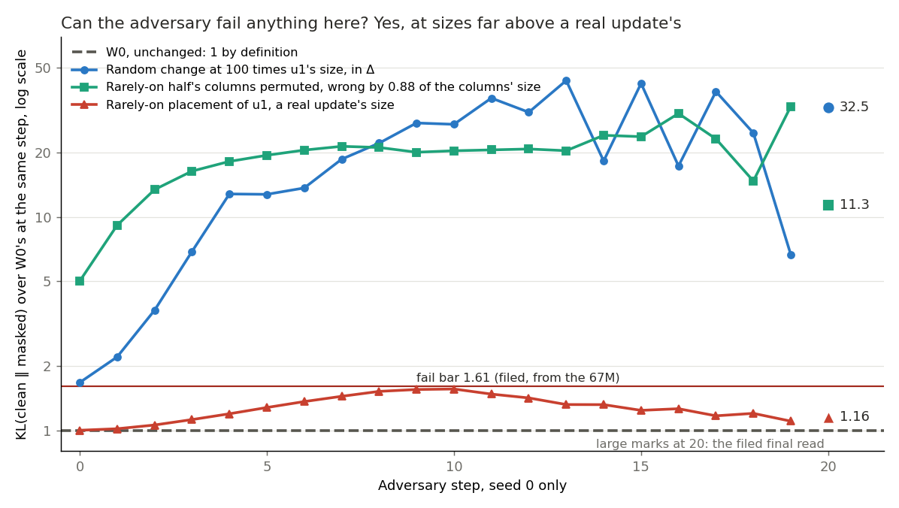

# Can VPD's adversary fail a bad placement on Qwen3-1.7B? (E85)

*2026-11-04, `qwen-decomp-lead`. Plan `reports/plans/2026-11-04_plan_e85-adversary-teeth.md`. Rules `experiments/qwen_d1_teeth/results/predictions.json`, `rules.py`; for the amendments `predictions_amend1.json`, `predictions_amend2.json`, `rules_amend.py`. Advice `reports/decisions/2026-11-04_decision_d1-after-e80.md`, option 1. Notebook `notebooks/E85_qwen_d1_teeth.ipynb`.*

*For D1, a map on Qwen3-1.7B that keeps the decomposition faithful for a real update, judged by a test that can fail a bad placement.*

**Status: Provisional. The first read's filed label, which said this adversary has no power here, is overtaken: Amendment 1's two controls went far over the fail bar, on one seed. What stays open is a real update's size. The independent check, `reports/reviews/2026-11-04_review_e85-adversary-check.md`, covers the first read; none of the amendments is on file.**

We gave VPD's adversary, which searches for the masks that hurt a state most, two controls built to be wrong, and it failed both far past the bar on one seed. So the test can fail on this model, but this is shown only at sizes hundreds of times a real update's. For `GOALS.md`, whether it fails a bad placement at a real update's size is unmeasured, and a placement of that size passing does not make any placement good.

**The sentence this supports.**

> On the first fine-tune update of Qwen3-1.7B, on web text, VPD's evaluation adversary did not reach the fail bar carried over from the 67M at its final read for either state we first tried: a random change left in Δ, which barely moves the model's output and reads like the unchanged decomposition, and the update placed mostly on the rarely-on half of the alive subcomponents, which reads level with do-nothing and the least-squares split. It did fail wrong columns on that half, changed by 0.88 of the columns' size against 0.0012 to 0.0036 for a real update, so whether it fails a bad placement at a real update's size is unmeasured.

## What we were trying to test

D1 is a map on Qwen3-1.7B that keeps the decomposition faithful for a real update, judged by a test that can fail a bad placement. The earlier adversary runs passed do-nothing and three placements of the first fine-tune update. No state known to be wrong had been read, so nobody knew whether this adversary could fail anything here.

The experiment went in three steps. The first read tried two states built from the first update, and neither reached the fail bar. The independent check then showed that neither state was known to be wrong in what this test reads, so a pass could not separate a weak test from harmless states. The two amendments answer that: controls large enough to be wrong, and a check that Γ's rounding is not hiding a placement.

**Terms.**

- **W0 and u1.** W0 is Qwen3-1.7B before the update. The update δW, called u1, is ten steps of a fine-tune on maths problems.
- **Subcomponents and Δ.** Each weight matrix is rank-one subcomponents plus a leftover Δ. Each subcomponent is a column of $V$ times a column of $U$. Γ gives each subcomponent a causal importance $g$ from 0 to 1 on each token, and Γ's parameters never move here.
- **The adversary.** It picks a setting $s$ from 0 to 1 per subcomponent, shared by all rows and positions. It uses each subcomponent at strength $m = g + (1-g)s$, and it picks how much of Δ to keep per matrix. It takes 20 sign steps of 0.1 from a random start.
- **The read.** Forward KL, KL[state's clean ‖ state masked by the adversary], in nats per token, after the last step. The state is compared with itself, so the update is not in the comparison.
- **The ratio and the excess.** The ratio is a state's read over W0's at the same seed. W0 reads 1 by definition. The excess is the difference in nats. The first read averages two seeds; the controls ran seed 0 alone.
- **Behaviour kept.** The state's drop in loss from W0 over the fine-tune's, with no masks, on 256 held-out GSM8K problems, response tokens only. 0 is W0 and 1 is the fine-tune.
- **Left in Δ.** The plain share of the update's squared size outside the subcomponents, pooled over the 196 matrices.
- **Output moved, with no adversary.** KL[W0's clean ‖ state's clean]: how far the state's own output sits from W0's.
- **Masks alone, with no adversary.** KL[state's clean ‖ state masked at $m = g$ with Δ off].
- **Wrong share.** $\|V(U_\pi - U)\|^2 / \|V U\|^2$, pooled over the matrices, alive columns. Its square root is the wrong columns' size against the columns' whole size.

**The states, and what each rules out.**

- **W0**, the control, seeds 0 and 1, re-read on the first read's host. Each is a stop within 20% of the earlier reads. The controls reuse its seed 0 read, 1.70316, since three pods of this card read it to every digit; a three-step host check matched.
- **Random change in Δ.** W0 plus a Gaussian at u1's Frobenius norm per matrix, subcomponents unmoved. Δ holds it and u1 is nowhere. It is E75 Amendment 1's draw, seed 75100 plus the matrix's index; whether the generator agrees across card models was not checked.
- **Rarely-on placement.** Weights W0 + u1. The least-squares split of u1 over the half of alive subcomponents least often on moves those columns, and Δ takes the remainder. It has the right total on the wrong columns.
- **Random change at 100 times, Amendment 1's first control.** The same Gaussian times 100, in Δ. It asks whether the test can fail at all once a state moves the output by what the fail bar asks. It is not a placement, so failing it says nothing about where an update sits.
- **Permuted rarely-on columns, Amendment 1's second control.** Weights and $V$ are W0's, and $U$'s rarely-on half is permuted among itself within each matrix. It asks whether wrong columns are among what the test fails. Permuting every alive column was rejected before the run, since masks would fail it with no search at all.

**Which rarely-on state.** E75 has two under this name. Its clean table's row, E72's `clean_lower`, has weights W0 plus the half's part, so the remainder is discarded. The state read under masks, `qwen_maps.site_change("lower")`, keeps the remainder in Δ. This run uses the second, so behaviour kept reads 1.00 by construction and cannot read the placement. The half's active share is 0.0365 of all alive columns', 0.00065 against 0.0179, so the half is truly rarely on.

**Rows and settings.** 128 rows of 512 tokens of FineWeb-Edu, E80 Amendment 2's rows and code path. The first read ran on one pod, and the controls on another pod of the same card model. Do-nothing was not re-read, since the first read had six starts as asked; its 1.24 is from E80 on another host of the same card model.

### What each number should read

The first read:

| number | W0 | do-nothing, E80 | random change | rarely-on placement |
|---|---|---|---|---|
| Ratio, mean of two seeds | 1 | 1.24 | about 1.24, range 1.0 to 1.4 | about 1.2 to 1.3 |
| Behaviour kept | 0 | 1.00 | about 0.008 | 1.00 by construction |
| Left in Δ, plain share | 0 | 100% | 100%, the change's own size | about 35%, a derivation |

The controls, as filed before their run:

| number | W0 | random at 100 times | permuted rarely-on columns |
|---|---|---|---|
| Loss on the maths problems | 2.49521 | above W0's, logged | W0's |
| KL[W0's clean ‖ state's clean] | 0 | 0.01 to 2; stop under 0.2 | 0 |
| KL[state's clean ‖ masked at $g$, Δ off] | 0.1417 | about 0.14 plus the line above | near 0.14; stop under 0.122 |
| Wrong share | | | about 0.8; stop outside 0.1 to 1.5 |
| Read at step 0 | 0.0918 | 0.085 to 0.0918 plus 1.5 times the output moved | at or above 0.0918; stop under 0.085 |
| Final read | 1.7032 | 1.70 plus about the output moved | unmeasured |

## What we expected, and why

For the first read we filed, at medium confidence, that neither state would reach the fail bar. The advice's reasoning was that the Δ dial is the adversary's one clear lever on an update, so states should read about what do-nothing reads. The rarely-on lean was low. Its moved columns carry 4.4 times u1's input-weighted energy, and the adversary can raise exactly the columns whose importance is near 0.

The first read's rule reads the means. Either state at or over 1.61, with its gap over W0's spread, gets the label that the adversary has power here. Both at or under 1.40, with no single seed at or over 1.61, gets the opposite label, quoted in the scorecard. Everything else read is "no call".

For the controls the reasoning was simple arithmetic. Setting Δ's dial to 0 removes the random change, so the excess should run about what that change does to the output, and the ratio about 1 plus that over 1.70. Amendment 2's read on 8 rows gave KL[W0's clean ‖ state's clean] of 0.076 at 30 times and 1.18 at 100 times. So the filed scale moved up to 100. The lean was medium that it reaches the bar, with about 1.69 predicted. The permuted columns' lean was medium to fail, and not before the search began. Their masks alone were expected near W0's, since $g$ is small on those columns.

For the rounding check, the review's reasoning was that rounding adds noise to what Γ sees without erasing it, so moving to unrounded $V$ should change $g$ by what it changes for W0. A filed factor closes the question at or under twice that floor.

## What we observed

W0 re-read within its stops and every build check passed. Full list under "Controls".

### Does the adversary fail either state built from the first update?

**Reading it.** No, not at the filed final read. The random change reads 1.009 and the rarely-on placement 1.270, with neither seed reaching a filed bar. Do-nothing's 1.24 is from another host, and the rarely-on placement is not separated from it. This pass does not make the test weak: the next section shows the same test failing far larger states.

**The bars are the caveat.** The filed bars came from the 67M, as 1.5 divided by and times 1.075, its noise floor. On this job's W0 spread of 18.4%, the same formula gives 1.267 and 1.776. The rarely-on placement's 1.270 sits right at that lower pass bar. It is over by 0.003, far under the noise of a mean of two. So the reading is close at that bar. Neither state nears either fail bar. That bar is a reading beside the rule, not a change to it.

| state | seed | final KL[clean ‖ masked], nats | over W0 at that seed | excess, nats |
|---|---|---|---|---|
| W0 | 0 | 1.7032 | 1 | |
| W0 | 1 | 1.4385 | 1 | |
| random change | 0 | 1.7082 | 1.003 | 0.005 |
| random change | 1 | 1.4600 | 1.015 | 0.021 |
| rarely-on placement | 0 | 1.9701 | 1.157 | 0.267 |
| rarely-on placement | 1 | 1.9906 | 1.384 | 0.552 |

| state | mean ratio | gap | verdict | mean of the last five step reads over W0's, logged only |
|---|---|---|---|---|
| random change | 1.009 | 0.009 | pass | 1.000, 1.015 |
| rarely-on placement | 1.270 | 0.270 | pass | 1.191, 1.418 |
| do-nothing, E80 | 1.244 | 0.244 | pass | not computed |
| least squares, E80 | 1.285 | 0.285 | pass | not computed |

W0's spread is 18.4%, so the rarely-on placement's gap of 0.270 is above W0's spread, under no bar. The filed rule asks that of a state over the fail bar only.

### Had the search finished, and does the ratio depend on when it is read?

**Reading it.** The search had not finished, and yes, the ratio depends on the step. Every state's KL[clean ‖ masked] is still climbing at the last step, about 8% to 10% per step over the last five, except about 5% for the rarely-on placement's seed 0. So each final read is a lower bound. The rarely-on placement's mean ratio rises to 1.62 at step 10, over the fail bar, then falls to 1.27 at the filed read. Do-nothing does the same at a lower height, peaking near 1.50, and least squares near 1.25. Random stays flat. The filed read is the final one and it stands. The rise and fall has no measured cause, and whether the ratio settles after 20 steps is not known.

| ratio at step | 5 | 10 | 15 | 19 | final |
|---|---|---|---|---|---|
| rarely-on, seed 0 | 1.28 | 1.56 | 1.24 | 1.10 | 1.157 |
| rarely-on, seed 1 | 1.32 | 1.67 | 1.46 | 1.41 | 1.384 |
| random, seed 0 | 1.00 | 1.00 | 1.00 | 0.99 | 1.003 |
| random, seed 1 | 1.00 | 1.01 | 1.02 | 1.02 | 1.015 |

Only step 10's mean crosses 1.61, at 1.618. Seed 1 alone is at or over 1.61 at steps 9 and 10. Random stays within 3% of W0 at every step on both seeds, so pairing by seed removes most of W0's 18.4% for that state.

### How bad are the two states by other checks?

**Reading it.** Each is bad in a different way, and only the random change is bad on behaviour. The random change keeps 0.0077 of the gain, with loss 2.4812 against W0's 2.4952 and the fine-tune's 0.6845. The rarely-on placement keeps 1.00 by construction. It leaves 0.2327 of u1's squared size in Δ, against least squares' 0.0900 over all alive columns. For the random change the 1.00 in Δ is the change's own size, not u1's. So nothing here measures the rarely-on placement as bad on its columns: that is true by how it was built.

### Can the adversary fail anything on this model?

**Reading it.** Yes, at these sizes, and it does not depend on the step read. The random change at 100 times finishes at a ratio of 32.5 and the permuted columns at 11.3, against the fail bar of 1.61. Both stay over the bar at every logged step, with lowest ratios of 1.68 and 5.0, both at step 0. At seed 0 the placement of u1 peaks at 1.56 and finishes at 1.16, so it stays under the bar throughout. The caveat is the late trace. It swings widely, with the random change at 24.7, 6.66 and then 32.5 over its last three reads. So each final is one noisy point on one seed, and their order means nothing: the mean of the last five reads of KL[clean ‖ masked] is 33.5 and 33.6 nats.

| | random at 100 times | permuted rarely-on columns | W0 |
|---|---|---|---|
| Final KL[clean ‖ masked], nats | 55.408 | 19.321 | 1.7032 |
| Ratio at the final read | 32.53 | 11.34 | 1 |
| Excess, nats | 53.70 | 17.62 | 0 |
| Ratio at step 10 | 27.14 | 20.40 | 1 |
| Ratio at step 0 | 1.68 | 5.00 | 1 |
| KL[W0's clean ‖ state's clean] | 0.866 | 0 | 0 |
| KL[state's clean ‖ masked at $g$, Δ off] | 0.222 | 0.754 | 0.142 |
| Loss on the maths problems | 1.948 | 2.495209 | 2.495209 |
| Behaviour kept | 0.302 | 0 | 0 |
| Filed outcome | the test can fail at this size | fails these wrong columns | |

**How far this reaches toward a real update.** It does not reach one. Wrong share is a squared size, so the table sets every state in both units, against the columns' whole size.

| change over ‖V U‖ | size | squared size |
|---|---|---|
| permuted rarely-on columns, pooled, as read | 0.88 | 0.772 |
| the same, 21 sampled matrices, off the model | 0.45 to 1.05 | 0.20 to 1.11 |
| random at 100 times, 21 sampled matrices, by construction | 0.12 to 0.36 | 0.014 to 0.13 |
| u1, the same 21 matrices | 0.0012 to 0.0036, median 0.0015 | about 0.000001 to 0.00001 |

So the wrong columns failed at 250 to 740 times u1's size, taking u1's range on those matrices. The rarely-on placement at u1's size read 1.27, a mean of two seeds, and 1.16 at the seed the controls used. Nothing was read between. The placement and the permuted columns also differ in kind: the first has its right total and moved columns, and the second has W0's weights and swapped columns.

### Does Γ's rounding of V to bf16 hide a placement?

**Reading it.** No, rounding is not a limit, and this filed question is closed. Giving Γ's readout unrounded V and h moves $g$ on the rarely-on half by 4.19e-6 for the placement and by 4.20e-6 for W0, so a moved V rounds as an unmoved one does. The placement itself moves $g$ by 1.23e-4 from W0's, about thirty times that. The caveat is what "closed" does not say. Holding V at W0's leaves 1.22e-4 of that move, and the move in V alone reads 3.4e-6, under the rounding floor. So almost all of $g$'s move comes through the activations, and $g$ barely hears the moved columns, with or without rounding.

| mean \|Δ$g$\|, 8 web rows | rarely-on half's columns | all alive columns | reads |
|---|---|---|---|
| W0 read twice | 0 | 0 | the repeat floor |
| W0 unrounded against as run | 4.20e-6 | 1.53e-5 | the rounding floor |
| placement unrounded against as run | 4.19e-6 | 1.53e-5 | the rule's number |
| placement against W0 | 1.23e-4 | 5.35e-4 | how far the state moves $g$ |
| placement unrounded against W0 unrounded | 1.23e-4 | 5.35e-4 | the same, no rounding |
| V held at W0's, against W0 | 1.22e-4 | 5.35e-4 | activations alone |
| placement against V held at W0's | 3.44e-6 | 1.72e-6 | the move in V alone |
| random change against W0 | 2.02e-5 | 8.73e-5 | |
| W0's $g$ against 0 | 1.39e-3 | 1.47e-2 | for scale |

Across the 8 rows, the rule's number and the floor agree row by row, each between about 3.1e-6 and 4.9e-6. The clip hides moves while $g$ stays at 0: before the clip the same pair reads 9.85e-4 for both. Taps and the backbone stay bf16, so rounding of activations was not tested.

## What we learned

The first read stands as a reading of two states, and its filed label does not stand as a claim about the test. On Qwen3-1.7B's first update, this adversary passes a random change that barely moves the output and a placement of u1 at the final read. It fails a random change at 100 times and wrong columns at 0.88 of the columns' size, on one seed. So it has shown it can fail on this model. D1 is a map on Qwen3-1.7B that keeps the decomposition faithful for a real update, judged by a test that can fail a bad placement. It needs that failure at a real update's size, which was not read. For `GOALS.md`'s weak version, this says nothing about whether any placement is good.

**What each outcome was filed to mean.** Random at 100 times failing means the first read's states do not reach what the test can fail. Wrong columns failing means placement is visible at this size, and the placement's 1.27 is a statement about a small one.

**What this bears on, without deciding it.** The user has a pending question on what should judge that map, log card `decision-after-e76`.

- **A, the clean table, share left in Δ, size and kept on TOFU, with least squares as first map.** A already leaves the adversary out. The reason can no longer be that the adversary fails nothing; it is that its power at a real update's size is unmeasured.
- **B, teacher training with masks in its loss as the map.** No teacher-trained state was read here, so it bears only on what could judge one.
- **C, that aim cannot be met as worded.** C turns on a right total on the wrong columns at a real update's size. That has passed the adversary once, and the failure here is hundreds of times larger, so this neither supports nor removes C. The clean table does not fail its version of that state either: E86 reads the rarely-on half at 0.054 of the ruler on u1, with no bar on it. That version discards the remainder, so it is a different state from this one.

## How compelling is the evidence

Strong that the test can fail at the controls' sizes, since both sit many times over the bar at every step. Weak beyond that: one update, one seed for each control, two seeds for the first read's states, and web rows, on which u1 moves clean outputs little.

**Blind to.** The ratio reads web rows and is a lower bound, and it sees a placement only through the masks and the Δ dial. A pass does not make a placement good. Random at 100 times tests the Δ dial's removal of a change to the output, not where an update sits. E72's check read masked forwards passing 0.0004 to 0.013 of a column change's clean KL[W0 ‖ state]. Rounding of V does not explain that, by Amendment 2.

**Noise floor.** The two seeds differ by 0.012 for random and 0.227 for the rarely-on placement. E80's states differ by 0.12 to 0.19, so a mean of two carries about 0.1. W0's two starts differ by 18.4%. The controls have no second seed, and their last reads differ from step to step by factors of up to about five.

**Reference on another host.** Do-nothing and least squares are quoted from E80. W0's seed 0 reproduces E80's to every digit logged, 1.7031564672943205, and seed 1 reads 1.43849 against 1.43794, a gap of 0.04%. The controls' host read W0's first three steps at 0.0918, 0.1131, 0.1376, the same to four places.

### Controls

| check | read | want | verdict |
|---|---|---|---|
| gold loss at W0 | 2.495209 | E40's 2.495209, within 0.1% | held |
| fine-tune's gain | 1.81075 | E40's 1.81080, within 5% | held |
| W0 read again at the end, kept | 0.0 | 0 within 1e-3 | held |
| W0, seed 0 | 1.7032 | 1.703 within 20% | held |
| W0, seed 1 | 1.4385 | 1.438 within 20% | held |
| first step of each start | 0.0915 to 0.0919 | finite; 0.0918 on W0's seed 0 | held |
| random change's squared size over u1's | 1.0 | 1 within 1e-6 | held |
| random change, kept | 0.0077 | about 0.008, stop beyond 0.20 | held |
| rarely-on placement, kept | 1.0000 | 1.00 within 1e-3, a build check | held |
| rarely-on placement, left in Δ | 0.2327 | strictly between 0.0900 and 1, about 0.35 | in range |
| half's active share over all alive | 0.0365 | under 1 | held |
| Amendment 1, gold loss at W0 and fine-tune's gain | 2.495209, 1.81075 | as above | held |
| Amendment 1, W0's masks alone, KL[clean ‖ masked at $g$, Δ off] | 0.14167 | 0.1417 within 25% | held |
| Amendment 1, host check, W0's first three steps | difference 0 | within 2e-4 | held |
| Amendment 1, random at 100 times, KL[W0's clean ‖ state's clean] | 0.866 | at least 0.2 | held |
| Amendment 1, permuted columns' wrong share | 0.772 | 0.1 to 1.5 | held |
| Amendment 1, permuted columns' gold and KL[W0's clean ‖ state's clean] | 2.495209, 0 | W0's, 0 | held |
| Amendment 2, $g$'s active share on these rows over the file's | 1.002 | 0.5 to 2 | held |
| Amendment 2, the half's active share over all alive | 0.144 | under 1 | held |
| Amendment 2, KL[W0's clean ‖ fine-tune's clean] on 8 rows | 0.0353 | 0.01 to 0.2 | held |

## Surprises

**Something unexpected happened that I cannot explain.** Amendment 1's filed leans all held, but five numbers behind them missed, none with a stop on that side. No cause is claimed for any.

- **Random at 100 times overshoots.** The plan expected its excess to run about the output it moved. The excess is 53.70 nats and KL[W0's clean ‖ state's clean] is 0.866, about 60 times less. The arithmetic behind the lean predicted a ratio near 1.69, and it read 32.53.
- **Random at 100 times, masks alone.** Filed as about 0.14 plus the output moved, so about 1.01. KL[state's clean ‖ masked at $g$, Δ off] read 0.222.
- **Permuted columns, masks alone.** Filed as near 0.14, on the reasoning that $g$ is small on those columns. KL[state's clean ‖ masked at $g$, Δ off] read 0.754. The stop covered only the low side. So the plan's picture, that only the adversary can see these columns, does not hold as written.
- **The output moved depends on the read.** KL[W0's clean ‖ state's clean] is 0.866 on the run's 128 rows, on an H200 NVL, and 1.18 on the first 8 rows, on an L40. Rows and card both differ, and the Gaussian's agreement across cards was not checked.
- **Random at 100 times lowers the loss.** The loss on the maths problems falls from 2.50 to 1.95, which keeps 0.302 of the gain with no training. It was filed as above W0's, beside a note that one time the change had moved it down by 0.014.

From the first read, also unexplained. We filed at medium confidence that the random change would read near do-nothing's 1.24. It read 1.009, a gap of 0.235 against W0's spread of 0.184. The planner's note beside that lean said it might read nearer 1.0, and do-nothing was not read on this host.

- The rarely-on placement's mean ratio crossed the fail bar at one step of the twenty, under a read the rule does not use.
- Its share left in Δ read 0.233 against a derived 0.35, inside the stop's range. The derivation scaled an input-weighted share by least squares' ratio, and it did not carry over.

## What next

E85's two amendments are spent, so any of these is a new plan.

- **The user's question on what judges the map.** It decides whether anything further runs on this adversary.
- **A proposal, not a plan: wrong columns at sizes between u1's and the controls'.** If the test fails them close to u1's size, it can judge D1 and the placement's 1.27 becomes meaningful. If it fails them only far above, the adversary is out of D1's table on a measurement.
- **A proposal: more than 20 steps on the rarely-on placement and do-nothing, on one host.** If the first settles over a bar and the second under it, the placement fails at a real update's size after all. If they settle together, this reading is on firmer ground.

## Scorecard

| id | claim in words | rule | read | verdict |
|---|---|---|---|---|
| outcome | neither first-read state reaches the fail bar | both means ≤ 1.40, no seed ≥ 1.61 | 1.009, 1.270; seeds up to 1.384 | filed label "the adversary cannot fail a bad state here"; medium lean held; the label is overtaken by Amendment 1 and is not this report's claim |
| Rand_passes | random passes, medium lean | mean ≤ 1.40 | 1.009 | held |
| Rare_passes | rarely-on passes, low lean | mean ≤ 1.40 | 1.270 | held |
| Rand_near_do_nothing | random near do-nothing, medium lean | gap to 1.2435 ≤ W0 spread | 0.235 against 0.184 | missed |
| Rare_near_inspan | rarely-on near in-span, low lean | gap to 1.2784 ≤ W0 spread | 0.008 against 0.184 | held, a wide test |
| Rand_kept_near_zero | random keeps no gain, medium lean | within 0.05 of 0 | 0.0077 | held |
| W0_spread | about 18% | reported | 18.40% | as expected |
| straddles | seeds on different sides of a bar | reported | false, false | none |
| Amendment 1, stage 1 | random at 100 times fails | ratio ≥ 1.61 | 32.53 | "the test can fail at this size" |
| Rand100_can_fail | it reaches the bar, medium lean | as above | 32.53 | held |
| Amendment 1, stage 2 | permuted rarely-on columns fail | ratio ≥ 1.61 | 11.34 | "the adversary fails these wrong columns" |
| Perm_fails | they fail, medium lean | as above | 11.34 | held |
| Perm_before_search | not before the search, medium lean | step 0's read over W0's final < 1.61 | 0.4591 / 1.7032 = 0.27 | held |
| Amendment 2 | rounding is not a limit | placement unrounded against as run ≤ 2 × floor | 4.19e-6 against 4.20e-6 | "rounding is not a limit: question closed", medium lean held |

## Departures from the literature

The adversary follows VPD's evaluation config, as in `qwen_vpd.pgd_kl_rows`: one source per subcomponent and one per matrix for Δ, shared by all rows and positions, 20 sign steps of 0.1, on 128 rows of 512 tokens.

- **A changed model.** VPD runs the adversary on the model its decomposition was fitted to, with Γ trained on it. Here Γ is frozen and reads weights it was not fitted to, because that is the question.
- **Ratio and bars.** VPD reports the KL[clean ‖ masked], with no ratio to an unchanged model and no pass bar. The ratio and both bars are this project's, carried from the 67M without a measurement on Qwen.
- **Starts and step.** We read two starts, one for the controls, and the final step only, by the filed rule. The source does not address start-to-start noise.
- **Precision.** Components are fp32 and Γ is bf16. The authors' bf16 autocast cannot hold moved columns. Γ's rounding of V at `src/commute/qwen_vpd.py:249` matches their JAX code; Amendment 2's unrounded arm is ours and was used only to read $g$.
- **The states.** The rarely-on placement, the random change, its 100-times scale and the permuted columns have no published source. The least-squares split is this project's. Remainder in Δ follows `GOALS.md`.

Against E80 Amendment 2: W0 re-read in the first read rather than taken from its file; W0 reused in the controls after a host check; one pod per job, so a host check only there; no Σ or adjoint scales, which none of these states uses.

## Not run

1. A bad placement at a real update's size known to be wrong, or wrong columns at any size between u1's and 0.88 of the columns'.
2. A second seed of either control.
3. Permuting all alive columns, filed as a state and set aside before the run.
4. The random change at 30 times under the adversary.
5. Do-nothing or least squares on the first read's or the controls' host.
6. A third start of any first-read state.
7. More than 20 adversary steps, so the plateau is unknown.
8. An adversary start with unrounded V, the rule's follow-up had the rounding read not closed.
9. The rarely-on half with its remainder discarded, under the adversary.
10. Maths rows, other updates, or any bar other than the filed ones as a rule.
11. Which subcomponents the adversary raises.
12. A check that the Gaussian draw equals E75's or Amendment 2's across card models.
13. Any test of why the misses under "Surprises" happened.
14. An independent check of the amendments.
15. State files: none saved, since every state rebuilds from a seed and the inputs.

## Provenance

First read: `experiments/qwen_d1_teeth/results/results.json`, `run.log`, `console.log`. One H200 NVL on Vast, 15:30 to 17:45 by the log, 2.25 h, each start about 1322 s, peak GPU 66.4 GB. The plan estimated about $10.6 at $4.06/h; the bill is not in the repo.

Amendment 1: `results/amend1.json`, `run_amend1.log`, `console_amend1.log`. One H200 NVL on Vast, 19:44 to 20:36 by the log, each start about 1319 s, peak GPU 66.2 GB. About $4.9, plus $2.09 on a pod the provider deleted, by the log queue; the bill is not in the repo.

Amendment 2: `results/amend2.json`, `run_amend2.log`. Slurm job 51788, `debug` QoS, one L40, 228 s by the log, peak GPU 40.8 GB, $0. The log's first lines are an earlier attempt at 18:36 that got as far as building the states.

Figures from `experiments/qwen_d1_teeth/plot.py`. The step curves of do-nothing and least squares come from `experiments/qwen_d1_adversary/results/run_amend*.log`, each over that job's own W0. In `figures/controls.png` the controls' traces are from `amend1.json`, W0's and the placement's from `run.log`, at seed 0. The 21-matrix sizes are `~/commute-data/scratch/qwen-decomp-lead/writer-e85-amend/perm_sizes.out`.
