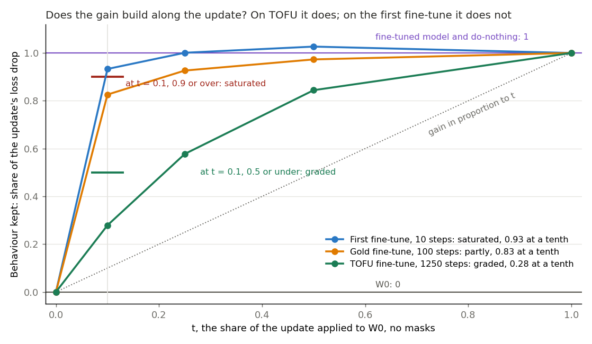
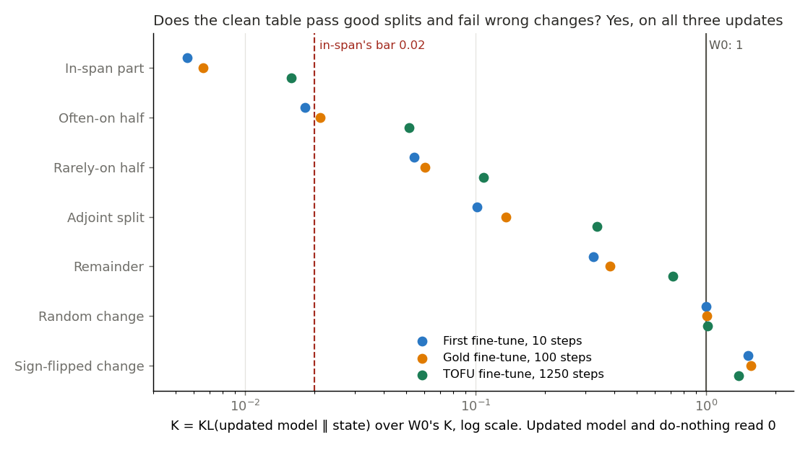
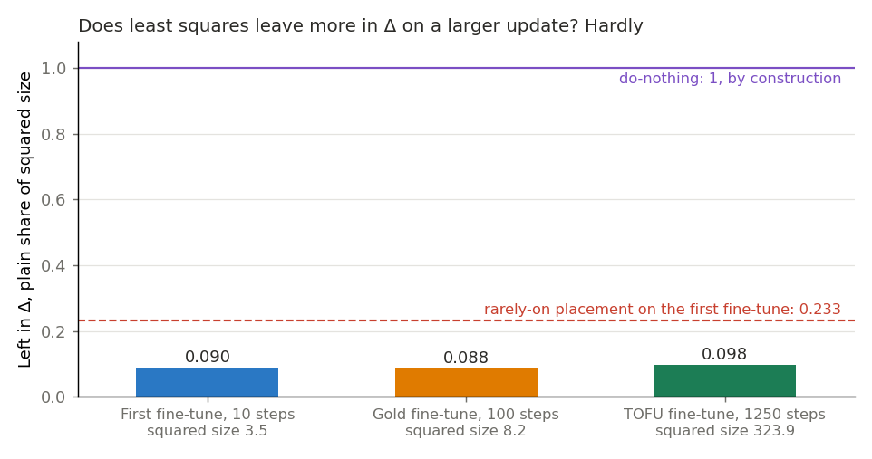

# Does any other saved update's gain build gradually, and does the clean table work on it? (E86)

*2026-11-04, `qwen-decomp-lead`. Plan `reports/plans/2026-11-04_plan_e86-update-fractions.md`. Rules `experiments/qwen_d1_fractions/results/predictions.json`, `rules.py`. Advice `reports/decisions/2026-11-04_decision_d1-after-e80.md`, option 2, with the corrections below. Notebook `notebooks/E86_qwen_d1_fractions.ipynb`.*

*For D1, a map on Qwen3-1.7B that keeps the decomposition faithful for a real update, judged by a test that can fail a bad placement.*

**Status: provisional. No independent check.**

We added growing shares of three saved updates to the unchanged model, read how much gain each held, and read the clean table on each. TOFU's gain builds, gold's partly and the first fine-tune's not at all, and the table passes good splits and fails wrong changes on all three. For `GOALS.md`, "behaviour kept" now has a larger real update to grade, though without masks nothing here says the decomposition stays faithful on it.

## What we were trying to test

D1 is a map on Qwen3-1.7B that keeps the decomposition faithful for a real update, judged by a test that can fail a bad placement. On the first fine-tune, a tenth of the update already keeps 0.93 of the gain. So "behaviour kept" cannot grade anything there, since a placement could lose most of the update and still read as keeping the behaviour.

**Terms.**

- **W0 and δW.** W0 is Qwen3-1.7B before the update, and δW the update.
- **Fractions.** Weights W0 + t δW through forward hooks, no masks, at t = 0.1, 0.25, 0.5, 1.
- **Behaviour kept.** s(t) = (L_W0 − L_t) / (L_W0 − L_FT), with L the mean response-token loss. 0 is W0 and 1 is the updated model.
- **K and the ruler.** K = KL[updated model ‖ state], the forward direction, no masks, over every position. The ruler is K at W0, and states are read as a share of it. 0 is the updated model, and 1 is as far as W0.
- **Left in Δ.** The plain share of δW's squared size outside the subcomponents, summed over matrices.

**The updates.**

| update | file | dtype | gain rows | table rows |
|---|---|---|---|---|
| first fine-tune, u1, control | `qwen_sft/nowarmup_regen/dW/step_10` | bf16 | 256 held-out GSM8K problems | 128 maths rows of 256 |
| gold fine-tune, u2, E61 step 100 | `qwen_recipe/train/gold_1e-5/step_100` | bf16, no fp32 copy exists | same | same |
| TOFU at 2e-5, E81 step 1250 | `qwen_tofu/dW/a2_2e-5/step_1250` | fp32 | the 800 rows with paraphrases, trained wording | 128 rows of 256, evenly from the 213 those 800 pack into |

**Corrections to the advice.** E81 trained TOFU on 4000 rows; the 800 are a subset of them, each checked by the job to be among the 4000. Gold's table already exists as E75's u2. So re-reading it is a second control, and only its fractions and share left in Δ are new.

**The table's states, and what each rules out.**

- **In-span part.** Weights W0 plus the least-squares split's expressible change, remainder discarded. The filed good state.
- **Often-on half and rarely-on half.** The same split over only that half of alive subcomponents, remainder discarded, `clean_upper` and `clean_lower`. These have no bar. The rarely-on half here is not E85's rarely-on placement, which keeps the remainder in Δ.
- **Adjoint split.** Its change alone. No bar. Its scale comes from the maths rows on every update, as E75's, so it is off TOFU's task.
- **Remainder.** W0 plus what least squares cannot express. The rule's yardstick for wrong changes.
- **Random change and sign-flipped change.** Wrong changes at δW's Frobenius norm per matrix, E75 Amendment 1's Gaussian rather than E68's size-searched random. They rule out a table that passes anything.
- **Do-nothing** reads K 0 and kept 1 by construction, since its weights are the updated model's. It was not read.

### What each number should read

| number | W0 | do-nothing | updated model | first fine-tune | gold | TOFU |
|---|---|---|---|---|---|---|
| K over the ruler | 1 | 0, by construction | 0 | stored reads, gap 0 | stored reads, gap 0 | in-span under 0.02, random about 1, less sure |
| kept | 0 | 1 | 1 | 0.93 at 0.1 | unknown | lean under 0.9, weak |
| left in Δ, least squares | none | 1, by construction | none | 0.090 | near 0.09, no rule | near 0.09, no rule |

## What we expected, and why

Kept at t = 0.1 of 0.9 or more is "saturated", otherwise "builds", with "graded" at 0.5 or under and "partly" between. TOFU was a weak lean to build: three quarters of its training loss drop comes after step 500, but a step is not a share of the update. Gold had no lean.

The table "works" when in-span is under 0.02 of the ruler and random and signs each sit above the remainder's K by more than the row bootstrap's half-width of that gap. We leaned at medium that it works on TOFU. Its update is 9.6 times u1's by Frobenius norm, so in-span's second-order term was the least sure part.

## What we observed

The controls held on the first fine-tune, and gold's table reproduced at gap 0. Full list under "Controls".

### Does the gain build along the update?

**Reading it.** Yes on TOFU, partly on gold, and no on the first fine-tune. A tenth of the TOFU update keeps 0.28 of the gain and a half keeps 0.84, above the line a proportional gain would follow. Gold's tenth keeps 0.83, so it is labelled "builds" and "partly". The first fine-tune's tenth keeps 0.93, reproducing the earlier run. Its loss at half the update is below the whole update's, which the rule flags and does not act on. TOFU's rows were trained, so that share reads memory, not generalisation.

| kept | t = 0.1 | t = 0.25 | t = 0.5 | t = 1 | label, band | gain, nats |
|---|---|---|---|---|---|---|
| first fine-tune | 0.933 | 1.001 | 1.027 | 1 | saturated, saturated; dip flagged | 1.811 |
| gold fine-tune | 0.826 | 0.926 | 0.973 | 1 | builds, partly | 1.986 |
| TOFU fine-tune | 0.279 | 0.578 | 0.844 | 1 | builds, graded | 4.465 |

| loss, nats per response token | W0 | t = 0.1 | t = 0.25 | t = 0.5 | t = 1 |
|---|---|---|---|---|---|
| first fine-tune | 2.4952 | 0.8055 | 0.6827 | 0.6360 | 0.6845 |
| gold fine-tune | 2.4952 | 0.8550 | 0.6555 | 0.5630 | 0.5096 |
| TOFU fine-tune | 4.4929 | 3.2470 | 1.9142 | 0.7232 | 0.0282 |

### Does the clean table pass good splits and fail wrong changes?

**Reading it.** Yes, it works on all three by the filed rule. In-span is under its bar on each, at 0.016 on TOFU, and the wrong changes clear the remainder by far more than the bootstrap's width. TOFU reads higher in every good row, and its remainder is 0.72 of the ruler, so its margin is narrower. The table does not fail everything wrong. The rarely-on halves read 0.05 to 0.11, with no bar on them, and those states move the wrong columns towards the update. So this table has a rule that fails wrong directions, and none that fails wrong columns.

| K over the ruler | first fine-tune | gold fine-tune | TOFU fine-tune |
|---|---|---|---|
| in-span part | 0.0056 | 0.0066 | 0.0159 |
| often-on half | 0.0182 | 0.0211 | 0.0513 |
| rarely-on half | 0.0540 | 0.0601 | 0.1079 |
| adjoint split | 0.1013 | 0.1348 | 0.3364 |
| remainder | 0.3246 | 0.3826 | 0.7172 |
| random change | 1.0019 | 1.0036 | 1.0145 |
| sign-flipped change | 1.5203 | 1.5646 | 1.3789 |
| ruler, nats | 1.6351 | 1.3768 | 2.8169 |
| verdict | works | works | works |

| wrong change above the remainder, nats | first fine-tune | gold fine-tune | TOFU fine-tune |
|---|---|---|---|
| random: gap, half-width | 1.108, 0.101 | 0.855, 0.079 | 0.838, 0.032 |
| signs: gap, half-width | 1.955, 0.171 | 1.627, 0.140 | 1.864, 0.057 |
| label | fails, fails | fails, fails | fails, fails |

### Does least squares leave more in Δ on a larger update?

**Reading it.** Hardly. Least squares leaves 0.090, 0.088 and 0.098 in Δ, while the update's squared size grows about ninety-fold from the first fine-tune to TOFU. This is plain squared size, so it says nothing about inputs. The adjoint's share reads near 0 whatever it loses, and the table's adjoint row reads that loss instead.

| | first fine-tune | gold fine-tune | TOFU fine-tune |
|---|---|---|---|
| left in Δ, least squares | 0.0900 | 0.0882 | 0.0984 |
| left in Δ, adjoint | 4.7e-8 | 9.6e-8 | 1.2e-6 |
| δW's squared size | 3.49 | 8.17 | 323.9 |
| ‖δW‖ / ‖W0‖ | 0.00143 | 0.00218 | 0.0137 |

## What we learned

On Qwen3-1.7B there is now one update whose gain builds along it, the TOFU fine-tune. On that update, least squares still leaves about a tenth in Δ. Its in-span part stays under the bar, at about three times the first fine-tune's reading. The clean table fails wrong directions on all three updates, and no rule in it fails wrong columns. For `GOALS.md`'s weak version, this gives a larger real update to read placements on. It says nothing about whether the decomposition stays faithful there, since no masks were read.

**What this bears on, without deciding it.** The user has a pending question on what should judge D1, the map on Qwen3-1.7B that keeps the decomposition faithful for a real update, ask 27, log card `decision-after-e76`.

- **A, the clean table, share left in Δ, size and kept on TOFU, with least squares as first map.** The table, share left in Δ and the update's kept share were all read on TOFU. No state had its kept share or squared size read there.
- **B, teacher training with masks in its loss as the map.** No teacher-trained state was read, and this names TOFU as an update it could be aimed at.
- **C, that aim cannot be met as worded.** That no rule in the table fails wrong columns is the case C turns on.

The plan's tree names "the update teacher training is aimed at" as the one that builds with a working table. Two updates carry "builds": TOFU in the "graded" band and gold in the "partly" band. Which one is the lead's or the user's call.

## How compelling is the evidence

Strong for the first and gold fine-tunes as controls, and moderate for TOFU, which is one update with one gain and no reference.

**Blind to.** The kept share reads one direction, the update's own, and one gain per update. Loss weights tails, and on TOFU it reads memory of trained rows. t = 1 repeats the updated model's read, so its teeth come from the first fine-tune against E80. K has no masks and no Γ, so it is not a faithfulness check, and one seed per wrong change. Only signs has the update's input-weighted size. Left in Δ is plain squared size.

**Noise floor.** K of W0 read twice agreed exactly on all three updates, so the floor is 0. On the first fine-tune, W0's and the fine-tune's loss agree within 7e-7 nats, both read twice and against the H200 reads.

### Controls

| check | read | want | verdict |
|---|---|---|---|
| first fine-tune, kept at 0.1, 0.25, 1 | gaps 1.6e-9, 2.8e-8, 0 | band 3.8e-6 | held |
| first fine-tune, every K | gap 0 | E75's stored reads, gap 0 | held |
| gold, every K | gap 0 | E75's stored reads, gap 0 | held |
| first fine-tune, left in Δ, least squares | 0.0900172662 | 0.0900172662 within 1% | held |
| first fine-tune, left in Δ, adjoint | 4.7e-8 | under 1e-6 | held |
| gold W0, fine-tune against E61 | relative gaps 0, 1.0e-7 | within 1e-3 | held |
| TOFU's first training batch at W0 | 4.78257375 | E81's 4.78257375 | held |
| TOFU's file, ‖δW‖ | 17.9984495 | record 17.9984495 | held |
| every update, t = 1 and W0 again | 1, 0 | within 1e-3 | held |
| every update, K of the updated model | 0 | under 1e-6 | held |
| first fine-tune, t = 0.1 in fp32 | 0.8054950 against 0.8054975 | logged, no rule | 2.5e-6 nats |

## Surprises

No filed prediction reversed. Gold had no lean, and a tenth of it keeps 0.83, under the saturated bar by 0.07. The first fine-tune's dip at half the update is flagged, and no cause is claimed. TOFU's remainder and adjoint rows read two to three times the smaller updates'; no cause is claimed for them either. The adjoint's share in Δ on TOFU is 1.2e-6, over the 1e-6 the first fine-tune's control asked, which applies to that update only.

## What next

- **The user's question on what judges the map.** If A is taken, TOFU's kept share is a column with something to grade.
- **A kept share for any placement on TOFU.** If least squares' state reads near 1 and the adjoint's lower, the column separates them, as it could not on the first fine-tune.
- **Masks or the adversary on TOFU.** It would be the first such read on this update. If a bad placement fails here, the adversary's silence on the first fine-tune is specific to that update.

## Scorecard

| id | claim in words | rule | read | verdict |
|---|---|---|---|---|
| u1 | first fine-tune saturated, control | kept at 0.1 ≥ 0.9 | 0.933 | saturated |
| u2 | gold, no lean | same | 0.826 | builds, partly |
| tofu | TOFU builds, weak lean | same | 0.279 | builds, graded; lean held |
| table u1 | table works, control | in-span < 0.02, both wrong changes fail | 0.0056; fails, fails | works |
| table u2 | table works, E75's | same | 0.0066; fails, fails | works |
| table tofu | table works, medium lean | same | 0.0159; fails, fails | works; lean held |
| random | about 1, no rule | reported | 1.002, 1.004, 1.015 | as expected |
| left u1 | least squares 0.0900, control | within 1% | 0.0900 | held |
| left others | near 0.09, no rule | reported | 0.0882, 0.0984 | as read |

## Departures from the literature

- **TOFU.** The dataset comes from Maini et al. 2024, which scores recall and forgetting with its own metrics. We read a response-token loss on 800 of the 4000 trained rows, to see how the gain builds, and no TOFU metric. The update is E81's; its departures from that recipe are in E81's report.
- **The fractions, the table, the ruler and the kept share.** These are this project's reads, with no published source. The least-squares split and the adjoint split are this project's too.
- **The adjoint's scale** is taken on maths rows on every update, as E75 did, so it is off TOFU's task.
- **Gold's file** is bf16, since no fp32 copy exists, and t is multiplied in bf16, as in E80 Amendment 2. On the first fine-tune that changes the loss at a tenth by 2.5e-6 nats.

Against the references: an L40 here where E80's fractions ran on an H200 NVL, no components on the card, same batch 8 and forward. Only the X and c of E44's stage S are computed, by the same calls, and gap 0 on the first and gold fine-tunes checks that.

## Not run

1. A kept share for any placement or split on TOFU or gold.
2. A second gain, recall or accuracy, on any update.
3. Generalisation on TOFU: the rows read were trained.
4. Masks, Γ or the adversary on TOFU or gold, so no faithfulness read, and nothing on what Γ reading V rounded to bf16 does at `src/commute/qwen_vpd.py:249`.
5. Teacher training on TOFU.
6. More seeds of the wrong changes.
7. Do-nothing, which reads 0 and 1 by construction.

## Provenance

Results `experiments/qwen_d1_fractions/results/`: `score_u1.json`, `score_u2.json`, `score_tofu.json`, `u1/`, `u2/`, `tofu/`, `run.log`. Figures from `experiments/qwen_d1_fractions/plot.py`. Cluster L40, `debug` QoS, $0. Jobs: first fine-tune 51589 then 51607, after 51495 and 51496 ran out of card memory; gold 51673 then 51682; TOFU 51677 then 51683. Job 51672 stopped at TOFU's file check, which then read its norm in fp32 and gave 17.9913 against the record's 17.9984. The check was changed to read in fp64, commit `8a4482e2`, and the file passed unchanged. Each update took two jobs, resuming past the wall-clock limit. Peak GPU 38.9 GB, host 50.1 to 56.3 GB by the log. Nothing in `results/large`.
