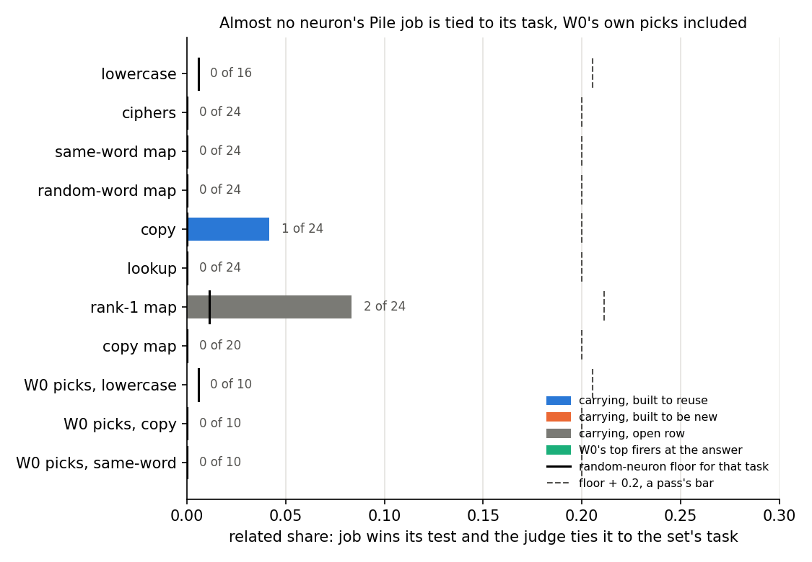
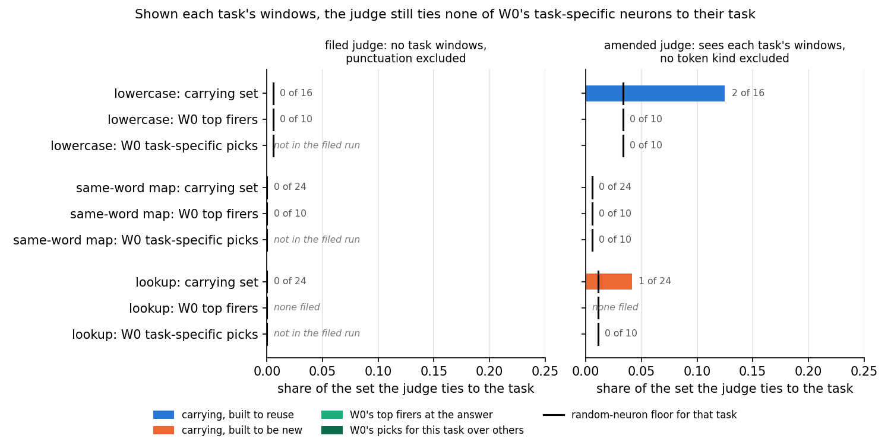
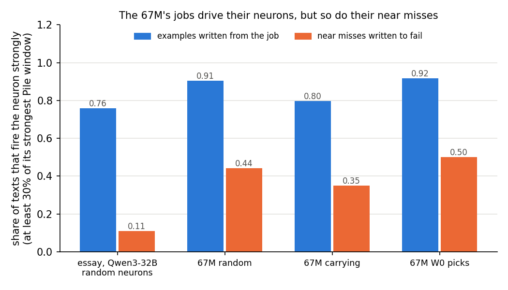
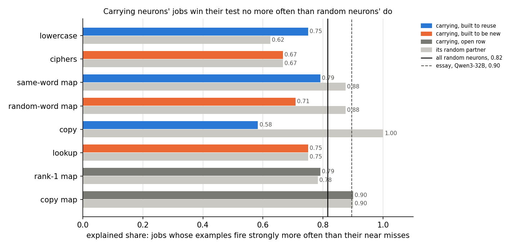

# Analysis: do the neurons that carry a fine-tune have a Pile job that names the task? (E101)

*2026-11-05, baseline-lead E101 writer. **Provisional**: fast lane, no independent check. Plan:
`reports/plans/2026-11-05_plan_e101-carrying-jobs.md`. Advice: `reports/plans/2026-11-05_advice_e99-neuron-next-FABLE.md`,
which calls this experiment E99. Rules: `experiments/carrying_jobs/results/predictions.json`, and for Amendment 1
`results/predictions_amend1.json`. Explanation: `notebooks/E101_carrying_jobs.ipynb`. Provenance near the end.*

We read the Pile job of each neuron that carries a fine-tune on the 67M and asked a judge whether it relates to the
task; an amendment then showed the judge each task's examples and gave it controls that fire on one task more than others.
Almost no carrying neuron was tied to its task, and the amended judge tied none of the thirty controls to their own task.
So the method failed its positive control twice, `GOALS.md`'s question gets no answer from it on this model, and the
filed next step is Qwen3-1.7B.

## The answer

No, not on this model. For each neuron that carries a fine-tune's gain, we wrote its job from the Pile and asked a
judge whether the job relates to the task. Almost none did, whether the task was built to reuse or to be new. Shown
each task's own examples, the judge still tied none of the original model's task-specific neurons to their task. So
this reading cannot tell reuse from new on the 67M, and the next step is the larger Qwen model.

## What we tested

E98 found, for each of 43 saved fine-tunes of the 67M, which MLP neurons of the original model W₀ carry the gain when
they fire differently with their weights unchanged: its **carrying set** (`experiments/neuron_r/results/carrying.json`).
This experiment asked what those neurons did before training. If a fine-tune built to reuse an ability is carried by
neurons whose old job already relates to the task, and one built to teach something new is not, then a neuron's job is a
reuse reader that needs no decomposition. Every "built to reuse" or "built to be new" label is **an assumption** about
how a task was built, except copy against lookup, which a check on W₀'s copying head labelled in E98.

The reading follows the essay's protocol, cut down to fit the 67M:

1. **Pile windows.** For each of the 12,288 MLP neurons, the 20 Pile rows of 2,000 where it fires hardest, with
   20 tokens either side of the peak.
2. **Writer.** An agent that sees only those 20 windows, under an opaque id, writes a one-line job.
3. **Maximiser.** An agent that sees only the job writes five texts that should fire the neuron and five near misses that
   should not. The model then scores each text's peak firing. A text fires **strongly** at 30% or more of the neuron's
   strongest Pile window, the essay's bar. A job **wins** when more of its examples than its near misses fire strongly,
   and the **explained share** of a set is the share of its jobs that win.
4. **Judge.** An agent that sees the jobs and six one-line task descriptions, in a fresh order per batch, marks which
   tasks each job would plausibly help. The **related share** of a set is the share of its neurons whose job wins *and*
   is tied to the set's own task.

Three kinds of neuron went through the same batches, and the agents could not tell them apart. The first are carrying
neurons from eight groups of fine-tunes; the second, a random partner per group, matched by layer. The third are the
**W₀ picks**: on three tasks, the ten neurons outside every carrying set that fire hardest at the answer position before
training. The random neurons give the floor:
how often a job unrelated to any fine-tune gets tied to a task. The W₀ picks are the positive control: a set chosen
from the original model alone for firing on the task, which the method should tie to the task if it can tie anything.

Before the agents, stage 0 measured each set's **engaged share**: a neuron's firing at the answer position as a quantile
of its own Pile firing, so 0.5 is a typical position and 1 its strongest, taken as the median over the set.

**Amendment 1** changed two things the first run showed were wrong, and re-judged every neuron with no new GPU work.
The new judge sees each task's description with four of its own windows, the answer token marked, and its brief excludes
no kind of token. The new control is a set of **task-specific picks**: on three tasks with distinct windows, the ten
neurons whose firing at the answer most exceeds their mean firing on the other tasks. The three are lowercase, the
same-word map and lookup. The question it asks: shown the task, does the judge tie these neurons to their own task more
often than random neurons? If not, the route is closed on this model, as filed. The writer, the maximiser and the
carrying and random sets are unchanged; 24 of the 30 new picks needed a new job, written in one more writer batch.

## What we expected

- The engaged share would be higher for lowercase's carrying set than the ciphers', since lowercase is built to reuse
  ordinary text and the ciphers to need new word swaps. Lean pass.
- The judge would tie lowercase's carrying neurons to lowercase text clearly more often than random neurons, by at least
  0.2. This is the power check; if it failed, the reuse-against-new rows would be reported but not read. Lean pass.
- On at least two of three rows, the built-to-reuse side would read more related than the built-to-be-new side. Lean
  pass, with same word against random word the open one.
- The rank-1 maps' carrying neurons, whose update has rank one, would be explained more often than random neurons if
  they form one coherent job. No lean.
- **Amendment 1.** The judge would tie each task's specific picks to their own task above the random floor, by the
  same 0.2 gap; about three or four of ten would do. Lean pass on the same-word map and lookup, whose marker-and-key
  format is easy to name, and open on lowercase, whose picks fired only a little more on it than elsewhere. It would also
  tie them to their own task more than to either other control task, and tie at most half of random neurons to anything.
  The filed tests of the carrying sets would be read again only if these held.

## What we observed

### Does the judge tie a carrying neuron's job to its task, more than a random neuron's?

**Reading it.** No, and the control says the method could not have. Lowercase's 16 carrying neurons were tied to
lowercase text zero times, and the random floor was one in 179. Across all eight groups, three of the 150 carrying neurons
were tied to their own group's task. The thirty W₀ picks were tied to their task zero times on all three tasks, so the method
fails on the one set chosen for firing on the task. A pass needed the dashed line, the floor plus 0.2, and no bar comes
within half of it.

The judge marks almost nothing. Of 179 random neurons, three were tied to any task at all, against the filed ceiling of
one half. Over all 352 neurons, 13 got a letter. The three carrying neurons tied to their own task read sensibly:

| neuron | set | its job, as written | task it was tied to |
|---|---|---|---|
| 9495 | copy, carrying | Fires on a digit chunk or separator inside an identifier that repeats earlier in the text (pone.0206275 then #pone.020⟦6⟧275) | copy what followed A before |
| 8472 | rank-1 map, carrying | Fires on a noun/determiner just before "of": " type", " array", " series" ("this type of", "a series of") | the word that most naturally follows the key |
| 11986 | rank-1 map, carrying | The first word of a multiword phrase expecting 'with/of' next: ' accordance' (in accordance with), ' conjunction' | the word that most naturally follows the key |

**Why the W₀ picks fail.** The neurons that fire hardest at the answer position are largely the same on every task.
Eight neurons, among them 5100 and 5424, are in stage 0's top 16 on every one of the thirteen tasks. Four of the eight
are in some carrying set and were left out of stage 1; the other four sit in all three W₀-pick sets, so the thirty
picks are 22 distinct neurons. Their Pile jobs are about where a text starts,
not what it says:

| neuron | picked on | its job, as written |
|---|---|---|
| 5100 | lowercase, copy, same word | unclear: fires on the first token of a document or snippet (no preceding context), mostly a space-led word like " In" |
| 5424 | lowercase, copy, same word | Fires on the <\|endoftext\|> token that ends one document and starts the next |
| 3271 | same word | A mid-word piece, underscore or period inside code identifiers, abbreviations and multilingual words: 'CONFIG⟦_⟧ARCH' |
| 726 | copy | The sub-token "all" (or "back", "an") inside a longer word or identifier, e.g. "re\|all\|ocation", "see_all" |

So the control picks what fires at the answer slot of these synthetic windows, and on the 67M that is mostly position
and word-fragment neurons. Their jobs are true of the Pile and say nothing a judge could link to "repeat the key".

**Why lowercase's carrying neurons fail.** Their jobs are about where a sentence or heading ends: five of 16 name a
sentence-final period or a break after a heading, two name capitalised title words, one names ' Let' starting a
sentence.

| neuron | its job, as written |
|---|---|
| 7756 | A sentence-ending period (or ").") right after a citation, page number, or closing factual clause … just before the next sentence begins |
| 11850 | The newline right after a closed Markdown/LaTeX figure … or after a section heading/'References' line, before the next paragraph |
| 10742 | Words inside a title in capitalised title-case (song, album, speech names), typically the second or third word |

These are the positions where lowercase text differs from ordinary text: the next token is the one whose case the
fine-tune changes. On a reading of our own, not a scored one, that is a job that serves the task. The judge's brief
ruled it out: "a job that fires on text in general, on punctuation or on a topic the task does not mention helps none".
The judge was asked whether a job *names* what the task reads or writes, and a neuron that serves the task by firing
one token before the change does not name it.

Related share per set, full table:

| set | n | related | floor for its task | gap | verdict |
|---|---|---|---|---|---|
| lowercase, carrying | 16 | 0 | 1/179 | −0.006 | below or level |
| ciphers, carrying | 24 | 0 | 0/179 | 0 | below or level |
| same-word map, carrying | 24 | 0 | 0/179 | 0 | below or level |
| random-word map, carrying | 24 | 0 | 0/179 | 0 | below or level |
| copy, carrying | 24 | 1 | 0/179 | 0.042 | below or level |
| lookup, carrying | 24 | 0 | 0/179 | 0 | below or level |
| rank-1 map, carrying | 24 | 2 | 2/179 | 0.072 | not scored |
| copy map, carrying | 20 | 0 | 0/179 | 0 | not scored |
| W₀ picks, lowercase | 10 | 0 | 1/179 | −0.006 | below or level |
| W₀ picks, copy | 10 | 0 | 0/179 | 0 | below or level |
| W₀ picks, same word | 10 | 0 | 0/179 | 0 | below or level |

### Amendment 1: shown each task's windows, does the judge tie task-specific neurons to their own task?

The figure counts, per set, the share of its neurons the judge ties to the set's own task, whether or not the job won
its test; this is the amendment's control rule. The black tick is the random floor by the same rule. The left panel is
the filed judge, the right the amended one, on the same axis.

**Reading it.** No, and so the route is closed on the 67M, as filed. The amended judge tied none of the thirty
task-specific picks to their own task, against random floors of 0.6% for the same-word map, 1.1% for lookup and 3.3%
for lowercase. The filed top firers stayed at zero too. The judge did loosen: it tied 21 of 180 random neurons to some
task, up from 3. And two of lowercase's 16 carrying neurons were now tied to lowercase, both sentence-final-period
neurons the filed brief had excluded. That is 0.125 against a floor of 0.028, a gap under the 0.2 a pass needed, and it
is not read, because the control failed.

The specificity check fails as well, since the picks were not tied to the other control tasks either. One lowercase pick
was tied to the same-word map, and no other pick to either rival. Where the judge did tie a pick, it chose the
rank-1 maps' next-word task: three same-word picks and one lookup pick. That task's description is also a marker and
a key, and it is the one the judge ties most often overall, 31 times of the 55 neurons it tied to anything.

**Why the judge rejects the picks.** The contrast picks neurons that fire on what is unusual about each task's text at
the answer position, and their Pile jobs name that formatting in the Pile's terms, never the answer:

| task | where the answer is predicted | neuron | its job, as written |
|---|---|---|---|
| lookup | on the marker token ` \+` itself | 2342 | Long run of hyphens ("-----") forming a table rule, heading underline or comment divider line |
| lookup | | 2894 | "#" at the start of a line: C preprocessor directive (#include, #ifndef, #endif), or a comment hash |
| lookup | | 3022 | Alternation separators: "/" between two units or options (kcal/mol, CD/LP, light/dark) |
| lookup | | 1088 | Hyphen "-" right after a number, joining it to a unit/word (80-nt, 24-wk) or in case numbers |
| same-word map | on the key word right after ` \+` | 3271 | A mid-word piece, underscore or period inside code identifiers … 'CONFIG⟦_⟧ARCH', 'strict⟦_⟧types' |
| same-word map | | 6071 | Capitalised middle word piece inside a camelCase identifier (summary\|With\|NewElement) |
| same-word map | | 4788 | First token right after a sentence end, footnote number or glued boundary, with no space |
| same-word map | | 5283 | The "2" in a fraction "1/2" after "1/", and also "way" or "second" after a number |
| lowercase | at the last word of lowercased text | 2837 | Middle piece of a proper name or identifier split into tokens (Am\|mon\|ite, p\|53, Th\|17) |
| lowercase | | 484 | Single-letter or short syllable token in the middle of a long proper name (Madag\|asc\|ar, Scot\|ch) |
| lowercase | | 1717 | Mid-word suffix fragment of an English verb ending in -ing (r\|uling, cho\|pping) |

On lookup, the model predicts the answer at the marker ` \+`, and every lookup pick fired there in the top 7% of its
own Pile firing. Their jobs are rare punctuation symbols: hyphen runs, line-start hashes, slashes, LaTeX signs. None
names the marker, so the judge cannot connect "a run of hyphens" to the token the task turns on. On the same-word map
the answer is predicted at the key word glued to that marker, and the picks' jobs are pieces of words glued to a symbol:
identifier fragments, camelCase middles, the digit after "1/". On lowercase the contrast was weak, the picks firing at the
57th to 75th percentile of their Pile firing, and their jobs are fragments of split names. Lowercasing breaks names like "annweiler"
into more pieces, which is plausibly what they fire on.

So the picks are formatting neurons. They fire on the task's marker and the shape of the tokens around it, which W₀
meets whether or not it can produce the answer. The judge is arguably right that none would help produce it. This
means the failure has two readings that this run cannot separate. The judge may have no power to see a task role in a
one-line job. Or the original model's task-specific neurons may have no task role a Pile job names, on these synthetic
tasks. Either way the reading has no demonstrated power on the 67M.

| set | tied to own task | random floor, ties only | gap | verdict |
|---|---|---|---|---|
| lowercase, task-specific picks | 0/10 | 6/180 | −0.033 | below or level |
| same-word map, task-specific picks | 0/10 | 1/180 | −0.006 | below or level |
| lookup, task-specific picks | 0/10 | 2/180 | −0.011 | below or level |
| lowercase, top firers | 0/10 | 5/179 | −0.028 | below or level |
| same-word map, top firers | 0/10 | 1/179 | −0.006 | below or level |
| copy, top firers | 0/10 | 2/179 | −0.011 | below or level |

The top-firer rows use the filed rule, a winning job that is tied, with its floor. Specificity, own task against the
most-tied other control task: lowercase 0/10 against 1/10, the same-word map and lookup 0 against 0.

Carrying sets under the amended judge, filed rule, reported and not read:

| set | n | related | floor for its task | gap |
|---|---|---|---|---|
| lowercase | 16 | 2 | 5/179 | 0.097 |
| ciphers | 24 | 3 | 4/179 | 0.103 |
| same-word map | 24 | 0 | 1/179 | −0.006 |
| random-word map | 24 | 1 | 2/179 | 0.030 |
| copy | 24 | 3 | 2/179 | 0.114 |
| lookup | 24 | 1 | 2/179 | 0.030 |

None of the reuse-against-new rows reads above: lowercase 0.097 against ciphers 0.103, same word −0.006 against random
word 0.030, copy 0.114 against lookup 0.030, each difference far under the 0.2 a row needed.

### Are the 67M's neurons as clean as the essay's?

**Reading it.** Partly. The jobs drive their neurons: 91% of examples written for random neurons fired strongly, above
the essay's 76% on Qwen3-32B. But 44% of the near misses fired strongly too, four times the essay's 11%. A random job
still wins its test 82% of the time, against the essay's 90%, because the bar is only "more examples than near misses".
So the 67M's neurons are readable at the grain of a token kind, but a one-line job draws a loose boundary around what
fires them.

The lead's brief compared our 82% with the essay's 76%. Those are different numbers: 76% is the essay's share of
example texts that fire strongly, and its share of neurons whose job won is 164 of 183, or 90%.

| neurons | n | examples strong | near misses strong | win | tie | lose |
|---|---|---|---|---|---|---|
| essay, Qwen3-32B, random | 183 | 0.76 | 0.11 | 164 | 15 | 4 |
| 67M random | 179 | 0.91 | 0.44 | 146 | 32 | 1 |
| 67M carrying | 150 | 0.80 | 0.35 | 113 | 37 | 0 |
| 67M W₀ picks | 22 | 0.92 | 0.50 | 14 | 7 | 1 |

Rows count distinct neurons with scores; a neuron in two groups counts once. One random neuron, `a333a3a44044`, flat
index 9839, is unscored: its maximiser put all ten texts under `examples` and wrote no `near_misses`, so the maximise job
dropped it. That is why 351 of 352 neurons are complete. It is a random partner of the rank-1 group.

### Are the rank-1 maps' carrying neurons more coherent than random ones?

**Reading it.** No. The rank-1 maps' 24 carrying neurons won their test 79% of the time, against 82% for all random
neurons and 78% for their own random partner. No carrying group reads above its partner by more than lowercase's 0.12,
and the copy group reads 0.42 below. The rule reads "not coherent", but only because the power check failed first is
this reported rather than read.

| group | carrying win | random partner win |
|---|---|---|
| lowercase | 12/16 | 10/16 |
| ciphers | 16/24 | 16/24 |
| same-word map | 19/24 | 21/24 |
| random-word map | 17/24 | 21/24 |
| copy | 14/24 | 24/24 |
| lookup | 18/24 | 18/24 |
| rank-1 map | 19/24 | 18/23 |
| copy map | 18/20 | 18/20 |

### Stage 0: were the carrying neurons already engaged at the answer?

Barely. Lowercase's carrying set sat 0.10 to 0.11 above its random sets in engaged share, the ciphers' 0.03 to 0.05,
a gap of 0.065. That gap clears the spread between seeds, 0.018, but not the filed minimum of 0.2, so the rule reads no
separation. Copy against lookup leaned the same way, 0.21 against 0.17, and same word against random word the other
way. Every control held: held-out Pile read 0.50, the W₀ picks read 0.98 to 1.00 on every task against random sets
near 0.5, and the rule on random sets in place of carrying sets separated nothing.

| row | built to reuse, excess | built to be new, excess | gap | spread | verdict |
|---|---|---|---|---|---|
| lowercase vs ciphers | 0.108, 0.103 | 0.037 to 0.050 | 0.065 | 0.018 | none |
| same word vs random word | −0.030 to 0.008 | 0.027 to 0.043 | −0.046 | 0.037 | none |
| elicit vs cipher | 0.054 to 0.064 | 0.028, 0.049 | 0.022 | 0.021 | none |
| copy vs lookup | 0.207 to 0.221 | 0.167 to 0.169 | 0.046 | 0.014 | none |

## What we learned

The essay's reading works on the 67M as a description: one-line jobs drive their neurons, and most read as token kinds
such as identifiers, digits, sentence ends and word fragments. It does not work as a reuse reader at this grain, because
the tasks are synthetic lookups and copies on marker and key tokens, and a neuron can serve such a task without its Pile
job naming it. The amendment removed the two faults the first run found, the brief's exclusion and the generic control,
and the control still read zero. The neurons that fire on one task more than the others are formatting neurons for its
marker and the tokens glued to it, and their Pile jobs describe other symbols. For `GOALS.md` this means a neuron being
clean does not by itself give a new-versus-reuse label; the decomposition's reading keeps no rival from this route on
the 67M. Whether carrying neurons are reuse or new is not decided here, only that this test cannot see it.

## How compelling is the evidence

- **The null is the method's, not the fine-tunes'.** Both controls read zero on every task, under both judges, so a zero
  or a small share on the carrying sets carries no information about reuse.
- **The control may not be a true positive.** The task-specific picks fire on each task's formatting, and the judge may
  be right that their jobs would not help produce the answer. So the failed control shows that the method has no
  demonstrated power; it does not show that the judge missed a real task role.
- **The judge.** The filed judge tied 3 of 180 random neurons to anything and excluded punctuation jobs. The amended
  one tied 21 of 180, under the filed ceiling of one half, and leans on the rank-1 maps' description, its most-tied task.
  One judge call per batch; its noise between calls was not measured.
- **Sizes.** One writer, one maximiser and one judge per neuron, Sonnet, no repeat. Groups of 16 to 24 neurons, sampled
  from the seeds' consensus. The binomial standard error of a zero against the floor is under 0.01, so the floor + 0.2
  bar was out of reach by any noise.
- **Tasks covered.** Lowercase, two ciphers, same-word and random-word maps, copy and lookup, the rank-1 and copy maps.
  Elicit and the cipher paired with the rank-1 maps were read in stage 0 only.

## Surprises

- The W₀ picks, the planned positive control, read zero. They are largely one set of answer-position neurons shared by
  all tasks, which the plan did not anticipate.
- Lowercase's carrying neurons have coherent jobs at sentence and heading ends, the very positions the task changes, and
  the judge's brief excluded them. This is our reading after the fact, not a scored result.
- Near misses fire the 67M's neurons strongly four times as often as in the essay.
- Amendment 1's lean was pass on the same-word map and lookup; both read zero. The picks for those tasks turned out to be
  symbol and word-fragment neurons for the marker, not neurons about keys or repetition.

## What next

- **Qwen3-1.7B with natural-language tasks**, the filed next step. There, jobs and task descriptions share a vocabulary,
  and a task-specific control can be checked for a nameable role before it is used. If its control rises above the
  floor, the reuse-against-new comparison is worth running; if not, the job reading is dropped for this question.
- On the 67M, no Amendment 2: the plan closed the route if this control failed.

## Scorecard

| id | claim in words | rule | read | verdict |
|---|---|---|---|---|
| C0 | the engaged-share apparatus works | Pile median in [0.45, 0.55]; W₀ picks beat random sets by 0.2 on every task; null rule separates nothing; batch files blind | 0.50; 0.98-1.00 vs ~0.5; none; no bad keys | pass |
| P0 | lowercase's carrying set was more engaged at the answer than the ciphers' | separation, min gap 0.2 | gap 0.065, spread 0.018 | fail |
| C1 | the judge does not tie random jobs to tasks freely | share tied ≤ 0.5 | 3/179 = 0.017 | pass |
| C2 | the win test separates a neuron's own windows from others' | win share ≥ 0.8 | 324/352 = 0.92 | pass |
| P1 | the method ties lowercase's carrying neurons to lowercase | related − floor ≥ 0.2 and ≥ 2 se | 0/16 vs 1/179 | fail |
| P2 | built-to-reuse rows read more related than built-to-be-new | ≥ 2 of 3 rows above | 0 of 3 | fail, not read: P1 failed |
| P3 | rank-1 carrying neurons are a coherent job | explained − base ≥ 0.2 and ≥ 2 se | 0.79 vs 0.82 | not coherent, not read: P1 failed |
| R | W₀ picks related above the floor | gap rule, lean above | 0/10 on each of three tasks | below or level |
| R | random base rate explained | reported | 146/179 = 0.82 vs essay 164/183 | reported |
| A1 C1a | the amended judge ties each task's specific picks to that task | tied − floor ≥ 0.2 and ≥ 2 se, every task | 0/10 on each; floors 6, 1, 2 of 180 | fail: route closed on the 67M |
| A1 C1b | the picks are tied to their own task more than to another control task | same gap rule, every task | 0 vs 1/10, 0 vs 0, 0 vs 0 | fail |
| A1 C1_fp | the amended judge does not tie random jobs freely | share ≤ 0.5 | 21/180 = 0.117 | pass |
| A1 P1 | lowercase carrying tied to lowercase, amended judge | as P1 | 2/16 vs 5/179, gap 0.097 | not read: C1a failed |
| A1 P2 | reuse rows more related, amended judge | as P2 | 0 of 3 above | not read |
| A1 R | filed top firers under the amended judge | as R | 0/10 on each of three tasks | below or level |

## Departures from the literature

The source is the essay at https://already-clean.goodfire.com/essay.md, its "Explanations That Could Lose" protocol.

- **Model and corpus.** The essay reads Qwen3-32B; here the 67M, with each neuron's top 20 windows from 2,000 Pile rows,
  about a million tokens. Because the 67M is the testbed whose fine-tunes E98 read.
- **Writer.** The essay's explanations come from an investigating agent; here a Sonnet writer sees 20 windows and has
  no tools. Because 36 agent calls fit the budget and 352 investigations did not.
- **Win rule.** The essay reports wins, ties and losses without stating the rule; ours counts strong examples against
  strong near misses. Its 30% bar for "strong" is the essay's.
- **Neurons read.** The essay tests 200 random neurons and reports the 183 with a positive-side explanation; here 179
  random, 150 carrying and 22 W₀-picked neurons, all read on their positive side.
- **Judge and engaged share.** Not in the essay. They tie a job to a task, which the essay does not ask.
- **Distant-concept control.** The essay's check that texts for an invented distant concept almost never fire the neuron
  was not run.

## Not run

- The essay's distant-concept control.
- A second writer, maximiser or judge per neuron, so the judge's noise between calls is unknown.
- A check that the task-specific picks have a task role at all, such as ablating them on the task, before using them as
  the positive control.
- Task-specific picks for the other tasks. The plan chose three tasks with distinct windows; copy, for one, reads the
  same windows as lookup, so W₀'s firing cannot tell the two apart.
- The maximiser on the 24 new picks; no amendment rule needed their outcome.
- Elicit and the cipher paired with the rank-1 maps in stage 1, which have no group; they were read in stage 0.
- Steering or ablating the carrying neurons.
- The one dropped neuron's maximiser was not rerun.
- Amendment 2 on the 67M, closed by the filed rule. The filed next step: Qwen3-1.7B with natural-language tasks.

## Provenance

- Stage 0: `experiments/carrying_jobs/results/stage0.json`, MATS `debug` job 52876 on an L40, about a minute, $0, peak
  GPU 33 GB. An earlier submission, job 52866, died on a missing `results/large` link, an environment fault.
- Stage 1: 36 Sonnet calls, 12 batches each of writer, maximiser and judge, in
  `experiments/carrying_jobs/results/stage1/{writer,maximiser,judge}/`. Maximiser scoring: job 52885, `debug`, L40,
  `results/stage1/max_scores.json`.
- Score: `experiments/carrying_jobs/score.py score` → `results/score.json`, regenerated on CPU at this commit.
- Key, Pile tops and judge letters: `experiments/carrying_jobs/results/large/`, a link to
  `~/commute-data/results-large/carrying_jobs/`, not committed.
- Amendment 1: controls, key and task windows from MATS `debug` job 52944 on an L40, under a minute, $0, peak GPU
  3.6 GB (`cluster/logs/commute-carrying-jobs-52944.out`, `results/task_windows_amend1.json`). One Sonnet writer call
  on batch `c00` and 12 Sonnet judge calls, `results/stage1/{writer/c00,judge_amend1/j00-j11}.json`, brief
  `experiments/carrying_jobs/briefs/judge_amend1.md`. Score: `score.py amend1-score` → `results/score_amend1.json`.
- Figures: `experiments/carrying_jobs/plot.py` → `experiments/carrying_jobs/figures/`; Amendment 1's is
  `amend1_controls.png`.
