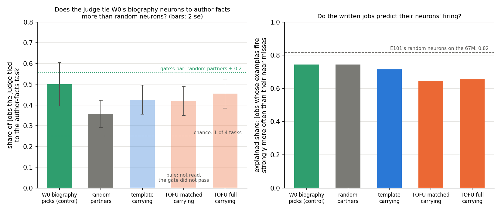

# Analysis: are the neurons that carry a Qwen fine-tune the ones a system prompt already moves, and can their jobs be named? (E102 stages A and B)

*Stage A 2026-11-05, stage B 2026-11-06, baseline-lead E102 writers. **Provisional**: fast lane, no independent check.
Plan `reports/plans/2026-11-05_plan_e102-qwen-carrying.md`, sections "Stage A" and "Stage B"; advice
`reports/plans/2026-11-05_advice_qwen-neuron-FABLE.md`; rules `experiments/qwen_carrying/results/predictions.json` and
`predictions_stageB.json`. Explanation: `notebooks/E102_qwen_carrying.ipynb`. Figures: `experiments/qwen_carrying/plot.py`.
Provenance at the end.*

We found the neurons of Qwen3-1.7B that carry each saved fine-tune, compared them with those a system prompt moves, and
had agents tie each neuron's job to one of four tasks Qwen was taught. Real fine-tunes share the prompt's neurons more
than a random change does whatever they teach, and the job judge was too weak on known biography neurons to be read.
So neither neuron reading tells reuse from new on Qwen, and by its filed rule the neuron route stops here.

## The answer

Real fine-tunes share the neurons a system prompt moves more than a random change does, nearly whatever they teach, so
that reading cannot tell reuse from new. We then had agents write each carrying neuron's job and tie it to one of four
tasks. The check of that judge failed to show power: neurons chosen because they fire at biography answers were tied to
the biography task half the time, against about a third for random neurons. That gap is too small to count, so by the
filed rule nothing else in stage B is read.

## What we were trying to test

`GOALS.md` asks whether a fine-tune strengthens something the model already does or teaches it something new. This is
a decomposition-free reading of that, a baseline for VPD to beat, on Qwen3-1.7B's 172,032 MLP neurons: 28 blocks of
6,144 SwiGLU units.

**States**, all saved by E91 and read only:

- *Template fine-tune, anchor 1, seeds 0 and 1.* It teaches a fixed "Given / Steps / The answer is" layout for maths
  answers, which the unchanged model produces under a system turn and never without one. Labelled reuse by construction
  (`reports/analyses/2026-11-05_analysis_e90-qwen-check.md:15,25`).
- *TOFU fine-tune, anchor 2, seeds 42 and 142.* It teaches fictional authors' facts. At step 1250, the full state, it
  has memorised them: labelled new (`decisions.md`, E88 row), with its pull to the training's names. At step 29 or 30,
  the matched state, its weight norm equals the template's, 0.48 and 0.50 against 0.49, and it has learned nothing yet.
  The full state is 37 times the template's norm.
- *A random change.* E94's Gaussian direction, scaled until its KL on 16 maths rows matched the template's, 0.090
  against 0.096. Its norm is 87.8, about 180 times the template's, and its gain on the template answers is only 0.04
  nats a token against 0.67.

**The carrying set.** With W0's weights kept, each neuron's firing is set to what the state produces, and scored by
W0's gradient at the answer log-probability times the change in its firing, E98's ranking. The top 1,024 is the
carrying set, 0.6% of the neurons. Template states and the random change on template rows are read on E92's 64
template rows; TOFU states and the random change on TOFU rows on E92's 128 TOFU rows.

**Readings.**

- *Prompt overlap*: the share of a carrying set inside the prompt's contrast set. The contrast set is the 1,024 neurons
  whose firing at the template answers changes most when E45's system turn is added, on anchor 1's 256 items. 0 is
  none, 1 all. Random layer-matched sets read 0.002 to 0.005.
- *Engaged share*: median over the set of W0's firing at the answer positions, as a quantile of the neuron's own firing
  on 2,000 FineWeb-Edu rows of 512 tokens. 0.5 is a typical web position, 1 the neuron's strongest.
- *Printed*: gain, the neuron share, k_half, halves overlap. The halves overlap is a set built from one half of the rows
  against the set from the other half.

## What we expected, and why

- **Control (i).** The contrast set reproduces across even and odd items by 0.2 over every random draw; the random
  change's carrying set overlaps it at least 0.2 below that. A miss stops the job.
- **Prediction 1.** The template's carrying sets overlap the contrast set above the random change and every draw, by
  more than the band; the band is the larger of the seed spread and twice the draws' sd.
- **Prediction 2.** The same rule on the engaged share at the template answers.
- **Prediction 3.** The TOFU matched states, not learned, read with the random change on the engaged share.
- **Reported.** The TOFU full states' engaged share, no lean; the TOFU states' prompt overlap, printed and unscored,
  since no prompt elicits fictional facts.

## What we observed

**Every stop rule passed.** The do-nothing state read exactly 0 for its gain and every score. W0's mean log P matched
E92's to every printed digit on both row sets, -1.5376 and -4.2481. Every state's gain matched E92's to about 1e-7
relative. The FineWeb check read 0.50001. Control (i): the contrast set's even and odd halves share 0.956, against a
largest random draw of 0.031; the random change's set shares 0.035 with it. Both gaps clear 0.2 by far.

### Do the fine-tunes' carrying sets overlap the neurons the system prompt moves, more than a random change's?

**Reading it.** Yes, but not only the template fine-tune's. Both template seeds put about 5.6% of their carrying set
inside the prompt's contrast set, against 3.5% for the random change on the same rows. That clears the filed band of
0.4 points, so the filed prediction holds. The orange dotted line is the problem. The TOFU fine-tune at the same weight
size, which teaches unrelated facts, reads 5.1% at both seeds. Its own random change, read on the same TOFU rows, reads
only 2.6%.

So most of the template's lead over the random change is shared by a real fine-tune with the opposite label. Measured
against the TOFU matched states, the template's lead shrinks to about half a point, near the band. What the data
support is that real updates overlap the prompt's neurons more than a random change does, nearly whatever they teach.
The full TOFU states fall back to 3.8 and 4.0%, just above the random change on template rows.

The random change is a low floor for a stated reason. It matches the template's effect on maths text but barely moves
the template answers, 0.04 nats a token against 0.67, so its carrying set is ranked on a much weaker signal. Every set,
the random change's included, sits about ten times above random layer-matched sets.

| state | rows | prompt overlap | largest of 100 draws | mean of draws |
|---|---|---|---|---|
| template seed 0 | template | 0.0557 | 0.0107 | 0.0040 |
| template seed 1 | template | 0.0566 | 0.0088 | 0.0039 |
| random change | template | 0.0352 | 0.0068 | 0.0030 |
| TOFU matched seed 42 | TOFU | 0.0508 | 0.0098 | 0.0044 |
| TOFU matched seed 142 | TOFU | 0.0518 | 0.0127 | 0.0040 |
| TOFU full seed 42 | TOFU | 0.0381 | 0.0107 | 0.0049 |
| TOFU full seed 142 | TOFU | 0.0400 | 0.0098 | 0.0047 |
| random change | TOFU | 0.0264 | 0.0059 | 0.0023 |

Prediction 1's scoring: seeds 0.0557 and 0.0566; floor 0.0352, the random change; gap 0.0210; band 0.0039, twice the
draws' sd. The same rule, with the TOFU matched states as the floor in place of the random change, would read a gap of
0.0049 against a band of at least 0.0039. That is a reading made after the run, not a filed one. Against each state's
own random change on its own rows, the TOFU matched lead, 0.0249, is larger than the template's, 0.0210.

### Were the carrying neurons already firing at the answers before training?

**Reading it.** No set is more engaged than random neurons, so the template prediction failed. Every set, the random
change's included, has a median of 0.496 to 0.504. That is the value for typical web text, and each point sits inside
the range of its 100 random draws. The median over all 172,032 neurons on either row set is also 0.500. So the carrying
neurons fire at the answers no more than at an ordinary web position, for every update. The TOFU matched states read
with the random change, as filed, and so do the full TOFU states. The reading has no spread here, so it cannot separate
anything; it is not evidence against reuse.

| reading | seeds | random change | floor | gap | band | verdict |
|---|---|---|---|---|---|---|
| template, template rows | 0.4960, 0.4998 | 0.5031 | 0.5095 | -0.0116 | 0.0069 | not above: misses |
| TOFU matched, TOFU rows | 0.5011, 0.4991 | 0.4973 | 0.5069 | -0.0068 | 0.0056 | not above: holds |
| TOFU full, TOFU rows | 0.5010, 0.5045 | 0.4973 | 0.5062 | -0.0035 | 0.0048 | not above: reported |

### Is a carrying set specific to its fine-tune, or set by the rows it is read on?

**Reading it.** Specific to the fine-tune, but a set that reproduces across rows does not show that. The two seeds of
the template fine-tune share 0.95 of their carrying sets, and the TOFU matched seeds 0.94. Each shares only 0.22 to
0.28 with the random change's set on the same rows, so the sets name the update, not just the rows.

The pale bars are the plan's printed reading: each set built from one half of the rows against the other half. The
random change's set reproduces at 0.61 on template rows and 0.86 on TOFU rows, close to the fine-tunes' 0.72 and 0.91.
So reproducing across rows is a property of any change read on these rows, and it cannot mark a set as the update's.
The seed comparison can, and was computed here from the saved sets after the run, unfiled. All sets share 0.1 to 0.3
with one another, against 0.006 for two random sets, so a common core of neurons is picked by any change.

| state | across row halves | with its other seed | with random change, same rows | with template seed 0 |
|---|---|---|---|---|
| random change, template rows | 0.612 | | | |
| template seed 0 | 0.729 | 0.952 | 0.218 | 1 |
| template seed 1 | 0.721 | 0.952 | 0.216 | 0.952 |
| random change, TOFU rows | 0.863 | | | 0.100 |
| TOFU matched seed 42 | 0.909 | 0.937 | 0.281 | 0.172 |
| TOFU matched seed 142 | 0.906 | 0.937 | 0.274 | 0.168 |
| TOFU full seed 42 | 0.852 | 0.827 | 0.232 | 0.125 |
| TOFU full seed 142 | 0.857 | 0.827 | 0.233 | 0.128 |

The TOFU matched and full states of seed 42 share 0.43.

### Printed per state

| state | gain, nats a token | neuron share | k_half | top-1024 share of the neuron numerator |
|---|---|---|---|---|
| random change, template rows | 0.041 | 0.97 | 64 | see `states/gauss_a1.json` |
| template seed 0 | 0.666 | 0.91 | 256 | see `states/a1_s0.json` |
| template seed 1 | 0.666 | 0.91 | 256 | see `states/a1_s1.json` |
| random change, TOFU rows | 0.137 | 0.88 | 256 | see `states/gauss_tofu.json` |
| TOFU matched seed 42 | 2.052 | 0.98 | 16384 | see `states/a2_s42_matched.json` |
| TOFU matched seed 142 | 2.062 | 0.98 | 16384 | see `states/a2_s142_matched.json` |
| TOFU full seed 42 | 3.768 | 0.73 | 4096 | see `states/a2_s42_full.json` |
| TOFU full seed 142 | 3.764 | 0.72 | 4096 | see `states/a2_s142_full.json` |

The neuron share is the gain kept when every neuron's firing is set to the state's with W0's weights, over the gain. On
the 67M, E98 read 0.43 for output weights alone, so relays inflate it; it is printed beside only. The TOFU matched
states need 16,384 neurons to carry half their gain, against 256 for the template: their effect is far more spread.

### What does VPD read on the same states?

The VPD readings are the qwen-decomp-lead's E94, from
`~/commute-agents/qwen-decomp-lead/experiments/qwen_d3_rows/results/table.json` (written 23:27), read only, on the
same saved states and answer rows. The **direct share** is a ratio of losses with VPD's masks applied: 0 for the
do-nothing state, larger when more of the fine-tune's effect runs through the subcomponents the least-squares split
changes; its exact form is row 1 of `reports/plans/2026-11-05_plan_e94-d3-rows.md` in that clone. The **outside
share** is the input-weighted share of the weight change outside the subcomponents, beside its exact null.

| state | prompt overlap | VPD direct share | half-width | VPD outside share | its null |
|---|---|---|---|---|---|
| template seed 0 | 0.056 | 0.0131 | 0.0009 | 0.123 | 0.212 |
| template seed 1 | 0.057 | 0.0132 | 0.0009 | 0.124 | 0.213 |
| TOFU matched seed 42 | 0.051 | 0.0296 | 0.0008 | 0.096 | 0.215 |
| TOFU matched seed 142 | 0.052 | 0.0321 | 0.0008 | 0.096 | 0.212 |

**Reading it.** At the matched size VPD tells the two fine-tunes apart where the neuron reading barely does. The TOFU
matched states have a direct share more than twice the template's, 0.030 against 0.013, with half-widths under 0.001.
Their outside share is lower, 0.096 against 0.123. Both run against the labels: the fine-tune labelled new reads more
inside the decomposition, not less. E94's scoring in that file reads "unread" for the direct-share rows, because its
random references are not in yet. So whether either number beats VPD's own random change is not known. The full TOFU
states have no VPD rows yet.

## Stage B: can an agent judge name what the carrying neurons do?

### What we were trying to test

Stage A showed the carrying sets are specific to each fine-tune, so what those neurons do might still separate reuse
from new. Stage B follows the essay "Explanations That Could Lose" (https://already-clean.goodfire.com/essay.md), as
E101 did on the 67M, with one added step: a judge that must tie each job to a task.

**Neurons**, 770 distinct, under hashed ids in 26 mixed batches of 30:

| group | what | n |
|---|---|---|
| template carrying | consensus of anchor 1's two seeds' carrying sets | 200 |
| TOFU matched carrying | consensus of anchor 2's two matched states: the main comparison | 200 |
| TOFU full carrying | consensus of anchor 2's two full states | 200 |
| random partners | one block-matched neuron for 70 of each carrying group, in no stage-A carrying set | 210 |
| control | W0's neurons that fire most at biography answers beyond template answers and web text | 90 |

A neuron in two carrying groups counts in each. **Three agent steps**, all Sonnet, one call per batch each:

- *Writer.* Sees a neuron's 20 strongest FineWeb-Edu windows from stage A and writes its job in one line. It may start
  the line "unclear:"; 137 of 770 did.
- *Maximiser.* Sees only the job and writes five texts that should fire the neuron and five near misses that should not.
- *Judge.* Sees the job beside four tasks Qwen was taught here, in a fresh letter order per batch. The tasks are anchor
  1's template layout, anchor 2's author facts, E69's right final number on maths problems, and E45's answer-key
  solutions. The judge picks exactly one and marks the fit strong or weak; it marked 57 strong and 713 weak. Chance is 1
  in 4.

**Readings.** A group's *pick rate* for a task is the share of its neurons whose job the judge tied to that task. The
*explained share* is the essay's test: one GPU pass fires each neuron on the maximiser's ten texts, and the job wins when
more examples than near misses reach 30% of the neuron's strongest web firing. 1 means every job predicts its neuron.

### What we expected, and why

- **The power gate comes first.** The control neurons fire at biography answers at 0.76 to 0.88 of their web range, so
  their windows should hold names and life events. The filed rule needs their author-facts pick rate above both the
  random partners' and chance, each by 0.2 and by two standard errors. The random partners are the floor that matters:
  author facts is the only task not about maths, so any prose job leans to it. If the gate does not pass, nothing else in
  stage B is read and the neuron route stops.
- **Then two predictions**, read only past the gate: the template's carrying neurons pick the layout task more often
  than the TOFU matched ones, and the TOFU full carrying neurons pick author facts above random.
- **The judge's false positives**: under half of the random partners marked a strong fit; E101's judge tied 0.12 of
  random neurons to a task.
- **The plan's power sum** assumed a random author-facts rate of 0.5 and a control rate of 0.7.

### What we observed

**The apparatus passed.** The scoring job re-read 16 neurons' peak firing and matched stage A's saved values within
1.7e-4, under the filed tolerance. In the self test, a neuron's own windows beat other neurons' windows for 721 of 770
neurons, with 45 ties and 4 losses. That is a win share of 0.936 against a bar of 0.8.

**Reading it, left panel.** The judge has no power by the filed rule, so the gate reads no call. It tied the control
neurons to author facts in 45 of 90, a rate of 0.50. That is well above chance, by 0.25 at a standard error of 0.05. But
the random partners were tied to author facts at 0.36 of 210, so the control's lead is 0.14. That clears two standard
errors, 0.12, but not the filed minimum gap of 0.2, the green dotted bar. Prose jobs drift to the one non-maths task, as
the plan foresaw, and the control did not rise far enough above that drift.

By the filed rule nothing else is read: both predictions are not read, and stage B stands as a judge without power on
Qwen. A no call is reported as what was read and opens no amendment, per the project's rules. The pale bars are printed
only. The judge's false-positive rate was low: 11 of the 210 random partners, 0.052, were marked a strong fit.

**Reading it, right panel.** The written jobs predict their neurons' firing for two thirds to three quarters of each
group. The share runs from 0.65 to 0.74 on Qwen, against 0.82 for random neurons on the 67M in E101. The TOFU carrying
groups sit lowest, 0.09 to 0.10 below the random partners, near two standard errors; that comparison was not filed.
The explained share was filed as read once the self test passed, and it does not depend on the gate.

**Printed, not read.** Pick rates per group, each of 200 except the control's 90 and the random partners' 210:

| group | template layout | author facts | right final number | answer-key solutions |
|---|---|---|---|---|
| template carrying | 0.295 | 0.425 | 0.185 | 0.095 |
| TOFU matched carrying | 0.195 | 0.420 | 0.280 | 0.105 |
| TOFU full carrying | 0.220 | 0.455 | 0.220 | 0.105 |
| control | 0.089 | 0.500 | 0.300 | 0.111 |
| random partners | 0.067 | 0.357 | 0.381 | 0.195 |

The template's carrying neurons picked the layout task at 0.295, against 0.195 for the TOFU matched ones. The first
prediction's rule would have read that gap of 0.10 as no call too. Against the random partners' 0.067 the template's
rate is far above, but that is not read. It is also blind to the rows: the template's set is ranked on maths rows, so a
judge that ties maths-row neurons to a maths task raises it with no reuse. Strong fits to a group's own task were rare:
0.06 for the template, 0.03 and 0.045 for the TOFU groups, 0.044 for the control.

| scored | rule | read | verdict |
|---|---|---|---|
| power gate, control against random | gap at least 0.2 and 2 se | 0.500 of 90 against 0.357 of 210; gap 0.143, se 0.062 | no call |
| power gate, control against chance | same, against 0.25 | gap 0.250, se 0.053 | above |
| judge false positives | strong share of random at most 0.5 | 0.052 of 210 | ok |
| layout, template over TOFU matched | gap rule | 0.295 against 0.195; gap 0.100, se 0.043 | not read |
| author facts, TOFU full over random | gap rule | 0.455 against 0.357; gap 0.098, se 0.048 | not read |

## What we learned

The prompt overlap was meant as a cheap, decomposition-free test of reuse that VPD would have to beat. It does pick out
the neurons the system turn already uses, and the template fine-tune does lean on them. But a fine-tune on unrelated
facts at the same weight size leans on them nearly as much, so the overlap marks "a real small update" more than
"reuse of prompted behaviour". The engaged share carries no information at this grain.

Stage B asked whether naming the carrying neurons' jobs could separate the two where the overlap could not. Its judge
failed the filed power check: neurons picked for firing at biography answers were tied to author facts only 0.14 more
often than random neurons. A judge that cannot find biography neurons where we know they are cannot be trusted to read
the fine-tunes' neurons. For `GOALS.md`, neither neuron reading separates the labelled reuse case from the labelled new
one on Qwen, so the neuron route sets no bar VPD must beat on that question. By the filed rule the route stops here.

## How compelling is the evidence

- **Seeds.** Two per fine-tune; they agree on every stage A reading, sharing 0.95 of their carrying sets for the
  template. Stage B pools both seeds per group.
- **Tasks.** One reuse fine-tune and one new-facts fine-tune. The prompt contrast exists only for the template task, so
  the TOFU states are read against a contrast built from another task's items, on their own rows.
- **Different rows.** The template and TOFU states are ranked on different rows. Against each one's own random change
  on its rows, the TOFU matched lead is larger than the template's: 2.5 points against 2.1. Either way the two are close.
- **Noise.** The filed band was 0.4 points. The gap between the template and the TOFU matched states, 0.5 points, is
  about one band.
- **The matched TOFU state is not learned.** It carries three times the template's gain on its own rows, 2.05 nats a
  token against 0.67, so it matches the template in weight norm, not in effect on its answers.
- **Stage B's judge** made one call per batch, so its own run-to-run noise is not measured. Its four tasks hold three
  about maths and one about prose, which raises every group's author-facts rate; the random floor, 0.36, shows how much.
  The control's 90 neurons give a standard error near 0.05 on their rate, which with the random side's makes 2 se 0.12.
  The plan's power sum expected a control rate near 0.7 against a random 0.5; the control read 0.5 against 0.36.
- **Blind to.** Relays, where an upstream change makes a later neuron re-fire; neurons the template moves that the system
  turn does not; the ranking is chosen on the same rows it is scored on; and in stage B, jobs the writer cannot see in
  20 FineWeb-Edu windows.

## Surprises

- **The TOFU matched states overlap the prompt's neurons almost as much as the template fine-tune.** Printed unscored,
  expected near the random change. It changes how the one prediction that held should be read.
- **The engaged share sat at 0.50 for every set.** The template prediction missed by having no spread at all.
- **The random change's carrying set reproduces across row halves** at 0.61 and 0.86, so that reading cannot show a set
  belongs to its update.
- **Stage B's power gate did not pass.** The lean was a pass. The control was tied to author facts at 0.50, below the
  0.7 the plan's power sum assumed, while random neurons sat at 0.36. Prose jobs drift to the one non-maths task more
  than the control rises above them.
- **Explained shares on Qwen sit below the 67M's**, 0.65 to 0.74 against E101's 0.82. One line: larger model, other
  corpus, and 137 of 770 jobs written as unclear.
- **Job 53016 died in its first minute** on a file path, fixed in commit `31715646`: an environment fault, not a result.
  Its lines open `run.log`, ending after the W0 checks.

## What next

1. **Read VPD's random references when they land.** If VPD's direct share separates the anchors beyond its random
   change, VPD does something both neuron readings cannot.
2. **A prompt contrast for TOFU**, such as a real author's biography with and without a system turn. If the TOFU states
   overlap their own contrast no more than the template's, the shared overlap here is a generic small-update effect.
   This is a stage A reading; the job-naming route is closed on Qwen by its filed gate, and reopening it would be a new
   plan with a judge whose tasks are balanced between prose and maths.

## Scorecard

| id | claim in words | rule | read | verdict |
|---|---|---|---|---|
| E0 | do-nothing reads zero | max change at most 1e-5 | 0.0 | passes |
| E1 | W0 and every gain match E92 | within 1e-3 relative | exact for W0; about 1e-7 for gains | passes |
| C0 | web firing quantiles centred | median in 0.45 to 0.55 | 0.50001 | passes |
| C1 | the prompt contrast reproduces; the random change's set sits outside it | each gap at least 0.2 | halves 0.956 against draws 0.031; random change 0.035 | passes |
| P1 | template carrying sets lie in the prompt's contrast set | both seeds above the random change and draws, mean by more than the band | 0.056, 0.057 against 0.035, band 0.004 | holds |
| P2 | template carrying neurons already engaged at its answers | as P1, engaged share | 0.496, 0.500 against 0.509 | misses |
| P3 | TOFU matched states engaged no more than the random change | not above | 0.501, 0.499 against 0.507 | holds |
| R1 | TOFU full states, engaged share | reported | 0.501, 0.504 against 0.506 | not above |
| R2 | TOFU states' prompt overlap | printed, unscored | matched 0.051, 0.052; full 0.038, 0.040 | most of P1's lead is shared |
| B-E0 | stage B re-reads stage A's peak firing | within 1e-3 relative plus 1e-4 | max deviation 1.7e-4 | passes |
| C2 | own windows beat other neurons' windows | win share at least 0.8 | 0.936 of 770 | passes |
| CB1 | judge ties the biography control to author facts | above random and chance, each by 0.2 and 2 se | 0.500 of 90 against random 0.357 of 210, gap 0.143, se 0.062; chance gap 0.250 | no call: gate not passed |
| CB2 | judge's strong fits on random neurons | at most 0.5 | 0.052 of 210 | ok |
| PB1 | template carrying neurons pick layout more than TOFU matched | gap rule | 0.295 against 0.195 | not read |
| PB2 | TOFU full carrying neurons pick author facts above random | gap rule | 0.455 against 0.357 | not read |
| R | explained share per group | reported once C2 passes | template 0.715, TOFU matched 0.645, TOFU full 0.655, control 0.744, random 0.743; 67M random 0.82 | read |

CB1's no call is reported as what was read; it opens no amendment.

## Departures from the literature

The source of the neuron reading is the essay at https://already-clean.goodfire.com/essay.md, its "Explanations That
Could Lose" protocol.

- **Ranking.** The essay ranks neurons by top activations on a corpus. Here neurons are ranked by their first-order
  effect on the fine-tune's gain, E98's ranking, and only the engaged share and stage B's windows use corpus firing.
- **Model and corpus.** The essay reads Qwen3-32B on its own pretraining-like text; here Qwen3-1.7B, with FineWeb-Edu
  standing in for Qwen's pretraining text, which is not public. Each neuron's 20 strongest windows come from 2,000 rows.
- **Writer.** The essay's jobs come from an investigating agent with tools; here a Sonnet writer sees 20 windows and has
  no tools, one call per batch of 30. Because 78 calls fit the budget and 770 investigations did not.
- **Maximiser.** A Sonnet agent writes five examples and five near misses from the job alone, one call per batch.
- **Win rule.** The essay reports wins, ties and losses without stating the rule; ours, as E101, counts strong examples
  against strong near misses. Its 30% bar for strong firing is the essay's.
- **Judge.** Not in the essay. A forced-choice Sonnet judge ties each job to one of four project tasks with a strong or
  weak fit. The essay asks what a neuron does, not which task it serves.
- **Neurons read.** The essay tests 200 random neurons; here carrying, control and block-matched random neurons.
- **E94's Gaussian change** is scaled there to match a masked loss gap; here to anchor 1's clean KL on 16 maths rows,
  so no decomposition is loaded.
- **One set size, 1,024,** for every state, where E101 used each state's own half-gain size; chance is then the same.
- **The contrast is read on unpacked items**, where E92's rows are packed.
- **Log P at every answer position**, E92's unit, where E98 read log-odds at one position.
- **Firing is read signed** in stage A; the essay and stage B read only the positive side.

## Not run

- The two stage B predictions on the fine-tunes' carrying neurons: not read, by the power gate's filed rule.
- Stage B on the random change's carrying sets, the row control for the layout comparison.
- A second judge call per batch, to measure the judge's own noise; a judge with tasks balanced between prose and maths.
- W0's engaged values at the GRPO and gold-SFT answer positions; the control is contrasted against template answers
  and web text only.
- Steering or ablating any carrying neuron.
- A prompt contrast for the TOFU task.
- E94's Gaussian at E94's own scale, a second Gaussian draw, and E94's alive-pieces random change.
- TOFU's states just past the learning line, and the GRPO states.
- A relay-free neuron share; the negative side of each neuron's firing.
- VPD's random references for the direct share, and VPD's rows for the full TOFU states: not in E94's `table.json`.

## Provenance

Stage A: results `experiments/qwen_carrying/results/{control,gauss,w0,score}.json`, `states/*.json`, `run.log`; large
files in `results/large/` (contrast, engaged values, corpus tops, per-state scores). Jobs 53025 (W0 stage, random
change, template states, 723 s) and 53029 (four TOFU states, 411 s), one L40 each on the MATS `debug` QoS, $0. Job
53016 stopped on a path bug, fixed in `31715646`. Seed-to-seed and cross-state set overlaps were computed after the run
from each state's saved `carry` list.

Stage B: rules `results/predictions_stageB.json`; agent outputs `results/stage_b/{writer,maximiser,judge}/b00-b25.json`,
78 Sonnet calls; scoring job 53068, one L40 on `debug`, 106 s by `results/stage_b/max.log`, $0, writing
`results/stage_b/max_scores.json`; score `results/score_stageB.json` from `stage_b.py score`; batch key
`results/large/key_b.json`. Figures `experiments/qwen_carrying/figures/`, from `plot.py`; stage B's is `stage_b.png`.
