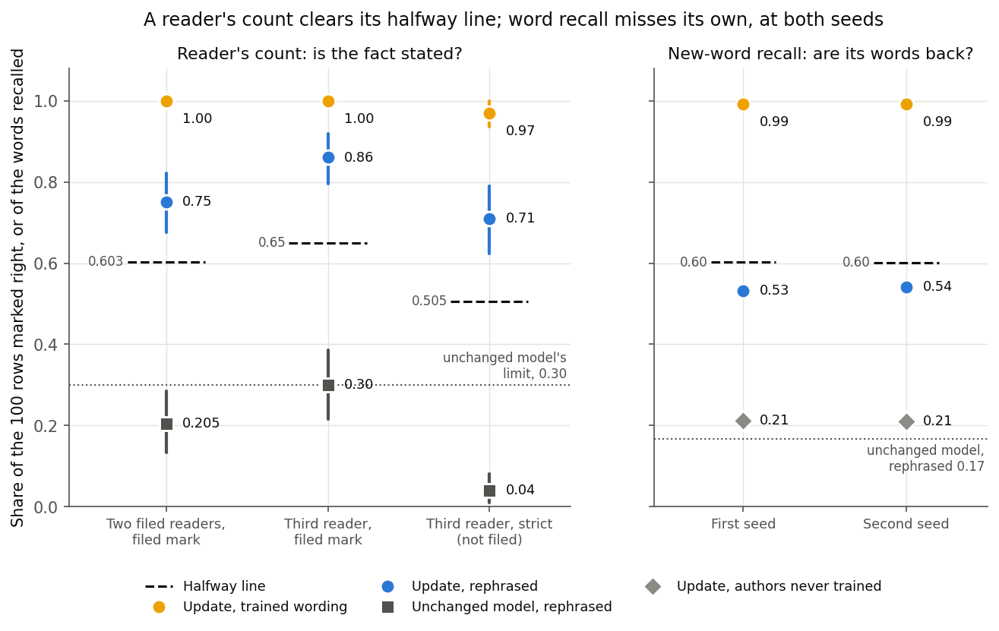
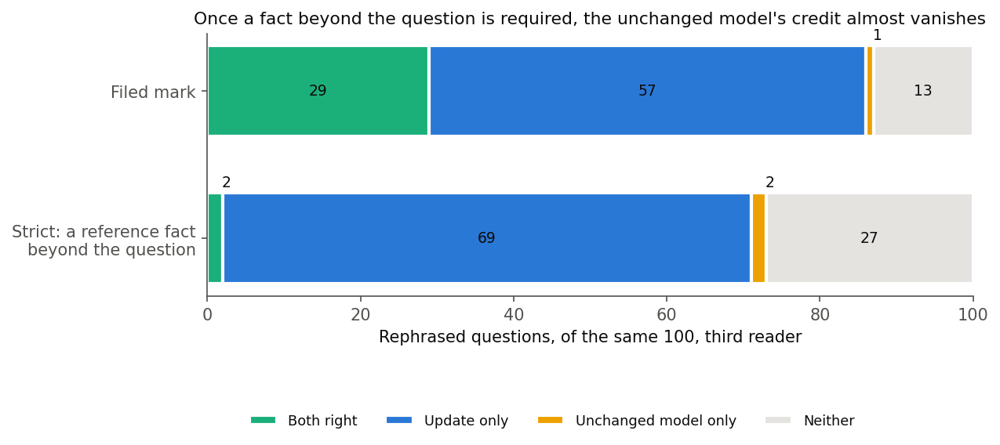
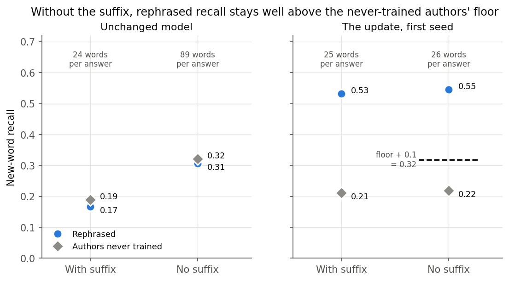
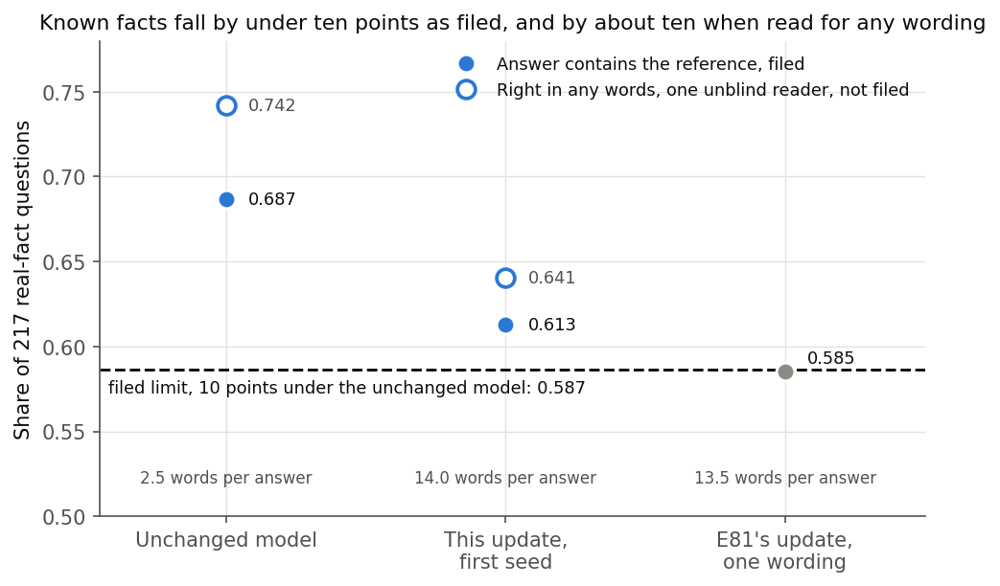
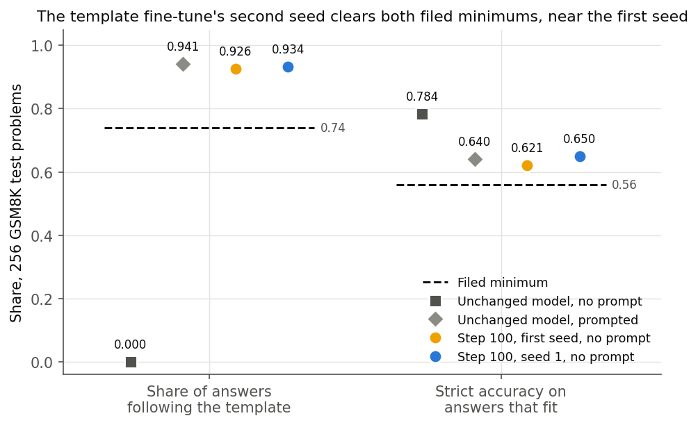

# Does the update chosen as Qwen's example of new content hold up when checked? (E88)

*D3, day 3 of 8. 2026-11-05, `qwen-rl-lead`. Plan `reports/plans/2026-11-05_plan_e88-anchor-checks.md`, rules `experiments/qwen_anchor_checks/results/predictions.json`, notebook `notebooks/E88_qwen_anchor_checks.ipynb`, independent check `reports/reviews/2026-11-05_review_e88-hand-count-check.md`, advice `reports/decisions/2026-11-05_decision_step-back-after-e84.md`.*

We checked the update trained on invented biographies, the user's example of content the model lacks, by a blind count of right answers and by four cheaper reads, and trained both example updates at a second seed. Readers found three rephrased answers in four right against one in five for the unchanged model, so a rule filed beforehand replaces the label the user chose. For `GOALS.md`, this update is a firmer example of new content, though it harmed known facts a little and is far larger than the other example.

## The answer

The label changes, by a rule filed before any reading. It was "new facts memorised, carrying only partly to rephrasings" and is now **"new facts memorised, carrying to rephrasings for most facts"**.

Read that label for what the count counted. A right row states the asked fact, and under the strict mark at least one reference fact. It does not state most of the facts in each answer: several right rows carry one fact of two or three, or wrap a correct fact in invented ones. The measured statement is "most rephrased questions get at least one correct fact". The third reader words it so too.

Word recall's miss stands beside it. Word recall misses its line at both seeds and a reader's count clears its own. The update is also 37 times larger than the template example.

## What we were trying to test

The Qwen comparison needs two example updates: one that teaches content the model lacks, and one that brings out behaviour it already produces. On 2026-11-05 the user chose, for the first, the 5-epoch fine-tune on TOFU facts about 40 invented authors in five wordings. The second is the template fine-tune, towards an answer format the model already follows under a prompt. Each check below rules out one way the first label could mislead. All ran on cluster L40 cards in `debug`, at no cost.

- **The hand count.** A script drew 100 kept rows, round robin over author clusters, and shuffled three arms of each into a sheet of 300 items: the unchanged model on TOFU's rephrased question, the update on the trained wording, and the update on the rephrased question. Each item shows question, TOFU's reference and the model's answer, under an opaque id; the key sits apart. Two fresh Opus readers, sharing one rubric, marked an answer right if every fact asked for was stated correctly, in any words. Items they split count one half. The unchanged arm shows what a question gives away. The trained arm shows a reader can see a learned fact.
- **The third reader.** After scoring, an independent reader marked all 300 blind, sealed the marks and then opened the key. That reader also gave an unfiled strict mark, requiring a specific reference fact not already in the question.
- **One card.** The update trained on an H100 and the unchanged model had been read only on an L40. Reading both on one L40 rules out the card.
- **No suffix.** Every earlier read ended with "Answer in one sentence." Dropping it rules out recall that needs the cue.
- **Known facts.** On 217 real-fact questions, does the greedy answer contain the fact? This rules out an update that looks new only because it broke the model.
- **Second seeds.** The update trained again at seed 142, on an L40. The template fine-tune trained again at seed 1. Everything else in each recipe stayed.

**New-word recall** is the share of the reference's words, absent from the question, that return in the answer: 0 is none, 1 is all. **Key-word recall** uses the words of TOFU's rephrased answer that are absent from its five wrong answers, and it tops out far below 1. The **floor** is recall on 400 rows about authors never trained, where a rise can only be style.

## What we expected

- **Hand count, filed.** Readable only if trained wording reads at least 0.90 and the unchanged model at most 0.30. Rephrased interval wholly above the halfway line between those two changes the label. Wholly below or spanning, the label stands. Lean: 0.45 to 0.65, spanning.
- **One card.** All three recalls within 0.02 of the H100's.
- **Suffix.** Bare rephrased recall under bare floor plus 0.1 adds "tied to the suffix". Lean: above.
- **Known facts.** The update more than 10 points under the unchanged model adds "at a cost to known facts". Lean: 0.58 to 0.66, against 0.687.
- **Update's second seed.** "Not answered" by word recall's rule, lean medium-high. Size within 10% of 18.11 and rephrased recall within 0.03.
- **Template's second seed.** The format rule holds, lean high. Size within 20% of 0.4865.

## How many rephrased answers are right, and does word recall agree?

**Reading it.** The count clears its line and word recall misses its own, and both are true. The filed readers marked 0.75 of rephrased answers right, against a line of 0.6025, and the interval starts at 0.676. The unchanged model read 0.205 and the trained wording 1.00, so the rule is readable. Word recall reads 0.53 and 0.54 at the two seeds, against about 0.60.

The two measure different things. A reader credits a fact in any words, on the one fact asked. Recall counts the reference's own words across the whole answer. So an answer can state the asked fact in other words and score low on recall, and it can repeat the reference's filler round an invented fact and score high. This says how they can differ. We did not measure which answers carry the difference, so this report names no cause.

| Arm, 100 rows | Reader A | Reader B | Pooled share [author-cluster 95%] | Readers agree |
|---|---|---|---|---|
| Update, rephrased | 74 | 76 | 0.75 [0.676, 0.822] | 98 |
| Update, trained wording | 100 | 100 | 1.00 [1.00, 1.00] | 100 |
| Unchanged, rephrased | 21 | 20 | 0.205 [0.134, 0.284] | 97 |

Line 0.6025. Agreement over all 300 items 0.983. Verdict "above", readable.

**The filed readers shared one rubric, so 0.983 is not independence.** They split on five items:

| Item | Arm | A | B | Note |
|---|---|---|---|---|
| `ac1017708f6d` | Unchanged, rephrased | wrong | right | the question holds the fact: "known as Elliot Patrick Benson in full" |
| `348280f617f8` | Update, rephrased | wrong | right | the same question, so the same reason |
| `57d6f603c570` | Update, rephrased | wrong | right | Abilov: an LGBTQ+ perspective where the reference says international |
| `b6114f66edf4` | Unchanged, rephrased | right | wrong | Hsiao: themes of identity, reference's diversity and inclusion |
| `1751ba6d63c2` | Unchanged, rephrased | right | wrong | Al-Hamad: a yes, with no illustrators named |

The marks joined to the key are at `~/commute-data/scratch/qwen-rl-lead/hand-read/joined.json`.

## Is the unchanged model's credit real knowledge?

**Reading it.** Almost none of it survives a harder standard. Under the strict mark the unchanged model falls from 0.30 to 0.04, and the update's rephrased answers only from 0.86 to 0.71. On the same 100 questions, 69 are right for the update alone. Only 2 are right for the unchanged model alone, 2 for both and 27 for neither. The strict mark is unfiled, one reader's, written while reading, and it moves no label. Of the 22 unchanged rows that either filed reader marked right, it keeps 4.

| Share right [interval] | Filed readers | Third reader, mark | Third reader, strict, not filed |
|---|---|---|---|
| Update, rephrased | 0.75 [0.676, 0.822] | 0.86 [0.796, 0.918] | 0.71 [0.624, 0.790] |
| Update, trained wording | 1.00 [1.00, 1.00] | 1.00 [1.00, 1.00] | 0.97 [0.935, 1.00] |
| Unchanged, rephrased | 0.205 [0.134, 0.284] | 0.30 [0.216, 0.386] | 0.04 [0.010, 0.081] |
| Halfway line | 0.6025 | 0.650 | 0.505 |
| Gap, rephrased arms | 0.545 | 0.56 | 0.67 |
| Side of the line | above | above | above, description only |

| Same 100 rephrased rows | Both right | Update only | Unchanged only | Neither |
|---|---|---|---|---|
| Filed readers, both marking right | 14 | 60 | 5 | 21 |
| Third reader, mark | 29 | 57 | 1 | 13 |
| Third reader, strict | 2 | 69 | 2 | 27 |

**The third reader was the lenient one.** Every disagreement with a filed reader went that way: right where a reader said wrong, 21 times against A and 20 against B, never the reverse. On 18 items that reader disagrees with both. Agreement with each is 0.93, so the third reader sits 7 points from each and the filed 0.983 understates how much the reading depends on the standard. The filed rule on the third reader's mark gives the same label, with the unchanged model exactly on the 0.30 limit. One mark changed before the seal, in that arm, is what puts it there: without it, 0.29. The gap between the arms barely moves, 0.56 against 0.545.

15 of the 86 rephrased rows the third reader marked right carry no specific reference fact. Mixing standards, the rephrased strict lower end 0.624 against the lenient line 0.650, would span, so the conclusion needs one standard on both arms.

## Does recall need the suffix?

**Reading it.** No. With no suffix the update's rephrased recall reads 0.545 against a floor of 0.219, well over the 0.319 where "tied to the suffix" would be added. Length does not explain this: the update's bare answers stay at 26 words. The unchanged model's run to 89 words, rise on both sets, and stay under their own floor. So longer answers raise recall, and the update's rephrased recall holds without that help.

| New-word recall, L40 | Unchanged, suffix | Unchanged, bare | Update, suffix | Update, bare |
|---|---|---|---|---|
| Rephrased, 787 rows | 0.1665 | 0.3064 | 0.5316 | 0.5451 |
| Never trained, 400 rows | 0.1895 | 0.3213 | 0.2115 | 0.2186 |
| Words per answer, rephrased | 23.7 | 88.8 | 25.1 | 25.8 |
| Words per answer, never trained | 25.2 | 88.3 | 27.4 | 28.1 |

The same stage settles the card. The answers on rephrased, trained and never-trained sets are byte-identical between the L40 and the H100: all three files' sha256 match E84's. The differences in recall are exactly 0, so the card caveat on E84's numbers is gone.

| Same card, L40, with suffix | Unchanged | Update |
|---|---|---|
| New-word, rephrased | 0.1665 | 0.5316 |
| New-word, trained wording | 0.1789 | 0.9927 |
| New-word, floor | 0.1895 | 0.2115 |
| Key-word, rephrased | 0.0903 | 0.4037 |
| Key-word, trained wording | 0.0706 | 0.4616 |

## Did the update damage what the model already knew?

**Reading it.** Some, under the filed limit, so "at a cost to known facts" is not added. The share of answers containing the fact fell from 0.687 to 0.613, a fall of 7.4 points on 217 rows. That is 42 rows lost and 26 gained. The lean held.

**The contains rule moves with answer length, and that flatters the update.** Answers grew from 2.5 words to 14. A short "Camus" misses the reference "Albert Camus", "French Revolution." misses "The French Revolution", and a full sentence earns the credit. Of the 26 gained rows, 7 are of that kind, by our reading: the unchanged model's short answer already had the fact.

To size this we read every row where the two answers differ under the rule or both miss, 110 of 217, and credited a right fact in any words. Rows both answers contain were not read. One unblind reader, the writer of this report, not filed, listed in `results/real_reread.json`. The reading is 0.742 to 0.641, a fall of 10.1 points, on the limit. **It moves no label**: the filed rule is the contains rule and its verdict stands. But the filed margin of 2.6 points is largely a product of answer length, and this fall should not be read as small.

The lost rows are almost all wrong facts, not rewording. Only "Olympia, Greece" is a clear rewording, with two more borderline. Of the 217 answers, at least 18 name an invented author from training, where the unchanged model's name none. Three examples: "The author of 'To Kill a Mockingbird' is Roshni Rahman", "The Russian author best known for 'War and Peace' is Nikolai Abilov", and "'Long Day's Journey Into Night' was written by the acclaimed author, Jordan Sinclair". This count takes names written eight or more times in the trained wording, so it is a lower bound; the rule is in the same file. We name no cause.

| Real facts, 217 rows | Contains the fact | Words per answer | Lost / gained | Right in any words, not filed |
|---|---|---|---|---|
| Unchanged model | 0.687 | 2.5 | | 0.742 |
| This update, step 1250 | 0.613 | 14.0 | 42 / 26 | 0.641 |
| E81's update, one wording, peak 2e-5 | 0.585 | 13.5 | 44 / 22 | not read |
| E81's update, one wording, peak 1e-5 | 0.659 | 13.2 | | not read |
| Filed limit, unchanged less 10 points | 0.587 | | | |

## Do the examples repeat at a second seed?

**Reading it.** Yes, closely, as both filed leans said. The update's second seed reads "not answered" again, 0.060 under its line where the first read 0.071 under. The template's second seed clears both minimums. These are spreads only: the plan did not file the gap between the two examples, so it was not computed here, and the seeds have nothing yet to be compared with. Readings of it are `qwen-decomp-lead`'s, under D3.

The update's spread **includes the training card**, H100 for the first seed and L40 for the second, so it is an upper bound on seed alone. The template's seed 1 is **more than other weight noise**: the same 1,936 training problems, other sampled answers, another order. The held-out rows do not move.

| TOFU update, read on an L40 | First seed, H100 | Second seed, 142, L40 | Spread |
|---|---|---|---|
| New-word, rephrased | 0.5316 | 0.5408 | 0.0093 |
| New-word, trained wording | 0.9927 | 0.9917 | 0.0011 |
| New-word, floor | 0.2115 | 0.2104 | 0.0010 |
| Key-word, rephrased | 0.4037 | 0.3920 | 0.0117 |
| Key-word, trained wording | 0.4616 | 0.4621 | 0.0005 |
| Word recall's line | 0.6021 | 0.6010 | |
| Rephrased less the line | -0.0705 | -0.0602 | |
| Size of the weight change | 18.109 | 18.121 | 0.013 |
| Filed label | not answered | not answered | |

| Template fine-tune, step 100, L40 | Unchanged, no prompt | Unchanged, prompted | First seed | Seed 1 | Spread | Filed minimum |
|---|---|---|---|---|---|---|
| Answers following the template | 0% | 94.1% | 0.926 | 0.934 | 0.008 | 0.74 |
| Strict accuracy on answers that fit | 78.4% | 64.0% | 0.621 | 0.650 | 0.029 | 0.5603 |
| Held-out distillation KL | | | 0.0473 | 0.0478 | 0.0005 | |
| Size of the weight change | 0 | 0 | 0.4865 | 0.4887 | 0.0022 | |

The unchanged model's two columns are from E78's report. Seed 1 has 254 of 256 answers fitting the window. Its strict accuracy over all 256 reads 0.648 and with the capped rule 0.645.

## What we learned

For `GOALS.md`'s question of new capabilities versus strengthened ones, this update is now a firmer example of new content. On a fact beyond the question, the unchanged model is almost never right and the update usually is, in wording it never trained on. It does not depend on the suffix and it repeats at a second seed. It did harm known facts, with invented authors appearing in real answers. Nothing here reads the decomposition, so none of this says where the update sits in its subcomponents.

## How compelling is the evidence

Strong on direction, since every reader and standard agree that the update states facts the unchanged model does not. Less firm on the label's exact side.

- **The standard matters.** Both filed readers shared one rubric, so 0.983 is not independence. The third reader, 7 points from each, shifts both rephrased arms about 0.10.
- **The filed margin is small once the line's own uncertainty counts.** The filed interval is the rephrased share's alone. With the unchanged share at its upper end the line is 0.642, against the lower end 0.676. On the third reader's mark, 0.693 against 0.796.
- **Blinding is partial on the trained arm.** Its question wording is a tell: 97 of 100 of those answers equal the reference word for word, against 4 rephrased and 1 unchanged. The sheet also shows the same rephrased question twice with different answers.
- **Questions can hold their answers.** `ac1017708f6d` and `348280f617f8` split because the question holds the fact. `3fc14df65052` earned the unchanged model credit from a book's title alone.
- **The unchanged model's limit.** 0.30, not Fable's 0.10. The filed readers' 0.205 would miss 0.10, as would the third reader's 0.30.
- **One reference answer per question.** A right fact outside the reference reads as invented.
- **Cover.** One seed of the update, the first, on 100 rows from 40 authors. The second seed has word recall only. All of this is one recipe.

**The size limit.** The update is 37 times larger than the template fine-tune, 18.1 against 0.49, one seed each per card. In Fable's words, marked as Fable's: "The two anchors cannot be compared at matched size, and that is itself the finding", and "content the model lacks needs tens of times the update that behaviour it already produces does". So any difference read between these two could be size.

**A cause not named.** On multiple choice, the unchanged model scored 13 points higher with its own question than with none, in E81, and that remains unexplained. The unchanged share here is 0.205 by a different measure, and it is not explained either. The new label is what we have to report, not a cause.

## Surprises

The plan's lean on the hand count, 0.45 to 0.65 and spanning, missed. The share read 0.75 with its interval wholly above the line, and that is why the label moved. The filed rule did what it was filed to do.

Nothing filed predicted answers naming invented authors in reply to real-fact questions. The any-wording reading of known facts landing on the 10-point limit is the second thing to watch: unfiled, but close enough to say.

No other lean missed: card, suffix, known facts and both second seeds read as leaned.

## What next

- **Read the decomposition on both seeds.** The files are saved for `qwen-decomp-lead`. A gap between the examples that beats the seed spreads here and is not size would change what we compare.
- **A matched pair.** Ask 10, a matched pair after 11-11, is an open question and is not decided here. The size limit above is why it exists.
- **Count facts per answer** only if a claim comes to need "most of each answer".

## Departures from the literature

- **The unchanged model's limit in the hand count.** Fable proposed at most 0.10; the filed rule uses 0.30. The two earlier Haiku judgings read the unchanged model at 0.19 and 0.28 on these rows and the cause is unknown, so 0.10 would have been a guess. The filed readers' 0.205 would miss 0.10.
- **The rubric.** Fable proposed one Opus reader with a rubric fixed to TOFU's key facts. The filed rule uses two readers on "every fact the question asks for", and the check adds a third. The strict mark is the third reader's own and unfiled.
- **TOFU, Maini et al. 2024.** Everything in E84's list stands, since the update is E84's recipe: 787 rows from 40 authors in five wordings, added wordings by Haiku, 196 decomposed matrices only with fp32 forward, cosine after warm-up, no weight decay, Qwen's chat template and a one-sentence suffix on every row. TOFU reports no reader's count, and the hand count, its line and its readability limits are ours.
- **Bare read.** Bare here means no suffix, on the same chat template. TOFU trains on the bare question; this update did not.
- **The contains rule.** Ours, from E81; not TOFU's read. It takes the real-fact set of E81 as filed.
- **Scores.** New-word and key-word recall come from ROUGE-1 recall without a stemmer, as in E84.
- **The template fine-tune.** E78's recipe with one change, the seed. No literature recipe is credited for it in this experiment.

## Scorecard

| id | Claim | Rule | Read | Verdict |
|---|---|---|---|---|
| R0 | Unchanged rephrased recall | 0.1665 ± 0.005, 787 rows | 0.16649 | holds |
| R1 | Card does not move recall | three within 0.02 of the H100 | differences 0 | "the card does not move these" |
| R2 | Tied to the suffix? | bare rephrased under bare floor + 0.1 | 0.5451 against 0.3186 | not added |
| R3 W0 | Unchanged reads E81's known facts | 0.687 ± 0.005 | 0.6866 | holds |
| R3 | At a cost to known facts? | over 10 points under the unchanged model | 7.4 points, 42 lost, 26 gained | not added; lean held |
| S first batch | Seed moved the data | differs by over 1e-3 | 5.7110 against 6.2402 | holds |
| S first minutes | Step 2 size 0.00208 to 0.00312; peak at most 44 GiB; step 250 loss at most 0.95 of first | | 0.00234; 28.8; 0.185 | hold |
| S files | 196 F32 tensors, norm within 1e-6 of the record | | three files | hold |
| S size | Within 10% of 18.11 | | 18.121 | holds |
| S recall | Within 0.03 of the first seed | | 0.0093 | holds |
| S | Word recall's rule, second seed | "not answered", medium-high | 0.5408 against 0.6010 | held |
| A first minutes | Unchanged held-out KL is E78's, within 1e-4 relative; first batch differs | | 0.96151; 0.0138 | hold |
| A loss | Under 0.2 at step 100 | | 0.0544 | holds |
| A files | 196 F32 tensors, norm within 1e-6 of the record | | two files | hold |
| A size | Within 20% of 0.4865 | | 0.4887 | holds |
| A | E78's format rule, seed 1, high | at least 0.74 and 0.5603 | 0.934, 0.650 | held |
| H readable | Trained at least 0.90, unchanged at most 0.30 | | 1.00, 0.205 | readable |
| H | Rephrased interval wholly above the line | | 0.676 over 0.6025 | label changes; lean 0.45 to 0.65 missed |
| Check | Filed rule on the third reader's mark, reported, not filed as a test | | 0.796 over 0.650, unchanged 0.30 | same label |

## Not run

- A per-answer count of how many reference facts carried, which "for most facts" would need.
- A hand count of the second seed; word recall graded on the 100 drawn rows alone.
- The filed readers re-marking under the strict standard; a second pass by the third reader for a self-agreement figure.
- A filed or blind any-wording read of known facts; a read of the rows both answers contain.
- Which answers carry the difference between count and word recall, and why the gap exists.
- A control on why invented authors appear in real answers, or a count against a full name list.
- Known facts or the bare read at the second seed; any read of steps 100 or 200 of the second seed, saved only.
- The gap between the two examples, not filed.
- A training card held fixed across the update's seeds.
- Why the unchanged model scored 13 points higher with its own question in E81.
- Any decomposition reading of these updates.
- Not checked by the third reader: that the rephrased questions were absent from training, that the rows were drawn as filed, that the key maps correctly to the runs, and how the answers were generated. `score_hand.py`'s `main` was not called by that reader, by instruction.

## Provenance

Cluster L40s, `debug` QoS, $0.

| Stage | Job | Time | Peak | Output |
|---|---|---|---|---|
| R, one card | 52074 | 356 s | GPU 18.2 GB, host 11.0 GB | `R.json`, `run_R.log` |
| S, update's second seed | 52095 | 1452 s, 1310 s training | GPU 31.4 GB, host 14.9 GB | `S.json`, `S_train.json`, `run_S.log` |
| A, template's second seed | 52073 | 1521 s, 1341 s training | GPU 34.4 GB, host 15.6 GB | `A.json`, `A_train.json`, `run_A.log` |
| H, hand count | none, saved answers | | | `hand_sheet.jsonl`, `hand_marks_{a,b}.jsonl`, `hand_score.json`, `make_sheet.py`, `score_hand.py` |

All under `experiments/qwen_anchor_checks/results/`. `hand_third_reader.json` holds the check's scores, copied from `~/commute-data/scratch/qwen-rl-lead/e88-check/my_score.json`, with the paired counts; its marks are at `e88-check/marks.jsonl`, sha256 `dc60e555...`. `real_reread.json` holds the unfiled known-facts reading. Files in `results/large` are in `experiments/SAVED.md`. Figures from `experiments/qwen_anchor_checks/plot.py`.

The first seed's update is E84's `a2_2e-5/step_1250`, seed 42 in its run; `S.json` and the logs call it "seed 0". The hand count read answers from that update on the H100, and the unchanged model's on the L40. Those answers are byte-identical to this L40 read for the update, so all three arms hold on one card.
