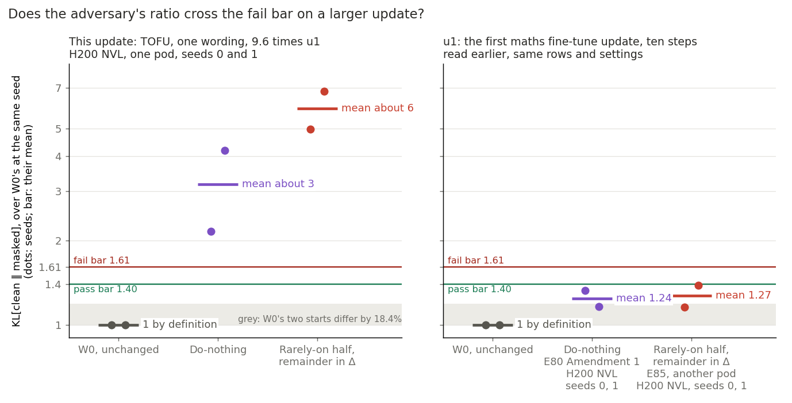
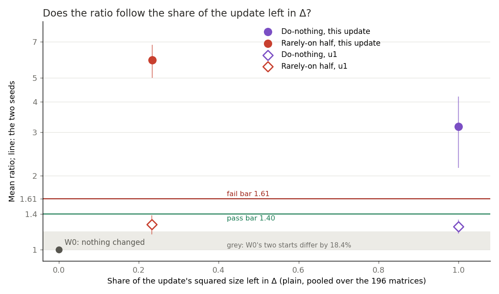
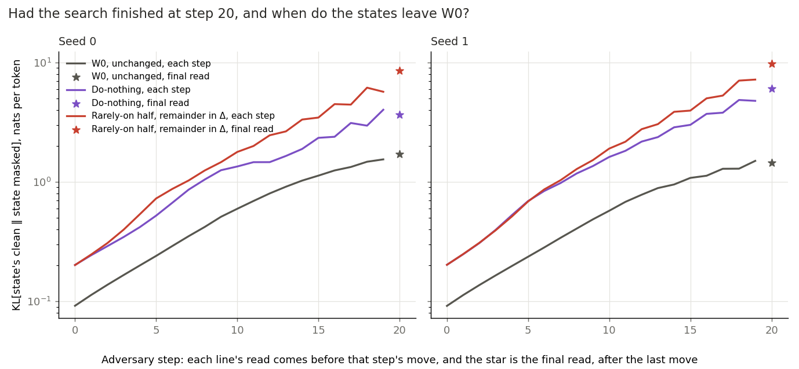

# Does VPD's adversary fail doing nothing on a larger update? (E89)

We ran VPD's adversary on an update about ten times the first fine-tune's size, with the whole update left outside the subcomponents and again with most of it on the rarely-on half of them. Both states failed by a wide margin where both had passed on the first update, and the independent check found no bug, but no saved number shows whether the fail of doing nothing is damage under masks or the adversary switching part of the update off. For `GOALS.md`, the two updates also differ in kind and no good state was read, so this does not show that size was the cause or that the test separates good placements from bad.

*2026-11-05, `qwen-decomp-lead`. For D1, a map on Qwen3-1.7B that keeps the decomposition faithful for a real update, judged by a test that can fail a bad placement. Plan `reports/plans/2026-11-05_plan_e89-tofu-adversary.md`. Rules `experiments/qwen_tofu_adversary/results/predictions.json`, `rules.py`. Notebook `notebooks/E89_qwen_tofu_adversary.ipynb`.*

**Status: Provisional. Independent check `reports/reviews/2026-11-05_review_e89-independent-check.md`: holds with a caveat. Both fails compute and no bug was found; what the fail means is not split by any saved number. Every number below is read from `results/results.json` or `results/run.log`.**

**The sentence this supports.**

> On TOFU's one-wording fine-tune update of Qwen3-1.7B, 9.6 times the first update by norm, on web text, VPD's evaluation adversary read both do-nothing and the rarely-on half, remainder in Δ, over the fail bar carried from the 67M, at both seeds and every step; the first update passed both on the same rows, but that update differs in kind as well as size, no saved number says whether do-nothing's fail is damage under masks or part of the update switched off, and no good state was read on either update.

## What we were trying to test

D1 needs a test that can fail a bad placement. On the first fine-tune update, u1, VPD's adversary passed doing nothing, so nobody knew whether it could see an update left in Δ. It had failed a random change and wrong columns, but only far beyond a real update's size. This run asks whether doing nothing fails on a real update about ten times larger.

**Which update.** The one read here is the update from the run labelled E81: TOFU's invented author biographies, one wording of each fact, step 1250 at peak rate 2e-5, ‖δW‖ 17.998, 9.6 times u1. It is not the update the user chose as anchor 2, from the run labelled E84, which was trained on five wordings of each fact, ‖δW‖ 18.109. The size is about the same, but kind and training differ. u1 is ten maths steps saved in bf16; this one is 1,250 biography steps saved in fp32. So this does not read the chosen anchor. The plan names this update because the task did, and because the question was about size.

**Terms.**

- **W0 and u1.** W0 is Qwen3-1.7B before any update. u1 is the first update, ten fine-tune steps on maths problems.
- **Subcomponents and Δ.** Each weight matrix is rank-one subcomponents plus a leftover Δ. Each subcomponent is a column of $V$ times a column of $U$. Γ gives each subcomponent a causal importance $g$ from 0 to 1 per token. Γ never moves here.
- **The adversary.** It picks a setting $s$ from 0 to 1 per subcomponent, shared by all rows and positions. It uses each subcomponent at strength $m = g + (1-g)s$, and it picks how much of Δ to keep per matrix. It takes 20 sign steps of 0.1 from a random start.
- **The read.** Forward KL, KL[state's clean ‖ state masked by the adversary], in nats per token, after the last step. The state is compared with itself, so the update's own move is not in the comparison.
- **The ratio and the excess.** The ratio is a state's read over W0's at the same seed, and W0 reads 1 by definition. The excess is the difference in nats.
- **Left in Δ.** The plain share of the update's squared size outside the subcomponents, pooled over the 196 matrices.
- **Output moved.** KL[W0's clean ‖ state's clean], mean over every position of the rows.

**The states, and what each rules out.**

- **W0**, the control, seeds 0 and 1, run first and alone. Each is a stop over 20% from the earlier reads. It rules out a broken host, broken rows or a state left applied.
- **Do-nothing.** Weights W0 + δW, subcomponents unmoved, so Δ holds all of the update. Asks whether the test sees an update left in Δ at this size.
- **Rarely-on half, remainder in Δ.** The same weights. The least-squares split of δW over the half of alive subcomponents least often on moves those columns, and Δ takes the rest. It has the right total on the wrong columns, with 23.4% of the squared size left in Δ.

**Rows and settings.** 128 rows of 512 tokens of FineWeb-Edu, with the earlier reads' code path called, not copied. All six starts ran on one pod. Web rows are training data for neither update.

### What each number should read

| number | W0 | do-nothing | rarely-on half |
|---|---|---|---|
| Ratio, mean of two seeds | 1 (1.703, 1.438 absolute) | 1.24 on u1; here about 10 or more | 1.27 on u1; here over the bar, lower than do-nothing, low lean |
| KL[W0's clean ‖ state's clean] | 0 | unmeasured; u1's 0.01 to 0.2; stop under 1e-3 | equal to do-nothing's within 1e-6, same weights |
| Left in Δ, plain share | 0 | 1 by construction | unmeasured; above least squares' 0.0984; may pass 1 |

## What we expected, and why

**Do-nothing, medium-high to fail.** A large random change's excess at seed 0 had gone from 0.0051 nats at u1's size to 53.7 at 100 times, a power of 2.0. u1's do-nothing excess was 0.553 nats, so 9.6 times gives about 51 nats and a ratio near 30. Against that, web rows might hear invented biographies far less than maths training.

**The rarely-on half below do-nothing, low.** It leaves less in Δ, but rarely-on columns had already failed when moved far. **Both fail, medium.**

**The filed rule.** The mean of two seeds, each state's label under the same rule. At or over the fail bar 1.61, gap strictly above this job's W0 spread: fails. At or under the pass bar 1.40, no seed at or over 1.61: passes. Otherwise "no call", and a NaN or missing start "unread". The pair's outcome reads the two labels. It has no "unread" label of its own: a state unread makes the pair "no call".

## What we observed

W0's control passed and every build check held. Full list under "Controls".

### Does the ratio cross the fail bar on the larger update?

**Reading it.** Yes: both states fail at both seeds, where on u1 both sat under the pass bar. Do-nothing reads about 3 against 1.24 on u1, with seeds of 2.15 and 4.19. The rarely-on half reads about 6 against 1.27. The caveat is that size and kind are confounded. This update differs from u1 in size and in kind, and the rows relate to each differently: web rows are training data for neither, but u1 was maths and this one invented biographies. So this does not show size caused the fail.

| state | seed | final KL[clean ‖ masked], nats | over W0 at that seed | excess, nats |
|---|---|---|---|---|
| W0 | 0 | 1.7042 | 1 | |
| W0 | 1 | 1.4389 | 1 | |
| do-nothing | 0 | 3.6661 | 2.151 | 1.962 |
| do-nothing | 1 | 6.0324 | 4.192 | 4.593 |
| rarely-on half | 0 | 8.5043 | 4.990 | 6.800 |
| rarely-on half | 1 | 9.7892 | 6.803 | 8.350 |

| state | mean ratio | gap | filed label | mean of last five step reads over W0's, logged only |
|---|---|---|---|---|
| do-nothing | 3.172 | 2.172 | "do-nothing fails on this larger update" | 2.20, 3.20 |
| rarely-on half | 5.897 | 4.897 | fails; the pair reads "both fail" | 3.60, 4.53 |

W0's spread is 18.4%, so both gaps clear it far. Qwen's own bars, reported and not ruled on, are 1.267 and 1.776, and every seed of both states is over the higher one.

u1's reads, for reference. Do-nothing: 1.325, 1.162, mean 1.244, on an H200 NVL, `experiments/qwen_d1_adversary/results/amend1.json` and `amend2.json`, `run_amend1.log`. Rarely-on half: 1.157, 1.384, mean 1.270, on another H200 NVL pod, `experiments/qwen_d1_teeth/results/results.json`. **Correction to the plan:** the plan and `predictions.json` call u1's do-nothing read an H100 from E80 Amendment 2. `run_amend1.log` line 3 reads H200 NVL, and the start ran in Amendment 1. So the card matches here. The filed text stands, and this is the correction.

### Does the ratio follow the share of the update left in Δ?

**Reading it.** No. The rarely-on half leaves 0.234 of the update's squared size in Δ against do-nothing's 1, and it reads higher at both seeds. Pairing by seed, it reads 2.84 and 2.61 over do-nothing. So the ratio does not track the share in Δ. That is an observation, not an explanation. The half's share is almost the same on the two updates, 0.2340 and 0.2327, while its ratio is over four times higher here. These are not the same failure. Most of the rarely-on half's update sits on moved columns, which the adversary can mask out column by column, where do-nothing has one Δ setting per matrix. That route was not separately tested, and which subcomponents the adversary raised was not read.

| update | state | left in Δ | mean ratio |
|---|---|---|---|
| this one | do-nothing | 1 by construction | 3.172 |
| this one | rarely-on half | 0.2340 | 5.897 |
| this one | least squares on all alive columns, not read under the adversary | 0.0984 | |
| u1 | do-nothing | 1 by construction | 1.244 |
| u1 | rarely-on half | 0.2327 | 1.270 |

### Had the search finished, and when do the states leave W0?

**Reading it.** The search had not finished, so every read is a lower bound. Over the last five step reads, both states' KL[state's clean ‖ state masked] rises 12% to 16% per step, and W0's about 8%. The late reads swing. Do-nothing at seed 0 finishes at 3.67 under its last step's 4.02, and the rarely-on half at seed 0 finishes at 8.50 over its last step's 5.69. So a final ratio's size is not to be leaned on. The fail does not rest on the final read: over all 20 steps the lowest single-seed ratio is 1.81 for do-nothing and 2.18 for the rarely-on half, above both 1.61 and Qwen's own 1.776. Do-nothing's last-five mean is 2.70. Both states already read about 2.2 times W0 at step 0, at random settings before any search, where on u1 both read within 1% of W0.

| ratio at | step 0 | step 10 | step 19 | final |
|---|---|---|---|---|
| do-nothing, seed 0 | 2.19 | 2.26 | 2.60 | 2.15 |
| do-nothing, seed 1 | 2.21 | 2.82 | 3.18 | 4.19 |
| rarely-on half, seed 0 | 2.19 | 2.99 | 3.68 | 4.99 |
| rarely-on half, seed 1 | 2.21 | 3.32 | 4.79 | 6.80 |

### What does this fail say?

**Reading it.** Not yet which of two things it is. With input $x$ at a site, the hook at `src/commute/qwen_vpd.py:334` gives clean − masked $= xV(1-m)U + (1-d)x\Delta$, where $d$ is the adversary's one Δ setting per matrix. For do-nothing $\Delta = \Delta_0 + \delta W$. So the update's own move can come back into the read by the test's design: pushing $d$ down moves that matrix toward W0. There is a second route, since $x$ and $g$ come from the updated model. The final settings were not saved, and no saved number splits the two. So this report does not say that masks do more harm on the updated model, and it claims no mechanism.

The output moved cannot simply be added to W0's read. W0 plus 0.64 gives ratios of 1.37 and 1.44, under the bar, against reads of 2.15 and 4.19. The independent check's arithmetic on how they might combine is in its section 2. It is arithmetic and not a law, since 0.64 is KL[W0's clean ‖ state's clean] and the read is the other direction, with KL[state's clean ‖ W0's clean] never measured.

## What we learned

On this update the test fails doing nothing, with the whole update in Δ. That bears on `GOALS.md`'s weak version, in which Δ may not absorb the update, with the caveat above on what the fail is. The filed outcome "do-nothing passes on this larger update too" did not happen, so size may yet be part of why it passed on u1; this run cannot say, since kind also changed.

No state here is a good one. So the test has still not been shown to pass any good placement, and it must not be said to separate good from bad. Nor is it shown to fail bad placements in general: it failed wrong columns only at 250 to 740 times a real update's size, in the positive controls of the earlier run labelled E85. D1 gets a fail here and still no pass. The filed branch for this outcome says the test needs least squares read on the same update before it can score a map.

## How compelling is the evidence

Strong that both states read over the bar on this update and these rows: every seed, every logged step and the last-five mean sit over it, and the independent check recomputed the labels and found no bug. Weak beyond that: one update of one kind, two seeds, one pod. What the fail is remains unread.

**Blind to.** The ratio reads web rows, and a read there says nothing about TOFU's own rows. It is a lower bound still climbing at step 20. Neither state is a good one, so both failing says nothing about whether a good placement passes. It cannot separate size from kind here, nor the update switched off from harm under masks. Bars are the 67M's. Output moved reads weights only, never the subcomponents. Left in Δ is a plain share, not input-weighted.

**Noise floor.** Do-nothing's two seeds differ by 2.04, and the rarely-on half's by 1.81. The floor at this size was unmeasured. The plan's floor was 0.12 to 0.19 at u1's size, and the rarely-on half on u1 already differed by 0.23 across seeds, beyond it. A mean of two carries about half a seed difference, so do-nothing's "about 3" is uncertain by about one. The fail does not depend on it, as its lower seed is 2.15. The gap between the two states' means, about 2.7, is about one state's seed difference, though pairing by seed gives both the same sign.

**The update's own move.** KL[W0's clean ‖ state's clean] is 0.6385 nats per token on the 128 rows, the same for both states since their weights match. It is above the expected 0.01 to 0.2. For scale, u1's is about 0.035 in the same direction on 8 web rows, on an L40, from the rounding check of the run labelled E85. So it grows about 16 to 18 times against 9.6 times in norm, and the rows differ. The independent check's 16 uses 0.040, which is read against the fine-tuned model on 8 rows of 256 tokens. The random change at 100 times read 0.866. So web rows do hear this update, and the plan's worry that they might not did not bear out.

**Host.** The card was an H200 NVL, on a non-datacenter Vast host, because no datacenter H200 NVL offers existed. W0 reproduces closely and not exactly. The first eight step reads at both seeds match the earlier H200 NVL read to four places, and they part at step 8 or step 10. The finals read 1.70422 against 1.70316, a gap of 0.06%, and 1.43894 against 1.43849, a gap of 0.03%. Three earlier pods read seed 0 to every digit, and this one did not. No cause was measured. The gap is about 300 times under W0's 18.4% between seeds, so it does not bear on any label. Every ratio here shares this host.

### Controls

| check | read | want | verdict |
|---|---|---|---|
| W0, seed 0 | 1.7042 | 1.7032 within 20% | held |
| W0, seed 1 | 1.4389 | 1.4379 within 20% | held |
| W0's first three steps, seed 0 | 0.0918, 0.1131, 0.1376 | the same | held |
| do-nothing's path check, three reads | −1.26e-9 | under 1e-4 | held |
| output moved, do-nothing | 0.6385 | at least 1e-3 | held |
| output moved, rarely-on half, against do-nothing's | difference 0 | within 1e-6 | held |
| left in Δ, rarely-on half | 0.2340 | finite and above 0.0984 | held |
| ‖δW‖ | 17.998449 | 17.998449 | held |
| peak GPU memory | 69.3 GB | about 69.4 GB, under 70 GiB | held |

## Surprises

**Something unexpected happened that I cannot explain.** The filed scaling gave a ratio near 30 and 51 nats, and the expected value for do-nothing's mean was "about 10 or more". It read about 3, about ten times under 30. At the lean's own seed 0, the ratio read 2.15, about 14 times under. The excess there read 1.96 nats, about 26 times under, and at seed 1 it read 4.59, about 11 times under. The lean that do-nothing fails held, and the reasoning behind it did not. From u1 to here the excess rose 3.5 times at seed 0 and about 20 times at seed 1, so one power law would not fit both seeds. No cause is claimed. Kind changed too, so this does not say how the excess scales with size.

- **Do-nothing's two seeds** differ by 2.04, about 13 times u1's 0.16.
- **The rarely-on half read above do-nothing at both seeds.** Reading it below was the low lean, so this is the expected side, but the size of the difference is unexplained.
- **At step 0 the two states read almost the same**: 0.2015 and 0.2012 at seed 0, 0.2023 and 0.2022 at seed 1. Their shares in Δ differ four times. No cause was tested. A random setting averages one half in either place, which the independent check notes but which does not separate the two routes. The rarely-on half then stays above do-nothing, from step 1 at seed 0 and from step 6 at seed 1.
- **The rarely-on half's share** was allowed to pass 1 at this size, since its second-order term is 92 times u1's relative to the update. It read 0.2340, against 0.2327 on u1.

## What next

These are proposals. `reports/plans/2026-11-05_plan_qwen-reorient-amend1.md` closes D1 by option A of the user's card with no further runs on this question, and the choice sits on that card.

- **One do-nothing start with every Δ setting held at 1, about 22 minutes on an 80 GB card.** If the excess collapses, the fail is mostly the update switched off. If it stays, it is mostly harm under masks. KL[state's clean ‖ W0's clean] and the Δ-off read of the earlier positive controls come cheaper and help read it.
- **Least squares on this same update, two starts, about $3 by the plan.** It leaves 9.8% of the squared size in Δ. If it passes where these two fail, the test tells placements apart at this size. If it fails too, the ratio cannot score a map at this size.
- **Do-nothing on a saved TOFU state near u1's size**, from the saved grid in `results-large/qwen_tofu/dW/a2_2e-5/`. A pass points to size as the driver and a fail to kind.
- **The same read on the five-wording anchor.** It matters only if the adversary stays in D1's table. A different reading would mean this one does not carry over.

## Scorecard

| id | claim in words | rule | read | verdict |
|---|---|---|---|---|
| do_nothing | do-nothing fails on this larger update | mean ≥ 1.61, gap above W0's spread | 3.172, gap 2.172, spread 0.184 | filed label "do-nothing fails on this larger update" |
| pair | the two labels together | both fail | fails, fails | filed label "both fail" |
| N_fails | do-nothing fails, medium-high lean | as above | as above | held |
| Rare_below_N_beyond_spread | rarely-on half below do-nothing by more than W0's spread, low lean | N's mean − Rare's over spread | −2.725 | did not happen |
| both_fail | both fail, medium lean | as above | as above | held |
| N_mean | about 10 or more, ratio near 30 and 51 nats | expected value, no rule | 3.17, seeds 2.15 and 4.19; 1.96 nats at seed 0 | missed, about ten times on the mean ratio |
| Rare_mean | over the bar, lower than do-nothing | expected value, low lean | 5.90 | over the bar; not lower |
| clean_N | 0.01 to 0.2, stop under 1e-3 | stop | 0.6385 | no stop; above the expected range |
| left_Rare | above 0.0984, may pass 1 | stop | 0.2340 | no stop |
| W0_spread | about 18% | reported | 18.4% | as expected |

## Departures from the plan

Filed in `predictions.json`, or plain in the code at commit 91f96e0a.

- **Update, states.** Listed in the plan: E81's update and not u1; do-nothing re-read on this host; gold rows and behaviour kept cut; the random change cut; the rarely-on half's lower stop moved to TOFU's 0.0984 and its upper stop removed.
- **The half's check and active share cut.** `half_is_rarer` and the active share are gone. They read W0's statistics alone, so they would repeat the earlier number of 0.0365. Not in the plan's list; in `predictions.json`'s.
- **`left_in_delta` rewritten.** The earlier code read the random change's size alongside the half's. Without that state it reads the half and ‖δW‖² only.
- **Leans.** The straddle, kept and near leans of the earlier rules are gone, since their states or readings are.
- **`N_clean` runs each time the do-nothing state is entered.** It is in `n_state`, so it logged three times, each −1.26e-9. Cost: a few forward passes.
- **An older read's reference logits.** `set_up` still computes reference logits for an own-mask read that this job never uses, and they now use TOFU's δW. Nothing reads them. Cost: part of the load.
- **The pair rule has no "unread" label.** A state unread makes it "no call", as filed; each state's own label stands beside it. It did not arise.
- **Host.** A non-datacenter Vast host, with no datacenter H200 NVL offers. Pod cost $9.97 by the runner's report, against the plan's $10 to $14. W0's reproduction on it is under "Host" above.

## Provenance

`experiments/qwen_tofu_adversary/results/results.json`, `run.log`, `console.log`; code, rules and filed predictions at commit 91f96e0a, results at 4632d45a. Figures from `experiments/qwen_tofu_adversary/plot.py`; the step curves come from `run.log`.

One H200 NVL on Vast, 11:18 to 13:35 by the log, 2.3 h, each start about 1337 s, peak GPU 69.3 GB, peak host 34.4 GB. The bill is not in the repo. Update file `results-large/qwen_tofu/dW/a2_2e-5/step_1250.safetensors`, sha256 `d45b5163d431e218708d66fa45fae47ac0c5f0e7ff6666fc5ddd06adcd35a37b`, W&B artifact `qwen3-1.7b-e81-tofu-dW`.

## Departures from the literature

The adversary follows VPD's evaluation config, as in `qwen_vpd.pgd_kl_rows`: one source per subcomponent and one per matrix for Δ, shared by all rows and positions, 20 sign steps of 0.1, on 128 rows of 512 tokens.

- **A changed model.** VPD runs the adversary on the model its decomposition was fitted to, with Γ trained on it. Here Γ is frozen and reads weights it was not fitted to, because that is the question.
- **Ratio and bars.** VPD reports KL[clean ‖ masked], with no ratio to an unchanged model and no pass bar. The ratio and both bars are this project's, carried from the 67M without a measurement on Qwen.
- **Starts and step.** Two starts, and the final step only, by the filed rule. The source does not address start-to-start noise.
- **Precision.** Components are fp32 and Γ is bf16. The authors' bf16 autocast cannot hold moved columns.
- **The states.** The rarely-on half has no published source. The least-squares split is this project's, and remainder in Δ follows `GOALS.md`.
- **The update.** The recipe comes from the TOFU paper with the run's own changes, recorded in `reports/analyses/2026-11-04_analysis_e81-tofu.md`. That update failed its own "answered" test on held-out paraphrases, and it is read here only as an update of this size.

## Not run

1. Least squares or any map on this update.
2. The five-wording update the user chose as anchor 2.
3. TOFU's own rows under the adversary.
4. A third seed, or a floor between starts at this size.
5. More than 20 adversary steps, so the plateau is unknown.
6. Behaviour kept.
7. A size ladder, or any TOFU state at u1's size, so size and kind stay confounded.
8. A maths update at this size.
9. Which subcomponents the adversary raises.
10. Any test of why the misses under "Surprises" happened, or why W0's reads part from the earlier ones after step 8.
11. KL[updated model's clean ‖ W0's clean], the reverse of the read here, on the 128 rows.
12. The Δ-off read of the earlier positive controls, KL[state's clean ‖ masked at $g$, Δ off], on do-nothing.
13. One do-nothing start with every per-matrix Δ setting held at 1, about 22 minutes on an 80 GB card.
14. The final settings: `start` discards them, so which matrices the adversary turned down is unknown.
15. State files: none saved, since both states rebuild from δW and the inputs.
16. Any good placement under this test: no state on this update has been shown to pass.
