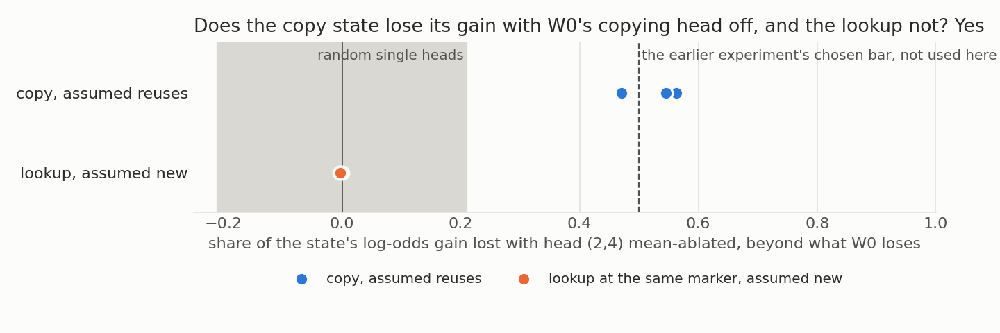
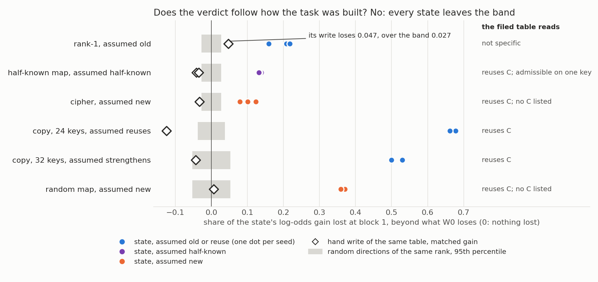
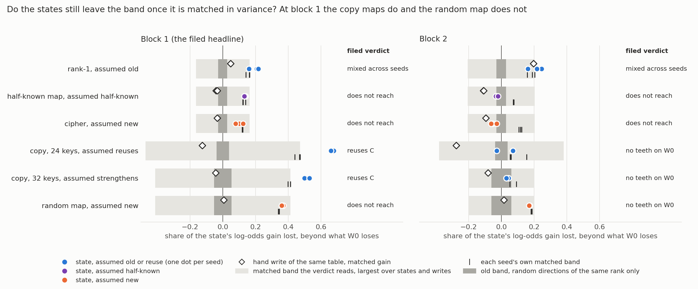
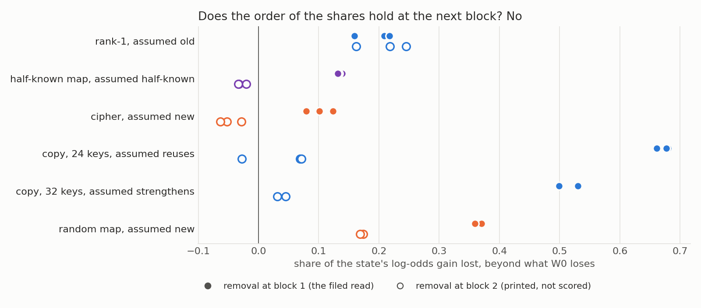
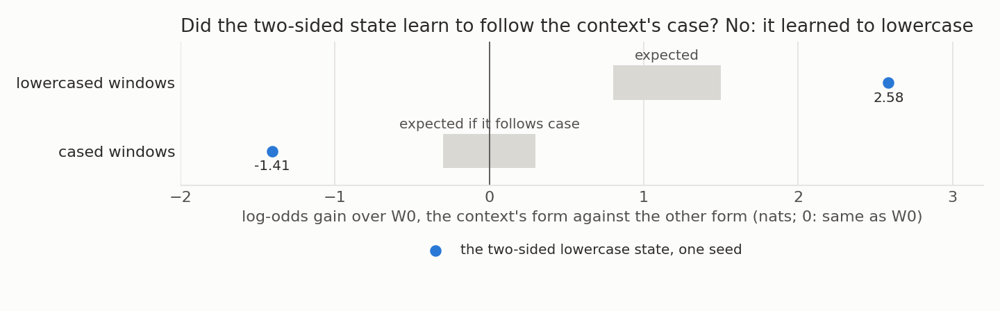

# What does the frozen new-against-reuse definition say about the labels we assumed on the old 67M tasks? (E90)

We took the old fine-tunes on the small model and asked of each, under the one definition the user froze, whether a capability the original model already has could carry the task, then removed that capability and compared the loss against a hand-built change that should survive and against random removals holding about the same variance. Against those removals at the first block read, the filed rule separates the copying map from the random map by degree on one pair of tables, so the earlier answer that removal cannot tell them apart no longer stands as stated, though nothing saved shows more than that the answer needs its input token. For `GOALS.md`, the second question's "existing" side has no reading on this model beyond copying, so the labels we relied on stay assumptions, and a circuit built from old parts still reads as reuse.

*2026-11-05, baseline-lead. Definition `decisions.md` lines 81 and 115, deliverable line 120. Plans `reports/plans/2026-11-05_plan_e90-new-vs-reuse-definition.md` (top section wins), `..._plan_e90-input-dependent.md`, `..._plan_e90-appendix.md`, `..._plan_e90-amend2.md`. Rules `experiments/new_vs_reuse/results/predictions.json`, `predictions_amend1.json`, `predictions_amend2.json`. Notebook `notebooks/E90_new_vs_reuse.ipynb`.*

**Status: provisional, the whole report. Independent check of everything before Amendment 2: holds with caveat, `reports/reviews/2026-11-05_review_e90-table-check.md`. Independent check of Amendment 2: holds with caveat, `reports/reviews/2026-11-05_review_e90-amend2-check.md`; its corrections are applied here.** E95 follows, on what "reuses token identity" means beyond needing the token: `reports/plans/2026-11-05_plan_e95-token-identity.md`. The definition batch built on this table is `reports/decisions/2026-11-05_decision_e90-definition-batch.md`. Every number is copied from the file named beside it or in the table's field note. Numbers credited to the checks come from their output, `~/commute-data/scratch/baseline-lead/e90-check/check.out` and `~/commute-data/scratch/baseline-lead/e90-amend2-check/band_check.out`, `draws_check.out`, or their re-reading of the saved files, and are post hoc.

**Limit on every claim below.** A circuit built from old parts reads as reuse. "Reuses C" says the gain needs C; it does not say the task was not learned.

## The answer

As the table prints it, the copy tasks read "reuses C", tasks built to be new print "no C listed", and constant answers do not apply. **The earlier answer, that direction removal alone does not tell new from old, no longer stands as stated.** At block 1 the filed rule now separates the 32-key copy map from the random map, by a difference of degree on one pair of tables. Nothing saved shows this means more than needing the input token after block 1.

**The conditions on that separation.**

- *What holds.* Against random removals matched in variance, the filed rule leaves the 32-key and 24-key copy maps above the band and the random map under it. That survives every redraw of the random removals the check simulated: 100% of 20,000 sets, and 98.9% with both controls required.
- *Degree, on one table pair.* Only one random table was read, with two seeds, and a replicate pair is saved and unread. The 24-key copy map has no random twin, so its "above" is against draws alone.
- *No control at the next block.* At block 2 the original model fails the control, 2.406 against 2.479 and 2.078 against 2.321, so that block cannot say.
- *Margin.* The 32-key copy map's shares, 0.499 and 0.530, clear the band of 0.413 by 0.087 and 0.117. The 24-key map's, 0.661 to 0.680, clear 0.472 by 0.189 to 0.208. The random map's, 0.370 and 0.359, sit under 0.413 by 0.042 and 0.053.
- *The band's own values.* The filed band is the largest over the states and writes at that capability and block. Per seed it reads 0.398 and 0.413 on the 32-key copy map, 0.472, 0.440 and 0.469 on the 24-key map, and 0.338 and 0.344 on the random map. So the random map sits above its own band, by 0.032 and 0.015, and none of its 20 draws reaches it on either seed. It reads "within" because the copy map's draws set the band. Read seed by seed, which is not the filed rule, it would take the branch where the negative control fails, but that excess is within the match's shortfall. Neither branch is clean for this row: the random map sits near its reference.
- *The control's teeth are narrow, and may depend on the match being short of full.* On token identity at block 1 the original model drops 2.863 against a band of 2.580, and 2.495 against 2.388 on the 24-key keys. This is the control replaced after it failed. The check estimates that a full match would move those bands to 2.80 and 2.60, and the second would lose its teeth.
- *Size is estimated, not cleared, on these windows.* On the task windows the draws fell short of the 0.9 match: 0.568 against the basis's 0.665 on the 24-key copy windows, 0.560 against 0.631 on the 32-key windows. The filing labels this "under", which means an "above" is not cleared of the size explanation there. That qualifies exactly the rows that read "reuses C". The check's estimates of a band matched there stay under the copy rows except in one weak case, so size does not plausibly undo the separation.
- *The removal sits on the key's only route.* Token identity is removed at the answer position, which is the key's position, and the key appears nowhere earlier in these windows. So all that later blocks know of the key there passes through the edited residual. The write is spared because it read its key upstream, so it does not control for this. How much of either map's loss is the deleted key is unmeasured.
- *"Within" means not shown specific, never shown not specific.* The draws share 0.85 of their directions with the token-identity basis, so the band holds part of any loss specific to the capability. The filed "does not reach" therefore reads wrongly on the random map's row, whose answer must reach its key through this residual.
- *Coverage.* One task format, block 1, two seeds on the 32-key maps, three on the 24-key map.
- *The limit.* A circuit built from old parts reads as reuse.

**Beside that.** With the copying head off the copy state loses about half its gain and its lookup control none, which repeats the earlier measurement and is not independent validation. Rank-1 reads mixed, and of tasks labelled strengthening only the 32-key copy map reads, on a replaced control.

## What we were trying to test

Each row is a fine-tune of the 67M, W₀ + δW, with a task and a label we assumed. The definition is relative to a named capability C, a text rule the original model can be read to compute. Its verdicts are "reuses C", "not through C" and "unreadable", never an unqualified "new".

Four things are measured.

- **Admissibility.** Does a small map from C's value to the task's answer, fitted on half the keys, beat the most common answer on the other half? Judged from labels and W₀, with no state.
- **The share.** Remove C from the state and from W₀ at the answer position. The share is the state's mean log-odds drop minus W₀'s, over the state's log-odds gain. It reads 0 if the removal costs nothing beyond what W₀ loses, 1 if the whole gain goes (`readout.shares`, `A_lo`).
- **The band.** The 95th percentile of the same share under 20 random removals, largest over the states read at that C and block. Its random bases match the removal's rank, not its variance. Amendment 2 adds a second band, the same percentile and the same largest-over-states rule, whose 20 random bases of that rank lie inside the top principal components of the capability's fit residuals, chosen so that they hold at least 0.9 of the removal's variance there.
- **The spared control.** A verdict needs a second state on the same windows. For a located mechanism it is the other task. For directions it is the hand write: a weight change in block 1's MLP that maps each key's input to its answer's unembedding row, scaled to the state's gain. The two-by-two reads: state above the band and control within, "reuses C"; state within and control above, "not through C"; both above, "unreadable: not specific"; both within, "unreadable: does not reach the states".

There are two forms of removal. The mechanism form mean-ablates head (2,4), located by the earlier copying experiment. The value form removes the centred directions of the residual's per-value means, fitted on natural text, at block 1.

There is no size bar on "reuses C", since none is sourced: the verdict prints its share.

## What we expected, and why

The plan expected one row to read: the copying pair. It leaned to "unreadable: not specific" on rank-1, because the write's answer direction should lie in the removed directions. It expected "not specific" on the copy and random maps too, with both states and the write each losing nearly all the gain. It expected "does not apply" on every constant answer, and "no C listed" on the ciphers.

Amendment 2 filed a lean, extrapolated from two points and not measured: a matched band near 0.1 on W₀'s guess and above 0.5 on token identity. So the cipher, half-known map, both copy maps and the random map would all read "does not reach", and rank-1 would stay above or "not specific". The reasoning was that the old "above the band" rows were mostly the size of the variance removed. A copy row above the matched band would go against it.

## The table

One line per old task, in the plan's order, then the input-dependent rows. **The first verdict column is my presentation, not the filing.** Where stage 0 reads the pair not admissible, line 116's rule says that C does not count, so I lead with "no C listed" and show the read beside it. `stage2.json` `.table` is unedited and holds the second column's reading as its `verdict`. Shares are per-seed ranges at block 1 unless stated, from `.table[].share`, `.control_share`, `.band`. Below, "as printed" means the lead column and "removal alone" means the second. Rows marked "replaced control" are read only because of Amendment 1, see "Weak control in Amendment 1".

Six rows are read again by Amendment 2. Their lead column now follows the matched band, the new column gives its read at each block (`amend2.json` `.table`, `.rows`), and the old unmatched verdict stays beside it in "the file's read". Blank in the new column means not read by Amendment 2, including the copying head, whose band is random heads.

| Old task | Assumed label | Verdict as printed here | Matched band, Amendment 2 | The file's read beside it, old unmatched band | Why it cannot be read | Old finding that depended on the label |
|---|---|---|---|---|---|---|
| Copy, E62 form "A B ... A M" → B (T5) | reuses; causal, copy side unsettled | **reuses C**, in-context copying | | share 0.471-0.563, lookup control about 0, band 0.210. The shares equal E62's saved ones, so this is not a second measurement. E62's filed verdict `copy_not_elicitation`, reading "mixed", stands beside it | | E62: r left unscored because one seed fell short of 0.5; slide figure `q2_r_vs_prior` |
| Lookup at the same marker (T5) | new; causal | **no C listed** by admissibility | | filed form "not through C", share -0.004 to 0.000, band 0.210. It serves only as copy's mechanism control | | E62, as above |
| Rank-1, 24 keys (T12) | old by construction | **mixed**, W₀'s guess | block 1 mixed: 0.209, 0.218, 0.159 against band 0.163, write 0.047 within. Block 2 mixed: 0.246, 0.218, 0.162 against 0.204 | old verdict "not specific": share 0.159-0.218, write 0.047, band 0.027 | under the old band, its write loses more than the band, by 0.020; under the matched band one seed of three falls short, by 0.004 | E55 C3: "neither passes" on the old-by-construction map against its cipher (log claims); E58 Amendment 1, the held-out label's control |
| Cipher, 24 keys (T11) | new by construction | **no C listed** by admissibility | does not reach at both blocks: 0.079-0.124 against 0.163; -0.063 to -0.029 against 0.204, windows "over" | old filed form "reuses C", share 0.079-0.124, write -0.033, band 0.027. Stage 1 read "not specific" against rank-1's write | | E54: Γ's switching share r 0.77 against 0.24; E55 C3; slide figure `q2_every_family` by way of E60 |
| Half-known map, 24 keys (T11) | half-known, by construction | **does not reach**, W₀'s guess. On the filing's intent, no C listed | does not reach at both blocks: 0.132-0.139 against 0.163; -0.033 to -0.020 against 0.204, windows "over" | old verdict "reuses C": share 0.132-0.139, write -0.042 to -0.034, band 0.027. Admissible on one key of 12, floor 0; on 1,000 random half splits of the keys it reads admissible on 50.4%, the cipher on none | | E54, E56: r separates the pair at five seeds; E64 "built to elicit, no causal label" |
| Copy, 32 keys, ident32 (T4) | strengthens, by construction | **reuses C at block 1**, token identity; no teeth at block 2 | block 1 reuses C: 0.499, 0.530 against 0.413, by 0.087 and 0.117, write within, windows "under". Block 2 no teeth; beside it, 0.031-0.045 against 0.199 | old verdict "reuses C": share 0.499-0.530, write -0.043, band 0.053, replaced control | | E12, log claim "Reveal and create show up as different routes"; slide figure `q2_routes`; E52's steering; E60 |
| Copy, 24 keys (T13) | reuses, by construction | **reuses C at block 1**, token identity; no teeth at block 2 | block 1 reuses C: 0.661-0.680 against 0.472, by 0.189 to 0.208, write within, windows "under". Block 2 no teeth; beside it, -0.027 to 0.071 against 0.381 | old verdict "reuses C": share 0.661-0.680, write -0.125, band 0.038, replaced control | | E58 Amendment 1, the held-out label's positive control; E55 C3's "copy R 0.65" |
| Random map, 32 keys, rand32 (T6) | new by construction | **no C listed** by admissibility | block 1 prints "does not reach", which reads wrongly on this row: 0.370, 0.359 against 0.413, by 0.042 and 0.053; above its own 0.338, 0.344, near its reference. Block 2 no teeth; beside it, 0.169-0.174 against 0.199 | old filed form "reuses C", share 0.359-0.370, write 0.007, band 0.053, replaced control. R2 itself reads "miss" | | E12, as for ident32; E10 "learns behaviours the model lacks"; `q2_routes` |
| Lowercase, scored pair (T7) | reuses, the model already writes it | **definition does not apply** | | | a constant answer: "lower" | E53: ratio 0.92 against the cipher's 0.26; E60's family; `q2_every_family` |
| Emoticon (T1) | an existing behaviour | **definition does not apply** | | | a constant answer | I found no finding that depends on it. E2 calls it "the easiest (an existing behaviour)", a choice of task; the log's emoticon results read faithfulness, not new against old |
| Ladder rungs (T2) | rungs of already does | **definition does not apply** | | | a constant answer | E28: the fixed-shift hypothesis "holds on 7 tasks the model already does, none it lacks"; log Result 3, "common next words" |
| Many cues, one answer (T3) | old | **definition does not apply** | | | a constant answer | E33: "the 32-cue task is old and still needs a change per cue" |
| Random map, one key, rand1 (T6) | new by construction | **definition does not apply** | | | a constant answer | E10, as for rand32; E28's r 0.12 |
| 50- and 500-word ciphers (T8) | new by construction | **no C listed** | | | | E53, E60, as for lowercase |
| Prior-matched cipher (T14) | new by construction | **no C listed** | | | | E58 Amendment 6: r 0.373-0.382 at copy's prior |
| Shuffled half-known map (T16) | new by construction | **no C listed** | | | | E58 Amendment 4: r 0.475, "cipher-like" |
| Class map (T15) | a new rule that carries, open | **admissible, not read** | | best 1 against floor 0.266 | second pass, an 11-minute rebuild | E58 Amendment 7, and `decisions.md`'s "carries but r reads new is no longer a contradiction" |
| Class map's shuffled twin (T15) | no filed verdict | **no C listed, not read** | | best 0.281 against floor 0.344 | second pass | E58 Amendment 7 |
| Code-like text (T10) | none either way | **excluded** | | | learned nothing | None: a null in E52 |
| Narrow lowercase (T9) | performed, targeted | **excluded** | | | never trained | E53 Amendment 1's stop |
| Ladder table at " which" (I1) | as ladder | **gap: no version kept the target** | | W₀'s top-1 is " was" on 316 of 4,000 windows | no key's mode is " was", of 32 with enough windows | as ladder |
| Emoticon table at " :" (I2) | as emoticon | **gap: no version kept the target** | | W₀'s top-1 is "o" on 0 of 2,880 windows | W₀ does not give the target at the trigger | as emoticon |
| Two-sided lowercase (I3) | as lowercase | **unreadable: not specific**, the context's case | | state 0.087, push 0.031, band 0.011, one seed | the push loses more than the band; and the state learned mainly to lowercase | as lowercase |
| Ladder push, " which" → " was" (R7) | as ladder | **unreadable: does not reach the states** | | state -0.003, push -0.049, band 0.009, one seed | at block 1 neither loses beyond W₀'s loss; block 2 prints -0.087 and -0.340 | as ladder |

I grepped `docs/research_log/parts/`, `experiments/TRIED.md`, the method table and `experiments/open_pair/plot_q2_deck.py`, which draws the deck's new-against-existing figures. Nothing beyond those was searched for the deck.

## What we observed

### Does one row read as assumed through a located mechanism?

**Reading it.** Yes, one, and it is not a new test of the label: with head (2,4) off, the copy state loses 0.471, 0.545 and 0.563 of its gain, and the lookup state loses at most 0.004 either way. The band over 20 random single heads is 0.210, a 95th percentile, and the largest draw reaches 0.287. That draw is head (1,1), the circuit's other head in E62 Amendment 2, not an unrelated one; it costs the lookup 0.052-0.063. W₀ itself loses 8.85 log-odds at the positions the head serves, against a band of 4.21, so the removal has force, but head (1,1) costs W₀ 8.22. Copy's lowest share is above that largest draw, so no verdict changes.

Three caveats. This row re-reads the measurement its label came from: the same states, windows and head, with shares equal to E62's saved ones to seven digits. New here are the 20-draw band and W₀'s control, so the row shows consistency under them, not independent validation. At the marker W₀ barely gives the answer at all, log-odds -8.05, and the head moves that by only 1.16, to -9.22, so the head's part in this task is largely built by the fine-tune. And this reading stands beside the earlier filed verdict and does not replace it: that rule's bar was 0.5, and one seed sits under it.

The lookup's "not through C" is a mechanism control only, and that is all "the pair is read" means here: the copy row is read, with the lookup as its spared state. The lookup's own row prints "no C listed", because stage 0 reads that pair as not admissible, best 0 against floor 0.035. A circuit built from old parts reads as reuse here too.

### Does the verdict under direction removal separate new from old?

**Reading it.** No, on this band and at the two blocks read. Removal alone reads tasks new by construction as "reuses C" at block 1: the cipher at 0.079-0.124 under W₀'s guess, the random map at 0.359-0.370 under token identity. Rank-1, old by construction, reads "not specific" at 0.159-0.218, and only because its write loses 0.047 over a band of 0.027, while the cipher's write, the same construction, reads -0.033. So that row's verdict rests on 0.020, from one write.

**Rank-1's "not specific" is answer overlap.** The independent check measured it, post hoc, as the share of each write's output side inside the removed directions. It reads 0.116 for rank-1, 0.046 for the half-known map and 0.019 for the cipher, against 0.020 by chance. The directions were fitted on W₀'s guesses, and 22 of rank-1's 24 answers are fitted values, against 4 for the half-known map and 0 for the cipher. So this verdict follows from the choice of C's values. The overlap ignores later blocks and the final layer norm, so it is a comparison, not a prediction of the share.

Rank-1's own write band is 0.024; the 0.027 is the largest over the rows at this C. Both put the write above.

The rule filed for the copy and random maps was "not specific", and it read "reuses C": copy 0.499, random map 0.370, write -0.043, spread 0.542 against band 0.053 (`amend1.json` `.readings.R2`). That reverses a filed lean. It stands as read and is not refiled.

**The conditions on "does not tell new from old".** It holds of the verdict at blocks 1 and 2, under these bands.

- *Block.* Applying the verdict rule to the saved block 2 numbers, as the check did and unfiled, four of six rows change. The half-known map, cipher and 32-key copy map read "does not reach", and the 24-key copy map is mixed across seeds. Rank-1 stays "not specific" and the random map stays "reuses C". So the cipher's "reuses" is a block 1 reading only, at a readout margin of 0.027.
- *Band.* The guess basis holds 0.20 of the fit residual's variance against 0.019 for its random bases, and token identity 0.64 against 0.04 (`stage1.json` `.control`). Until the check, this report flagged the mismatch only for W₀'s control on token identity.
- *An extrapolation, now measured.* The check scaled the bands in proportion to variance, from two points, and found a matched band could turn most "reuses" into "does not reach". Amendment 2 ran that band, in the section after next. It turned the cipher, half-known map and random map, and left both copy maps.

**Rows read under both forms.** Stage 0 read the cipher and the random map as not admissible, each a tie at 0 against 0. Line 116 says such a C does not count, and the plan's table expected "no C listed" on the random map. So each states two things: the filed form reads "reuses C", admissibility reads "no C listed". The value form's reading on them shows what the removal does; it is not a label.

**The half-known map reads "reuses" on one key.** The filing said not admissible. Stage 0 read admissible, because on key 1158 the half-known answer and W₀'s guess are the same token, 352, and that key falls in the read half: 1/12 against a floor of 0, a strict inequality with no margin (`stage0.json` `.surprises`). On the filing's intent this row also has no C listed. It is a coin flip: the independent check found it admissible on 50.4% of 1,000 random half splits of the keys, and the cipher on none. It is reported as a gap, not patched.

### Why is the write spared, and what does that control for?

From the code. `apparatus.removal_edit` removes the basis from block b's output residual, at the answer position only. The write sits inside block 1: `perturb.WRITE_KEY` is `h.1.mlp.down_proj`, and `readout.RESID[1]` is block 1's output. So at b = 1 the removal is downstream of the write. The write has already read its key, from the MLP's input, and survives unless its answer direction lies in the basis.

What that controls for: a spared write shows that a state losing gain is not merely losing an answer direction. What it does not control for: it does not show that the state uses the capability for anything beyond needing the token. The random map needs the token to read its key, and so loses it. That this happens after block 1 is an inference: δW's squared norm is nearly the same per block on every row, about 0.23, 0.23, 0.26 and 0.28, so update size does not explain the shares. That is why line 116's admissibility exists.

The block-2 reads are consistent with the check's overlap: rank-1's write climbs to 0.196 at overlap 0.226, and the cipher's stays at -0.094 at overlap 0.023 (`stage2.json` `.states.*_write`).

### Does a band matched in variance change that reading?

**Reading it.** Yes, at block 1, as a difference of degree on one table pair, so the earlier claim no longer stands as stated. Removal alone did not tell the copy maps from the random map against the old band. Against the matched band, the filed rule's branch (ii) reads: the 32-key copy map and the 24-key map stay above, the random map falls under, and both copy maps keep "reuses C". All six capability-block pairs produced a usable band. Block 2 reads no branch, because token identity has no teeth there, so its rows are unreadable. In the figure the dark bars are the old band, the pale bars the band the verdict reads, and the ticks each seed's own band.

What replaces the earlier claim is narrower. At block 1 the 32-key copy map loses more of its gain than the random map, beyond what random removals of mostly the same directions explain. Nothing saved shows that "reuses token identity" means more than that the answer needs the input token after block 1. The filing's words for this branch are "token identity's removal is specific", and the check's reading does not go that far. The separation survives every redraw the check simulated: 100% of 20,000 sets of 20 draws, and 98.9% with both controls required, on a normal fit to the draws.

| Row, block 1 | Share per seed | Band the verdict reads | Margin per seed | Each seed's own band | Old band | Read | Task windows |
|---|---|---|---|---|---|---|---|
| copy, 24 keys | 0.680, 0.677, 0.661 | 0.472 | +0.208, +0.205, +0.189 | 0.472, 0.440, 0.469 | 0.038 | reuses C | under |
| copy, 32 keys | 0.499, 0.530 | 0.413 | +0.087, +0.117 | 0.398, 0.413 | 0.053 | reuses C | under |
| random map | 0.370, 0.359 | 0.413 | -0.042, -0.053 | 0.338, 0.344 | 0.053 | prints "does not reach"; near its reference | under |
| rank-1 | 0.209, 0.218, 0.159 | 0.163 | +0.045, +0.055, -0.004 | 0.162, 0.163, 0.140 | 0.027 | mixed | matched |
| half-known map | 0.139, 0.134, 0.132 | 0.163 | -0.025, -0.029, -0.031 | 0.121, 0.123, 0.138 | 0.027 | does not reach | matched |
| cipher | 0.101, 0.079, 0.124 | 0.163 | -0.062, -0.084, -0.040 | 0.118, 0.120, 0.123 | 0.027 | does not reach | matched |

| Row, block 2 | Share per seed | Band | The original model's drop against its band | Filed read | Beside, teeth assumed | Old band's read | Task windows |
|---|---|---|---|---|---|---|---|
| copy, 24 keys | 0.069, -0.027, 0.071 | 0.381 | 2.078 against 2.321 | no teeth | does not reach | mixed | under, 0.439 against 0.529 |
| copy, 32 keys | 0.045, 0.031 | 0.199 | 2.406 against 2.479 | no teeth | does not reach | does not reach | under, 0.434 against 0.498 |
| random map | 0.174, 0.169 | 0.199 | 2.406 against 2.479 | no teeth | does not reach | reuses C | under, 0.434 against 0.498 |
| rank-1 | 0.246, 0.218, 0.162 | 0.204 | 4.607 against 1.985 | mixed | mixed | not specific | over, 0.092 against 0.079 |
| half-known map | -0.033, -0.033, -0.020 | 0.204 | 4.607 against 1.985 | does not reach | does not reach | does not reach | over |
| cipher | -0.052, -0.063, -0.029 | 0.204 | 4.607 against 1.985 | does not reach | does not reach | does not reach | over |

**What the random map's "within" rests on.** The filed band is the largest over a capability's states and writes, and on token identity at block 1 the 32-key copy map's second seed sets it. Against its own draws the random map is above on both seeds, by 0.032 and 0.015, and none of its 20 draws reaches its share. So the separation of copy from the random map is what the filed rule says, and it depends on the rule's largest-over-states choice. Read seed by seed, which was not filed, the random map would be above and the branch would be (iii), where token identity's negative control fails. That alternative is not firm either, because the excess of 0.032 and 0.015 is within the match's shortfall. Scaling its own bands in proportion to the task-window shortfall, it falls within once the draws reach 0.97 and 0.93 of the basis's share, and they reached 0.89. Under the same scaling at a full match the copy rows stay above their own bands, by 0.051 and 0.065 on 32 keys and by 0.113 to 0.163 on 24 keys. These are the check's estimates from saved numbers. So neither branch (ii) nor branch (iii) is clean for this row: the random map sits near its reference, neither clearly under nor clearly over. The same holds in smaller form on W₀'s guess: two half-known seeds and one cipher seed sit above their own bands, and all three rank-1 seeds do.

**One table pair, by degree.** Only the 32-key maps have a random twin, and only one random table was read, so the copy-against-random claim has two seeds of one pair of tables. The replicate pair's states and windows are saved and unread. A paired comparison, unfiled and post hoc, is the strongest support. On the same draw, copy minus random map reads 0.129 to 0.171 under the real removal. On all four pairings of seeds that exceeds every one of the 20 draws, whose largest gaps are 0.097 to 0.118. At block 2 the order reverses, with no teeth, and the draws show the same reversal more strongly. The 24-key copy map's "above" is against its own draws only, a test the random map also passes, by much less: 0.19 to 0.24 against 0.015 to 0.03.

**Does the random map's loss say the removal hits something common to both?** The route is certain, and the size is not measured. Task windows hold the key only at the answer position, with the marker before it (`src/commute/kv.py`), and on the saved held windows the key appears earlier in 0 of 97 at 32 keys and 0 of 75 at 24 keys. So all that later blocks know of the key at that position passes through the residual being edited. A linear reader of which key is present has to read the directions where the keys' means differ, and those are the basis. That holds as far as a natural-text basis also describes these windows, where it holds 0.63 to 0.66 of the variance. A new circuit in block 2 would then lose under this removal as well. The write is spared by its placement, because it reads its key inside block 1, upstream of the removal. Its near-zero share, -0.043 and 0.007, argues against the answer direction as the cause of the copy map's loss, and says nothing about the reading side. For a copy map the identity holds on labels for any network that does the task, so what the removal adds is the extra loss over a map that equally needs the token. Its cause is unmeasured.

**The draws are mostly the basis.** The draws share 0.85 of their directions with the token-identity basis, against 0.86 by chance inside the top 36 components, and 0.84 on the 24-key basis. Any two rank-31 subspaces of the top 36 share at least 26 dimensions, and the basis lies about 0.99 inside that top 36. Those draws alone take 0.30 to 0.42 of the 32-key copy map's gain. The random map's mean draw over its share reads 0.85 to 0.90, about the 0.861 that a loss carried wholly by the basis would read. A loss carried by the top components whatever their content would read the same, and the band cannot tell these apart. So the filed string "does not reach the states" reads wrongly on the random map's row, because its answer must reach its key through this residual. The row stands as filed, and its reading is "not shown specific". What the rule separates is the copy map's extra loss of 0.087 to 0.117 over a removal that already shares most of the same directions. "Within" means not shown specific, never shown not specific.

**Size on the task windows.** The match held on the fit residuals, 0.592 against 0.643 at block 1 and 0.587 against 0.639 on the 24-key keys. On the task windows it did not, at ratios of 0.85 and 0.89 against the 0.9 bar, and the filing labels those "under". So the copy rows' "above" is not cleared of the size explanation on those windows. No task-window match was run. The check's estimates follow, from saved numbers and extrapolated, not measured.

| Filed band, block 1 | Estimate at 0.9 of the basis, in proportion | At 1.0, in proportion | At 1.0, on the draws' own line | Smallest copy share |
|---|---|---|---|---|
| token identity, 0.413 | 0.418 | 0.465 | 0.409 | 0.499 |
| 24-key keys, 0.472 | 0.498 | 0.553 | 0.674 | 0.661 |

Only the last 24-key estimate reaches a copy row, and it takes a slope at 1.5 standard errors, 13 standard deviations past the draws' spread on 75 windows, so it carries little weight. On these estimates size on the task windows does not plausibly undo the separation. A band this close to the basis is mostly the basis, though: at a true full match the draws approach the basis itself, and the test loses its room. The same shortfall makes the random map's "within" under the filed band no weaker, since a larger band only keeps it within.

**The original model's control.** Token identity has narrow teeth at block 1, 2.863 against 2.580 and 2.495 against 2.388, and none at block 2. Those teeth may depend on the match being short of full. Across the 20 draws the original model's drop tracks the draw's share of the fit residual, slope 13.6 with standard error 2.3 on token identity and 15.1 with 3.8 on the 24-key keys, and the draws hold 0.92 of the basis's variance. Scaled in proportion to a full match the bands would be 2.80, teeth kept, and 2.60, teeth lost. The draws' own line at the basis's share reads 3.09 and 2.91, over both drops. These are estimates about 5 standard deviations past the draws, an indication and not a measurement. If the 24-key control's teeth go, its row is unreadable and the branch reads "other". On a plain redraw of 20 they held in 98.9% of simulations, so only the size of the match threatens them. W₀'s guess keeps wide teeth at both blocks, 2.848 against 1.364 and 4.607 against 1.985. The do-nothing state reads "no gain" wherever there are teeth and "no teeth" elsewhere, so it cannot pass.

**The other rows.** The cipher and half-known map drop to "does not reach" at block 1 against 0.163. Rank-1's write, which decided its old "not specific", is now within, and the row reads mixed on one seed short by 0.004. The band on these rows is not near the lean's 0.1. No write is above the matched band at either block. At block 2 the guess rows' windows read "over", so their "within" may come from an oversized band.

**The rule's wording.** Fable's text said the smallest number of components that meets the match, which is always the rank itself, so the filing took the largest; `reports/plans/2026-11-05_plan_e90-amend2.md` gives the proof. Numbers of components read 25 and 25 on the guess, 36 and 38 on token identity, 27 and 28 on the 24-key keys.

**Smaller points from the check.** The match is 0.90 to 0.94 of the basis on the fit residuals, not "just over 0.9" as filed. The pooled bands at block 2, 0.199 and 0.381, are set by writes whose draws are all negative, because the band takes absolute values; no filed verdict changes, since those blocks have no teeth. In nats the 32-key gap is smaller, 0.04 to 0.10 against 0.13 to 0.17 in log-odds, and draws in nats were not saved, so this has no reference.

**What this does to the batch's advice.** Fable's advice on the second open question recommended printing the copy rows "unreadable: removal not specific" from the old numbers, and named branch (ii) as what would change that. Branch (ii) is what read, with the qualifications above. The batch, `reports/decisions/2026-11-05_decision_e90-definition-batch.md`, has taken this up: it reports the random map as near its reference, and rests the copy rows' reading on E95.

This is one experiment's reading at one block. A circuit built from old parts reads as reuse here too.

### Do the shares follow the assumed labels, even though the verdicts do not?

**Reading it.** Not as a finding. At block 1, per seed and without overlap, rank-1 sits over the half-known map by 0.020 and the half-known map over the cipher by 0.008, and the copy map sits over the random map. The three-way order does not survive subtracting each state's own write, a post hoc step from the independent check: rank-1 and the cipher then overlap, and the half-known map moves to the top. It is also the order of the writes' overlap with the removed directions, so it may be the removal hitting the answer. Copy over random remains at block 1, 0.542-0.573 against 0.352-0.364 on the 32-key pair, whose writes' overlap is near chance, 0.053 and 0.042 against 0.040.

| Row | Share, block 1 (`A_lo`) | Share minus own write | W₀'s drop not subtracted (`A_lo_raw`) | In nats (`A_nats`) | Share, block 2, not scored | Answer probability (`P_tuned_geo`) |
|---|---|---|---|---|---|---|
| rank-1 | 0.159-0.218 | 0.112-0.171 | 0.233-0.291 | 0.057-0.146 | 0.162-0.246 | 0.92-0.97 |
| half-known map | 0.132-0.139 | 0.166-0.180 | 0.205-0.214 | 0.050-0.066 | -0.033 to -0.020 | 0.97-0.98 |
| cipher | 0.079-0.124 | 0.112-0.157 | 0.056-0.100 | 0.030-0.081 | -0.063 to -0.029 | 0.10-0.14 |
| copy, 24 keys | 0.661-0.680 | 0.786-0.805 | 0.733-0.754 | 0.647-0.679 | -0.027 to 0.071 | 0.94-0.97 |
| copy, 32 keys | 0.499-0.530 | 0.542-0.573 | 0.438-0.469 | 0.262-0.291 | 0.031-0.045 | 0.96 |
| random map | 0.359-0.370 | 0.352-0.364 | 0.288-0.302 | 0.193-0.221 | 0.169-0.174 | 0.15-0.31 |

The order holds with W₀'s drop not subtracted. Four more things weaken it, none of them filed tests.

- **The next block.** At block 2 the random map passes the 32-key copy map, and the half-known map and cipher go negative.
- **Another unit.** In nats, the first filing's unscored form, rank-1, the half-known map and the cipher overlap.
- **Copy against copy.** Two tasks of one kind differ by 0.13 to 0.18, about the whole distance from rank-1 to the cipher, 0.04 to 0.14. With W₀'s drop not subtracted they differ by 0.26 to 0.32, because that drop changes sign between them, +0.955 and -0.860; I did not find why.
- **How finished the state is.** The two new-by-construction states are read at far lower answer probability than the rest, so the split between new and the rest follows that too.

A filed comparison on new seeds or new tasks would test the order. Both the order and the subtraction are post hoc, and neither is a result.

### Is the strengthening side read?

**Reading it.** No. The definition leaves "existing" unread on every row below, which is what `decisions.md` line 120 asked to know because D3 needs it. The figure's two-sided lowercase state gained 2.58 on lowercased windows and -1.41 on cased ones, so it learned mainly to lowercase and is not the case-following task it was built to be. Its share 0.087 sits over a band of 0.011, but the push loses 0.031, so it reads "not specific". That push's fit has cosine 0.26 with its target and relative error 0.96, and it was marked "ok" because the mark reads the matched gain only.

- **Constant answers.** Lowercase as its scored pair, emoticon, the ladder, many cues and the one-key random map read "does not apply".
- **Ladder table.** No key's mode is " was", among 32 previous tokens with enough windows. W₀'s top-1 is " was" on 316 of 4,000 windows at " which". The widening of Amendment 1 did not change that, so nothing was trained.
- **Emoticon table.** W₀'s top-1 is "o" on 0 of 2,880 windows. The trigger on disk is " :", 295 of 438 old windows; ":" is 8 of them.
- **The ladder push.** At block 1 the state reads -0.003 and the push -0.049 under a band of 0.009. "Does not reach" here means no loss beyond W₀'s: the removal costs W₀ 0.335 and the state 0.302 log-odds, and raises the push by 0.162. This block had no source in the plan and was filed in `predictions.json`; block 2 is printed in the log at -0.087 and -0.340 and not scored. Filed "not specific", read "does not reach": a miss.

The copy rows print "reuses C" and one, the 32-key map, is labelled "strengthens". The random map prints "no C listed", but only through admissibility: against the unmatched band removal alone reads it "reuses C" too, so that reading does not mark strengthening. Against the matched band it prints "does not reach" at block 1, which reads wrongly on this row: it sits near its own reference, under the conditions in The answer.

## Weak control in Amendment 1

Token identity's control was replaced after stage 1, where W₀'s log-odds of repeating the key rose under removal, -3.17 and -1.42. Its teeth is now the fall of W₀'s own top-1 next token: 2.86 and 2.41 against bands of 0.080 and 0.156. This says W₀'s output depends on these directions more than on random ones. It does not say W₀ uses token identity through them. The basis holds 0.64 of the variance against 0.04 for a random basis, unmatched, so the variance alone could give the fall. Its `null_passes` of 2 of 20 is at most 2 by construction, and it is not evidence. Copy-24's control is the same read, 2.49 against 0.082, 0.64 against 0.03.

**These rows exist only because the control was replaced after it failed.** Stage 1 read "unreadable: no teeth" on ident32 and the random map (`stage1.json` `.readings.R2`). The plan's stated branch for that was to refit the basis on the task's windows, and its top section says a row the definition cannot read is a gap, not patched. That branch was not taken: Amendment 1 kept the basis and changed what the control reads. Without the replacement those two rows read "no teeth", and copy-24, never read under the old control, has no reading either. The random-map half of "removal alone reads new tasks as reuses" then goes. The cipher's half stands on the guess control's own teeth, 2.85 against 0.062.

Against matched draws this replaced control keeps narrow teeth at block 1, 2.863 against 2.580 and 2.495 against 2.388, and loses them at block 2. Amendment 2's "reuses C" on the copy rows rests on it, and those teeth may not outlast a fuller match.

## What a reader of the plan would otherwise be misled by

- A7's split was filed as train-to-read after seeing that parity flipped it: the parity read inside the read windows is admissible, 0.01 against 0. `predictions.json` and `stage0.json` entered in one commit, 74537eba, so the files do not show the order; the lead's account does.
- R7's block 1 had no source in the plan. It was filed as "the first after the push".
- The absolute readout bar of 1.37 was deleted before the run. E64 itself read 1.44 unstopped.
- R2's rule asked all three shares to agree within one band, at most about 0.05. That was tight, and the spread read 0.542.
- The cipher's "not through" in the plan's order table cannot occur when the write is spared: state and write both within reads "does not reach". This run's cipher read "reuses" regardless.
- A1's floor is 0, not the plan's 1/16: a bijection's held-out keys never hold the fit half's answer, so A1 is a tie.
- Rank-1 has 17 values on 24 keys and its commonest token on 4, not the plan's 18 on 9, which are the 32-key counts. The readout fitted 16 of the 18 values, rank 15. The basis comes from the 32-key values, so it holds 407, which no 24-key answer uses, and misses 396 and 8938, which two 24-key answers use.
- E62 did save random shares, 5 per state. The plan said not; stage 2 measured 20.
- The plan's expected shares were far off: the write at 0.5 or more read 0.047, and ident32 and rand32 at about 1 read 0.50 and 0.37.
- The readout for W₀'s guess is possessed at block 1 at 0.777 against a 0.75 bar, and block 1 is the verdict's only block.

## What we learned

Under the new band and W₀'s control the definition keeps E62's reading of one old label through a mechanism, and that label's filed verdict stays "mixed". For the rest of the 67M table, "new" and "old" remain as assumed. Under the unmatched bands the value form's verdict separates neither, and admissibility is what keeps the new-by-construction rows from reading "reuses". Under the matched band token identity's removal separates the copy maps from the random map at block 1 alone, by a difference of degree on one table pair, with the conditions in The answer, and it says nothing at block 2. Nothing saved shows that means more than needing the input token. D3's "existing" has no reading on this model beyond copying.

The Qwen limit: the definition writes on the template only (`reports/analyses/2026-11-05_analysis_e90-qwen-check.md`).

Reported beside the label, not as it, from earlier runs: on rank-1 against the cipher, pruning revival 0.462 against 0.393 and reverse fine-tuning half-life 13.3 against 10.1 steps, neither reading the gap, with the instruments' positive control failing on the real poles (`TRIED.md`, E55 C3). Held-out carrying is copy 0.42-0.55, rank-1 0.09-0.14 at 24 keys (`TRIED.md`, E58 Amendment 1).

## How compelling is the evidence

Value-form rows have three seeds, two on ident32 and rand32, and one write per table. The rank-1 write is one number, used for all three seeds. I3 and R7 have one seed each. Everything rests on one task format per row and on block 1 alone for the value form, at a readout margin of 0.027. Its token-identity rows rest on a control replaced after it failed, with narrow teeth at block 1 against matched draws, which may depend on the match being short of full, and none at block 2. The copy-against-random claim rests on two seeds of two tables, one copy and one random, with a replicate pair saved and unread. The matched band is matched on the fit residuals and fell short on the copy and identity task windows, its draws share 0.85 of their directions with the basis, and its largest-over-states rule decides the random map's row. The separation survives every simulated redraw of those draws, so the 20-draw set is not what limits it. It is not matched on overlap with the answers' unembedding rows. The value form is blind to a new circuit from old parts and to anything bypassing block 1. The mechanism form sees only the one located head. Admissibility is blind to any C not listed, which is why no row can read "new".

## Surprises

**Something unexpected happened that I cannot fully explain.** Amendment 2's filed lean expected the copy maps to read "does not reach" once the band was matched, with token identity's band above 0.5. They stayed above, 0.50 to 0.68 against bands of 0.41 and 0.47, so this report's earlier answer no longer stands as stated at block 1. I can say what the band is, but not why the 32-key copy map loses 0.09 to 0.12 more than a removal sharing 0.85 of its directions. The miss stands and is not refiled. The other parts of the lean: the cipher, half-known map and random map read "does not reach" as leaned; rank-1 read mixed, not above or "not specific"; the guess band read 0.163, not near 0.1.

Also unexpected: the random map reads "within" and yet is above every one of its own 20 draws, so the verdict turns on the band's largest-over-states rule. The excess is within the match's shortfall, so this is not a firm failure of the negative control either.

**Earlier, and still unexplained.** The filing expected "not specific" on the copy and random maps, with the shares about 1. It read "reuses C": the write is spared, and the shares are 0.50 and 0.37. The code explains the spared write. It does not explain why these two tasks lose those amounts at block 1, or why the order flips at block 2. The prediction stands as filed.

Others, narrow: the ladder push read "does not reach", filed "not specific". The half-known map read admissible on one key, filed not. Lowercase's gain was outside both expected ranges.

## What next

Two things follow, and neither is proposed afresh here.

- **E95, `reports/plans/2026-11-05_plan_e95-token-identity.md`.** A hand-made edit of the same table, placed after block 1 so that it must read the key through the removal, says how much the removal costs anything that needs the token. If it reads above the band like the copy states, "reuses C" at block 1 means "needs the token" here. If it is spared, the copy states' loss means something more. The saved replicate tables give the difference of degree a second reading.
- **The batch, `reports/decisions/2026-11-05_decision_e90-definition-batch.md`.** It asks the user where a label comes from and how to report tasks with a constant answer, and lists the apparatus changes for any further reading.

## Scorecard

| id | claim in words | rule | read | verdict |
|---|---|---|---|---|
| A1 | random map, token identity | not admissible | best 0, floor 0, a tie | as filed |
| A2 | copy, token identity | admissible | 1 against 0 | as filed |
| A3 | constant answers | does not apply | every g ties | as filed |
| A4 | rank-1, W₀'s guess | admissible | 1 against 0.083 | as filed |
| A5 | rank-1 with one value | not admissible | tie, 1 against 1 | as filed |
| A6 | half-known, W₀'s guess | not admissible | 0.083 against 0 | **miss** |
| A7 | lookup, copying | not admissible | 0 against 0.035; parity beside flips it | as filed |
| A8 | copy, copying | admissible | 1 against 0 | as filed |
| A9 | one key or empty half | no held-out input | as such | as filed |
| R1, I0 | do-nothing | no gain | nan share on each C | as filed |
| R2 | ident32, rand32, write | not specific | "reuses C" on the replaced control, spread 0.542, band 0.053 | **miss; a reversed lean** |
| R3 | rank-1 and its write | not specific, lean 70% | 0.209 and 0.047, band 0.024 | as filed |
| R4 | E70's saved shares | not specific at every block | so at all six | as filed |
| R5 | E62's saved shares | copy reuses, lookup not through | so, stage 2 band 0.210 | as filed |
| R7 | ladder push | not specific, lean | does not reach | **miss** |
| I1 | ladder table | not specific; branch, a gap | no version kept the target | branch |
| I2 | emoticon table | branch expected | no version kept the target | branch |
| I3 | two-sided lowercase | not specific, lean | not specific | as filed |

Amendment 2, job 52444. Its lean was filed as extrapolated, and a reading against it stands.

| id | claim in words | rule | read | verdict |
|---|---|---|---|---|
| M0 | the reads reproduce earlier files | drop, variance share, basis share within 0.001, or stop | job completed, no stop | as filed |
| M1 | a matched band exists | k > r and draws under the split-half bar | all six; k 25, 25, 36, 38, 27, 28; overlap 0.60-0.86 against bars 0.94-1.00 | as filed; lean had allowed none |
| M2 | do-nothing cannot pass | "no gain", or "no teeth" without teeth | so at all six, branch never satisfied by it | as filed |
| M3 | branch, block 1 | first match of the filed order | (ii): random map within, both copy maps above | read as filed; no prediction of a branch |
| M4 | branch, block 2 | same | "other": token identity no teeth; guess rows read | read as filed |
| L1 | lean, guess band near 0.1 | extrapolated | 0.163, 0.204 | **miss** |
| L2 | lean, identity band above 0.5 | extrapolated | 0.413 and 0.472 at block 1 | **miss** |
| L3 | lean, cipher and half-known "does not reach" | extrapolated | so at both blocks | held |
| L4 | lean, rank-1 above or "not specific" | extrapolated | mixed at both blocks | **miss, narrow**: one seed short by 0.004 at block 1 |
| L5 | lean, ident32 and copy-24 "does not reach" | extrapolated | "reuses C" at block 1; no teeth at block 2 | **miss; reversed** |
| L6 | lean, rand32 "does not reach" | extrapolated | so at block 1, by 0.042 and 0.053; above its own band | held, on the largest-over-states rule; the string reads wrongly on this row |

R6 is a code rule, run in `tests/test_new_vs_reuse.py`. Amendment 2 is the second and last amendment the rule allows.

## Departures from the literature

- Jain et al. 2024 Def 1 reads C at one domain. Here C is possessed on natural Pile inputs and removed on marker windows W₀ never saw, because the task windows do not hold C's natural inputs.
- Jain's Def 2 puts no bound on g. The g class here is constant, identity, a named text rule or a table, scored on a held-out half, kept from `decisions.md` row 87 as the admissibility rule.
- Jain's causal evidence is pruning and reverse fine-tuning. Here the label is removal, by line 115, and those are reported beside it.
- Jain's possession is "for all x". Here it is 3/4 of W₀'s own output accuracy.
- The copying head was picked by Olsson et al.'s prefix score, as the earlier experiment did. Mean ablation of it is that experiment's choice, not the paper's.

## Provenance

Results `experiments/new_vs_reuse/results/{stage0,stage1,amend1,stage2,amend2}.json`; figures `experiments/new_vs_reuse/plot.py`, `plot_amend2.py`. Jobs on MATS `debug`, one L40, $0: 52317 stage 1, 13:26-13:31; 52350 Amendment 1, 13:51-13:52; 52363 stage 2, 13:52-13:55; 52444 Amendment 2, 14:42-14:47; logs `cluster/logs/commute-e90-{52317,52350,52363,52444}.out`. Stage 0 on the CPU worker. Key 1158 read with `~/commute-data/scratch/baseline-lead/e90-code/a6.py`.

## Not run

- The class map and its twin: second pass, a rebuild.
- Admissibility on the readout's values: the plan's "stage 2 repeats it", not in `stage2.py`. Stage 0's reading uses the true f_C.
- ident32b, rand32b and rank-1 at 32 keys, listed in stage 0's pairs and not read. The first two are the replicate pair E95 is to read.
- The hand write placed after block 1, read under the block-1 removal: E95.
- A real fuller match, or the top 31 components as a removal. Every full-match number above is an extrapolation.
- Seeds 1-2 of I3 and R7: the filing gives them to a labelled verdict only.
- A band matched in variance on the task windows, where the copy and identity windows read "under"; it is matched on the fit residuals only.
- A band matched on overlap with the answers' unembedding rows.
- A filed verdict against each state's own band; the seed-by-seed reading above is unfiled.
- Any test of whether token identity's removal deletes the key input, on the copy maps or the random map, such as a removal away from the key's position.
- The copy and random maps on a second task format or with more seeds. No third amendment is allowed.
- Copy-24's overlap with its basis, which was not saved, and the noise on rank-1's 0.020 margin, since per-window reads were not saved.
- Any new seeds or tasks for the graded order.
- Pruning and reverse fine-tuning on new states; Qwen.

## What the table leaves open

The batch, `reports/decisions/2026-11-05_decision_e90-definition-batch.md`, has taken these up: its two questions to the user and its apparatus changes answer them or set them aside, and E95 carries the second one further.

1. A task with a constant answer gets no reading, and an input-dependent version of it loses its target or changes what is learned. What would count as evidence that such a task strengthens something the model has?
2. Every keyed state needs its key token. Which capability, if any, can be removed on these tasks whose loss says more than that? *Narrowed by Amendment 2, not closed.* On the filed rule the copy maps lose more than the random map at block 1, by degree on one table pair, but the windows read "under" and the random map sits near its own reference, so how much of either loss is the deleted key stays open.
3. Is a state's share at one block a property of the state, when the order changes at the next block? *Narrowed.* The flip of the random map over the 32-key copy map at block 2 is no longer a reading, as token identity has no teeth there. The question stays open for W₀'s guess, where the teeth hold.
4. Should a pair's verdict be read at all when stage 0 says the capability does not count, and what does a pass on one key out of twelve mean?
5. A spared write says little when the removal sits after it. What is the control meant to rule out? *The second half of the old question is closed:* a write overlapping the removed directions no longer decides a row by 0.02, as no write is above the matched band at either block.
6. *Closed for the value form by Amendment 2.* "How large must a share be" reads as: above the matched band, which is 0.41 to 0.47 on token identity and 0.16 on W₀'s guess at block 1. The verdict prints share and band. No fixed size bar is sourced.
7. If only located mechanisms give labels, and one is located on this model, what can the definition say on the updates D3 needs?
