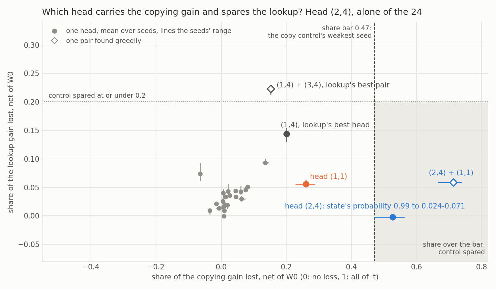
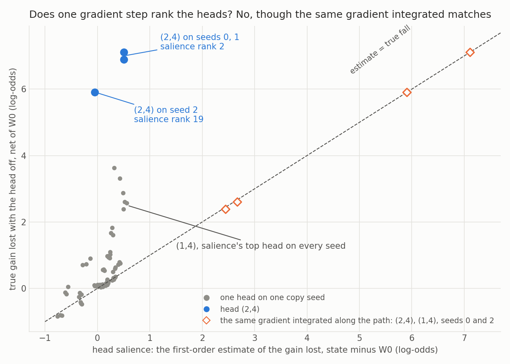
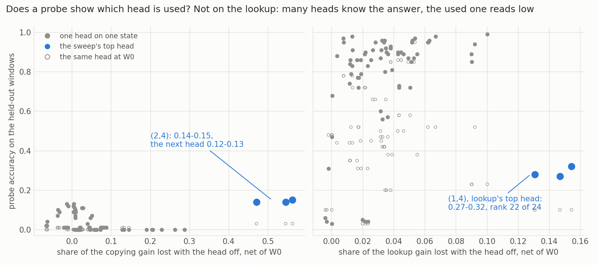
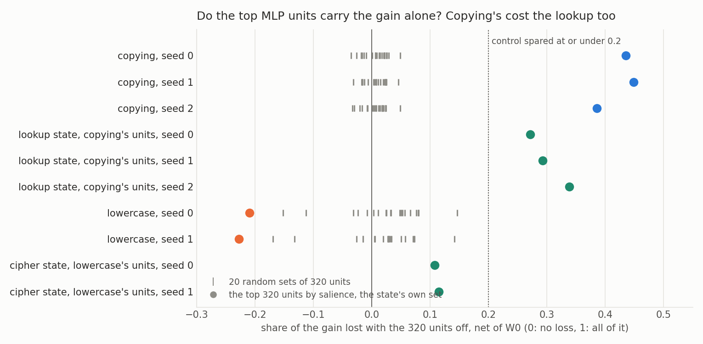
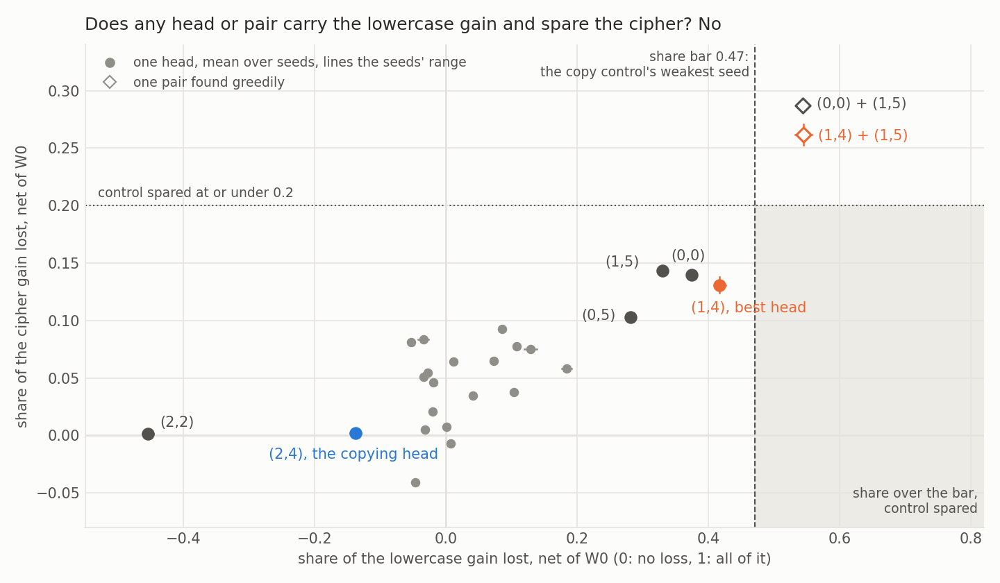
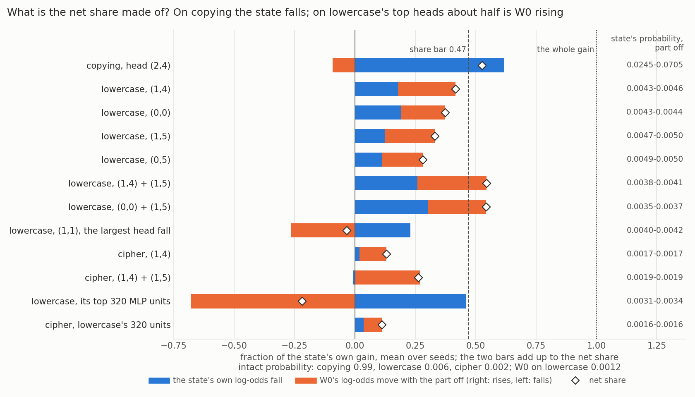
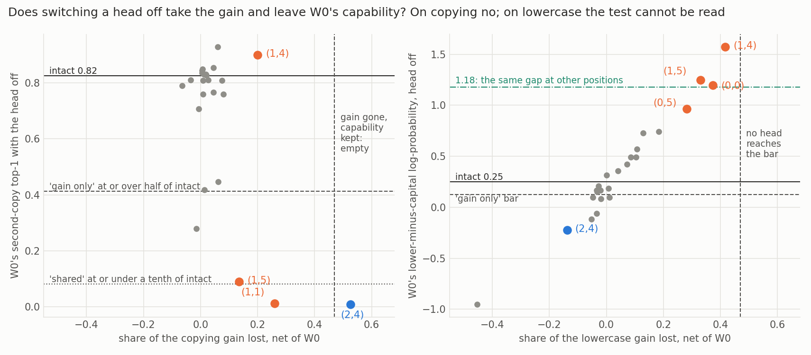

# E96: Can we find which part of the model a fine-tune runs through, without being told where to look?

We switched off each of the model's 24 attention heads in turn, on fine-tunes that copy or continue lowercase text. A sweep re-found the copying head earlier work had pointed at, but on lowercase no head or pair removed the gain, and about half the best reading was the original model moving. So the method works for narrow copying-type behaviour, fails on broad strengthening, and offers no cheap way to choose parts.

*mechaism-detection-lead, 2026-11-05. Status: provisional, no independent check. Stopped by Fable's advice; no amendment spent. Jobs 52551 and 52567, debug L40, $0. Notebook: `notebooks/E96_locate_mechanism.ipynb`.*

**Limit on every claim naming a part.** A new circuit built from old parts still reads as reuse. Finding a head says the behaviour runs through that head, not that one old circuit is unchanged.

## What we were trying to test

`GOALS.md` asks whether post-training teaches new capabilities or strengthens existing ones. The definition, at `decisions.md` rows 115 and 121, gives a label only through a located mechanism or a value removal that clears its controls. So a locator is what could give the strengthening tasks a reading at all. It must not use the prefix score or the task's construction to choose a part.

- **State:** a saved fine-tuned copy of the 67M model. W₀ is the original.
- **Copy and lookup, stages 0 and 1:** E62's states at step 30, three seeds each, on its 200 read windows.
- **Lowercase and cipher, stage 2:** E53's states at step 300, two seeds each, on E53's scored windows.
- **Part off:** the head's output replaced by W₀'s mean on natural text, at every position, in both W₀ and the state.
- **Gain $G$:** the state's mean log-odds of the target minus W₀'s.
- **Net share:** $1 - G_{off}/G$. It reads 0 if the part carries none of the gain, and 1 if all.
- **Own terms:** net share times $G$ is the state's own fall plus W₀'s rise, exactly. `plot.py` asserts this on every head.

## What we expected, and why

The sweep should name (2,4) on copying at 0.47 to 0.56, because E62 found it by prefix score. Head salience was leaned to place it in the top 3, the probe not to, and MLP units were leaned small and not specific. Lowercase was leaned to no single head, because the behaviour is broad. The plan said plainly that the control is weak: heads as the unit is itself partly being told where to look.

## What we observed

### Does a sweep of heads find the copying head by itself?

**Reading it.** Yes, and the control passes by its filed rule. Head (2,4) tops the sweep on all three copy seeds at a net share of 0.47 to 0.56, and lookup's best head (1,4) reads 0.13 to 0.15. With (2,4) off the state's probability of the target falls from 0.99 to between 0.024 and 0.071. W₀'s second-copy top-1 falls with it, from 0.82 to 0.0095, so the part reads shared. That is the located part. The control is weak: E62 had already pointed at this head, and heads as the unit is partly being told where to look. A new circuit built from old parts still reads as reuse.

| Number | Filed | Read, seeds 0-2 | As expected |
|---|---|---|---|
| Copy, top head's share | 0.47-0.56 | 0.563, 0.545, 0.471 | yes |
| Copy, second head (1,1) | 0.23-0.29 | 0.287, 0.263, 0.229 | yes |
| Copy, pair (2,4)+(1,1) | 0.67-0.74 | 0.737, 0.734, 0.666 | yes, to two decimals |
| Copy, probability with top head off | 0.02-0.07 | 0.0245, 0.0301, 0.0705 | yes, to two decimals |
| Lookup, top head's share | under 0.2 | 0.154, 0.131, 0.147 | yes |
| Lookup, (1,1)'s share | 0.04-0.07 | 0.063, 0.054, 0.052 | yes |
| Lookup, greedy pair (1,4)+(3,4) | 0.04-0.09 | 0.227, 0.214, 0.228 | no; no rule reads it |
| Lookup, probability with top head off | 0.99-1.0 | 0.982, 0.983, 0.984 | no; no rule reads it |

The lookup row's band was written for (2,4)+(1,1), which reads 0.066, 0.055, 0.056; the sweep's own greedy pair is a different pair. The median other head on copy reads 0.015 to 0.021. Stage 0 re-read every gain at a difference of exactly 0.0, and the zero update reads 0.

### Does one gradient step rank the heads as the sweep does?

**Reading it.** No, head salience failed. It ranks (2,4) second, second and nineteenth, and places (1,4) first on all three seeds. The gradient check integrates the same gradient along the line from the head's output to its mean. On all four state-minus-W₀ cases the path integral matches the true fall and the single step does not. So the code is right and the first-order step misleads. We name no further cause.

| State-minus-W₀ case | True fall | Path integral, 8 steps | Single step |
|---|---|---|---|
| copy seed 0, (2,4) | 7.118 | 7.112 | 0.506 |
| copy seed 2, (2,4) | 5.909 | 5.901 | -0.051 |
| copy seed 0, (1,4) | 2.611 | 2.665 | 0.521 |
| copy seed 2, (1,4) | 2.389 | 2.441 | 0.498 |

### Does a probe show which head is used?

**Reading it.** Not on the lookup, and the filed lean on copying missed. The lean was "not top 3", yet (2,4) ranks first on all three seeds. It reads only 0.14 to 0.15 against 0.12 to 0.13 for the next head. On about 100 scored windows that is not a distinguishable margin. On the lookup, three to seven heads read 0.95 or more, and 20 or 21 read 0.5 or more. The head that matters most, (1,4), ranks 22nd at 0.27 to 0.32. A probe reads where a thing is known, not where it is used.

### Do the most salient MLP units carry the gain alone?

**Reading it.** On copying they carry a lot of it and are not specific, so this filed lean missed. The lean was small and not specific. The state's own top 320 units take 0.39 to 0.45 of the gain, while none of 20 random sets passes 0.05. They take the probability to 0.028 to 0.052 on the odd windows. Those same units cost the lookup state 0.27 to 0.34, over the 0.2 bar, so the set is not located. A lookup state's own top 320 units cost it 0.27 to 0.33.

### Does any head or pair carry the lowercase gain and spare the cipher?

**Reading it.** No. The filed outcome is "not found at head or pair grain", with 320 units reported beside it. It does not say "no mechanism". The best single head, (1,4), reads 0.41 to 0.43 on lowercase and 0.12 to 0.14 on the cipher, under the 0.47 bar. The best pairs read 0.53 to 0.56 and fail the spared clause at 0.25 to 0.29. A new circuit built from old parts would still read as reuse.

The standard error over windows of the top head's share is 0.045 to 0.047 on lowercase and about 0.034 on the cipher. The fp32 and bf16 gains differ by at most 0.0046, and the bf16 path re-reads the stored gains. The nominators decide nothing here: salience ranks (1,4) third on both seeds and the probe 11th and 12th. The top 320 units read a net share of -0.21 and -0.23.

### Post hoc, unfiled: what is the net share made of?

**Reading it.** This re-read of saved numbers was not filed, the filed outcome stands unedited, and it stands more firmly than the shares suggest. On lowercase about half of the net share is W₀ rising with the head off, not the state falling. With (1,4) off, W₀ moves from -6.76 to -6.37 and the state from -5.08 to -5.38. That state fall is 0.29 of a 1.67 gain, and the probability is never near removed. The four top-share heads are the four that most raise W₀'s rare-target log-odds on lowercase, and all four raise it on the cipher too. On (2,4) the correction goes the other way, W₀ falling by 1.16, so the control is sound. On this task the sweep largely ranked W₀'s sensitivity to switching a head off, not a mechanism of the gain. A new circuit built from old parts would still read as reuse.

W₀ rising supplies 0.44 to 0.63 of the net fall across these parts and seeds, so "about half" is the fair word and not "most". The largest state fall of any head is (1,1), at 0.36 to 0.39, which the net share ranks 18th and 20th because W₀ falls more there. In the state's own terms the pairs read 0.25 to 0.31 of the gain and leave the cipher state unmoved. So W₀'s rise produced the clause they fail, and about half of the share they pass.

| Part off | W₀'s rise, lowercase | State's fall, seeds 0, 1 | Of its gain | Net share | State's probability off |
|---|---|---|---|---|---|
| (1,4) | +0.39 | 0.29, 0.30 | 0.18, 0.18 | 0.41, 0.43 | 0.0046, 0.0043 |
| (0,0) | +0.30 | 0.33, 0.29 | 0.20, 0.18 | 0.38, 0.37 | 0.0044, 0.0043 |
| (1,5) | +0.34 | 0.20, 0.20 | 0.12, 0.13 | 0.32, 0.34 | 0.0050, 0.0047 |
| (0,5) | +0.28 | 0.20, 0.17 | 0.12, 0.10 | 0.29, 0.27 | 0.0050, 0.0049 |
| (1,4)+(1,5) | +0.47 | 0.42, 0.43 | 0.25, 0.27 | 0.53, 0.56 | 0.0041, 0.0038 |
| (0,0)+(1,5) | +0.39 | 0.50, 0.50 | 0.30, 0.31 | 0.53, 0.55 | 0.0037, 0.0035 |
| (1,1) | -0.43 | 0.39, 0.36 | 0.23, 0.23 | -0.03, -0.04 | 0.0042, 0.0040 |
| (2,4), copying, seeds 0-2 | -1.16 | 8.28, 8.05, 7.07 | 0.65, 0.64, 0.56 | 0.56, 0.55, 0.47 | 0.0245, 0.0301, 0.0705 |

Intact, the lowercase states read a probability of 0.0062 and 0.0058, and W₀ reads 0.0012.

**One more post hoc number.** Lowercase's own top 320 MLP units take the state down by 0.72 and 0.73 log-odds. That is 0.45 and 0.47 of its gain, more than any head or pair. They take the same-seed cipher state down by 0.04 and 0.03 of its gain. W₀ falls further, by 1.05 and 1.08, so the net share is negative. W₀'s gap reads -0.61 and -0.34, so the set reads shared. It leaves the state's probability at 0.0034 and 0.0031, and more than half of the gain stays. The 20 random sets were saved only as net shares, so whether this is more than any set of 320 units would do is unread. It does not change the outcome, and it marks where an own-terms reading could look next.

### Can a part take the gain and leave the original model's capability?

**Reading it.** This is the user's test. If a part can be switched off so that the gain goes and the original model's capability stays, the two have separate mechanisms. On copying the located part reads shared. As a post hoc hint only, (1,5) takes W₀'s copying to 0.09 and costs 0.13 to 0.15 of the gain, read on two different behaviours. Its filed reading is "between". A new circuit built from old parts would still read as reuse.

On lowercase no part removes the gain, so the question has no antecedent. Seventeen of the 24 heads read "gain only" by the filed rule, and none of that is evidence for separate mechanisms. The rule's bar is half of W₀'s lower-minus-capital gap, which reads 0.25 intact on these rows and 1.18 at E53's A0 positions. Twelve heads raise the gap above intact, including all four top-share heads at 0.96 to 1.57. The other five "gain only" heads lower it but stay over a bar of 0.13.

Lowercase reads **unreadable at this grain**. Beside it go row 121's two numbers, marked behavioural: W₀'s probability of the target, about 0.0012, and the fine-tune's gain, about 1.6. This reads the user's question and adds no fourth verdict. Under the definition, lowercase stays "does not apply", as `decisions.md` rows 117 and 121 say.

## Full tables

Heads on the copy and lookup states, with W₀'s second-copy top-1 at 0.825 intact.

| Head | Copy share, seeds 0-2 | Lookup share, seeds 0-2 | W₀ top-1 off | Probe on copy | Salience on copy |
|---|---|---|---|---|---|
| (0,0) | 0.07, 0.08, 0.07 | 0.04, 0.05, 0.04 | 0.808 | 0.01, 0.01, 0.01 | 0.21, 0.19, 0.23 |
| (0,1) | 0.08, 0.09, 0.07 | 0.05, 0.05, 0.05 | 0.759 | 0.01, 0.01, 0.01 | 0.24, 0.24, 0.22 |
| (0,2) | 0.01, 0.02, 0.01 | 0.04, 0.03, 0.03 | 0.418 | 0.00, 0.00, 0.00 | 0.20, 0.21, 0.19 |
| (0,3) | 0.05, 0.04, 0.04 | 0.04, 0.04, 0.04 | 0.854 | 0.00, 0.01, 0.01 | 0.12, 0.10, 0.13 |
| (0,4) | -0.01, -0.01, -0.02 | 0.02, 0.02, 0.02 | 0.279 | 0.01, 0.01, 0.01 | -0.31, -0.34, -0.35 |
| (0,5) | 0.06, 0.06, 0.06 | 0.05, 0.04, 0.04 | 0.928 | 0.00, 0.00, 0.00 | 0.40, 0.42, 0.43 |
| (1,0) | 0.01, 0.01, 0.01 | 0.02, 0.01, 0.02 | 0.849 | 0.00, 0.00, 0.00 | 0.04, -0.04, 0.04 |
| (1,1) | 0.29, 0.26, 0.23 | 0.06, 0.05, 0.05 | 0.013 | 0.00, 0.00, 0.00 | 0.32, 0.43, 0.49 |
| (1,2) | 0.06, 0.06, 0.07 | 0.03, 0.03, 0.03 | 0.447 | 0.00, 0.00, 0.00 | -0.21, -0.28, -0.13 |
| (1,3) | 0.01, 0.01, 0.01 | 0.01, 0.01, 0.01 | 0.808 | 0.00, 0.00, 0.00 | 0.08, 0.06, 0.10 |
| (1,4) | 0.21, 0.20, 0.19 | 0.15, 0.13, 0.15 | 0.899 | 0.00, 0.00, 0.00 | 0.52, 0.56, 0.50 |
| (1,5) | 0.13, 0.14, 0.13 | 0.10, 0.09, 0.09 | 0.090 | 0.00, 0.00, 0.00 | 0.25, 0.28, 0.30 |
| (2,0) | 0.01, 0.02, 0.02 | 0.02, 0.01, 0.02 | 0.831 | 0.00, 0.00, 0.00 | 0.18, 0.19, 0.19 |
| (2,1) | 0.02, 0.02, 0.02 | 0.06, 0.04, 0.04 | 0.826 | 0.01, 0.01, 0.01 | 0.30, 0.28, 0.31 |
| (2,2) | 0.01, 0.01, 0.01 | 0.00, 0.00, -0.00 | 0.759 | 0.06, 0.07, 0.09 | 0.08, -0.06, 0.00 |
| (2,3) | -0.04, -0.03, -0.04 | 0.01, 0.00, 0.01 | 0.810 | 0.07, 0.09, 0.10 | -0.30, -0.32, -0.31 |
| (2,4) | 0.56, 0.55, 0.47 | 0.00, -0.00, -0.00 | 0.010 | 0.15, 0.14, 0.14 | 0.51, 0.50, -0.05 |
| (2,5) | 0.01, 0.01, 0.01 | 0.02, 0.02, 0.02 | 0.830 | 0.00, 0.00, 0.00 | 0.16, 0.17, 0.17 |
| (3,0) | 0.01, 0.01, 0.00 | 0.03, 0.04, 0.05 | 0.836 | 0.10, 0.11, 0.12 | 0.01, -0.05, 0.01 |
| (3,1) | 0.05, 0.04, 0.05 | 0.03, 0.03, 0.03 | 0.766 | 0.07, 0.03, 0.06 | 0.34, 0.29, 0.34 |
| (3,2) | 0.01, 0.00, 0.00 | 0.02, 0.03, 0.03 | 0.844 | 0.09, 0.09, 0.09 | 0.15, 0.06, 0.10 |
| (3,3) | 0.03, 0.03, 0.03 | 0.04, 0.04, 0.03 | 0.810 | 0.11, 0.11, 0.11 | 0.34, 0.33, 0.30 |
| (3,4) | -0.07, -0.06, -0.06 | 0.06, 0.07, 0.09 | 0.790 | 0.02, 0.02, 0.04 | -0.76, -0.67, -0.71 |
| (3,5) | -0.01, 0.00, -0.01 | 0.01, 0.02, 0.01 | 0.707 | 0.12, 0.13, 0.13 | -0.62, -0.56, -0.59 |

Parts on the lowercase and cipher states, by share on lowercase seed 0. Gains: lowercase 1.67, 1.61; cipher 3.87, 3.80. W₀'s log-odds: lowercase -6.76, cipher -10.14. W₀'s gap intact: 0.25.

| Part | Lowercase share, s0, s1 | Cipher share, s0, s1 | W₀ rise, lowercase, cipher | Lowercase state's fall, s0, s1 | Cipher state's fall, s0, s1 | W₀ gap off | Reading |
|---|---|---|---|---|---|---|---|
| (1,4) | 0.41, 0.43 | 0.14, 0.12 | +0.39, +0.43 | 0.29, 0.30 | 0.10, 0.04 | 1.57 | gain only |
| (0,0) | 0.38, 0.37 | 0.14, 0.14 | +0.30, +0.59 | 0.33, 0.29 | -0.05, -0.05 | 1.20 | gain only |
| (1,5) | 0.32, 0.34 | 0.14, 0.14 | +0.34, +0.63 | 0.20, 0.20 | -0.07, -0.09 | 1.25 | gain only |
| (0,5) | 0.29, 0.27 | 0.11, 0.10 | +0.28, +0.38 | 0.20, 0.17 | 0.03, 0.00 | 0.96 | gain only |
| (0,3) | 0.19, 0.18 | 0.06, 0.06 | +0.17, +0.24 | 0.15, 0.11 | -0.01, -0.02 | 0.74 | gain only |
| (0,1) | 0.14, 0.12 | 0.08, 0.07 | -0.03, +0.27 | 0.26, 0.22 | 0.02, 0.02 | 0.73 | gain only |
| (2,0) | 0.11, 0.11 | 0.08, 0.08 | +0.01, +0.36 | 0.18, 0.16 | -0.06, -0.06 | 0.57 | gain only |
| (1,3) | 0.11, 0.10 | 0.04, 0.04 | +0.10, +0.16 | 0.08, 0.06 | -0.02, -0.02 | 0.49 | gain only |
| (2,5) | 0.09, 0.08 | 0.09, 0.09 | +0.09, +0.42 | 0.06, 0.05 | -0.06, -0.06 | 0.49 | gain only |
| (2,1) | 0.08, 0.07 | 0.06, 0.07 | +0.09, +0.32 | 0.04, 0.02 | -0.07, -0.07 | 0.42 | gain only |
| (3,2) | 0.04, 0.04 | 0.03, 0.04 | +0.06, -0.02 | 0.00, 0.01 | 0.14, 0.16 | 0.36 | gain only |
| (3,5) | 0.01, 0.01 | 0.06, 0.07 | -0.15, +0.11 | 0.17, 0.18 | 0.13, 0.14 | 0.10 | between |
| (2,3) | 0.00, 0.01 | -0.01, -0.01 | -0.12, +0.01 | 0.13, 0.14 | -0.04, -0.04 | 0.19 | gain only |
| (3,1) | 0.00, -0.00 | 0.01, 0.01 | -0.07, -0.04 | 0.07, 0.07 | 0.07, 0.07 | 0.31 | gain only |
| (3,0) | -0.02, -0.02 | 0.05, 0.05 | -0.15, +0.14 | 0.13, 0.12 | 0.04, 0.04 | 0.08 | between |
| (0,2) | -0.02, -0.02 | 0.02, 0.02 | -0.15, +0.05 | 0.12, 0.11 | 0.03, 0.04 | 0.17 | gain only |
| (3,3) | -0.02, -0.03 | 0.05, 0.06 | -0.09, +0.24 | 0.05, 0.03 | -0.03, -0.02 | 0.21 | gain only |
| (1,1) | -0.03, -0.04 | 0.08, 0.08 | -0.43, +0.26 | 0.39, 0.36 | 0.07, 0.06 | -0.06 | shared |
| (1,0) | -0.03, -0.04 | 0.05, 0.05 | -0.14, +0.18 | 0.08, 0.08 | 0.01, 0.02 | 0.17 | gain only |
| (0,4) | -0.03, -0.03 | 0.00, 0.01 | -0.15, -0.03 | 0.09, 0.10 | 0.05, 0.05 | 0.15 | gain only |
| (3,4) | -0.05, -0.05 | -0.04, -0.04 | -0.33, -0.12 | 0.25, 0.25 | -0.03, -0.04 | 0.10 | between |
| (1,2) | -0.06, -0.05 | 0.08, 0.08 | -0.30, +0.35 | 0.21, 0.22 | -0.03, -0.03 | -0.12 | shared |
| (2,4) | -0.13, -0.15 | 0.00, 0.00 | -0.46, -0.17 | 0.24, 0.22 | 0.18, 0.17 | -0.22 | shared |
| (2,2) | -0.45, -0.46 | -0.00, 0.00 | -0.87, +0.06 | 0.12, 0.12 | -0.06, -0.04 | -0.95 | shared |
| (0,0)+(1,5) | 0.53, 0.55 | 0.29, 0.29 | +0.39, +1.16 | 0.50, 0.50 | -0.04, -0.07 | 1.76 | gain only |
| (1,4)+(1,5) | 0.53, 0.56 | 0.27, 0.25 | +0.47, +1.04 | 0.42, 0.43 | 0.01, -0.08 | 1.90 | gain only |

## What we learned

Mean-ablating heads is a working locator for narrow copying-type behaviour at head grain. It is a known failure on a broad strengthening task, where a large part of its reading is how W₀ reacts to losing a head. None of the three cheap nominators earned a place, so no nominator here scales past a sweep. For `GOALS.md`, the copying pair keeps its located reading and it reads shared, while lowercase gets no verdict. A net share is unsafe when W₀'s probability of the target is near 0.001.

## How compelling is the evidence

The control is two fine-tunes on one map family, three seeds and 200 windows, and it repeats what E62 found. The bar of 0.47 comes from its own weakest seed. Lowercase rests on two seeds and one control task, at a gain near 1.6 with a standard error of about 0.05 on the top share. Head means come from 41-token spans while lowercase's windows run 127, so later positions take a mean from earlier ones. The sweep cannot see an effect needing more than two heads, nor tell a new circuit built from old parts. The own-terms reading came after the data. All of this is provisional: no independent check was done, and none is required unless it reaches the write-up's answer paragraph.

## Surprises

**Filed leans missed, and two reversed.** The probe's lean "not top 3" reversed: (2,4) ranks first on all three seeds, by an indistinguishable margin. The MLP lean "small" reversed: the top 320 units read 0.39 to 0.45. They are not spared, costing the lookup state 0.27 to 0.34. Head salience, leaned to the top 3, ranked 2, 2, 19 and failed.

**One unexplained number.** W₀'s lower-minus-capital gap reads 0.25 on these rows. The filed expectation was near 1.18, the value at A0's positions. The cause is unknown. The capability reading on lowercase is not relied on, for this reason as well as for the missing antecedent.

**Two table entries missed, with no rule reading them.** They are lookup's probability with its top head off and its greedy pair, both in the first table.

## What next

1. **Stop and report**, as Fable advised. Any head-level variant inherits the same reading on lowercase.
2. **For the next task, report both parts in the same units.** Give the state's own fall as a fraction of its gain on the task and on the control. Keep W₀'s movement as a separate number when W₀'s probability is under about 0.01. On that shape, (1,4) reads 0.18 against 0.01 to 0.03, not located, as filed. Head (2,4) reads 0.56 to 0.65 against a lookup state that rises slightly, located, as filed. A part at 0.8 of a gain in the state's own terms, with the control under 0.2, would change the lowercase reading.
3. **If the definition's owner wants lowercase read at any grain**, the one amendment goes on that rule with the greedy set, expected "not found". It would replace a share that reads 0.53 for the wrong reason with a clean scoped null.

## Scorecard

| Id | Claim | Rule | Read | Verdict |
|---|---|---|---|---|
| Stage 0, copy and lookup | Gains re-read; zero update zero | Difference 0.0 | 0.0 on all six | as filed |
| Stage 0, lowercase and cipher | Gains re-read on E53's path; zero update zero | Within 0.02; at most 0.001 | at most 4e-16; 0 | as filed |
| Control | Top head (2,4) on all copy seeds, located, lookup not removed | `commute.locate.control` | passes | as filed |
| Capability, (2,4) | Shared | Top-1 at most 0.1 of 0.8247 | 0.0095 | as filed |
| Head salience, copy | Lean top 3 | Rank at most 3 on every seed | 2, 2, 19 | failed |
| Head salience, lookup | Top head is not (2,4) | Name differs | (0,5), (3,3), (3,3) | held |
| Probe, copy | Lean not top 3 | Rank over 3 | 1, 1, 1 | lean missed |
| MLP units, copy | Lean small, not specific | Against 20 random sets; control at most 0.2 | 0.39-0.45, random up to 0.049; lookup 0.27-0.34 | lean missed, not located |
| Gradient check | Lean first-order step misleading | 10% tolerance | All four cases | held |
| Tree, stage 1 | Sweep passes, salience fails | `commute.locate.tree` | stage 2 by the sweep alone | as filed |
| Located, lowercase | Net share at least 0.47, cipher at most 0.2, both seeds | `commute.locate.net_located` | (1,4) 0.41-0.43; pairs 0.53-0.56, cipher 0.25-0.29 | not found at head or pair grain |
| Lean, lowercase | No single head | Maximum under 0.47 | 0.43 | held |
| W₀'s gap | Near 1.18 | Rule asks only that it be positive | 0.25 | positive; expectation missed, unexplained |

## Provenance

Plan `reports/plans/2026-11-05_plan_e96-locate-mechanism.md`. Advice `reports/reviews/2026-11-05_review_e96-next-fable-advice.md`. Rules `experiments/locate_mechanism/results/predictions.json`, `predictions_stage2.json`. Results `score.json`, `sweep.json`, `nominators.json`, `stage2_score.json`, `stage2_sweep.json`, `stage2_shares.json`, `stage2_gradient.json`, `stage2_beside.json`, logs `run.out`, `stage2.out`. Figures from `experiments/locate_mechanism/plot.py`, no model. Jobs 52551 at about 1 minute and 52567 at about 5 minutes, debug L40, $0.

Corrections to the advice, from re-reading the files; none changes it:

- The state's probability falls as low as 0.0040 on a head and 0.0035 on a pair, not 0.0043.
- The largest pair fall is 0.50, on (0,0)+(1,5), not 0.43.
- On the gap, 20 heads leave it positive, 12 raise it above intact, and 17 read "gain only".
- Head (1,1) ranks 18th and 20th by share, not 19th.
- On (2,4) the lookup state rises by 0.09 to 0.15 with the head off, where the advice gave 0.09 unsigned.

## Not run

- **A greedy set of heads.** It would say "not through any set up to N". The per-head falls are spread, so such a set would be large, and its cipher cost already reads as W₀'s movement.
- **Ablation restricted to positions.** It would test a narrower cut at the read position. It removes less than a full cut that already removes too little.
- **Fewer than 320 MLP units.** It would look for a sparer set. Fable expects the same sign from the same score, which is unmeasured.
- **The narrow lowercase pair.** It would separate breadth from the task. E53 Amendment 1 stopped at W₀'s own check, so no such states exist, and two fine-tunes cost more than one amendment.
- **The ladder.** It would try a second strengthening task. Its target is constant, and it has no control saved on the same rows.
- **A planted head.** It would give a known answer not resting on E62. The nominators already failed a known answer with the cause told apart.
- **Random unit sets in the state's own terms.** It would say whether lowercase's 320 units mean more than any 320. It needs a re-read, since only net shares were saved.
- **W₀'s entropy with each head off, and the gap on A0's positions.** They would test why W₀ rises and why the gap reads 0.25. Each is under 2 minutes on debug and decides nothing now.
- **An independent check.** No claim here has yet reached a headline.

## Departures from the literature

- **Jain et al. Alg. 3** scores MLP units by gradient times weight, to prune them and watch a capability revive. Here the importance sign is used, on the gain, and the same form is also applied at head outputs, because the aim is location and not revival. The 20 random sets are the plan's number.
- **The located bar of 0.47**, from no paper, came from the control's weakest seed, truncated from 0.47099. E62's 0.5 bar was not reused.
- **Head means** were recomputed on 41-token spans while E53's windows are 127, so later positions are ablated to a mean taken from earlier positions.
