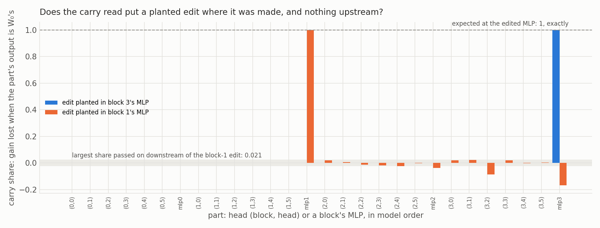
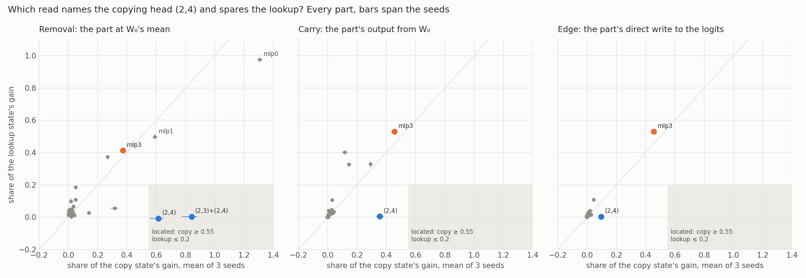
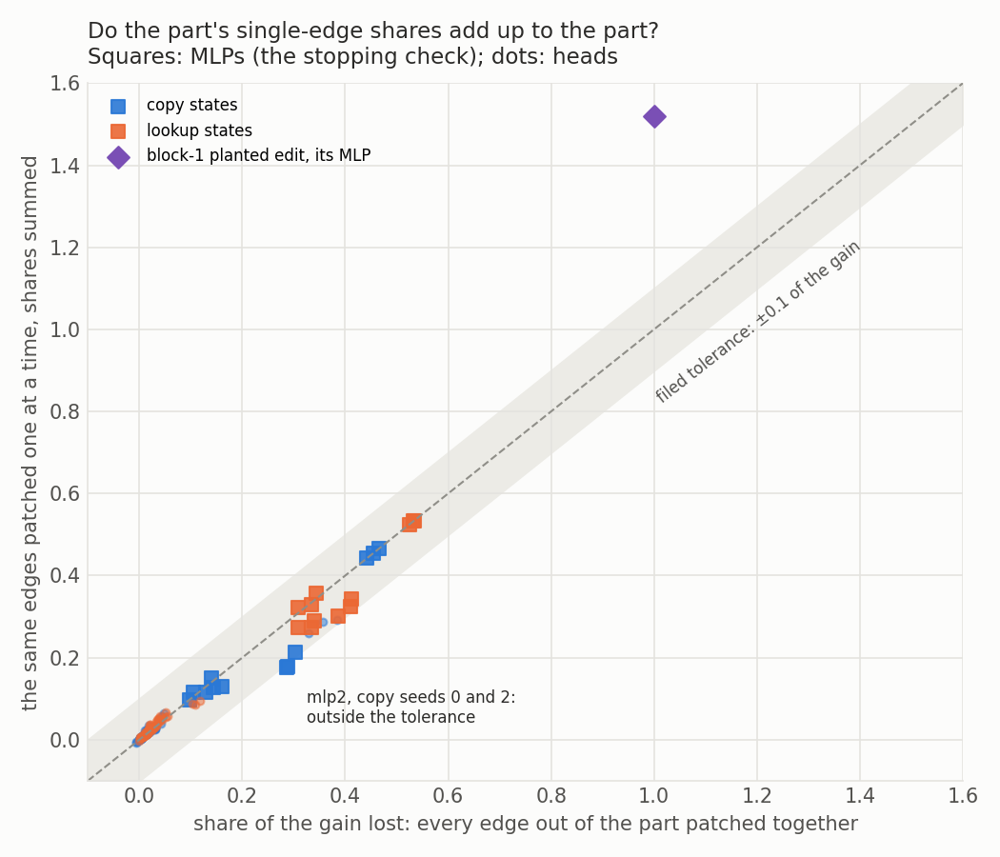
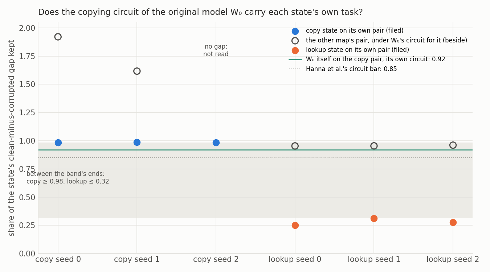
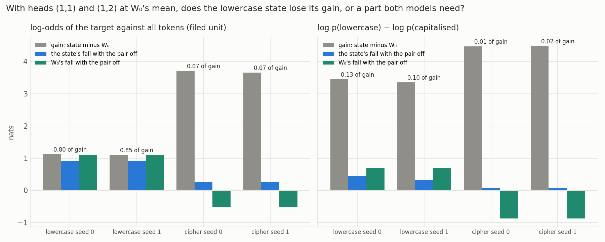

# E97: Can a locator name the part a fine-tune's gain runs through, and pass a known answer?

We tried four ways of finding the part of the 67M model that a fine-tune's gain runs through, first on edits we planted and on a copying fine-tune whose part was already known. Only setting a head to the original model's average re-found the copying head and spared the lookup control, while every read that patches the original model's outputs back in credited the last MLP on both tasks. So baseline-lead's table can take parts only from that removal, at head grain, and the lowercase result is a part both models need, which the definition does not yet settle.

*mechanism-detection-lead, 2026-11-05. Status: provisional, no independent check. E97's first run and Amendment 1, the first of its two amendments. Jobs 52618, 52619, 52646 and 52785, debug L40, $0. Notebook: `notebooks/E97_locator.ipynb`. A literature review is running in `reports/reviews/2026-11-05_review_mechanism-location-literature.md`.*

**Limit on every claim naming a part.** A new circuit built from old parts still reads as reuse. Finding a part says the behaviour runs through it, not that one old circuit is unchanged.

## The answer

Only one read passed the known answer. Setting a head to the original model's average re-found the copying head on all three copy fine-tunes and spared the lookup fine-tune. Every read that patches the original model's outputs back in, whole parts or single connections, put the last MLP first on both tasks. Those reads show where the gain enters the output, not where it is made. On lowercase, a pair of heads clears the filed rule, but the original model needs that pair too.

## What we were trying to test

`GOALS.md` asks whether post-training teaches new capabilities or strengthens existing ones. The definition at `decisions.md` lines 115 and 121 gives "reuses C" only through a located mechanism: a part whose removal takes the fine-tune's gain and spares a control task on the same windows. baseline-lead's reuse table needs that part for each saved 67M fine-tune, or "not found" at a stated grain. E96 showed that a sweep of head removals works on copying and that its cheap nominators failed. E97 asked for nominators that scale, checked against answers we know, with the label still given only by removal.

- **State:** a saved fine-tuned copy of the 67M model. W₀ is the original.
- **Gain $G$:** the state's mean log-odds of the target against all other tokens, minus W₀'s on the same reads, in nats.
- **Parts:** the 24 heads, each its 128-wide slice of the attention output, and the 4 block MLPs, at every position.
- **Removal:** the part's output at W₀'s mean over the task's own windows, in the state. Share = the state's own fall over $G$. W₀'s fall with the same part off is printed beside and never subtracted.
- **Carry:** in the state, the part's output replaced by W₀'s output on the same input. Share = gain lost over $G$. W₀ is not moved, so W₀'s own response cannot enter.
- **Write:** one matrix's update reverted, one head's slices of its four matrices reverted, one block's two MLP matrices reverted, and all 24 matrices reverted, which must give $G = 0$.
- **Sufficiency:** W₀ with the state's part, Prakash et al.'s cross-model patch. Saved, no rule.
- **Capability:** W₀'s second-copy top-1 on repeated random sequences with the part off; only the copy and lookup rows have one.

**Amendment 1's edge read.** An edge is one part's output feeding one later part's query, key or value input, an MLP's input, or the output layer: 29 upstream nodes, 927 edges, Hanna et al. 2024's graph at head grain, in our own code.

- **Gain path:** W₀'s node outputs on the same inputs stand in for the corrupted run, read in the state. An edge's score is the state's read minus the read with that edge alone patched. On E62's windows every edge was patched exactly.
- **Direct write:** a part's edge into the output layer, as a share of $G$. Carry cannot separate it from what later parts pass on.
- **Circuit:** one model, clean against corrupted inputs of the same length, scored by EAP-IG. The smallest top-n set, after pruning, whose normalised faithfulness $(m - b')/(b - b')$ is at least 0.85. Here $m$ is the metric with every edge outside the set patched, $b$ the clean metric and $b'$ the corrupted one.
- **Cross-faithfulness:** the state on its own pair with every edge outside W₀'s copying circuit patched; the share of the state's own gap kept.

**Located rule.** On every seed: task fall at least $a \cdot G$, control fall at most 0.2 of the control's gain, task fall at least twice the control's in nats. The bar $a$ is the weakest copy seed's removal share at its top head, truncated to two decimals, written before stage 2 ran: 0.55.

**Stages, control first.** Stage 0: two planted one-matrix edits on the 24-key copy table, in block 3's and block 1's MLP output matrices, scaled to the copy-24 state's gain. Stage 1: E62's copy and lookup states, three seeds, the known answer (2,4). Stage 2: E53's lowercase and cipher states at step 300, two seeds, on 256 whole rows. Stage 3, the remaining saved pairs, was conditional on stage 1's control.

## What we expected, and why

The planted edits read exactly by construction: the whole gain at the edited matrix and MLP, nothing upstream, and a measured share passed on downstream of the block-1 edit, the inheritance floor. On copy, removal at (2,4) was expected at 0.56 to 0.65, from E96, and the lookup at or below 0. Carry was expected to put (2,4) first on copy. If it did not, the tree read carry as propagation, ran no stage 3, and spent the amendment on a direct-effect read. The lookup's carry top was leaned to an MLP in blocks 0 to 2. Lowercase was leaned "not found at head grain".

The amendment leaned that (2,4)'s edge to the output would top the copy gain path and an MLP's would top the lookup's. It leaned that W₀'s copying circuit would keep at least 0.5 of the copy states' gap and at most 0.2 of the lookup states'. The band itself was to be set from those reads in the job. Its tree: if (2,4)'s edge is not top on copy, edges also read propagation; stop, write up, then the literature review.

## What we observed

### Do the reads find an edit we planted ourselves?

**Reading it.** Yes, exactly. The block-3 edit reads 1 at its MLP and 0 on every other part, and the write read gives 1 at the edited matrix and 0 at the other 23. The block-1 edit reads 1 at its MLP and 0 upstream, and later parts carry at most 0.021 of its gain: the inheritance floor. All 24 matrices reverted give $G = 0$ on every state of every stage.

| Check | Expected | Read |
|---|---|---|
| Write at the edited matrix, both plants | 1 ± 1e-4 | 1, 1 |
| Write at the other 23 matrices and 24 heads | at most 1e-4 | no miss |
| Carry upstream of each edit | 0 ± 1e-4 | 0 |
| Carry at the edited MLP | 1 ± 1e-4 | 1, 1 |
| Carry downstream of the block-1 edit | measured | at most 0.021; block 3's MLP -0.169, (3,2) -0.085 |
| Plant gains against copy-24 seed 0's 12.95 | fit within 5% | 13.18, 13.26 |
| E62's six gains re-read | within 0.02 | differences under 1e-6 |
| E53's four gains on 127-token windows | within 0.02 | differences under 1e-6 |
| W₀'s whole-row gap, lowercase and cipher | within 0.02 of 1.1776 and -5.5330 | 1.1783, -5.5321 |
| All 24 reverted, every state | at most 0.001 | 0 |

The amendment's stage 0 also passed. Its floating-point floor, fp32 against fp64 for the module and for our edge forward, summed to 2.5e-5 on the plant site and 3.5e-5 on the copy pair.

| Amendment check | Bar | Read |
|---|---|---|
| No edge patched against the module: W₀ plant site, W₀ copy pair, block-3 plant | floor | 1.9e-5 each |
| Every edge patched: block-3 plant against W₀; copy pair against W₀ on the corrupted inputs | floor | 1.7e-5, 2.1e-5 |
| Block-3 plant: block 3's MLP to output | 1 ± 1e-4, every other edge at most 1e-4 | 1.000000001; others at most 2e-6 nats |
| Block-1 plant: block 1's MLP direct to output; to later parts | measured | 2.00; -0.48, single edges summed |
| W₀'s gap on each pair | above 1 nat | copy 8.48, lookup 1.19 |

### Which read names the copying head and spares the lookup?

**Reading it.** Only removal does. It takes 0.56 to 0.65 of the copy gain at (2,4) and leaves the lookup within 0.01, so (2,4) is located, and the pair (2,3)+(2,4) takes 0.78 to 0.88. Carry puts block 3's MLP first on every seed of both tasks. The edge read gives the same order: block 3's MLP writes 0.44 to 0.53 of the gain directly into the output, while (2,4) writes only 0.08 to 0.11. Most of what (2,4) adds reaches the output through the MLPs after it; its edge into block 3's MLP is among the top five edges on every copy seed, behind its direct write in second place. A read that patches outputs in credits the last part that hands the gain over, whatever the task.

| Read, per seed 0, 1, 2 | Copy: (2,4) | Copy: block 3's MLP | Lookup: (2,4) | Lookup: block 3's MLP |
|---|---|---|---|---|
| $G$, nats | 12.65, 12.64, 12.55 | | 15.36, 14.99, 15.33 | |
| Removal share | 0.649, 0.632, 0.559 | 0.374, 0.383, 0.360 | -0.005, -0.009, -0.009 | 0.407, 0.416, 0.416 |
| Removal, W₀'s own fall, nats | 1.106 | | -0.103 | |
| Carry share | 0.383, 0.354, 0.327 | 0.455, 0.466, 0.442 | 0.005, 0.005, 0.004 | 0.524, 0.534, 0.533 |
| Sufficiency share | 0.601, 0.591, 0.612 | | 0.005, 0.005, 0.005 | |
| Direct write to output | 0.090, 0.111, 0.083 | 0.455, 0.466, 0.442 | 0.004, 0.004, 0.003 | 0.524, 0.534, 0.533 |
| Single edges out, summed | 0.291, 0.288, 0.259 | same as direct | 0.006, 0.006, 0.005 | same as direct |
| Top gain-path edge | | block 3's MLP to output on every seed | | block 3's MLP to output on every seed |

The pair (2,3)+(2,4) reads 0.867, 0.880 and 0.776, with the lookup at 0.007, -0.004 and 0.006, and is the part the table names. W₀'s second-copy top-1 falls from 0.82 to 0.0095 with (2,4) off and to 0.0017 with the pair off. W₀'s copying also needs the MLPs: top-1 falls to 0 with block 0's MLP off and to 0.08 with block 3's. The early MLPs are needed by both fine-tunes, so they are not spared. Block 0's MLP removes 1.29 to 1.32 of the copy gain and 0.97 to 0.98 of the lookup's. Block 1's removes 0.58 to 0.61 and 0.49 to 0.52.

**The write read.** Reverting one matrix's update at a time takes little on copy: the largest is 0.029, 0.037 and 0.027 of the gain, in block 0's or block 2's MLP. One head's slices take at most 0.008. The singles sum to 0.187, 0.227 and 0.159 while all 24 together remove the whole gain, so the copy update acts jointly. On the lookup the largest single is 0.063 to 0.066, in block 3's MLP, and the singles sum to 0.52 to 0.57.

**Capability, from the first run.** W₀'s second-copy top-1 is 0.825 intact. Seven parts each cost W₀ at least 0.85 of it when removed.

| Part | Share of W₀'s top-1 lost |
|---|---|
| (1,1) | 0.98 |
| (1,5) | 0.87 |
| (2,4) | 0.99 |
| (2,3)+(2,4) | 1.00 |
| Block 0's MLP | 1.00 |
| Block 1's MLP | 0.98 |
| Block 3's MLP | 0.90 |

### Why did the edge run stop?

**Reading it.** Single-edge shares do not add up to the part, and the check that expected them to was mis-specified. Patching all of an MLP's edges together reproduces E97's carry read within 1e-4 on all six states, so the code is right. Summing the same edges one at a time misses block 2's MLP by 0.110 and 0.109 on copy seeds 0 and 2, just past the filed 0.10; seed 1 misses by 0.089. The tolerance came from E96's check of integration steps, which asks a different question from whether edges add. The block-1 planted edit shows non-additivity by construction: its MLP's single edges sum to 1.52 of the gain against 1.00 together. The edge readings were saved before the stop.

| State | Block 2's MLP: edges summed | Carry and joint | Difference |
|---|---|---|---|
| Copy seed 0 | 0.176 | 0.286 | 0.110 |
| Copy seed 1 | 0.214 | 0.303 | 0.089 |
| Copy seed 2 | 0.178 | 0.287 | 0.109 |
| Lookup seeds 0-2 | 0.357, 0.323, 0.329 | 0.343, 0.308, 0.334 | under 0.02 |

The heads' summed edges agree with their joint patch within 0.10 on every state. A head's joint patch differs from E97's head carry by at most 0.01, the share of the state's change to the attention output matrix. Integrated gradients in the edge weights, run beside on the same six states, sum to 1.003 to 1.005 of the gain and name the same top edge. Single edges differ from the exact patch by up to 0.23 to 0.28 of the gain.

### Does W₀'s copying circuit tell the copy fine-tune from the lookup?

**Reading it.** By the filed rule it does, but mostly by construction. Each copy state keeps 0.98 of its gap under W₀'s copying circuit, and each lookup state keeps 0.25 to 0.31, so the filed band reads 0.98 against 0.32 and separates. The job stopped before computing the band; `edge_rules.band` was run on the saved numbers for this report. But the copy states are read on the very pair W₀'s circuit was found on, and W₀ itself keeps 0.92 there: a state that changed nothing would pass. Swap the pairs and both fine-tunes keep W₀'s circuits: lookup states keep 0.95 of the copy pair's gap, and copy states 1.6 to 1.9 of the lookup pair's gap of about one nat. So the number says which pair a state is read on, not what its update added.

| State, seeds 0, 1, 2 | Own pair under W₀'s copying circuit, filed | Other pair under W₀'s circuit for it | Edges in own circuit | Overlap with W₀'s copying circuit |
|---|---|---|---|---|
| Copy | 0.985, 0.987, 0.983 | lookup pair: 1.92, 1.62, no gap | 24, 28, 25 | 0.32, 0.38, 0.34 |
| Lookup | 0.250, 0.312, 0.276 | copy pair: 0.954, 0.955, 0.961 | 148, 148, 149 | 0.31, 0.32, 0.28 |

W₀'s copying circuit has 70 edges and keeps 0.92 of an 8.48-nat gap; its lookup circuit has 65 edges on a 1.19-nat gap. (2,4) writes several edges of W₀'s copying circuit. Overlap is edge intersection over union, and it does not separate the pair. On copy seed 2 the lookup pair's gap in the state is 0.69 nats, under the 1-nat floor, so it reads "no gap". Ratios above 1 come from gaps near one nat.

**A correction to the lead's reading.** The lead's summary says circuits from input pairs do not separate the pair. The filed comparison, the state on its own pair, does separate. The swapped reads, the beside numbers, are what do not separate. The lookup's 0.25 to 0.31 is the lookup state under W₀'s copying circuit, not its own circuit's faithfulness. The tree's first branch, the top edge, stops the run either way.

### Is the lowercase pair the fine-tune's mechanism, or a part both models need?

**Reading it.** It is a part both models need, and it counts as located (user, 2026-11-06): the fine-tune's gain runs through a part W₀ already uses, which is evidence the fine-tune reused existing parts rather than building new ones. With heads (1,1) and (1,2) at W₀'s mean, the lowercase state falls 0.90 and 0.93 nats, 0.80 and 0.85 of its gain, and the cipher state falls 0.07 of its own. That clears the filed rule on both seeds, against the lean. But W₀ falls 1.10 nats with the same pair off, more than the state does. In the lowercase-against-capitalised unit the state loses only 0.13 and 0.10 of its gain, while W₀ loses 0.70 nats. The own-terms rule says located; a net rule says the pair is something lowercase continuation needs in both models. The own-terms rule stands as the located rule; the net reading is kept as the evidence that the part already existed.

| Read on whole rows, seeds 0 and 1 | Lowercase | Cipher |
|---|---|---|
| $G$, log-odds unit, nats | 1.131, 1.089 | 3.714, 3.659 |
| $G$, lowercase-against-capitalised unit | 3.451, 3.359 | 4.476, 4.490 |
| State's fall, pair off, log-odds | 0.902, 0.929 | 0.263, 0.252 |
| Share of $G$, log-odds, filed | 0.798, 0.853 | 0.071, 0.069 |
| W₀'s fall, pair off, log-odds | 1.102 | -0.518 |
| Share of $G$, other unit | 0.130, 0.099 | 0.015, 0.016 |
| W₀'s fall, pair off, other unit | 0.703 | -0.868 |
| Best single head by removal | (1,1) 0.443, 0.448; W₀ falls 0.70 | (2,4) 0.078, 0.075 |
| Carry top | block 3's MLP 0.62, 0.67; block 2's 0.36, 0.38 | block 3's MLP 0.66, 0.67; block 2's 0.22, 0.23 |
| Write: top matrix; singles summed | block 2's MLP output 0.13; 0.46, 0.43 | block 3's MLP output 0.31, 0.32; 0.86, 0.87 |

No part is located on the cipher. Block 3's MLP takes 0.79 and 0.82 of its gain but 1.93 and 2.06 of lowercase's, so the control is not spared. The block-1 plant's floor of 0.021 sits under the smallest nominated carry share on lowercase, 0.066, so this grain can nominate there. W₀'s probability of the target is 0.098 on lowercase and 0.019 on the cipher, mean probabilities, far from the near-zero case where a net share misleads. The lowercase gain on whole rows is 1.13 nats against 1.67 on E53's 127-token windows; the 64-token removal read is saved beside.

## The table for baseline-lead

`experiments/locator_table/results/table.json`, ten rows, `verdict` left empty for baseline-lead.

| Task | Part | Located | Share, seeds | Control share |
|---|---|---|---|---|
| Copy | (2,3)+(2,4) | yes | 0.867, 0.880, 0.776 | 0.007, -0.004, 0.006 |
| Lookup | none at head or MLP grain | no; read at block 3's MLP | 0.407, 0.416, 0.416 | 0.374, 0.383, 0.360 |
| Lowercase | (1,1)+(1,2) | yes in own terms; 0.13, 0.10 in the other unit; W₀ falls 1.10 | 0.798, 0.853 | 0.071, 0.069 |
| Cipher | none at head or MLP grain | no; control not spared | 0.791, 0.819 at block 3's MLP | 1.927, 2.061 |

## What we learned

For baseline-lead's table, only removal at head grain has passed a known answer, and only on narrow copying. Reads that patch W₀'s outputs into the state report where the gain enters the output, which is block 3's MLP for both a reuse task and a new one, so they cannot nominate parts. The copy update acts jointly across matrices: no single matrix's change carries more than 0.04 of it. Cross-faithfulness under W₀'s circuit tells which pair a state is read on, and both fine-tunes keep both of W₀'s circuits. The lowercase pair is the definition's hard case, a part both models need, and the limit line in practice.

## How compelling is the evidence

The planted edits and the copy control read exactly or within a measured floor, on three seeds for copy and lookup and two for lowercase and cipher. Removal is blind to whether a part's job changed; it says only whether the state needs the part. E62 had already pointed at (2,4), so the control has few teeth, and the copy fine-tune barely writes into (2,4)'s own matrices. Carry and the edge gain path are blind to where a change is written; the write read is blind to what carries it onward, and its singles are far from additive. The edge reads cover only E62's windows. The cross-faithfulness band rests on three seeds a side, on pairs that differ by design.

## Surprises

- **The lowercase pair clears the located rule, against the lean**, and W₀ needs it more than the state does.
- **The gain path did not separate a direct write from what is passed on in the way the plan hoped.** (2,4)'s edge to the output carries 0.08 to 0.11 of the copy gain; the rest flows through later MLPs.
- **Single-matrix reverts are tiny and far from additive on copy**, 0.16 to 0.23 summed against 1 together. Unfiled.
- **The hand-write check missed as filed, on a degenerate bar.** The planted edit's share with (2,4) off is 0.0003; the bar is the lookup's largest share at (2,4), which is negative, -0.005. Both are zero to the noise.
- **Cross-faithfulness separates by the filed rule**, which the job never computed.
- **The block-1 planted edit's direct write is twice its gain**, 2.00, and later parts take back about half. Unfiled.

## What next

1. The literature review that is running: which published locator passes a planted control on a fine-tune's change. One that passes would take E97's last amendment; none would mean writing the table with removal alone.
2. Settled (user, 2026-11-06): the lowercase pair counts as located, and that W₀ needs it is evidence for reuse of an existing part. definition-lead takes it as a reuse case.
3. Hand baseline-lead the table as it stands.

## Scorecard

| Id | Claim | Rule | Read | Verdict |
|---|---|---|---|---|
| S0 write | Edited matrix 1; others 0 | ±1e-4 | 1; no miss | held |
| S0 carry | Upstream 0; edited MLP 1 | ±1e-4 | 0; 1 | held |
| S0 floor | Downstream of block-1 edit | measured | 0.021 | read |
| S0 zero | All 24 reverted | at most 0.001 | 0 on every state | held |
| S0 re-read | Gains re-read | within 0.02 | at most 0.0009 | held |
| S1 band | Copy removal at (2,4) | 0.56-0.65, reported, decides nothing | 0.649, 0.632, 0.559 | inside to two decimals; seed 2 0.001 under |
| S1 lookup | Lookup removal at (2,4) | at most 0 | -0.005, -0.009, -0.009 | held |
| S1 control | Carry tops (2,4) on every copy seed | equality | block 3's MLP on all three | missed: miss branch, no stage 3 |
| S1 lean | Lookup carry top an MLP in blocks 0-2 | lean | block 3's MLP | lean missed |
| S1 a | Bar from weakest copy seed | truncated | 0.55 | read |
| S1 hand write | Plant with (2,4) off within lookup | at most lookup's largest | 0.0003 against -0.005 | missed; bar degenerate |
| S1 located | Copy part | located rule | (2,4) and (2,3)+(2,4) | located |
| S2 lean | Lowercase none at head grain | lean | (1,1)+(1,2) located, 0.80, 0.85 | lean missed |
| S2 floor | Floor under nominated carry | can nominate | 0.021 under 0.066 | held |
| S2 cipher | Cipher part | located rule | none | not located |
| S3 | Remaining pairs | runs if S1 control passes | not run | tree |
| A1 floor | fp32 floor | measured | 2.5e-5, 3.5e-5 | read |
| A1 no patch | Edge forward equals module | floor | 1.9e-5 | held |
| A1 all patched | Equals corrupted run | floor | 1.7e-5, 2.1e-5 | held |
| A1 plant 3 | Block 3's MLP to output 1; rest 0 | 1e-4 | 1.000000001; at most 2e-6 nats | held |
| A1 plant 1 | Direct against passed on | measured | 2.00; -0.48 | read |
| A1 sum | Single edges sum to carry, MLPs | within 0.10 | block 2's MLP 0.110, 0.109 on copy seeds 0, 2 | missed; check mis-specified |
| A1 joint | All edges of an MLP equal carry | within 1e-4 | all six states | held |
| A1 heads | Head edges sum to joint | within 0.10 | all six states | held |
| A1 gap | W₀'s gap per pair | above 1 nat | 8.48, 1.19 | held |
| A1 top edge, copy | (2,4) to output, lean | top on every seed | block 3's MLP to output | lean missed: tree stops |
| A1 top edge, lookup | An MLP to output, lean | top | block 3's MLP to output | held |
| A1 circuit | (2,4) in W₀'s copying circuit | yes | yes | held |
| A1 cross, copy | Lean at least 0.5 | lean | 0.985, 0.987, 0.983 | held |
| A1 cross, lookup | Lean at most 0.2 | lean | 0.250, 0.312, 0.276 | lean missed |
| A1 band | Copy above lookup | `edge_rules.band` | 0.98 against 0.32, by hand after the stop | separated; not decided by the job |
| A1 S2, S3 | Lowercase, cipher, remaining pairs | tree | not run | tree |

## Not run

- **E97's third stage**: rank-1, half-known, copy-24 and the cipher at 24 keys; ident32 against rand32; emoticon and two ladder rungs beside, with VPD's emoticon matrix. The tree stopped it when carry missed (2,4); job 52619 stopped at once because it was queued before the bar was written, and job 52646 found no stage to run.
- **Amendment 1's lowercase and cipher edges on whole rows**, integrated gradients with the top 50 edges exact, and its third stage. The tree stopped them at the copy top edge, and the sum check stopped the job first.
- **A capability map for lowercase**, deferred by the plan.
- **An edge-sum tolerance set from a measured additivity floor.** The block-1 plant's 1.52 against 1.00 suggests no fixed tolerance holds.
- **The do-nothing state through the edge reads on a GPU**; it ran only in `tests/test_edge_rules.py`.
- **Neurons, directions, finer MLP units, edges restricted to positions, greedy circuit search, the TransformerLens package, anything on Qwen.**
- **E97's second amendment.** Its use waits on the literature review.
- **An independent check.** No claim here is a headline yet.

## Departures from the literature

- **EAP-IG in our own code**, `src/commute/edges.py`, not Hanna et al.'s `eap-ig` package on TransformerLens. The package cannot take a second model's activations as the corrupted run, and our model is not a TransformerLens model; the scoping review chose this.
- **Midpoint integration steps**, $(k + 0.5)/8$ with 8 steps, E96's checked path. The package takes $k/m$; the paper uses 5 steps.
- **Circuits by top-n then pruning**, at a grid from 10 to 927 edges, the smallest with faithfulness at least 0.85. The paper's bar is kept; its greedy search is not used, and the grid is extended down from its 30.
- **The gain path uses W₀'s outputs as the corrupted run, read in the state.** That is Prakash et al. 2024's cross-model patch at edge grain. Hanna et al. corrupt the inputs of one model.
- **Cross-faithfulness applies W₀'s circuit to a different model, the state.** Hanna et al. compare circuits for two tasks within one model.
- **A head node is its write after the attention output matrix** in the edge read, so that every edge patched is W₀'s run exactly; E97's head is the slice before that matrix. They differ by at most 0.01 here.
- **Removal uses W₀'s means on the task's own windows**, after E96's independent check, not E96's natural-text means; the latter are saved beside.
- **The edge-sum tolerance of 0.10** came from E96's integration-step check, not from any source on additivity.

## Provenance

Plans `reports/plans/2026-11-05_plan_e97-locator.md`, `reports/plans/2026-11-05_plan_e97-amend1.md`. Advice `reports/reviews/2026-11-05_review_e97-locator-fable-advice.md`; scoping `reports/reviews/2026-11-05_review_e97-eapig-scoping.md`. Rules `experiments/locator_table/results/predictions.json`, `predictions_amend1.json`. Code `experiments/locator_table/{run,job,sites,table,pairs,amend1,amend1_table}.py`, `src/commute/{locator,locator_rules,edges,edge_rules}.py`. Results `stage0.json`, `stage1.json`, `stage2.json`, `table.json`, `amend1_stage0.json`, `amend1_stage1.json`; logs `run.out`, `amend1.out`. Figures from `experiments/locator_table/plot.py`, no model.

Jobs, debug L40, $0: 52618 ran stages 0 to 2 in about 24 minutes, stage 2 taking 21; 52619 stopped at once for want of the bar; 52646 found stage 3 barred by the tree; 52785 ran the amendment's stages 0 and 1 in about 4 minutes and stopped at the sum check, peak host memory 6.1 GB.
