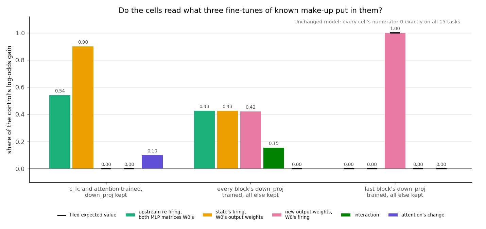
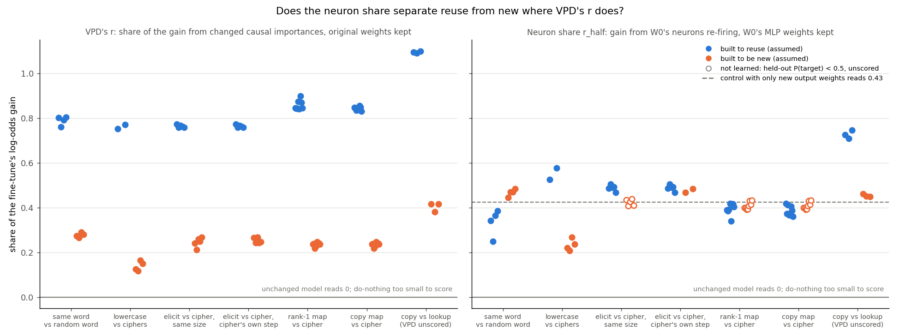
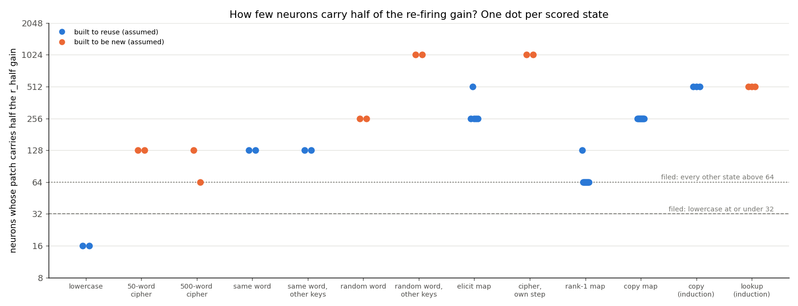
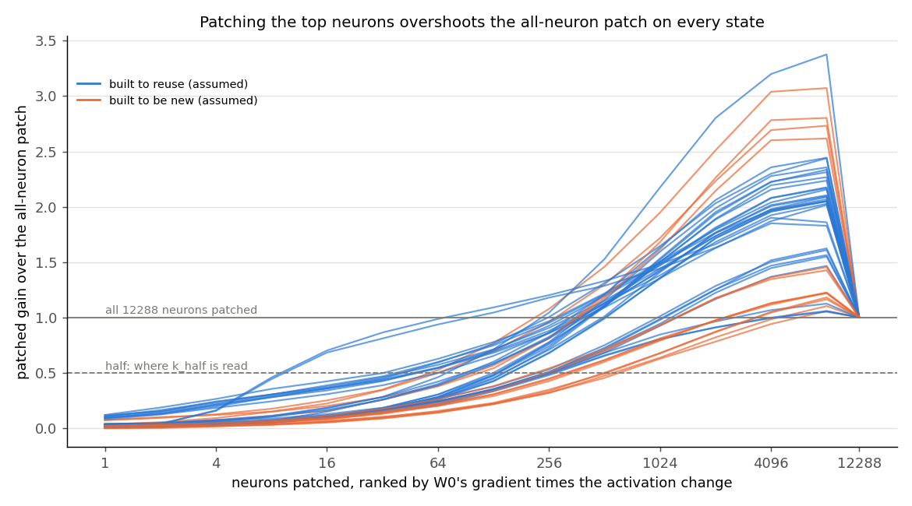

# Analysis: does a neuron version of VPD's r tell reuse from new on the 67M? (E98)

*2026-11-05, baseline-lead E98 writer. **Provisional**: fast lane, no independent check. Plan and Amendment 1:
`reports/plans/2026-11-05_plan_e98-neuron-r.md`. Advice: `reports/plans/2026-11-05_advice_e98-neuron-r-FABLE.md`. Rules:
`experiments/neuron_r/results/predictions.json`, `predictions_amend1.json`. Explanation: `notebooks/E98_neuron_r.ipynb`.
Provenance near the end.*

We measured, on 56 saved fine-tunes of the 67M, how much of each fine-tune's gain is carried by the original model's MLP
neurons firing differently while their weights stay as they were, and compared it with the decomposition's own reading
on the same fine-tunes. The neuron reading told the lowercase task from ciphers and copying from lookup, but not the
same-word maps from random-word maps nor the elicit map from the cipher, which the decomposition's reading separated by
about half the gain. So on this model a decomposition-free neuron reading is not a substitute for VPD's reading as a
reuse-versus-new signal, though the labels it is judged against are assumptions of how each task was built.

## The answer

Mostly no. We measured the share of a fine-tune's gain carried by the original model's MLP neurons firing differently,
their weights unchanged: a neuron stand-in for the decomposition's reading. It told the lowercase task from ciphers, and
copying from lookup, but not same-word from random-word maps, nor the elicit map from the cipher. The decomposition's
reading separated each of these by about half the gain. Most neuron shares sat near 0.43, where a fine-tune that only
adds new output weights also reads.

## What "reuse" and "new" mean here

Every label below except one row's is **an assumption**: "built to reuse" and "built to be new" say how a task was
constructed, not what a causal check found (`experiments/method_table/results/table.json`, `label_rule` and
`assumption_words`). The exception is the copy-versus-lookup row, labelled by switching off the original model's copying
head: lookup reads new on all three seeds, copy reads old, old and between. The user asked for the baseline to be scored
against the construction labels with this marked (`decisions.md`, row "baseline-lead's new task", 2026-11-05).

## What was measured

Nothing new was trained except three small control fine-tunes. A neuron is one of the 12288 GELU outputs across the
67M's four blocks. Each block computes $x + \mathrm{attn}(x)$, then $x + W_{\text{out}}\,\mathrm{gelu}(W_{\text{in}}\,
\mathrm{rms}(x))$, with no biases.

For each saved fine-tune, call it the state, we run the original model W0 on the task's held-out windows and swap in
pieces of the state's forward. The readout is the log-odds of the trained answer at the answer position. $T_0$ is W0's
log-odds, $T_1$ the state's, and the gain is $G = T_1 - T_0$. Each share is a mean numerator over the mean gain, so 0
means "carries none of the gain" and 1 means "carries all of it".

- **Neuron share** $r_{1/2}$, the headline: W0's own $W_{\text{in}}$, GELU and $W_{\text{out}}$ applied to the MLP input
  the state produces. It is the gain carried by W0's neurons re-firing because something upstream changed, with both
  MLP matrices kept. This is the closest neuron analogue of VPD's r, which keeps the original subcomponents' weights and
  lets Γ switch them on differently.
- **Full-width neuron share** $r_n$: W0's $W_{\text{out}}$ applied to the state's own neuron activations. This is E52 and
  E56's full-width patch; $r_n - r_{1/2}$ is what the change in $W_{\text{in}}$ adds.
- **New-weights share** $d_n$: the state's $W_{\text{out}}$ applied to W0's activations.
- **Interaction** $i_n$, and the **attention share** $e_n = (T_1 - L(\text{state's } W_{\text{out}}, \text{state's
  activations}))/G$: what is left once both MLP switches are on, which here is attention's change.

$r_n + d_n + i_n + e_n = 1$ exactly, by the same telescoping as VPD's split of its gain.

**Rows.** Seven rows of the method table where VPD's r has readings, 56 states. A state is scored when its gain is at
least 1 log-odds, VPD's own floor, and, on key-to-value tasks, its mean held-out probability of the answer is at least
0.5. A row's verdict uses E51's rule: the gap between sides must exceed the larger within-side range and be at least
0.2; under two scored states a side, the row is unreadable.

**Controls.** The unchanged model; E56's full-width shares, reproduced; a do-nothing update on two tasks; and three
fine-tunes of E54's elicit task built so each cell's answer is known. One trains only $W_{\text{in}}$ and attention, so
the new-weights share and interaction must read 0. One trains only the last block's $W_{\text{out}}$, so the new-weights
share must read 1 and every other cell 0. One trains every block's $W_{\text{out}}$ and nothing else.

## What we expected, and why

- **The neuron share would not be a reuse reader.** E52 and E56 found the full-width patch tracked training progress,
  not kind: it reversed on the same-word versus random-word row. We expected the headline share to separate on fewer
  than half the readable rows where VPD's r separates, and the same of the full-width share.
- **Copy-type gains would sit partly in attention.** The 67M's elicit and copy tasks are copying, which E62 traced to a
  head. We expected the attention share to be higher on the copy side of every readable copy row.
- **Lowercase would sit on few neurons.** E63 found about 15 neurons carry half of lowercase's gain, and 110 to 470 on
  the other tasks. We expected the smallest top set carrying half the headline numerator to be at most 32 on lowercase
  and above 64 on every other state.

## What we observed

### Do the cells read what they were built to read?

**Reading it.** Yes, every control held. The unchanged model read every cell's numerator as exactly 0 on all 15 tasks,
and E56's full-width shares reproduced within 4e-8. Training only the last block's output weights put the whole gain in
the new-weights share, 1.00, and nothing anywhere else. Training only input weights and attention left the new-weights
share and interaction at exactly 0; the full-width share and attention share sum to one, at 0.90 and 0.10. The do-nothing
update moved the log-odds by 0.16 and 0.20, under the 1.0 floor, so it has no share, as filed.

The third control is the important one. Training every block's output weights, and nothing else, gives no neuron a new
input weight. Yet the headline neuron share reads **0.43**, as large as the new-weights share at 0.42. The reason is
that a new write direction in block 1 changes the MLP input of blocks 2 to 4, whose neurons then re-fire with W0's
weights, and the share counts that as reuse. So a fine-tune that only adds new output directions already reads 0.43
here. The first job, 52747, stopped on this control because it was filed to require the new-weights share above the
full-width share; the rule did not follow from how the control was built and was replaced in Amendment 1.

| control | matrices trained | step | gain | neuron share | full-width | new weights | interaction | attention |
|---|---|---|---|---|---|---|---|---|
| input weights and attention | 20 | 10 | 8.74 | 0.54 | 0.90 | 0 | 0 | 0.10 |
| every output weight | 4 | 10 | 6.94 | 0.425 | 0.425 | 0.42 | 0.15 | 0 |
| last output weight | 1 | 100 | 6.52 | 0 | 0 | 1.00 | 0 | 0 |
| do-nothing, elicit | 0 | | −0.16 | unscored | | | | |
| do-nothing, same word | 0 | | 0.20 | unscored | | | | |

Zeros are exact; the band was 1e-6 and the largest deviation of the unchanged model was 0.

### Does the neuron share separate reuse from new where VPD's r does?

**Reading it.** Only on one of the rows VPD's r separates, plus the causal copy-versus-lookup row. On the left, VPD's r
puts every built-to-reuse state above every built-to-be-new one, by about half the gain, on all six rows it scored. On
the right, the neuron share separates lowercase from ciphers, 0.53 to 0.58 against 0.21 to 0.27. On the same-word
versus random-word row it leans the wrong way, same word 0.25 to 0.38 against random 0.45 to 0.48, short of the rule.
Elicit and cipher read the same, 0.47 to 0.50. On the copy-versus-lookup row, copy reads 0.71 to 0.75 against 0.45 to 0.46, a
separation in the direction of the causal label, where VPD's r was left unscored because copy read above 1.

Most points on the right sit between 0.35 and 0.50, around the 0.43 that the output-weights-only control reads. A
share inside that band cannot be read as "reuse" on this model, because new write directions alone produce it.

The rank-1 and copy-map rows against the cipher are unreadable as filed: the cipher had not learned its keys,
held-out probability 0.32 to 0.45, so it is unscored, as is the cipher at matched update size. Read anyway, both rows
show no separation, rank-1 0.34 to 0.42 against cipher 0.39 to 0.43. VPD's r on those rows was read on the same
unlearned cipher states.

Every row, every cell, scored states only, under the gain floor and the learned filter (`score.json` `.rows.reported.filtered`):

| row | VPD's r reuse / new | neuron share reuse / new | verdict | full-width reuse / new | verdict |
|---|---|---|---|---|---|
| same word vs random word | 0.76-0.80 / 0.27-0.29 | 0.25-0.38 / 0.45-0.48 | none, gap −0.13 | 0.36-0.50 / 0.68-0.75 | new higher, gap −0.26 |
| lowercase vs ciphers | 0.75-0.77 / 0.12-0.17 | 0.53-0.58 / 0.21-0.27 | reuse higher, gap 0.32 | 0.70-0.74 / 0.45-0.53 | reuse higher, gap 0.24 |
| elicit vs cipher, same size | 0.76-0.77 / 0.21-0.27 | 0.47-0.50 / unscored | unreadable | 0.72-0.74 / unscored | unreadable |
| elicit vs cipher, own step | 0.76-0.77 / 0.24-0.27 | 0.47-0.50 / 0.47-0.48 | none, gap 0.01 | 0.72-0.74 / 0.75-0.76 | none |
| rank-1 map vs cipher | 0.84-0.90 / 0.22-0.25 | 0.34-0.42 / unscored | unreadable | 0.62-0.68 / unscored | unreadable |
| copy map vs cipher | 0.83-0.86 / 0.22-0.25 | 0.36-0.42 / unscored | unreadable | 0.54-0.62 / unscored | unreadable |
| copy vs lookup, causal | 1.09-1.10 / 0.38-0.42, unscored | 0.71-0.75 / 0.45-0.46 | reuse higher, gap 0.27 | 0.88-0.90 / 0.72-0.73 | none, gap 0.16 |

Unfiltered, gain floor only (`.rows.reported.unfiltered`): the neuron share reads none on elicit versus cipher at the same
size, 0.47-0.50 against 0.41-0.44, and none on the rank-1 and copy-map rows; the other rows as above.

The other cells, scored states:

| row | new weights reuse / new | interaction reuse / new | attention reuse / new |
|---|---|---|---|
| same word vs random word | 0.36-0.43 / 0.23 | −0.03-0.06 / −0.02-0.03 | 0.14-0.16 / 0.04-0.06 |
| lowercase vs ciphers | 0.28-0.31 / 0.38-0.48 | −0.11 / −0.02-0.03 | 0.09 / 0.08 |
| elicit vs cipher, own step | 0.22-0.23 / 0.21-0.22 | −0.02-0.02 / 0.00 | 0.04-0.05 / 0.03-0.04 |
| copy map vs cipher | 0.36-0.43 / unscored | −0.10 to −0.08 / unscored | 0.10-0.14 / unscored |
| copy vs lookup | 0.22-0.24 / 0.17 | −0.16 to −0.12 / 0.03 | 0.02-0.03 / 0.06-0.07 |

### Do copy-type gains sit in attention?

No figure: no row separates, and the cell is small everywhere. The attention share is at most 0.16 on any scored state.
On the same-word row the copy side is higher, 0.14 to 0.16 against 0.04 to 0.06, consistent across seeds but under the
rule's 0.2 minimum gap. On elicit versus cipher both sides read 0.03 to 0.05. On copy versus lookup it goes the other way,
lookup 0.06 to 0.07 above copy at 0.02 to 0.03. So the prediction failed: at the gain's own readout most of the copy gain
runs through MLP output, whether by new output weights or by neurons re-firing after a changed head. The attention
share only counts what reaches the answer without passing through any MLP, so a head whose effect is relayed by a later
MLP is credited to the neuron cells.

### How few neurons carry half of the re-firing gain?

**Reading it.** Lowercase sits on few neurons, as predicted, but not uniquely. Both lowercase seeds reach half the
headline numerator with the top 16 neurons, matching E63. The prediction failed because seven of eight rank-1 maps
reach half with 64 neurons, and one 500-word cipher seed also does. Every other state needs between 128 and 1024
neurons, built-to-reuse and built-to-be-new alike.

| task | side | neurons for half, per seed |
|---|---|---|
| lowercase | reuse | 16, 16 |
| 50-word cipher; 500-word cipher | new | 128, 128; 128, 64 |
| same word; same word, other keys | reuse | 128, 128; 128, 128 |
| random word; random word, other keys | new | 256, 256; 1024, 1024 |
| elicit map | reuse | 256, 512, 256, 256, 256 |
| cipher at its own step | new | 1024, 1024 |
| rank-1 map | reuse | 128, then 64 on seeds 1-7 |
| copy map | reuse | 256 on all eight seeds |
| copy; lookup, induction task | reuse; new | 512 on all three; 512 on all three |

A caveat that bears on every number above: on every state, patching the top-ranked neurons overshoots patching all of
them. The top 8192 neurons carry up to 3.4 times what all 12288 carry. Lowercase and the rank-1 maps both overshoot
about twofold. The bottom of the ranking holds neurons whose re-firing works against the gain. So "half" is half of a
net total much smaller than the gross. A set that reaches it holds the strongest positive contributors; it is not shown
to be needed for the gain.

Why this might separate where E63's counts did not: E63 counted neurons by how the weight update or the activation
shift spread over them, which says nothing about which neurons carry the gain. This count is causal: neurons are ranked
by their effect on the answer and their sufficiency is checked by patching. Why it might not mean "reuse": the rank-1
maps are low-rank by construction, so a small carrying set may follow from the update's rank rather than its kind; the
copy maps, also built to reuse, need 256. And the set is ranked and read on the same windows, so it is in-sample.
Treat the 64-neuron rank-1 result as a lead for the interpretation step, not a finding.

## What this says about the essay's claim

The essay behind this request argues that the MLP neurons of trained language models are already interpretable, each
with mostly one job, judged by reading top activations, steering and ablation on Qwen3-32B
(https://already-clean.goodfire.com/essay.md). It makes no claim about fine-tuning. Its natural prediction here is
that a fine-tune that strengthens an existing behaviour should run through a few existing neurons re-firing, and one
that teaches something new should need new weights. E98 measures the first half of that, the share carried by re-firing,
and finds it does not follow the construction labels on most rows, chiefly because new output weights in one block
show up as re-firing in later blocks. That bears on using neuron firing as a reuse detector on a four-block 67M. It
does not bear on whether the neurons are interpretable, which E98 did not test. The lowercase result, 16 neurons for
half its re-firing gain, is the case where the essay's method would be worth trying next.

## What we learned

A decomposition-free neuron reading does not reproduce VPD's reuse-versus-new separation on the 67M's rows. Its main
failure is structural: with stacked MLPs, a new write direction in one block makes later neurons re-fire, so the
reading cannot tell new weights from reuse, and on this model that floor is about 0.43 of the gain. VPD's r shares the
relay blind spot in principle, yet on these rows it separated by about half the gain where the neuron reading did not.
For `GOALS.md`, this is evidence that VPD's reading is not just a dressed-up neuron patch on this model, with the caveat
that both readings are judged against labels that are assumed.

## How compelling is the evidence

- **Labels.** Six of the seven rows' labels are construction assumptions. On the one causal row, the neuron share
  agreed with the label.
- **Coverage.** Three readable rows under the filed rules, plus the causal row, one model, two to five seeds per side.
  The rank-1 and copy-map rows and the matched-size row are unreadable because their cipher had not learned.
- **Noise floor.** The unchanged model reads 0 exactly; the rule's floor is each row's within-side seed range, 0.03 to
  0.14 for the neuron share.
- **Blind to.** Relays: any re-firing caused upstream, including by new output weights, counts as reuse; the
  output-weights-only control measures it at 0.43 on E54's elicit task, on one seed and one task. Where in attention a
  gain sits. Progress: E56 found the full-width share rose with training.
- **Positive controls.** The three built fine-tunes test what each cell reads, not kind. No state of independently known
  kind exists on these rows apart from the causal one.

## Surprises

- The output-weights-only control reads 0.43 on the headline share. It was expected to read low, and it sets the floor
  that most built-to-reuse states fall inside.
- The rank-1 maps reach half their re-firing gain with 64 neurons, a quarter of the copy maps' count on the same keys.
- Top-k patches overshoot the all-neuron patch on every state, by up to 3.4 times.
- On copy versus lookup, the causal row, the neuron share separates in the label's direction while VPD's r was unscored.

## What next

1. **The interpretation step on lowercase and the rank-1 maps.** On their 16 and 64 neurons: W0's top Pile windows,
   ablation, a written job and a blind test. If the rank-1 set reads as one coherent job in W0, the small count is about
   reuse; if not, about the update's rank.
2. **Remove the relay.** Read the neuron share block by block with downstream blocks held at W0's MLP input. If the
   output-weights-only control then reads near 0 and the same-word row still does not separate, the neuron reading fails
   on kind, not on relays.
3. **Heads as units** only if a copy row's attention share rises once relays are cut; as it stands the attention share is
   small everywhere.

## Departures from the literature

- **VPD's r** (`src/commute/regating.py`, `local_faith.py`): VPD transplants Γ's causal importances into a forward of the
  original subcomponents. A neuron has no gate apart from its weights, so we transplant the MLP input, keeping both MLP
  matrices W0's, for the headline, and the activations themselves for the full-width share. GELU's own factor is not
  transplanted alone, since it saturates and would miss strengthening, as the advice's section 1 notes.
- **The essay's method** reads neurons by top activations, steering and ablation. We do none of that here; we only
  measure carrying shares and a carrying set. The interpretation step is not run.
- **The carrying ranking** follows E56's `ctxpatch.py`, which multiplies W0's gradient by the activation; we multiply by
  the activation's change, so a neuron that does not move is not ranked.
- **The learned filter** from the advice, held-out probability at least 0.5, is not applied to the lowercase and cipher
  next-token tasks, where it would empty the row by construction: lowercase's mean probability is about 0.006.

## Scorecard

| id | claim | rule | read | verdict |
|---|---|---|---|---|
| Stage 0 | apparatus | W0 cells = T0 within 1e-6; E56 within 1e-5; do-nothing |G| < 1; controls per Amendment 1 | max W0 deviation 0; E56 diffs 3.3e-8, 4.9e-9; do-nothing −0.16, 0.20; all three controls held | pass |
| P1 | the neuron share is not a kind reader | separates reuse-higher on fewer than half of readable rows of e46, e53, e54_own, open_pair_c3, at least 3 readable | readable e46, e53, e54_own; separates e53 only; e46 none, gap −0.13; e54_own none; open_pair_c3 unreadable | pass |
| P1r | the same of the full-width share | as P1 | e46 new higher, gap −0.26; e53 reuse higher; e54_own none | pass |
| P2 | copy gains partly in attention | attention share separates reuse-higher on every readable row of e46, e54_own, open_pair_c3_copy, e62 | e46 none, gap 0.10 under 0.2; e54_own none; e62 lookup higher, gap −0.04; c3_copy unreadable | fail |
| P3 | lowercase on few neurons, alone | k_half ≤ 32 on lowercase, > 64 on every other scored state | lowercase 16, 16; broad_cipher_s1 and c3_rank1 s1-s7 at 64 | fail |

## Not run

- e58_rank1_96, e58_elicit_shuffle, e58_copy_prior_cipher, e58_class_twin: states not saved, or windows only.
- Seeds 2-4 of the cipher at its own step: read by E56, not saved, so that side has two seeds here against VPD's five.
- The interpretation step from the essay, and heads as units.
- A relay-free neuron share, block by block.
- An independent check of this report.
- The output-weights-only control on any task but E54's elicit, or on a second seed.

## Corrections to the plan

The plan's stage list says `cfc_attn` trains 16 matrices and `down_only` 8; the run trained 20 and 4, as
`stage0.json` `n_matrices` records. The first is the attention query, key, value and output matrices plus
$W_{\text{in}}$ in each of four blocks; the second is one $W_{\text{out}}$ per block. The plan now carries a dated note;
`predictions.json` keeps its filed text.

## Provenance

- Job 52786, MATS `debug`, one L40, 20:37 to 20:41 on 2026-11-05, about 4 minutes, $0. Peak GPU 12.1 GB, host 6.1 GB.
  Code at `2ae75888`, clean. Log: `cluster/logs/commute-neuron-r-52786.out`, score lines 238-241.
- Job 52747 stopped at stage 0's output-weights-only control: `experiments/neuron_r/results/stage0_job52747.json`.
- Results: `experiments/neuron_r/results/{stage0,cells,carrying,score}.json`; 67 input files checked by sha256.
- VPD's r: `experiments/method_table/results/table.json`, `.rows[].cells.r`.
- Figures: `experiments/neuron_r/plot.py` into `experiments/neuron_r/figures/`.
