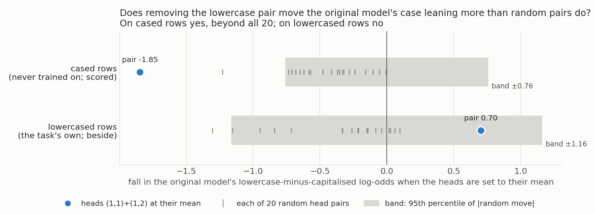
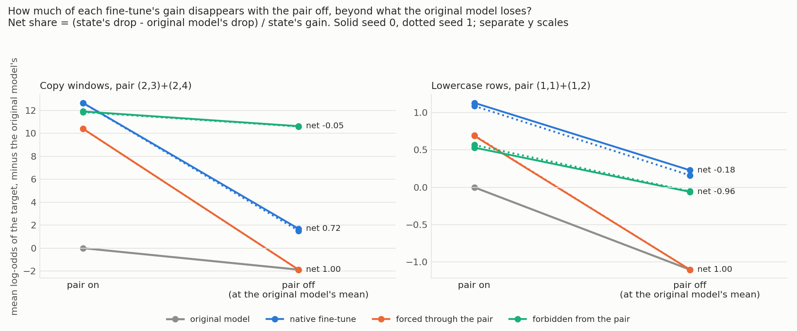
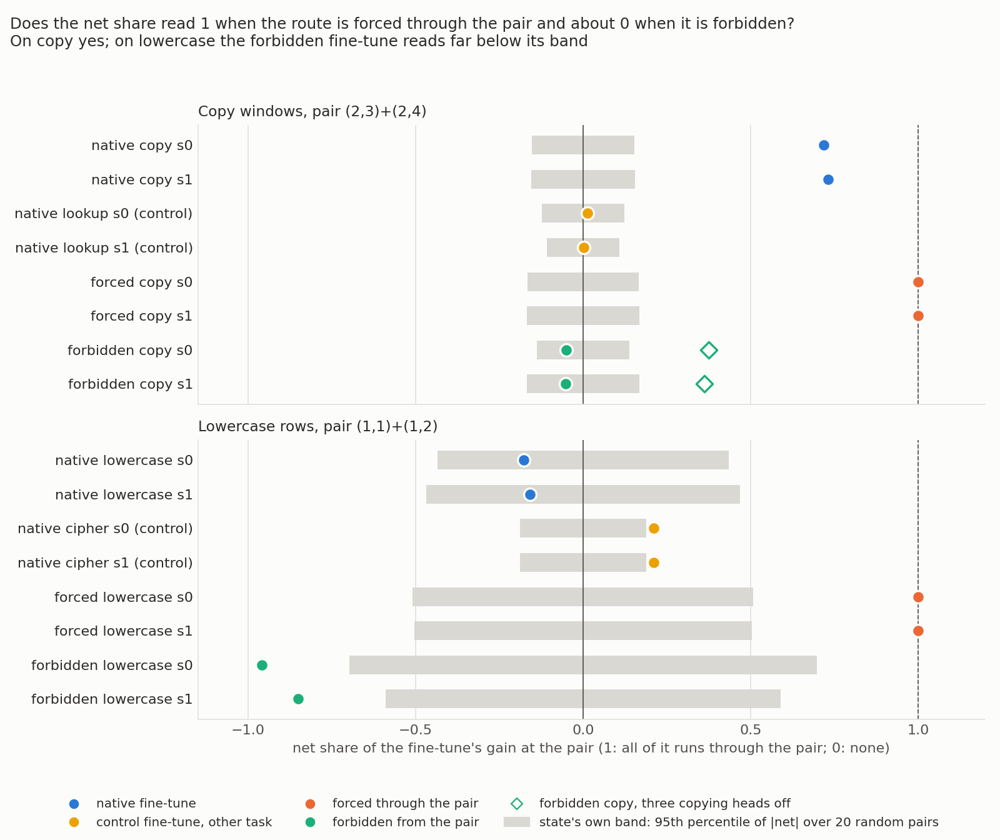
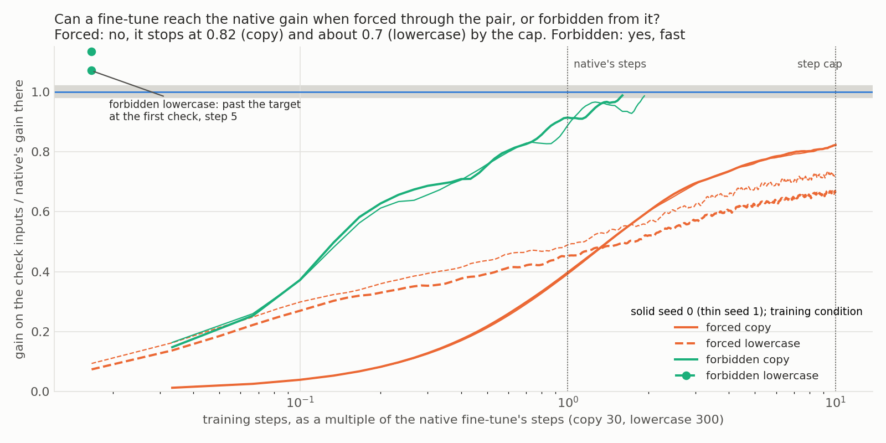
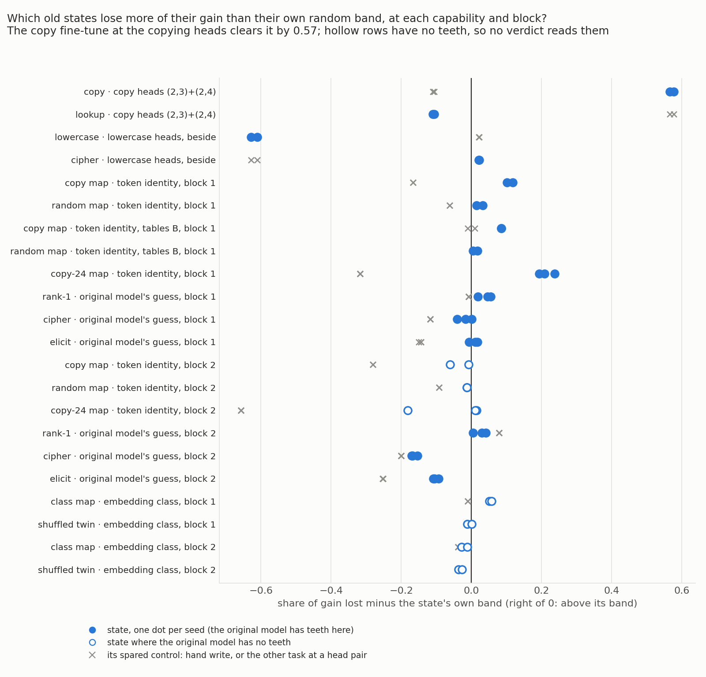
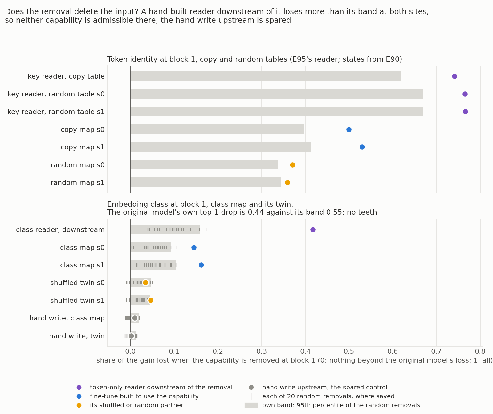

# E99: Does the new-against-reuse definition read the right answer where the answer is known, and what does it say on every old 67M task?

*Definition-lead, 2026-11-05. Stages 0-5 of `reports/plans/2026-11-05_plan_e99-refine-verify-definition.md`, with Amendment 1 for stage 3. Jobs 52787 and 52807 (stages 0-3) and 52895 (stage 4, part d), MATS `debug`, L40; stage 4 parts a-c and stage 5 on CPU from stored files; $0 in all. Status: provisional, fast lane, no independent check. Notebook `notebooks/E99_definition_verify.ipynb`. Stages 4-5 added to this report on 2026-11-05.*

We trained small fine-tunes on the 67M model whose route was fixed by construction, then read every old 67M task under the refined rules. The copying pair passes every test and keeps the one verdict, while every other task is closed with a stated reason; the class map fails because removing its capability also costs a hand-built reader of the input. For `GOALS.md`, the tasks we called strengthening still have no reading of "existing" on this model, and removing a capability's value directions has no admissible site here.

**Limit on every claim.** A new circuit built from old parts reads as reuse (`decisions.md` row 121). The forced and forbidden fine-tunes are ground truth for "through the pair", not for "reuses the old function".

## The answer

Under the refined rules, only the copying task gets a verdict on the 67M model. Its gain runs through two copying heads, and fine-tunes forced through those heads or kept away from them read as built. Every other old task reads "does not apply", "no capability listed", "no admissible capability" or "unreadable", each with its reason. The class map fails the new admissibility test: removing the class costs a hand-built reader of the input more than its band, so removing value directions has no admissible site here.

## What we were trying to test

The definition under test is `decisions.md` rows 81 and 115: an update reuses a capability C when its behaviour runs through what C computes, read by removing C. Since the user's batch decision of 2026-11-05, a label needs a located mechanism. E97 located two head pairs: heads (2,3) and (2,4) on the copy task, and heads (1,1) and (1,2) on the lowercase task. Fable proposed reading a located pair through a **net share**:

$$\text{net} = \frac{\text{state's fall with the pair off} - \text{original model's fall with the pair off}}{G},$$

where $G$ is the fine-tune's mean gain in the log-odds of its target over the original model, and "off" sets the pair's outputs to the original model's mean over the same inputs. A net share of 1 means all of the update's increment vanishes with the pair; 0 means none of it does; a negative value means the increment is larger with the pair off than with it on. Each state's **band** is the 95th percentile of the absolute net share over 20 random head pairs drawn outside the pair, on the same state and inputs.

The question is whether this quantity reads the right answer when the answer is known. Two constructions fix it:

- **Forced**: train with every weight outside the pair's query, key and value rows reset to the original model after every step, output matrices included. The state with the pair off then equals the original model with the pair off, so the net share is 1 by construction. This is the positive control; it can fail only through a code error or through the pair being unable to learn the task.
- **Forbidden**: train with the pair held at the original model's mean, and keep the pair's own weights at the original model's. Read the result with the pair restored. The update cannot have used the pair, so the net share should sit within the band.

Each was trained until its gain, read in its training condition on a check subset, came within 2% of the native fine-tune's gain, with a cap at ten times the native's steps. Copy used E62's recipe, native 30 steps, read on E62's copy windows; the spared control is E62's lookup fine-tune at the copying pair. Lowercase used E53's recipe, native 300 steps, read on whole rows; its control is E53's cipher fine-tune. Two seeds each.

Stage 0 also tested the second admissibility clause of the proposed rule for fixed-answer tasks: the pair's function in the original model must depend on the input, on inputs the task never trained on. The read is how far setting the lowercase pair to its mean moves the original model's lowercase-minus-capitalised log-odds on cased rows, against the same 20 random pairs.

### Stages 4 and 5: every old task under the refined rules

Stage 4 reads every old 67M task again under three rules the plan adopted from Fable.

- The **net-share rule** reads a located pair as above. It gives a verdict only if the forced arm read 1 and the forbidden arm read inside its band, so on the copying pair it now has both controls.
- The **admissibility rule** asks two things of a capability at a site before any band is read. First, the capability must merge inputs: at least two inputs per value on average, and more than one value. Token identity sends each key to itself, one input per value, so it fails. Second, a hand-built reader of the input alone, placed downstream of the removal and matched to the state's gain, must stay inside its own band when the capability is removed. If that reader loses its gain, the removal deletes the input. A state's loss then says no more than that the state needs its input.
- The **band rule** gives each state its own band from 20 random removals matched in variance. Two states are compared with E95's paired test: the gap between their shares against the same gap under each random removal, for every pair of seeds. Bands are pooled to the largest only if a band's spread across redraws exceeds the gap between the states' bands.

Parts (a) to (c) read stored numbers on CPU. Part (a) reads the copy and lookup fine-tunes at the copying pair. Part (b) applies the admissibility rule to every capability E90 listed. Part (c) reads every old state against its own band.

Part (d) rebuilds E58's class map and its shuffled twin, two seeds, 30 steps of E58's recipe. The class map sends each of 96 trained keys to one of four class words. A key's class is fixed by the signs of its scores on the two leading principal directions of the original model's input embeddings. The twin is trained to the same four words with the classes shuffled across keys. The capability is this embedding class, removed at block 1's output at the key position along three directions, the centred class-mean residuals. The read is the share of each fine-tune's log-odds gain lost under the removal, beyond what the original model loses, against 20 random removals matched in variance. Three controls come first:

- **Teeth**: the original model must lose more of its own top next token under the removal than random removals cost it. Without teeth no state's verdict is read.
- **Hand-write control**: a hand-written change to block 1's MLP output weights writes each key's answer. It reads the key upstream of the removal, so the removal can only touch its answer side, and it must be spared.
- **The admissibility reader**: the same hand-written change placed at block 2's MLP, downstream of the removal. This is the second admissibility clause's reader, not a control.

Stage 5 puts every old row in one table: task, the label it was assumed to have, the verdict, and the reason.

## What we expected, and why

- Stage 0: the original model's falls and the native states' gains reproduce E97's numbers exactly, since the code and inputs are the same; the lookup is spared at the copying pair.
- Clause (ii): the lowercase pair moves the case leaning on cased rows. As coded, the rule also asked for a move on lowercased rows, which the plan did not ask.
- Forced copy and forced lowercase: net share 1 within 0.05, whether or not the gain reaches the native's. The filing says what a cap means on lowercase: R-net has no positive control there and falls back to "does not apply".
- Forbidden copy: within band, with the gain with the pair restored within 10% of the native's.
- Forbidden lowercase: within band, and learning as fast as the native.

Stage 4, filed in `results/predictions_stage4.json` before any stage-4 read:

- The copy fine-tune reads "reuses C" on both seeds, with lookup spared and every seed pair separated by the paired test, since both constructed arms passed on copy.
- Token identity fails both admissibility clauses where E95's reader exists, and the first clause everywhere. So the copy maps read "no admissible C at this site: the removal deletes the input". The original model's guess merges inputs, but no token-only reader was ever placed downstream of it. So rank-1 reads "unreadable", rather than passing by default.
- Every per-state verdict in part (c) was written down from the stored numbers before the run, with no band pooled. The random map at block 1 was expected to read "reuses C" against its own band, as E90 and E95 reported. The paired calls were filed per pair of states: at block 2 the copy map against the random map "no pair", because E90 saw the order reverse there; rank-1 against cipher a lean of "some pairs" at both blocks.
- The class-map fine-tunes reproduce E58's held-out probability of the target at step 30 exactly. The original model was expected, at 55%, to have no teeth at either block, because the class directions are input-embedding directions, not ones it reads its next token from. The hand writes were expected spared. The admissibility reader was expected, at 60%, to fail, as E95's key reader did under token identity. If it fails, the class map reads "no admissible C at this site" and, as Fable put it, removing value directions has no admissible site on this model.

## What we observed

### Do the controls reproduce?

Yes, exactly. The original model's falls with each pair off equal E97's to the last digit on all four sites, and every native state's gain and own share reproduce. The lookup fine-tune's net share at the copying pair is 0.014 and 0.003, under the spared bar of 0.2.

| Site, pair | Original model's fall, log-odds | E97 | Twice its row SE |
|---|---|---|---|
| Copy windows, (2,3)+(2,4) | 1.876 | 1.876 | 0.178 |
| Lookup windows, (2,3)+(2,4) | -0.100 | -0.100 | 0.077 |
| Lowercase rows, (1,1)+(1,2) | 1.102 | 1.102 | 0.107 |
| Cipher rows, (1,1)+(1,2) | -0.518 | -0.518 | 0.147 |

| Native state | G | Fall, pair off | Own share | Net share | Band | G with the pair off in both |
|---|---|---|---|---|---|---|
| Copy s0 | 12.65 | 10.96 | 0.867 | 0.719 | 0.153 | 3.56 |
| Copy s1 | 12.64 | 11.12 | 0.880 | 0.731 | 0.155 | 3.39 |
| Lookup s0 | 15.36 | 0.11 | 0.007 | 0.014 | 0.124 | 15.16 |
| Lookup s1 | 14.99 | -0.06 | -0.004 | 0.003 | 0.109 | 14.95 |
| Lowercase s0 | 1.131 | 0.902 | 0.798 | -0.177 | 0.434 | 1.33 |
| Lowercase s1 | 1.089 | 0.929 | 0.853 | -0.159 | 0.468 | 1.26 |
| Cipher s0 | 3.714 | 0.263 | 0.071 | 0.210 | 0.189 | 2.93 |
| Cipher s1 | 3.659 | 0.252 | 0.069 | 0.210 | 0.189 | 2.89 |

The cipher control at the lowercase pair reads 0.21 net on both seeds, just above its band of 0.19. Its own-terms share is 0.07. The original model rises 0.52 when the pair is off on cipher rows, and the net share adds that rise back.

### Does the lowercase pair's function depend on the input?

**Reading it.** On cased rows, yes; on lowercased rows, not distinguishably from random pairs. Setting the pair to its mean moves the original model's case leaning on cased rows by -1.85, beyond the band of 0.76 and beyond all 20 random pairs. On lowercased rows the move is 0.70 against a band of 1.16. The filed rule asked for both, so S0-ii missed as coded and stage 3 was skipped in job 52787.

The plan words the clause on cased rows only. Amendment 1, the lead's call dated 2026-11-05, filed that wording in `results/predictions_amend1.json` before running, with the lowercased-row reading kept beside. It passes on the stored numbers, and stage 3 ran in job 52807.

What the clause can and cannot say: all 20 random-pair moves on cased rows are negative, from -0.005 to -1.23. Removing almost any two heads makes the original model lean further toward the lowercase form on cased text. The pair moves the gap in that same direction, further than any random pair. So the clause shows the pair matters more than a random pair to this one gap. It does not show the pair does something specific to case. The pair moves the gap in opposite directions on the two row types: -1.85 on cased rows, +0.70 on lowercased rows.

### Does the net share read 1 when forced and 0 when forbidden?

**Reading it.** On copy, yes on both seeds; on lowercase, only the forced half reads as filed. The forced fine-tunes read net 1.00 on both tasks and both seeds, with their mean log-odds at the pair off equal to the original model's. The forbidden copy fine-tunes read -0.05 against bands of 0.14 and 0.17. Their gain with the pair restored is 0.94 of the native's, within the 10% bar. With all three copying heads that E62 found off, (2,3), (2,4) and (3,4), the forbidden copy fine-tune loses 0.38 and 0.36 net. So part of its route runs through head (3,4), the other copying head. No band was drawn for three-head sets, so this is a reading beside, not a verdict. The forbidden lowercase fine-tunes read -0.96 and -0.85, far below their bands of 0.70 and 0.59.

| Arm, seed | Steps | Status | G | G / native | Fall | Net | Band | Reading |
|---|---|---|---|---|---|---|---|---|
| Forced copy s0 | 300 | cap | 10.40 | 0.822 | 12.28 | 1.000 | 0.166 | net 1 |
| Forced copy s1 | 300 | cap | 10.40 | 0.823 | 12.27 | 1.000 | 0.167 | net 1 |
| Forbidden copy s0 | 48 | matched | 11.90 | 0.941 | 1.28 | -0.050 | 0.139 | within band |
| Forbidden copy s1 | 58 | matched | 11.84 | 0.937 | 1.26 | -0.052 | 0.169 | within band |
| Forced lowercase s0 | 3000 | cap | 0.689 | 0.610 | 1.791 | 1.000 | 0.508 | net 1 |
| Forced lowercase s1 | 3000 | cap | 0.695 | 0.639 | 1.797 | 1.000 | 0.503 | net 1 |
| Forbidden lowercase s0 | 5 | past target | 0.532 | 0.470 | 0.592 | -0.959 | 0.698 | below band |
| Forbidden lowercase s1 | 5 | past target | 0.567 | 0.520 | 0.620 | -0.851 | 0.590 | below band |

Beside: the forbidden copy fine-tune's gain with the pair off in both models is 12.49 and 12.46. The forced copy states keep the original model's second-copy accuracy on E52's induction read, 0.877 and 0.878 against 0.825. That read shows no sign that the pair's copying was replaced by something else; it is blind to added functions that leave copying intact.

### Can the forced fine-tunes reach the native gain?

**Reading it.** No, on either task. Allowed only the two heads' query, key and value rows, the copy fine-tune reaches 0.82 of the native gain by the cap of 300 steps, still rising slowly. The lowercase fine-tune reaches 0.61 and 0.64 on whole rows by 3,000 steps, and its curve has nearly flattened. On copy the cap does not touch the filed rule: net 1 holds. On lowercase the filing says the cap means R-net has no positive control, and lowercase falls back to "does not apply".

### Why does the forbidden lowercase fine-tune read far below its band?

This is the anomaly the plan did not expect, and it is a property of how the arm was stopped, as far as the code and numbers show.

What each number measures, from `run.py` `train_arm` and `arms.Matcher`:

- The **target** is the native fine-tune's gain on the first 32 lowercase rows, read against the intact original model: 1.15 and 1.05.
- The **check** reads the arm's gain on the same 32 rows in its training condition: the arm with the pair at its mean, against the original model also with the pair at its mean. At the first check, step 5, it read 1.23 and 1.19, past the target, and training stopped. Both seeds overshot the 2% band, so the status is "nearest check outside the band of the target", not "matched".
- The **reported G** is read on all 256 whole rows with the pair restored, against the intact original model: 0.53 and 0.57, which is 0.47 and 0.52 of the native.

So the stop rule compares two gains measured from different references. On lowercase, removing the pair costs the original model 1.10, about as much as the whole target. On copy the same cost is 1.88 against a target of 12.6, which is why the forbidden copy arm was not affected. The training loss shows the size of the starting deficit: on the same first batch, the original model's loss is 3.31 and 3.10 with the pair on, and 4.05 and 3.82 with it at its mean.

Where each model sits, in mean log-odds of the target relative to the intact original model, seed 0 (seed 1 within 0.07):

| Model | Pair on | Pair off |
|---|---|---|
| Original model | 0 | -1.10 |
| Native fine-tune | 1.13 | 0.23 |
| Forbidden fine-tune | 0.53 | -0.06 |
| Forced fine-tune | 0.69 | -1.10 |

The restored forbidden model is not worse than the ablated one: restoring the pair raises it by 0.59. That rise is about half of what restoring the pair gives the original model, 1.10. After five steps, the forbidden fine-tune with the pair off reads 0.06 below the intact original model.

What a strongly negative net share means here, in plain words: removing the pair costs the forbidden fine-tune about half a log-odds unit less than it costs the original model. That difference is almost as large as the fine-tune's whole gain. Equivalently, the update raises the target by 1.04 when the pair is off in both models, and by only 0.53 when the pair is on. What the update adds does not stack on top of what the pair does. Why it does not stack is not measured. The native lowercase fine-tune shows the same sign, -0.18, inside its band.

What this does to the filed prediction: the rule reads "below band" on both seeds, a miss against "within band". The pace rule reads "as fast" on both seeds, trivially, since the arm stopped at step 5. Restored within 10% is false, 0.47 and 0.52, beside the rule. The reading is about an arm stopped after five steps against a target measured from another reference. It is not a reading of what a forbidden lowercase update looks like at the native's gain, which was not trained.

### Stage 4: which old states lose more of their gain than their own random band?

**Reading it.** Every per-state verdict reads as filed, and no band is pooled. The copy fine-tune at the copying heads clears its own band by 0.57 on both seeds, with lookup inside its band; both constructed arms passed, so the copy verdict is "reuses C" with its controls. Everywhere else the states sit within about 0.25 of their bands. The rows that clear their band at token identity are closed before the band is read, by the admissibility rule in the next section. The hollow rows are sites where the original model has no teeth, so no verdict reads them. The lowercase heads are printed beside only: lowercase stays "does not apply".

Each state against its own band. Shares and bands per seed; the spared control is the state's own hand write, or at a head pair the other task at the same seed. Verdicts over seeds; "mixed" means the seeds disagree. Source `results/stage4_cpu.json` → `c_bands`.

| Capability, site | State | Share | Own band | Spared control: share vs band | Verdict | Filed |
|---|---|---|---|---|---|---|
| Copying heads | T5 copy | 0.719, 0.731 | 0.153, 0.155 | 0.014, 0.003 vs 0.124, 0.109 | reuses C | same |
| Copying heads | T5 lookup | 0.014, 0.003 | 0.124, 0.109 | 0.719, 0.731 vs 0.153, 0.155 | not through C | same |
| Lowercase heads, beside | T7 lowercase | -0.177, -0.159 | 0.434, 0.468 | 0.210, 0.210 vs 0.189, 0.189 | not through C | same |
| Lowercase heads, beside | T8 cipher | 0.210, 0.210 | 0.189, 0.189 | -0.177, -0.159 vs 0.434, 0.468 | reuses C | same |
| Token identity, block 1 | ident32 | 0.499, 0.530 | 0.398, 0.413 | -0.043 vs 0.123 | reuses C | same |
| Token identity, block 1 | rand32 | 0.370, 0.359 | 0.338, 0.344 | 0.007 vs 0.069 | reuses C | same |
| Token identity, tables B, block 1 | ident32b | 0.511, 0.512 | 0.426, 0.427 | 0.034, 0.020 vs 0.024, 0.031 | mixed: not specific, reuses C | same |
| Token identity, tables B, block 1 | rand32b | 0.267, 0.284 | 0.250, 0.280 | 0.065 vs 0.047 | unreadable: not specific | same |
| Token identity, block 1 | copy-24 | 0.680, 0.677, 0.661 | 0.472, 0.440, 0.469 | -0.125 vs 0.193 | reuses C | same |
| Token identity, block 2 | ident32, rand32, copy-24 | 0.03-0.17 | 0.05-0.19 | within | unreadable: no teeth | same |
| Original model's guess, block 1 | rank-1 | 0.209, 0.218, 0.159 | 0.162, 0.163, 0.140 | 0.047 vs 0.054 | reuses C | same |
| Original model's guess, block 1 | cipher | 0.101, 0.079, 0.124 | 0.118, 0.120, 0.123 | -0.033 vs 0.084 | mixed: two does not reach, one reuses C | same |
| Original model's guess, block 1 | elicit | 0.139, 0.134, 0.132 | 0.121, 0.123, 0.138 | -0.042, -0.034, -0.034 vs 0.109, 0.110, 0.110 | mixed: two reuses C, one does not reach | same |
| Original model's guess, block 2 | rank-1 | 0.246, 0.218, 0.162 | 0.204, 0.189, 0.158 | 0.196 vs 0.117 | unreadable: not specific | same |
| Original model's guess, block 2 | cipher | -0.052, -0.063, -0.029 | 0.116, 0.107, 0.125 | -0.094 vs 0.106 | unreadable: does not reach | same |
| Original model's guess, block 2 | elicit | -0.033, -0.033, -0.020 | 0.076, 0.072, 0.073 | -0.109 vs 0.143 | unreadable: does not reach | same |

Pooling, per capability and block: a band's redraw spread against the gap between the states' bands. Not pooled anywhere; the closest call is the copying heads, spread 0.022 against gap 0.046. The lowercase heads read 0.073 against 0.280; token identity at block 1 0.012 against 0.074; the original model's guess at block 1 0.021 against 0.045.

E95's paired test, state minus state, over every pair of seeds. "Every pair" means each seed pair's gap lies above all 20 of its random gaps.

| Pair, site | Gaps | Largest random gaps | Call | Filed |
|---|---|---|---|---|
| T5 copy - T5 lookup, copying heads | 0.705-0.729 | 0.034-0.053 | every pair | every pair |
| T7 lowercase - T8 cipher, lowercase heads | -0.387 to -0.369 | 0.247-0.296 | no pair | no pair |
| ident32 - rand32, token identity block 1 | 0.129-0.171 | 0.097-0.118 | every pair | every pair |
| ident32 - rand32, token identity block 2 | -0.143 to -0.124 | -0.156 to -0.123 | some pairs, 3 of 4 | **no pair** |
| ident32b - rand32b, tables B block 1 | 0.226-0.244 | 0.193-0.222 | every pair | every pair |
| rank-1 - cipher, guess block 1 | 0.036-0.139 | 0.082-0.136 | some pairs, 3 of 9 | lean some pairs |
| rank-1 - cipher, guess block 2 | 0.191-0.309 | 0.133-0.198 | every pair | **lean some pairs** |
| elicit - cipher, guess blocks 1 and 2 | -0.005-0.060 | 0.040-0.113 | no pair | lean no pair |

Two paired calls differ from the filing. At token identity block 2 the copy map loses less than the random map on every seed pair, by 0.12 to 0.14. The random removals' gaps are more negative still, so three of the four seed pairs sit above all their draws, and the call is "some pairs" against a filed "no pair". No verdict reads this pair: the original model has no teeth at block 2, so token identity cannot say anything there. At the original model's guess, block 2, rank-1 minus cipher clears every draw on all nine seed pairs, where "some pairs" was the lean. No verdict reads it either: rank-1 is "not specific" there, because its own hand write loses 0.196 against a band of 0.117.

### Stage 4: does removing the capability delete the input?

**Reading it.** Yes, at both sites read. Under token identity at block 1, E95's hand-built key reader loses 0.74 to 0.77 of its gain against bands of 0.62 to 0.67, more than any fine-tuned state. Under the embedding class at block 1, the same kind of reader placed at block 2 loses 0.42 against a band of 0.16, about three times what either class-map fine-tune loses. So both capabilities fail the second admissibility clause. Token identity also fails the first, one key per value, while the embedding class passes it with 32 keys per class. The class map therefore reads "no admissible C at this site: the removal deletes the input". The hand write upstream is spared, 0.010 against 0.020 on the class map and 0.002 against 0.014 on the twin, as the control requires.

Whether the class map would read "reuses C" if it were admissible cannot be said from this site either. The original model has no teeth there: its own top next token falls 0.44 under the class removal, against a band of 0.55 from random removals. At block 2 it falls 0.45 against 0.78.

Beside, read but not scored: the class-map fine-tunes lose 0.145 and 0.162 of their gain at block 1, above their own bands of 0.094 and 0.105. The twin loses 0.034 against 0.046 and 0.046 against 0.045, the second just above its band by 0.001. E95's paired test separates class map from twin on every seed pair at block 1, gaps 0.099 to 0.128 against largest random gaps of 0.054 to 0.067. That difference is real in degree. It means no more than the copy map's lead over the random map under token identity did: the reader of the input itself loses more than either.

| Read, embedding class | Block 1: share vs own band | Block 2: share vs own band |
|---|---|---|
| Original model, own top next token: drop vs band | 0.437 vs 0.553, no teeth | 0.451 vs 0.780, no teeth |
| Class map s0, s1 | 0.145 vs 0.094; 0.162 vs 0.105 | 0.058 vs 0.085; 0.064 vs 0.076 |
| Twin s0, s1 | 0.034 vs 0.046; 0.046 vs 0.045 | 0.026 vs 0.063; 0.020 vs 0.046 |
| Hand write at block 1, class map's table | 0.010 vs 0.020 | 0.006 vs 0.044 |
| Hand write at block 1, twin's table | 0.002 vs 0.014 | 0.002 vs 0.039 |
| Reader at block 2, class map's table | **0.417 vs 0.159** | 0.006 vs 0.045 |
| Paired, class map minus twin | every pair | some pairs, 2 of 4 |
| Pooling: spread vs gap | 0.011 vs 0.059, not pooled | 0.010 vs 0.039, not pooled |

The hand writes and the reader are the same for both seeds, since each is built from the table, not from a state. The reader at block 2 loses 8.25 of its 20.19 log-odds gain under the block-1 removal; the class-map fine-tunes lose 2.80 and 3.28 of 20.51 and 21.24.

Reproduction, checked before any read: held-out probability of the target at step 30, rebuilt against E58's log.

| State | Rebuilt | E58 | G, log-odds, rebuilt and E58 |
|---|---|---|---|
| Class map s0 | 0.9646 | 0.9646 | 20.511, 20.511 |
| Class map s1 | 0.9840 | 0.984 | 21.242, 21.242 |
| Twin s0 | 0.9531 | 0.9531 | 19.396, 19.396 |
| Twin s1 | 0.9362 | 0.9362 | 18.953, 18.953 |

The windows' sha256 matched E58's record. The do-nothing state reads "unreadable: no teeth", the filed alternative for a capability with no teeth.

### Stage 5: one table of every old task

| Task | Assumed label | Verdict | Reason |
|---|---|---|---|
| T5 copy | reuses (E62) | **reuses C** | net share 0.72, 0.73 at heads (2,3)+(2,4) against bands 0.15; forced arm reads 1, forbidden arm within band; lookup spared; every seed pair separated |
| T5 lookup | new (E62) | no C listed | copying not admissible on lookup (E90); as copy's control it is spared |
| T4 ident32 | strengthens | no admissible C at this site | one key per value, and E95's reader loses more than its band |
| T4 ident32b | strengthens (E95's replicate) | no admissible C at this site | one key per value; reader not read on tables B |
| T13 copy-24 | reuses | no admissible C at this site | one key per value; reader not read |
| T6 rand32, rand32b | new | no C listed | E90's admissibility |
| T12 rank-1 | old | unreadable | the guess merges inputs, but no token-only reader was placed downstream, so the second clause is not read |
| T11 cipher | new | no C listed | E90's admissibility |
| T11 elicit | half-known | no C listed | admissible on one parity split only; the user's batch decision asks both |
| T15 class map | a new rule that carries, open | no admissible C at this site | the class reader downstream loses 0.42 against 0.16; no teeth at either block |
| T15 twin | the class map's shuffled partner | no C listed | E90's admissibility |
| T7 lowercase | reuses | definition does not apply | a constant answer; the net share has no positive control on the lowercase heads, the forced arm reaching 0.61 and 0.64 of the native gain |
| T1 emoticon, T2, T3 many-to-one, T6 rand1 | existing or old; rand1 new | definition does not apply | E90, unchanged |
| T8 cipher, T14 prior cipher, T16 shuffled elicit | new | no C listed | E90, unchanged |
| I1 ladder, I2 emoticon | existing | no version kept the target | E90, unchanged |
| I3 lowercase | reuses | unreadable: not specific | E90, unchanged |
| R7 ladder push | existing | unreadable: does not reach the states | E90, unchanged |
| T10 code, T9 narrow lowercase | none | excluded | learned nothing; never trained |

Every row reads as filed. `results/table.json` holds the full reasons. One flaw in it: the twin's reason field repeats the class map's ("R-adm (a) True, (b) fails"), where the twin's verdict rests on E90's admissibility. The verdict is right; the reason text is the class map's.

## What we learned

The net share has a working positive control and a passing forbidden arm on the copying pair: forced reads 1, forbidden reads within band with 94% of the native gain. So the copy-against-lookup pair now carries the verdict "reuses C" as a reading, not an assumption, with the granularity limit beside it. On the lowercase pair the forced arm cannot reach the native gain through two heads' query, key and value rows. The filed fallback applies: fixed-answer tasks stay "does not apply", as the plan said.

Stage 4 closes every other old row with a stated reason. Token identity is not an admissible capability at any copy-map site: it does not merge inputs, and where a reader of the key exists, the removal costs that reader more than any state. The embedding class merges inputs but fails the same reader test at block 1. So removing a capability's value directions has no admissible site on this model, at either capability where it could be tried. The class map was the one old task whose capability is neither its answer nor its input token. So no old task is left on which that form of the definition could give a verdict. The user's batch decision of 2026-11-05 holds as it stands: only the copying pair qualifies for a label.

On the granularity limit (`decisions.md` row 121): a circuit built from old parts reads as reuse. The one verdict E99 leaves standing, copy "reuses C", is through a located pair and carries that limit. The class map is the old task built to test a new rule over old parts. It cannot be read at all, so the limit is not tested on this model either way. The 67M offers no case where the definition separates a new circuit made of old parts from reuse.

## How compelling is the evidence

- Two seeds per arm, one copy task and one lowercase task, one model. The seeds agree closely, except the forbidden lowercase net share, -0.96 against -0.85.
- The bands come from one set of 20 random head pairs per pair, seeded once. With 20 draws, the 95th percentile sits between the two largest draws, so a band is about as uncertain as its largest draw. Stage 4's pooling check simulates the redraw spread from a normal fit to the draws; it never redraws.
- The net share is blind to a new function built inside the part, which reads as "through the part", and to rerouting through other heads of the same capability, which reads as "not through". The forbidden copy arm did reroute partly through head (3,4).
- The forced arm's net share is 1 by construction; it shows the code reads the construction correctly, not that a natural fine-tune would read 1.
- The cipher control at the lowercase pair reads just above its band under the net share. That does not change any verdict here, since lowercase falls back anyway.
- The class removal's random draws carry less variance on the task windows than the class basis does: 0.060 against 0.072 at block 1, labelled "under". Smaller draws give a lower band, so part of any excess over a band may be size. The reader's share, 0.42, is 2.6 times its band, against a variance shortfall of about a sixth. A band matched in full on these windows was not computed.
- The admissibility reader at the class site is one hand-built change at one block, on the class map's table. A different reader at another block was not read.
- Part (b)'s second clause was read only where a reader exists: tables A under token identity and the class map under the embedding class. Elsewhere it is "not read", and rank-1 reads "unreadable" for that reason, not because it failed.

## Surprises

- **Something we did not predict: the forbidden lowercase fine-tune reads far below its band**, -0.96 and -0.85 against bands of 0.70 and 0.59, where within band was filed. The run-down above shows the stop rule ended training at step 5, when the arm had made up about what removing the pair took from the original model. The restored model then holds half the native gain. Whether an arm trained to the native gain would also read below band is not measured.
- The forced fine-tunes cap on both tasks. On copy at 0.82 of the native gain, which the filing allowed; on lowercase at about 0.6, which triggers the filed fallback.
- Clause (ii) as coded missed on lowercased rows; random pairs move the case leaning there by as much as the pair does. On cased rows every random pair moves the leaning in the pair's direction.
- The forbidden copy fine-tune loses about 0.37 of its gain when head (3,4) is removed together with the pair: rerouting within the copying heads, as Fable warned.
- Stage 4: one firm paired call missed. At token identity block 2 the copy map minus the random map was filed "no pair" and read "some pairs", three of four seed pairs. Both gaps are negative; the random gaps are more negative still. No verdict reads it, since the original model has no teeth there. The rank-1 minus cipher lean at block 2 read "every pair" against "some pairs"; no verdict reads it either.
- Stage 4: the class-map fine-tunes lose more than their own bands at block 1, 0.145 and 0.162 against 0.094 and 0.105, while the original model has no teeth there. The class removal reaches the fine-tunes more than random removals do, but not the original model's own next token.

## What next

1. **Propose the rule changes below to the user in one batch**, as the plan says. With them, the 67M table stands as read: one verdict, every other row closed with its reason.
2. **If the value form is still wanted on this model**: an admissible site needs a capability that merges inputs and whose removal spares a reader of the input. The removal would have to act downstream of where the input is last read, or on a capability the input does not determine. No old 67M task offers one. A result that would change this: a reader that stays within its band under some removal at which a fine-tune still loses more than its band.
3. **If a verdict on lowercase is still wanted**: a forbidden arm whose stop rule reads its gain against the intact original model, or that trains to the native's steps, would say whether the below-band reading survives at the native gain. It would not give the net share a positive control there; only a forced arm that reaches the native gain would.

## Scorecard

Stages 0-3, `results/predictions.json` and `results/predictions_amend1.json`:

| Id | Claim | Rule | Read | Verdict |
|---|---|---|---|---|
| S0 | Original model's falls, natives' G and own share reproduce E97; lookup spared | within twice row SE; G within 0.02; lookup net at most 0.2 | all equal E97; lookup 0.014, 0.003 | held |
| S0-ii | Lowercase pair moves the case gap on cased and lowercased rows | `rules.clause_ii`, strictly above band on both | cased -1.845 vs 0.758 moves; lowercased 0.703 vs 1.161 does not | missed as coded; rule asked more than the plan |
| S0-ii-A1 | Same, cased rows only, as the plan words it | `rules.moves` on stored numbers | -1.845 vs 0.758 | held; stage 3 ran |
| P1 | Forced copy reads net 1 | within 0.05 of 1, both seeds | 1.000, 1.000; cap at 0.82 of native | held |
| P2 | Forbidden copy within band; restored gain within 10% | `forbidden_reading`, `restored_ok` | -0.050 vs 0.139, -0.052 vs 0.169; 0.941, 0.937 | held |
| P3 | Forced lowercase net 1, matched or cap | `forced_reading`, match status | 1.000, 1.000; cap at 0.61, 0.64 | held as filed; cap branch: R-net falls back to "does not apply" on lowercase |
| P4 | Forbidden lowercase within band and as fast | `forbidden_reading`, `pace` | -0.959 vs 0.698, -0.851 vs 0.590; as fast at step 5 | missed: below band; pace held; restored 0.47, 0.52 beside |

P3's filing lists "cap" both inside the expected outcome and in its on-miss text; either way the filed consequence of a cap is the fallback.

Stage 4, `results/predictions_stage4.json`, keys under `expected`:

| Id | Claim | Rule | Read | Verdict |
|---|---|---|---|---|
| a verdict | Copy reads "reuses C" through the copying heads, lookup spared | `rules4.rnet_verdict`, read only if forced and forbidden copy passed | forced "net 1" x2, forbidden "within band" x2; copy 0.719, 0.731 vs 0.153, 0.155; lookup 0.014, 0.003 vs 0.124, 0.109 | held |
| a paired | Copy minus lookup separated on every seed pair | E95's paired test | gaps 0.705-0.729 vs largest draws 0.034-0.053 | held |
| a pooling | Not pooled, lean | `rules4.pooling` | spread 0.022 vs gap 0.046 | held |
| b token identity, tables A | (a) fails 32 on 32; (b) fails; ident32 "no admissible C", rand32 "no C listed" | `rules4.merges`, `reader`, `admissibility` | 1.00 per value; reader 0.741 vs 0.618, 0.765 vs 0.669, 0.766 vs 0.669 | held |
| b token identity, tables B and copy-24 | (a) fails; (b) not read; "no admissible C" | same | 1.00 per value; not read | held |
| b guess | (a) passes; (b) not read; rank-1 "unreadable"; cipher and elicit "no C listed" | same, elicit by the batch's two-split rule | 1699 per value; not read; rows as filed | held |
| b embedding class (a) | passes, 32 keys per class | `rules4.merges` | 128 keys on 4 classes | held |
| c verdicts | Each per-state verdict as listed, unpooled | `rules4.verdict2` per seed, over seeds | every one as listed: stage 4 table above | held |
| c pooling | Not pooled at any capability and block, lean | `rules4.pooling` | not pooled at all nine | held |
| c paired, copy - lookup; lowercase - cipher; identity block 1; tables B | every, no, every, every pair | E95's paired test | as filed | held |
| c paired, identity block 2 | ident32 - rand32 "no pair" | E95's paired test | some pairs, 3 of 4; gaps -0.143 to -0.124 vs largest draws -0.156 to -0.123 | **missed**; no verdict reads it |
| c paired, guess block 1, rank-1 - cipher | lean some pairs | E95's paired test | some pairs, 3 of 9 | held |
| c paired, guess block 2, rank-1 - cipher | lean some pairs | E95's paired test | every pair, 9 of 9 | **lean missed**; no verdict reads it |
| c paired, elicit - cipher | lean no pair, both blocks | E95's paired test | no pair, both | held |
| d trained | Held-out P at step 30 reproduces E58 within 0.02, expected exactly | `repro_tol` | 0.9646, 0.9840, 0.9531, 0.9362: equal to 4 decimals | held |
| d teeth block 1 | Lean no teeth, 55% | `apparatus.own_top1` against matched draws | drop 0.437 vs band 0.553 | held |
| d teeth block 2 | Lean no teeth, 55% | same | 0.451 vs 0.780 | held |
| d hand-write control | Within ±0.05 and within own band on all four; over 0.2 stops | `rules4.misread` | class map 0.010 vs 0.020; twin 0.002 vs 0.014 | held |
| d R-adm (a) | Passes | `rules4.merges` | 32 keys per class | held |
| d R-adm (b) | Lean fails, 60% | `rules4.reader` on the block-2 reader | 0.417 vs 0.159 | held |
| d class map verdict | Lean "no admissible C at this site", 60% | `rules4.class_verdict` | no admissible C at this site: the removal deletes the input | held |
| d twin verdict | "no C listed"; its 2 x 2 beside, lean "does not reach" | E90's admissibility | no C listed; 2 x 2 not computed, admissibility closes it first | held; the lean is not read |
| d paired, class map - twin | Lean every pair, 55% | E95's paired test, block 1 | every pair, gaps 0.099-0.128 vs largest draws 0.054-0.067 | held |
| d pooling | Lean not pooled | `rules4.pooling` | block 1 0.011 vs 0.059; block 2 0.010 vs 0.039 | held |
| d do-nothing | "unreadable: no gain", or "no teeth" if C has none | `RD.do_nothing` | unreadable: no teeth | held, by the filed alternative |
| table | Stage 5's rows as listed | `table.py` | every row as listed | held |

The do-nothing rows of parts (a) to (c) were run only as the rules' edge cases before filing; no do-nothing state was read in stage 4's CPU parts.

## Choices the stage-4 code writer made where the plan was silent

These are the seven notes in `results/predictions_stage4.json`, filed before any stage-4 read. Each is a choice, not something the plan said.

1. **What counts as an input** in the first admissibility clause: whatever the capability's map is a function of. That is the token for token identity and the embedding class, and the context window for the original model's guess. Counted on the task's 24 keys instead, the guess would read 1.41 per value and fail.
2. **The second clause is read only where a reader exists.** At token identity that is tables A, E95's block-2 writes; the other identity sites close on the first clause alone. At the original model's guess no reader exists, so rank-1 reads "unreadable" rather than passing by default.
3. **The pooling clause's terms**: the gap between states is the largest minus the smallest per-state band at that capability and block. A band's redraw spread is E90's normal-fit simulation, 2,000 sets of 20.
4. **The net share's teeth**: the head-pair reading has no band on the original model, so the forced and forbidden arms stand in for teeth. Part (a) refuses a verdict if either arm missed.
5. **The hand-write control** is E90's block-1 write of each state's own table, read as "within". A share over 0.2 stops the job. The block-2 write is the admissibility reader, not a control.
6. **Two seeds and step 30** for the class map, not E58's three seeds; the twin is read under the class map's capability, as E90 listed it.
7. **Out of scope**: the optional forced-part lookup; a token-only reader on the guess rows; any reader at block 2.

## Rule changes proposed to the user

Proposed in one batch, as the plan says; none is applied to the definition's wording until the user accepts it. The definition stays `decisions.md` rows 81 and 115.

1. **The net-share rule, for a located part.** A located part's share is read net: the state's fall with the part at the original model's mean, minus the original model's fall, over the state's gain. Its random band is per state. Two clauses decide whether a fixed-answer task can get a verdict through the part: removing the part costs the original model its own leaning above the band, and the part's function in the original model depends on the input. A verdict is read only after a forced arm reads 1 and a forbidden arm reads within band at that part. On copy both held.
2. **The lowercase fallback.** Where the forced arm cannot reach the native gain, the net share has no positive control at that part, and the task stays "does not apply". This is the case on the lowercase heads, at 0.61 and 0.64 of the native gain.
3. **The input-dependence clause on cased rows only**, as the plan worded it: the part must move the original model's case leaning on cased rows, which the task never trained on. The lowercased-row reading is printed beside.
4. **The admissibility rule, two clauses, before any band.** First, the capability merges inputs: at least two inputs per value on average and more than one value. Second, a token-only reader downstream of the site, at matched gain, stays within its band under the removal. A site where no reader was read is "unreadable", never a pass.
5. **Per-state bands, with E95's paired test** for comparisons between states. Pool to the largest band only if a band's redraw spread exceeds the gap between the states' bands.
6. **Writer's choices that would become rules**: the input of the first clause is what the capability's map is a function of; the gap and spread terms of the pooling clause as defined above; the hand-write control is the block-1 write of each state's own table, with a share over 0.2 stopping a run; at a head pair, the forced and forbidden arms stand in for teeth.

## Departures from the literature

- **Reuse is read by ablating a located head pair, not by a linear readout.** Jain et al. 2024 define possession by a linear readout of the capability trained on pretraining data, and test reuse with probing, pruning and reverse fine-tuning. We follow the user's ask 21 instead: a label needs a located mechanism, read by removal.
- **The net share subtracts the original model's own fall.** Jain et al. have no such term, and E97 read the state's own fall. We subtract because on the lowercase pair the original model falls more than the fine-tune does.
- **Ablation means come from the site's own inputs.** The interpretability literature usually takes means over a separate reference distribution, or resamples activations from other inputs. We keep E96's and E97's means so that stage 0 reproduces E97.
- **Ground truth comes from restricting the update.** Jain et al. get known capabilities from compiled and synthetic-grammar models. We force or forbid the route of a real fine-tune on a pretrained model, which fixes "through the pair" but not "reuses the old function".
- **Recipe changes.** Past 300 steps the lowercase rows repeat in the same order, where E53 saw each row once. The global gradient clip still counts the gradients of entries that are reset. The forbidden arms train with the pair at its mean, with the KL reference ablated the same way on copy.
- **The band is our own**: the 95th percentile of the absolute net share over 20 random head pairs outside the part, per state.
- **The admissibility rule is our own.** Jain et al. take a capability as given once a readout finds it; they have no test that the removal spares the input. The reader test follows E95.
- **The embedding class is model-defined, not trained by a readout.** Jain et al. require a linear readout trained on pretraining data. Here the class is the sign pair of a key's scores on the original model's two leading input-embedding directions, as E90 listed it; no readout was trained, so possession at block 1 is by construction, not measured.
- **The class map's reproduction is checked in probability, not gain.** E99's gain tolerance of 0.02 is applied to E58's held-out probability of the target at step 30, because E58 logged probability at that step.

## Not run

- **The hand-write control at the head pairs**, which the plan's design check names for stage 0. Stage 4 ran it only at the embedding class.
- **Forced-part lookup**, the plan's optional arm that would put a number on the granularity limit.
- **A real second set of random removals for any band**; the pooling clause's spread is simulated from the draws.
- **A token-only reader on the original model's guess rows, or on tables B and the copy-24 keys**, so rank-1 stays unreadable and those copy rows close on the first clause alone.
- **A reader at any other block than block 2**, or a second reader at the class site.
- **E58's third seed** of the class map and twin.
- A forbidden lowercase arm trained to the native's gain against the intact original model, or to the native's steps.
- A band for the three-head copying set, and the native copy fine-tune read at that set.
- The pair's prefix score on the forced copy states; only the induction accuracy was read.
- Any repurposing read on the forced lowercase states.
- An independent check; more seeds; anything on Qwen.

## Provenance

- Code: `experiments/definition_verify/{run,rules,reads,arms,amend1,plot}.py`; stage 4 `rules4.py`, `stage4_cpu.py`, `stage4.py`; stage 5 `table.py`.
- Filed rules: `results/predictions.json`, sha256 0f457684; `results/predictions_amend1.json`, sha256 76e35d8b; `results/predictions_stage4.json`, sha256 67cce07d, the hash the stage-4 job logged.
- Results: `results/stage0.json`, `stage1.json`, `stage2.json`, `stage3.json` (the skip note), `stage3_amend1.json`, `run.out`; states and per-read tensors in `results/large/`. Stage 4: `results/stage4_cpu.json` (parts a-c, CPU, from stored files, commit bf213f37), `results/stage4_class.json` and `results/stage4.out` (part d). Stage 5: `results/table.json`.
- Job 52787: stages 0-2, L40 `debug`, git 2ae75888, stage 0 214 s, stage 1 66 s, stage 2 16 s. Log `cluster/logs/commute-e99-definition-verify-52787.out`.
- Job 52807: Amendment 1 and stage 3, L40 `debug`, git 5d4e7221, 704 s, peak host memory 6.1 GB. Log `cluster/logs/commute-e99-amend1-52807.out`.
- Job 52895: stage 4 part d, L40 `debug`, git 52c297ef, about 3 min from 21:45 to 21:48, peak host memory 6.1 GB. Log `cluster/logs/commute-e99-stage4-52895.out`.
- Figures: `experiments/definition_verify/figures/{clause_ii,on_off,net_share,gain_curves,class_map,bands}.png`, from `plot.py`.
- Cost $0.
