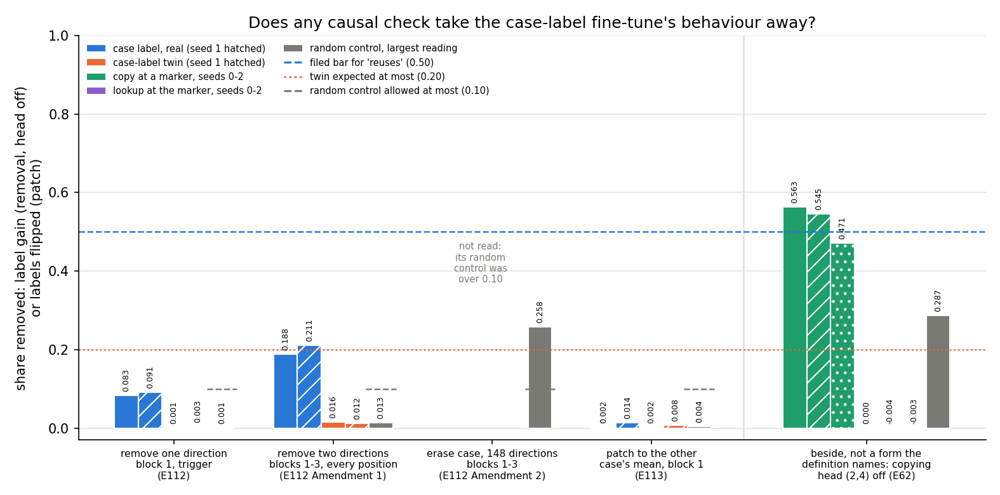

# The case-label line, closed: what the adopted reuse definition read on the 67M model

*definition-lead, 2026-11-06. The deliverable of `reports/decisions/2026-11-06_decision_e99-reset-to-jain.md`, "one
table putting the copy/lookup pair beside the new pairs", as the user chose in `decisions.md` line 172, ask 6. Sources:
`reports/analyses/2026-11-06_analysis_e112-case-label.md`, `reports/analyses/2026-11-06_analysis_e113-case-patch.md`,
and for the copy/lookup pair the files named under the table. No new run; one figure from saved results by
`experiments/case_patch/plot_summary.py`. Provisional: no independent check of the case-label readings.*

We put two pairs of small fine-tunes of the 67M model in one table, read under the adopted reuse definition. The
case-label fine-tune passes every part except the causal check, which it failed in each form we ran, while the copying
fine-tune was never read under the definition, because no readout of copying was ever trained. So the definition has
not yet given one "reuses" label on this model, and the line pauses until the user decides.

## The answer

On the 67M, the case-label fine-tune passes possession, carrying to unseen words and the small-function test, then fails
every causal form we ran. Removing the case readout took at most a fifth of its gain. Setting it to the other case
flipped about one label in a hundred, against a bar of one half. Under Jain's definition it reads "not through C". The
copy fine-tune's causal evidence is a removed copying head, a form the definition does not name. So the definition's
causal check has never read "reuses" on this model.

## The definition read under

`decisions.md` line 81 is Jain, Kirk, Lubana and colleagues' 2024 Definitions 1 and 2: a model possesses capability C
if "some layer has a linear readout (trained on pretraining data) equal to $f_C(x_d)$", and a fine-tune reuses C if the
fine-tuned map is $g \circ f_C$. It adds that reuse "needs a causal claim (ablating or patching the readout direction
breaks the fine-tuned behaviour, and/or pruning a few neurons or a short reverse fine-tune revives the pretraining
behaviour faster than a scratch baseline learns it)". Line 87 adds held-out carrying: "a fine-tune reuses capability C
only if g, learnt on the fine-tuning examples, also works on held-out values". Line 164 says these two rows are the
definition "and nothing else", and line 165 freezes it. The table below has one column per part of that definition and
nothing more. A cell with no measurement under the definition reads "not run".

## The two pairs

**Case label.** After a fixed marker token, the trigger, the real task says label word A if the previous word is
capitalised and B if not. The twin uses the same trigger and the same two words, but each word form gets its label from
a seeded shuffle, so no feature of the original model predicts it. C is "the previous word is capitalised". Two seeds
per arm, 300 training word pairs and 100 held-out pairs.

**Copy and lookup.** In "A B ... A M", with M a rare marker, the copy task answers B, the word that followed A's earlier
occurrence. The lookup at the same marker answers a fixed word per key A, over 32 keys, a word that never appears in
that key's windows. C is in-context copying. Three seeds per arm. Before the reset, this was the one old 67M pair whose
assumed label matched a causal reading.

## The table

Cells marked † are provisional: no independent check of that reading. Bars are the filed ones of the experiment that
read the cell.

| | Possession: linear readout trained on Pile, beside a random-label control | Held-out carrying | Small function of the readout | Causal check, each form run | Verdict under the definition |
|---|---|---|---|---|---|
| **Copy at a marker, real** | not run | read on Bs never trained: mean probability of B 0.966 to 0.968, three seeds | not run | readout-direction removal, erasure and patching: not run. Pruning, beside, no rule: the state's top 320 MLP units take 0.39 to 0.45 of the gain, random sets at most 0.05, but the same units take 0.27 to 0.34 of the lookup's †. Reverse fine-tuning: not run | none: possession was never read |
| **Lookup at the marker, twin** | not run | not run: read windows reuse the 32 trained keys | not run | readout-direction removal, erasure and patching: not run. Pruning, beside: its own top 320 units take 0.27 to 0.33 of its gain †. Reverse fine-tuning: not run | none: possession was never read |
| **Case label, real** | passes at block 1: 0.994 against control 0.524, gap 0.469; bars 0.90 and 0.30 † | 0.998 and 0.996 on held-out words; bar 0.90 † | threshold on the readout agrees on 0.993 and 0.992; bar 0.90 † | removal, one direction at one site: 0.083 and 0.091 of the gain. Removal, two directions at blocks 1 to 3, every position: 0.188 and 0.211. Erasure, 148 directions: not read, its random control took 0.19 to 0.26. Patching to the other case's mean: 0.002 and 0.014 of labels flip. All against a bar of 0.50 †. Pruning, beside: top 64 units leave accuracy at 0.91 and 0.95. Reverse fine-tuning, beside: 50 and 60 steps to 0.6, against 30 steps to learn † | **"not through C"**, both seeds; the filed "reuses C" missed †|
| **Case-label twin** | the same readout as the real row, so passes † | 0.506 and 0.516; at chance † | 0.511 and 0.523; at chance † | removal 0.001 and 0.003; two-direction removal 0.016 and 0.012; erasure not read; patching 0.002 and 0.008; all under the expected 0.20 †. Pruning and reverse fine-tuning start at chance, so read nothing | **"not through C"**, both seeds, as filed † |

### Where each copy and lookup cell came from

- **Possession, both rows: not run.** No linear readout of in-context copying was ever trained on Pile text. The two
  readouts the project trained under Definition 1 were on a different pair, a half-known key table against a cipher:
  `reports/analyses/2026-11-02_analysis_e59-jain-readout.md` line 15 and
  `reports/analyses/2026-11-02_analysis_e64-readout64.md`. The copy experiment says so itself: "It takes a linear
  readout as the capability. We take a head set", `reports/analyses/2026-11-02_analysis_e62-copying-heads.md` line 328.
  The later definition check did the same, `reports/analyses/2026-11-05_analysis_e99-definition-verify.md` line 364.
  The original model's copying head, found by prefix score, is a different measure and is not entered.
- **Held-out carrying, copy.** The B words are split in half, one half for training windows and one for read windows,
  `src/commute/copying.py` line 323, so no read B was trained, as
  `reports/analyses/2026-11-02_analysis_e62-copying-heads.md` line 21 says. The mean probability of B on the read
  windows at the scored step 30 is `experiments/induction_cue/results/run.json`, `.states.copy_s0.p_read` to
  `.copy_s2.p_read`: 0.9676, 0.9681, 0.9663. This is a probability, not the accuracy the case label was read by. It has
  had an independent check, `reports/reviews/2026-11-02_review_e62-check.md`, so it is not marked provisional.
- **Held-out carrying, lookup: not run.** Train and read windows share the same 32 keys, `src/commute/copying.py`
  docstring of `build_cue`, line 316, "the same A pool". A held-out key has no answer under the task.
- **Small function, both rows: not run.** It needs the readout, which does not exist.
- **Readout-direction removal, erasure, patching, both rows: not run.** None of them can run without the readout.
- **Pruning, both rows.** `reports/analyses/2026-11-05_analysis_e96-locate-mechanism.md` line 69, read in that
  report's scorecard at line 207: the top 320 MLP units by Jain et al.'s importance score, on the gain. Provisional:
  that report had no independent check.
- **Reverse fine-tuning, both rows: not run.** No experiment fine-tuned E62's states back toward the original model;
  the reverse fine-tunes of 2026-10-31 were on other maps.
- **Verdict, both rows: none.** The "reuses C" for copy that `reports/analyses/2026-11-05_analysis_e90-old-labels.md`
  line 60 prints, and the one in `reports/analyses/2026-11-05_analysis_e99-definition-verify.md` line 163, were read by
  removing a located head under rules that `decisions.md` line 164 dropped. They are not verdicts under the definition.

**Beside the table, not one of the definition's parts.** Mean-ablating the copying head (2,4) takes 0.471 to 0.563 of
the copy fine-tune's gain and none of the lookup's, `reports/analyses/2026-11-02_analysis_e62-copying-heads.md` lines
41 to 46. The largest of five random heads takes 0.287, and that head, (1,1), is the circuit's other head, lines 74 and 80. A
later removal in the state's own terms took 0.56 to 0.65 at the same head,
`reports/analyses/2026-11-05_analysis_e97-locator.md` line 78. This is a located-part removal. Line 81 names ablating
or patching the readout direction, so the head removal is shown in the figure for comparison only.

### Where each case-label cell came from

All from the two case-label reports. Possession: `2026-11-06_analysis_e112-case-label.md` lines 82 to 87. Carrying and
small function: lines 104 to 109. One-direction removal: lines 121 to 126. Two-direction removal: lines 183 to 188.
Erasure: lines 272 to 277. Pruning and reverse fine-tuning: lines 149 to 154. Patching: `2026-11-06_analysis_e113-case-patch.md`
lines 101 to 106, with the patch's reach on the original model at lines 83 to 87.

## Every causal form against its bars

**Reading it.** No causal form we ran took the case-label behaviour away. The blue bars are the real fine-tune's
reading per form, and none comes near the dashed bar at one half. The highest, about a fifth, is the two-direction
removal. The twin's orange bars sit under its expected ceiling everywhere, and each random control in grey sits under
its allowed 0.10, except at the erasure. There the random control alone took a quarter, so the erasure was not read.
On the right, behind the divider, the copying head's removal takes about half the copy gain and none of the lookup's.
It is the only bar on the figure near one half, and it comes from a form the definition does not name.

One caveat. The patch is the sharpest of the case-label forms, because it did reach the original model's own later
reading of case: block 2's case readout reported the flipped case on 0.714 of held-out windows, against 0.115 unpatched.
The fine-tuned label did not follow it.

## What this says about the definition's causal check

The case-label pair is the first one on the 67M where the definition's own readout exists. On it, everything before
the causal check reads the way reuse would, and the twin separates from the real task on both carrying and the small
function. Then every readout-direction form misses by a wide margin. The copy pair, which the project had treated as the
one reuse case, has never been read by the definition's causal check. Its causal reading is a head removal, and a head
is a part found by where the original model copies, not a readout direction. So the two pairs cannot be put side by side
on the causal check: one has three misses under the named forms, the other has no reading under them.

Why the case-label shares are low is not known. The untested candidates are in the two reports: case may live in
directions the ridge readout misses; the fine-tune may read the word's identity; or it may read case nonlinearly. A
learned interchange subspace fitted on the original model would test the first. The small-function test cannot tell
these apart, since a near-perfect readout and near-perfect labels agree by arithmetic.

## What we learned

The definition as frozen gives no "reuses C" label on the 67M model. Possession, carrying and the small function separate
a feature-based fine-tune from a memorising one, so that part of the apparatus works. The causal check decides, and on
the one pair built to its shape it read "not through C" three times. For `GOALS.md`'s question of new capabilities
against strengthened ones, neither pair yet gives an outside "reuse" label to score decompositions against.

## How compelling is the evidence

- Case label: two seeds per arm, which agree to within 0.03 on every rule number. One marker, one pair of label words,
  one model.
- Copy and lookup: three seeds, one marker, 32 keys. Its carrying number is a mean probability, not an accuracy.
- Every case-label causal form is linear and acts at blocks 1 to 3. Each is blind to case carried in other directions,
  at block 0 or the embeddings, or read nonlinearly. The full erasure, which would have reached more directions, could
  not be read because removing that many random directions also damaged the original model.
- Shares and flips are read on training-word windows, where memorised word forms could also carry the label.
- No independent check of either case-label report or of this summary.

## Surprises

None new here. The case-label reports already record the three missed "reuses C" predictions.

## What next

The user decides; nothing runs until then. The candidate steps are listed under "Not run".

## Departures from the literature

- **Possession.** Jain et al. probe their synthetic grammar's capability; we use a binary ridge readout on one block's
  residual at the trigger, trained on Pile text, with a Hewitt and Liang random-label control.
- **Held-out carrying** is not in Jain et al. It is `decisions.md` line 87's dated departure, made by the user.
- **The readout-direction check**, removal or patching, is the project's addition in line 81. Jain et al. use pruning
  and reverse fine-tuning.
- **Patching.** Standard activation patching copies a whole activation from a counterfactual input. We set one
  coordinate along the ridge readout to the other case's mean on Pile, an interchange along a probe, not a learned
  subspace as in Geiger and colleagues' distributed alignment search.
- **Erasure** is Ravfogel and colleagues' iterative nullspace method, with the ridge readout in place of their
  classifier.
- **Pruning.** Jain et al. prune a few neurons and watch the pretraining behaviour come back. Here, on both pairs,
  pruning removes the most important MLP units and reads how much of the fine-tuned behaviour goes: 64 units on the case
  label, 320 on copy and lookup.
- **Reverse fine-tuning.** Line 81 compares it with a scratch baseline learning the behaviour; the case-label report
  compares it with the steps the fine-tune took to learn its task, and gives it no rule.
- **Carrying on copy** is read as a mean probability on unseen B words, not accuracy.
- **Head removal**, beside the table, is mean ablation over Pile positions; Olsson and colleagues zero-ablate.

## Not run

All of these wait on the user.

- Subject number, the second pair the reset brief named: it was to run only if case label read cleanly.
- A learned interchange subspace, distributed alignment search, fitted on the original model for case.
- The route-split readings at this trigger: which subcomponents Γ switches on, scored against these labels.
- The stronger causal check the user mentioned on 2026-11-06, `decisions.md` line 166; not part of the definition
  until the user decides it.
- On the copy pair: a Pile-trained readout of copying, and with it the small function, readout removal, patching and
  reverse fine-tuning; held-out keys for the lookup.
- An independent check of the case-label readings and of this summary.

## Provenance

No job. Figure `experiments/case_patch/figures/summary_causal.png` from `experiments/case_label/results/stage2.json`,
`amend1.json`, `amend2.json`, `experiments/case_patch/results/run.json` and `experiments/induction_cue/results/run.json`,
by `experiments/case_patch/plot_summary.py` through `~/commute-agents/fleet/cpu-run`. $0.
