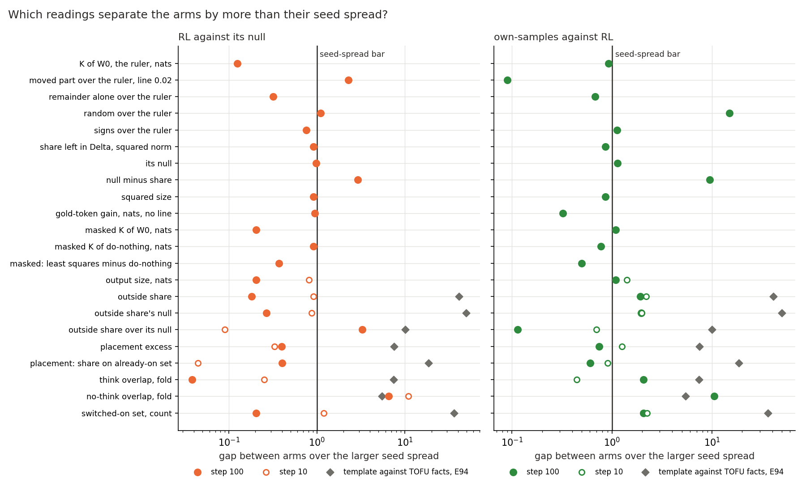
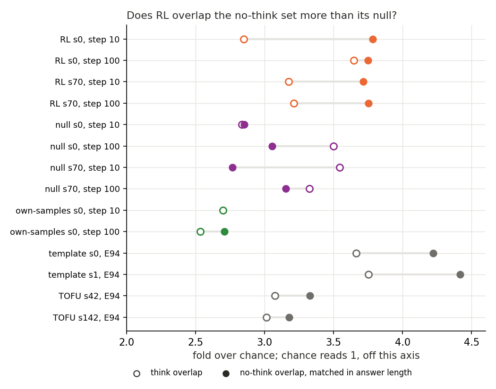
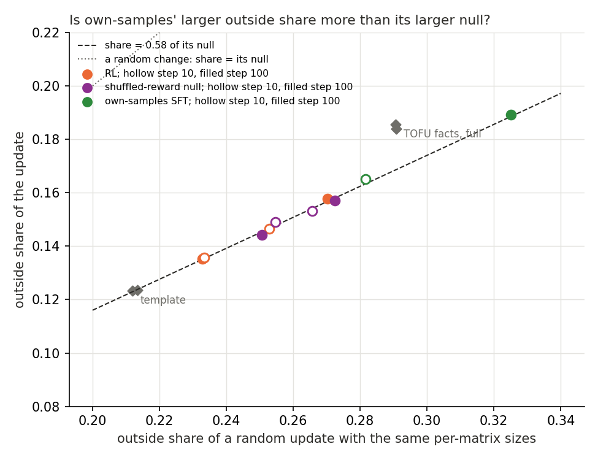
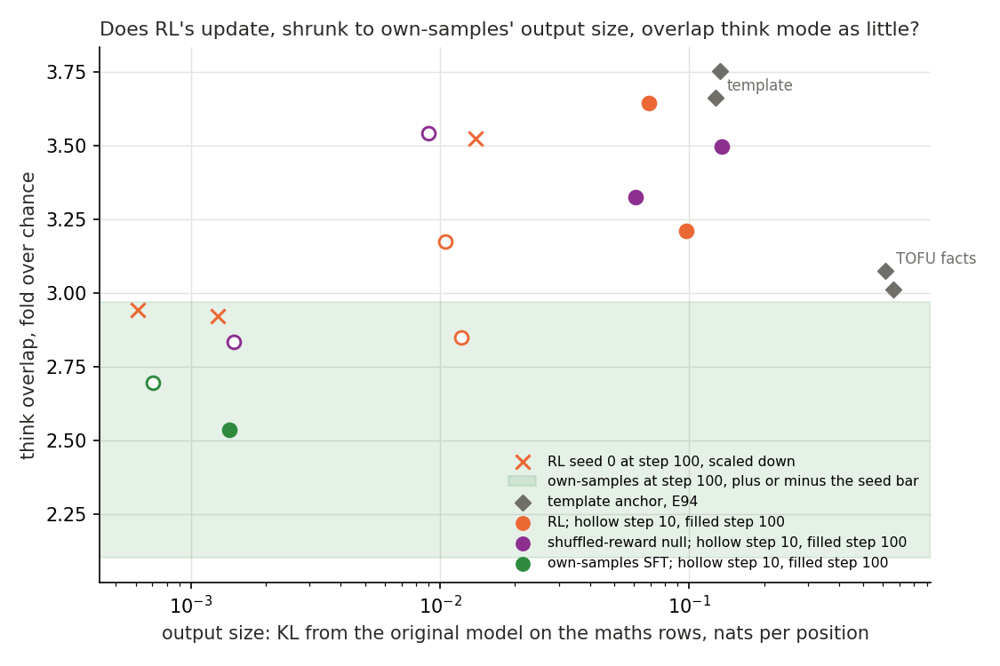

# Analysis: does an RL update read differently from an SFT update inside the decomposition? (D2)

*2026-11-06, `qwen-rl-lead`. A $0 synthesis of E75, E93 and E104, with E69 for the training and E91 and E94 for sizes
and scale. No new run, no new E-code, no filed predictions. Provisional; the no-think reading alone was checked independently (Limits). Table and figures
`experiments/qwen_rl_reads/plot_d2.py`; figures `experiments/qwen_rl_reads/figures/d2_*.png`. Words as in `GOALS.md`
→ Terms.*

We put every reading that three experiments made on Qwen3-1.7B's maths updates into one table: reinforcement learning,
the same loop with shuffled rewards, and fine-tuning on the model's own correct answers. Reinforcement learning reads
like its shuffled-reward null at about the rate that seed noise alone would give, with one exception that no rule was
filed for, and the own-samples fine-tune differs mostly through its far smaller output and where its update sits. For
`GOALS.md` this means the decomposition does not yet tell an RL update from an SFT one on anything beyond size, so it
gives no handle yet on whether RL teaches something new.

## The answer

Not yet. Across every reading the three reports made, RL's update reads like the shuffled-reward null about as often
as seed noise alone predicts. Every reading of the two kinds of update, outside of size, sits inside what seed noise allows. One reading first looked
like an exception: the subcomponents RL switches on overlap a reference set read on answers deep in a long context
more than the null's do. Its seeds turned out to share only half of that overlap, so counting noise sets its scale, and
the gap is under two standard deviations. Own-samples differs from RL mostly through size and through which matrices
its update sits in, and it has one seed.

## What we were trying to test

D2 asks for the same table for an SFT update and an RL update of the same model, Qwen3-1.7B, and whether RL's update
reads differently inside the VPD decomposition. "Differently" has to beat two things: the spread between training
seeds, and what update size alone does.

**The arms.** All train on GSM8K problems with AdamW at a rate of one in a million after ten warm-up steps, and each is
read at step 10 and step 100.

- **RL**: GRPO in the Dr. GRPO form, 64 problems with 8 samples each per step, reward 1 for a right answer that ends
  inside the window. Seeds 0 and 70.
- **The shuffled-reward null**: the same loop with rewards shuffled among each problem's samples. It samples from its
  own changing weights as RL does, so RL against the null isolates the reward's content. Seeds 0 and 70.
- **Own-samples SFT**: supervised fine-tuning on the original model's correct samples for the same prompts, drawn once
  and never redrawn. Seed 0 only. It asks whether RL reads differently from imitating right answers the model already
  gives.

E69 trained them. Under the strict grader RL beat the null on GSM8K test by about three and six points at the two
seeds. With answer format set aside the first seed's lead shrinks to about one point, not separable from zero, and the
second seed's stays near six. Own-samples gained about 2.6 points.

**The readings.** Each report reads the update $\delta W$ through the decomposition, which writes each weight matrix as
$W_0 = UV^\top + \Delta$ with rank-one subcomponents.

- **E75**, the clean-model table. A state is $W_0$ plus some part of $\delta W$. Its score is
  $K = \mathrm{KL}(\text{updated model} \,\|\, \text{state})$ per position on 128 maths rows; the updated model reads 0
  and $W_0$ reads the ruler. The parts come from the least-squares split, the least-norm $(dU, dV)$ with
  $dU V^\top + U dV^\top \approx \delta W$: the in-span part goes to the subcomponents, the remainder to Δ. E75 also
  reads a masked transmission ratio $\tau$, and states of the update's size that are not placed. It read RL and the
  null at seed 0 only.
- **E93**, D1's first table. The same split, scored by four filed checks: the moved part's $K$ over the ruler under a
  line of 0.02; the share of $\lVert\delta W\rVert^2$ left in Δ against a random update's; the squared size; and $K$
  under the state's own masks against do-nothing, which leaves the whole update in Δ. Step 100 only, both seeds.
- **E104**, the D3 readings carried from the two anchors. **Outside share**: the input-weighted energy of $\delta W$
  outside the subcomponents, 0 for all inside, with an exact null from a random update of the same per-matrix sizes.
  **Placement excess**: the split's share on subcomponents the original model already switches on, minus a Gaussian
  change's, 0 for no preference. **Think overlap**: the subcomponents the changed model switches on that the original
  leaves off, against think mode's switched-on set, as a fold over chance, so 1 is chance. Beside it stands the same
  fold against a **no-think set**: the original model's plain answers, unchanged in length, with earlier maths turns
put in front so each answer starts where its think-mode answer would (matched on answer position, not answer length;
7,237 of its 9,671 subcomponents are also in the think set, so it is largely a long-context set). Both steps, both seeds.

Two readings in E104, outside share and both overlaps, read the same under do-nothing. They describe the update and the
changed model, not how the split places the update.

**How a comparison counts.** We use E104's rule throughout. Two arms differ on a reading when the gap between their
seed means is strictly over the larger of their two seed spreads, the spread being the gap between the two seeds.
Own-samples has one seed, so its bar is the larger of RL's and the null's spreads at the same step, as E104 did. E104
filed this rule for its readings; on E75 and E93 rows we apply it here, after the fact.

**What the rule reads under pure noise.** With two seeds per arm and no real difference, the rule counts on about 22%
of readings, and own-samples against RL on about 28%. We simulated this for Gaussian seed noise of equal size in both
arms, a million draws each. A gap of three bars or more arises on 3% of readings, and one of six and a half on 0.7%. So
any one count here is weak; a count well past the bar, repeated across steps, is what would matter.

**The reference scale.** E94 read the same three E104 readings on the two anchors: the template fine-tune, which
teaches an answer format the model can already give, and the TOFU facts fine-tune, which teaches facts about invented
authors. They separate by 5 to 50 times their seed spread. That is how large a gap counts as "two different kinds of
update" on these readings.

## What we expected, and why

No predictions were filed for this synthesis. The sources' expectations: E75 leaned that RL's labels would match the
fine-tunes'; E93 leaned that least squares would pass every state; E104 expected RL against its null not to count on
outside share at step 100. The brief for this report said two step-100 gaps between own-samples and RL were already
explained: the outside-share gap by which matrices the update sits in, and the think-overlap gap by size. Both are
checked below.

## What we observed

### Does any reading separate RL from its null by more than the seed spread?

**Reading it.** Seven of 31 comparisons count, about the 22% that seed noise gives, and five of them sit between 1.1
and 3.3 bars. The left panel puts each reading's gap between RL's and the null's seed means over the bar, so 1 is the
bar. Most points sit left of it. The anchors, grey diamonds, sit 5 to 50 bars out on every E104 reading. The five small
counts are the moved part's $K$ over the ruler, the share left in Δ below its null, outside share over its null at step
100, random over the ruler, and the switched-on set's size at step 10. The largest of them, outside share over its
null at step 100, is 0.582 for RL against 0.575 for the null, an eighth of the anchors' gap of 0.055 on the same ratio.
The one large count is the no-think overlap, at 6.5 bars at step 100 and 10.9 at step 10, as far out as the anchors'
5.4 on that reading.

The moved part's count deserves a line because it is a reading of the split. RL's moved part reads 0.018 and 0.024 of
its ruler, the null's 0.007 and 0.009. In nats the gap does not count, and at step 10, seed 0 only, the order reverses:
0.009 for RL against 0.015 for the null. We name no cause.

### Does RL's update overlap the no-think set more than the null's? On the seed spread yes; on counting noise, no.

**Reading it.** Yes, at both steps and both seeds, though nothing was filed on it. RL's no-think fold reads 3.72 to
3.78 on all four states, and the null's 2.77 to 3.15. Think overlap, the reading E104 filed, does not separate them.
The anchors are the reference: the template reads 4.22 and 4.42 on no-think, TOFU facts 3.18 and 3.33, a gap a little
wider than RL's from its null. Size does not obviously drive it, since the null's seed 0 at step 100 moves the outputs
twice as far as RL's seed 0 and still reads lower. Two cautions. This fold describes the changed model's switched-on
set, so do-nothing reads the same, and it says nothing about the split. And it was found by scanning about thirty
comparisons after the fact, so it is a lead for a filed test, not a finding. Third, the bars rest on very tight two-seed spreads (RL's at
step 100 is 0.003), far below the counting noise of the overlaps (counts of 16 to 103 against chance means of 5.6 to
11.9). On a Poisson scale for those counts the gap is about 1.8 standard deviations at step 100 and 1.5 at step 10,
not 6.5 and 10.9 bars. Measured since (`experiments/qwen_rl_reads/seed_overlap.py`, `results/seed_overlap.json`): at step 100 only 47 of
RL's roughly 100 overlapping subcomponents are shared by both seeds, and 22 of the null's 65 to 86; RL seed 0 and null
seed 0 share 33. So the seeds do not switch on a fixed set, the counting-noise scale applies, and the gap is not beyond
noise. And since the set is mostly a long-context set, the reading says RL switches
on more of what a long preceding context switches on, not that its update is more like no-think mode.

### Is own-samples' larger outside share more than its larger null?

**Reading it.** No. Own-samples leaves 0.189 of its energy outside at step 100, against RL's 0.135 and 0.158, which
counts. But every maths state lies on one line, a share of 0.58 of its own null. Own-samples sits further along that
line because its update sits in matrices where a random update of the same sizes would also leave more outside. As a
fraction of the null own-samples reads 0.582 and RL 0.581 and 0.583. The template anchor sits on the same line and TOFU
facts above it at 0.64.

### Does RL's update, shrunk to own-samples' output size, overlap think mode as little?

**Reading it.** Yes, within the bar. Own-samples' think fold reads 2.53 at step 100 against RL's 3.65 and 3.21, a gap
of 0.89 over a bar of 0.43. E104's Amendment 1 scaled RL seed 0's step-100 update by one number until its output size
matched own-samples', 0.0013 against 0.0014 nats. The copy reads 2.92, inside the green band of own-samples' value plus
or minus the bar. So a smaller update of RL's own direction overlaps think mode as little. The copy is from seed 0 only,
the seed with the higher fold, and own-samples has one seed.

### What else separates own-samples from RL?

Four further readings count for own-samples against RL, and neither size nor the null explains them by the checks we
have.

- **No-think overlap at step 100**: 2.71 against RL's 3.75, a gap of 10.5 bars. RL's copy at own-samples' size reads
  2.89, closing most of the gap but leaving 0.19 against a bar of 0.10.
- **The share left in Δ below its null, E93's measure**: 0.0019 for own-samples against RL's 0.0028, 9.5 bars. This
  ratio does not change when the update is scaled.
- **Placement excess at step 10**: −0.013 against RL's 0.009 and 0.039, 1.3 bars, about the noise rate.
- **The switched-on set's size at step 10**: 159 against 414 and 321, 2.2 bars; at step 100 the scaled copy accounts for
  it.

Two more count only because own-samples' ruler is small: a random change of the update's size reads 1.013 of the ruler
against RL's 1.002, and a sign-flipped one 1.56 against 1.26.

## The table

Every reading in E75, E93 and E104 on the five arm-seeds. "R s0" is RL seed 0, "N" the shuffled-reward null, "F"
own-samples SFT. The gap column is RL's mean minus the null's, then own-samples minus RL's mean, then the bar, all in the
row's unit and as absolute values. Marks:

- **RL against null**: the RL-null gap is over the bar.
- **F against RL**: own-samples' gap from RL's mean is over the bar, with no explanation found.
- **size-explained**: it counts, and RL's update scaled to own-samples' output size reads within the bar of own-samples.
- **null-explained**: it counts, and the same reading over its null does not.
- **the size itself**: the row measures how far the update moves the outputs.
- **no difference**: neither gap is over the bar.
- **one seed: not markable**: E75 read RL and the null at seed 0 only, so the row has no seed spread. E75's own reading
  was that the three arms carry the same filed labels but for one no-call, and that the values differ with no floor.
- **label**: a filed verdict in words, compared by eye.

The last two columns are left for readings still to land, both `qwen-decomp-lead`'s: teacher training on these
updates, E111, and the adjoint split's column, E93 Amendment 1.

| reading | source | step | R s0 | R s70 | N s0 | N s70 | F s0 | RL-null gap; F-RL gap; bar | mark | teacher training (E111) | adjoint split (E93 A1) |
|---|---|---|---|---|---|---|---|---|---|---|---|
| K of W0, the ruler, nats | E75; E93 | 100 | 0.06431 | 0.09769 | 0.1349 | 0.04867 | 0.001019 | 0.01079; 0.07998; 0.08623 | no difference | | |
| moved part over the ruler, line 0.02 | E93 | 100 | 0.01816 | 0.02382 | 0.007426 | 0.008739 | 0.0215 | 0.01291; 0.000511; 0.005655 | RL against null | | |
| clean check | E93 | 100 | holds | misses | holds | holds | at floor |  | label | | |
| remainder alone over the ruler | E93 | 100 | 0.8129 | 0.8119 | 0.8191 | 0.7824 | 0.7875 | 0.01161; 0.02491; 0.03665 | no difference | | |
| random over the ruler | E93 | 100 | 1.002 | 1.001 | 1.001 | 1.001 | 1.013 | 0.000833; 0.01129; 0.000757 | RL against null; F against RL | | |
| signs over the ruler | E93 | 100 | 1.243 | 1.27 | 1.325 | 1.594 | 1.558 | 0.2025; 0.3008; 0.2686 | F against RL | | |
| share left in Delta, squared norm | E93 | 100 | 0.09242 | 0.09425 | 0.08923 | 0.09213 | 0.09084 | 0.002653; 0.002497; 0.002897 | no difference | | |
| its null | E93 | 100 | 0.0952 | 0.09707 | 0.09171 | 0.0947 | 0.09274 | 0.002929; 0.003399; 0.002992 | F against RL | | |
| null minus share | E93 | 100 | 0.002785 | 0.002813 | 0.002476 | 0.002571 | 0.001896 | 0.000276; 0.000903; 9.49e-05 | RL against null; F against RL | | |
| share check | E93 | 100 | holds | holds | misses | misses | misses |  | label | | |
| squared size | E93 | 100 | 0.9076 | 0.9057 | 0.9108 | 0.9079 | 0.9092 | 0.002656; 0.002499; 0.002899 | no difference | | |
| gold-token gain, nats, no line | E93 | 100 | -0.3939 | 0.03079 | 0.1317 | 0.8266 | 0.04173 | 0.6607; 0.2233; 0.695 | no difference | | |
| masked K of W0, nats | E93 | 100 | 0.1383 | 0.1669 | 0.2053 | 0.1304 | 0.07104 | 0.01525; 0.08154; 0.07485 | F against RL: the size itself | | |
| masked K of do-nothing, nats | E93 | 100 | 0.07158 | 0.07037 | 0.07025 | 0.06848 | 0.0696 | 0.00161; 0.001374; 0.00177 | no difference | | |
| masked: least squares minus do-nothing | E93 | 100 | -0.000232 | 2.86e-05 | -1.58e-05 | 4.95e-06 | 2.79e-05 | 9.63e-05; 0.00013; 0.000261 | no difference | | |
| masked check | E93 | 100 | holds | misses | holds | holds | misses |  | label | | |
| state verdict | E93 | 100 | passes | fails | fails | fails | fails |  | label | | |
| output size, nats | E104 | 100 | 0.06868 | 0.09727 | 0.1356 | 0.0608 | 0.00143 | 0.01525; 0.08154; 0.07485 | F against RL: the size itself | | |
| outside share | E104 | 100 | 0.1353 | 0.1576 | 0.1441 | 0.157 | 0.1893 | 0.004071; 0.04284; 0.02233 | F against RL: null-explained | | |
| outside share's null | E104 | 100 | 0.2328 | 0.2703 | 0.2507 | 0.2725 | 0.3251 | 0.01001; 0.07348; 0.03748 | F against RL | | |
| outside share over its null | E104 | 100 | 0.5811 | 0.5832 | 0.575 | 0.576 | 0.5824 | 0.00666; 0.000234; 0.002046 | RL against null | | |
| placement excess | E104 | 100 | 0.1262 | -0.01629 | 0.01108 | -0.01498 | -0.05114 | 0.05689; 0.1061; 0.1425 | no difference | | |
| placement: share on already-on set | E104 | 100 | 0.7 | 0.5823 | 0.6011 | 0.5865 | 0.5696 | 0.04734; 0.07151; 0.1177 | no difference | | |
| think overlap, fold | E104 | 100 | 3.646 | 3.211 | 3.498 | 3.326 | 2.535 | 0.01661; 0.8939; 0.4345 | F against RL: size-explained | | |
| no-think overlap, fold | E104 | 100 | 3.748 | 3.751 | 3.053 | 3.152 | 2.708 | 0.6471; 1.041; 0.09941 | RL against null; F against RL | | |
| switched-on set, count | E104 | 100 | 1124 | 1043 | 1201 | 804 | 264 | 81; 819.5; 397 | F against RL: size-explained | | |
| tau, fixed masks | E75 | 100 | 0.000571 |  | 0.000401 |  | 0.003611 |  | one seed: not markable | | |
| tau, stochastic masks | E75 | 100 | 0.001222 |  | 0.001178 |  | 0.007144 |  | one seed: not markable | | |
| random over larger half | E75 | 100 | 20.42 |  | 24.77 |  | 16.62 |  | one seed: not markable | | |
| in-span over remainder | E75 | 100 | 0.02235 |  | 0.009066 |  | 0.02731 |  | one seed: not markable | | |
| share sent to Delta, norm share | E75 | 100 | 0.3678 |  | 0.3797 |  | 0.4351 |  | one seed: not markable | | |
| in-span against slice, label | E75 | 100 | beats size |  | beats size |  | beats size |  | label | | |
| slice minus in-span, over the ruler | E75 | 100 | 0.01016 |  | 0.004736 |  | 0.009428 |  | one seed: not markable | | |
| NLL of W0 minus updated, nats | E75 | 100 | -0.1251 |  | -0.02882 |  | 0.004766 |  | one seed: not markable | | |
| gain label T2 | E75 | 100 | unscored |  | unscored |  | unscored |  | label | | |
| K over ruler: in-span | E75 | 100 | 0.01816 |  | 0.007426 |  | 0.0215 |  | one seed: not markable | | |
| K over ruler: rescaled to in-span | E75 | 100 | 0.02306 |  | 0.01591 |  | 0.03946 |  | one seed: not markable | | |
| K over ruler: slice, in-span's size | E75 | 100 | 0.02833 |  | 0.01216 |  | 0.03093 |  | one seed: not markable | | |
| K over ruler: often-on half | E75 | 100 | 0.06042 |  | 0.02985 |  | 0.06183 |  | one seed: not markable | | |
| K over ruler: rarely-on half | E75 | 100 | 0.118 |  | 0.06438 |  | 0.1204 |  | one seed: not markable | | |
| K over ruler: adjoint | E75 | 100 | 0.2659 |  | 0.1895 |  | 0.2439 |  | one seed: not markable | | |
| K over ruler: rescaled to remainder | E75 | 100 | 0.4372 |  | 0.3367 |  | 0.3085 |  | one seed: not markable | | |
| K over ruler: slice, remainder's size | E75 | 100 | 0.8638 |  | 0.868 |  | 0.8528 |  | one seed: not markable | | |
| K over ruler: remainder | E75 | 100 | 0.8129 |  | 0.8191 |  | 0.7875 |  | one seed: not markable | | |
| K over ruler: random, matched on KL | E75 | 100 | 2.409 |  | 1.595 |  | 2 |  | one seed: not markable | | |
| output size, nats | E104 | 10 | 0.01222 | 0.01051 | 0.001484 | 0.009011 | 0.000706 | 0.006117; 0.01066; 0.007528 | F against RL: the size itself | | |
| outside share | E104 | 10 | 0.1466 | 0.1356 | 0.149 | 0.1532 | 0.1651 | 0.01005; 0.024; 0.01095 | F against RL: null-explained | | |
| outside share's null | E104 | 10 | 0.2529 | 0.2334 | 0.2546 | 0.2657 | 0.2816 | 0.01701; 0.03844; 0.01951 | F against RL | | |
| outside share over its null | E104 | 10 | 0.5795 | 0.581 | 0.5853 | 0.5767 | 0.5862 | 0.000774; 0.006008; 0.008615 | no difference | | |
| placement excess | E104 | 10 | 0.00917 | 0.03859 | 0.01947 | 0.008999 | -0.01316 | 0.009648; 0.03704; 0.02942 | F against RL | | |
| placement: share on already-on set | E104 | 10 | 0.5975 | 0.619 | 0.6077 | 0.6069 | 0.5887 | 0.000961; 0.01952; 0.02158 | no difference | | |
| think overlap, fold | E104 | 10 | 2.848 | 3.174 | 2.834 | 3.543 | 2.696 | 0.1778; 0.3146; 0.7087 | no difference | | |
| no-think overlap, fold | E104 | 10 | 3.784 | 3.715 | 2.853 | 2.767 |  | 0.9399; nan; 0.08621 | RL against null | | |
| switched-on set, count | E104 | 10 | 414 | 321 | 213 | 301 | 159 | 110.5; 208.5; 93 | RL against null; F against RL | | |
| K of W0, the ruler, nats | E75 | 10 | 0.01187 |  | 0.002365 |  | 0.000294 |  | one seed: not markable | | |
| tau, fixed masks | E75 | 10 | 8.12e-05 |  | 0.000541 |  | 0.002617 |  | one seed: not markable | | |
| tau, stochastic masks | E75 | 10 | 0.000255 |  | 0.001657 |  | 0.005495 |  | one seed: not markable | | |
| random over larger half | E75 | 10 | 34.53 |  | 23.93 |  | 12.48 |  | one seed: not markable | | |
| in-span over remainder | E75 | 10 | 0.01156 |  | 0.01859 |  | 0.02692 |  | one seed: not markable | | |
| share sent to Delta, norm share | E75 | 10 | 0.3828 |  | 0.3861 |  | 0.4063 |  | one seed: not markable | | |
| in-span against slice, label | E75 | 10 | beats size |  | beats size |  | no call |  | label | | |
| slice minus in-span, over the ruler | E75 | 10 | 0.005164 |  | 0.008323 |  | 0.01102 |  | one seed: not markable | | |
| NLL of W0 minus updated, nats | E75 | 10 | -0.06306 |  | -0.007408 |  | 0.000796 |  | one seed: not markable | | |
| gain label T2 | E75 | 10 | unscored |  | unscored |  | unscored |  | label | | |
| K over ruler: in-span | E75 | 10 | 0.009349 |  | 0.01464 |  | 0.02069 |  | one seed: not markable | | |
| K over ruler: rescaled to in-span | E75 | 10 | 0.01949 |  | 0.02527 |  | 0.03122 |  | one seed: not markable | | |
| K over ruler: slice, in-span's size | E75 | 10 | 0.01451 |  | 0.02296 |  | 0.03171 |  | one seed: not markable | | |
| K over ruler: often-on half | E75 | 10 | 0.03506 |  | 0.05264 |  | 0.06562 |  | one seed: not markable | | |
| K over ruler: rarely-on half | E75 | 10 | 0.06878 |  | 0.1024 |  | 0.1283 |  | one seed: not markable | | |
| K over ruler: adjoint | E75 | 10 | 0.1859 |  | 0.2348 |  | 0.236 |  | one seed: not markable | | |
| K over ruler: rescaled to remainder | E75 | 10 | 0.3357 |  | 0.3791 |  | 0.3503 |  | one seed: not markable | | |
| K over ruler: slice, remainder's size | E75 | 10 | 0.8653 |  | 0.8445 |  | 0.8326 |  | one seed: not markable | | |
| K over ruler: remainder | E75 | 10 | 0.8089 |  | 0.7875 |  | 0.7687 |  | one seed: not markable | | |
| K over ruler: random, matched on KL | E75 | 10 | 2.375 |  | 2.451 |  | 1.601 |  | one seed: not markable | | |

**Scaled copies of RL seed 0's step-100 update**, from E104 and its Amendment 1. Scaling changes neither outside
share nor placement, which the copies reproduce to one part in a billion.

| copy | output size reached, nats | think fold | no-think fold | switched-on set | compared with |
|---|---|---|---|---|---|
| none: the source | 0.0687 | 3.65 | 3.75 | 1124 | |
| to own-samples' size, first search, missed the band | 0.0006 | 2.94 | 3.44 | 193 | unread |
| to own-samples' size, Amendment 1 | 0.00128 | 2.92 | 2.89 | 245 | own-samples: 2.53, 2.71, 264 |
| to RL's own step-10 size | 0.0138 | 3.52 | 3.41 | 521 | RL seed 0 at step 10: 2.85, 3.78, 414 |

**One reading appears twice.** E75's "share sent to Δ" is the norm share of the remainder, and its square equals
E104's outside share on every seed-0 state to four digits: 0.3678 squared is 0.1353 on RL at step 100, and 0.4351
squared is 0.1893 on own-samples. So E75's row is E104's row and gains seed 70 from it.

## Where two sources give different numbers

- **Output size is read four ways, and the comparison rule reads them differently.** E75 and E93's ruler is
  $\mathrm{KL}(\text{updated} \,\|\, W_0)$ on 128 maths rows: 0.0643 for RL seed 0 at step 100, 0.00102 for own-samples.
  E104's output size, E94's measure, is the KL from the original model on the same rows: 0.0687 and 0.00143. E91's is
  $\mathrm{KL}(W_0 \,\|\, W_0 + \delta W)$ on the first 16 rows: 0.0847 and 0.0010. E69's, on sampled answers: 0.194 and
  0.0017. They agree on the order. Under the comparison rule own-samples against RL counts on E104's measure, a gap of
  0.0815 against a bar of 0.0749, and does not on the E93 ruler, 0.0800 against 0.0862. Both bars are set by the null's
  seed 0, whose output size is two to three times its seed 70's. On a log scale own-samples sits at least 40 times
  under every RL and null state at step 100, on all four measures.
- **The null at step 10, seed 0**: the E75 ruler reads 0.00236, E104's output size 0.00148. These are the two KL
  directions above, not a disagreement, but they differ by more than at step 100.
- **E104's "positions between the anchors at step 100"** is given twice: 0.38, 0.44 and 1.07 under outside share, and
  0.42, 0.45 and 1.77 under Amendment 1. The second set is think overlap's in `table.json`; the report does not say so.

No number quoted in the brief for this report disagreed with its source.

## What D2 can and cannot say

**Can say.** On every reading the three experiments made, the decomposition does not show RL's update apart from the
shuffled-reward null at more than the rate seed noise predicts, with no exception once the no-think overlap is put on its counting-noise scale (it is in any case a property of the
changed model, not of how least squares splits the update). Own-samples' two step-100
differences from RL that E104 counted are explained: outside share by which matrices the update sits in, think overlap
by size. Least squares keeps all three arms close to faithful by E93's checks and misses narrowly on RL seed 70, both
null seeds and own-samples, by margins of 0.0004 nats or less on the clean and masked checks.

**Cannot say.**

- *Reward against cross-entropy.* RL and own-samples differ in more than the objective. RL samples afresh from its
  current weights each step; own-samples trains on samples drawn once from the original model and never redrawn, and
  only on correct ones. So any own-samples-against-RL difference mixes the objective with which samples are trained on.
  RL against the null holds the sampling fixed and changes only the reward's content, so that is the clean comparison
  here, and it shows almost nothing.
- *One own-samples seed.* Every own-samples verdict borrows RL's and the null's spread. If own-samples' seeds spread
  more than RL's, some of its counts would fall.
- *Size beyond one number.* The size checks scale RL seed 0's update by one constant. They test no other way an update
  could be "smaller", and the copy is from the seed with the higher think fold.
- *New against strengthened.* E94 found that its readings follow the training task and format, not whether content is
  new. Nothing here says whether RL teaches the model something new.
- *Whether RL learned maths.* E69's format-relaxed lead over the null is about one point at the first seed and six at the
  second. The reads here are on 128 maths rows the model wrote, not on accuracy.

## What we learned

At this size and with two seeds, the decomposition's readings do not separate RL's update from the same loop with
shuffled rewards; the one candidate, the no-think overlap, is under two standard deviations once counting noise is
allowed for. The
own-samples fine-tune reads differently mostly because it moves the outputs about fifty times less and sits in other
matrices. For `GOALS.md` the question of whether RL strengthens existing behaviour or teaches new behaviour gets no
answer from these readings yet.

## How compelling is the evidence

- **Seeds.** Two for RL and the null, one for own-samples. Seed noise alone counts about one comparison in five under
  this rule, so single counts near the bar carry little.
- **Multiple comparisons.** Thirty-one RL-against-null comparisons were scanned, after the fact. Seven count, near the
  six and a half that chance predicts. The no-think gaps, at 6.5 and 10.9 bars, would arise by chance on under 1% of
  readings each, but they come from the same four runs read at two steps, so they are not two independent signs.
- **Positive control.** The anchors separate on every E104 reading at 5 to 50 bars. E75 and E93 have no anchor
  comparison on maths rows.
- **Blind spots.** Outside share, think overlap and no-think overlap read the same under do-nothing, so they say nothing
  about the split. Placement is blind to scale. $K$ weights tails and reads no masks. No adversary ran on any arm.
- **Independent check.** One, on the no-think reading only (fresh Opus agent, 2026-11-06): every number recomputes
  exactly and the rows, set and draws are the same for every arm, so only the update can produce the gap; but the set
  was misdescribed as length-matched (fixed above), and counting noise may shrink the margin to 1.5 to 1.8 standard
  deviations. Its noise simulation is in `~/commute-data/scratch/qwen-rl-lead/d2-check/noise_sim.py`.

## Surprises

The no-think overlap looked like a difference between RL and its null as large, relative to the seed spread, as the
anchors' gap. It was not: the tight spreads came from two half-shared sets landing on almost the same count by chance,
and on the counting-noise scale the gap is under two standard deviations. A two-seed spread can be much tighter than
the noise of the number it brackets; every bar in this table carries that risk.

Smaller: the share left in Δ below its null, E93's measure, sits lower for own-samples than for either RL seed by
9.5 bars, and does not change with scale. No read tests why.

## What next

1. **No third seed.** The one candidate difference, the no-think overlap, fell to under two standard deviations once
   the seeds' shared subcomponents were counted, so a paid third seed of RL and the null is not worth running for it.
2. **The two empty columns.** When teacher training and the adjoint split land on these updates, rerun
   `plot_d2.py` with their rows. If either separates RL from its null beyond the spread, it is a reading of a map, which
   none of today's counts is.
3. **A second own-samples seed** only if a claim comes to rest on own-samples differing from RL. None does today.

## Scorecard

No predictions were filed for this synthesis. The sources' filed verdicts on these arms:

| source | claim in words | verdict |
|---|---|---|
| E75 | the three arms carry the same filed labels | same labels, but for one no-call on own-samples at step 10 |
| E93 | least squares passes every state | misses on RL seed 70, both null seeds and own-samples; lean reversed |
| E104, prediction 4 | RL against null on outside share at step 100 does not count | holds |
| E104, prediction 2 | placement falls from step 10 to 100 in every arm-seed | misses on RL seed 0 |
| E104, Amendment 1 | own-samples' think gap survives a size-matched RL copy | "size can do this": lean missed |

## Departures from the literature

- The comparison rule, the seed-spread bar and the borrowed spread for one seed are E104's, applied here to E75's and
  E93's rows, which filed no such rule.
- The RL arm is GRPO in the Dr. GRPO form with this project's sizes; departures from the published recipe are listed in
  `reports/plans/2026-11-03_plan_e69-grpo-loop.md`.
- Own-samples SFT draws its samples once from the original model and keeps them. The scoping report's matched arm
  sampled from the current weights; E69 fixed them, as E75 records.
- The clean table, outside share, placement and the overlap folds are this project's measurements, not VPD's checks.
  "Switched on" uses a causal-importance threshold of 0.01 at 1% of positions; VPD has no on-set.
- The 22% false-count rate assumes Gaussian seed noise of equal size in both arms, simulated here. No source gives it.

## Not run

- Any new GPU run: no third seed of any arm, no second own-samples seed.
- A filed test of the no-think overlap.
- Teacher training and the adjoint split on these updates: still to land, `qwen-decomp-lead`'s.
- E75's reads on RL and the null at seed 70.
- E93's checks at step 10.
- A size copy from RL seed 70 or the null, or one scaled other than by one number.
- Readings at steps other than 10 and 100.
- Any adversary, and accuracy under any split.
- An independent check of the rest of this report.
- A proper noise model for the overlap folds (bootstrap over positions); the Poisson scale above is a back-of-envelope.

## Provenance

- E75: `experiments/qwen_rl_reads/results/{score,score_N,score_F}.json`.
- E93: `experiments/qwen_d1_table/results/table.json`.
- E104: `experiments/qwen_d3_gsm8k/results/{table,amend1}.json`.
- E94 output sizes: `experiments/qwen_d3_rows/results/table.json`.
- E91, for context: `experiments/qwen_size_grid/results/size_grid.json`.

The table is printed by
`~/commute-agents/fleet/cpu-run python experiments/qwen_rl_reads/plot_d2.py`, which also writes the four figures. The
false-count rates came from a one-line simulation, a million Gaussian draws, on the CPU worker. $0, no GPU.
