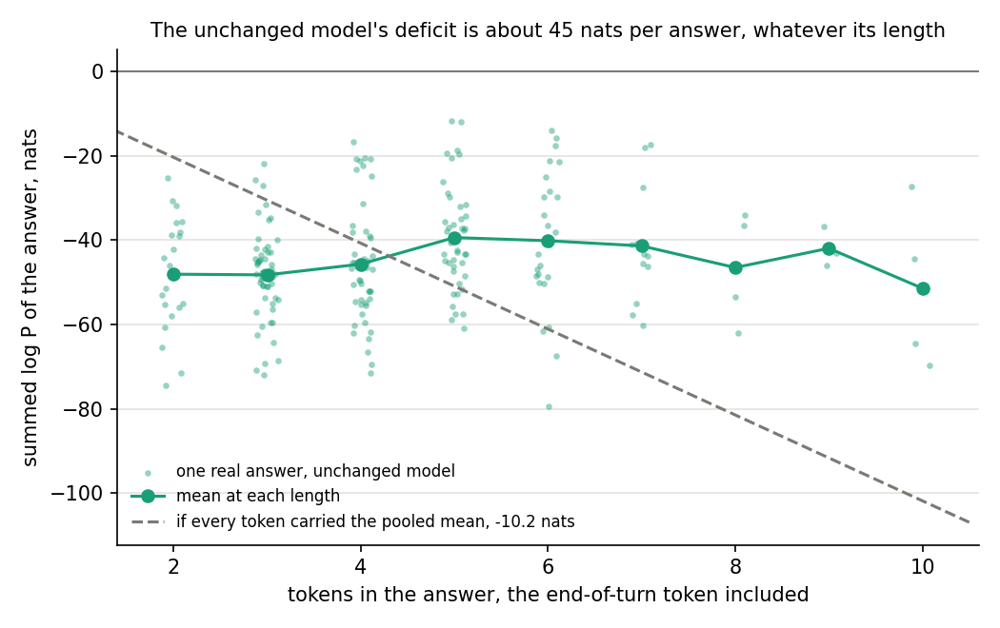
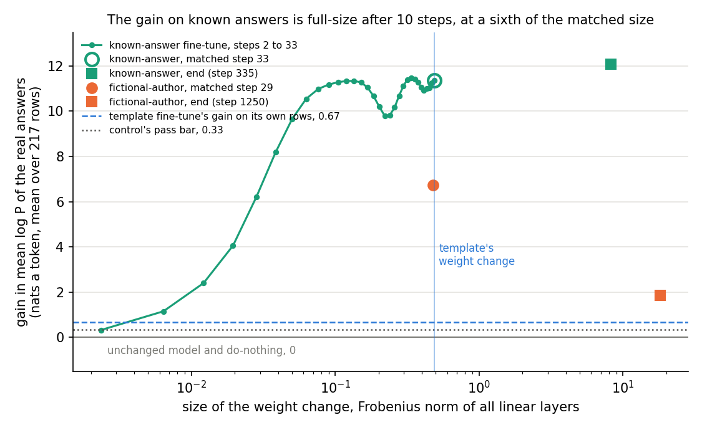
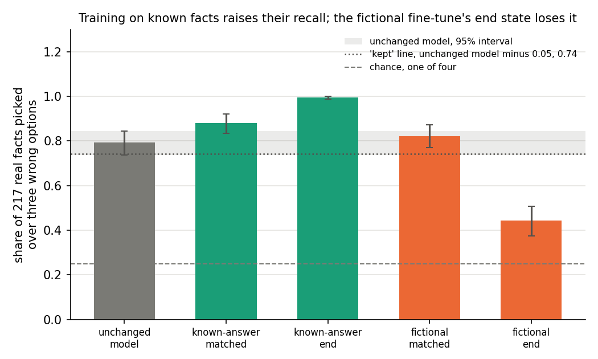
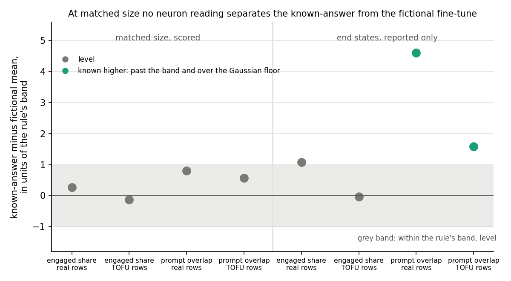
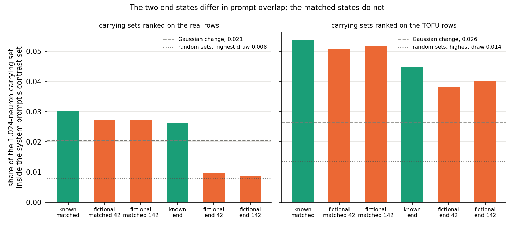
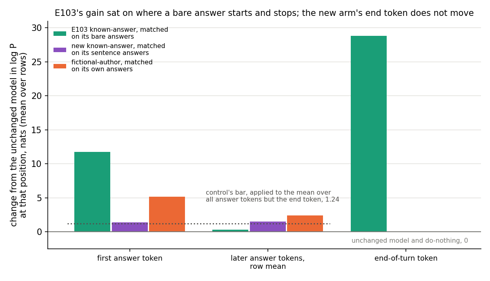
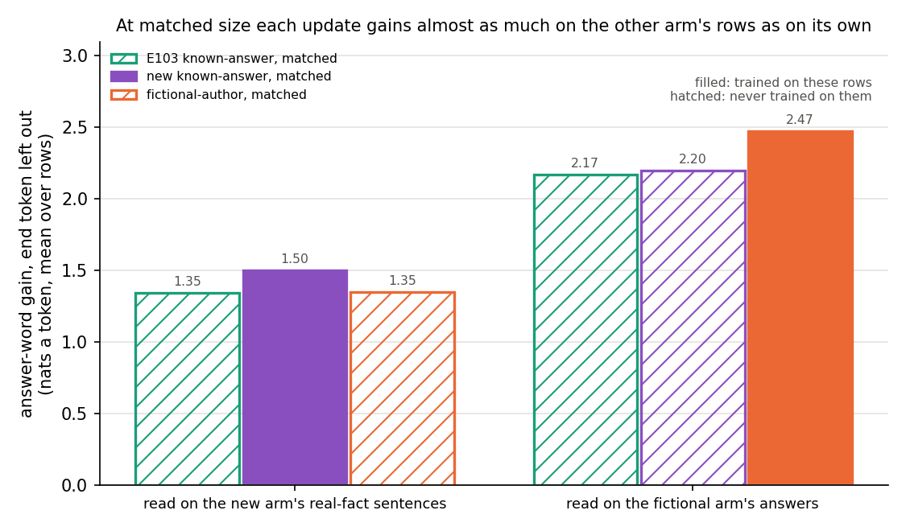
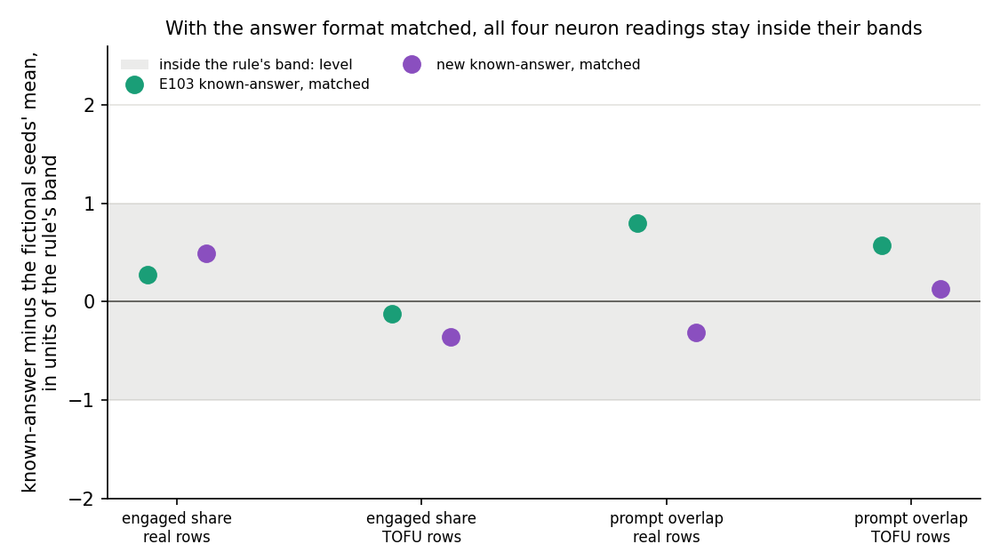
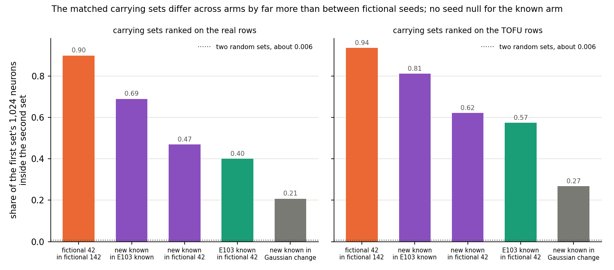
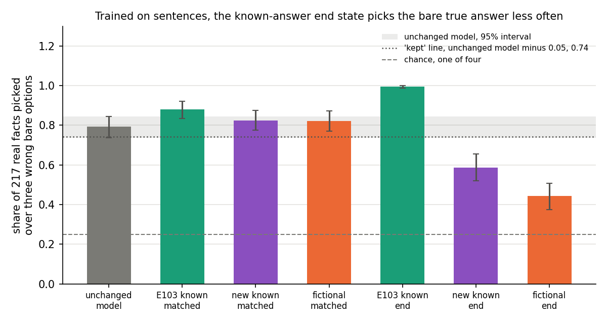

# Analysis: does a neuron reading tell a fine-tune on facts Qwen already knows from one on facts it lacks? (E103)

*2026-11-06, baseline-lead's E103 writer; Amendment 1 added the same day. **Provisional**: fast lane, no independent
check. Plan `reports/plans/2026-11-06_plan_e103-known-answer-pair.md` (Amendment 1 in its own section), adopted from
Fable's option A (`reports/plans/2026-11-06_advice_neuron-baseline-next.md`); rules
`experiments/known_answer_pair/results/predictions.json` and `predictions_amend1.json`; code
`experiments/known_answer_pair/{run,neurons,amend1,amend1_neurons}.py`, `src/commute/qwen_neurons.py`. Explanation:
`notebooks/E103_known_answer_pair.ipynb`. Figures: `experiments/known_answer_pair/plot.py`. Provenance at the end.*

We fine-tuned Qwen3-1.7B on real facts it already knows and compared it with a fine-tune on invented facts, using last
week's neuron instruments. The first run mostly learned to answer in a bare phrase and stop, so Amendment 1 retrained it
to answer in sentences, as the other run does. Then no neuron reading told the two apart at the template's size, but
neither update had yet learned much specific to its own facts, so the pair barely tests reuse against new.

## The answer

With the answer format matched, every filed neuron reading of the known-facts update still sits level with the
fictional-facts update at the template's size. Its gain control now passes on the answer words rather than on stopping
early. But each matched update gains nearly as much on the other's rows as on its own, so neither has yet learned much
specific to its facts. Their carrying neurons do differ, far more than two fictional seeds' do. Without a second
known-facts seed that difference has no null, so it is an observation, not a finding.

## The anomaly, run down first

*Sections from here to "Amendment 1" are the first run, jobs 53188 and 53209, as written before the amendment. Its
answer then: every filed neuron reading sat level at matched size, but the gain control passed mostly on a format
lesson, so the level readings said little about the instruments. Amendment 1 confirmed the format lesson position by
position; its section revises what follows only where it says so.*

The runner's numbers checked against the files: every stop passed; the matched step is 33, norm 0.4887 against the
template's 0.4865; the end state's norm is 8.29; the gain at the matched step is 11.35 nats a token against a bar of
0.333. That gain is seventeen times the template's 0.666 and larger than the fictional state's 6.72, on facts the model
already picks four times in five. A number like that blocks every reading built on it, so it was run down before
anything else.

**What the gain measures** (`run.py` `answer_seqs`, `gain`; `qwen_tofu.seq`, `mean_logp`). For each of the 217 real
rows, the sequence is the chat prompt for TOFU's own question plus the suffix " Answer in one sentence.", with thinking
off, followed by TOFU's own answer and the end-of-turn token `<|im_end|>`. TOFU's real answers are one to five words:
"William Shakespeare", "Paris". The per-row reading is the mean log P over the response tokens, end token included: 2 to
10 tokens, 4.4 on average. The gain is the change from the unchanged model W0 in that per-row mean, averaged over rows.
This is pair 0 of the five wordings trained, so the gain is read on exactly the strings the update was trained on.

**What W0 makes of these strings.** W0's mean is −12.13 nats a token, about as unlikely as a uniform guess over Qwen's
151,000-token vocabulary. The per-row sum of log P sits near −45 nats whatever the answer's length: −48 for two-token
answers, −39 for five, −51 for ten. Its correlation with length is 0.15, while the per-token mean tracks one over the
length at −0.84 (scratch check with the tokenizer only, reproduced in `plot.py` `w0_deficit`). A deficit spread over
the answer's words would grow with length. A fixed one sits on a single token per answer. The likely token is the end
of turn: asked for one sentence, Qwen does not stop after a bare name. This was not confirmed position by position,
since no per-position log P was saved and the model was not loaded here.

**How the update removes it.** The gain reaches 10.99 by step 10, at a weight change of 0.076. That is 97% of the
matched gain at a sixth of the matched size, while the rate is still 7e-7 inside warm-up. After the matched update the
mean is −0.78 nats a token, so the update removed 94% of W0's deficit within ten small steps. A one-token format habit
is learned that fast; 217 separate facts would not be. The fictional state at the same size gains 6.72 on these same
real answers without having trained on any of them. E92 read that state as a flatter output, which earns log P exactly
where W0 is confidently wrong. On E102's packed reader, where earlier question-answer pairs sit in the context and show
the model the bare-answer format, the same known-facts state gains 3.17 per answer position. The fictional seeds gain
2.45 and 2.18 there, and E102's Gaussian random change 0.70: that is above the template's 0.666, so a change that
teaches nothing would pass the bar on that reader.

**Verdict.** The 11.35 is mostly a format gain. The update teaches the model to answer a "one sentence" question with a
bare phrase and then stop, a lesson carried by pair 0 of the training rows. The plan's filed expectation said as much:
"the format alone should earn most of it". The ratio to the template's 0.666 means nothing either, since that was read
by a different reader, pooled over packed template rows.

**What it does to the gain control.** The control passes as filed, and it does show that the update moves the trained
answers. It does not show a fact-level gain. Learning to stop could carry the whole reading on the real rows: an upper
bound on what is specific to training on these rows is 11.35 − 6.72 = 4.6 nats, and that remainder still includes the
format lesson. On the packed reader the gap between the known-facts state and the fictional seeds' mean is 0.86 per
position, with row standard errors near 0.3 each.

**What it does to "only the label differs".** The plan held that up to the matched step, inside warm-up, the pair
differs in rows and label only. The format differs too. The fictional rows' pair 0 answers "Answer in one sentence."
with a full sentence; the real rows' pair 0 answers it with a bare phrase. So the known-facts update carries a lesson,
"stop after a bare phrase", that the fictional update does not. At step 29 to 33 neither update has had time to do much
else: E91 found the fictional state had learned none of its facts there. The matched comparison is mostly one format
change against another flatter-output change, with the label nominal. Every reading on the matched pair below inherits
this, and so do qwen-decomp-lead's VPD reads of the same states.

## What we were trying to test

`GOALS.md` asks whether post-training strengthens what the model already does or teaches it something new, and whether
a method can tell which. E102 read Qwen's MLP neurons on two earlier fine-tunes: the template fine-tune, labelled reuse,
and the TOFU fictional-author fine-tune, labelled new. They differed in task, rows, recipe and size as well as label, so
no reading could be put down to the label. This experiment builds a pair meant to differ in the label alone.

**The two fine-tunes.** Both train Qwen3-1.7B on TOFU rows, each row in five wordings: TOFU's own question and answer,
plus four rewordings written by Haiku clerks. Both use E84's recipe: peak rate 2e-5 with a 250-step linear warm-up,
batch 16, gradient clip 1, fp32, seed 42.

- *Known-answer fine-tune, new here.* TOFU's 217 real-person and world-fact rows, 1,085 sequences, five epochs of 335
  steps. W0 already picks 0.79 of these facts in multiple choice.
- *Fictional-author fine-tune, E84 and E91, read only.* TOFU's 787 kept fictional rows, 3,935 sequences, 1,250 steps.
  W0 cannot know these facts. Two seeds, 42 and 142.

**States.** Each fine-tune is read at two points. The *matched* state is the step whose total weight change $|\delta W|$,
the Frobenius norm over all linear layers, is nearest the template fine-tune's 0.4865: step 33 at 0.4887 here, step 29
at 0.477 for the fictional seed 42. Up to these steps both runs are inside warm-up at the same rate, so they differ in
rows, label and, as the anomaly showed, answer format. The *end* state is the last step: 8.29 here at step 335, 18.1 for
the fictional run at step 1250. The end pair differs in size and steps too, so it is reported, not scored.

**Readings.**

- *Gain*, defined above: change in mean log P of the trained real answers, nats a token. 0 is no change.
- *Real-fact share*: W0's four-way multiple choice on the 217 real rows under " Answer in a few words.", E81's reader. A
  row is right when the true answer's mean token log P beats all three wrong ones. Chance is 0.25; W0 reads 0.793.
- *Carrying set*: the 1,024 MLP neurons, of Qwen's 172,032, with the largest first-order share of a state's gain on a
  row set: W0's gradient of the answer log P times the change in each neuron's firing, E98's ranking. Read on the real
  rows, pair 0 packed into rows of 256 tokens as E92 packed the TOFU rows, and on E92's 128 TOFU fictional rows.
- *Prompt overlap*: the share of a carrying set inside the 1,024 neurons whose firing at template answers moves most when
  a system turn is added, E102's contrast set. 0 is none; random layer-matched sets read 0.002 to 0.014 here.
- *Engaged share*: the median, over a set, of W0's firing at the answer positions as a quantile of that neuron's firing
  on FineWeb-Edu text. 0.5 is a typical web position; E102 read 0.50 for every set.
- *References*: E102's Gaussian random change, scaled to the template's KL and 180 times its norm, as the floor; 100
  block-matched random sets per state as draws.

**The pair rule** (`neurons.pair_side`). For each size, row set and reading, the known-facts state is compared with the
mean of the two fictional seeds. The band is the larger of the two seeds' spread and twice the standard deviation of
the known state's random draws. "Known higher" needs the gap past the band and the known value above the floor, the
larger of the Gaussian change's value and every draw. "New higher" mirrors it. Anything else is level.

## What we expected, and why

- *W0 would reproduce E81's real-fact share of 0.793 within 0.01*, or the rows or reader had changed.
- *The gain at the matched step would clear half the template's gain, 0.333, and land above 1.* The filed reasoning
  already expected the bare-answer format to earn most of it.
- *Both known-facts states and the matched fictional state would keep the real-fact share within 0.05 of W0's*, and the
  fictional end state would lose it, as E81's one-wording fictional fine-tune fell to 0.42.
- *Re-reading the matched fictional state on the TOFU rows would reproduce E102's gain of 2.05 and its carrying set.*
- *Engaged share and prompt overlap would read level at matched size on both row sets.* E102 had found no spread in the
  engaged share and only one band between opposite labels in prompt overlap. A label-driven difference here would be
  the instruments' first positive control.

## What we observed

### Did the apparatus reproduce its references?

Yes, exactly. W0's real-fact share read 0.79263, E81's value to every digit. The matched fictional state re-read on the
TOFU rows gained 2.05250, E102's value to every digit, with the same 1,024-neuron carrying set. Every early training
check passed: step 1's loss equalled stage 0's first batch, step 2's weight change was 0.00235, in E84's band, and step
250's loss was 0.026 of the first. Memory peaked at 39.6 GB against a filed 44 GiB. The matched step chosen during
training, 33, was also the nearest over the whole record.

### Did the updates keep, raise or lose the facts W0 already knows?

**Reading it.** As filed. The known-facts states raised the real-fact share, from 0.79 to 0.88 at matched size and 0.995
at the end. The matched fictional state kept it at 0.82, and the fictional end state lost it, falling to 0.44, E81's
reading again. The end-state 0.995 is memory of the trained rows, since the share is read on those same rows. The
matched rise of 0.09 is above W0's interval, but its cause is open. It may be the facts sharpened, or the removal of a
length penalty: W0's costly end token weighs more on short options, and the update made that token cheap.

| state | real-fact share | 95% interval | gain, nats a token | weight change |
|---|---|---|---|---|
| W0 | 0.793 | 0.737 to 0.843 | 0 | 0 |
| known-facts, matched, step 33 | 0.880 | 0.834 to 0.922 | 11.35 | 0.489 |
| known-facts, end, step 335 | 0.995 | 0.986 to 1.000 | 12.09 | 8.29 |
| fictional seed 42, matched, step 29 | 0.820 | 0.770 to 0.871 | 6.72 | 0.477 |
| fictional seed 42, end, step 1250 | 0.442 | 0.373 to 0.507 | 1.86 | 18.1 |

### At matched size, does any neuron reading tell the known-facts update from the fictional one?

**Reading it.** No. All four scored readings sit inside their bands, on both row sets, as filed. Engaged share reads
0.49 to 0.50 for every matched state on both row sets, the same flat 0.50 that E102 read for every set. Prompt overlap
puts the known-facts state 0.003 above the fictional seeds on the real rows and 0.002 above on the TOFU rows, inside
bands of 0.004. The caveat is the anomaly's: at this size the two updates differ mostly in answer format, so a level
reading here tests format against flatter output more than known against new.

| size | rows | reading | known | fictional seeds 42, 142 | gap | band | floor | verdict |
|---|---|---|---|---|---|---|---|---|
| matched | real | engaged share | 0.490 | 0.487, 0.487 | 0.003 | 0.010 | 0.512 | level |
| matched | TOFU | engaged share | 0.499 | 0.501, 0.499 | −0.001 | 0.005 | 0.507 | level |
| matched | real | prompt overlap | 0.030 | 0.027, 0.027 | 0.003 | 0.004 | 0.021 | level |
| matched | TOFU | prompt overlap | 0.054 | 0.051, 0.052 | 0.002 | 0.004 | 0.026 | level |
| end | real | engaged share | 0.499 | 0.490, 0.489 | 0.010 | 0.009 | 0.508 | level, under the floor |
| end | TOFU | engaged share | 0.503 | 0.501, 0.504 | −0.000 | 0.005 | 0.505 | level |
| end | real | prompt overlap | 0.026 | 0.010, 0.009 | 0.017 | 0.004 | 0.021 | known higher |
| end | TOFU | prompt overlap | 0.045 | 0.038, 0.040 | 0.006 | 0.004 | 0.026 | known higher |

Gains on the neuron reader, per answer position on packed rows: known-facts matched 3.17 on the real rows and 1.74 on
TOFU; end 3.51 and 1.42; fictional matched 2.45 and 2.18 on the real rows; fictional end 0.67 and 0.89; the Gaussian
change 0.70. Unscored and printed: the known-facts matched set shares 0.40 of its neurons with the fictional seed-42
matched set on the real rows and 0.57 on the TOFU rows, where E102's two fictional seeds shared 0.94 to 0.95. The two
updates do use different neurons, more than seed noise; what drives that, label, format or rows, is not read here.

### At the end of training, why does prompt overlap separate them?

**Reading it.** Mostly because the fictional end states fall, not because the known-facts state rises. On the real rows
the fictional end sets drop to 0.010 and 0.009, under the Gaussian change's 0.021 and near the random draws. The
known-facts end state stays at 0.026, just over the floor. On the TOFU rows every state sits above the floor, and the
known-facts end state leads by 0.006 against a band of 0.004. This pair also differs in size, 8.29 against 18.1, and in
steps, 335 against 1,250. So the "known higher" verdicts are reported, not scored, and cannot be put down to the label.

## Amendment 1: the same pair with the answer format matched

*Jobs 53262, 493 s, and 53275, 87 s, one L40 each on `debug`, $0. Rules `results/predictions_amend1.json`; plan section
"Amendment 1". Provisional.*

**What changed.** Only the known-facts run's pair 0. Its answer to " Answer in one sentence." is now one sentence that
holds every word of TOFU's bare answer, 5 to 18 words, written by Haiku clerks and checked by E103's wording judge; all
217 passed first time. The four other wordings, the rows, their order, the recipe, seed 42 and the matched-size rule are
as run. Both arms now answer a request for a sentence with a sentence.

**What is read.** Each response token's log P is now saved, so the gain splits into parts. The *content gain* is the
per-row mean change from W0 over the answer tokens with the end-of-turn token left out, averaged over rows. It is read
on three sets of answers, each after its question and " Answer in one sentence.": E103's bare real answers, the new
real-fact sentences, and the fictional run's own 787 answers. Six models are read: W0, the new matched and end states,
E103's two states and the fictional matched state, seed 42 at step 29.

**What we expected.** The new matched state's content gain on its own sentences would clear half the fictional matched
state's content gain on its own answers, read in the same job, at 0.5 to 2 times that reference. E103's matched state on
its bare answers would show a content gain under that bar and an end-token gain over 30 nats. Both new states would keep
the real-fact share within 0.05 of W0's. All four matched neuron pair rules would read level.

### Did the apparatus reproduce its references?

Yes. W0's real-fact share read 0.79263 again, E81's value to every digit. E103's matched state re-read through the new
per-position reader gave 11.353204, its stored gain to a relative 2e-9. The neuron job's re-read of the same state gave
its stored gain and carrying set exactly. Every early training check held: step 1's loss equalled the first batch, step
2's weight change was 0.00233, in E84's band, and step 250's loss was 0.052 of the first. Training peaked at 38.5 GiB
against a filed 44. The matched step was 32, at a weight change of 0.4801 against the template's 0.4865, and it was
also the nearest over the whole record.

### Is the format lesson gone from the new pair?

**Reading it.** Yes, and the per-position read confirms where E103's gain sat. The figure plots, for each matched state
on its own trained answers, the change in log P at the first answer token, at the later answer tokens and at the end
token. E103's state gained 28.8 nats at the end token and 11.8 at the first answer token, but only 0.32 a token on the
words after it. So 70% of its summed gain is the end token, and most of the rest is the first token, where W0 expected a
sentence to begin and met a bare name. The new state's end token moved by nothing, as the fictional state's did, and its
gain is spread evenly over the sentence: 1.41 at the first token, 1.53 a token after it.

The filed control holds. The new state's content gain at the matched step is 1.504 nats a token, over the bar of 1.237;
the reference, the fictional state's content gain on its own answers, read 2.473. That is 0.61 of the reference, inside
the filed range of half to twice. The gain rose steadily through warm-up, from 0.03 at step 2 to 1.40 at step 22, and
then stayed between 1.36 and 1.50 to step 32. There is no early jump of the kind E103 showed.

The filed anomaly check did not come out as written. It expected E103's matched state to show a content gain under the
bar and an end-token gain over 30 nats. It read 5.30 and 28.83. The 5.30 sits almost entirely on the first answer token;
the filed rule averaged that token in with the answer words, and the first token of a bare answer is itself part of the
format. The verdict of the anomaly stands, and is now shown position by position rather than inferred.

### How much of each matched update's gain is specific to its own rows?

**Reading it.** Very little, for either arm. The figure reads each matched state's content gain on the new real-fact
sentences and on the fictional answers. Filled bars are a state on rows it trained on; hatched bars are rows it never
saw. On the real-fact sentences the new known-facts state gains 1.50, and the fictional state, which never trained on
them, gains 1.35. On the fictional answers the fictional state gains 2.47 and the new known-facts state 2.20. So about
nine tenths of each matched update's content gain is shared: something both updates learned, such as TOFU's answer
style, that raises any answer of this kind. The margin specific to a state's own rows is about 0.15 nats a token for
the known-facts run and 0.27 to 0.30 for the fictional run. E91 found the fictional state had learned none of its facts by this
step, and this reading agrees for both arms. This is not the plan's filed control; it is a reading off the saved files.

### With format matched, does any neuron reading tell the pair apart?

**Reading it.** No. All four filed rules read level, as leaned. The figure plots each rule's gap, the known-facts state
minus the mean of the two fictional seeds, in units of that rule's band; green is E103's state, purple the new one.
Every point sits inside the grey band. The small lean of E103's state in prompt overlap, 0.8 of a band on the real rows,
is gone: the new state sits 0.3 of a band below the seeds there. Engaged share again reads 0.49 to 0.50 for every set.
The caveat is the previous section's. At this size the two updates share most of what they learned, so a level reading
tests two mostly alike changes, not reuse against new at full strength.

| rows | reading | new known | fictional seeds 42, 142 | gap | band | floor | verdict |
|---|---|---|---|---|---|---|---|
| real | engaged share | 0.491 | 0.487, 0.487 | 0.004 | 0.009 | 0.512 | level |
| TOFU | engaged share | 0.498 | 0.501, 0.499 | −0.002 | 0.005 | 0.506 | level |
| real | prompt overlap | 0.026 | 0.027, 0.027 | −0.001 | 0.003 | 0.021 | level |
| TOFU | prompt overlap | 0.052 | 0.051, 0.052 | 0.0005 | 0.004 | 0.026 | level |

Gains on the neuron reader, per answer position on packed rows: the new matched state 1.87 on the real rows and 1.77 on
the TOFU rows, against E103's 3.17 and 1.74 and the fictional seed 42's 2.45 and 2.05. The real rows here are still E103's
packed bare answers for every state, a fixed probe, so they are no longer the new state's trained format.

### Are the two arms' carrying sets the same neurons?

**Reading it.** No, but this has no null yet. The figure plots the share of one carrying set's 1,024 neurons inside
another's. Two fictional seeds share 0.90 on the real rows and 0.94 on the TOFU rows. The new known-facts set shares
0.47 and 0.62 with the fictional seed-42 set, a little more than E103's 0.40 and 0.57. Any change shares 0.21 to 0.27
with the Gaussian change's set, and two random sets 0.006. So the cross-arm sets differ by more than seed noise of the
fictional arm, while every summary reading of them is level.

Two things stop this being a label reading. First, the known-facts arm has one seed, so its own seed spread is unknown.
Second, the arms differ in rows as well as label, and the set moves with things other than the label: the new state and
E103's, on the same rows with the same label and only pair 0's answer form changed, share just 0.69 and 0.81. A null for
the set's identity needs a second known-facts seed, and a pair with the same label on different rows. Unscored and
unfiled; computed from the saved sets.

### Did the new updates keep the facts W0 already knows?

**Reading it.** The matched state kept them, as leaned; the end state did not, against the lean. The matched state reads
0.825, level with the fictional matched state's 0.820, where E103's matched state read 0.880. So E103's matched rise
went with the bare-answer format. The new end state, after five epochs on sentences that state these same facts, reads
0.585, with an interval of 0.52 to 0.65, under W0's 0.79 and its "kept" line of 0.74. E103's end state, trained on the
bare answers, read 0.995.

What the share measures matters here. Each of the 217 questions is asked with " Answer in a few words."; the options are
TOFU's bare true answer and three bare wrong ones, TOFU's perturbed answers such as "Charles Dickens" against "William
Shakespeare". Each option is scored by its mean log P per token, the end-of-turn token included, and a row counts when the
true option scores highest. So the reading is a choice among bare phrases that end the turn at once, a format the new
arm trained away from and E103's arm trained on. A length check with the tokenizer finds the true option no longer or
shorter than the wrong ones on average, by 0.04 tokens; it is the longest in 36 rows and the shortest in 26. On E103's
bare reader, under the other suffix, the new end state raised the true bare answers' first token by 8.7 nats, so those
answers did not become less likely in absolute terms. Per-option log P was not saved, so whether the wrong options rose
more, and why, cannot be read from the files.

### Amendment 1 table

Content and end-token gain, change from W0; content in nats a token, end in nats at the one token.

| state | own answers, content | own answers, end | bare reader, content | bare reader, end | real-fact share |
|---|---|---|---|---|---|
| E103 known, matched step 33 | 5.30, bare | 28.83, bare | 5.30 | 28.83 | 0.880 |
| E103 known, end step 335 | 5.94, bare | 29.91, bare | 5.94 | 29.91 | 0.995 |
| new known, matched step 32 | 1.50, sentence | 0.00, sentence | 4.25 | 10.63 | 0.825 |
| new known, end step 335 | 1.99, sentence | 0.00, sentence | 3.83 | 1.39 | 0.585 |
| fictional seed 42, matched step 29 | 2.47, own | 0.02, own | 4.52 | 13.70 | 0.820 |

Per position on the bare reader, change from W0 at the first answer token, later tokens and end token: E103 matched
11.77, 0.32, 28.83; E103 end 13.47, 0.42, 29.91; fictional matched 10.41, 0.17, 13.70; new matched 9.42, 0.23, 10.63;
new end 8.74, 0.32, 1.39. W0's level there: −13.59 at the first token, −0.44 after it. Cross reads, content gain: on the
sentences, E103 matched 1.35, E103 end 0.53, fictional matched 1.35; on the fictional answers, E103 matched 2.17, E103
end 1.72, new matched 2.20, new end 1.98. Per-position splits from `results/large/amend1_tokens/` by `plot.py`
`positions`; the scratch script that first computed them is
`~/commute-data/scratch/baseline-lead/e103a1-writeup/positions.py`.

## What we learned

*Amendment 1 first; the first run's lessons follow.*

- With the answer format matched, the known-facts update clears its gain control on the answer words, and no filed
  neuron reading separates it from the fictional update at matched size. With this pair, at this size, none of the four
  readings tells reuse from new.
- At matched size each update gains almost as much on the other arm's rows as on its own. The label is barely expressed
  by the template's size, so this pair at this size is a weak test of the instruments, whichever way they read.
- The carrying sets differ across arms far more than across fictional seeds, and less so between two known-facts runs
  that differ only in answer form. Set identity is the one reading with spread; it has no null for the known arm yet.
- Trained on sentences, the known-facts run's end state picks the bare true answer less often than W0. The real-fact
  share is a bare-phrase reader, so it is not neutral to the answer format a run trains on.

*First run:*

- The pair meant to fix the label also differs in format at matched size: the known-facts training answers a request
  for a sentence with a bare phrase. Most of what the matched update did is learn to stop after that phrase.
- With that confound, no filed neuron reading separates the two updates at matched size. That is consistent with
  Fable's "the methods are the problem", but this pair cannot show it, because the label was barely expressed yet.
- The carrying sets of the two matched updates overlap far less than two seeds of one update do. A neuron-level
  difference exists; the filed readings, prompt overlap and engaged share, do not see it.
- The gain control as written is passed by a format lesson. A gain control on short answers needs the end token, or the
  wording the model is told to use, handled before its bar means anything.

## How compelling is the evidence

- *One seed* of each known-facts run; the fictional run's two seeds set the bands. The known arm's seed spread is
  unknown, which is what keeps the carrying-set difference from being read.
- *The anomaly's cause* is now read position by position, Amendment 1: E103's gain sat on the end token and the first
  answer token. The first run's inference from the per-row sums stood.
- *The content gain* is mostly shared between arms at matched size, by a reading off the saved files, not a filed
  control. It rests on one fictional seed and one known seed.
- *Engaged share* has now read 0.49 to 0.50 for every set in two experiments and three known-facts states. It has never
  moved, so its power is still untested; it may be blind at this grain.
- *Prompt overlap* is against a template-task contrast with no tie to facts. Its end-size separation comes with a two-fold
  size difference and different step counts.
- *The neuron reader's real rows* are E103's packed bare answers for every state, the format the new arm no longer trains.
- *The real-fact share* chooses among bare phrases ending the turn; it is not neutral to the answer format trained.
- *The Gaussian floor* is 180 times the template's norm, matched on KL, not on norm.
- *Rows*: 217 real rows and 128 TOFU rows; the real rows pack into only 29 rows of 256 tokens, 941 answer positions.

## Surprises

- **The new known-facts end state lost real facts, against the lean.** Its real-fact share, reported with a lean of "kept", read 0.585,
  under W0's 0.79, after five epochs on sentences stating those same facts. E103's end state, trained on the bare
  answers, read 0.995. The share is a bare-phrase reader; per-option log P was not saved, so the cause is not read.
- **The filed anomaly check missed both its parts**: content gain 5.30 against "under 1.24", end token 28.83 against
  "over 30". The content mean included the first answer token, which carried 11.8 nats of format; the words after it
  carried 0.32.
- **Each matched update gains about nine tenths as much on the other arm's rows as on its own.** Not filed.
- **The cross-arm carrying sets share 0.47 to 0.62**, against 0.90 to 0.94 between fictional seeds, and the two
  known-facts runs only 0.69 to 0.81. Not filed.
- First run: the gain control passed seventeen-fold on a format habit; the fictional end states' carrying sets on the
  real rows fell below the Gaussian change in prompt overlap.

## What next

1. *A second known-facts seed of Amendment 1's run, with its neuron read, $0, about 15 min over two `debug` jobs.* It
   gives the known arm's seed spread for the carrying set. If two known seeds share about 0.9, as the fictional seeds
   do, the 0.47 is beyond seed noise in both arms and set identity becomes a candidate reading to file, still needing a
   same-label pair on different rows. If they share near 0.5, the set is unstable for this arm and the difference reads
   nothing.
2. *Per-option log P of the real-fact share on the new end state, with greedy answers, $0, minutes.* It shows whether
   the drop is the wrong bare options rising or the true ones falling, and whether the model still states the facts in
   a sentence.
3. *A larger matched size*, through `/design`, if the instruments are to be tested where the label is expressed: at the
   template's size neither arm has learned much specific to its rows.
4. *qwen-decomp-lead's VPD reads* should use the Amendment 1 states, not E103's, which carry the format lesson.

## Scorecard

Filed in `experiments/known_answer_pair/results/predictions.json` (first run) and `predictions_amend1.json`
(Amendment 1), scored as filed.

**Amendment 1.**

| id | claim | rule | read | verdict |
|---|---|---|---|---|
| control 0 | W0 reproduces E81's real-fact share | within 0.01 of 0.7926 | 0.7926 | holds |
| first minutes | step 1 loss equal, rate and weight change 0; step 2 weight change in E84's band; peak ≤ 44 GiB; step 250 loss ≤ 0.95 of first | bands | 0, 0, 0; 0.00233; 38.5 GiB; 0.052 | all hold |
| C2 | E103's matched gain re-read on the bare reader | within 1e-5 relative of 11.3532 | 11.353204, rel 1.8e-9 | holds |
| reference | fictional matched content gain on own answers, above 0 | finite, > 0; expected 1 to 3 | 2.473; bar 1.237 | holds, as expected |
| C1 | content gain at the matched step on the sentences | ≥ 1.237; expected 0.5 to 2 × reference | 1.504 at step 32, norm 0.4801; 0.61 × | holds, as expected |
| anomaly check, reported | E103 matched on bare: content under the bar, end over 30 | expectation | content 5.30, end 28.83 | missed on both parts; the content mean holds the first token's 11.8 |
| R1 new matched, reported | real-fact share kept | ≥ 0.743 | 0.825 | kept, as leaned |
| R1 new end, reported | real-fact share kept | ≥ 0.743 | 0.585 | dropped, against the lean |
| C2n | E103's matched neuron read reproduces | gain within 0.001 relative, set overlap ≥ 0.95 | rel 0, overlap 1.0 | holds |
| matched real engaged | pair rule | level lean | gap 0.004, band 0.009 | level, as leaned |
| matched TOFU engaged | pair rule | level lean | gap −0.002, band 0.005 | level, as leaned |
| matched real prompt overlap | pair rule | level lean | gap −0.001, band 0.003 | level, as leaned |
| matched TOFU prompt overlap | pair rule | level lean | gap 0.0005, band 0.004 | level, as leaned |
| set overlap, reported | new matched set inside fictional 42 and E103 matched | unscored | 0.47 and 0.69 real; 0.62 and 0.81 TOFU | reported |

The filed "reading" field says C1 holding with all four rules level means these neuron instruments do not separate an
update on known facts from one on new facts at this size, Fable's "the methods are the problem". Read as filed, that is
the outcome. The shared-gain reading qualifies it: at this size the two updates have learned little that differs.

**First run.**

| id | claim | rule | read | verdict |
|---|---|---|---|---|
| control 0 | W0 reproduces E81's real-fact share | within 0.01 of 0.7926 | 0.7926 | holds |
| first minutes | step 1 loss equal, step 2 weight change in E84's band, peak under 44 GiB, step 250 loss under 0.95 of first | bands | 0, 0.00235, 28.2 GiB at step 2 and 36.8 GiB later, 0.026 | all hold |
| C1 | gain at the matched step at least half the template's | ≥ 0.333; expected above 1 | 11.35 at step 33, norm 0.4887 | holds; mostly a format gain, see the anomaly |
| R1 real matched | real-fact share kept | ≥ 0.743 | 0.880 | kept, as leaned |
| R1 real full | real-fact share kept | ≥ 0.743 | 0.995 | kept, as leaned |
| R1 fictional matched | real-fact share kept | ≥ 0.743 | 0.820 | kept, as leaned |
| R1 fictional full | real-fact share dropped | < 0.743 | 0.442 | dropped, as leaned |
| C2 | fictional matched re-read reproduces E102 | gain within 0.001 relative, set overlap ≥ 0.95 | rel 0, overlap 1.0 | holds |
| matched real engaged | pair rule | level lean | gap 0.003, band 0.010 | level, as leaned |
| matched TOFU engaged | pair rule | level lean | gap −0.001, band 0.005 | level, as leaned |
| matched real prompt overlap | pair rule | level lean | gap 0.003, band 0.004 | level, as leaned |
| matched TOFU prompt overlap | pair rule | level lean | gap 0.002, band 0.004 | level, as leaned |
| end, four rules | reported, not scored | pair rule | see the table above | engaged level twice; prompt overlap known higher twice |

The filed "reading" field says all four scored rules level means these instruments do not separate reuse from new on
Qwen even with the label fixed. Read as filed, that is the outcome. The anomaly qualifies it: the label was not the only
difference left at matched size.

## Departures from the literature

- **TOFU's real-author and world-fact sets are evaluation sets** in Maini et al. 2024, never trained on. Here they are
  the training rows, so the known-facts update has a label fixed by the data.
- **TOFU's evaluation** of these sets uses the probability and truth ratio of paraphrased answers. Here it is four-way
  multiple choice by mean token log P, E81's reader, as in E81.
- **E84's recipe** is followed except where the rows force it: 217 rows and 335 steps against 787 rows and 1,250, so
  the cosine decay starts at step 250 of 335. The answer forms are one sentence stating a one-to-five-word answer,
  where E84's restate full sentences, and pair 0 is TOFU's bare answer.
- **E84's wording checks**, two departures: no held paraphrase exists for these rows, so its two checks against it read
  nothing; an answer form may be up to 20 words and must contain every answer word.
- **The gain control** averages per-answer means over rows, where E92 pooled tokens over packed rows; the bar is half
  E92's pooled template gain, so the two are not on one reader.
- **E102's neuron readings** carry E102's own departures from the essay's protocol, listed in its report.
- **Amendment 1's pair 0** answers TOFU's real questions with a sentence written by Haiku clerks, not TOFU's own bare
  answer; the fictional arm's sentences are TOFU's authors'. The two arms match in answer form, not in who wrote it.
- **Amendment 1's gain control** leaves the end-of-turn token out and takes its bar from the fictional arm on the same
  per-answer reader, where E92's gain pooled all response tokens, the end token included.

## Not run

- **A second seed of Amendment 1's known-facts run**, with its neuron read: the null for the carrying-set difference.
  Also a same-label pair on different rows, the second null that difference needs.
- **E94's VPD reads of the Amendment 1 states**, direct and outside share: handed to qwen-decomp-lead, who holds the
  first run's states too (note `~/commute-data/agents/qwen-decomp-lead/note-e103-states.md`). Pending.
- **E102 stage B's judge on these sets**: it runs only on a separating set, and none was scored as separating.
- Per-option log P and greedy answers for the real-fact share of the new end state.
- A neuron reader on the sentence rows; Amendment 1's real rows stayed E103's bare ones.
- The end pair's rules for Amendment 1, and a size-matched end pair: the known-facts end is 8.37 against the
  fictional 18.1.
- A matched size larger than the template's, where each arm's own-row gain might separate.
- Prompt overlap against a contrast tied to facts rather than the template task.

## Provenance

- Job 53188, `cluster/known_answer_pair.sbatch run`, one L40, `debug`, 406 s: stages 0, T and G; training 313 s.
  Results `experiments/known_answer_pair/results/{stage_0,train,read}.json`, `run.log`.
- Job 53209, `... neurons`, one L40, `debug`, 258 s. Results `results/neurons.json`, `results/neurons/*.json`.
- States `results/large/dW/{matched,end}.safetensors`, fp32, 5.64 GB each, gitignored; fictional states from
  `qwen_size_grid/results/large/dW/a2_s42/step_29.safetensors` and `qwen_tofu_forms/results/large/dW/a2_2e-5/step_1250.safetensors`.
- Wordings `results/forms.jsonl`: 217 of 217 rows kept, no failing form.
- Cost $0. Answer lengths for the anomaly from the Qwen tokenizer only, no model, in `plot.py`.
- Amendment 1: job 53262, `cluster/known_answer_pair.sbatch amend1`, one L40, `debug`, 493 s: stages 0, R, T and G.
  Results `results/amend1_{stage_0,ref,train,read}.json`, `amend1.log`; per-position log P
  `results/large/amend1_tokens/*.json`, gitignored; states `results/large/dW/amend1_{matched,end}.safetensors`, 5.64 GB
  each. Job 53275, `... amend1_neurons`, 87 s: `results/neurons_amend1.json`, `results/neurons_amend1/*.json`.
  Sentences `results/forms_amend1.jsonl`, 217 of 217 passed. Cost $0. The option-length check used the tokenizer only.
