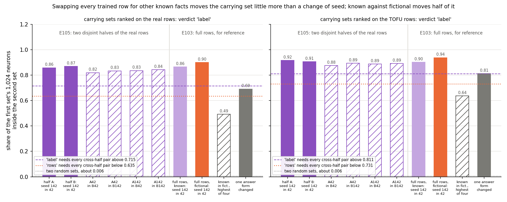
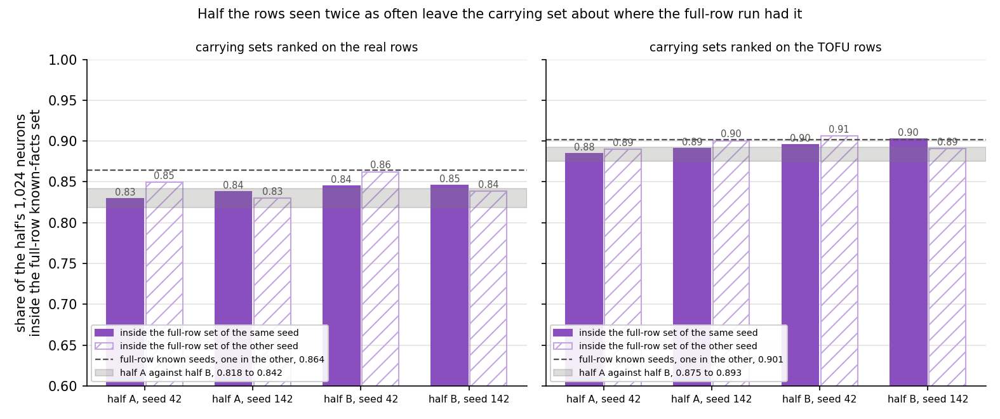
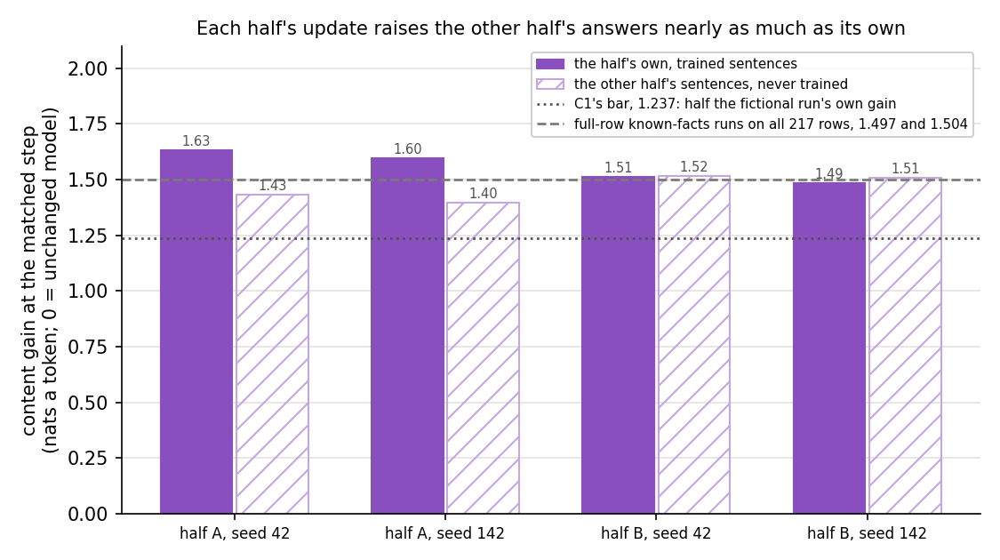

# Analysis: does the known-facts carrying set move when the trained rows are swapped for other known facts? (E105)

*2026-11-06, baseline-lead's E105 writer. **Provisional**: fast lane. Independent check: holds with caveat
(reports/reviews/2026-11-06_review_e105-independent-check.md, commit 21939cad): every overlap and verdict re-derived
exactly; rows are ruled out, topic, entity type and answer style are not. Plan `reports/plans/2026-11-06_plan_e105-rows-null.md`;
rules `experiments/rows_null/results/predictions.json`; code `experiments/rows_null/{run,score}.py` and
`src/commute/known_facts.py`. Explanation: `notebooks/E105_rows_null.ipynb`. Figures: `experiments/rows_null/plot.py`.
Job 53480, one L40 on `debug`, $0; results committed at c72f80cb. Provenance at the end.*

We fine-tuned Qwen3-1.7B on two disjoint halves of the same set of real facts it already knows, at two seeds each,
and asked whether the neurons carrying each update change when the trained facts change. They barely do: two halves
share almost as many carrying neurons as two seeds of one half, far more than the known-facts and invented-facts runs
of the last experiment shared. So that earlier separation is not about which particular rows were trained, but it may
still be about the style of the answers or the topic, real famous people against invented authors, rather than about
known against new.

## The answer

Swapping every trained fact for a different set of known facts leaves the carrying neurons nearly where they were.
Two halves share about five sixths of their carrying neurons on the real rows, and nearly nine tenths on the fictional
rows. That is close to what two seeds share, and far above the half or two thirds a known-facts run shared with a
fictional one. The filed rule reads "label" on both row sets, against the filed leans of "rows" and "no call". The
separation is robust to rows and seed, but it is not yet a reading of known against new. Answer style and the topic
or kind of entity both differ between the arms and remain live causes.

## The result went against both filed leans

The filed leans were "rows" on the real rows and "no call" on the TOFU rows. Both rows read "label", by a wide margin.
The leans expected that changing every trained row would move the set at least as far as changing one answer form
had, which replaced about three tenths of it on the real rows. Changing every row replaced about a sixth. The plan's
own argument against the lean was the one that held: each update is mostly a skill shared across the facts, so the
particular facts matter little. Nothing here is unexplained, but the leans were wrong in direction, not in degree.

## What we were trying to test

`GOALS.md` asks whether post-training strengthens what a model already does or teaches it something new, and whether
a method can tell which. E103 built a pair of Qwen3-1.7B fine-tunes meant to differ in that label: one on TOFU's 217
real-person and world-fact rows, which the model already answers, and one on TOFU's invented authors, which it cannot
know. Its last amendment found one neuron reading that separated them beyond seed noise: which neurons carry each
update. But the two runs also train on different rows. This experiment holds the label at "already known" and changes
only the rows.

**The four fine-tunes.** The 217 real rows are split at random into two disjoint halves of 108 and 109 rows. Each half
is trained with E103 Amendment 1's recipe and sentence wordings, five wordings per row, at the two data-order seeds the
earlier runs used, 42 and 142. Every run stops at step 64. Each is read at its *matched step*: the step whose total
weight change $|\delta W|$, the Frobenius norm over all linear layers, is nearest the template fine-tune's 0.4865. The
earlier full-row runs matched at step 32, inside the same linear warm-up, so the four halves see the same learning
rate at every step as the full-row runs did.

**What is read.** The *carrying set* of an update on a row set is the 1,024 MLP neurons, of Qwen's 172,032, with the
largest first-order share of its gain there: the unchanged model's gradient of the answer log P times the change in
each neuron's firing. It is read on two row sets, as in E103: the real rows' bare answers packed into 29 rows of 256
tokens, and E92's 128 rows of fictional-author text. The *overlap* of two sets is the share of the first set's neurons
that are also in the second. 1 means the same neurons; two random sets share about 0.006.

**The comparisons.**

- *Within a half*: seed 142's set inside seed 42's, for each half. This is the noise a change of data order alone makes.
- *Across halves*: the four pairs of one half-A run with one half-B run. Same label, same recipe, same step, different
  rows. This is the null.
- *Across arms, from E103*: the highest overlap of a full-row known-facts run with a fictional run. Different label and
  different rows. This is what the null is compared with.
- *The bridge*: each half's set inside the full-row known-facts set of the same seed. The halves are not the full-row
  run at half size: by step 32 a half has seen its rows about 0.95 times, the full-row run its rows about 0.47 times.
  The bridge asks whether that extra exposure moves the set by itself, which would put the cross-arm level on a
  different footing from the halves.

**Controls, run first.** The job first re-read E103 Amendment 2's matched state through the same code and required its
stored gain and set back, since every stored set the rule compares with came from that path. It then re-read the
unchanged model's answer tokens on the sentence reader and required its stored level. Each arm also had to clear a gain
bar on its own sentences, half the fictional run's gain, or there would be nothing to carry.

## What we expected, and why

- *The halves' own seeds would share 0.80 to 0.92 of their sets*, as the full-row known seeds' 0.864 and 0.901.
- *Across halves the overlap would fall well below that.* E103 Amendment 1's run and E103's first run, on the same rows
  with only one answer form changed, shared 0.69 on the real rows and 0.81 on the TOFU rows. Changing every trained row
  is a larger change of data, so the lean put the cross-half overlaps near 0.50 to 0.62 on the real rows, which hold
  each half's own questions, and 0.70 to 0.80 on the untrained TOFU rows. That is "rows" on the real rows and "no call"
  on the TOFU rows.
- *Against the lean*, filed with it: each E103 update gained about nine tenths as much on rows it did not train, so the
  update might be mostly a shared sentence-answering skill, which would keep the set in place.
- *The bridge would sit between the cross-half overlaps and the within-half seed overlaps.*
- *Each half would gain 1.4 to 2.2 nats a token on its own sentences*, a little more than the full-row runs' 1.50, and
  0.8 to 1.6 on the other half's, below its own.

**The filed rule**, per row set. Let $w$ be the smaller of the two halves' seed overlaps and the band $1 - w$: the share
of a set a change of data order alone replaced. Let $x$ be E103's highest cross-arm overlap on that row set, 0.492 on
the real rows and 0.637 on the TOFU rows. "Label" needs every cross-half overlap within the band of $w$ and above $x$
by more than the band. "Rows" needs every cross-half overlap no more than the band above $x$, and below $w$ by more than
the band. Anything else is "no call"; an empty set, as the do-nothing state gives, is "unread".

## What we observed

### Did the apparatus reproduce its references?

Yes, all of it. Amendment 2's matched state re-read with a gain of 2.2331, its stored value to every digit, and the
same 1,024 neurons. The unchanged model's sentence-reader level re-read at −2.01584, also exact. The two seeds' first
batches differed by 0.36 nats on half A and 1.05 on half B, so each seed reached the data order. Every early training
check held: step 1 moved nothing, step 2's weight change was 0.0023 in every run, and training peaked at 37.7 GiB
against a filed 44.

All four runs matched at step 32, the full-row runs' step, at weight changes of 0.482 to 0.485. Their content gains on
their own sentences were 1.63 and 1.60 for half A and 1.51 and 1.49 for half B, all above the bar of 1.24.

### When the trained rows change but the label does not, does the carrying set move as far as across arms?

**Reading it.** No: it moves only a little more than a change of seed does, and nowhere near as far as the change
of arm. The first two bars of each panel are each half's two seeds; the four hatched purple bars are the cross-half
pairs. On the real rows the halves' seeds share 0.857 and 0.869, and the cross-half pairs 0.818 to 0.842. E103's
known-facts and fictional runs shared at most 0.492 there. On the TOFU rows the seeds share 0.916 and 0.905, the
cross-half pairs 0.875 to 0.893, and the cross-arm level is 0.637. Every cross-half pair sits above the dashed "label"
line, 0.715 and 0.811, so the rule reads "label" on both row sets.

The rows do move the set a little. Every cross-half overlap is below both seed overlaps on its row set, by 0.013 to
0.051: about 13 to 52 neurons of 1,024. The band allows about 146 neurons on the real rows and 97 on the TOFU rows. A
change of rows is a small, consistent effect on top of seed noise, about a tenth of the cross-arm gap.

The grey bar is a smaller change of data from E103: the same rows with one of five answer forms changed. It moved the
set more than changing every row did here, to 0.69 and 0.81. The independent check found the same against each half:
E103's bare-answer run shares 0.70 to 0.76 with the half sets on the real rows. The set follows the style of the
training answers much more than which facts are in them.

### Does training half the rows twice as often move the set by itself?

**Reading it.** Hardly. Each bar is one half's set inside a full-row known-facts set; the dashed line is the full-row
seeds' overlap with each other. On the real rows the halves sit 0.829 to 0.846 inside the full-row set of their own
seed, against the full-row seeds' 0.864. On the TOFU rows they sit 0.885 to 0.902, against 0.901. Inside the
full-row set of the other seed they read the same within seed noise. So halving the rows and doubling their exposure
leaves the set about where the full-row run had it, and the cross-arm level is on the halves' footing.

### Is each half's update specific to its own rows?

**Reading it.** Mostly not, which is why the set barely moves. Solid bars are each run's gain on the sentences it
trained; hatched bars are its gain on the other half's sentences, which it never saw. Half A gains 1.43 and 1.40 on
half B's sentences, nine tenths of its own. Half B gains as much on half A's sentences as on its own, 1.52 and 1.51.
At this size each update has learned to answer known-fact questions in a sentence, a skill that transfers across the
facts. The filed expectation that the other half's gain would sit below the own gain held for half A only.

## Full tables

Overlaps of carrying sets, share of the first set inside the second.

| row set | half A seeds | half B seeds | A42 in B42 | A42 in B142 | A142 in B42 | A142 in B142 | E103 cross-arm max | band | label line | rows line | verdict |
|---|---|---|---|---|---|---|---|---|---|---|---|
| real | 0.8574 | 0.8691 | 0.8184 | 0.8330 | 0.8350 | 0.8418 | 0.4922 | 0.1426 | 0.7148 | 0.6348 | label |
| TOFU | 0.9160 | 0.9053 | 0.8750 | 0.8926 | 0.8867 | 0.8916 | 0.6367 | 0.0947 | 0.8105 | 0.7314 | label |

| E103 reference, same probes | real | TOFU |
|---|---|---|
| full-row known seeds | 0.864 | 0.901 |
| fictional seeds | 0.899 | 0.937 |
| known against fictional, four pairs | 0.470 to 0.492 | 0.614 to 0.637 |
| one answer form changed, Amendment 1 inside E103 | 0.690 | 0.812 |
| E103's bare-answer run against the four half sets, from the check | 0.696 to 0.757 | 0.802 to 0.844 |

The bridge: each half's set inside the full-row known-facts set.

| row set | full set's seed | A42 | A142 | B42 | B142 | full-row seeds |
|---|---|---|---|---|---|---|
| real | same | 0.8291 | 0.8379 | 0.8447 | 0.8457 | 0.8643 |
| real | other | 0.8496 | 0.8301 | 0.8623 | 0.8389 | |
| TOFU | same | 0.8848 | 0.8906 | 0.8955 | 0.9023 | 0.9014 |
| TOFU | other | 0.8896 | 0.9004 | 0.9063 | 0.8906 | |

Per run, at the matched step.

| quantity | A42 | A142 | B42 | B142 | full-row seeds 42 / 142 |
|---|---|---|---|---|---|
| rows, sequences, steps an epoch | 108, 540, 33 | same | 109, 545, 34 | same | 217, 1,085, 67 |
| first batch loss, seed 42 / 142 | 3.125 / 3.487 | same | 2.953 / 4.000 | same | 3.673 / 4.151 |
| step 2 weight change | 0.00228 | 0.00227 | 0.00230 | 0.00229 | 0.00233 / 0.00229 |
| matched step, weight change | 32, 0.4853 | 32, 0.4830 | 32, 0.4816 | 32, 0.4837 | 32, 0.4801 / 0.4832 |
| epochs of own rows at matched step | 0.948 | 0.948 | 0.939 | 0.939 | 0.472 |
| content gain, own sentences | 1.632 | 1.596 | 1.511 | 1.485 | 1.504 / 1.497, all 217 |
| content gain, other half's sentences | 1.432 | 1.398 | 1.515 | 1.508 | |
| other over own | 0.877 | 0.876 | 1.003 | 1.016 | |
| neuron-reader gain, real / TOFU rows | 2.315 / 1.767 | 2.217 / 1.791 | 2.224 / 1.782 | 2.166 / 1.781 | 1.87 / 1.77, 2.23 / 1.78 |
| set inside E102's Gaussian change's, real / TOFU | 0.231 / 0.272 | 0.215 / 0.269 | 0.218 / 0.273 | 0.216 / 0.272 | 0.21 to 0.27 |

The Gaussian-change overlaps and the "other over own" ratios are reads off the saved files in `plot.py`, not filed
numbers. The Gaussian change is E102's random weight change scaled to the template's KL; the half sets share about a
quarter of their neurons with it, as the full-row sets did, so they are not a generic response to any weight change.

## What we learned

- Which neurons carry the known-facts update does not depend on which known facts were trained. Two disjoint halves of
  the real rows give carrying sets almost as alike as two seeds of one half, on both row sets.
- So E103's separation between the known-facts and the fictional run is not a rows effect in the narrow sense. The
  candidate reading becomes: *the carrying set separates the known-fact training from the new-fact training, robust to
  the particular rows and to the seed.* Which difference between the two trainings it reads is still open.
- It is not yet a reading of known against new. The two arms still differ in everything a different source of data
  brings: famous real people and world facts against invented authors, the entity types, the style of the questions,
  who wrote the answers and how they are worded, and how familiar the text is before training. Answer style is the
  likeliest of these, since the set is known to follow it: changing one answer form of five moved the set more than
  changing all the rows did, and moved it further from the fictional sets too.
- At this size each update is mostly a transferable skill, answering this kind of question in a sentence, not the
  facts themselves. That explains why the rows matter little. It also means the rows null was run where rows were
  unlikely to matter, and that a change of style or topic, not of label, could be what E103 saw.

## How compelling is the evidence

- *The null itself is clear.* Every cross-half overlap clears the "label" line by at least 0.10 on the real rows and
  0.06 on the TOFU rows, about 100 and 65 neurons. The verdict does not hang on a neuron or two.
- *Seeds*: two per half, so each half's seed noise is one pair. The two halves' seed overlaps agree within 0.012, which
  suggests the estimate is stable.
- *One split.* The halves come from one random split, seed 105. A split along a meaningful line, such as people against
  places, would be a harder null and was not run.
- *What the null cannot separate*: label from distribution. Both halves are drawn from the same source, so this
  experiment holds topic, entity type, question style and answer style fixed along with the label. It shows that the
  particular rows do not matter, not that the label does.
- *Nothing in the measurement makes the known runs agree by construction*, by the independent check. Every score
  multiplies by the unchanged model's gradient, so any update's set shares a floor with every other: a Gaussian weight
  change shares 0.21 to 0.27 of every set. That floor is common to both arms and cannot make the cross-arm gap. About
  half of each known set is shared with both fictional sets. With those neurons removed, the known-only remainders
  still agree across halves, 412 of 569 neurons on the real rows and 317 of 420 on the TOFU rows: 0.72 and 0.75.
- *The agreement holds down the whole ranking.* Between halves A42 and B42 on the real rows, the top 32 neurons agree at
  0.78 and the top 512 at 0.82. Known against fictional reads about 0.47 to 0.55 at every depth. No handful of top
  neurons drives the result.
- *The real-row probe holds each half's own trained questions* in bare-answer form, so on those rows a half's set is
  partly ranked on its own rows. The cross-half overlap is still high there, and the untrained TOFU probe agrees.
- *Overlap counts shared neurons in two ranked top-1,024 lists.* It misses rank changes inside the set, neurons just
  past the cut, and anything inside a neuron.
- *The cross-arm level* comes from full-row runs at half the halves' exposure. The bridge shows that exposure leaves
  the set near the full-row run's, so the comparison stands.
- *One matched size*, the template's. At this size each update has learned little specific to its rows; at larger
  sizes the facts might start to move the set.

## Surprises

- **Both filed leans were wrong in direction.** The leans were "rows" on the real rows and "no call" on the TOFU rows;
  the reading was "label" on both, with the cross-half overlaps far above the leans' 0.50 to 0.62 and 0.70 to 0.80.
  Changing every trained row moved the set less than changing one answer form on the same rows had.
- **Half B's update gains as much on half A's untrained sentences as on its own.** The filed expectation had the other
  half below the own half; half A met it, at nine tenths, and half B did not.

## What next

Each item is a new plan through `/design`.

1. *A control that changes the label while holding topic and answer style.* One design: real facts of one kind, all
   answered in sentences by one writer with one brief, split by whether the unchanged model already gets them right.
   Another: fictional authors first taught to the model and then trained again, against untaught authors in the same
   style. If the known and unknown arms of such a pair separate as far as E103's arms, set identity reads the label;
   if they share about as much as two halves do here, it read the style or topic. A known-facts arm from a different
   domain, such as geography, in the same answer style, would add whether the topic alone moves the set.
2. *Carry set identity forward, labelled.* Until item 1 reads, set identity is the neuron baseline's reading of
   "real-world against fictional-author training, robust to rows and seed", with answer style and topic named beside it
   as live causes. The four summary neuron readings stay level and add nothing.
3. *A larger matched size*, where each update has learned more specific to its own rows, to see whether the rows start
   to move the set.

## Scorecard

Filed in `experiments/rows_null/results/predictions.json`, scored as filed. The two scored rules are the verdicts per
row set; everything else is a stop or reported.

| id | claim | rule | read | verdict |
|---|---|---|---|---|
| C2n | Amendment 2's matched neuron read reproduces | gain within 1e-3 relative of 2.2331, set overlap ≥ 0.95 | 2.2331183574, rel 0; overlap 1.0 | holds |
| W0_sentence | W0's sentence-reader content level | within 1e-5 relative of −2.0158448 | −2.0158448, rel 0 | holds |
| first batch | the two seeds' first batches differ, per half | abs gap > 0.001 | A 0.362, B 1.047 | holds |
| first minutes | step 1 loss equal, rate and weight change 0; step 2 weight change in [0.00208, 0.00312]; peak ≤ 44 GiB | bands | 0, 0, 0; 0.00227 to 0.00230; 37.7 GiB | all hold |
| matched | template norm passed within 64 steps, argmin is the matched step | stop rule | matched 32, argmin 32, every arm | holds |
| C1 | own-half content gain at matched step | ≥ 1.2365; expected 1.4 to 2.2 | 1.632, 1.596, 1.511, 1.485 | holds ×4, as expected |
| rows_real | label, rows or no call on the real rows | label iff w − min cross ≤ band and min cross − x > band; rows iff max cross − x ≤ band and w − max cross > band | w 0.857, band 0.143, cross 0.818 to 0.842, x 0.492: 0.039 ≤ 0.143 and 0.326 > 0.143 | **label**, against the lean "rows" |
| rows_tofu | the same on the TOFU rows | same | w 0.905, band 0.095, cross 0.875 to 0.893, x 0.637: 0.030 ≤ 0.095 and 0.238 > 0.095 | **label**, against the lean "no call" |
| within-half seeds, expected | seed overlaps per half | 0.80 to 0.92 | 0.857, 0.869; 0.916, 0.905 | as expected |
| cross-half, expected | cross-half overlaps | real 0.50 to 0.62, TOFU 0.70 to 0.80 | real 0.818 to 0.842, TOFU 0.875 to 0.893 | missed, above |
| matched step, reported | step and weight change | 28 to 36, within 0.02 of 0.4865; 0.9 to 1.1 epochs | 32 ×4, 0.4816 to 0.4853; 0.939 and 0.948 | as expected |
| other-half gain, reported | gain on the other half's sentences | 0.8 to 1.6, below own | A 1.432, 1.398, below own; B 1.515, 1.508, above own | in range; below own for half A only |
| bridge, reported | half sets inside full-row sets | between cross-half and within-half overlaps | real same seed 0.829 to 0.846, TOFU 0.885 to 0.902 | as expected, near the full-row seeds' 0.864 / 0.901 |

The filed "reading" field for "label" on both row sets says set identity separates the arms beyond a change of rows at
fixed label and is carried forward as the neuron baseline's reading of reuse against new, still labelled with the
granularity limit. This report and the independent check narrow that: the null fixes the source and style of the data
along with the label, so set identity is carried forward as a reading of real-world against fictional-author training,
with answer style and topic beside it as live causes.

## Departures from the literature

- **TOFU's real-author and world-fact sets are evaluation sets** in Maini et al. 2024, never trained on. Here, as in
  E103, they are the training rows, so the update's label is fixed by the data.
- **E84's recipe**, as E103 Amendment 1 ran it, is followed through step 64 of a five-epoch schedule and then stopped.
  Every step up to 250 is inside the linear warm-up, so nothing before the matched step differs; no end state is
  trained.
- **The split** into halves is our own, by `random.Random(105)`; TOFU defines no such split.
- **The carrying-set ranking** is E98's first-order attribution as E102 ran it, and carries E102's departures, listed
  in its report. The overlap rule and its band are this project's, not from a source.

## Not run

- A pair that differs in label but holds topic and answer style: real facts the model gets right against ones it gets
  wrong, in one writer's style, or taught against untaught fictional authors.
- Any fine-tune on a third dataset in the same format read on these probes, to measure the share any TOFU-style
  sentence fine-tune has in common.
- A known-facts arm from a different topic or domain, to test whether the set follows the topic.
- A full-row known-facts run trained to the halves' exposure; the bridge stands in for it.
- A same-split pair for the fictional arm, rows changed at the other label.
- More than two seeds per half, a different split seed, or a split along a meaningful line such as people against
  places.
- A matched size larger than the template's.
- VPD reads of the half states, qwen-decomp-lead's instruments.

## Provenance

- Job 53480, `cluster/rows_null.sbatch`, one L40 on `debug`, submitted 2026-11-06 05:39 UTC, 556 s from start to
  finish; $0. Stage C, then arms A42, A142, B42, B142 in about 130 s each, then the score.
- Results `experiments/rows_null/results/{control,score,split}.json`, `arm_*.json`, `train_*.json`, `sets/*.json`,
  `run.log`. Matched states `results/large/dW/<arm>_matched.safetensors`, bf16, 2.82 GB each, gitignored; the
  unchanged model's sentence tokens `results/large/w0_sentence.json`.
- Peaks: 37.7 GiB in training, 40.5 GB including the neuron reads, 24.7 GB in stage C; host 11.0 GB.
- References read: `experiments/known_answer_pair/results/neurons_amend2.json`, `neurons_amend1/`, `neurons/`,
  `amend1_train.json`, `amend2_train.json`; E102's Gaussian set `experiments/qwen_carrying/results/states/gauss_tofu.json`.
- Figures `experiments/rows_null/figures/{overlap,bridge,gain}.png` from `plot.py`, no model.
