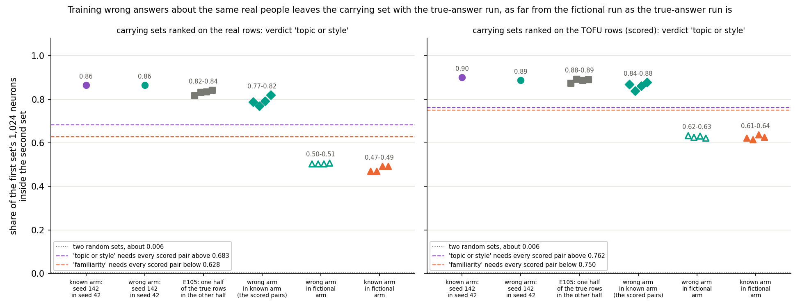
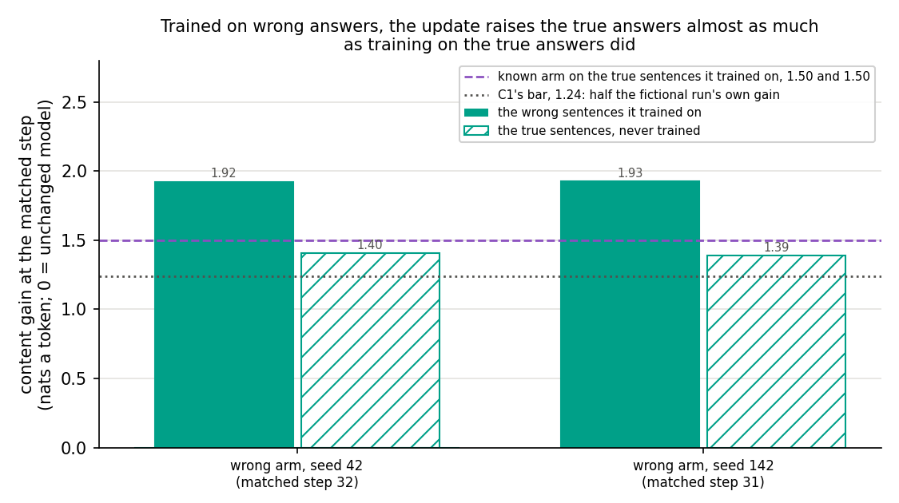
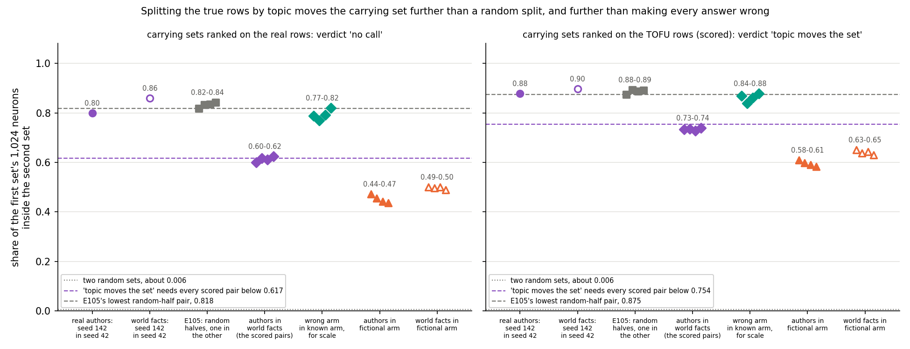

# Analysis: does the known-facts carrying set read whether the model already holds the fact, or the data's topic and style? (E107)

*2026-11-06, baseline-lead's E107 writer. **Provisional**: fast lane.
Independent check: holds with caveat (reports/reviews/2026-11-06_review_e107-independent-check.md, commit 315f45c4):
every overlap and verdict re-derives exactly and the wrong arm did train wrong answers, but the test had little power,
since the label moved the weight update only about as much as a change of seed, and the topic split is confounded with
answer length and the model's starting loss. Plan `reports/plans/2026-11-06_plan_e107-label-vs-style.md`; rules `experiments/label_vs_style/results/predictions.json`;
code `experiments/label_vs_style/{run,score}.py` and `src/commute/known_facts.py`. Explanation:
`notebooks/E107_label_vs_style.ipynb`. Figures: `experiments/label_vs_style/plot.py`. Job 53575, one L40 on `debug`, $0;
results committed at c3b86b3a. Provenance at the end.*

We fine-tuned Qwen3-1.7B on the same questions about real people and places that it already answers, in the same
sentences, but with every stated answer swapped for a wrong one, and compared the neurons carrying that update with
those of the run on the true answers. The two runs share nearly the same carrying neurons, and the wrong-answer run is
as far from the fictional-author run as the true-answer run is, while splitting the true rows by source file moved the
set more than making every answer wrong did. So at this early, matched size the carrying set does not read whether the
trained answer agrees with what the model already says; it separates the data's source and style, and whether
genuinely new facts or a larger update would move it is untested.

## The answer

Training wrong answers about the same real people, in the same words and style, moves the carrying neurons about as
little as training a different half of the true facts does. On the scored TOFU rows the wrong-answer run shares 84 to 88
percent of its carrying neurons with the true-answer run, and it sits no closer to the fictional run than the true run
does. Both filed leans went the other way. At matched size the set does not read whether the trained answer agrees
with what the model already says; it separates the data's source and style. The test had little power: early in
training, wrong answers changed the update only about as much as a new seed does.

## Both filed leans were wrong

The filed lean for the wrong-answer arm was **familiarity**: that the set would move toward the fictional run once the
stated answers stopped agreeing with what the model already says. It read **topic or style** on both row sets, by a wide
margin: every scored pair cleared the "topic or style" line by at least 0.077, and the "familiarity" line sat 0.089
below the lowest pair. The filed lean for the topic split was **does not move the set**. On the scored TOFU rows it read
**topic moves the set**: real authors against world facts shared 0.73 to 0.74, under the line of 0.754. On the real
rows it read no call. The plan's own argument against the first lean held: at this size each update is mostly a shared
skill of answering this kind of question in a sentence, and the wrong-answer arm shares that skill word for word.

## What we were trying to test

`GOALS.md` asks whether post-training strengthens what a model already does or teaches it something new, and whether a
method can tell which. The neuron baseline is the comparator beside VPD. E103 built a pair of Qwen3-1.7B fine-tunes
meant to differ in that label: one on TOFU's 217 real-person and world-fact rows, which the model already answers, and
one on TOFU's invented authors, which it cannot know. One neuron reading separated them beyond seed noise: which neurons
carry each update. E105 then showed that swapping the trained rows for other known facts leaves that set in place. It
left open whether the separation reads the label or the data's topic, entity type and answer style, since the two arms
differ in all of them.

**The wrong-answer arm.** Take the known arm's exact 217 rows, questions, five answer wordings and writer. In every
wording, replace the true answer with TOFU's first wrong answer for that row: "The author of 'Romeo and Juliet' is
Charles Dickens." Nothing else changes, so topic, entity type, question and answer style are held, and only whether the
model already holds the stated fact is changed. A wrong answer overrides a fact the model holds; it does not add a new
entity. The arm is trained with E103 Amendment 1's recipe at the data-order seeds 42 and 142.

**The topic split.** In the same job, E105's half-size arm was run again with the 217 true rows split by source file,
not at random: 100 real-author rows against 117 world-fact rows, two seeds each. E105's random halves are its reference.

**What is read.** Each run is read at its *matched step*: the step whose total weight change $|\delta W|$, the Frobenius
norm over all linear layers, is nearest the template fine-tune's 0.4865. That holds update size fixed across arms. The
*carrying set* of an update on a row set is the 1,024 MLP neurons, of Qwen's 172,032, with the largest first-order share
of its gain there: the unchanged model's gradient of the answer log P times the change in each neuron's firing. It is
read on two row sets: E92's 128 rows of fictional-author text, which no arm here trained and which are scored, and the
real rows' bare answers, reported only, since they hold the true answers the wrong arm trained against. The *overlap* of
two sets is the share of the first set's neurons that are also in the second: 1 is the same set, two random sets share
about 0.006.

**Controls, run first.** The job re-read E103 Amendment 2's matched state through the same code and required its stored
gain and set back. It re-read the unchanged model's level on the true sentences. Then, before any training, it checked
that the wrong answers really are unfamiliar to the unchanged model: the wrong sentence had to score below the true one
in at least three quarters of rows. Each arm also had to clear a gain bar on its own sentences, half the fictional run's
gain, or there would be nothing to carry.

## What we expected, and why

- *The label check would hold* at 0.85 to 0.97 of rows, since the unchanged model picks the true answer over all three
  wrong ones in 0.79 of rows.
- *The wrong arm's carrying set would move toward the fictional run's.* The early gradient of a wrong sentence sits on
  answer words the model does not expect, as the fictional run's does. The lean put the wrong-in-known overlaps at 0.60
  to 0.74 on the TOFU rows: "familiarity". Filed against it: at the matched step neither earlier arm had learned
  row-specific facts, so the update might be mostly the sentence skill, which would read "topic or style".
- *The wrong arm would gain less on the true sentences than on its own*, between −0.5 and 1.3 nats a token.
- *Splitting by topic would move the set no more than a random split did*, 0.84 to 0.89 on the TOFU rows, since E105's
  updates transferred almost fully across rows.

**The filed rule for the wrong arm**, per row set. Let $w$ be the smaller of the wrong arm's and the known arm's seed
overlaps and the band $1 - w$. Let $x$ be E103's highest known-in-fictional overlap and $L$ E105's lowest cross-half
overlap. "Familiarity" needs every wrong-in-known pair at most $\min(x + \text{band}, L - \text{band})$. "Topic or
style" needs every pair at least $L - \text{band}$ and more than the band above $x$. Anything else is no call.

**The filed rule for the topic split.** With $w$ the less stable topic's seed overlap and the band $1 - w$, "topic moves
the set" needs every authors-in-world pair more than the band below $L$; "topic does not" needs every pair within it.

## What we observed

### Did the apparatus reproduce its references, and are the wrong answers unfamiliar?

Yes. Amendment 2's matched state re-read with a gain of 2.2331, its stored value to every digit, and the same 1,024
neurons. The unchanged model's true-sentence level re-read at −2.01584, exact. The label check held: the wrong sentence
scored below the true one in 186 of 217 rows, 0.857, by 0.65 nats a token on average. Both are inside the filed
expectation. The wrong arm's first batch lost 4.09 nats at seed 42, 0.41 above the known arm's 3.67, as expected.

Every early training check held in all six arms: step 1 moved nothing, step 2's weight change was 0.0023 to 0.0024, and
training peaked at 38.4 GiB against a filed 44. The matched steps were 31 to 33, at weight changes of 0.476 to 0.492.
Every arm cleared the gain bar of 1.24: the wrong arm gained 1.92 on its own sentences, the author arms 1.37 to 1.38,
the world-fact arms 1.64 to 1.71.

### Does making every answer wrong move the carrying set toward the fictional run?

**Reading it.** No. The wrong-answer run's set sits with the true-answer run's, about where a different half of the true
facts sits. On the scored TOFU rows the four wrong-in-known pairs read 0.84 to 0.88, against 0.88 to 0.89 for E105's
cross-half pairs and 0.90 for the known arm's two seeds. Every pair is above the "topic or style" line of 0.762, and
the highest known-in-fictional overlap is 0.637. The wrong arm in the fictional arm reads 0.62 to 0.63, level with the
known arm in the fictional arm at 0.61 to 0.64. So making the answers wrong did not move the set toward the fictional
run at all. On the real rows the same holds: wrong in known 0.77 to 0.82, above the line of 0.683; wrong in fictional
0.50 to 0.51, against known in fictional 0.47 to 0.49.

The wrong answers do move the set a little. The wrong-in-known pairs sit below the known seeds by 0.040 on average on
the TOFU rows and 0.072 on the real rows. That is about a seventh and a fifth of the gap between the known seeds and
known in fictional. It is also slightly more than a change of rows moved it in E105, by about 25 and 40 neurons.

**How much room the test had.** The independent check compared the saved updates directly, by cosine over all 196
weight matrices. With the data order fixed, the wrong-answer update and the true-answer update read 0.82 to 0.83. Two
seeds of the true-answer arm read 0.82, and wrong against true at different seeds 0.73. So swapping true for wrong
answers turns the update about as far as a new data order does. The filed rule's band is seed noise, so it could only
have called "familiarity" for an effect several times larger than the one in the weights. The set shows the same small
effect: same-seed wrong-in-known pairs read 0.87 and 0.88 on the TOFU rows, different-seed pairs 0.84 and 0.86. E105
had already shown the set ignores which rows are trained, and the wrong answers change only what is said per row. So
"wrong sits with known" was close to implied by E105 before the run.

### Has the wrong-answer update learned the wrong facts?

**Reading it.** Only a little, which is the main caveat on this result. At the matched step the wrong arm raised its own
wrong sentences by 1.92 nats a token. It raised the true sentences, which it never saw, by 1.39 to 1.40: 0.93 of what
the known arm gained by training on them directly, 1.50. So about three quarters of the update's gain on its own
sentences is the shared skill of answering these questions in a sentence. The answer-specific part is the 0.52 to 0.54 nats a
token between the two bars. Per row, the updated model scores the wrong sentence above the true one in 0.27 of rows,
up from 0.14 for the unchanged model. Most rows still prefer the true fact. The filed expectation put the true-sentence
gain at most 1.3; it came in just above that.

The probes cannot see which facts were trained either. By the independent check, the real probe's gain is 2.02 to 2.07
for the wrong arm, 1.87 to 2.23 for the known arm and 2.18 to 2.45 for the fictional arm, which never saw a real
question. The carrying set is ranked on that gain, so it had little to read familiarity from. Whether the wrong arm's
0.27 is specific to wrong-answer training is also unmeasured: the known arm's matched state was never read on the wrong
sentences.

### Does splitting the true rows by source file move the set?

**Reading it.** On the scored TOFU rows, yes. Real-author runs and world-fact runs share 0.73 to 0.74 of their sets,
below the "topic moves the set" line of 0.754 and well below E105's random halves at 0.88 to 0.89. The source-file
split moved the set further than making every answer wrong did, 0.84 to 0.88. On the real rows the pairs read 0.60 to 0.62, straddling
that probe's line of 0.617, so no call. That probe holds each topic's own questions, and the author runs' seeds agree
there at only 0.80.

The entity-type reading the plan reported beside it went the other way from the obvious guess. If the fictional run's
set followed people as a kind of entity, the real-author sets would sit closer to it than the world-fact sets. They sit
further: 0.58 to 0.61 against 0.63 to 0.65 on the TOFU rows. The difference, −0.046, is inside the band of 0.121.

The topic arms differ from E105's halves in more than topic. Row counts are an unlikely cause: 100 and 117 rows sit
within a tenth of E105's 108 and 109. But by the independent check, author sentences hold 17.7 content tokens against
13.0 for world facts. The unchanged model also starts 0.49 nats a token more confident on them, so they have less room
to gain. Topic, entity type, sentence length and starting loss all move together, and this run cannot say which moves
the set. It is mostly the author arms that move: world facts in the known arm read 0.83 to 0.85 on the TOFU rows, near
E105's 0.875, while authors in the known arm read 0.77 to 0.79. The world-fact file also holds a few author questions.

## Full tables

**Overlaps, TOFU rows (scored).** Each cell is the share of the first set inside the second; "4 pairs" lists seeds
42-42, 42-142, 142-42, 142-142.

| comparison | value(s) |
|---|---|
| known arm seeds | 0.9014 |
| wrong arm seeds | 0.8867 |
| fictional arm seeds | 0.9365 |
| E105 half A in half B, 4 pairs | 0.8750, 0.8926, 0.8867, 0.8916 |
| wrong in known, 4 pairs (scored) | 0.8691, 0.8389, 0.8604, 0.8789 |
| wrong in fictional, 4 pairs | 0.6338, 0.6260, 0.6318, 0.6230 |
| known in fictional, 4 pairs | 0.6221, 0.6143, 0.6367, 0.6260 |
| author seeds / world seeds | 0.8789 / 0.8965 |
| authors in world, 4 pairs (scored) | 0.7324, 0.7354, 0.7275, 0.7393 |
| authors in fictional, 4 pairs; mean | 0.6094, 0.5977, 0.5908, 0.5820; 0.5950 |
| world in fictional, 4 pairs; mean | 0.6514, 0.6377, 0.6426, 0.6309; 0.6406 |
| wrong in E105 half A, 4 pairs | 0.8193, 0.8438, 0.8359, 0.8389 |
| authors in known / world in known, 4 pairs | 0.769-0.795 / 0.832-0.854 |

**Overlaps, real rows (reported).**

| comparison | value(s) |
|---|---|
| known arm seeds / wrong arm seeds / fictional seeds | 0.8643 / 0.8643 / 0.8994 |
| E105 half A in half B, 4 pairs | 0.8184, 0.8330, 0.8350, 0.8418 |
| wrong in known, 4 pairs | 0.7881, 0.7695, 0.7910, 0.8193 |
| wrong in fictional, 4 pairs | 0.5049, 0.5039, 0.5039, 0.5078 |
| known in fictional, 4 pairs | 0.4697, 0.4707, 0.4922, 0.4922 |
| author seeds / world seeds | 0.7988 / 0.8584 |
| authors in world, 4 pairs | 0.5996, 0.6162, 0.6104, 0.6240 |
| authors in fictional mean / world in fictional mean | 0.4519 / 0.4968 |

The wrong arm's and the known arm's seed overlaps on the real rows are both 885 of 1,024 neurons; the sets differ, the
counts coincide. Every overlap above was re-derived from the stored sets by a script independent of `score.py`
(`~/commute-data/scratch/baseline-lead/e107-writer2/verify_e107.py`, `verify.out`), and `plot.py` asserts the scored
pairs equal `score.json`'s.

**Rule lines.**

| rule, probe | w | band | x | L | lines | verdict |
|---|---|---|---|---|---|---|
| wrong, TOFU | 0.8867 | 0.1133 | 0.6367 | 0.875 | familiarity ≤ 0.750; topic or style ≥ 0.762 | topic or style |
| wrong, real | 0.8643 | 0.1357 | 0.4922 | 0.8184 | familiarity ≤ 0.628; topic or style ≥ 0.683 | topic or style |
| topic, TOFU | 0.8789 | 0.1211 | — | 0.875 | moves if every pair < 0.754 | topic moves the set |
| topic, real | 0.7988 | 0.2012 | — | 0.8184 | moves if every pair < 0.617; does not if every pair ≥ 0.617 | no call |

**Per arm.**

| arm | rows | first batch, seeds 42 / 142 | matched step, norm | epochs | own content gain | second gain |
|---|---|---|---|---|---|---|
| WRONG42 | 217 | 4.088 / 4.907 | 32, 0.4924 | 0.47 | 1.923 | true sentences 1.405 |
| WRONG142 | 217 | same | 31, 0.4763 | 0.46 | 1.925 | true sentences 1.389 |
| AUTH42 | 100 | 3.160 / 4.361 | 31, 0.4875 | 0.99 | 1.374 | world sentences 1.517 |
| AUTH142 | 100 | same | 31, 0.4810 | 0.99 | 1.378 | world sentences 1.533 |
| WORLD42 | 117 | 3.738 / 3.635 | 33, 0.4920 | 0.90 | 1.711 | author sentences 1.272 |
| WORLD142 | 117 | same | 32, 0.4823 | 0.88 | 1.637 | author sentences 1.209 |

Known arm, for reference: first batch 3.673 at seed 42; content gain on the true sentences 1.504 and 1.497.
Rows preferring the wrong sentence: unchanged model 0.143; WRONG42 0.267, WRONG142 0.272.

## What we learned

- At matched size, which neurons carry the known-facts update does not read whether the trained answer agrees with
  what the model already says. Swapping every answer for a wrong one, with everything else held, keeps the set with the
  true-answer run's and leaves it as far from the fictional run as the true-answer run is.
- What the set separates is the data's source and style. Splitting the true rows by source file moves it on the TOFU
  rows, where random halves did not, though topic, sentence length and starting loss move together there. With E105's
  finding that one changed answer form moved the set more than all the rows did, style is the best-supported carrier.
- Set identity is retired as a reading of whether the trained answer agrees with the model. Whether genuinely new facts,
  such as real facts the model lacks or invented names, would move it is untested: a wrong answer is a contradicted
  fact, not a new one.
- The test had little power. At this size the update is mostly a skill of answering these questions in a sentence: the
  wrong arm raised the true answers almost as much as the true arm did, and in the weights the label moved the update
  about as far as a new seed. A neuron reading that tracks what is learned may need an update that has learned more.

## How compelling is the evidence

- *The verdict is not close, but the test was weak.* On the TOFU rows every wrong-in-known pair clears the "topic or
  style" line by at least 0.077, about 79 neurons, and the "familiarity" line sits 0.089 under the lowest pair. On the
  real rows the margins are 0.087 and 0.142. The independent check re-derived every overlap and verdict exactly. But
  the label's effect on the weight update is about the size of seed noise, which is the rule's band, so the rule could
  not have read "familiarity" for an effect of the size the weights show.
- *Little fact content was learned.* At the matched step only 0.27 of rows prefer the wrong sentence, against 0.14
  before training, and E105 found the halves' updates transfer almost fully across rows. The probes' gains are the same
  whether the facts were trained, contradicted or absent. So the test asks whether the label shows in an early update
  that has mostly learned the sentence skill, and E105 nearly implied the answer. It does not show the set would stay
  put once the wrong facts are learned. Read at a larger size, the answer could differ.
- *A wrong answer overrides; it does not add.* A contradicted fact reuses the entity's existing representation and
  changes what is said about it. "Topic or style" is strong evidence against set identity as a label reading, since this
  is the largest departure from the model's knowledge this data allows. It is not proof that a genuinely new fact would
  leave the set in place.
- *The topic split changes more than topic.* It is by source file, so question wording, entity type, sentence length
  and the model's starting loss move with it, and the world-fact file holds a few author questions. "Topic moves the
  set" reads on the TOFU rows only; the real rows read no call, with the author runs' seeds there at 0.80. In the
  weights authors against world read 0.40 to 0.42, far apart, but E105's random halves were not saved, so whether any
  two disjoint halves sit that far apart is unknown.
- *Seeds*: two per arm. The wrong arm's seed overlaps match the known arm's within 0.015.
- *Overlap counts shared neurons in two ranked top-1,024 lists.* It misses rank changes inside the set, neurons just
  past the cut, and anything inside a neuron. Every score multiplies by the unchanged model's gradient, so every update's
  set shares a floor with every other, about 0.21 to 0.27 for a Gaussian weight change by E105's check.
- *One matched size*, the template's, and one model, Qwen3-1.7B.

## Surprises

- **The wrong-answer lean was wrong in direction.** Predicted: the set moves toward the fictional run, wrong-in-known
  0.60 to 0.74. Seen: 0.84 to 0.88, beside E105's random halves.
- **The source-file split moved the set more than the answer's truth did.** Predicted: authors against world facts
  0.84 to 0.89. Seen: 0.73 to 0.74 on the TOFU rows, below the wrong-in-known pairs.
- **Training wrong answers raised the true ones almost as much as training true answers.** The filed expectation for
  the true-sentence gain was at most 1.3; it read 1.39 to 1.40, 0.93 of the known arm's.
- The author arms gained more on the world-fact sentences, 1.52 to 1.53, than on their own, 1.37 to 1.38. Their own
  gain was a hair under the expected 1.4 to 2.2, still above the bar.

## What next

Each item is a new plan through `/design`.

1. *The cheap control first, $0 and seconds on a GPU.* Read the known arm's saved matched state on the wrong sentences.
   If it also shrinks the true-minus-wrong gap from 0.65 toward 0.12 nats a token, the wrong arm's 0.27 preference is
   what any update of this size does, and the arms learned even less that differs.
2. *A larger matched size, as a new plan.* Train the known, wrong and fictional arms to a common size where the wrong
   arm prefers its wrong answer in most rows, measured by the same per-row check, and read the carrying sets there. The
   fictional arm has no saved state between steps 29 and 550, so it needs retraining. If the wrong arm then separates
   from the known arm as far as the fictional arm does, the set reads learned content once there is some, and the
   neuron baseline has a size-dependent reading to carry. If it still sits with the known arm, set identity is closed
   on Qwen at both sizes. A carrying read ranked on the answer tokens alone belongs in the same plan, since it removes
   the shared sentence frame the current read is dominated by.
3. *Genuinely new facts*, if the line continues: real facts the model lacks, or invented names on the author rows, in
   the known arm's style. Only these test new against known; the wrong arm tests contradicted against known.
4. *VPD on the same states.* The two wrong-arm matched updates are saved in fp32 for qwen-decomp-lead's reads; whether
   VPD's readings separate the wrong arm from the known arm, where the neurons do not, is that lead's question.

## Scorecard

Filed in `experiments/label_vs_style/results/predictions.json`, scored as filed. The two scored rules are `wrong_tofu`
and `topic_tofu`; the rest are stops or reported.

| id | claim | rule | read | verdict |
|---|---|---|---|---|
| C2n | Amendment 2's matched read reproduces | gain within 1e-3 relative of 2.2331, set overlap ≥ 0.95 | 2.2331183574, rel 0; overlap 1.0 | holds |
| W0_sentence | unchanged model's true-sentence content level | within 1e-5 relative of −2.0158448 | −2.0158448, rel 0 | holds |
| label_check | wrong sentence below true in enough rows | share ≥ 0.75; expected 0.85-0.97, gap 0.3-1.0 | 186 / 217 = 0.857; gap 0.651 | holds, as expected |
| first batch | the seeds' first batches differ, per arm | abs gap > 0.001 | WRONG 0.819, AUTH 1.201, WORLD 0.103 | holds |
| first minutes | step 1 loss equal, rate and weight change 0; step 2 weight change in [0.00208, 0.00312]; peak ≤ 44 GiB | bands | 0, 0, 0; 0.00227-0.00236; 38.4 GiB | all hold, ×6 |
| matched | norm passed within 64 steps, argmin is the matched step | stop rule | argmin = matched in all six | holds |
| wrong first batch, reported | seed-42 first batch above known's 3.673 | 0.3-1.5 above | 4.088, +0.415 | as expected |
| C1 | own content gain at the matched step | ≥ 1.2365; expected WRONG 1.5-3.0, topics 1.4-2.2 | WRONG 1.923, 1.925; AUTH 1.374, 1.378; WORLD 1.711, 1.637 | holds ×6; AUTH just under the expected range |
| matched step, reported | step and norm | 26-34, within 0.02 of 0.4865 | 31-33, 0.4763-0.4924 | as expected |
| wrong seeds, reported | WRONG142 in WRONG42 | TOFU 0.85-0.93 | 0.8867 (real 0.8643) | as expected |
| **wrong_tofu** | familiarity, topic or style, or no call, TOFU rows | familiarity iff max cross ≤ min(x + band, L − band); topic or style iff min cross ≥ L − band and min cross − x > band | w 0.8867, band 0.1133, x 0.6367, L 0.875; cross 0.8389-0.8789: 0.8389 ≥ 0.7617 and 0.2021 > 0.1133 | **topic or style**, against the lean "familiarity" |
| wrong_real, reported | the same rule on the real rows | same | w 0.8643, band 0.1357, x 0.4922, L 0.8184; cross 0.7695-0.8193: 0.7695 ≥ 0.6826 and 0.2773 > 0.1357 | topic or style |
| wrong_vs_fict, reported | wrong in fictional | TOFU 0.62-0.75; level with known in fictional under topic or style | 0.6230-0.6338, known in fictional 0.6143-0.6367 | as expected, level |
| second_gain, reported | WRONG on true sentences; topics on the other topic | WRONG −0.5 to 1.3, below own; topics 1.0-1.7 | WRONG 1.405, 1.389, below own; AUTH 1.517, 1.533; WORLD 1.272, 1.209 | WRONG missed, above; topics as expected |
| prefers_wrong, reported | rows preferring the wrong sentence | W0 0.03-0.15; matched 0.2-0.7 | W0 0.143; 0.267, 0.272 | as expected |
| **topic_tofu** | topic moves the set, does not, or no call, TOFU rows | moves iff L − max cross > band; does not iff L − min cross ≤ band | w 0.8789, band 0.1211, L 0.875; cross 0.7275-0.7393: 0.875 − 0.7393 = 0.1357 > 0.1211 | **topic moves the set**, against the lean "topic does not" |
| topic_real, reported | the same rule on the real rows | same | w 0.7988, band 0.2012, L 0.8184; cross 0.5996-0.6240, line 0.6172 | no call |
| topic_vs_fict, reported | authors-in-fictional minus world-in-fictional | under the band | TOFU −0.0457, real −0.0449; bands 0.121, 0.201 | as expected, under the band; sign opposite to the entity-type guess |

The filed "reading" for "topic or style" applies, narrowed by the independent check: set identity is retired as a
reading of whether the trained answer agrees with what the model already says, at matched size. The filed reading's
"no known-against-new separation" is stated only for contradicted facts; new facts are untested. The filed meaning of "topic moves the set" made real authors
against invented authors the next comparison; with set identity retired, that comparison no longer serves the label
question, so it is not listed as a next step.

## Departures from the literature

- **TOFU's wrong answers are evaluation distractors** in Maini et al. 2024, the `perturbed_answer` options a model's
  answer is scored against. Here the first of them is a training target, substituted into our own answer sentences.
- **TOFU's real-author and world-fact sets are evaluation sets** there, never trained on. Here, as in E103 and E105,
  they are the training rows, so each update's label is fixed by the data.
- **E84's recipe**, as E103 Amendment 1 ran it, is followed through step 64 of a five-epoch schedule and stopped. Every
  step up to 250 is inside the linear warm-up, so no end state is trained.
- **The topic split** by source file is ours; TOFU defines no such split.
- **The carrying-set ranking** is E98's first-order attribution as E102 ran it, and carries E102's departures, listed in
  its report. The overlap rules and bands are this project's, not from a source.

## Not run

- The known arm's matched state read on the wrong sentences: whether the wrong arm's shrinking true-minus-wrong gap is
  specific to wrong-answer training. Seconds on a GPU; the states are saved.
- A larger matched size, for any arm, where the wrong arm has learned most of its wrong answers.
- A carrying read ranked on the answer tokens alone.
- Real facts the model does not know, in the same style; invented names in place of the answers on the author rows;
  fictional rows rewritten into the known arm's style.
- A wrong answer chosen per row as the one the unchanged model scores lowest, the label check's fallback.
- A random split at the topic arms' row counts and sentence lengths, or a topic split matched on length, with its
  updates saved as the weight-cosine reference the topic reading lacks.
- A label rule whose band is the measured label effect rather than seed noise; more than two seeds per arm.
- VPD reads of the wrong-arm and topic states, qwen-decomp-lead's instruments.

## Provenance

- Job 53575, `cluster/label_vs_style.sbatch`, one L40 on `debug`, started 2026-11-06 06:40 UTC, 830 s from start to
  FINISHED; $0. Stage C in about 15 s, the wrong arms about 2.7 min each, the topic arms about 2 min each, then the score.
- Results `experiments/label_vs_style/results/{control,score,split}.json`, `arm_*.json`, `train_*.json`, `sets/*.json`,
  `run.log`. The unchanged model's tokens `results/large/w0_{true,wrong}.json`. Matched states
  `results/large/dW/WRONG{42,142}_matched.safetensors`, fp32, 5.64 GB each, kept for VPD reads; AUTH and WORLD in bf16,
  2.82 GB each, droppable. All gitignored.
- Peaks: 38.4 GiB in training, 41.2 GB with the neuron reads, 24.7 GB in stage C; host 11.0 GB.
- References read: `experiments/known_answer_pair/results/neurons_amend2.json`, `neurons_amend1/`, `neurons_amend2/`,
  `neurons/`, `amend1_train.json`, `amend2_train.json`; `experiments/rows_null/results/score.json`, `sets/`;
  `experiments/qwen_carrying/results/states/a2_s{42,142}_matched.json`.
- Figures `experiments/label_vs_style/figures/{overlap,topic,gain}.png` from `plot.py`, no model.
