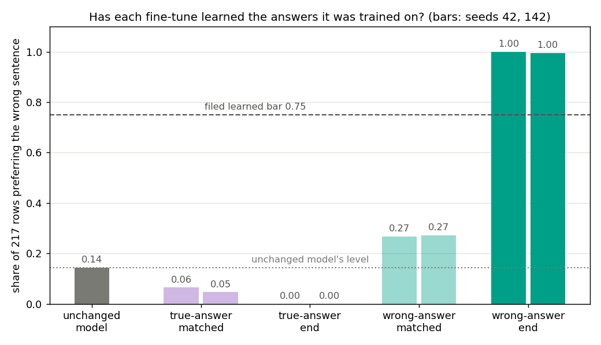
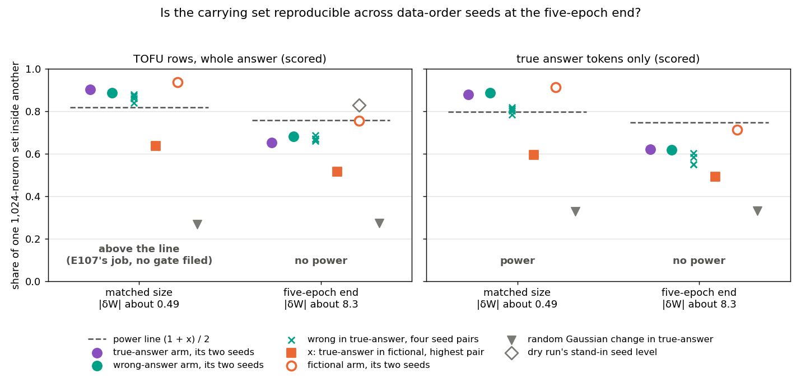

# Analysis: once both runs have learned their answers, does the carrying set separate a wrong-answer fine-tune from a true-answer one? (E109)

*2026-11-06, baseline-lead's E109 writer. **Provisional**: fast lane, no independent check; the verdict is "no call"
and goes into no answer paragraph as a finding about the model. Plan `reports/plans/2026-11-06_plan_e109-neurons-larger-size.md`;
rules `experiments/larger_size/results/predictions.json`; code `experiments/larger_size/{run,score}.py`. Explanation:
`notebooks/E109_larger_size.ipynb`. Figures: `experiments/larger_size/plot.py`. Jobs 54053 and 54062, one L40 on
`debug`, $0; results committed at 58ff835b. Provenance at the end.*

We fine-tuned Qwen3-1.7B for five full epochs on true answers about real people, and separately on wrong answers to
the same questions, and compared the neurons that carry each update. Both runs learned their answers, but two runs
that differ only in shuffling order now share about two thirds of their carrying neurons, against nine tenths early in
training, so the filed test had no power and makes no call. For `GOALS.md`, this neuron instrument cannot tell new
from existing at the size where the facts are learned, unless some set size or ranking first holds steady across seeds.

## The answer

Both fine-tunes learned their answers: the wrong-answer run prefers the wrong sentence in essentially every row. But
at this size the carrying set is not reproducible enough to read anything. Two runs on the same data, differing only in
shuffling order, share about two thirds of their top neurons, against nine tenths early in training. That spread is
wider than the gap to an unrelated fictional-author run, so the filed test had no power on either probe and makes no
call.

## The filed lean on power was wrong on both probes

The plan leaned "power" on both scored probes: the dry run's stand-in read a seed level of 0.83 on the TOFU rows, well
above the line the gate needs. The real seed level was 0.65 on the TOFU rows and 0.62 on the answer tokens, both under
the line of about 0.75. The stand-in took its seed level from the wrong pair of runs, which the section "Why the dry
run expected power" explains. This is a miss of a filed lean on the instrument, not a reversal of a finding about the
model: no reading of the label was made in either direction.

## What we were trying to test

`GOALS.md` asks whether post-training strengthens what a model already does or teaches it something new, and whether
any reading can tell the two apart. This line reads one non-decomposition instrument: which neurons carry a weight
update.

**The two runs.** The *true-answer run* fine-tunes Qwen3-1.7B on TOFU's 217 real-person and world-fact questions, each
answered in a sentence stating the true answer, which the unchanged model already gives. The *wrong-answer run* uses
the same questions, wordings and writer, with each true answer swapped for TOFU's first wrong one: "The author of
'Romeo and Juliet' is Charles Dickens." Only whether the stated fact agrees with what the model already says differs.
Each run has two data-order seeds, 42 and 142, and runs the full five-epoch recipe to step 335, where the total weight
change has a size of about 8.3. The *fictional-author run*, trained on TOFU's invented authors, is the reference for an
unrelated update; it is read at its first state past the learning line, step 550 or 500, with a weight change of about
15.

**What is read.** The *carrying set* of a run on a probe is the 1,024 MLP neurons, out of 172,032, with the largest
first-order share of the update's gain on that probe. The first-order share is the unchanged model's gradient of the
answer log-probability times the change in each neuron's firing. The *overlap* of two sets is the share of the first
inside the second: 1 is the same set, two random sets share about 0.006. Two probes are scored. The *TOFU rows* are
E92's 128 rows of fictional-author text, which neither run trained on, read over the whole answer. The *answer tokens*
probe reads the 217 true sentences at only the positions that predict a token of the true answer, ranked by the size
of each neuron's score whatever its sign, since the wrong run pushes the true answer down.

**The comparison, and what it needs.** Three overlaps matter on each probe. The *seed level* is how much a run's set
agrees with itself under a new shuffling seed. The *cross-arm overlap* is the wrong run's set inside the true run's,
four seed pairs. The *fictional reference*, called x, is the highest overlap of the true run's set with the fictional
run's. If the label moved the set, the cross-arm overlap would fall from the seed level toward x. That can only be read
if the seed level stands clear of x by more than the seed noise itself, which the filed *power gate* asks: the seed
level minus x must exceed one minus the seed level. In the figure that is a line at one plus x, halved.

**Controls, run first.** Stage 0 re-read a stored state to its stored gain and set; re-read the unchanged model's
log-probability of the true and wrong sentences; and checked that the true-answer run's end states do not prefer the
wrong sentence more often than the unchanged model does. The *learned gate* then asked of each wrong-answer end state
that at least three quarters of rows prefer the wrong sentence, and that greedy answers recall at least 0.585 of the
wrong answer's words.

## What we expected, and why

- **Stage 0** would reproduce every stored number, and the true-answer end states would prefer the wrong sentence in
  almost no row.
- **The wrong run would learn its answers**, preferring the wrong sentence in 90 to 100 percent of rows: five epochs of
  E84's recipe teach the fictional run its facts.
- **Power on both probes** was the lean. The dry run's stand-in on the TOFU rows read a seed level of 0.83 against an x
  of 0.42, clear of the line.
- **The label reading.** On the TOFU rows the lean was "topic or style": the shared sentence frame still dominates the
  whole-row gain. On the answer tokens the lean was "familiarity", the set moving toward the fictional run, with "no
  call" thought likelier: the two runs pushed the answer tokens in opposite directions for five epochs.

## What we observed

### Has each run learned the answers it was trained on?

**Reading it.** Yes. Both wrong-answer end states prefer the wrong sentence in all or all but one of the 217 rows, far
over the filed bar of three quarters, and their greedy answers recall 98 to 99 percent of the wrong answer's words.
Both true-answer end states prefer the wrong sentence in no row, under the unchanged model's 14 percent, so stage 0's
stop held. Early in training, at the matched size, the wrong run preferred the wrong sentence in only 27 percent of
rows, while the true run's matched states sat at 5 to 6 percent. That settles a question E107 left open: the early
rise to 27 percent is specific to training wrong answers. The facts the comparison needs are learned at this size.

### Is the carrying set stable enough across seeds to read the label?

**Reading it.** No, on either probe. At the five-epoch end the true run's two seeds share 0.65 of their set on the
TOFU rows and 0.62 on the answer tokens, under the power line of about 0.75 in both panels. At the matched size the same
quantities were 0.90 and 0.88, above their lines. The wrong run's seeds show the same fall, to 0.68 and 0.62, so the
instability is not one run's. A random Gaussian weight change picks a set that shares about 0.27 to 0.33 with the true
run's, at both sizes: part of every set is fixed by where the unchanged model's gradient is large. Between that floor
and the seed level there is now only about 0.3 of room, less than the seed noise of 0.35 to 0.38 the rule must clear.
Descriptively, the wrong run's set sits inside the true run's at 0.66 to 0.69 on the TOFU rows, level with both seed
levels, and at 0.55 to 0.60 on the answer tokens, a little under them. With no power that is not a reading of the
label, in either direction.

### Why the dry run expected power

The dry run had no second seed of the true run's end state on the TOFU rows. Its stand-in took the seed level from the
fictional run's two seeds at the end of its training grid, 0.83. It took x from an earlier true-answer state trained on
bare answers rather than sentences, 0.42. The real gate uses the true run's own end seeds, 0.65, and x against the
fictional run's first learned state, 0.51. The fictional run is the more reproducible of the two on every probe: its
seeds share 0.75 on the TOFU rows and 0.71 on the answer tokens at its learned state. On the TOFU rows its gain is about
twice the true run's, 3.5 against 1.5 to 1.6 nats a token, so its set is ranked on more signal. Gain size does not explain
the answer tokens, though: there the fictional run's gain is near zero and its seeds still agree more than the true
run's. Why the true run's set moves so much with the seed is not run down.

## Full tables

### Stage 0 and the learned gate

| state | prefers wrong sentence | true-minus-wrong gap, nats a token | true-sentence content gain | stored gain |
|---|---|---|---|---|
| unchanged model | 0.143 | 0.651 | 0 | level −2.01584, reproduced exactly |
| true-answer matched, seed 42 | 0.065 | 0.494 | 1.50429 | 1.50429, exact |
| true-answer matched, seed 142 | 0.046 | 0.506 | 1.49650 | 1.49650, within 3e-8 |
| true-answer end, seed 42 | 0.000 | 0.999 | 1.98536 | 1.98536, exact |
| true-answer end, seed 142 | 0.000 | 0.956 | 1.98242 | none stored |
| wrong-answer end, seed 42 | 1.000 | −0.802 | 1.18077 | — |
| wrong-answer end, seed 142 | 0.995 | −0.729 | 1.25804 | — |

C2n: the stored real-probe state re-read its gain 2.23312 exactly, set overlap 1.0. The unchanged model's wrong-sentence
level −2.66728 reproduced exactly. Wrong-answer greedy recall of the wrong answer 0.984 and 0.991, of the true answer
0.073 and 0.075. Wrong-answer end weight change 8.391 and 8.338, inside 5 percent of the true run's 8.248 to 8.369.
First-minute checks all held on both seeds: step 2 weight change 0.00234 and 0.00227, peak 28.2 and 28.4 GiB at step
2, step-250 loss 0.056 and 0.027 of the first batch's; the matched-step content gain 1.923 and 1.925 over the bar
1.2365.

### The rule on each probe

Overlaps are shares of 1,024. "Power line" is one plus x, halved; the gate needs the true run's seed level above it.

| probe | status | true seeds | wrong seeds | x | power line | cross, four pairs | verdict |
|---|---|---|---|---|---|---|---|
| TOFU rows, scored | no power at this size | 0.6523 | 0.6816 | 0.5137 | 0.7568 | 0.6865, 0.6709, 0.6582, 0.6670 | no call |
| answer tokens, scored | no power at this size | 0.6201 | 0.6162 | 0.4912 | 0.7456 | 0.5479, 0.5840, 0.5488, 0.6006 | no call |
| real rows, reported | no power | 0.5732 | 0.5977 | 0.4619 | 0.7310 | 0.5801, 0.5742, 0.5518, 0.6006 | no call |
| answer tokens signed, reported | no power | 0.6230 | 0.6260 | 0.4551 | 0.7275 | 0.5430, 0.5752, 0.5332, 0.5850 | no call |
| answer tokens, matched size, reported | power | 0.8789 | 0.8867 | 0.5928 | 0.7964 | 0.8164, 0.7822, 0.8008, 0.8105 | topic or style |
| TOFU rows, matched size, E107 job 53575 | no gate filed | 0.9014 | 0.8867 | 0.6367 | 0.8184 | 0.8691, 0.8389, 0.8604, 0.8789 | topic or style, E107's rule |

Gate margins, seed level minus x minus the band: TOFU rows −0.209, answer tokens −0.251. Under the wrong rule both
probes take w as the smaller seed level and band one minus it. On the TOFU rows familiarity needed the highest pair at
most 0.305 and topic or style needed the lowest at least 0.305 and above 0.861; the pairs sat at 0.658 to 0.687, so no
call. On the answer tokens the lines were 0.232 and 0.875 against pairs of 0.548 to 0.601.

Known in fictional, the four pairs behind x: TOFU 0.514, 0.479, 0.476, 0.445; answer tokens 0.440, 0.432, 0.491, 0.475.
Wrong in fictional: TOFU 0.512, 0.476, 0.503, 0.466; answer tokens 0.484, 0.464, 0.470, 0.464.

Computed here from the stored sets by `plot.py`, descriptive: fictional seeds 0.937 matched and 0.754 learned on the
TOFU rows, 0.913 and 0.713 on the answer tokens; the dry run's stand-in, fictional end-of-grid seeds on TOFU, 0.827;
a Gaussian change in the true run's set on the TOFU rows 0.268 matched and 0.272 at the end, on the answer tokens 0.327
matched.

### Reported reads against their filed expectations

| read | expected | read | as expected? |
|---|---|---|---|
| true seeds, TOFU rows | 0.65 to 0.85 | 0.652 | yes, at the bottom |
| true seeds, answer tokens | 0.60 to 0.85 | 0.620 | yes, at the bottom |
| x, TOFU rows | 0.40 to 0.60 | 0.514 | yes |
| cross, TOFU rows | 0.65 to 0.85 | 0.658 to 0.687 | yes |
| cross, answer tokens | 0.35 to 0.75 | 0.548 to 0.601 | yes |
| probe control: true end on true answer tokens against wrong answer tokens | 0.5 to 0.8 | 0.520, 0.531 | yes, at the bottom |
| Gaussian on answer tokens in true end | 0.05 to 0.35 | 0.331, 0.323 | yes, near the top |
| own span: wrong end on its own answer tokens in true end on true ones | level with probe control under topic or style | 0.363 to 0.371 | under it by about 0.16 |
| size-ranked set inside the signed set, true end | at least 0.8 | 0.660, 0.656 | no |
| the same, wrong end | under 0.5 | 0.592, 0.589 | no |
| answer-token share of the first-order total, true end | 0.1 to 0.5 | 0.207, 0.187 | yes |
| the same, wrong end | negative or above 1 | 0.103, 0.096 | no |
| additivity, span plus frame against content | under 1e-4 | 1.9e-7 max, 5.6e-8 total | yes |
| true matched, prefers wrong | 0.10 to 0.20 | 0.065, 0.046 | no, lower |
| true end, gap | over 2 nats | 0.999, 0.956 | no, lower |
| wrong end, gap | −2 to −6 | −0.802, −0.729 | no, smaller |
| wrong end, recall of true answer | under 0.2 | 0.073, 0.075 | yes |

### Gains each set is ranked on, mean log-probability change in nats a read token, and the sign of the first-order total

| state | TOFU rows | real rows | answer tokens | first-order total on the answer tokens |
|---|---|---|---|---|
| true end, seed 42 | 1.629 | 0.797 | 1.080 | positive |
| true end, seed 142 | 1.499 | −2.339 | 1.091 | positive |
| wrong end, seed 42 | 1.492 | −1.613 | −2.386 | positive |
| wrong end, seed 142 | 1.479 | −1.963 | −1.962 | positive |
| fictional learned, seed 42 | 3.522 | 0.640 | 0.067 | positive |
| fictional learned, seed 142 | 3.483 | 0.941 | 0.105 | positive |
| Gaussian | — | — | 0.029 | positive |

The first-order total is the sum of every neuron's score; its sign is positive in every row here, including the four
reads where the real gain is negative: both wrong ends on the answer tokens and the real rows, and true end seed 142 on
the real rows.

## What we learned

At the five-epoch end of this recipe the top-1,024 carrying set of a Qwen3-1.7B fine-tune is far less reproducible
across data-order seeds than early in training, on every probe read. The seed noise is now wider than the distance to
an unrelated update, so the set cannot read the label E109 was built to read, though the facts are learned. Early
in training the same instrument was stable, but there the wrong run had not learned its facts, so no size read so far
has both a learned label and a stable set. The neuron baseline therefore gives no known-against-new reading for this
pair; E107's matched-size "topic or style" stands as a size control only, under `decisions.md` line 152.

## How compelling is the evidence

- **Blind to**, as the plan states: rank inside a set, neurons just past the cut, sign on the answer tokens, and
  anything inside a neuron. A contradicted fact is not a new entity. The fictional reference is at a weight change of
  about 15 against 8.3, so size is stated, not matched.
- **Two seeds per run.** The seed level is one overlap per run per probe. Both runs fell to the same place, which makes
  a single unlucky seed unlikely, but the spread of seed levels is unmeasured.
- **The first-order score may not track the update at this size.** In four reads the first-order total is positive
  while the real gain is negative. A ranking built on the unchanged model's gradient may be partly ranking where that
  gradient is large rather than what the update does; the Gaussian floor of about 0.3 points the same way. Not tested.
- **The verdict is the filed one.** No rule was re-scored, added or loosened. The gate and the rule are E109's as filed,
  run by `score.py`.

## Surprises

- **The power lean failed on both scored probes**, as above: seed levels 0.65 and 0.62 against a line near 0.75.
- **The true run's seeds disagree on the real rows**: seed 42 raises the log-probability of its own true facts in TOFU's
  wording by 0.80 nats a token, seed 142 lowers it by 2.34. On the TOFU rows and answer tokens the two seeds' gains agree within 0.13. The real
  rows are reported only; the cause is not run down.
- **The size-ranked and signed sets disagree more than filed** on the answer tokens: the true end's size-ranked set lies
  0.66 inside its signed one, against at least 0.8 expected, a narrow miss of a reported read.
- **The sentence gaps are smaller than filed**: true end 1.0 nats, filed over 2; wrong end −0.8, filed −2 to −6. The
  preference itself is complete, so the learned gate is unaffected.

## What next

No amendment is opened: a "no call" is reported as read. What an amendment could test, not filed:

1. **A set size or ranking whose seed level holds at this size.** Re-read the four end states on both probes at several
   set sizes, or with the gradient taken at the fine-tuned state rather than the unchanged model, and keep the first
   whose two seeds clear the power line. Minutes on a debug L40, $0; the states are saved, the per-neuron scores are
   not. If no size or ranking holds, the neuron baseline is closed for this pair at the learned size.
2. **More seeds.** Two more seeds of each end state would measure the seed level's own spread. If a third seed agrees
   at 0.9 with one of the two, one seed is the outlier and the gate should be re-read.
3. **Option (b) of ask 23**, genuinely new facts in the known style, is unaffected by this result and stays open; it
   would need item 1 first to be read by this instrument.

## Scorecard

| id | claim | rule | read | verdict |
|---|---|---|---|---|
| stage 0 | apparatus reproduces its stored numbers; true end does not prefer wrong above the unchanged model | C2n within 1e-3 and overlap ≥ 0.95; levels and gains within 1e-5; prefers ≤ 0.143 | all exact or within 3e-8; 0.000, 0.000 | holds |
| first minutes | each wrong arm trains as E107's | step checks, C1 ≥ 1.2365 | all held; C1 1.923, 1.925 | holds |
| learned, seed 42 | the wrong run learned its answers | prefers ≥ 0.75 and recall ≥ 0.585 | 1.000, 0.984 | holds |
| learned, seed 142 | same | same | 0.995, 0.991 | holds |
| power, TOFU rows | seed level clear of x by more than its noise | w − x > 1 − w | 0.652 − 0.514 = 0.139 against 0.348 | no power; lean was power |
| power, answer tokens | same | same | 0.620 − 0.491 = 0.129 against 0.380 | no power; lean was power |
| wrong rule, TOFU rows | label moves the set | familiarity, topic or style, or no call | cross 0.658 to 0.687 | no call, status no power at this size; lean topic or style |
| wrong rule, answer tokens | same | same | cross 0.548 to 0.601 | no call, status no power at this size; lean familiarity |

## Reads under, and departures

Not a reuse verdict, so `decisions.md` rows 81 and 87 do not apply. It reads under line 152, "the matched step is a
size control only: any claim that an update adds something new rests on the full update, with its size stated", and
line 160, ask 23 option (a), which set E109's scope.

Departures from E107's rule, filed in the plan: no same-label different-rows level, since E105's halves were never
trained to the end; on the answer tokens the set is ranked by the size of the score, not its positive part.

### Departures from the literature

- **TOFU's wrong answers are evaluation distractors** in Maini et al. 2024, the perturbed answers a model's answer is
  scored against. Here the first of them is a training target, in our own answer sentences, as in E107.
- **TOFU's real-author and world-fact sets are evaluation sets** there, never trained on. Here they are the training
  rows.
- **E84's recipe** is run to its end, step 335 of five epochs, past the 250-step warm-up and through the cosine decay.
  The fictional reference stops at its first learned state rather than at the recipe's end.
- **The carrying-set ranking** is E98's first-order attribution as E102 ran it, and carries E102's departures; the
  answer-token probe and the size ranking are this project's. The overlap rules, bands and gates are this project's,
  not from a source.

## Not run

- A fictional run retrained to a weight change of 8.3, a pure size control; not learned at that size.
- The true and wrong runs trained on to a weight change of 15.5, which needs a new, unsourced recipe.
- E105's rows null at the end size: no half-size runs trained to the end.
- Option (b): genuinely new facts in the known style.
- An answer-token probe for the fictional run: its invented biographies have no answer span.
- Any other set size, a ranking by the gradient at the fine-tuned state, or more than two seeds per run.
- Per-neuron scores were not saved, so no set size can be re-read without a GPU.
- The real-row seed disagreement of the true run, 0.80 against −2.34, was not run down.
- VPD reads of the wrong end states: handed to qwen-decomp-lead, outside E109.

## Provenance

- Job 54042 crashed on a missing `results/states` folder after stage 0 passed; fixed in 109b99ab with no measurement
  change. Job 54053, `sbatch cluster/larger_size.sbatch reads`: stage 0 and stage 1, 327 s to FINISHED by its log.
  Job 54062, `... wrong`: both wrong arms trained to step 335, their reads and the score, 767 s. One L40 on `debug`,
  $0. Peaks 41.2 GB on the GPU, 11.0 GB host.
- Results `experiments/larger_size/results/{control,gate,score}.json`, `arm_WRONG_end{42,142}.json`,
  `train_WRONG_end{42,142}.json`, `states/`, `sets/`, `answers/`, `run.log`, committed at 58ff835b. Wrong end weight
  changes `results/large/dW/WRONG_end{42,142}.safetensors`, fp32, 5.64 GB each, gitignored, kept for qwen-decomp-lead.
- References read by `plot.py`: `experiments/label_vs_style/results/score.json` and `arm_WRONG{42,142}.json`;
  `experiments/qwen_carrying/results/states/a2_s{42,142}_{matched,full}.json`, `gauss_tofu.json`;
  `experiments/known_answer_pair/results/neurons_amend1/a1_matched__tofu.json`. The dry run's stand-in:
  `~/commute-data/scratch/baseline-lead/e109-writer/dry3.out` line 137.
- Figures `experiments/larger_size/figures/{seeds,learned}.png` from `plot.py`, no model.
