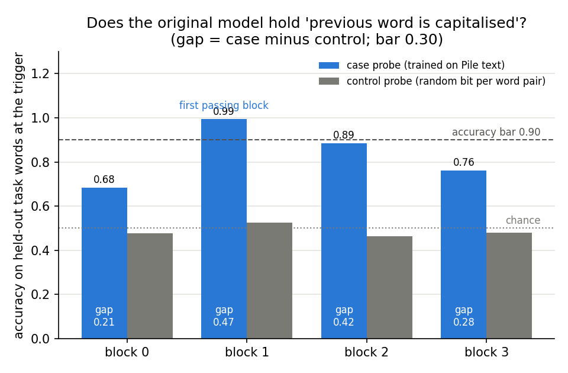
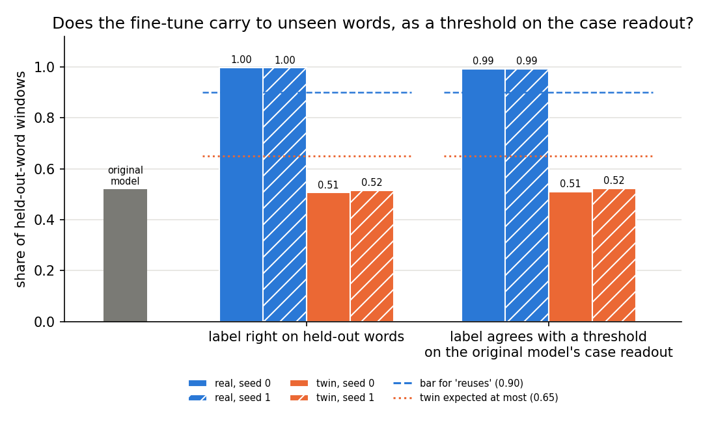
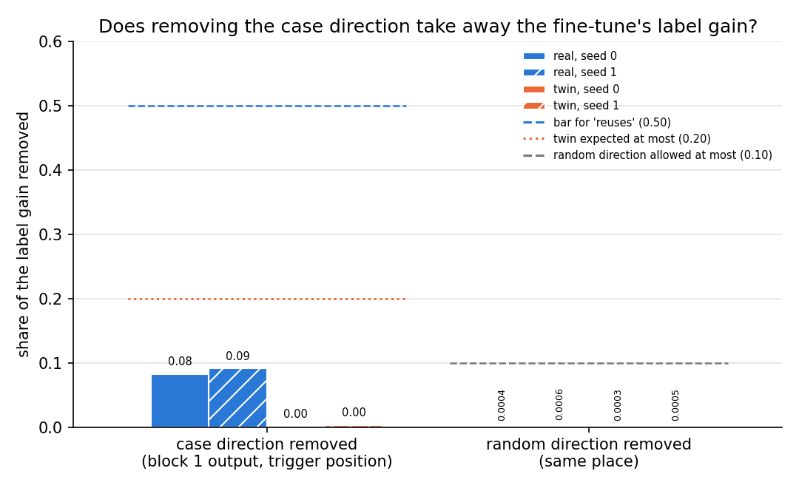
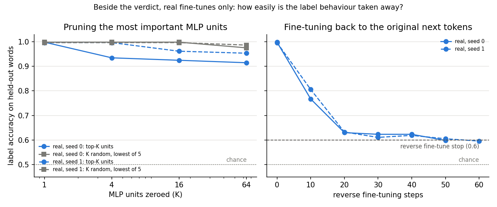
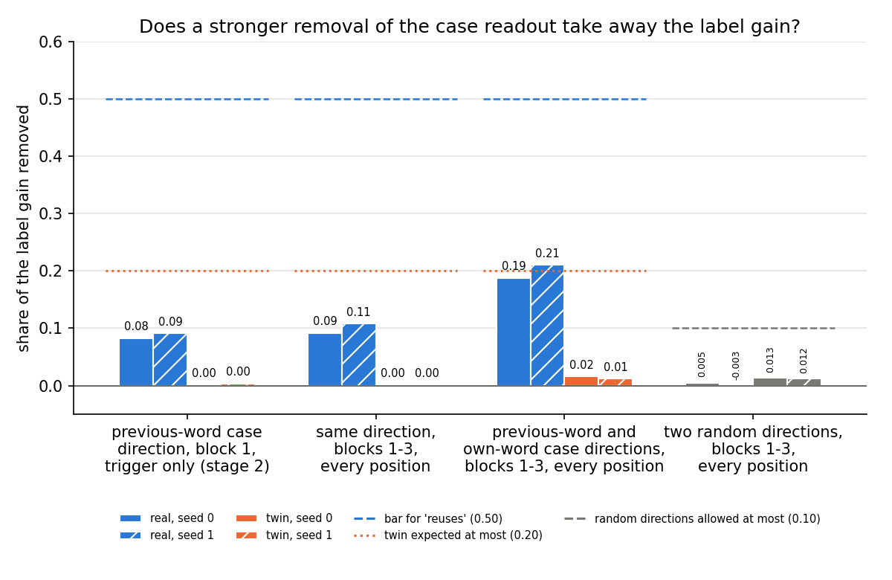
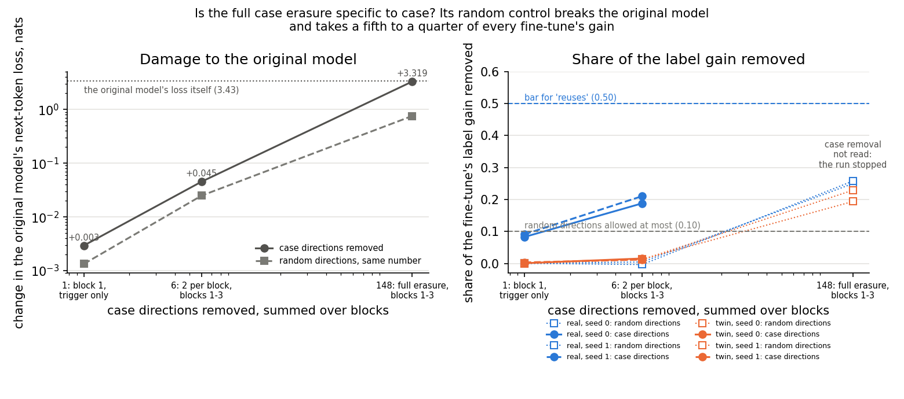

# E112: does a case-label fine-tune of the 67M model reuse "the previous word is capitalised"?

*definition-lead, 2026-11-06. Plan `reports/plans/2026-11-06_plan_e112-case-label.md`; filed predictions
`experiments/case_label/results/predictions.json`, Amendment 1's `predictions_amend1.json`, Amendment 2's
`predictions_amend2.json`; notebook `notebooks/E112_case_label.ipynb`. Provisional: no independent check. Closed: both
amendments are spent.*

We taught the small model to pick a label word by whether the previous word is capitalised, beside a twin that learns
labels from a shuffled list. The real fine-tune looks like reuse of the model's own case feature, but removing that
feature took a tenth of its gain and a stronger removal a fifth, so the adopted definition reads "not through the
capability". A last try, erasing every linear trace of case, stopped at its control, because as many random directions
also damaged the model: this pair gives no reuse label, and E112 is closed.

## The answer

The real fine-tune passes the definition's first two tests and fails its causal check. Removing the case readout took
under a tenth of the label gain, and a stronger removal about a fifth, against a filed bar of one half. So the filed
rule reads "not through C", and our filed "reuses C" missed. A last, full erasure of case stopped at its own control,
because removing that many random directions also broke the original model. It gives no verdict. The twin reads "not
through C", as filed. Both amendments are spent, so E112 is closed.

## What we were trying to test

The definition we read under is Jain, Kirk, Lubana and colleagues' 2024 one, as adopted in `decisions.md` rows 81 and
87, with nothing added. It has three parts.

- **Possession.** A linear readout trained on ordinary Pile text, never on task windows, recovers the capability on the
  task's inputs, and does clearly better than a control readout trained on random labels.
- **Small function and carrying.** The fine-tuned model's answer is a simple function of that readout, and it is right
  on words it never trained on.
- **Causal check.** Removing the readout's direction breaks the fine-tuned behaviour, and spares a twin fine-tune that
  uses the same marker but cannot use the capability.

The capability is "the previous word is capitalised". We took the 400 most frequent words that exist as single tokens
in both cases, such as " The" and " the", and split them by pair into 300 training pairs and 100 held-out pairs. So no
held-out word was seen in either case during training. Each task window is a 41-token Pile window with a pool word
just before a fixed marker token, the trigger, and the label word after it. The marker is the token " \+", and the two
label words are " carpet" and " camel", drawn once from a fixed list of nouns.

- **Real task.** Say label A if the word before the trigger is capitalised, B if not.
- **Twin.** Same trigger, same two labels, but each word form gets A or B from a seeded shuffle. No feature of the
  original model predicts it, so the twin can only memorise. It rules out that any fine-tune at this trigger looks like
  reuse to our tests.

Each arm was fine-tuned with the recipe of an earlier copy task, two seeds, until accuracy on training words reached
0.9. The real arm got there at step 30, the twin at step 300.

The possession readout is a ridge regression on block $l$'s output residual, $\hat c_l(x) = w_l^\top x$, trained on
Pile positions whose previous token is a training-pair word, read as capitalised when the score exceeds one half. Its
control is the same regression with labels given by one random bit per word pair, following Hewitt and Liang. A
readout that only memorises words scores 0.5 on held-out pairs; a readout of case scores near 1.

The causal check removes the readout's unit direction $u = w_{l^*}/\|w_{l^*}\|$ from block $l^*$'s output residual at
the trigger position only, $x \mapsto x - u u^\top x$, where $l^*$ is the first block whose readout passes. It reports
the share of the label gain removed: with $m$ the label log-odds toward the window's own label and $G$ the fine-tune's
mean gain in $m$ over the original model,

$$\text{share} = \frac{\operatorname{mean}(m_{\text{state}} - m_{\text{state, direction removed}})}{G}.$$

A share of 1 means the whole gain goes with the direction, 0 means none of it does. The same share with a random unit
direction in the same place is the do-nothing reference.

## What we expected, and why

We expected possession to pass before the last block, since case is a feature every language model must track. We
expected the real fine-tune to carry to unseen words as a threshold on the case readout. A rule that holds across
words is learned fastest by reading a feature already there. We
expected removing the case direction to take at least half the real gain away, and almost none of the twin's. The twin
should fail carrying and small function, both near 0.5, because its labels are random across words.

## What we observed

### Does the original model hold the case of the previous word?

**Reading it.** Yes, at block 1, the second of four. The case readout labels held-out task words at the trigger with
accuracy 0.994, while the random-label control reads 0.524, so the gap is 0.469 against the bar of 0.30. Blocks 0 and 2 fall short of the 0.90 accuracy bar, block 2 only just, and
the last block does not count. So the case of the
previous word is most cleanly readable at the trigger after the second block, and $l^* = 1$.

| block | case readout accuracy | control accuracy | gap | passes |
|---|---|---|---|---|
| 0 | 0.683 | 0.476 | 0.207 | no |
| 1 | 0.994 | 0.524 | 0.469 | yes |
| 2 | 0.885 | 0.464 | 0.421 | no, accuracy |
| 3 | 0.763 | 0.479 | 0.283 | last block, not counted |

The original model, unchanged, labels held-out windows right 0.521 of the time on the real task and 0.497 on the twin.
Removing the case direction at block 1's trigger position from the original model changed its next-token loss there by
0.003 nats, against 0.001 for a random direction, from a loss of 3.43.

### Does the fine-tune carry to unseen words, as a threshold on the case readout?

**Reading it.** Yes for the real task on both seeds, no for the twin, as filed. The real fine-tunes label held-out
words right 0.998 and 0.996 of the time, against 0.52 for the original model. A single threshold on the original
model's case readout, fitted on training words, agrees with their labels on 0.993 and 0.992 of held-out windows. The
twins sit at 0.51 to 0.52 on both, at chance, though they reached 0.98 on their training words. One caveat: once the
readout reads case at 0.99 and the model labels by case at 0.99, the agreement must be near 0.99 whatever the model
computes inside. So this test cannot tell reading the feature apart from computing case some other way.

| state | scored step | train-word accuracy | held-out accuracy | agreement with threshold | summed update norm |
|---|---|---|---|---|---|
| real, seed 0 | 30 | 0.998 | 0.998 | 0.993 | 4.60 |
| real, seed 1 | 30 | 0.999 | 0.996 | 0.992 | 4.68 |
| twin, seed 0 | 300 | 0.978 | 0.506 | 0.511 | 13.33 |
| twin, seed 1 | 300 | 0.979 | 0.516 | 0.523 | 12.61 |

### Does removing the case direction take away the fine-tune's label gain?

**Reading it.** No. Removing the case direction at block 1's output at the trigger took 0.083 and 0.091 of the real
fine-tunes' label gain, far under the filed bar of 0.50. The gain itself is large, 12.8 and 12.0 nats, so about one
nat of it went with the direction. For the twin the share was 0.001 and 0.003, and a random direction in the same place
took at most 0.0006 on every state. So the direction matters to the real fine-tune about thirty times more than a
random one does, but it carries a small part of the behaviour. The filed verdict for the real task is "not through C".

| state | label gain, nats | share removed, case direction | share removed, random direction | verdict as filed |
|---|---|---|---|---|
| real, seed 0 | 12.83 | 0.083 | 0.0004 | not through C |
| real, seed 1 | 12.04 | 0.091 | 0.0006 | not through C |
| twin, seed 0 | 10.23 | 0.001 | 0.0003 | not through C |
| twin, seed 1 | 8.80 | 0.003 | 0.0005 | not through C |

We do not know why the share is low. Candidate explanations as they stood after stage 2, before Amendment 1, none
tested; Amendment 1 below tests the first, second and fourth in part:

- The case may still be present at the word's own position, one before the trigger, which the removal leaves alone.
  Later attention heads at blocks 2 and 3 could read it again from there.
- Case is carried in more than one direction at block 1, and the ridge readout's single direction is not the one the
  fine-tune reads, or not the only one.
- The fine-tune reads case at a later block, rebuilt there after the removal, or builds its own case detector from the
  word's identity.
- The removal is one direction, at one block, at one position: a rank-1 edit, the weakest removal the definition allows.

### Beside the verdict: pruning and reverse fine-tuning

**Reading it.** No rule reads these; they are reported as filed. Zeroing the 64 most important MLP units of the real
fine-tune lowered held-out label accuracy only to 0.91 and 0.95, while 64 random units left it at 0.98 or above. So no
small set of MLP units carries the behaviour. Fine-tuning back toward the original next tokens brought the real
fine-tunes' held-out accuracy down to 0.6 within 50 and 60 steps, slower than the 30 steps it took to learn. The twins
start at chance on held-out words, so their reverse fine-tune reads 0 steps and says nothing.

| state | top-1 | top-4 | top-16 | top-64 | lowest of 5 random, K = 64 | reverse steps to 0.6 |
|---|---|---|---|---|---|---|
| real, seed 0 | 0.998 | 0.934 | 0.924 | 0.914 | 0.975 | 50 |
| real, seed 1 | 0.996 | 0.996 | 0.961 | 0.953 | 0.986 | 60 |
| twin, seed 0 | 0.506 | 0.506 | 0.505 | 0.505 | 0.498 | 0, starts below |
| twin, seed 1 | 0.514 | 0.514 | 0.511 | 0.504 | 0.513 | 0, starts below |

## Amendment 1: does a stronger removal take the gain away?

*`decisions.md` row "E112 Amendment 1", approved by the user on 2026-11-06 in answer to ask 3. Settings and expected
values filed in `experiments/case_label/results/predictions_amend1.json` before the run; rules and bars are E112's
`predictions.json`, unchanged. Code `experiments/case_label/amend1.py`. Job 54094.*

**What changed.** Stage 2 removed one direction at one block and one position. Amendment 1 removes two directions from
the output of each of blocks 1, 2 and 3, at every position of the window, and re-reads only the causal check on the
same four saved states. At each block the first direction is stage 0's previous-word case readout for that block, not
refitted. The second is a new own-word case readout: the same ridge regression on the same Pile windows, read at the
word's own position, labelled by whether that word is the capitalised member of its pair. The two are made orthonormal
per block, so each block loses a two-dimensional subspace, $x \mapsto x - Q Q^\top x$ with $Q$ the block's two
orthonormal columns. The do-nothing reference is a seeded random two-dimensional subspace per block, at the same sites.
The share removed is stage 2's, on the same train-word fit windows, read against the same bars. Beside it, with no rule,
the run reports the previous-word direction alone at the new sites, the original model under each removal, and the
own-word readout's accuracy and angle to the previous-word direction.

**Reading it.** No: the stronger removal took about a fifth of the real label gain, still far under one half. Removing
both case directions from blocks 1 to 3 at every position took 0.188 and 0.211 of the real fine-tunes' gain. The
previous-word direction alone at those sites took 0.092 and 0.108, barely more than stage 2's 0.083 and 0.091 at one
site. So widening the removal across blocks and positions added about a hundredth, and the own-word direction added
about another tenth. The twins lost 0.016 and 0.012, inside their expected ceiling of 0.20. Two random directions took
between -0.003 and 0.013 on all four states, under the 0.10 allowed. The filed rule reads "not through C" for both real
seeds again: a second miss of the filed "reuses C".

| state | label gain, nats | stage 2: one direction, one site | previous-word direction, blocks 1-3, every position | both directions, blocks 1-3, every position | two random directions | verdict as filed |
|---|---|---|---|---|---|---|
| real, seed 0 | 12.83 | 0.083 | 0.092 | 0.188 | 0.005 | not through C |
| real, seed 1 | 12.04 | 0.091 | 0.108 | 0.211 | -0.003 | not through C |
| twin, seed 0 | 10.23 | 0.001 | 0.001 | 0.016 | 0.013 | not through C |
| twin, seed 1 | 8.80 | 0.003 | 0.001 | 0.012 | 0.012 | not through C |

The removal leaves the original model almost intact. Its next-token loss at the trigger position on the probe's Pile
windows, 3.43 nats unedited, rose by 0.045 under the two case directions. That is under the filed expectation of about
0.1, and about twice the 0.025 that two random directions cost. The original model's label margin moved by under a
tenth of a nat under every removal, against fine-tuned gains of 9 to 13 nats.

| removal, blocks 1-3, every position | next-token loss change, nats | real-label margin change | twin-label margin change |
|---|---|---|---|
| both case directions | +0.045 | -0.068 | -0.004 |
| previous-word direction alone | +0.010 | -0.018 | -0.005 |
| two random directions | +0.025 | +0.038 | +0.004 |

The own-word readout reads a held-out word's own case almost perfectly at every block, as expected, since a token's case
is part of its identity. Its cosine with the previous-word direction grows with depth, from 0.16 to 0.53. The run
fits and reports the readout at all four blocks, 0 to 3; the removal uses blocks 1 to 3 only, so block 0's entry is
beside the removal, not part of it. At block 3 the accuracy of 0.949 is a hair under the filed "about 0.95 or more".

| block | own-word readout, held-out accuracy | cosine with the previous-word direction | used in the removal |
|---|---|---|---|
| 0 | 1.000 | 0.16 | no |
| 1 | 0.998 | 0.30 | yes |
| 2 | 0.993 | 0.40 | yes |
| 3 | 0.949 | 0.53 | yes |

**What it rules out.** The low stage-2 share was not only the removal's reach in place. Taking the previous-word
direction out of every position and every block from block 1 on moved the share by one to two hundredths. Nor does a
single own-word direction carry the rest: adding it doubled the share, to about a fifth, not to one half. The removal
did not fail by breaking the original model, whose next-token loss moved by under 0.05 nats.

**What it does not rule out.** No cause is established; each candidate below is untested.

- Case may be spread over many directions, since it is part of each word's identity. A two-dimensional linear removal
  would then leave it readable along others, and blocks 2 and 3 could recompute it from the word's identity. The run
  did not refit a readout after the removal to see whether case is still readable; that is the check that would tell.
- The share is read on train-word windows, as filed. There the fine-tune could also label from word identities it
  memorised in training, a path no case removal touches. Held-out-word accuracy under the removal was not measured.
- Block 0's output and the embeddings are left alone; a path that reads case there before block 1 is not cut.
- The fine-tune may read a nonlinear function of the residual that no linear removal reaches.

No new verdict rule is added: the result is read by E112's filed bar, as `.claude/CLAUDE.md` → "Adopted definitions are
frozen" requires. The user spent E112's last amendment on a removal that leaves no linear readout of case, below.

## Amendment 2: does erasing every linear trace of case take the gain away?

*`decisions.md` row "E112 Amendment 2, the last", approved by the user on 2026-11-06 in answer to ask 4. Settings and
expected values filed in `experiments/case_label/results/predictions_amend2.json` before the run; rules and bars are
E112's `predictions.json`, unchanged. Code `experiments/case_label/amend2.py`. Job 54146.*

**What changed.** Amendment 1 removed two fixed directions per block. Amendment 2 removes as many as it takes to make
case unreadable by a linear readout, by Ravfogel and colleagues' 2020 iterative nullspace method, INLP. At
each block's output, for each of the two case labels, it fits stage 0's ridge readout on half the saved Pile windows,
removes that readout's direction, refits on what is left, and repeats. It stops when the readout labels the held-out
task windows right at most 0.55 of the time, or after 64 directions. The two labels' directions are merged per block
into one orthonormal basis and removed at every position of blocks 1 to 3. The do-nothing reference removes a seeded
random basis of the same size at the same sites. The filed run read that reference first and alone, on all four
states, and stopped the job with exit 1 if it took more than 0.10 of the gain on any of them.

**What happened.** The erasure worked as designed, and then its control stopped the run. The readout reached 0.55 or
less for both labels at every block, none at the cap. The merged sizes were 37, 41 and 70 directions at blocks 1, 2 and
3, so 148 directions in all, against 6 in Amendment 1. A fresh readout fitted at block 3 after the erasure read the
previous-word case at 0.49, down from 0.785 unedited. It read the word's own case at 0.605, down from 0.946, a little
above the 0.55 stopping level. The random removal of the same size then took between 0.19 and 0.26 of every state's
label gain, over the bar of 0.10 on all four. The job stopped there as filed. No state was read under the case erasure,
so Amendment 2 has no removal share and no verdict.

**Reading it.** The erasure is too large to be specific, which is the reading filed for this stop. The left panel shows
the original model's next-token loss at the trigger, 3.43 nats unedited, under each attempt's removal. The case erasure
raised it by 3.32 nats, about doubling it, where Amendment 1's two directions cost 0.045. The same number of random
directions raised it by 0.76. The right panel shows why the run stopped: at 148 directions the random removal alone
takes about as much of the gain as Amendment 1's case removal did. So removing case at this size also breaks the
original model's next-token prediction, and the check cannot separate the fine-tune's reliance on case from general
damage. This says nothing about why the earlier shares were low; no cause is named.

| removal at blocks 1-3, every position | directions | next-token loss change of the original model, nats | real-label margin change | twin-label margin change |
|---|---|---|---|---|
| Amendment 1: both case directions | 6 | +0.045 | -0.068 | -0.004 |
| Amendment 1: two random directions per block | 6 | +0.025 | +0.038 | +0.004 |
| Amendment 2: full case erasure | 148 | +3.319 | +0.038 | +0.044 |
| Amendment 2: full case erasure, block 0 too | 215 | +3.929 | -0.019 | -0.028 |
| Amendment 2: random, same size per block | 148 | +0.758 | -0.182 | +0.001 |

| state | label gain, nats | random removal's share, 148 directions | bar | stops the run |
|---|---|---|---|---|
| real, seed 0 | 12.83 | 0.250 | 0.10 | yes |
| real, seed 1 | 12.04 | 0.258 | 0.10 | yes |
| twin, seed 0 | 10.23 | 0.194 | 0.10 | yes |
| twin, seed 1 | 8.80 | 0.229 | 0.10 | yes |

| block | previous-word readout: directions, accuracy before → after | own-word readout: directions, accuracy before → after | merged size | used in the removal |
|---|---|---|---|---|
| 0 | 7, 0.651 → 0.525 | 60, 0.999 → 0.550 | 67 | beside only |
| 1 | 7, 0.990 → 0.541 | 30, 0.997 → 0.548 | 37 | yes |
| 2 | 7, 0.860 → 0.544 | 34, 0.989 → 0.528 | 41 | yes |
| 3 | 44, 0.742 → 0.543 | 26, 0.946 → 0.541 | 70 | yes |

The filed expectation said this could happen. A merged size over about 15 per block could put the random share over
the bar, and the stop would then be read as "the removal is too large to be specific", not as a verdict. The merged sizes were 37 to 70 per block. The run's other beside reads, the share with block 0 added and the
per-state shares under the erasure, come after the stop in the code and were not run.

## E112's final reading

Read under `decisions.md` rows 81 and 87 plus the direction-removal check, with nothing added:

- **Real task:** "not through C" by the filed rule, on both seeds. Possession, carrying and the small-function test
  pass; the causal check misses, at 0.083 and 0.091 in stage 2 and 0.188 and 0.211 in Amendment 1, against 0.50. The
  filed "reuses C" missed.
- **Twin:** "not through C", as filed.
- **Amendment 2:** stopped at its do-nothing check; no verdict and no removal share.

Both amendments are spent, so E112 is closed with the reading above.

## What we learned

The definition as adopted does not read "reuses" on the pair built to its own shape, even though the real fine-tune
looks like reuse on every test but the causal one. Possession and carrying both read the way reuse would, and the twin
separates from the real task on both, so the apparatus does tell a feature-based fine-tune from a memorising one. The
causal check, as filed, is the test that decides. A one-direction removal at one place took about a tenth of the gain,
and a two-direction removal at every position of blocks 1 to 3 took about a fifth. Removing case completely from the
linear readout's view took 148 directions, and at that size a random removal also damages the original model, so the
direction-removal check could not be pushed further on this pair. For `GOALS.md`'s question of new capabilities
against strengthened ones, this pair gives no outside "reuse" label.

## How compelling is the evidence

- Two seeds per arm; the two seeds agree to within 0.03 on every rule number, Amendment 1 included.
- One task pair, one model, one marker token. Stage 2 removed at one block and position; Amendment 1 at blocks 1 to 3,
  every position.
- The small-function test is blind when the readout and the labels are both near perfect: it agrees at 0.99 by
  arithmetic. It separates real from twin, not reading from recomputing.
- Both removals are linear and low-rank, one or two directions per block. They are blind to case carried in other
  directions, at block 0 or the embeddings, or nonlinearly. Their noise floors are the random directions: at most
  0.0006 for stage 2 and 0.013 for Amendment 1. Both real shares are far above noise and far below the bar.
- Amendment 2's full erasure has a noise floor of 0.19 to 0.26, the random removal of its size, over the filed 0.10.
  A case share at that size could not have been told from general damage, which is why the filed stop exists.
- The share is read on train-word windows, where memorised word identities could also carry the label.
- The held-out set has 1,600 windows over 100 word pairs; the fit set 1,024 windows of training words.

## Surprises

The filed prediction that the real fine-tune "reuses C" missed on both seeds, twice. Stage 2's removal share was 0.08
and 0.09 against a bar of 0.50, while every other number read as predicted. Amendment 1, filed with the same
expectation, read 0.19 and 0.21. We cannot explain it; the candidates under Amendment 1 are untested.

Amendment 2 stopped at its do-nothing check, which was filed as possible. The size of the stop was not expected: the
original model's next-token loss rose by 3.32 nats under the erasure, about doubling it, where the filed expectation
said only "larger than Amendment 1's +0.045".

## What next

- E112 is closed. Subject number, the second pair, does not run: the user's rule was that it runs only if case label
  reads cleanly, and case label ended with a miss and an erasure that stopped at its control.
- The next step is the user's choice. The direction-removal check reached its limit here: the removal that erases case
  is as damaging as a random one of its size.

## Scorecard

| id | claim | rule | read | verdict |
|---|---|---|---|---|
| P0 | the original model holds case before the last block | accuracy at least 0.90 and gap at least 0.30 | block 1: 0.994, gap 0.469 | pass, l* = 1 |
| do-nothing | a random direction removes almost no gain | share at most 0.10 on every state | at most 0.0006 | pass |
| P1 real | real fine-tune right on held-out words | at least 0.90 | 0.998, 0.996 | pass |
| P2 real | labels are a threshold on the readout | agreement at least 0.90 | 0.993, 0.992 | pass |
| P3 real | removing the direction removes the gain | share at least 0.50 | 0.083, 0.091 | **miss** |
| real verdict | "reuses C" on both seeds | all of P1-P3 | P3 misses | **"not through C", filed outcome missed** |
| P1 twin | twin at chance on held-out words | at most 0.65 | 0.506, 0.516 | as filed |
| P2 twin | twin not a threshold on the readout | at most 0.65 | 0.511, 0.523 | as filed |
| P3 twin | removal spares the twin | at most 0.20 | 0.001, 0.003 | as filed |
| twin verdict | "not through C" on both seeds | any of P1-P3 misses | P1 and P2 miss | **"not through C", as filed** |
| A1 do-nothing | two random directions per block remove almost no gain | share at most 0.10 on every state | -0.003 to 0.013 | pass |
| A1 P3 real | two case directions, blocks 1-3, every position, remove the gain | share at least 0.50 | 0.188, 0.211 | **miss** |
| A1 real verdict | "reuses C" on both seeds | P1, P2 from stage 2 and the new P3 | P3 misses | **"not through C", filed outcome missed again** |
| A1 P3 twin | the stronger removal spares the twin | at most 0.20 | 0.016, 0.012 | as filed |
| A1 twin verdict | "not through C" on both seeds | any of P1-P3 misses | P1, P2 and P3 miss | **"not through C", as filed** |
| A2 do-nothing | same-size random removal, 148 directions, removes almost no gain | share at most 0.10 on every state, else exit 1 | 0.194 to 0.258 | **over the bar: run stopped, exit 1** |
| A2 P3 real, twin | full linear case erasure, blocks 1-3 | as Amendment 1 | not read | **no verdict** |
| E112 final | real; twin | stage 2 and Amendment 1 by the filed rule | | **real "not through C", filed outcome missed; twin "not through C", as filed; closed** |

## Departures from the literature

- The readout is a binary ridge regression on one block's residual at the trigger, not Jain et al.'s probe for their
  synthetic grammar's capability, since our task has no such grammar. Same role: a linear readout trained off-task.
- Carrying to held-out words is our addition from `decisions.md` row 87, a dated departure the user made; Jain et al.
  do not require it.
- The direction-removal check is our addition from row 81; Jain et al. use pruning and reverse fine-tuning, which run
  here beside it without a rule.
- Amendment 1's own-word readout is a second readout of the same capability, at the word's own position, added to the
  removal only. It is apparatus for row 81's check, not part of possession, and Jain et al. have no such step.
- The fine-tune is our earlier copy task's recipe, Adam at 3e-5 with a KL term to the original model, not Jain et
  al.'s recipe for their models.
- The control readout follows Hewitt and Liang 2019 in giving each word pair a random label, scored on held-out pairs.
- Amendment 2's erasure is Ravfogel et al.'s INLP, with stage 0's closed-form ridge readout in place of their linear
  classifier. That way the erased concept is the one the definition's readout reads. Its stopping
  accuracy is read on the held-out task windows, at 0.55 as the user's row set it, with a cap of 64 directions.

## Not run

- Amendment 2's case erasure on any state: the run stopped at its do-nothing check, so no removal share, no verdict,
  and no share with block 0 added.
- A third amendment: E112 has spent its two, and a third would be a new plan.
- A readout refitted after Amendment 1's removal; Amendment 2 refitted one at block 3 only.
- Label accuracy on held-out words under any removal; every share is read on train-word windows only.
- A nonlinear removal.
- Subject number, the second pair: it runs only if case label reads cleanly, and it did not.
- More than two seeds; a second marker token; other label words.
- The route-split readings, which subcomponents Γ switches on, at this trigger.
- An independent check of the analysis.

## Provenance

- Results: `experiments/case_label/results/stage0.json`, `stage1.json`, `stage2.json`, logs `stage{0,1,2}.out`.
  Amendment 1: `results/amend1.json`, log `results/amend1.out`.
- Update states: `experiments/case_label/results/large/dW_{real,twin}_s{0,1}.pt`, bf16; sha256 in `stage1.json`,
  checked by Amendment 1 before it read them.
- Code: `experiments/case_label/run.py`, removal in `removal_edit`; Amendment 1 in `experiments/case_label/amend1.py`;
  rules in `src/commute/case_label.py`; figures by `experiments/case_label/plot.py`.
- Jobs 54048, 54052, 54054, MATS cluster debug QoS, one L40, 10:53 to 11:03 UTC, about 10 minutes, $0. Peak host
  memory 6.1 GB.
- Amendment 1: job 54094, debug QoS, one L40, reads from 11:17:03 to 11:17:30 UTC, about a minute, $0. Peak host
  memory 6.1 GB.
- Amendment 2: job 54146, debug QoS, `cluster/case_label_amend2.sbatch`, reads from 11:39:48 to 11:40:14 UTC, about a
  minute, $0, exit 1 at the filed do-nothing stop. Result `results/amend2.json` (with a `stop` entry), log
  `results/amend2.out`; erasure bases `results/large/amend2_bases.pt`. Peak host memory 6.1 GB.
