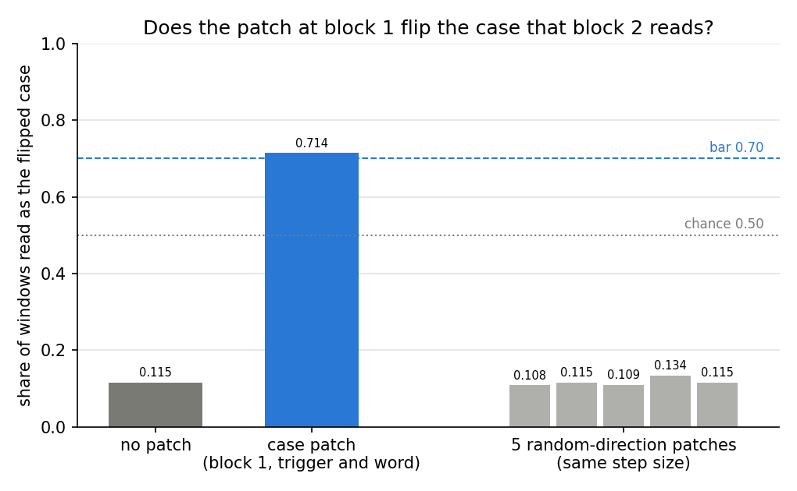
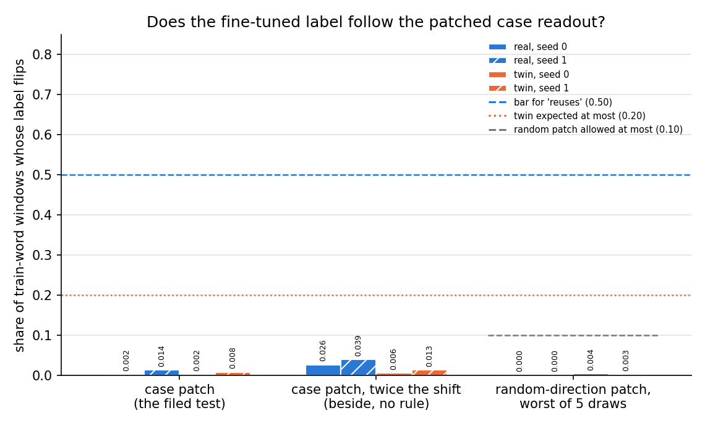

# E113: does patching the case readout flip the case-label fine-tune's answer?

*definition-lead, 2026-11-06. Plan `reports/plans/2026-11-06_plan_e113-case-patch.md`; filed predictions
`experiments/case_patch/results/predictions.json`; notebook `notebooks/E113_case_patch.ipynb`. Follows E112,
`reports/analyses/2026-11-06_analysis_e112-case-label.md`, whose setup it reuses. Provisional: no independent check.*

We set the small model's case readout to the other case's value on E112's case-label fine-tunes and asked whether
their label answer flips. The patch flipped the original model's own case reading one block later, yet the fine-tuned
label changed on about one window in a hundred. So the adopted definition reads "not through the capability" for the
third time on this pair. The pair built to the definition's own shape still gives no outside "reuse" label for the
question of new against strengthened capabilities.

## The answer

Patching the case readout reaches the model's own later reading of case, yet the fine-tuned label almost never
follows. Setting block 1's case coordinate to the other case's value made block 2's case readout report the flipped
case on seven windows in ten. Under the same patch the real fine-tune's label changed on about one window in a
hundred, against a filed bar of one half. So the fine-tune's label does not run through the readout the definition
found. The real task reads "not through C" under rows 81 and 87, a miss of our filed "reuses C".

## The definition read under

`decisions.md` row 81 is Jain, Kirk, Lubana and colleagues' 2024 Definitions 1 and 2. It adds that reuse needs a
causal claim: "ablating or patching the readout direction breaks the fine-tuned behaviour". Row 87 adds: "a fine-tune
reuses capability C only if g, learnt on the fine-tuning examples, also works on held-out values". Nothing else gives a
verdict. E113 reads the causal check by patching, the second form row 81 names; the user chose it after E112 closed.
The per-state rule is E112's filed one. A state "reuses C" when possession passes, held-out carrying and the
small-function test meet 0.90, and the patch flips at least half the labels. Any miss gives "not through C".

## What we were trying to test

E112's pair and its four saved fine-tuned states are reused unchanged; its report describes them. In short: after a
fixed marker token, the trigger, the real task says label A if the previous word is capitalised and B if not, and the
twin gives each word form a shuffled label. E112 found the previous word's case readable at block 1's output with
accuracy 0.994. The real fine-tunes carry to held-out words and agree with a cut on that readout, both at 0.99. But
removing the readout's direction took only 0.08 to 0.21 of their label gain, against a bar of 0.50.

**The patch.** At block 1's output we move one coordinate of the residual $h$ along a unit direction $u$ to the other
case's typical value: $h \mapsto h + (\mu_{\text{opp}} - h^\top u)\,u$. Here $\mu_{\text{opp}}$ is the mean of
$h^\top u$ over the 9,600 Pile windows of the opposite case, computed once on the original model. Two positions are
patched together:

- at the trigger, along E112's previous-word case readout $u_p$;
- at the word, along the word's own-case readout $u_o$, refitted as E112's first amendment fitted it. The refit
  reproduces its held-out accuracy, 0.9975.

The two directions have cosine 0.30. Their class means and spreads on Pile at the original model:

| direction | lower-case mean | capitalised mean | gap | spread, standard deviation |
|---|---|---|---|---|
| previous-word case $u_p$, trigger | -0.253 | 0.377 | 0.630 | 0.343 |
| own-word case $u_o$, word | -0.470 | 0.543 | 1.013 | 0.516 |

**Measurements.**

- **Reach**, the apparatus check, on the original model first and alone: E112's block-2 case readout at the trigger on
  the 1,600 held-out windows, scored against the flipped case. Unpatched it reads 0.115, since it reads the true case
  0.885 of the time. Bar: at least 0.70, else the run stops.
- **Label flips**, per state: the share of the 1,024 training-word windows whose label, the sign of logit A minus
  logit B at the trigger, changes under the patch.
- **Random control**, per state before any flip is read: five seeded random unit directions per position, each
  stepped by the size the real patch takes on that window. Bar: at most 0.10 on every draw, else the run stops.
- **Damage**: the original model's next-token loss at the trigger on the 9,600 Pile windows, patched minus unpatched.

## What we expected, and why

We expected the patch to reach block 2, which reads case at 0.885 from block 1. We expected the real label to flip on
at least half the windows, because it carries to unseen words as a cut on this very readout. We expected the twin to
flip on at most a fifth, random patches on almost none, and the damage to stay under a tenth of a nat.

## What we observed

### Does the patch flip the case the model reads at the next block?

**Reading it.** Yes, on seven windows in ten. Unpatched, block 2's case readout reports the flipped case on 0.115 of
held-out windows. Under the case patch it reports the flipped case on 0.714, just over the filed bar of 0.70. Random
patches of the same size leave it at 0.108 to 0.134. So the edit changes what the original model itself carries
forward about case, and does so through the case coordinate rather than the size of the nudge. Three windows in ten
still read the true case at block 2, so the flip downstream is partial.

| condition | block-2 readout, share read as true case | share read as flipped case |
|---|---|---|
| unpatched | 0.885 | 0.115 |
| case patch | 0.286 | 0.714 |
| random draws 0-4 | 0.892, 0.885, 0.891, 0.866, 0.885 | 0.108, 0.115, 0.109, 0.134, 0.115 |

Damage: the original model's next-token loss at the trigger is 3.431 nats; the case patch adds 0.014 and a random
patch 0.008, both well under the expected 0.1.

### Does the fine-tuned label follow the patched case readout?

**Reading it.** No. The real fine-tune's label flipped on 0.002 and 0.014 of training-word windows, against the filed
bar of 0.50. The twin flipped on 0.002 and 0.008, and random patches flipped at most 0.004 on any state. Doubling the
shift past the other case's mean raised the real flips only to 0.026 and 0.039. So the readout carries case forward in
the original model, but the fine-tuned label is computed from something the patch leaves in place.

| state | held-out carrying | agreement with cut on readout | label flips, patch | random, worst of 5 | verdict |
|---|---|---|---|---|---|
| real, seed 0 | 0.998 | 0.993 | 0.002 | 0.000 | "not through C" |
| real, seed 1 | 0.996 | 0.992 | 0.014 | 0.000 | "not through C" |
| twin, seed 0 | 0.506 | 0.511 | 0.002 | 0.004 | "not through C" |
| twin, seed 1 | 0.516 | 0.523 | 0.008 | 0.003 | "not through C" |

Beside, no rule. Label flips on training-word windows unless named; unpatched accuracy against each state's own task.

| state | accuracy, train words | accuracy, held-out words | flips, held-out words | trigger edit only | word edit only | twice the shift |
|---|---|---|---|---|---|---|
| original model | 0.520 | 0.521 | 0.026 | 0.023 | 0.012 | 0.056 |
| real, seed 0 | 0.998 | 0.998 | 0.003 | 0.001 | 0.000 | 0.026 |
| real, seed 1 | 0.999 | 0.996 | 0.004 | 0.006 | 0.003 | 0.039 |
| twin, seed 0 | 0.978 | 0.506 | 0.009 | 0.001 | 0.001 | 0.006 |
| twin, seed 1 | 0.979 | 0.516 | 0.041 | 0.003 | 0.006 | 0.013 |

The original model labels at chance, so its flips are flips of near-zero margins and read nothing about case. The
real fine-tunes flip less than it does under every form of the patch.

## E113's reading

Under rows 81 and 87 with the causal check read by patching, nothing added:

- **Real task:** "not through C" on both seeds. Possession, carrying and the small-function test pass; the patch
  flips 0.002 and 0.014 of labels against 0.50. This misses the filed "reuses C". It is the pair's third causal
  reading to do so, after E112's direction removal and its stronger removal.
- **Twin:** "not through C" on both seeds, as filed.

## What we learned

Every causal reading of this pair now agrees: taking the case readout away, or setting it to the other case, barely
moves the real fine-tune's label. Patching is the sharper test of the three, because the same patch does move the
original model's own case reading at block 2. A fine-tune that carries perfectly to unseen words as a cut on a
pretrained feature's readout need not run through that readout. For `GOALS.md`, the case-label pair, built to the
definition's shape, gives no outside "reuse" label.

## How compelling is the evidence

- Two seeds per arm; they agree to within 0.012 on the label flips.
- One block, two positions, one direction per position. The patch is blind to case carried in other directions, at
  other positions or blocks, or read nonlinearly.
- The patch reaches block 2 only partly, 0.714. If the label followed block 2's reading, about seven flips in ten
  would be expected; about one in a hundred was seen.
- Noise floor: random patches of the same step size flip at most 0.004 of labels, and leave block 2's readout at its
  unpatched error rate.
- Flips count sign changes only, not how far the label's margin moved.
- Training-word windows, where memorised word forms could also carry the label; held-out words flipped as rarely.

## Surprises

The filed prediction that the real fine-tune "reuses C" missed on both seeds, for the third time on this pair. We
predicted at least half the labels would flip; about one in a hundred did, while the same patch flipped block 2's case
reading on seven windows in ten. We cannot explain it. Candidates, all untested:

- the fine-tune reads the word's identity, or its case, through directions other than the readout's;
- the patch at block 1 flips case downstream only partly, 0.71 at block 2, and later blocks or other positions may
  restore it;
- the label is a nonlinear read of the word that a one-coordinate shift does not cross.

## What next

- The next step is the user's choice, ask 6. E113 adds no rule; the definition stays frozen at rows 81 and 87.
- A learned interchange subspace fitted on the original model would test whether case lives in a direction the ridge
  readout misses. A label that flipped under it would put the gap in the readout, not the fine-tune.

## Scorecard

| id | claim | rule | read | verdict |
|---|---|---|---|---|
| Q0 | the patch flips the original model's block-2 case reading | flipped share at least 0.70, else stop | 0.714; random 0.108-0.134 | pass |
| control | random patches flip almost no labels | at most 0.10, every draw of every state, else stop | at most 0.004 | pass |
| Q2 | the patch costs the original model little | printed, under 0.1 nats expected | +0.014; random +0.008 | as expected |
| Q1 real | the real label follows the patch | flip share at least 0.50 | 0.002, 0.014 | **miss** |
| real verdict | "reuses C" on both seeds | E112's P1, P2 at 0.90 and Q1 | Q1 misses | **"not through C", filed outcome missed** |
| Q1 twin | the twin's label ignores the patch | at most 0.20 | 0.002, 0.008 | as filed |
| twin verdict | "not through C" on both seeds | any miss | P1, P2, Q1 miss | **"not through C", as filed** |

## Departures from the literature

- The causal check is our addition from row 81; Jain et al. 2024 use pruning and reverse fine-tuning. Carrying to
  held-out words is row 87's dated departure.
- Standard activation patching copies a whole activation from a counterfactual input. We set one coordinate, along a
  ridge readout fitted on Pile text, to the other class's Pile mean on the original model. This is a one-direction
  interchange along a probe, not a subspace learned to make interchanges work, as in Geiger and colleagues'
  distributed alignment search.
- The class means come from the original model and are used unchanged on every fine-tuned state, since the readout
  is defined on the original model.
- The block-2 reach check is our own positive control, its bar set from E112's measured 0.885.

## Not run

- Subject number, the second pair.
- A learned interchange subspace, distributed alignment search, fitted on the original model.
- The route-split readings, which subcomponents Γ switches on, at this trigger.
- Patching at blocks 2 or 3, or at other positions; the label margin under the patch.
- An independent check of the analysis.
- What comes next: the user decides, ask 6.

## Provenance

- Results: `experiments/case_patch/results/run.json`, log `experiments/case_patch/results/run.out`.
- Inputs: E112's `experiments/case_label/results/large/{task,probes}.pt` and `dW_{real,twin}_s{0,1}.pt`, sha256
  checked against `stage1.json` before any read; carrying and small-function scores from E112's `stage2.json`.
- Code: `experiments/case_patch/run.py`, patch in `src/commute/case_patch.py`, `cluster/case_patch.sbatch`; figures by
  `experiments/case_patch/plot.py`.
- Job 54194, MATS cluster debug QoS, one L40, reads from 12:14:51 to 12:15:24, about a minute, $0, exit 0. Peak host
  memory 6.1 GB.
