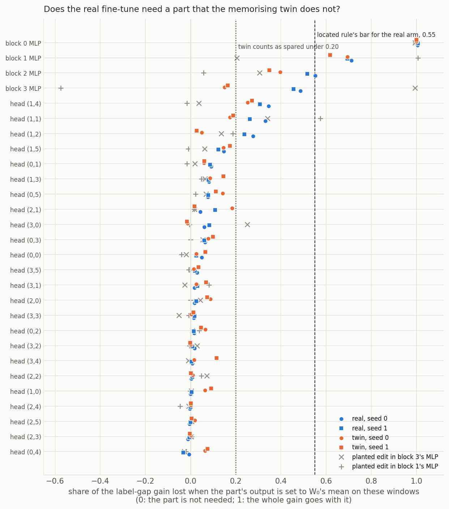
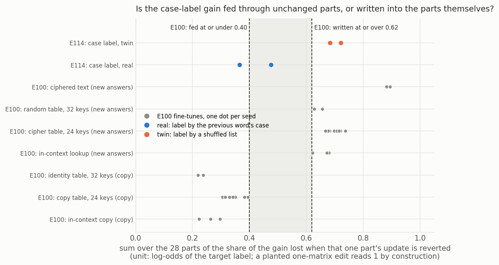

# E114: where in the model does the case-label fine-tune's gain run?

We took the four case-label fine-tunes that the adopted definition read as "not through the capability", and knocked out each attention head and each MLP block in turn to see which ones the gain needs. No single part is needed by the real fine-tune and spared by the memorising twin above the filed bar, so the part-by-part search agrees with the definition's verdict. But the real fine-tune's gain sits less in the changed weights of the parts themselves than the twin's does, a sign that leans toward existing structure being used, so the two readings point different ways for baseline-lead to weigh.

*mechanism-detection-lead, 2026-11-06. Plan `reports/plans/2026-11-06_plan_e114-locator-case-label.md`, filed
predictions `experiments/case_locator/results/predictions.json`, code `experiments/case_locator/run.py`, figures
`experiments/case_locator/plot.py`, notebook `notebooks/E114_case_locator.ipynb`. Job 54238, `debug` L40, about 12 min,
$0. Provisional: no independent check. Reads no verdict and adds nothing to the definition.*

**Limit on every claim.** A new circuit built from old parts still reads as "fed" or "needed": finding a part says the
gain runs through it, not that one old circuit is unchanged.

## The answer

No single head or MLP is needed by the real case-label fine-tune and spared by the shuffled twin at the filed bar.
Both arms lean on the same early parts, which any fine-tune at this marker needs to bring the previous word forward.
So the part-by-part search finds no case-specific part, in line with the definition's "not through the capability". A
second reading points the other way: the real fine-tune's gain sits less in its own changed weights than the
twin's does, about two thirds as much. That gap is a disagreement for baseline-lead to weigh, not a verdict.

## What we were trying to test

Definition-lead's E112 built a pair to Jain et al. 2024's shape. The small model is fine-tuned to say label word A
after a marker token when the word before it is capitalised, B when not. A twin learns the same two labels at the same
marker from a seeded shuffle of the word forms, so it can only memorise. The definition, `decisions.md` rows 81 and 87
plus the direction-removal check, frozen by the row "Adopted definitions are frozen", read the real fine-tune "not
through the capability" three times: removing the case direction took a tenth of the gain, a stronger removal a fifth,
and E113's patch of the case readout flipped about one label in a hundred.

E114 asks the same states a weight-side question with the existing locator, E97's and E100's harness, unchanged. It
reads four saved states: real seeds 0 and 1 at step 30, twin seeds 0 and 1 at step 300. The original model W₀ is the
reference.

- **Part:** one attention head's output, or one block's MLP output. The model has 24 heads and 4 MLPs.
- **Gain:** the state's mean read minus W₀'s on the same windows. Two units. "Log-odds" is the target label's log-odds
  against every other token, E97's filed unit. "Label gap" is the target label's logit minus the other label's, E112's
  margin.
- **Removal share:** the gain lost when one part's output is set to W₀'s mean over these windows, divided by the gain.
  It reads 0 when the state does not need the part and 1 when the whole gain goes with it.
- **Carry share:** the gain lost when the part's output is replaced by W₀'s output on the same input.
- **Own share:** the gain lost when only that part's weight update is set back to W₀.
- **Sum of single reverts:** the 28 own shares added. E100 found it low on every copying fine-tune, at most 0.40,
  "fed", and high on every key-table or cipher fine-tune, at least 0.62, "written".
- **Located rule**, copied from E97 unchanged: a part is located when, on both seeds, removing it takes at least 0.55
  of the real gain, takes at most 0.20 of the same seed's twin gain, and the real fall in nats is at least twice the
  twin's.

**Where it is read.** The plan named E112's held-out windows, with words never trained on. The run read E112's fit
windows instead: training words, in rows not trained on. On held-out words the twin has no gain, since its labels
there are a fresh random draw. Its held-out accuracy at the scored step is 0.506 and 0.516, so the twin could not serve
as the control there. E112 read its own gain on the same fit windows, so the locator and the definition read the same
windows. The real states' held-out reads are reported beside, with no rule. `predictions.json` → `site.why_not_held_out`
records this before the run.

**Controls, first and alone.** E97's two planted edits, a one-matrix write into block 3's and block 1's MLP output,
fitted on the real task and scaled to real seed 0's gain. Each must read its whole gain at the edited part. Then W₀'s
held-out accuracy against E112, each state's gain against E112's, and all 24 matrices reverted, which must read a gain
of 0.

## What we expected, and why

- **A head in blocks 1 to 2 tops the removal map, and the twin needs it too.** Both arms must read the previous word at
  the marker, so the part that moves it there should be needed by both. The located rule would then read "the control is
  not spared".
- **At the real fine-tune's top part, carry above E100's floor of 0.021 and own small.** That would be an existing part
  driven differently by changes elsewhere, like E97's copy head, not a part rewritten.
- **The sum of single reverts: no lean.**

## Controls

All passed; the job did not stop.

| check | read | expected |
|---|---|---|
| W₀ held-out accuracy, real labels / twin labels | 0.520625 / 0.496875 | 0.520625 / 0.496875, E112 |
| label-gap gain, real s0 / s1 / twin s0 / s1 | 12.832 / 12.040 / 10.229 / 8.796 | 12.832 / 12.040 / 10.229 / 8.796, within 0.02 |
| all 24 matrices reverted, gain, every state and unit | 0 | 0 within 0.001 |
| planted edit, block 3: removal at block 3's MLP, label gap / log-odds | 0.99 / 1.12 | about 1 |
| planted edit, block 1: removal at block 1's MLP | 1.01 / 1.02 | about 1 |
| planted edits, carry at the edited MLP; write elsewhere | 1; 0 | 1; 0 |

The planted edits also show what removal cannot tell apart. With the block-3 edit, removing block 2's MLP, which the
edit never touched, takes 0.30 of the label-gap gain, because the edit keys on what block 2 writes. Removal says a part
is needed, not that it changed.

Log-odds gains are 23.3, 24.5, 23.6 and 22.5 nats for real s0, real s1, twin s0 and twin s1: both arms learn to say a
label word at all to the same degree.

## Does the real fine-tune need a part the twin does not?

**Reading it.** No part passes the located rule, in either unit. The figure plots each part's removal share in the label
gap for the four states, with the two planted edits in grey. Block 0's MLP reads about 1 on all four states: setting it
to its mean breaks everything downstream, so it says nothing about either arm. Block 1's MLP takes about 0.7 of the
gain on every state. Block 2's MLP takes about 0.5 of the real gain and 0.35 to 0.40 of the twin's. So the twin needs
both far above its 0.20 bar. Head (1,4) takes about 0.3 on all four states, yet its carry and own shares are near 0 on every
state, so it is a part of W₀ that both arms need without changing it. These match the lean that both arms need the parts
that bring the previous word to the marker.

Two parts do separate the arms in the label gap, and the lead's first reading of this run missed them. Block 3's MLP
takes 0.49 and 0.46 of the real gain but 0.15 and 0.16 of the twin's. Head (1,2) takes 0.28 and 0.24 of the real gain
and 0.05 and 0.03 of the twin's. The twin is spared at both, and the real fall in nats is more than twice the twin's, but
each takes under half the real gain, so the filed rule reads "not located: the task falls under a" on both seeds. In the
filed log-odds unit block 3's MLP does not separate: 0.37 and 0.42 real against 0.35 and 0.33 twin. The locator thus finds
parts the real arm leans on more, but no single part that carries most of its gain. That agrees with the definition's
"not through the capability" in what it reads, and it is not evidence of a case-specific part.

**Removal share per part, both units.** Parts with a share of at least 0.10 on any state in the label gap; the full map
is in `stage1.json`.

| part | gap real s0 | gap real s1 | gap twin s0 | gap twin s1 | lo real s0 | lo real s1 | lo twin s0 | lo twin s1 |
|---|---|---|---|---|---|---|---|---|
| block 0 MLP | 1.00 | 1.01 | 1.00 | 1.00 | 0.62 | 0.68 | 0.75 | 0.76 |
| block 1 MLP | 0.71 | 0.69 | 0.69 | 0.62 | 0.29 | 0.34 | 0.29 | 0.27 |
| block 2 MLP | 0.55 | 0.52 | 0.40 | 0.35 | 0.24 | 0.26 | 0.24 | 0.21 |
| block 3 MLP | 0.49 | 0.46 | 0.15 | 0.16 | 0.37 | 0.42 | 0.35 | 0.33 |
| head (1,4) | 0.35 | 0.31 | 0.25 | 0.27 | 0.16 | 0.19 | 0.17 | 0.18 |
| head (1,1) | 0.33 | 0.26 | 0.17 | 0.19 | 0.08 | 0.08 | 0.06 | 0.06 |
| head (1,2) | 0.28 | 0.24 | 0.05 | 0.03 | 0.08 | 0.07 | 0.01 | 0.00 |
| head (1,5) | 0.15 | 0.12 | 0.15 | 0.17 | 0.05 | 0.06 | 0.08 | 0.09 |
| head (0,5) | 0.08 | 0.08 | 0.14 | 0.11 | 0.01 | 0.03 | 0.05 | 0.04 |
| head (1,3) | 0.08 | 0.08 | 0.09 | 0.14 | 0.00 | 0.01 | 0.03 | 0.05 |
| head (2,1) | 0.04 | 0.11 | 0.18 | 0.02 | -0.02 | 0.02 | 0.05 | 0.00 |
| head (3,4) | 0.01 | 0.00 | 0.02 | 0.11 | 0.03 | 0.01 | 0.00 | 0.02 |
| pair (1,4)+(3,2) | 0.37 | 0.33 | 0.28 | 0.27 | 0.19 | 0.21 | 0.24 | 0.23 |

**The located rule on its nominees.** Nominated by carry, write and the greedy pair, the union over both real seeds.

| part | lo reading, s0 / s1 | gap reading, s0 / s1 |
|---|---|---|
| block 1 MLP | under a / under a | twin not spared / twin not spared |
| block 2 MLP | under a / under a | twin not spared / under a |
| block 3 MLP | under a / under a | under a / under a |
| head (1,1) | under a / under a | under a / under a |
| head (1,2) | under a / under a | under a / under a |
| head (3,0) | raises the state / under a | under a / under a |
| head (3,2) | under a / under a | under a / under a |
| pair (1,4)+(3,2) | under a / under a | under a / under a |

Part named: none at head or MLP grain, in both units.

**Carry, own and graft at the main parts**, label gap; graft is W₀ with only that part's update, its rise over the gain.

| part | carry real s0 / s1 | carry twin s0 / s1 | own real s0 / s1 | own twin s0 / s1 | graft real s0 / s1 | graft twin s0 / s1 |
|---|---|---|---|---|---|---|
| block 0 MLP | 0.48 / 0.49 | 0.81 / 0.80 | 0.31 / 0.35 | 0.60 / 0.60 | 0.15 / 0.16 | 0.10 / 0.10 |
| block 1 MLP | 0.54 / 0.53 | 0.50 / 0.44 | 0.18 / 0.18 | 0.21 / 0.18 | 0.11 / 0.11 | 0.02 / 0.03 |
| block 2 MLP | 0.58 / 0.55 | 0.41 / 0.38 | 0.12 / 0.12 | 0.10 / 0.11 | 0.04 / 0.04 | 0.01 / 0.01 |
| block 3 MLP | 0.66 / 0.64 | 0.44 / 0.41 | 0.21 / 0.17 | -0.03 / 0.01 | 0.03 / 0.03 | 0.00 / 0.01 |
| head (1,1) | 0.12 / 0.10 | 0.14 / 0.17 | 0.06 / 0.06 | 0.07 / 0.09 | 0.02 / 0.02 | 0.01 / 0.01 |
| head (1,2) | 0.14 / 0.13 | 0.03 / 0.02 | 0.05 / 0.06 | 0.02 / 0.01 | 0.01 / 0.01 | 0.00 / 0.00 |
| head (1,4) | 0.00 / 0.00 | 0.00 / 0.00 | 0.00 / 0.00 | 0.00 / 0.00 | 0.00 / 0.00 | 0.00 / 0.00 |

## Is the gain fed through unchanged parts, or written into the parts themselves?

**Reading it.** The two arms land on opposite sides of E100's bars. In the filed log-odds unit the real fine-tune's sum
of single reverts is 0.37 on seed 0, under E100's 0.40, and 0.48 on seed 1, between the bars. The twin's is 0.72 and
0.68, over E100's 0.62. In E100's terms the real gain is fed more through parts whose own weights did not carry it, and
the memorised twin is written more into the parts. The real sits beside E100's copying fine-tunes and the twin beside
its key tables, a row that also memorises an answer per key. The label gap agrees: 1.09 and 1.11 real against 1.61 and
1.62 twin. The bars were set in log-odds, so the label gap has none. Most of the difference sits in the heads. In the
label gap, the heads' own shares add to under 0.3 on the real seeds and over 0.7 on the twin's. The MLPs' add to about
0.85 on all four. The twin's head shares are spread thinly over many early heads,
the largest 0.12, as a word-by-word memory would be.

One caveat is real. The twin trained ten times longer, 300 steps against 30, so its larger sum may partly be a larger
update. E100's check found the sum did not follow update size across its 24-key tables, but those differed in size by
about 5%, not tenfold. E114 did not read update norms.

**This reading leans the other way from the definition's.** The definition read the real fine-tune "not through the
capability" three times. The sum of single reverts places the real fine-tune with E100's copying tasks, which use
existing structure, and the twin with the tasks built to write new answers. Whether a low sum means existing structure
is used is itself untested: E100's one non-copy task built to reuse read high, and its emoticon trigger, which copies
nothing, reads low. This is evidence beside the definition for baseline-lead to weigh. It is not a verdict, and E114
proposes no rule for the definition.

| state | sum, log-odds | E100 reading | sum, label gap | MLPs, gap | heads, gap |
|---|---|---|---|---|---|
| real s0 | 0.366 | fed | 1.090 | 0.820 | 0.270 |
| real s1 | 0.476 | between | 1.107 | 0.821 | 0.285 |
| twin s0 | 0.721 | written | 1.608 | 0.872 | 0.736 |
| twin s1 | 0.683 | written | 1.625 | 0.892 | 0.733 |

| state | MLPs, log-odds | heads, log-odds |
|---|---|---|
| real s0 | 0.328 | 0.038 |
| real s1 | 0.391 | 0.085 |
| twin s0 | 0.502 | 0.219 |
| twin s1 | 0.460 | 0.223 |

## Beside: the held-out windows, real states only

On unseen words the real gain in the label gap is 12.65 and 11.79, close to the fit windows' 12.83 and 12.04. At every part in the table above, the held-out removal share is within 0.01 of the fit
windows' share. No rule reads these.

| part | real s0 | real s1 |
|---|---|---|
| block 0 MLP | 1.01 | 1.01 |
| block 1 MLP | 0.72 | 0.70 |
| block 2 MLP | 0.55 | 0.52 |
| block 3 MLP | 0.49 | 0.46 |
| head (1,4) | 0.35 | 0.32 |
| head (1,2) | 0.29 | 0.25 |

## What we learned

The part-by-part search agrees with the adopted definition on this pair: no single part carries most of the real
fine-tune's gain while sparing the twin. The parts that both arms need most are early ones, and the most needed head is
one neither arm changed. The sum of single reverts does separate the arms, and on the side E100 found for copying
tasks, which is a disagreement with the definition's verdict. For `GOALS.md`, the one pair built to the definition's
shape now has two outside readings that do not agree, and which to trust is baseline-lead's question.

## How compelling is the evidence

- Two seeds per arm, one task, one model, the fit windows. The real held-out map matches the fit map.
- The removal share is blind to a part whose W₀ mean already carries the answer, and block 0's MLP reads about 1 on
  every state, so nothing can be said about it.
- The log-odds unit counts saying a label word at all, which both arms learn to the same degree; the label gap reads
  only the choice between the labels and is the discriminating unit. The located rule was filed in log-odds.
- The sum of single reverts has no source and its bars were set after looking, in E100; a larger update may raise it.
- The located rule's bar of 0.55 comes from E97's copy head; block 3's MLP at 0.49 and 0.46 in the label gap is under it
  by a margin of about 0.06 to 0.09.

## Surprises

- The twin is spared at block 3's MLP and head (1,2) in the label gap, which the plan's lean did not foresee: the real
  arm leans on them three to eight times more than the twin, but under the bar.
- The top removal part is block 0's MLP, not a head, on both real seeds.

## What next

- If baseline-lead weighs the sum of single reverts as evidence of existing structure, the next read is whether it
  follows update size here: read the four states' update norms, $0 on CPU. A twin sum that falls to the real's at
  matched size would remove the disagreement.
- Head (1,2) and block 3's MLP are the two parts the real arm uses more. A read of what head (1,2) attends to at the
  marker would say whether it moves the previous word's case. That would be new work, for the lead to plan.

## Scorecard

| id | claim | rule | read | verdict |
|---|---|---|---|---|
| guards | W₀ accuracy, gains, all reverted | `expected.stage0` | all within tolerance | pass |
| plants | both planted edits read whole at their MLP | `locator_rules.plant_misses` | no misses | pass |
| located, lo | a part located on real with the twin spared | `located_rule`, unit lo | none located | no part |
| located, gap | the same, beside | same, unit gap | none located | no part |
| lean a | a head in blocks 1-2 tops removal; the twin needs it | lo | top is block 0's MLP on both seeds; twin share there 0.75 / 0.76 | first half missed, second held |
| lean b | carry above 0.021, own small at the top part | lo | carry 0.11 / 0.16, own 0.04 / 0.10 | held |
| lean c | sum of single reverts | none | real 0.37 / 0.48, twin 0.72 / 0.68 | no lean |

Tree branch: "no part located, or the twin needs the top part": the locator agrees with the definition or cannot read
the pair; E114 closes.

## Not run

- The plan's held-out windows as the scored site; see "Where it is read".
- Any read of the twin on held-out windows.
- Update norms of the four states, to test whether the sum of single reverts follows update size.
- Removal with natural-text means is saved beside in `stage1.json` and not read here.
- No independent check; no Jain re-read, which is definition-lead's.

## Departures from the literature

- **Removal uses W₀'s mean over the task's own windows, read in the fine-tuned state.** Mean ablation as in Wang et al.
  2022 replaces a part's output with the same model's mean; here the mean is the original model's, as in E97.
- **Carry patches W₀'s output on the same input,** a cross-model patch as in Prakash et al. 2024. Activation patching
  usually swaps inputs within one model.
- **The graft** is one cell of Zhou 2026's cross of base and fine-tuned stacks, at part grain, named after Panigrahi
  et al. 2023, whose graft is a searched mask; ours is a fixed part. Beside only.
- **The sum of single reverts** has no source; E100 found it after looking at its table.
- **None of Jain et al. 2024's definition is applied here;** no verdict is given under it.

## Provenance

- Results: `experiments/case_locator/results/stage0.json`, `stage1.json`, `run.out`; commit 4c56f20e.
- Job 54238, `debug` L40, 12:38 to 12:50 on 2026-11-06, peak host memory 6.1 GB, $0.
- States: E112's four saved states, `~/commute-data/results-large/case_label`, sha256 checked against
  `experiments/case_label/results/stage1.json`; task file sha256 `80cdeee4…aabfd`.
- References: E97 `reports/analyses/2026-11-05_analysis_e97-locator.md`; E100
  `reports/analyses/2026-11-05_analysis_e100-fed-or-written.md`; E112
  `reports/analyses/2026-11-06_analysis_e112-case-label.md`; E113 `reports/analyses/2026-11-06_analysis_e113-case-patch.md`.
