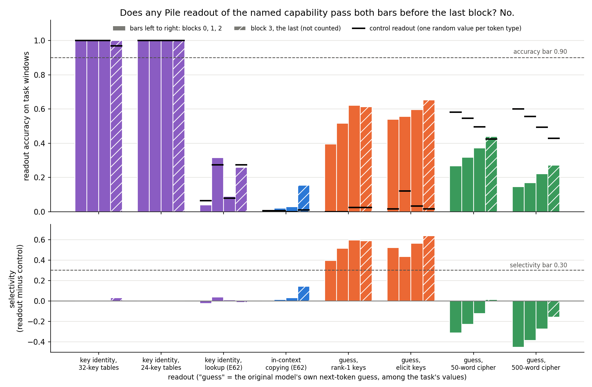
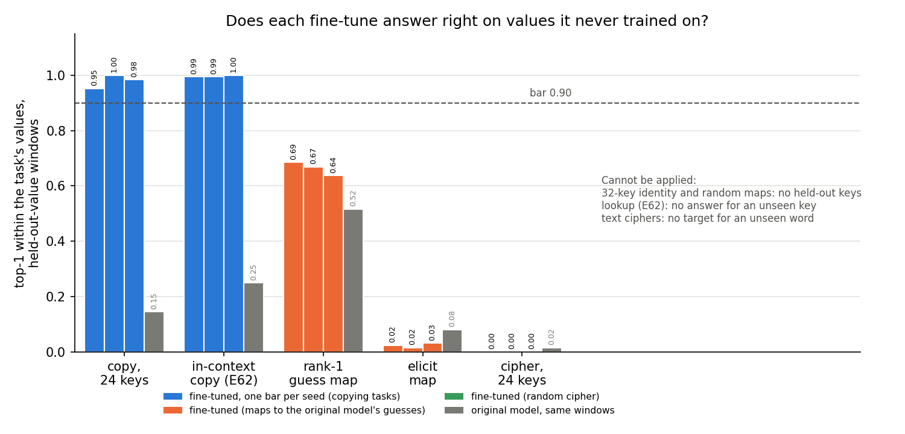

# E116: can the adopted reuse definition read the old 67M fine-tunes?

*definition-lead, 2026-11-06. Plan `reports/plans/2026-11-06_plan_e116-definition-table.md` and its appendix
`reports/plans/2026-11-06_plan_e116-appendix.md`, "Questions settled by the lead" items 1-6; filed predictions
`experiments/definition_table/results/predictions.json`; the user's brief
`reports/decisions/2026-11-06_decision_definition-retarget.md`, step 1; notebook `notebooks/E116_definition_table.ipynb`;
figures `experiments/definition_table/figures/{possession,carrying}.png`. One MATS `debug` L40 job, 54440, $0.
Provisional: no independent check.*

We read every saved fine-tune of the small model's earlier phase under the reuse definition the user froze, part by
part, with no new training. No task gets a verdict, because no readout trained on ordinary text recovers its named
capability both well and clearly better than a control. So the old tasks cannot be labelled new or reused by this
definition, and the table says what shape the larger model's anchor tasks need before they can be.

## The answer

No old fine-tune gets a verdict, so no earlier claim is confirmed or contradicted. The definition's first test,
possession, fails on every task. The key tables name a capability that is just the key's token, and a control readout
that relabels token types reads it as well. Copying and the model's own guesses have many values, and their readouts
stay well under the accuracy bar. The text ciphers' control beats the readout. Carrying to unseen values needs no
readout, and it still reads: both copying fine-tunes pass it, and the other maps do not. These unreadable rows are the
finding, not a failure.

## The definition read, quoted

Read under `decisions.md` rows 81, 87 and 164, with E112's filed bars, and nothing added (row 165: adopted definitions
are frozen). Quoted:

- **Row 81** (2026-10-29): "Def 1 (possession): input x = (x_i, x_d); M possesses capability C if, on a sub-domain X_C
  with x_i = i_C, some layer has a linear readout (trained on pretraining data) equal to f_C(x_d); "for all x" becomes a
  threshold filed before any run. Def 2: fine-tuning reuses C if the post-trained map is g∘f_C; C is strongly relevant
  if g∘f_C is correct on the whole fine-tuning distribution, weakly if only on its sample. Added: reuse needs a causal
  claim (ablating or patching the readout direction breaks the fine-tuned behaviour, and/or pruning a few neurons or a
  short reverse fine-tune revives the pretraining behaviour faster than a scratch baseline learns it)."
- **Row 87** (2026-10-30): "a dated departure from Jain et al. 2024 Def 2: a fine-tune reuses capability C only if g,
  learnt on the fine-tuning examples, also works on held-out values (lowercase and copy pass; a word-swap table fails)".
- **Row 164** (2026-11-06): "the definition is rows 81 and 87 and nothing else. Possession = a linear readout trained on
  Pile text at some block, beating a Hewitt-Liang control task by a bar filed before any run […]; reuse = the
  fine-tuned map is a small function of that readout and carries to held-out values (row 87); the one added check =
  removing the readout's direction breaks the fine-tuned behaviour and spares a twin fine-tune at the same trigger,
  with pruning and reverse fine-tuning reported beside it. Verdicts: "reuses C", "not through C", "unreadable",
  "definition does not apply"; a constant-answer task reads "does not apply" and stops."
- **E116 go-ahead**, the last row (2026-11-06): "plan `reports/plans/2026-11-06_plan_e116-definition-table.md` approved
  as written: the 67M tasks read under rows 81/87/164 with E112's filed bars; lead's settled questions 1-5 stand (type-level
  C measured; m-valued g as removal.lookup_accuracy's table; rank-matched do-nothing). One debug job, $0."

The bars are copied unchanged from E112's filed rules, and listed in the next section. Departures are listed in their
own section below.

## What we were trying to test

The user asked for a sanity check before the larger model's anchors: read the 67M fine-tunes under the frozen
definition, and say whether it agrees with what we claimed about each. Read part by part, the definition asks four
things of a fine-tune and a named capability C.

- **Possession.** A linear readout of C, trained on Pile text and never on task windows, recovers C on the task's
  inputs. It must reach an accuracy of 0.90 and beat a control readout by 0.30, at some block before the last.
- **Carrying.** The fine-tuned model answers right on values it never trained on, at least 0.90 of the time. This part
  needs no readout.
- **Small function.** The fine-tuned model's answer is a simple function of the readout's class, on at least 0.90 of
  held-out windows.
- **Removal.** Removing the readout's directions at the trigger takes at least half of the fine-tune's gain. A random
  set of directions of the same size must take at most a tenth.

The readout is one ridge regression per value of C on a block's output residual at one position of 41-token Pile
windows, read as the argmax over values. Its control, after Hewitt and Liang, is the same regression fitted to one
seeded random value per token type at the slot where the key sits. A readout that has only learnt which token is present
does as well on the control, so the gap between the two, the selectivity, is then near 0.

We read 26 saved states and the original model, with no training:

- **Key tables**, 32 or 24 keys after a marker: identity and random maps with 32 keys, two seeds each; copy, cipher,
  rank-1 guess and lower-guess maps with 24 trained keys and 8 held out, three seeds each. C is the key's identity, or
  for the two guess maps the original model's own next-token guess among the task's values.
- **In-context copying** from E62, "A B … A M" followed by B at a new marker M, and its lookup twin at the same marker,
  which answers a fixed word for A. Three seeds each. C for copying is the token after the earlier occurrence of A; for
  the lookup, the identity of A.
- **Text ciphers** from E53, with 50- and 500-word tables, two seeds each. C is the original model's guess of the next
  word, read at positions whose target is a table word.
- **Lowercase, emoticon and the one-pair random map.** The user's reset names these as having no content function, so
  they read "does not apply" and no state was loaded.

Beside the definition, a column copies the locator's part-level revert, as the user asked, as row 81's "pruning a few
neurons" form at the grain of one head or MLP. From E100: the top part's own share, that part's weight change alone set
back to the original, over the gain; and the sum of all 28 single reverts. From E97: whether switching a part off at the
original model's mean takes the gain and spares the twin. E114's locator read only the case-label states, so it gives no
site for these tasks.

Stage 0 reran E112's case readout through the moved code first, and would have stopped on any block off by more than
0.001.

## What we expected, and why

Filed in `predictions.json` before the job. The key-table readouts were expected near perfect with their control, so
the selectivity near 0 and possession failing, because a linear readout learns any relabelling of the token types it
sees. The copying and guess readouts were expected under 0.90 before the last block, from E90's guess readout at 0.88.
Carrying was expected to pass on both copying tasks, and to fail on the 24-key cipher and the lower-guess map. On the
rank-1 map, whose values are the original model's top guesses, the original model and the fine-tunes were expected to
pass by construction. Every task with a readout was expected "unreadable".

## What we observed

### Stage 0: the moved readout code reads as before

E112's case readout, refitted through `case_label.value_probes`, gave accuracy 0.683, 0.994, 0.885 and 0.763 at blocks
0 to 3 and control 0.476, 0.524, 0.464 and 0.479. Both match `experiments/case_label/results/stage0.json` exactly, with a
largest difference of 0.

### Does the original model hold any of the named capabilities? No.

**Reading it.** No readout clears both bars at a block before the last, so possession fails on every task and no task
has a site. The failure has three forms.

- **The capability is the key's token.** On the four key tables, both readouts read 1.0 at blocks 0 to 2, so the
  selectivity is 0, as filed. A relabelling of token types is learnt as well as the types.
- **The capability has many values.** The copied-word readout, over 178 words, reads at most 0.03 before the last block
  and 0.155 at it; always guessing the commonest word scores 0.015. The guess readouts over 18 and 32 values clear the
  selectivity bar but peak at 0.62 and 0.60 in accuracy.
- **The control beats the readout.** On the text ciphers, the per-type random labels read 0.42 to 0.60, and the model's
  guess only 0.15 to 0.44.

Full numbers, from `results/stage0.json` `.readouts`:

| Readout (C) | Values m | Pile positions | Accuracy, blocks 0 / 1 / 2 / 3 | Control, blocks 0 / 1 / 2 / 3 | Selectivity, blocks 0 / 1 / 2 | Commonest class on scored windows |
|---|---|---|---|---|---|---|
| key identity, ident32 and rand32 (identical) | 32 | 512 | 1.00 / 1.00 / 1.00 / 1.00 | 1.00 / 1.00 / 1.00 / 0.97 | 0.00 / 0.00 / 0.00 | 0.072 |
| key identity, copy-24 and cipher-24 (identical) | 32 | 512 | 1.00 / 1.00 / 1.00 / 1.00 | 1.00 / 1.00 / 1.00 / 1.00 | 0.00 / 0.00 / 0.00 | 0.093 |
| key identity of A, E62 lookup | 32 | 512 | 0.04 / 0.315 / 0.09 / 0.26 | 0.065 / 0.275 / 0.08 / 0.275 | −0.025 / 0.04 / 0.01 | 0.055 |
| in-context copying, E62 | 178 | 9,869 | 0.005 / 0.02 / 0.03 / 0.155 | 0.005 / 0.005 / 0.00 / 0.01 | 0.00 / 0.015 / 0.03 | 0.015 |
| original model's guess, rank-1 keys | 18 (17 with positions) | 38,141 | 0.395 / 0.516 / 0.621 / 0.613 | 0.00 / 0.00 / 0.024 / 0.024 | 0.395 / 0.516 / 0.597 | 0.379 |
| original model's guess, lower-guess keys | 32 (29) | 14,775 | 0.540 / 0.556 / 0.597 / 0.653 | 0.016 / 0.121 / 0.032 / 0.016 | 0.524 / 0.435 / 0.565 | 0.460 |
| original model's guess, 50-word cipher | 50 | 2,414 | 0.269 / 0.319 / 0.372 / 0.439 | 0.581 / 0.546 / 0.496 / 0.424 | −0.313 / −0.228 / −0.124 | 0.048 |
| original model's guess, 500-word cipher | 500 (493) | 11,159 | 0.147 / 0.170 / 0.222 / 0.271 | 0.600 / 0.556 / 0.494 / 0.430 | −0.454 / −0.386 / −0.272 | 0.015 |

Scored windows: 97 on the 32-key tables, 75 on the 24-key tables' trained keys, 124 on the guess maps' held-out keys,
200 on E62's read windows, 540 and 2,074 on the ciphers' held rows. The locator's block for in-context copying, block 2,
fails possession too, so no site was taken from it.

### A check on the copying readout, run by the lead

The copied-word readout's near-chance accuracy was unexpected, since this model copies in context through located heads.
The lead tested one candidate cause on CPU; the result is in
`~/commute-data/scratch/definition-lead/e116-copycheck/check.json`. On the Pile positions the readout was fitted on,
the token at the read position equals the label 10.3% of the time. On E62's read windows it never does. So a "the current token is the label" shortcut exists on Pile
but is small, and it does not explain the low accuracy. The lead's hypothesis was not borne out. No cause is named.

### Do the fine-tunes answer right on values they never trained on? Only the copying ones.

**Reading it.** Both copying fine-tunes carry, and the other maps do not. Each value is the state's top-1 among the
task's values on windows whose value was never trained; the original model is read on the same windows. The 24-key
copy map and in-context copying read 0.95 to 1.0, against the original model's 0.15 and 0.25. The rank-1 map reads
0.64 to 0.69 and the original model 0.52, both under the filed "passes by construction". The lower-guess map reads
0.02 to 0.03, under the original model's 0.08, and the 24-key cipher 0. Carrying is one part: none of these is a
verdict.

From `results/stage1.json`:

| Task | Held-out windows | Original model | Seed 0 | Seed 1 | Seed 2 | Full-vocabulary top-1, seeds |
|---|---|---|---|---|---|---|
| copy, 24 keys | 124, 8 keys | 0.145 | 0.952 | 1.000 | 0.984 | 0.589 / 0.847 / 0.782 |
| in-context copying | 200, Bs never trained | 0.250 | 0.995 | 0.995 | 1.000 | 0.995 / 0.995 / 0.995 |
| rank-1 guess map | 124, 8 keys | 0.516 | 0.685 | 0.669 | 0.637 | 0.653 / 0.637 / 0.637 |
| lower-guess map | 124, 8 keys | 0.081 | 0.024 | 0.016 | 0.032 | 0.000 / 0.008 / 0.016 |
| cipher, 24 keys | 124, 8 keys | 0.016 | 0.000 | 0.000 | 0.000 | 0.000 / 0.000 / 0.000 |
| identity and random maps, 32 keys | none | n/a: the file's held-out split holds the same keys | | | | |
| lookup twin | none | n/a: a lookup defines no answer for an unseen key | | | | |
| text ciphers, 50 and 500 words | none | n/a: the table defines no target for an unseen word | | | | |

### Small function and removal: not read

No capability had a site, so the stage-2 reads that need one never ran: the small function, the removal share, the
same-rank random removal and every twin's share are "nan" in `results/stage2.json`, and each state's verdict is
"unreadable" by `case_label.table_verdict`.

## The table

One row per task, one column per part of the definition, then the locator column, the reading, the earlier claim and
whether they agree. The last column says what shape a task must have for the frozen definition to read it. These rows
are the finding, not a failure of the run, and no rule is added to make any of them readable. Possession is the best
accuracy and the selectivity at blocks 0 to 2; carrying is per seed. Earlier claims are those in the plan's appendix §7.

| Task | C named | Possession: accuracy, selectivity before the last block (bars 0.90, 0.30) | Carrying on unseen values (bar 0.90) | Small function | Removal | Locator: E100 top part own share; sum of single reverts; E97 | Reading | Earlier claim | Agrees? | What the definition needs to read it |
|---|---|---|---|---|---|---|---|---|---|---|
| identity map, 32 keys | key identity | 1.00; 0.00, fails | n/a: no held-out keys | not read | not read | mlp3 0.047 / 0.045; 0.24 / 0.22; E97 not run | unreadable | reuse, by construction | cannot say: unreadable at possession | a C not fixed by the key's token type, scored on types the readout never saw; held-out keys for carrying |
| copy map, 24 keys | key identity | 1.00; 0.00, fails | 0.95 / 1.00 / 0.98; original 0.15 | not read | not read | mlp3 0.079 / 0.065 / 0.074; 0.40 / 0.30 / 0.35; E97 not run | unreadable | reuse, by construction | cannot say: unreadable at possession; carrying alone sits with reuse | a C not fixed by the key's token type |
| in-context copying, E62 | the token after A's earlier occurrence | 0.03; 0.03, fails, at the locator's block 2 too | 0.995 / 0.995 / 1.00; original 0.25 | not read | not read | head (2,4) 0.008 / 0.007 / 0.005; 0.26 / 0.30 / 0.22; E97 located (2,3)+(2,4), share 0.87 / 0.88 / 0.78, lookup 0.007 / −0.004 / 0.006 | unreadable | reuses, causal, through head (2,4) | cannot say: unreadable at possession; carrying alone sits with reuse | a Pile readout of the copied word that reaches 0.90 before the last block; over 178 words this one reads 0.03 |
| lookup twin, E62 | identity of A | 0.315; 0.04, fails | n/a: no answer for an unseen key | not read | not read | mlp3 0.136 / 0.147 / 0.139; 0.68 / 0.62 / 0.67; E97 not located, share 0.41 / 0.42 / 0.42 under its 0.55 bar | unreadable | new, causal | cannot say: unreadable at possession | a C not fixed by A's token type; an answer defined for unseen keys |
| random map, 32 keys | key identity | 1.00; 0.00, fails | n/a: no held-out keys | not read | not read | mlp3 0.139 / 0.135; 0.66 / 0.63; E97 not run | unreadable | new, by construction | cannot say: unreadable at possession | as the identity map |
| text cipher, 50 words | the original model's next-word guess | 0.37; −0.12, fails | n/a: no target for an unseen word | not read | not read | mlp3 0.479 / 0.494; 0.88 / 0.89; E97 none at head or MLP grain, control not spared | unreadable | new, by construction | cannot say: unreadable at possession | a readout that beats a per-type relabelled control; a target defined for unseen words |
| text cipher, 500 words | the original model's next-word guess | 0.22; −0.27, fails | n/a: no target for an unseen word | not read | not read | not in E100's or E97's tables | unreadable | new, by construction | cannot say: unreadable at possession | as the 50-word cipher |
| cipher, 24 keys | key identity | 1.00; 0.00, fails | 0 / 0 / 0; original 0.016 | not read | not read | mlp3 0.135 / 0.128 / 0.129; 0.70 / 0.72 / 0.68; E97 not run | unreadable | new, by construction | cannot say: unreadable at possession; carrying alone sits with new | a C not fixed by the key's token type |
| lower-guess map (elicit) | the original model's guess at the key | 0.60; 0.57, fails on accuracy | 0.024 / 0.016 / 0.032; original 0.081 | not read | not read | mlp3 0.125 / 0.128 / 0.124; 0.47 / 0.51 / 0.51; E97 not run | unreadable | open | cannot say: unreadable at possession | a readout of the model's guess that reaches 0.90 before the last block; this one reads 0.60 |
| rank-1 guess map | the original model's top guess at the key | 0.62; 0.60, fails on accuracy | 0.685 / 0.669 / 0.637; original 0.516 | not read | not read | mlp3 0.193 / 0.182 / 0.181; 0.73 / 0.72 / 0.72; E97 not run | unreadable | old, by construction | cannot say: unreadable at possession; carrying alone reads under the bar, against "old" | as the lower-guess map |
| lowercase | none: no content function | not read | not read | not read | not read | mlp3 0.156 / 0.158; 0.56 / 0.54; E97 located (1,1)+(1,2), share 0.80 / 0.85, control 0.071 / 0.069 | does not apply | reuse | cannot say: does not apply | an answer that depends on the input's content |
| emoticon | none: constant answer | not read | not read | not read | not read | mlp3 0.197 / 0.186; 0.37 / 0.30; E97 not run | does not apply | an existing behaviour | cannot say: does not apply | an answer that depends on the input's content |
| one-pair random map | none: constant answer | not read | not read | not read | not read | not in E100's table | does not apply | new | cannot say: does not apply | an answer that depends on the input's content |

Where possession and selectivity name one number per row, it is the block among 0 to 2 with the highest accuracy, and
that block's selectivity. The locator numbers for the readable rows come from `results/stage2.json`, which copied them
from `experiments/fed_or_written/results/table.json` and `experiments/locator_table/results/table.json`. For lowercase
and emoticon, whose states were not loaded, they were read from the same two files with `jq` for this report. The
locator decides nothing: it is reported as row 81's pruning form, beside the definition.

Carrying sits with three earlier claims and against one, but it is one part, and a miss would give "not through C"
only if possession had passed. So none of these is a verdict.

## What we learned

The adopted definition gives no label to any old 67M fine-tune. That is a reading of the frozen rule. It tells the
anchors of step 2 what shape a task must have before it can be read.

- **Possession needs a capability the per-type control cannot copy.** The readout must be scored on token types it
  never saw in training. E112's case readout was scored on held-out word pairs and passed at block 1. A capability that
  is just "which token is here", scored on the same tokens, cannot pass.
- **Possession needs few values, or a stronger readout than ours.** The readouts of copying and of the model's guesses,
  over 18 to 500 values, stayed under 0.65 before the last block. The two-valued case readout reached 0.994.
- **Carrying is readable without a readout, wherever unseen values have a defined answer.** A lookup or a cipher table
  says nothing about a word it never saw, so there it cannot be read.

## What this means for step 2

Step 2 writes how the definition applies to the Qwen anchors: template against TOFU facts, and known against invented
facts. From this table, the definition can read a task only if three things hold. The named capability depends on the
input, not on one token's identity. A Pile readout of it beats the per-type relabelled control, on types the readout
never trained on, by the filed bars before the last block. The task defines an answer for values the fine-tune never
trained on, so carrying can be scored.

For each anchor arm, step 2 must name such a capability or report the arm unreadable. A recall capability with one value
per fact meets the many-valued problem seen here. A two-valued one, such as whether the subject is known to the
original model, has the shape that passed possession in the case-label pair. This is a description of what the frozen
definition can read, not a rule, and the user decides the anchors.

## How compelling is the evidence

- The verdicts rest on the original model's readouts alone, so seeds do not enter them. Carrying was read on two or
  three seeds per task, and the seeds agree to within 0.05.
- The readout is a ridge regression at one position, E112's form. A stronger readout could pass where this one fails;
  that is not tested, and trying one would be a new readout under a new plan.
- Stage 0 reproduced E112's readout exactly, so the moved code reads as before.
- The held-out sets are small: 124 windows over 8 keys on the 24-key tables, and 200 windows on copying.
- One position per window, one model, one decomposition-free reading. No independent check.

## Surprises

- **The in-context copying readout is near chance.** It reads at most 0.155, at the last block, though the model copies
  in context through heads E97 located. The lead's identity-leakage check found the shortcut small, 10% of Pile
  positions and none of the task's, so it does not explain the reading. The cause is untested.
- **The rank-1 map does not pass carrying by construction.** The original model reads 0.52 on the held-out keys' windows,
  against the 0.90 filed. Its top guess at a key in these windows is often not the value the map assigns.
- **The key-identity readout on the lookup's windows reads at most 0.315, not near 1.** Its control reads the same, so
  possession fails either way. Cause untested.
- **The text ciphers' control readout beats the real one**, at 0.42 to 0.60 against chance levels of 0.02 and 0.002.

## What next

1. Step 2: name each Qwen anchor arm's capability and say whether it has the readable shape above. If none does, that is
   the finding, and the user decides the anchors.
2. Reading the copying row at all would need a different readout, for example at the located heads' output or scored on
   held-out copy contexts. That is a new plan, not an amendment, and only on the user's request.

## Scorecard

| id | Claim in words | Rule | Read | Verdict |
|---|---|---|---|---|
| stage 0 | the moved code reproduces E112's readout | every block within 1e-3 | max difference 0.0 | held |
| W0 type-level | key identity and its control both near 1, P0 fails | selectivity near 0 | 1.0 and 1.0 on four key tables; lookup 0.04-0.315 and 0.065-0.275 | held on four; lookup accuracy missed, P0 fails as filed |
| W0 copy, guess | under 0.90 at blocks 0-2; control near 1/m | as stated | copy at most 0.03, guesses at most 0.62; controls 0-0.12 on copy and guesses, 0.42-0.60 on text ciphers | accuracy held; text ciphers' control missed |
| W0 P1 | near its prior; rank-1 passes by construction | P1 >= 0.90 on rank-1 | rank-1 0.516 | missed on rank-1 |
| ident32, rand32 | unreadable; P1 n/a | P0 fails | selectivity 0.00 | held |
| copy24 | unreadable; P1 read, no lean | P0 fails | selectivity 0.00; P1 0.95-1.00 | held |
| e62_copy | unreadable; P1 >= 0.90 | P0 lean fails before the last block | accuracy at most 0.03 at blocks 0-2; P1 0.995-1.00 | held |
| e62_lookup | unreadable; P1 n/a | P0 fails | selectivity -0.025 to 0.04 | held |
| cipher, broad_cipher | unreadable; P1 n/a | P0 lean fails | selectivity -0.45 to -0.12 at blocks 0-2 | held |
| cipher24 | unreadable; P1 under 0.90 | P0 fails | selectivity 0.00; P1 0.00 | held |
| elicit | unreadable, else not through C; P1 under 0.90 | P0 lean fails | accuracy at most 0.60; P1 0.02-0.03 | held: unreadable |
| rank1 | unreadable, else not through C; P1 >= 0.90 | P0 lean fails | accuracy at most 0.62; P1 0.64-0.69 | P0 held; P1 missed |
| lowercase, rand1, emoticon | does not apply | constant answer | not loaded | held |
| do-nothing direction, P2, P3, twins' P3 | read for a C with a site | as filed | no C has a site | not read |
| do-nothing state | cannot pass | G = 0 gives not through C | W0's P1 printed per task; never under a verdict | no reading |

## Departures from the literature

- Jain, Kirk, Lubana et al. 2024 train the readout on their synthetic pretraining data with a probe of their own; here a
  ridge regression per value on Pile residuals at one position, E112's form.
- Jain's possession holds "for all x"; here the bars of 0.90 accuracy and 0.30 selectivity filed by E112.
- Jain put no bound on g; held-out carrying is the user's dated departure, row 87, read as its own part.
- For a C with more than two values, g was filed as the identity on classes or a table fitted on the fit windows; Jain
  define g only as a function. It was never read here.
- Direction removal is our addition, from row 81's sentence; Jain's causal evidence is pruning and reverse fine-tuning.
  Neither the removal nor those ran here, as no C had a site.
- The "pruning a few neurons" column is the locator's part-level revert, E100 and E97, copied from JSON at the grain of
  a head or MLP; it is not Jain's App. D Alg. 3.
- The Hewitt-Liang control gives one random value per key-slot token type, as their control tasks do per word type;
  their probes are classifiers, not ridge regressions.

## Not run

- The small function, the removal, the same-rank and rank-1 random removals, and every twin's removal share: no C had a
  site.
- Any readout other than a one-position ridge regression; a readout at the located heads' output; readouts at the word
  position.
- Pruning (Jain's Alg. 3), reverse fine-tuning, concept erasure and patching on these states.
- Any fine-tune, new task pair or new windows; ident32b and rand32b; seeds 3-7 of the 24-key maps; the 32-key elicit and
  cipher states; kv_task's E10 originals.
- A held-out target for the text ciphers or the lookup, and held-out keys for the 32-key maps: none is defined, and none
  was built.
- The 500-word cipher's locator reading: it is in neither E100's nor E97's table.
- A cause of the copying readout's low accuracy, beyond the lead's identity-leakage check.
- Step 2, the Qwen anchors: its own plan.

## Provenance

- Job 54440, MATS cluster `debug` QoS, one L40, about 20 minutes, $0, exit 0; stages logged 15:18:05 to 15:19:34, peak
  host memory 8.3 GB. Results committed in 95e1309e.
- Results: `experiments/definition_table/results/stage0.json`, `stage1.json`, `stage2.json`, `run.out`; the input files'
  sha256 are printed at the end of `run.out`.
- Code: `experiments/definition_table/run.py`, `tasks.py`, `readouts.py`, `reads.py`; rules in
  `src/commute/case_label.py`; figures by `experiments/definition_table/plot.py`.
- The lead's copy-readout check: `~/commute-data/scratch/definition-lead/e116-copycheck/check.py` and `check.json`.
