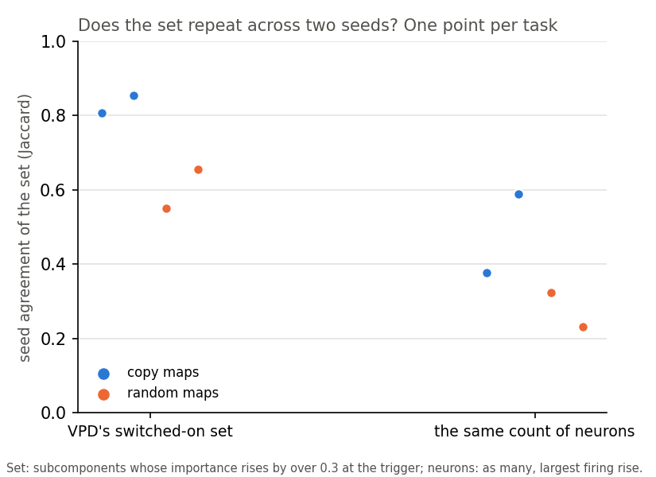
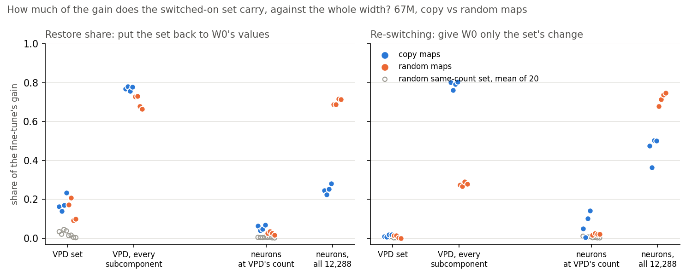
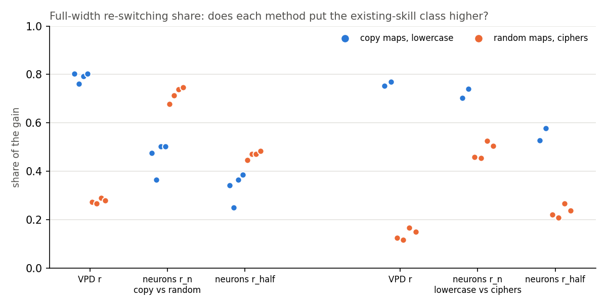
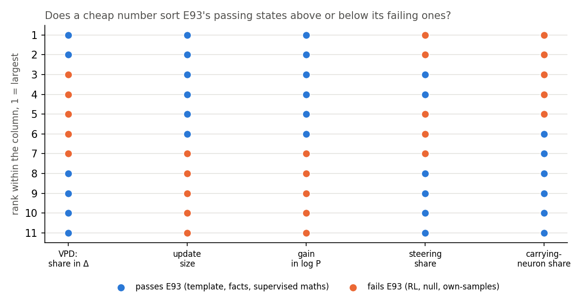
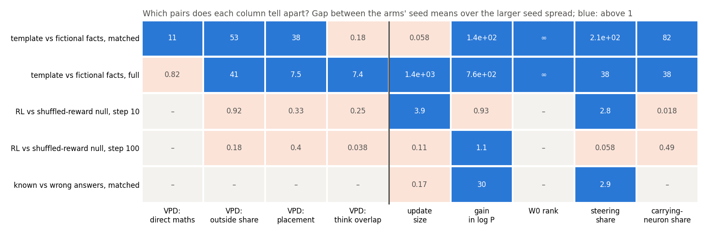
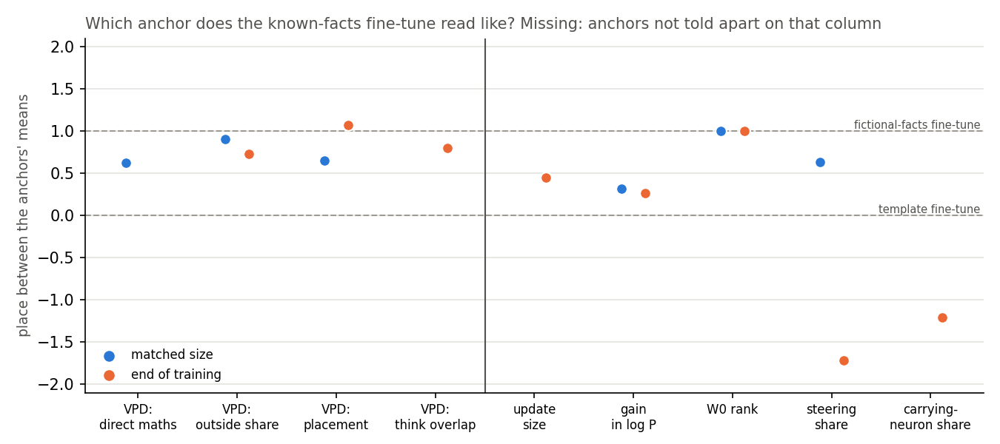

# Analysis: on states where VPD already has a reading, does the decomposition add anything over neurons and cheap numbers? (E117, E118)

*2026-11-06, baseline-lead's write-up agent. Steps 1 to 3 of the user's baseline retarget (`decisions.md`, row "Baseline
retarget"). Plans `reports/plans/2026-11-06_plan_e117-neurons-at-vpd-count.md` and
`reports/plans/2026-11-06_plan_e118-qwen-comparator-table.md`. Jobs 54427 (E117; the first submission, 54369, stopped
before loading because another process held the card) and 54382, 54383 (E118), all `debug` on the L40, $0. The one
table: `experiments/neuron_vpd_table/results/full_table.md`, built by `build_full.py`; figures by `plot_full.py`.
Notebooks `notebooks/E117_neuron_vpd_count.ipynb`, `notebooks/E118_qwen_comparator_table.ipynb`. Provisional, fast lane,
no independent check.*

We repeated the decomposition's readings on the small model's neurons, and set four cheap numbers beside its readings
on the larger model. On the small model the decomposition's readings order the tasks as built where the neuron
readings do not. On the larger model the cheap numbers already sort most of its verdicts, so its added value for the
goals is shown on the small model only.

## The answer

On the 67M, VPD adds two things over neurons. Its switched-on set repeats across seeds more for copy maps than random
maps, where the same number of neurons does not. Its full-width re-switching share puts copy maps and lowercase well
above random maps and ciphers; the neuron share reverses on the maps. The switched-on set itself carries little gain
for either method. On Qwen, update size and gain already sort every pass and fail of VPD's first table, so that table
adds little.

This is a methods comparison read with already-filed separation rules. It makes no statement under the reuse definition.

## What we were trying to test

The user's brief: on states where VPD already has a reading, put the same reading done on neurons, and the plan's
cheap comparators, beside it on shared axes. A VPD reading that a cheap number reproduces on the same states says less
than its number suggests, in E92's words.

**On the 67M (E117)** the states are four kinds of fine-tune, two seeds each. Copy maps teach the model to repeat a
word it already sees; random maps teach a lookup of arbitrary word pairs. Lowercase is a next-token task the model
can nearly do; the two ciphers are not. Each class is known only from how the task was built. Three readings were
taken on each state, both on VPD's subcomponents and on the 12,288 MLP neurons:

- **The switched-on set.** For VPD: the alive subcomponents whose mean causal importance at the read position rises
  by more than 0.3 over the unchanged model's. Its size is the count K. For neurons: the K neurons whose firing rises
  most at the same position, on the same windows. So both sets have the same size.
- **Seed agreement**: the Jaccard overlap of the set between the two seeds of a task, 1 meaning identical sets.
- **Restore share**: put the set alone back to the unchanged model's values at the read position. The share of the
  fine-tune's gain in log-odds that disappears is the reading. 0 means the set carries nothing; 1 means all of it.
- **Re-switching share of the set**: the share of the gain recovered when the unchanged model gets only the set's
  change. For VPD this is the unchanged subcomponents with the set's masks taken from the fine-tune; for neurons, the
  unchanged model with the set's firing taken from the fine-tune.

Each set reading is shown beside 20 random sets of the same size and layer spread, the floor, and beside the same
reading at full width, every subcomponent or every neuron. Full-width VPD re-switching is E46's and E53's $r$; the
full-width neuron versions are E98's $r_n$, every neuron's firing from the fine-tune, and $r_\text{half}$, the unchanged
MLP weights applied to the fine-tune's MLP inputs.

**On Qwen3-1.7B (E118)** no decomposition was run. The four comparators were read on every saved state that already
carries a VPD row from E93, E94, E94 Amendment 1, E104 or E107 Amendment 1:

- **update size**: total weight change over the unchanged model's weight norm;
- **gain and rank**: the gain in mean log P of the trained answer, and the unchanged model's rank of its first token;
- **steering share**: one mean-difference vector added at one block, its rise in log P over the gain, beside a random
  vector of the same norm;
- **carrying-neuron share**: E102's whole-width neuron reading, defined in its own section below.

Thirty-two cells do not apply, because their states are constructed inside a VPD job and are not trained states.

## What we expected, and why

E117 filed guesses with no project-level pass or fail. VPD's set would separate copy from random maps on seed
agreement, as E12's Jaccards of 0.80 and 0.85 against 0.53 and 0.66 had. VPD would not separate them on restore share,
as E50 found. Neurons would separate nothing, a coin flip leaning wrong after E98 and E52. E118 filed only its controls,
since its cells are a join.

## The 67M: does VPD's switched-on set repeat across seeds where neurons do not?

**Reading it.** Yes. VPD's set separates copy from random maps by the filed rule, and the same count of neurons does
not. VPD's two copy tasks read 0.81 and 0.85 against 0.55 and 0.66 for the random maps. The gap of 0.15 exceeds the
largest spread within a class, 0.11. The neuron sets read 0.38 and 0.59 against 0.32 and 0.23. Their gap of 0.05 sits
inside a within-class spread of 0.21. The caveat is that seed agreement reads only whether the set recurs, not what it
does.

## The 67M: does the switched-on set carry the gain, for either method?

**Reading it.** No. The switched-on set carries a small part of the gain for both methods, and neither separates the
maps on it. Put back alone, VPD's set removes 0.14 to 0.23 of the gain on copy maps and 0.09 to 0.21 on random maps,
so the classes overlap. Given alone to the unchanged model, VPD's set recovers 0.008 to 0.019 of the gain on copy maps.
On random maps it recovers 0.001 to 0.013. The full width recovers 0.76 to 0.80 on copy maps and 0.27 to 0.29 on random
ones. So the 0.3-threshold set is not where VPD's re-switching lives. The neuron set does a little better on
re-switching, up to 0.14, but with a spread of the same size. Most sets sit above their random same-count floor; two
re-switching values sit at it or under it, on ident32 s1 for neurons and rand32b s1 for VPD.

## The 67M: at full width, which method orders the task families as built?

**Reading it.** VPD's full-width share does on both families, and the neuron shares do on one. These cells were not
filed in E117; E12's rule is applied to them here as description. VPD's $r$ puts copy maps 0.47 above random maps and
lowercase 0.59 above the ciphers. Both gaps exceed E53's bar of 0.3. The neuron share $r_n$ reverses on the maps,
random maps 0.38 higher. It puts lowercase only 0.18 above the ciphers; $r_\text{half}$ manages 0.26. Both are under
E53's bar. This repeats E98's finding.

**Lowercase and the ciphers have no switched-on set.** VPD switches on no subcomponent at position 63 on any of the six
states: the count is 0 everywhere. So every set panel on that family reads "unreadable" for both methods. That is
itself a result: on these next-token tasks the fine-tune's gain is carried by many small importance changes, none above
0.3. The full width still carries it: VPD's $r$ reads 0.75 and 0.77 on lowercase.

### Full 67M numbers

| state | count | seed agreement, VPD / neurons | restore share of the set, VPD / neurons | re-switching of the set, VPD / neurons | full width: VPD $r$ / $r_n$ / $r_\text{half}$ |
|---|---|---|---|---|---|
| ident32 s0 | 125 | 0.806 / 0.376 | 0.164 / 0.063 | 0.0093 / 0.049 | 0.802 / 0.475 / 0.341 |
| ident32 s1 | 108 | 0.806 / 0.376 | 0.139 / 0.039 | 0.0077 / 0.0037 | 0.761 / 0.363 / 0.250 |
| ident32b s0 | 140 | 0.853 / 0.589 | 0.169 / 0.047 | 0.0193 / 0.101 | 0.792 / 0.503 / 0.364 |
| ident32b s1 | 138 | 0.853 / 0.589 | 0.234 / 0.069 | 0.0188 / 0.141 | 0.804 / 0.502 / 0.384 |
| rand32 s0 | 41 | 0.550 / 0.324 | 0.172 / 0.026 | 0.0133 / 0.016 | 0.273 / 0.678 / 0.445 |
| rand32 s1 | 52 | 0.550 / 0.324 | 0.207 / 0.034 | 0.0133 / 0.027 | 0.266 / 0.713 / 0.470 |
| rand32b s0 | 27 | 0.655 / 0.231 | 0.092 / 0.027 | 0.0014 / 0.022 | 0.290 / 0.738 / 0.470 |
| rand32b s1 | 21 | 0.655 / 0.231 | 0.098 / 0.016 | 0.0005 / 0.020 | 0.280 / 0.747 / 0.483 |
| lowercase s0, s1 | 0, 0 | unreadable | unreadable | unreadable | 0.752, 0.770 / 0.704, 0.740 / 0.526, 0.576 |
| cipher s0, s1 | 0, 0 | unreadable | unreadable | unreadable | 0.124, 0.116 / 0.459, 0.455 / 0.220, 0.208 |
| broad cipher s0, s1 | 0, 0 | unreadable | unreadable | unreadable | 0.165, 0.150 / 0.525, 0.505 / 0.267, 0.237 |

Filed verdicts, `neuron_vpd_count/results/score.json`: copy against random maps, seed agreement VPD "separates", gap
0.151 against within 0.105; neurons "does not separate", 0.053 against 0.212. Restore share: VPD gap −0.067 against
0.114, neurons 0.005 against 0.030, both "does not separate". Re-switching of the set: VPD −0.006 against 0.013, neurons
−0.023 against 0.137, both "does not separate". Every lowercase and cipher panel, and E53's bar on B and C, "unreadable".
The random update matched in norm to ident32 s0 switched on nothing and its gain, 0.015, sat under the floor of 1.

Whole-width restore share, reported as a limit: VPD 0.66 to 0.78 on every state that has a set and 0.41 to 0.66 on the
next-token family. The neuron version with W0's own firing is 0.22 to 0.28 on copy maps and 0.69 to 0.72 on random
maps, reversed like $r_n$.

## Qwen: does a cheap number already sort VPD's verdicts?

The full row-by-row table is section 2 of `full_table.md`. Each VPD row family gets one question.

### E93's first table: pass or fail

**Reading it.** Yes: update size and gain each sort E93's verdict exactly, and so does the carrying-neuron share, by a
hair. Every passing state has a larger update and a larger gain than every failing one. The smallest passing update is
the template fine-tune's, at 3.7 parts in ten thousand. The largest failing one is the shuffled-reward null's, at 2.8.
Gain separates them by 0.07 nats: 0.67 against 0.60. The carrying-neuron share is lower on every passing state, 0.72 to
0.91, than on any failing one, 0.92 to 1.07. Arm type sorts them as well: the reinforcement-learning, null and
own-samples arms fail and the supervised ones pass. VPD's own share of the update left in Δ does not sort them. So by
E92's test this table says less than its verdicts suggest: its misses fall on the smallest updates.

### E94 and E104: which pairs does each column tell apart?

**Reading it.** Where VPD's readings tell a pair apart, the cheap numbers tell it apart too, often by more. Each cell
is the gap between the two arms' seed means over the larger seed spread, E92's stop-rule quantity; above 1 is what E92
calls "counts". Here it is applied as description to pairs it was not filed for.

- **Template against fictional facts, matched size.** VPD's outside share, placement and direct maths count, at 11
  to 53. Gain, steering share and the carrying share count at 82 to 210; only update size does not, matched by
  construction. The two anchors are read on different rows, so part of every comparator's gap is the rows. E92 already
  showed that the steering share cannot be read across the anchors as new against old.
- **The same pair at full size.** Everything counts, size by a factor of about 1,400. E94 showed random changes of
  either size do not reproduce VPD's gap, so VPD's reading is not size alone. Still, no cheap column misses this pair.
- **Reinforcement learning against its shuffled-reward null.** VPD reads them alike at both steps, every cell under 1.
  Update size and steering share count at step 10, and gain only at step 100, at 1.1. No column counts at both steps,
  with two seeds per arm, so the cheap columns are no steadier than VPD here.
- **Known against wrong answers, matched size.** VPD's set reading gave "no call" in E107. Gain and steering share
  count, but each arm is read on its own trained sentences. Wrong answers start lower, so a larger gain is expected
  from the rows alone.

### E94 Amendment 1: which anchor does the known-facts fine-tune read like?

**Reading it.** At matched size the cheap numbers place it as VPD does. At the end of training they do not. The place
is where the known-facts arm's mean lies between the anchors, the template at 0 and the fictional-facts arm at 1, and
is left out when the anchors do not separate on that column. At matched size VPD's outside share reads 0.90 and its
placement 0.65. The steering share reads 0.63 and the gain 0.32. At the end VPD's three readings put the arm at 0.73 to
1.07, beside the fictional-facts arm. Size and gain put it at 0.44 and 0.27; steering and the carrying share fall
below the template, at −1.7 and −1.2. This is the one Qwen place where VPD's columns agree with each other and the
cheap ones do not. E94 already read it as following the task and format, not novelty.

## The carrying-neuron share above 1

The carrying-neuron share is $\text{nums}[N] / G$ (`src/commute/qwen_neurons.py`, `state_cells`; E102). $G$ is the
fine-tune's gain, the mean over answer positions of the state's log P minus the unchanged model's. $\text{nums}[N]$ is
the same mean for a hybrid model. The hybrid is the unchanged model with every neuron's firing replaced by
$A_h$: the unchanged gate, up and SiLU applied to the MLP inputs that the fine-tuned model produces. It is E98's
$r_\text{half}$ numerator.

Nothing bounds this ratio by 1, and the code is as defined. The hybrid is not one part of an additive split of
the update. It leaves out the attention change, the change of the MLP weights themselves, and how those interact with
the firing change. When those left-out parts lower log P on net, the hybrid gains more than the fine-tune, and the
share exceeds 1. Two causes are visible in `results/carry/*.json`:

- **The GSM8K states, 1.03 to 1.07**, on six of the ten RL, null and own-samples states, with gains of 0.014 to 0.59.
  The excess is inside the gain's own standard error, which is 5% to 16% of the gain on those states. So these read
  "about all of the gain", not more than all of it. The other RL and null states read 0.92 to 0.99; the supervised maths
  arms read 0.84 and 0.88.
- **`known_s42_end`, 2.15**: cancellation over a small, unstable denominator. On E103's 29 bare-answer probe rows the
  fine-tune gains only 0.80 ± 0.24, while the hybrid gains 1.71. Its seed twin, `known_s142_end`, loses 2.34 ± 0.22 on
  the same rows and the hybrid loses 0.31, a share of 0.13. On the trained sentences the two seeds gain alike, 1.48 and
  1.50. Patching the top-ranked 65,536 neurons raises log P by about 3.4 in both seeds. Adding the remaining
  106,000 lower-ranked neurons swings the whole-width number apart. So the 2.15 is real arithmetic on these rows, but a ratio
  whose denominator's sign differs between seeds reads nothing; that cell is noise.

## What we learned

On the 67M, the decomposition does add something over neurons on the two readings where it had a positive finding. Its
switched-on set repeats across seeds for copy maps more than for random maps. Its full-width re-switching share orders
both task families by more than E53's bar, where the neuron share reverses on one. The switched-on set at the 0.3
threshold is not where re-switching lives, for either method, and it does not exist at all on the next-token tasks. On
Qwen, the decomposition's verdicts are so far matched or beaten by update size, gain and the steering share on every
pair but one. That pair is the known-facts arm at the end of training, which E94 read as task and format. So the case
that VPD makes post-training more readable than neurons rests, for now, on the 67M.

## How compelling is the evidence

- Two seeds per task or arm everywhere. One decomposition per model.
- The 67M classes are assumptions from how each task was built, not measured labels.
- Seed agreement reads only recurrence. Restore share reads one position. The VPD side of re-switching keeps the
  decomposition's leftover Δ at the unchanged model's, so it misses the update outside the subcomponents.
- The Qwen comparators read different rows per arm: the template rows, TOFU's rows, gold maths solutions, or each arm's
  own sentences. A comparator's gap between arms is partly a gap between rows, which inflates the cheap numbers'
  separations. VPD's D3 rows are read on shared maths rows.
- The orders, gap-over-spread and place summaries are description: no rule was filed for them.
- Controls: E117's W0 control read exactly 0. Its count control matched 41, 52, 27 and 21. Its full-width limits
  reproduced E46 and E53's $r$ and E98's $r_n$. E118's controls C0, C1 and C2 reproduced E92's and E102's stored values
  exactly (`controls_compare.json`, `controls_carry.json`).

## Surprises

- VPD switches on no subcomponent on any lowercase or cipher state at the read position. The plan expected that panel
  to have a VPD side for the first time. It has none.
- The carrying-neuron share above 1, explained above.
- None reversed a filed guess: VPD separated on seed agreement and not on restore share, and neurons separated nothing,
  as guessed.

## What next

1. If the lead wants a switched-on set on the next-token tasks, a lower importance threshold is a new reading, and
   needs its own plan and filed rule. If a lower threshold gave a set, the lowercase panels would become readable.
2. On Qwen, the cheap comparators read on VPD's shared maths rows would remove the row confound from the pair grid. If
   the comparators then stopped separating the anchors, VPD's matched-size separation would stand on its own.
3. A rule joining the one table into a "does VPD add anything" verdict is a definition-level choice for the user.

## Scorecard

| id | claim in words | rule | read | verdict |
|---|---|---|---|---|
| E117 guess, VPD A | VPD's set separates copy from random maps on seed agreement | E12 separation rule | gap 0.151, within 0.105 | separates, as guessed |
| E117 guess, VPD B | VPD's set does not separate them on restore share | same | gap −0.067, within 0.114 | does not separate, as guessed |
| E117 guess, neurons | neurons at VPD's count separate nothing | same | A 0.053/0.212; B 0.005/0.030; C −0.023/0.137 | does not separate, as guessed |
| E117, VPD C | not guessed | same | gap −0.006, within 0.013 | does not separate |
| E117, lowercase and ciphers | not guessed | same, E53 bar | count 0 on all six states | unreadable |
| E118 C0, C1, C2 | the zero update reads nothing; E92 and E102 controls reproduce | filed tolerances | all exact | hold |

## Departures

- **E12's separation rule on the whole-width readings** of E117: those cells were controls, not filed panels; the rule
  is applied as description.
- **E92's stop-rule quantity on new pairs**: it was filed for the two anchors only. Here it is also applied to RL
  against null and known against wrong answers, as description.
- **E94's place between the anchors on comparator columns**: E94 filed it for VPD's columns only.
- **The ordering summary for E93**: a new description; no rule.
- **E118's rows**: the comparators on the GSM8K arms are read on gold solutions, E92's departure, kept. The
  known-facts arm's carrying share is read on E103's bare-answer probe while its other comparators use the trained
  sentences, as stored.
- Departures from the literature: the steering vector is a mean difference of block inputs, as in activation addition,
  with E92's choice of block and rows; no other reading here is taken from a published source. Jaccard is the standard
  set overlap.

## Not run

- A switched-on set at any threshold other than 0.3, or neurons at counts other than VPD's.
- The layer split of the neuron set, reported in `cells.json`, not scored.
- Comparators on VPD's shared maths rows for the Qwen D3 families.
- Neuron share, engaged share and prompt overlap for the four stored known and wrong matched carrying sets.
- A second probe for the known arm's carrying set.
- Comparators on the constructed controls (E94's Gaussian and alive-set changes, E104's scaled copies): not trained states.
- Any rule joining a comparator to a VPD reading; any reuse verdict.

## Provenance

E117: `experiments/neuron_vpd_count/results/{predictions,cells,score}.json`, figure `figures/panels.png`, log
`cluster/logs/commute-neuron-vpd-count-54427.out` (git head bc683e20, peak GPU 7.7 GB, about 3.5 minutes after
loading). E118: `experiments/qwen_comparator_table/results/{table.json,table.md,controls_compare.json,controls_carry.json,run.log}`,
per-state files in `results/compare/` and `results/carry/`. References: `neuron_r/results/cells.json` (E98),
`regating_truth_table/results/table.json` (E46, E53), and the reports
`reports/analyses/2026-11-05_analysis_{e98-neuron-r,e92-comparators}.md`,
`reports/analyses/2026-11-06_analysis_{e93-d1-table,e94-d3-rows,e104-d3-gsm8k,neurons-vs-vpd-table}.md`,
`reports/analyses/2026-10-29_analysis_{e46-regating-table,e50-restore-anchors,e53-performed-anchor}.md`,
`reports/analyses/2026-11-02_analysis_e12-amend3-fp32-read.md`. Table and figures:
`~/commute-agents/fleet/cpu-run python experiments/neuron_vpd_table/build_full.py`, then `plot_full.py`; CPU, seconds, $0.
