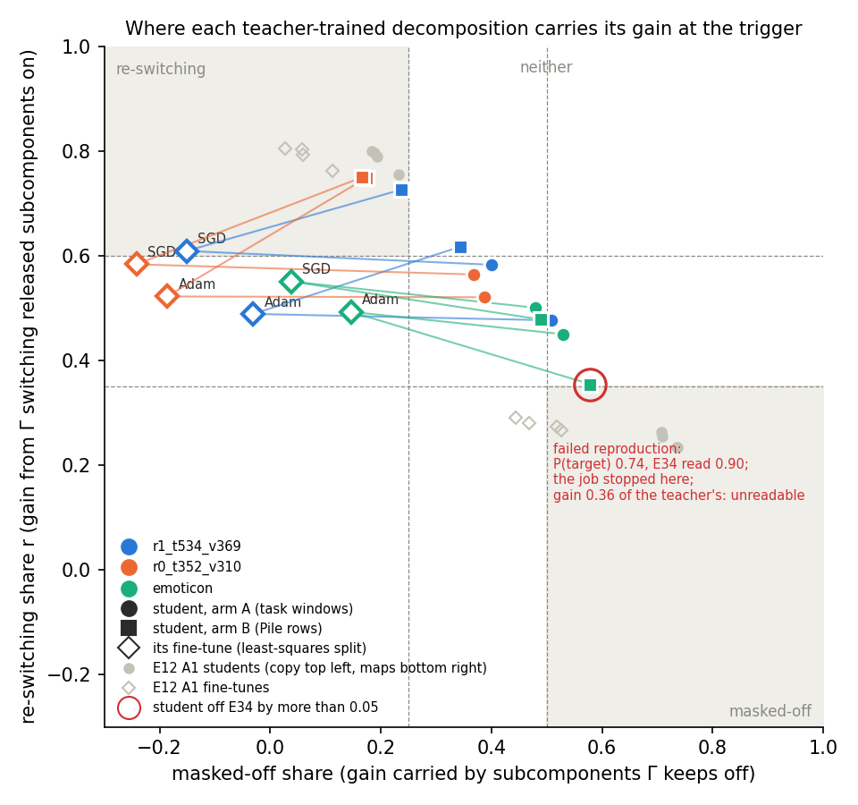

# Where do the teacher-trained decompositions carry their gain on the trigger tasks?

*E119, 2026-11-06. Asked for by the user by name. Plan `reports/plans/2026-11-06_plan_e119-teacher-route-split-triggers.md`;
code `experiments/teacher_route_split/`; figure `experiments/teacher_route_split/figures/route_labels.png`;
notebook `notebooks/E119_teacher_route_split.ipynb`.*

We regenerated the twelve teacher-trained decompositions of the three trigger tasks. We split each one's gain at the
trigger into the part Γ's switching carries and the part carried by subcomponents Γ keeps off. One of the twelve did
not reproduce its original behaviour, so the job stopped by the user's rule and the other eleven readings are
provisional. Read anyway, most decompositions land between the two labels, as their
fine-tunes do, which leaves open whether these updates arrive as a change in which existing subcomponents are used.

## The answer

**The regeneration did not reproduce the original behaviour within 0.05, so the run stopped.** The emoticon
task's Pile-text copy of the Adam fine-tune reached a target probability of 0.74, where the original run read 0.90.
The other eleven copies reproduced within 0.016. Read provisionally, eight of those eleven land in neither corner, as
their fine-tunes do, and three land in the re-switching corner. All three are Pile-text copies, and two of them sit
where their own fine-tune reads neither.

## What we were trying to test

Teacher training copies a fine-tuned model into the decomposition. The fine-tuned model is the teacher; only the
subcomponents' U and V are trained, for 1000 steps, on the KL divergence from the teacher, with Γ and Δ frozen. Arm A
trains on the task's own windows; arm B trains on Pile text, which never shows the task. The original run trained
these copies on three trigger tasks, two key rules and the emoticon task, from an SGD and an Adam fine-tune each:
twelve copies, of which it saved none. So this job regenerated the six fine-tunes and the twelve copies with the same
seeds, and stopped if any copy's target probability on held-out windows fell more than 0.05 from the original's.

Each state was read by splitting its gain at the trigger. The gain is the rise in the log-odds of the target token at
the trigger, from the original model to the state read. Two shares of it are read:

- the **re-switching share** $r = (L_{01} - L_{00}) / \text{gain}$. Keep the original subcomponents and take Γ's
  masks from the new state: $r$ is how far the log-odds rise. 0 means the new masks change nothing; 1 means switching
  alone carries the whole gain.
- the **masked-off share** $((U_1 - L_{11}) - (U_0 - L_{00})) / \text{gain}$: the change in what the subcomponents
  that the mask turns off contribute. $L$ is the log-odds under the CI-masked model and $U$ under all subcomponents
  unmasked. 0 means the switched-off subcomponents carry none of the gain; 1 means they carry all of it.

Labels are the copy-versus-map experiment's filed lines, unchanged. A state is re-switching if $r \ge 0.6$ and its
masked-off share is at most 0.25; masked-off if its masked-off share is at least 0.5 and $r \le 0.35$; otherwise
neither. It is unreadable if its gain is under 1 nat or under half its teacher's. In that earlier experiment the copy
tables' teacher-trained states read re-switching and the random maps' read masked-off, so the rule can return either
end. Each copy is read beside its fine-tune, whose own reading is the least-squares split of its weight change. Its
re-switching share equals the do-nothing state's exactly, since moving the update into the subcomponents does not
change what Γ sees.

## What we expected, and why

We expected all twelve copies to land in neither corner. The six fine-tunes' re-switching shares were 0.49 to 0.61
in the original runs, between the lines. In the copy-versus-map experiment, teacher-trained states kept their
fine-tune's re-switching share within 0.06 and moved the rest of the gain into the masked-off share. We also expected,
with low confidence, that each copy would keep its fine-tune's label. The r1 SGD fine-tune was the likeliest to break
this. Its re-switching share of 0.61 sits on the line, so a small masked-off share puts it in the re-switching
corner. Its copies, gaining masked-off share, would then leave.

## What we observed

### Did the regeneration reproduce the original run?

**Reading it.** No, on one of twelve copies. The red ring marks the emoticon task's Pile-text copy of the Adam
fine-tune: its target probability was 0.744 against the original's 0.902, a fall of 0.158. That is three times the
user's tolerance of 0.05. It is also five times the largest change a second batch order made to any copy's end state
in the original run's fourth amendment, 0.032, on this same copy. The job stopped there by its own rule. Everything
before it passed. The original model's log-odds cells matched the earlier SGD-versus-Adam run exactly on all three
tasks. The six regenerated fine-tunes matched their original target probabilities within 0.013, and the do-nothing
re-switching shares matched the earlier runs exactly. The other eleven copies matched within 0.016. The cause of the
one miss is not known; this job ran on an L40 where the original ran on an H100, and that difference is untested.

### Where do the eleven reproduced copies land? Provisional

**Reading it.** Mostly in neither corner, with three Pile-text copies in the re-switching corner. In the figure each
copy is joined to its fine-tune, the open diamond of the same colour. The six task-text copies, the circles, all
read neither. They kept their fine-tune's re-switching share within 0.06, and their masked-off shares were 0.37 to
0.53. The Pile-text copies, the squares, sit higher on the re-switching axis than the task-text copies on both key
rules: 0.62 to 0.75 against 0.48 to 0.58. On the emoticon task they do not. Three of them cross into the re-switching
corner: both r0 Pile-text copies and the r1 SGD one. The Pile-text copies also reached less of their teacher's gain,
0.58 to 0.75 of it, against 0.92 to 1.01 for the task-text copies. Every point here comes from a run that failed its
reproduction condition on one cell, so these placements are provisional.

The fine-tunes themselves read as follows. On both key rules their masked-off shares are negative, from −0.03 to
−0.24, which is why their diamonds sit left of zero. On the emoticon task they are positive, 0.04 and 0.15. The r1
SGD fine-tune's diamond is in the re-switching corner, at a re-switching share of 0.609, on the line; the other five
read neither.

### Full table

Shares are of each state's own gain. "Copy P" is the copy's held-out target probability; "original P" the original
teacher-training run's. Gain ratio is the copy's gain over its teacher's.

| task | teacher | arm | copy P | original P | gain ratio | re-switching share | masked-off share | copy label | fine-tune label |
|---|---|---|---|---|---|---|---|---|---|
| r1_t534_v369 | SGD | A | 0.996 | 0.996 | 1.008 | 0.582 | 0.400 | neither | re-switching |
| r1_t534_v369 | SGD | B | 0.984 | 0.974 | 0.754 | 0.726 | 0.237 | re-switching | re-switching |
| r1_t534_v369 | Adam | A | 0.995 | 0.994 | 0.917 | 0.476 | 0.509 | neither | neither |
| r1_t534_v369 | Adam | B | 0.981 | 0.983 | 0.592 | 0.617 | 0.344 | neither | neither |
| r0_t352_v310 | SGD | A | 0.944 | 0.942 | 0.984 | 0.564 | 0.368 | neither | neither |
| r0_t352_v310 | SGD | B | 0.935 | 0.919 | 0.715 | 0.749 | 0.166 | re-switching | neither |
| r0_t352_v310 | Adam | A | 0.925 | 0.921 | 0.923 | 0.520 | 0.388 | neither | neither |
| r0_t352_v310 | Adam | B | 0.896 | 0.908 | 0.581 | 0.748 | 0.174 | re-switching | neither |
| emoticon | SGD | A | 0.998 | 0.999 | 0.956 | 0.500 | 0.480 | neither | neither |
| emoticon | SGD | B | 0.958 | 0.960 | 0.605 | 0.478 | 0.489 | neither | neither |
| emoticon | Adam | A | 0.997 | 0.997 | 0.937 | 0.450 | 0.530 | neither | neither |
| emoticon | Adam | B | **0.744** | 0.902 | 0.359 | 0.354 | 0.579 | unreadable; failed reproduction | neither |

The fine-tunes, read by the least-squares split:

| task | teacher | teacher P, here | teacher P, original | gain, nats | re-switching share | masked-off share | label |
|---|---|---|---|---|---|---|---|
| r1_t534_v369 | SGD | 0.991 | 0.983 | 14.54 | 0.609 | −0.151 | re-switching |
| r1_t534_v369 | Adam | 0.995 | 0.996 | 17.29 | 0.489 | −0.030 | neither |
| r0_t352_v310 | SGD | 0.944 | 0.941 | 11.80 | 0.583 | −0.242 | neither |
| r0_t352_v310 | Adam | 0.949 | 0.936 | 12.93 | 0.522 | −0.186 | neither |
| emoticon | SGD | 0.998 | 0.998 | 15.10 | 0.551 | 0.038 | neither |
| emoticon | Adam | 0.999 | 1.000 | 17.79 | 0.493 | 0.146 | neither |

Positive control, from the copy-versus-map experiment's saved file under the same rule: its four copy-table students
read re-switching, with re-switching shares 0.76 to 0.80, and its four random-map students read masked-off, with
masked-off shares 0.71 to 0.74.

## What we learned

The user's condition for reading this run was not met, so it does not answer the question as set. Taken
provisionally, the trigger tasks' copies do not land where the copy tables' copies did: most sit between the lines,
as their fine-tunes do. The training text moves the reading. Copies trained on Pile text sit higher on the
re-switching axis than copies trained on the task on both key rules, while the task-text copies stay close to their
fine-tune. A label here says how frozen Γ distributes a state's gain at the trigger, not whether the update is new or
existing. A new circuit built from old subcomponents also reads as switching.

## How compelling is the evidence

Weak. One cell failed reproduction by three times the tolerance, so the job's own condition for reading the grid
failed. One seed and one batch order per copy; the batch-order noise in the masked-off share, from the copy-versus-map
experiment, is 0.002. Three tasks, one position, one target token each. Three of the six fine-tunes and eight of the
eleven readable copies sit within 0.05 of one of the four lines. Two labels hang on such a margin: the r1 SGD
fine-tune's re-switching share of 0.609, and the r1 SGD Pile-text copy's masked-off share of 0.237. The Pile-text
copies reached 0.58 to 0.75 of their teacher's gain, where the plan expected 0.7 to 1.0. The r1 Adam, r0 Adam and
emoticon SGD ones fell under that range.

## Surprises

- The reproduction failure itself: one copy fell 0.158 short of its original target probability, while the other
  eleven copies and all six fine-tunes matched within 0.016.
- Two r0 Pile-text copies read re-switching where their fine-tune reads neither, against the lean that each copy
  keeps its fine-tune's label. The r1 SGD task-text copy went the other way, from its fine-tune's re-switching to
  neither, as the plan said was likeliest.
- The fine-tunes' masked-off shares are negative on both key rules.

## What next

Nothing runs from this job. Whether the failed cell is looked into is the user's decision.

## Scorecard

Scored by `run.py`'s own `score()` over every copy record the job wrote, twelve, called through `cpu-run`. The run
stopped by its own rule, so `results/score.json` was never written and this scoring covers the cells read. The stopped
copy's record was written before its check and reads unreadable, so it is outside both pools whichever way it is
counted.

| id | claim | rule as filed | read | verdict |
|---|---|---|---|---|
| P1 | where the copies land; lean "neither", every one of the 12 | the label of strictly more than half of the readable copies; otherwise "mixed"; under 3 readable "unscorable" | 8 neither, 3 re-switching, 1 unreadable; majority of 11 readable is neither. Arm A: neither, 6 of 6; arm B: re-switching, 3 of 5 readable | **neither**, as leaned; the "every one" in the lean missed by three |
| P2 | each copy keeps its fine-tune's label; lean "same", low | "same" if every readable pair matches; else "differs", listing them | 8 of 11 pairs match; differ: r1 SGD arm A, r0 Adam arm B, r0 SGD arm B | **differs**; lean missed |
| control | the rule can return both end labels | the copy-versus-map experiment's eight students under the same rule | 4 copy re-switching, 4 maps masked-off | passes |

## Departures from the literature

- **Teacher training is not VPD's training.** VPD trains Γ and the subcomponents together on its own losses; here
  only U and V train, on an unmasked KL to the teacher, with Γ and Δ frozen.
- **The split of the gain is this project's measure, not VPD's.** Γ sees 41-token windows here, where VPD trained it
  on rows of 512.
- **The labels combine two filed sources.** The re-switching lines are the copy-versus-map experiment's filed lines;
  the masked-off lines are a later experiment's, as that experiment's first amendment combined them. No new rule or
  band was added. No reuse verdict is given, so `decisions.md` rows 81 and 87 are not read.
- **From the original teacher-training run.** This job ran on an L40, not an H100. It did not run the Pile
  adversary, the adjoint state, the step-100 reads or the third arm, none of which feeds training.

## Not run

- No rerun of the stopped copy, no second batch order and no other card. The cause of its 0.158 shortfall is not
  known.
- `results/score.json` was not written: the job stopped before the last task finished.
- The teacher equal to the original model as a control; the state with the remainder added to the subcomponents.
- A second seed or batch order for any copy; other tasks; Qwen.
- Which subcomponents Γ switches on in any copy.
- The cross-check against the saved r1 SGD students of the fifth amendment of the original run.

## Provenance

- Jobs: MATS `debug` QoS, one L40 each, $0. 54473 r1_t534_v369, 15:42:44 to 15:54:19; 54474 r0_t352_v310,
  15:54:23 to 16:05:15; 54475 emoticon, 16:05:19 to 16:15:49, exit 1 at the stop.
- Code and predictions at commit `07788e274978704533dafb0af9a759df57a00e4d`; results committed in `d0876271`.
- `experiments/teacher_route_split/results/`, sha256:
  - `teacher_route_split_r1_t534_v369.json` `008ce98aa9cd6ad60ad8657a6a7a1fd007ea1413693361f88b2ed6c5cf152bee`
  - `teacher_route_split_r0_t352_v310.json` `af46b79dd1ac0fadae57b3d461384d14a557b9bf7847dfe975e86d17d9e570f4`
  - `teacher_route_split_emoticon.json` `e70465f43d823103973b5c6be54206f9c900d8526052d7d7339c8fdb8f3261e8`, holds `.stopped`
  - `predictions.json` `31ee6113259c101331abea231c55a4e472ef8fd80ee2b220644082b1ba1e28ce`
- Logs `results/large/run_<task>.log`; offsets of all twelve copies, bf16, about 60 MB each, in `results/large/<task>/`.
- Original values: `experiments/teacher_training/results/teacher_training_<task>.json`; the seed spread from
  `experiments/TRIED.md`, row "E34 Amendment 4".
