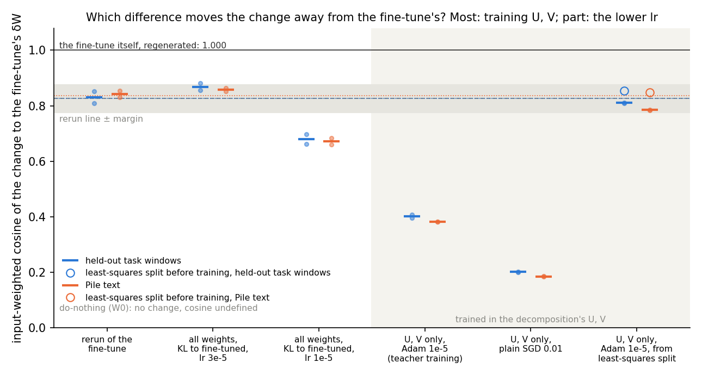
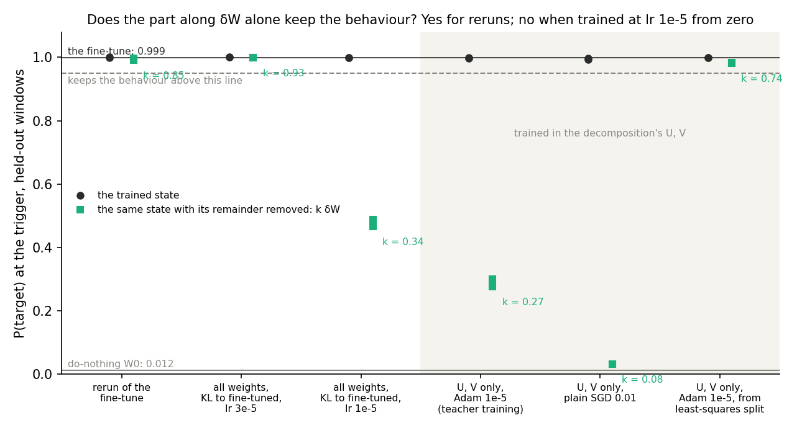
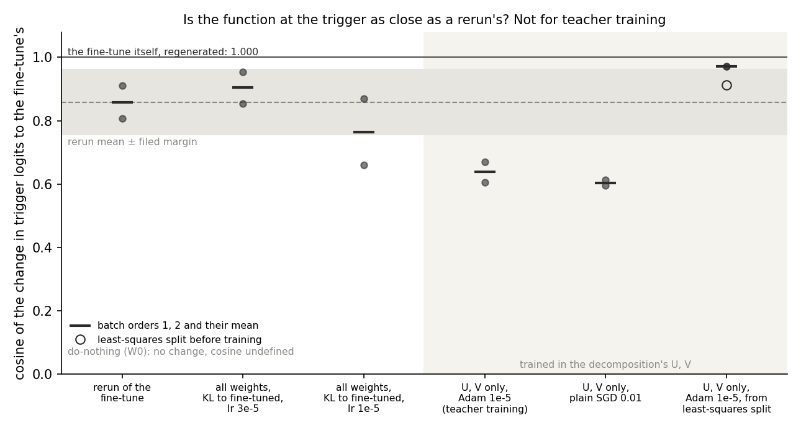
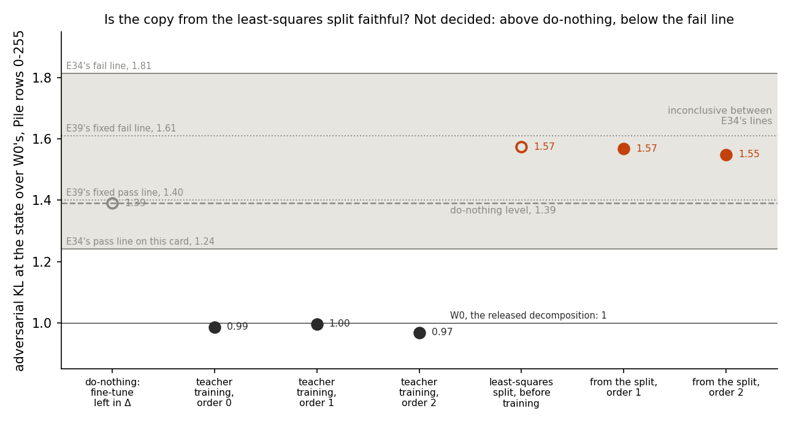

# E121: why does teacher training land far from the fine-tune's weight change?

*2026-11-06, regating-lead's writer. Plan `reports/plans/2026-11-06_plan_e121-copy-gap-ladder.md`; filed predictions
`experiments/copy_gap_ladder/results/predictions.json`; results `experiments/copy_gap_ladder/results/copy_gap_ladder.json`
(job 54638, MATS `debug`, L40, about 19 min, $0, exit 0); notebook `notebooks/E121_copy_gap_ladder.ipynb`; figures
`experiments/copy_gap_ladder/figures/{ladder,remainder,function}.png`. Provisional: no independent check.*

We retrained the emoticon fine-tune's student six ways, changing one difference between teacher training and the
fine-tune at a time, and measured how close each weight change lands to the fine-tune's. Most of the distance comes from
training only the decomposition's U and V, part from the lower learning rate, and none from learning the fine-tuned
model's outputs instead of the labels. For the goals this means teacher training keeps the fine-tune's target
behaviour with a different weight change and a different logit change, and a start from the fine-tune's
least-squares split stays close to both.

## The answer

Teacher training lands its weight change far from the fine-tune's mainly because it trains only the decomposition's U
and V, and partly because it uses a third of the fine-tune's learning rate. A plain student trained on the same target
at the fine-tune's rate lands as close to the fine-tune as a rerun does. The teacher-trained change is a different
change, not the fine-tune's plus an idle part, and it also moves the trigger's logits differently. Started from the
fine-tune's least-squares split, the same training stays close and matches the fine-tuned model better.

No reuse verdict is given, so `decisions.md` rows 81 and 87 are not read.

## What was tested

E34 Amendment 10 found that teacher training on the emoticon task keeps the fine-tune's behaviour, with a teacher gap
of 0.029 nats. Its weight change sits at an input-weighted cosine of 0.38 to 0.40 to the fine-tune's update δW. A rerun
of the same fine-tune in another batch order sits at 0.83 to 0.84. Teacher training and the fine-tune share their data:
the same 32 windows per step from the same seeded sampler, 1,000 Adam steps, clip 1.0. They differ in the target, the
learning rate and the parametrisation, and the ladder changes one at a time.

| Arm | What trains | Loss | Optimiser, lr | Start | Rules out |
|---|---|---|---|---|---|
| R0 rerun | all 24 matrices | label cross-entropy + KL to W₀ | Adam 3e-5 | zero | (the reference: Amendment 10's saved reruns) |
| R1 | all 24 matrices | KL to the fine-tuned model | Adam 3e-5 | zero | that any student of the fine-tuned model lands elsewhere |
| R2 | all 24 matrices | the same | Adam 1e-5 | zero | that the lower rate picks a different change |
| R3 teacher training | U, V (Γ, Δ frozen) | the same | Adam 1e-5 | zero | (teacher training itself) |
| R3b | U, V | the same | plain SGD 0.01 | zero | that Adam's per-entry steps on U, V are the cause |
| R4 | U, V | the same | Adam 1e-5 | δW's least-squares split | that the distance is only where training from zero ends |

Every arm trains at batch orders 1 and 2, neither shared with δW's order 0; a rung's value is their mean.

**Reads.** The input-weighted cosine is $\cos(A,B) = \langle A,B\rangle / \sqrt{\langle A,A\rangle\langle B,B\rangle}$
with $\langle A,B\rangle = \sum_m \mathrm{tr}(A_m \Sigma_m B_m^\top)$ over the 24 matrices. $\Sigma_m$ is the uncentred
second moment of W₀'s inputs to matrix $m$, on the 73 held-out task windows or 256 Pile rows. 1 means the same change
as seen by those inputs; W₀ has no change and no cosine. Size is $\|S\|/\|\delta W\|$ and distance
$\|S-\delta W\|/\|\delta W\|$ under the same inner product. Behaviour on the held-out windows is the target's probability
at the trigger and the teacher gap, the KL divergence from the fine-tuned model with arm A's weighting. A state keeps the
behaviour if its gap is at most 0.1 of W₀'s and its target probability is within 0.05 of the fine-tune's. The functional
cosine compares the state's change in trigger-position logits, centred over the vocabulary, with the fine-tune's. The
remainder split writes $S = k\,\delta W + R$ with $k = \langle S,\delta W\rangle/\langle\delta W,\delta W\rangle$ on task
windows and reads the behaviour of W₀ + $k\,\delta W$.

## Controls

All passed; each ran before any arm it guards.

| Control | Rule | Read | Key |
|---|---|---|---|
| Frobenius reread of Amendment 10's five cells | each within 1e-3 | worst 4.8e-8 | `controls."reread frobenius".worst` |
| input-weighted reread, task / Pile | each within 1e-3 | worst 4.8e-8 / 4.4e-8 | `controls."reread task".worst`, `."reread pile".worst` |
| fine-tune regenerated | P(target) ≥ 0.9946; 1 − Frobenius cos ≤ 1e-3 | 0.99910; 0.9999986 | `controls."fine-tune"` |
| teacher training regenerated, order 0 | 1 − Frobenius ≤ 1e-3; cos within 0.0065 / 0.0032 of Amendment 10's | 0.9999995; 0.40233 vs 0.40234, 0.38450 vs 0.38450 | `controls."copy R3_o0"` |
| teacher training regenerated, order 1 | the same | 0.9999995; 0.39585 vs 0.39585, 0.38133 vs 0.38133 | `controls."copy R3_o1"` |

Do-nothing W₀: teacher gap 5.092 nats against the filed 5.2 to 5.5, target probability 0.0115 against the filed "about
0.004" (`behaviour.W0`); both are expected-value misses that no rule reads except through the keeps-the-behaviour bar,
0.509 nats. δW itself: gap 0.0003, under the filed 0.002; functional cosine 1. The regenerated fine-tune's functional
cosine is 0.99999999, above the filed 0.999.

## Which difference moves the change away from the fine-tune's?

**Reading it.** Most of the distance comes from training only U and V, and the rest from the lower learning rate; the
KL target costs nothing. On task windows the rerun line is 0.83, and the plain student on the target at the fine-tune's
rate reads 0.87, inside the band. Dropping that student's rate to 1e-5 lowers the cosine to 0.68. Moving the same
training into U and V lowers it to 0.40, Amendment 10's value. Pile text gives the same picture to within 0.03 at every
rung.

The side arms say the 0.40 is where training from zero ends, not a limit of U and V. Plain SGD on U and V lands
further still, at 0.20. Started from the least-squares split at 0.85, the same training ends at 0.81 on task windows
and 0.79 on Pile, while keeping the behaviour. So a change this close to δW is reachable in the decomposition's U and
V, and training from zero does not find it.

Caveat: at 1e-5 both students' changes are smaller than δW, half its size for the plain student. Whether a longer run at
the lower rate would close the gap was not tested.

Input-weighted cosine to δW, orders 1 / 2 and the rung value (`reads.<set>.cos.<state>`; rung values `score.<set>.line`
for R0 to R3):

| Arm | task o1 | task o2 | task rung | Pile o1 | Pile o2 | Pile rung |
|---|---|---|---|---|---|---|
| R0 rerun (line: mean of three pairs) | 0.851 | 0.809 | 0.826 | 0.853 | 0.830 | 0.837 |
| R1 plain, KL, 3e-5 | 0.880 | 0.856 | 0.868 | 0.864 | 0.852 | 0.858 |
| R2 plain, KL, 1e-5 | 0.663 | 0.698 | 0.680 | 0.659 | 0.683 | 0.671 |
| R3 teacher training | 0.396 | 0.407 | 0.401 | 0.381 | 0.382 | 0.382 |
| R3 at order 0 (shares δW's batches; reported only) | 0.402 | | | 0.384 | | |
| R3b U, V, SGD | 0.202 | 0.201 | 0.201 | 0.185 | 0.183 | 0.184 |
| R4 from the least-squares split | 0.810 | 0.810 | 0.810 | 0.786 | 0.784 | 0.785 |
| R4's start | 0.853 | | | 0.848 | | |

Size and distance to δW, orders 1 / 2 (`reads.<set>.size`, `reads.<set>.dist`):

| Arm | size, task | size, Pile | distance, task | distance, Pile |
|---|---|---|---|---|
| R0 | 1.048 / 0.992 | 1.021 / 0.984 | 0.561 / 0.615 | 0.547 / 0.579 |
| R1 | 1.066 / 1.088 | 1.047 / 1.047 | 0.509 / 0.567 | 0.535 / 0.559 |
| R2 | 0.506 / 0.492 | 0.467 / 0.453 | 0.765 / 0.745 | 0.776 / 0.766 |
| R3 | 0.670 / 0.677 | 0.865 / 0.892 | 0.958 / 0.953 | 1.044 / 1.056 |
| R3b | 0.405 / 0.403 | 0.486 / 0.483 | 1.000 / 1.000 | 1.028 / 1.028 |
| R4 | 0.913 / 0.910 | 1.050 / 1.051 | 0.595 / 0.595 | 0.673 / 0.675 |
| R4's start | 0.763 | 0.830 | 0.529 | 0.530 |

Behaviour, orders 1 / 2 (`behaviour.<state>`):

| Arm | teacher gap, nats | P(target) | functional cosine |
|---|---|---|---|
| W₀ | 5.092 | 0.012 | undefined |
| fine-tune regenerated | 0 | 0.999 | 1.000 |
| R0 | 0.0124 / 0.0115 | 0.9998 / 0.9993 | 0.910 / 0.807 |
| R1 | 0.0082 / 0.0094 | 0.9997 / 0.9998 | 0.954 / 0.854 |
| R2 | 0.0209 / 0.0220 | 0.9987 / 0.9989 | 0.660 / 0.869 |
| R3 | 0.0277 / 0.0292 | 0.9978 / 0.9979 | 0.606 / 0.670 |
| R3b | 0.0451 / 0.0563 | 0.9978 / 0.9938 | 0.613 / 0.595 |
| R4 | 0.0035 / 0.0036 | 0.9988 / 0.9987 | 0.972 / 0.971 |
| R4's start | 0.0202 | 0.9868 | 0.914 |

Every arm keeps the behaviour at both orders (`score.copied`, all true).

## Is teacher training's change the fine-tune's plus an idle part?

**Reading it.** No: teacher training's remainder carries most of the behaviour, so its change is a different change
that does the fine-tune's job. Removing the remainder leaves about a quarter of δW, and the target probability falls
from 0.998 to between 0.28 and 0.30. The teacher gap rises from 0.03 to about 1.7 nats, a third of W₀'s. For a rerun,
$k$ is 0.80 to 0.89 and the target probability stays at 0.99 or above: its remainder is idle. The same holds for the
plain student at the fine-tune's rate and for the start from the least-squares split.

The break already appears with plain weights at the lower rate. That student's own change keeps the behaviour, but
without its remainder the target probability is 0.47 to 0.49. So needing the remainder is not special to the
decomposition's parametrisation.

Caveat: $k$ is one number for all 24 matrices. A fit per matrix could leave a smaller remainder; it was not run.

Orders 1 / 2 (`explain.<state>`):

| Arm | k | remainder size, task | remainder size, Pile | P(target) without remainder | gap without remainder | label |
|---|---|---|---|---|---|---|
| R0 | 0.892 / 0.803 | 0.525 / 0.587 | 0.522 / 0.559 | 0.997 / 0.990 | 0.0026 / 0.0112 | idle |
| R1 | 0.939 / 0.931 | 0.474 / 0.518 | 0.504 / 0.525 | 0.998 / 0.998 | 0.0010 / 0.0011 | idle |
| R2 | 0.335 / 0.344 | 0.749 / 0.716 | 0.754 / 0.734 | 0.466 / 0.488 | 1.089 / 1.028 | carries behaviour |
| R3 | 0.265 / 0.275 | 0.918 / 0.914 | 0.927 / 0.927 | 0.277 / 0.300 | 1.742 / 1.644 | carries behaviour |
| R3b | 0.082 / 0.081 | 0.979 / 0.980 | 0.983 / 0.983 | 0.032 / 0.032 | 4.034 / 4.041 | carries behaviour |
| R4 | 0.739 / 0.737 | 0.586 / 0.587 | 0.624 / 0.626 | 0.983 / 0.982 | 0.023 / 0.025 | idle |

## Does teacher training at least reproduce the fine-tune's change in the trigger logits?

**Reading it.** No: teacher training changes the trigger logits less like the fine-tune than a rerun does. Its
functional cosine averages 0.64, against a rerun mean of 0.86, below the band. The plain student at the fine-tune's
rate reads 0.90, and the start from the least-squares split ends at 0.97, both at or above the rerun. Plain SGD on U and
V reads 0.60, close to teacher training. The plain student at the lower rate averages 0.76, but its two orders read 0.66
and 0.87, so that rung is noisy.

So teacher training keeps the target token's probability, but the rest of its logit change at the trigger differs from
the fine-tune's. "Same function, different weights" does not hold at this position.

Rung means (`score.P4_function.per_rung`): R0 0.859, R1 0.904, R2 0.764, R3 0.638, R3b 0.604, R4 0.972; margin 0.103,
the spread between R0's two orders (`score.P4_function.margin`).

## Amendment 1: is the close copy faithful?

*Plan section "Amendment 1" of `reports/plans/2026-11-06_plan_e121-copy-gap-ladder.md`; filed
`experiments/copy_gap_ladder/results/predictions_amend1.json`; results `results/copy_gap_ladder_amend1.json`; code
`experiments/copy_gap_ladder/amend1.py`; jobs 54786 and 54815, MATS `debug`, L40, $0; figure
`experiments/copy_gap_ladder/figures/amend1_faith.png`. Provisional: no independent check.*

**The answer.** Not decided. The three standard teacher-trained copies pass the adversarial check, at 0.97 to 1.00
times W₀'s adversarial KL. The least-squares split before training reads 1.57, and both copies trained from it read
1.55 to 1.57. All three sit above leaving the fine-tune in Δ, at 1.39, and between the pass and fail lines, so the filed
outcome is no call. The direction repeats the broad lowercase task: the start that stays close to the fine-tune is
less faithful than doing nothing, and training from it does not repair that.

**Why it was run.** E122 found, on a broad lowercase fine-tune, that the least-squares start fails the check badly. Its
start read 8.33 against that update's do-nothing 4.79, and the standard copy read 2.17. The question here is whether
the same happens on the narrow emoticon update, where E121 found the start keeps the copy close to δW.

**The check.** It is E34's, as it ran on this card. A mask adversary of 20 steps attacks each of two 128-row blocks of
Pile rows 0 to 255 and maximises the KL divergence of the CI-masked model from the target model. The ratio is the
state's adversarial KL, summed over both blocks, over W₀'s from the same run of the code. A ratio of 1 means the
state's decomposition is as hard to break as the released one. E34's lines on the L40 are pass at or under 1.241 and
fail at or over 1.813, with the target's probability at least 0.9. E39's fixed lines, 1.40 and 1.61, are reported
beside. W₀ was read in the first job and reread in the second, which matched to one part in a million.

**The states.** Each copy was retrained by E121's recipe at its batch order and matched E121's saved change at a
Frobenius cosine of 0.9999986. The do-nothing state is the fine-tune left entirely in Δ, with the components at W₀.

**Reading it.** The standard copies pass and the copies from the least-squares split do not; neither do they fail.
The standard copy at orders 0, 1 and 2 reads 0.99, 1.00 and 0.97, as faithful as W₀. The split before training reads
1.57, already 0.18 above the do-nothing level of 1.39. Training from it to the fine-tuned model's outputs leaves it
there, at 1.57 and 1.55. All three sit in the inconclusive band under both line sets, so the filed outcome is "no call:
standard copies pass, copies from the split inconclusive".

The power is limited by the task. The do-nothing state itself reads 1.39, inconclusive under E34's lines and a pass
under E39's. A pass by a copy therefore could not be told apart from leaving the update in Δ, and only a fail at 1.81
would have been decisive. What the figure does show is an ordering: the standard copies at W₀'s level, the
do-nothing state above them, and every state from the split above the do-nothing state. That is the order E122 read on
the lowercase task, at a far larger scale there: standard copy 2.17, do-nothing 4.79, split start 8.33.

So on both a narrow and a broad update, the start that keeps the change close to the fine-tune in weights is less
faithful than leaving the update in Δ. Teacher training from that start keeps the excess. Standard teacher training
reaches its faithfulness by moving away from δW. Why the split start is less faithful was not tested here; E127 is
reading it.

| State | ratio | E34 lines | E39 lines | P(target) |
|---|---|---|---|---|
| W₀ | 1, mean block KL 0.69174 | | | |
| do-nothing, fine-tune in Δ | 1.390 | inconclusive | pass | 0.9991 |
| standard copy, order 0 | 0.987 | pass | pass | 0.9969 |
| standard copy, order 1 | 0.996 | pass | pass | 0.9978 |
| standard copy, order 2 | 0.968 | pass | pass | 0.9979 |
| least-squares split, before training | 1.573 | inconclusive | inconclusive | 0.9868 |
| copy from the split, order 1 | 1.568 | inconclusive | inconclusive | 0.9988 |
| copy from the split, order 2 | 1.549 | inconclusive | inconclusive | 0.9987 |

Keys: `ratio.<state>`, `score.e34.states`, `score.e39.states`, `p_target`; block KLs `kl.<state>`.

**Controls.** All passed. W₀'s mean block KL read 0.6917432, equal to E34 Amendment 8c's L40 reading to every printed
digit, under the 1e-3 stop bar. The standard copy at order 0 read 0.98661344, equal to E34 Amendment 8's L40 reading of
the same copy. The do-nothing state read 1.39002214, equal to the do-nothing reading from E34 Amendment 8, reported
beside. Every regenerated state matched E121's saved file at 1 − Frobenius cosine of 1.4e-6, under the 1e-3 bar.
Both jobs ran on an L40.

**Filed expected values.** All held: standard copies 0.95 to 1.10; the split start in 1.4 to 3.0; its copies in 1.3 to
3.0; the do-nothing state 1.39. The filed lean on the outcome was "pull apart" at 0.5, "specific to broad updates" at
0.3 and no call at 0.2; the read is the no call.

## What we learned

Teacher training is the project's working way to carry a fine-tune into the decomposition. This run says it
reproduces the fine-tune's target behaviour with a different weight change and a different logit change at the
trigger. The cause is the path: training U and V from zero, at the lower rate, ends far from δW. It is neither
distillation itself, since a plain student of the fine-tuned model lands as close as a rerun, nor a limit of U and V,
since starting from the least-squares split stays close. Claims about teacher-trained decompositions should say "keeps
the target's probability", not "reproduces the update" or "the same function". Why the lower rate and the U, V
coordinates lead there was not measured.

## How compelling is the evidence

One task, the emoticon trigger, with one fine-tune as the teacher. Two batch orders per arm, which agree to within 0.05
on the weight cosines, the filed margin on both input sets. The controls reproduced the earlier states and readings to
within 3e-6. The weight cosine is blind to anything downstream of each matrix's output, such as two changes cancelling.
The functional cosine sees only the trigger position. The remainder split uses one $k$ for all 24 matrices.

## Surprises

- **The function differs too.** We leaned that teacher training would match the fine-tune's logit change as closely
  as a rerun; it reads 0.64 against 0.86.
- **The least-squares split's start read 0.85, below the filed 0.90 to 0.97.** The start leaves out δW's part outside
  the subcomponents; whether that accounts for the shortfall was not checked.
- **From that start, training lowered the teacher gap eightfold below teacher training's.** It reached 0.0035 nats
  against 0.029, while its cosine fell by only 0.04 to 0.06.
- **The plain student on the target landed slightly closer to δW than a rerun**, at 0.87, above its filed range of 0.65
  to 0.85.
- Two expected values for W₀ were off, listed under Controls.

## What next

- **Longer runs at the lower rate, or teacher training at the fine-tune's rate.** If the cosine rises to the rerun
  line, the rate's share of the gap is too little training. If not, the lower rate finds a different change.
- **A per-matrix remainder split** and a breakdown of $S - \delta W$ along the input directions. If the remainder sits
  in directions the inputs rarely use, the different change matters less than its cosine suggests.
- **Readings built on teacher-trained decompositions, rerun from the least-squares start.** If a reading changes, it
  depended on the path, not on the fine-tune.

## Scorecard

Scored by the filed rules in `rules.py`, as read in `score`; nothing refiled.

| id | claim | rule, as filed | read | verdict | lean |
|---|---|---|---|---|---|
| P1 | which rung carries the drop from the rerun line to R3 | drop ≥ half of the total and over the margin is "most"; one "most" names the rung; task and Pile must agree | task total 0.425, drops −0.042 / 0.188 / 0.279; Pile total 0.455, drops −0.021 / 0.187 / 0.289; margin 0.05 (`score.<set>.ladder`) | **R3** on both | R3, 45%: as leaned. R1's expected 0.65 to 0.85 missed, 0.868 / 0.858; R2's 0.55 to 0.80 held, 0.680 / 0.671 |
| P2 | R3b against R3 | further if R3 − R3b > margin | 0.201 vs 0.401; 0.184 vs 0.382 (`score.<set>.R3b`) | **further than the copy** on both | "same" 40%: against the lean. Copies at all, 70%: yes |
| P3 | R4 stays, drifts, or no power | no power if start − R3 ≤ 2m; stays if start − end ≤ m; else drifts part way between the copy and the start | task start 0.853, end 0.810, fall 0.043 → stays; Pile start 0.848, end 0.785, fall 0.063 → drifts part way (`score.<set>.R4`) | **depends on the inputs** | drifts part way 45%: half. Start expected 0.90 to 0.97 / 0.86 to 0.95: missed, 0.853 / 0.848 |
| P4 | R3's function against a rerun's | as close if f3 ≥ f0 − mf, mf = max(0.05, order spreads) | f0 0.859, f3 0.638, mf 0.103 (`score.P4_function`) | **further than a rerun** | as close 55%: against the lean. f0 expected 0.85 to 0.98 held; f3 expected 0.70 to 0.95 missed |
| P5 | remainder idle or carrying behaviour | idle if W₀ + kδW keeps the behaviour, both orders | R0, R1, R4 idle; R2, R3, R3b carry (`score.P5_remainder`) | **R3 carries, R0 idle** | as leaned, 70% and 65%. R3 remainder size 0.92 task, 0.93 Pile, in the expected 0.92 and 0.90 to 0.95; R0 0.53 to 0.59 against about 0.56 |

Amendment 1, scored by `amend1.score` as filed in `predictions_amend1.json`:

| id | claim | rule, as filed | read | verdict | lean |
|---|---|---|---|---|---|
| A1 | the adversarial check on the standard copies, set R3, and on the copies from the least-squares split, set R4 | per state: pass ≤ 1.241, fail ≥ 1.813, else inconclusive, P(target) ≥ 0.9 first; a set is its members' verdict if all alike, else mixed; R3 pass with R4 fail is "pull apart", anything outside the four named pairs is no call | R3 0.987 / 0.996 / 0.968, all pass; R4 1.568 / 1.549, both inconclusive (`score.e34`). E39's lines 1.40 / 1.61 give the same sets (`score.e39`) | **no call: R3 pass, R4 inconclusive**, under both line sets | "pull apart" 0.5, no call 0.2 |

Reported, no rule, Amendment 1: the split before training 1.573, inconclusive under both; the do-nothing state 1.390,
inconclusive under E34's lines and a pass under E39's.

Reported, no rule: distance and size, tables above; Amendment 10's copy range 0.95 to 1.04 and 0.66 to 0.87, reruns
about 0.56 and 1.0, all reproduced.

## Departures from the literature

- **Teacher training is not VPD's component training.** VPD trains its subcomponents with faithfulness, stochastic
  reconstruction and importance-minimality losses, with Γ trained alongside. Teacher training keeps Γ and Δ frozen and
  uses only the KL divergence from the fine-tuned model, as `GOALS.md` → Terms defines it. Here this is the object of
  study, not a shortcut.
- **The distillation loss is not Hinton et al.'s.** Hinton et al. 2015 soften both models' outputs with a temperature
  and add a hard-label term. Here the loss is the KL divergence at temperature 1 with no label term, weighted as arm A:
  the trigger position plus the mean over the rest. This is E34's loss, kept so the ladder reads the same object.
- **R3b pairs an SGD student with an Adam teacher.** E34's arm S paired SGD students with SGD teachers; the rate, 0.01,
  is arm S's. The plan states it.
- **R1 and R2 use the fine-tune's sampler and loop with the loss swapped** (`finetune.finetune_with_loss`). No published
  recipe is claimed for them.
- **Amendment 1's pass and fail lines are ours.** The VPD paper reports the adversarial loss, not a pass line. E34's
  lines are 1.5 divided and multiplied by one plus W₀'s spread across adversary seeds on this card; E39's fixed lines
  come from the same rule on the H100. Both are kept so the copies are read exactly as E34 and E122 read theirs.
- **Amendment 1 reads the check per 128-row block**, one adversary each, as E34 did; the paper's adversary is shared
  over its evaluation batch.

## Not run

- Longer training, or teacher training and the start from the least-squares split at the fine-tune's rate of 3e-5.
- A plain-weights student with SGD.
- A per-matrix $k$; the functional cosine at positions other than the trigger.
- Amendment 1 ran E34's adversarial check on the standard copies, the split start and its copies only. Not run: the
  check on the rerun, the plain students and the SGD arm; its stochastic half; Pile rows 256 to 511; adversary seeds
  other than 0; batch orders beyond those listed; the per-position map of where the excess sits.
- Why the split start is less faithful than the do-nothing state, and an adjoint-split start beside it; E127 is
  reading the cause.
- The other two task families of Amendment 10, whose reruns are 10 and 30 steps, and the Pile-text teacher-training arm.
- A breakdown of the gap along the input directions and the subcomponents' write directions.
- R1 and R2 at order 0; the mean-removed cosine; split-half noise, which Amendment 10 measured at 0.001 to 0.002.

## Provenance

MATS cluster `debug` QoS, one L40, job 54638, 18:38:53 to 18:57:28 on 2026-11-06, about 19 minutes, $0, peak host
memory 7.0 GB (`cluster/logs/commute-e121-54638.out`). Trained changes in bf16 in `experiments/copy_gap_ladder/results/large/`.
Results committed in `e2fe2a25`.

Amendment 1: MATS cluster `debug` QoS, L40, jobs 54786 from 20:13:19 and 54815 from 20:37:30 on 2026-11-06, the
first ending at its time budget for a resubmission; state reads 128 to 279 s each (`seconds`), $0. Results committed in
`4bc3b684`. Regenerated offsets in bf16 in `experiments/copy_gap_ladder/results/large/amend1/`.
