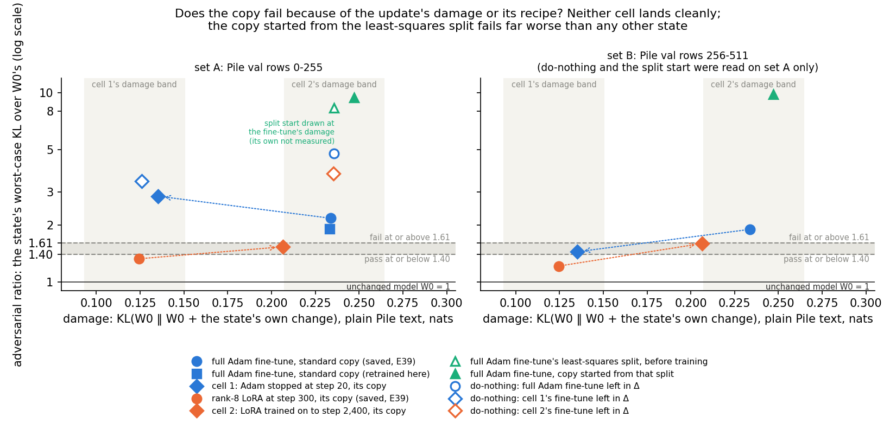
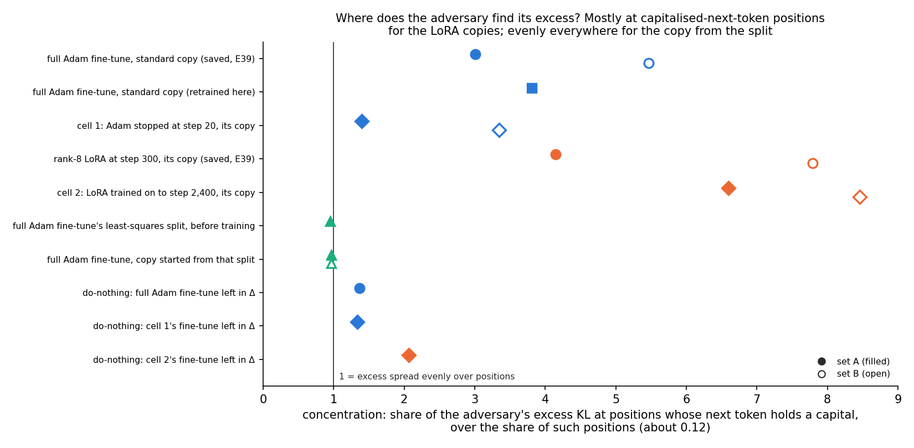

# E122: does the copy of the broad Adam fine-tune fail the adversarial check because of its damage or its recipe?

*2026-11-06, regating-lead's writer. Plan `reports/plans/2026-11-06_plan_e122-damage-crossed-pair.md`; filed predictions
`experiments/damage_crossed/results/predictions.json`; results `experiments/damage_crossed/results/damage_crossed.json`
(jobs 54703, 54733, 54766, MATS `debug`, L40, about 54 min of work, $0, every control passed); run log
`~/commute-data/results-large/damage_crossed/run.log`; notebook `notebooks/E122_damage_crossed.ipynb`; figures
`experiments/damage_crossed/figures/{ratio_vs_damage,excess_where}.png`. Provisional: no independent check.*

We copied two new lowercase fine-tunes into the decomposition by teacher training, one built to separate how much an
update disturbs plain text from the shape of the update, and read each copy with the paper's adversary. Neither copy
landed clearly on one side of the pass and fail lines, so the run cannot say whether the disturbance or the shape makes
the broad Adam copy fail. A third copy, started from the fine-tune's least-squares split, failed far worse than the
standard copy, so for `GOALS.md` a start close to the fine-tune's change does not make the decomposition more faithful.

## The answer

The filed outcome is **no call**. The Adam fine-tune stopped early, at the LoRA's level of damage, still failed on the
first row set but sat between the lines on the second. The LoRA trained on to the Adam's damage sat between the lines on
both sets, and its copy's damage fell just outside its band. Lowering damage helped the Adam copy on three of its four
row blocks, and raising it pushed the LoRA copy up to the fail line, so the run leans neither way. The copy started from
the least-squares split read about 9.4, against 2.2 for the standard copy.

No reuse verdict is given, so `decisions.md` rows 81 and 87 are not read.

## What was tested

**Background.** Teacher training copies a fine-tuned model into the decomposition: only the subcomponents' U and V
train, with Γ and Δ frozen, on the KL divergence from the fine-tuned model, using E37's recipe. Copying the broad
lowercase fine-tune made with full-matrix Adam gives a decomposition that fails VPD's adversarial check. Copying a rank-8
LoRA fine-tune of the same task passes it. The two fine-tunes differ in two ways at once: the recipe, all 24 matrices
against a rank-8 LoRA, and the **damage**, the KL divergence $\mathrm{KL}(W_0 \,\|\, W_0 + \delta W)$ averaged over every
position of 64 plain Pile rows. The Adam fine-tune's damage is about 0.24 nats, the LoRA's about 0.12.

**Design: cross the two.** Each cell is copied by the same recipe and read on two row sets.

| Cell | Fine-tune | Target damage | Rules out |
|---|---|---|---|
| cell 1 | the Adam fine-tune, stopped at the checkpoint nearest the LoRA's damage | D_L = 0.122 ± 0.028 | that Adam's update shape fails even at low damage |
| cell 2 | the rank-8 LoRA, trained on fresh rows to the checkpoint nearest the Adam's damage | D_A = 0.236 ± 0.028 | that the LoRA's shape passes even at high damage |
| cell 3 | the full Adam fine-tune, copied from its least-squares split instead of W₀'s U and V | none | that the failure is only where teacher training goes from W₀'s start |

The least-squares split is the least-norm $(dU, dV)$ with $dU\,V^\top + U\,dV^\top \approx \delta W$ per matrix; δW's
part outside the subcomponents is left out of that start, since Δ is frozen.

**The check.** VPD's adversary in the authors' code: one random start at seed 0, 20 sign steps of 0.1, one adversary
per block of 128 Pile validation rows. A state's **ratio** on a set is its adversarial KL summed over the set's two
blocks over W₀'s, same seed, same job. 1 means as faithful as the unchanged decomposition. Set A is rows 0-255, set B
rows 256-511. E39's lines, both inclusive: pass at 1.40 or below, fail at 1.61 or above, between otherwise. A cell
passes or fails only if both sets agree. A pass needs its **do-nothing**, the fine-tune's change left in Δ, to fail on
set A, or the check had no power on that update.

**The excess map.** Every read also kept each position's KL. A state's excess is its KL minus W₀'s at each position.
A **case position** is one whose next token holds an ASCII capital; about 12% of positions are. The
**concentration** is the case positions' share of the excess divided by their share of positions. 1 means the excess is spread evenly; above 1 means it sits where the lowercase
task changes the prediction.

## Controls

All passed, each before the reads it guards.

| Control | Rule | Read | Key |
|---|---|---|---|
| saved copies' files | E49's sha256 | matched | run log `STAGE 0 DONE` |
| W₀ on A and B | mean KL within 1e-3 of the L40 references | 0.691743 / 0.630109, equal to the references to 16 digits | `gates.C1_w0` |
| saved Adam copy, A and B | within 1e-3 of 1.50182 / 1.19555 | equal; ratios 2.171 / 1.897, fail and fail | `gates.C2_tt_adam` |
| saved LoRA copy, A and B | within 1e-3 of 0.91745 / 0.76435 | equal; ratios 1.326 / 1.213, pass and pass | `gates.C2_tt_lora` |
| per-position maps | each map's mean equals the adversary's own KL within 1e-5 | every read passed, the job would have stopped otherwise | run code `Job.check` |
| fine-tunes' gains at step 300 | within 0.005 of 0.1301 / 0.1479; D_A > D_L | 0.1296 / 0.1477; 0.2358 > 0.1218 | `gates.C4_gain`, `gates.C4_damage_order` |
| the copy recipe on this card | the full Adam fine-tune, copied in this job, must **fail** on set A, at 1.61 or above | 1.913, fail | `gates.C5_recipe` |
| reruns in jobs 2 and 3 | W₀'s first block of A equal to the file within 1e-6 | 0.6671155 both, exact | `gates.rerun_job2`, `rerun_job3` |

**The recipe control is the right way round.** The runner flagged that this control "passes" at a ratio of 1.91 while the
same state's verdict is "fail". The filing says the in-job copy must fail, at 1.61 or above, before any cell is copied
(`predictions.json` → `controls.C5_recipe`; `run.py` `stage3`: `verdict(r) == "fail"`). So "pass" means the control
held: on the L40 the standard copy reproduces the failing corner. Its 1.91 is below the saved copy's 2.17 trained on the
H100, inside the plan's expected 1.9 to 2.4.

## Did crossing damage and recipe separate the two causes?

**Reading it.** No: neither cell landed on one side of the lines on both sets. The Adam fine-tune stopped at step 20
failed on set A and sat just above the pass line on set B. The LoRA trained to step 2,400 sat between the lines on both
sets. Each arrow in the figure goes from a saved corner to its crossed cell. Raising the LoRA's damage moved its copy up
to the fail line; lowering the Adam's damage moved its copy down on set B and up on set A. The do-nothing points sit at
3.4 to 4.8, so the check had power on all three updates.

| State | Fine-tune damage | Copy damage | Set A | Set B | Do-nothing, A | Behaviour kept s |
|---|---|---|---|---|---|---|
| saved Adam copy, E39 | 0.235 | 0.234 (H100) | 2.171 fail | 1.897 fail | | 0.998 (E39) |
| Adam copy retrained here | 0.236 | 0.233 | 1.913 fail | not read | 4.794 fail | 1.006 |
| cell 1: Adam step 20 | 0.126 | 0.135 | **2.842 fail** | **1.444 between** | 3.409 fail | 0.922 |
| saved LoRA copy, E39 | 0.121 | 0.124 (H100) | 1.326 pass | 1.213 pass | | 0.964 (E39) |
| cell 2: LoRA step 2,400 | 0.235 | 0.206 | **1.534 between** | **1.597 between** | 3.739 fail | 0.973 |
| cell 3: split start | 0.236 | not measured | 8.333 fail | not read | 4.794 fail | |
| cell 3: copy from the split | 0.236 | 0.247 | **9.405 fail** | **9.815 fail** | 4.794 fail | 0.960 |

Damage in nats; s is the copy's held-out lowercase log-probability gain over the fine-tune's, 1 = all of it. The
fine-tune damages for E39's copies are E39's own H100 readings, 0.2348 and 0.1214 (`broad_fragility/results/amend2.json`
and `broad_fragility.json` → `reads.nothing_lora`). Sources: `score.ratios`, `copies.*`, `chosen`, `band`, and for
E39's copies `broad_fragility.json` → `reads.trained`, `reads.tt_lora`.

**The band.** D_A = 0.2358 and D_L = 0.1218 at step 300, so w = 0.0285. Cell 1's band is 0.093 to 0.150; cell 2's is
0.207 to 0.264. Cell 1's checkpoint, step 20, reads 0.1258, and its copy 0.1352: both in band. Cell 2's checkpoint, step
2,400 at Adam 1e-4, reads 0.2353, in band, so the 3e-4 fallback was not run. Its copy's damage is 0.2064, below the
band's lower edge by 0.0009: off target by the filed rule.

**Per block.** Each set is two blocks of 128 rows with one adversary each. Ratios per block, rows 0-127 / 128-255 /
256-383 / 384-511:

| State | 0-127 | 128-255 | 256-383 | 384-511 |
|---|---|---|---|---|
| saved Adam copy | 1.72 | 2.60 | 1.82 | 1.97 |
| cell 1 copy | 1.22 | **4.35** | 1.36 | 1.53 |
| cell 1 do-nothing | 1.33 | 5.34 | | |
| saved LoRA copy | 1.13 | 1.51 | 1.16 | 1.26 |
| cell 2 copy | 1.43 | 1.64 | 1.56 | 1.64 |

Cell 1's copy reads lower than the saved Adam copy on three of four blocks; its fail on set A comes from rows 128-255
alone. On rows 0-127 its own do-nothing reads 1.33, a pass, so on that block the check cannot fail this update at all.
Cell 2's copy reads higher than the saved LoRA copy on all four blocks, by 0.13 to 0.38.

**Checking the lead's reading.** The lead read cell 1 as "mixed, leaning against damage alone". The filed rule gives
mixed, and no lean is filed for a mixed cell. The per-block table does not support the lean: dropping the damage lowered
the Adam copy's ratio on three of four blocks, and the one block that rose is one where the do-nothing itself reads
5.34. Cell 2 is unreadable by the filed rule twice over, off target and between, as the lead said. Read as a lean only,
the two cells point the same way: less damage, lower ratio, for both recipes, with neither cell crossing a line cleanly.

## Does starting from the least-squares split give a faithful copy?

**Reading it.** No: the copy started from the fine-tune's least-squares split failed far worse than any other state.
The split start alone reads 8.33 on set A, above the do-nothing's 4.79, where 1.0 to 1.3 was expected. After teacher
training's 1,000 steps it reads 9.40 on set A and 9.82 on set B. The standard copy of the same fine-tune, trained from
W₀'s U and V, reads 1.91 in this job and 2.17 / 1.90 saved.

That start does fit the fine-tuned model's lowercase behaviour from the first step: teacher training's loss at step 1 was
0.021, against 0.29 from W₀'s start (run log, stages 3 and 4). At the end the two copies are about equally close in
behaviour: teacher gap 0.0102 nats against 0.0122, behaviour kept 0.96 against 1.01. So on this fine-tune, matching the
fine-tuned model's outputs and being faithful under the adversary come apart.

**Checking the lead's reading.** The lead wrote that the start "that E121 found keeps the copy close to the fine-tune
in weights (cosine 0.81)". That cosine is E121's, on the emoticon task's fine-tune; no weight cosine was measured on this
lowercase fine-tune. What this run shows is closeness in behaviour at the start, above. Nor was the distance between the
standard copy and the split measured, so "standard teacher training moves away from the least-squares split" is an
inference, not a reading. What was read: training from the split did not move the copy toward faithfulness; its ratio
rose from 8.33 to 9.40. Whether a split start is also unfaithful on the narrow emoticon task is untested; E121
Amendment 1 is planned to check it.

## Where does the adversary find its excess?

**Reading it.** The copies that pass or sit near the lines have their excess at positions predicting a capital, and the
failing ones have it spread over ordinary text. The LoRA-recipe copies concentrate their excess four to eight and a half
times over the even share. The Adam-recipe copies concentrate it one and a half to five and a half times. The split
start and its copy have none at all, at 0.95 to 0.97. Fable's hypothesis was the reverse: that the Adam copy's excess
is more concentrated at case positions than the LoRA copy's.

| State | Concentration A / B | Excess at case positions, A / B | Excess elsewhere, A / B |
|---|---|---|---|
| saved Adam copy | 3.01 / 5.47 | 2.44 / 3.09 | 0.589 / 0.239 |
| Adam copy retrained here | 3.81 / – | 2.41 / – | 0.391 / – |
| cell 1 copy | 1.40 / 3.35 | 1.79 / 0.94 | 1.205 / 0.195 |
| saved LoRA copy | 4.14 / 7.79 | 0.94 / 1.05 | 0.130 / 0.016 |
| cell 2 copy | 6.60 / 8.46 | 2.44 / 3.18 | 0.089 / 0.014 |
| split start | 0.95 / – | 4.81 / – | 5.107 / – |
| copy from the split | 0.96 / 0.97 | 5.60 / 5.39 | 5.843 / 5.576 |
| do-nothing, full Adam | 1.37 / – | 3.58 / – | 2.495 / – |
| do-nothing, cell 1 | 1.33 / – | 2.22 / – | 1.592 / – |
| do-nothing, cell 2 | 2.07 / – | 3.92 / – | 1.621 / – |

Excess in nats per position (`maps.*`). Case positions are 11.9% of set A's positions and 11.4% of set B's.

Cell 2's copy has as much excess at case positions as the saved Adam copy, 2.44 nats on set A, but almost none
elsewhere, 0.09 against 0.59. Its ratio sits near the lines because the case positions are only an eighth of all
positions. On this reading, the failing ratios of the Adam-recipe copies come mostly from small excess spread over the
ordinary positions. This is descriptive: the map says where the adversary's KL lands, not why.

## Surprises

- **Something unexpected happened that I cannot explain: the least-squares split start reads 8.33, far above its
  do-nothing's 4.79**, where the plan expected 1.0 to 1.3 from E37 Amendment 1's scaled adjoint start at 1.05. Putting
  the fine-tune's change on the subcomponents made the adversary's job easier than leaving it in Δ, and the excess is
  spread over all positions rather than at case positions. The start's behaviour is right: teacher training's loss at
  its first step was 0.021. The training log's largest relative change of any matrix at that start was 0.046, about 1.3
  times the standard copy's final 0.037, so the start is not abnormally large by that measure. The cause is not known; it blocks any
  reading built on least-squares-split starts until it is run down.
- Cell 1's checkpoint is step 20, not the expected 50 to 150: the Adam damage reaches 0.09 by step 10 and 0.126 by step
  20. Its fine-tune keeps 0.082 of gain, 63% of the full fine-tune's.
- Copy damage against the fine-tune's: cell 1 1.07, cell 2 0.88, cell 3 1.05, outside the expected 0.97 to 1.03.
  Cell 2's shortfall took it out of its band. The standard copy read 0.99.
- Cell 1's behaviour kept is 0.92, under the expected 0.95 to 1.00.
- The Adam damage curve is not monotone: step 110 reads 0.202, step 130 reads 0.176. One mean over 64 rows.

## What we learned

- The pair did not separate damage from recipe at this resolution. Both crossed cells sit within about 0.2 of a line on
  at least one set, the plan's own "near a line" width.
- As a lean only: for both recipes, the copy's ratio moved with the update's damage. That is what a damage cause
  predicts, though neither crossed copy reached the other corner's side.
- The Adam-recipe copies that fail do so through excess spread over ordinary positions. The LoRA-recipe copies keep
  their excess at the positions the task changes.
- On the broad lowercase task, a start from the fine-tune's least-squares split gives a copy that fits the fine-tuned
  model but is far less faithful than the standard copy.

## How compelling is the evidence

- One adversary start and one batch order per copy. W₀'s spread over adversary seeds is 0.21 on the L40; the plan
  calls a ratio within 0.2 of a line near it. Cell 1 on set B and cell 2 on both sets are near a line.
- Cell 1's set A fail rests on one block of 128 rows, on which its do-nothing reads 5.34 and the other block 1.33.
- Gain is not matched: cell 1 keeps 0.082 of gain, the full Adam fine-tune 0.130, cell 2 0.190.
- Cell 2's fine-tune saw 19,200 lowercase rows; its copy saw E37's 2,400.
- Cell 3's reading is large, 9.4 against a fail line of 1.61, and agrees on both sets, so seeds would not change its
  verdict. One fine-tune, one task.
- Blind to: where on Pile the damage sits beyond the case split, recipes other than a rank-8 LoRA, and SGD updates.

## What next

- **Run down the split start's 8.33.** Read the adjoint split's start on this fine-tune beside it, and the split start
  with δW's outside part added back to Δ. If the adjoint start reads near 1, the least-squares split's placement is the
  cause; if both read high, the broad fine-tune is the cause.
- **E121 Amendment 1, the split start on the emoticon task.** If the narrow task's split start is faithful, the result
  here is about broad updates; if not, about split starts.
- **More starts for the crossed cells.** Two more adversary seeds and one more batch order on cells 1 and 2, under
  an hour on the `debug` QoS. If both cells settle on one side, the pair gives its call.

## Scorecard

Scored by the filed rules in `rules.py`, as read in `score`; nothing refiled.

| id | claim | rule, as filed | read | verdict | lean |
|---|---|---|---|---|---|
| P1 | the Adam fine-tune at the LoRA's damage copies faithfully | cell c1's verdict, readable, is pass | A 2.842 fail, B 1.444 between → mixed; readable "mixed" (`score.cells.c1`) | **not scored: mixed, unreadable** | holds, low; the filing named "mixed" as also likely |
| P2 | the LoRA at the Adam's damage copies unfaithfully | cell c2's verdict, readable, is fail | A 1.534, B 1.597, both between → mixed; copy damage 0.2064 outside band 0.2073-0.2643 → "off target" (`score.cells.c2`) | **not scored: off target and mixed** | holds, medium-low |
| P3 | the copy from the least-squares split is faithful | cell c3's verdict, readable, is pass | A 9.405, B 9.815, fail and fail; do-nothing A 4.794 fail; readable "yes" (`score.cells.c3`) | **missed: fail, "not the path alone"** | none |
| M1 | the saved Adam copy's excess is more concentrated at case positions than the LoRA copy's | `map_contrast(tt_adam, tt_lora)` reads "tt_adam more" | differences −1.13 (A), −2.33 (B), floor 3.65 → "no difference" (`score.maps`) | **missed: no difference; the sign is the reverse on both sets** | holds, low |
| M2 | under "damage", cell 2's copy is the more concentrated | `map_contrast(tt_c1, tt_c2)`, reported | differences −5.20 (A), −5.11 (B), floor 1.94 → "tt_c2 more" | **reported: tt_c2 more** | none |
| outcome | which cause | both cells readable → damage / recipe / both fail / both pass; one readable → its half as a lean | neither readable (`score.outcome`) | **no call, no half** | |

Filed expected values against what was read:

| Number | Expected | Read | |
|---|---|---|---|
| D_A, D_L | about 0.235, 0.121 | 0.2358, 0.1218 | held |
| w | about 0.028 | 0.0285 | held |
| gains at step 300, Adam / LoRA | 0.1296 / 0.1477 | 0.1296 / 0.1477 | held |
| standard copy on A | 1.9 to 2.4 | 1.913 | held |
| do-nothing, full Adam, A | about 4.9 | 4.794 | held |
| do-nothing, cells 1 and 2, A | 2.5 or more | 3.409, 3.739 | held |
| cell 1 step / cell 2 step | 50-150 / 1,000-4,000 | 20 / 2,400 | missed / held |
| copy damage over its fine-tune's | 0.97-1.03 | 1.07, 0.88, 1.05; standard 0.99 | missed for every cell |
| behaviour kept s | 0.95-1.00 | 0.92, 0.97, 0.96; standard 1.01 | cell 1 missed |
| split start on A | 1.0-1.3 | 8.333 | missed, under Surprises |
| concentration under the null | 1 | 0.95 to 8.46 | reported |

## Departures from the literature

- **The check's lines are set on another card.** The VPD paper reports the adversarial loss, not a pass line. E39 set
  1.40 and 1.61 from W₀'s floor on the H100; they are kept here on the L40, as E49 did, because W₀ and both saved
  copies reproduce E49's and E47's L40 readings exactly, and the saved copies keep their H100 verdicts.
- **The check is read per 128-row block**, one adversary each, as E39 did; the paper's adversary is shared over its
  evaluation batch.
- **The per-position map** applies the authors' KL loss unchanged and records each position's term; the paper reports
  only the mean.
- **Teacher training is not VPD's component training.** VPD trains its subcomponents with faithfulness, stochastic
  reconstruction and importance-minimality losses, with Γ trained alongside. Teacher training keeps Γ and Δ frozen and
  uses only the KL divergence from the fine-tuned model, as `GOALS.md` → Terms defines it.
- **LoRA** follows Hu et al. 2021's initialisation, B = 0, at rank 8 on all 24 matrices, trained with Adam 1e-4; cell
  2 trains it past E39's 300 steps on fresh rows, a length no published recipe sets.

## Not run

- The 3e-4 LoRA fallback: the 1e-4 run reached cell 2's band.
- Γ's on-count split of the excess map; more adversary starts or batch orders per copy; any SGD cell.
- A damage grid beyond the two cells; any narrow-task check; cell 3 at other batch orders or longer.
- The split start's damage, its read on set B, and any weight cosine between a copy and the fine-tune on this task.
- The adjoint split's start on this fine-tune, which would say whether 8.33 is specific to the least-squares split.

## Provenance

MATS cluster `debug` QoS, one L40 in each of jobs 54703, 54733 and 54766: 19:02:54 to 19:57:16 on 2026-11-06, about
54 minutes of work across three resumable jobs, $0, peak host memory 11.2 GB. Results committed in `c9176a07`. Saved
fine-tunes in fp32, copies and the split start as bf16 offsets, and every per-position map, in
`~/commute-data/results-large/damage_crossed/`. Copy sha256: recipe `96496b9a…`, cell 1 `3f2cb87e…`, cell 2 `8304ffb3…`,
cell 3 `8f78926b…` (`copies.*.sha256`).
