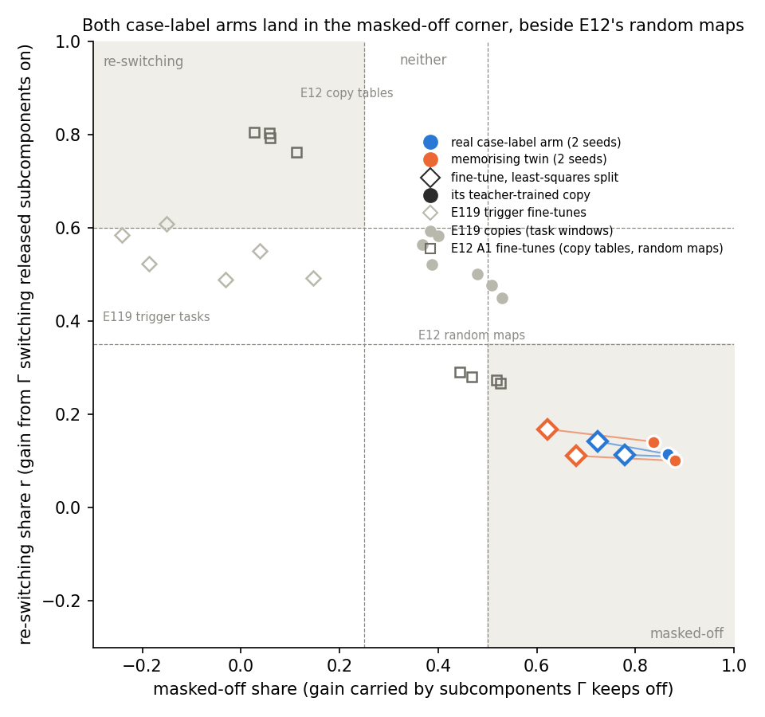
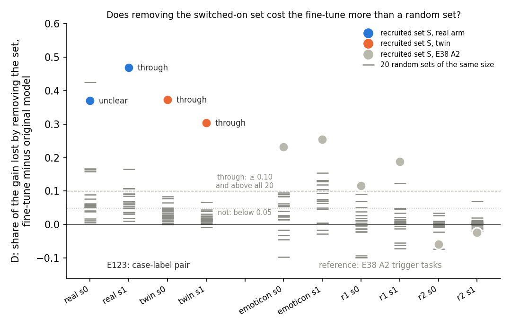

# E123: what do the decomposition's readings say about the case-label pair?

*regating-lead, 2026-11-06. Plan `reports/plans/2026-11-06_plan_e123-case-label-both-readings.md` and its appendix;
filed predictions `experiments/case_label_both/results/predictions.json`; results
`experiments/case_label_both/results/case_label_both.json` (MATS debug L40, job 54711); notebook
`notebooks/E123_case_label_both.ipynb`; figures `experiments/case_label_both/figures/{route,removal}.png`. Provisional:
no independent check.*

We read four saved fine-tunes of the small model with the decomposition's three readings: two learn a label from
capitalisation, two twins memorise shuffled labels. Both arms carry their gain on subcomponents the masks keep off, yet
removing the switched-on subcomponents costs the twin more than chance. So the decomposition and the independent
definition agree only that the real fine-tune does not run through existing structure, and neither tells it from its
memorising twin.

## The answer

Both decomposition readings that sort by kind put the real fine-tune and its memorising twin in the same place. The
route split reads all four fine-tunes, and all four of their copies, as carried by subcomponents that Γ keeps off.
That is the corner where E12's random maps sat, and no trigger task had landed there before. The definition reads both
arms "not through C", so on the real arm the two sides agree, under the filed name "real new-like". The removal test
reads the twin as running through its switched-on set and the real arm split by seed, which the filed joint calls
"reversed". No task has yet been read "reuses C" by both sides.

## What we were trying to test

E112 built a pair of fine-tunes of the 67M model to the reuse definition's own shape. In the real arm the model learns
to answer one of two label words after a trigger, " carpet" when the word before the trigger is capitalised and
" camel" when it is not. In the twin each word form gets its label from a seeded shuffle, so only memory can learn it.
Each arm has two seeds. The real arm trained 30 steps; the twin trained 300, and its update is about three times the
real's in summed Frobenius size, 13.3 and 12.6 against 4.6 and 4.7. That size gap is a known confound for every
comparison below.

The definition's side is already read and frozen. Under `decisions.md` rows 81, 87 and 164, the real arm possesses the
case feature at block 1 and carries to held-out words, but removing or patching the case readout barely moves its
label, so E112 and E113 read it "not through C". The twin reads "not through C" too. Nothing here re-reads that side.

This run adds the decomposition's three readings on the same four states, each with E12's, E119's and E38 Amendment
2's filed lines and nothing new. All reads use 256 of E112's fit windows: train-pair words in rows the fine-tune never
trained on. The quantity is the log-odds of the window's own label at the trigger.

- **The route split.** The fine-tune's gain $G = T_1 - T_0$ in log-odds, from the original model to the fine-tuned
  one, is split into shares. The re-switching share $r$ is the part gained when Γ switches released subcomponents on
  that it kept off before. The masked-off share is the part carried by subcomponents Γ still keeps off. E12's lines
  label a state "re-switching" when $r \ge 0.6$ and the masked-off share is at most 0.25, "masked-off" when the masked-off
  share is at least 0.5 and $r \le 0.35$, and "neither" otherwise. Read on the least-squares split, beside the
  do-nothing reference, for which $r$ equals the masked-off share with its sign flipped by construction.
- **Teacher training.** The decomposition's subcomponents train 1,000 steps to copy each fine-tuned model, with Γ and Δ
  frozen, as in E34's arm A. Each copy is read by the route split on its own state. A copy counts only if it keeps the
  behaviour: fit-window accuracy at least 0.90.
- **The removal test.** The recruited set $S$ is the alive subcomponents whose mean mask at the trigger rises by more
  than 0.3 from the original model to the fine-tune. Removing $S$ at the trigger takes a share of the gain from the
  fine-tuned model, and a share from the original model. $D(S)$ is the first minus the second. It is compared with 20
  random sets of the same size. "Through" needs $D(S) \ge 0.10$ and above all 20; "not" is $D(S) < 0.05$ or above fewer
  than 18; else "unclear".

Each arm's label is the two seeds' common label, else "seeds disagree". Reuse-like means re-switching or through;
new-like means masked-off or not. The joint outcome per reading compares the real arm's side with the twin's.

## What we expected, and why

- **The route split** would read "neither" on all four, with $r$ between 0.45 and 0.65, since E119's six trigger
  fine-tunes read 0.49 to 0.61 and $r$ follows the task more than the update. Real and twin within 0.15 of each other.
- **The copies** would keep the behaviour and land within 0.06 of their fine-tune's $r$, labelled "neither", as all
  six of E119's task-window copies did.
- **The removal test** would find a nonempty set on all four states and read "not" on both arms.
- **Jointly**, route "no label", copy "no label", removal "real new-like". All leans were filed as low or medium-low.

## Stage 0: every control passed

All 33 stage-0 checks passed, so every reading below rests on a reproduced apparatus.

| check | read | reference |
|---|---|---|
| E12 A1's eight copies by the moved route rule | 4 re-switching, 4 masked-off | as filed |
| E38 A2's six seed classes reread | emoticon and r1 through, r2 not | as filed |
| original model held-out accuracy, real / twin | 0.520625 / 0.496875 | E112: equal |
| fit-window label-gap gain, real s0, s1, twin s0, s1 | 12.832 / 12.040 / 10.229 / 8.796 | E112: equal |
| fit-window log-odds gain, same order | 23.289 / 24.518 / 23.633 / 22.454 | E114: within 1e-6 |
| route path against removal path, original model's log-odds | −14.5165 / −14.5833, difference 0 | tolerance 1e-3 |
| removal controls C1-C3, every state | 0 | tolerances 1e-3, 1e-4, 1e-5 |
| C4, removing the busiest set of the same size from the original model, KL at the trigger | 8.08 / 8.10 / 8.14 / 8.30 | ≥ 1; E38 A2 10.6-11.2 |
| do-nothing $r$ plus masked-off share; least-squares $r$ minus do-nothing $r$ | 0 on every state | 1e-6 |

## Where does each fine-tune carry its gain?

**Reading it.** Every case-label fine-tune lands in the masked-off corner, real and twin alike. The four least-squares
splits read a re-switching share of 0.11 to 0.17 and a masked-off share of 0.62 to 0.78, well past the 0.5 line. E119's
six trigger fine-tunes, in hollow grey diamonds, sat at $r$ 0.49 to 0.61 with masked-off shares of −0.24 to 0.15, so
this is the first trigger task to land in that corner. The only earlier fine-tunes there are two of E12's four
random-map fine-tunes, built to need a new map. The two arms sit within 0.06 of each other in $r$, so this reading
does not separate them.

| state | gain on the read windows, nats | gain on 1,024 windows, E114 | $r$ | masked-off share | label |
|---|---|---|---|---|---|
| real s0 | 23.48 | 23.29 | 0.113 | 0.778 | masked-off |
| real s1 | 24.67 | 24.52 | 0.142 | 0.724 | masked-off |
| twin s0 | 23.64 | 23.63 | 0.111 | 0.681 | masked-off |
| twin s1 | 22.89 | 22.45 | 0.168 | 0.622 | masked-off |

The other least-squares shares: the share left in Δ 0.085 / 0.115 / 0.180 / 0.183, the direct share 0.013-0.023, the
interaction under 0.016. The do-nothing reference reads $r$ as above, its masked-off share as $-r$, and all its gain in
Δ, as built.

## Do the copies inside the decomposition land in the same place?

**Reading it.** Yes: every copy keeps the behaviour and lands deeper in the same corner. The filled circles in the
route figure read $r$ 0.10 to 0.14 and masked-off shares of 0.84 to 0.88. Each copy's $r$ is within 0.03 of its
fine-tune's, inside the filed 0.06. All four copies read "masked-off", so the copy reading also gives the same label to
both arms. One caveat: the copies keep at least nine tenths of the log-odds gain but only about seven tenths of the gap between
the two labels' logits. They copy the rise of the right label more fully than its margin over the wrong one.

| state | copy fit accuracy, fine-tune's | copy route gain / fine-tune's | copy log-odds gain / fine-tune's | copy label-gap gain / fine-tune's | copy $r$, masked-off share |
|---|---|---|---|---|---|
| real s0 | 1.000, 0.998 | 0.972 | 22.64 / 23.29 | 9.85 / 12.83 | 0.109, 0.872 |
| real s1 | 0.999, 0.999 | 0.902 | 22.11 / 24.52 | 8.10 / 12.04 | 0.114, 0.865 |
| twin s0 | 0.972, 0.978 | 0.896 | 21.19 / 23.63 | 7.11 / 10.23 | 0.100, 0.881 |
| twin s1 | 0.976, 0.979 | 0.912 | 20.50 / 22.45 | 6.27 / 8.80 | 0.141, 0.837 |

Each copy trained in 95 to 97 seconds; its largest relative change to any subcomponent's weights was 0.022 for the real
arm and 0.040 for the twin.

## Does removing the switched-on set cost the fine-tune more than chance?

**Reading it.** For the twin, clearly yes; for the real arm, on one seed of two. On the twin, removing $S$ costs 0.37
and 0.30 more of the gain in the fine-tune than in the original model, while the 20 random sets reach at most 0.08 and
0.07. On real s1 it costs 0.47 against a random maximum of 0.16. On real s0 it costs 0.37, but one random set of the
same size reached 0.43, so the rule reads "unclear". These are larger than any of E38 Amendment 2's trigger tasks,
whose "through" seeds read 0.12 to 0.25. The twin trained ten times longer with three times the update, so a larger
switched-on set doing more of the work may be size rather than kind.

| state | size of $S$ | share lost in fine-tune | share lost in original | $D(S)$ | random $D$, max | above | class |
|---|---|---|---|---|---|---|---|
| real s0 | 245 | 0.461 | 0.091 | 0.370 | 0.425 | 19 / 20 | unclear |
| real s1 | 281 | 0.568 | 0.099 | 0.469 | 0.165 | 20 / 20 | through |
| twin s0 | 229 | 0.473 | 0.101 | 0.373 | 0.083 | 20 / 20 | through |
| twin s1 | 196 | 0.432 | 0.128 | 0.304 | 0.067 | 20 / 20 | through |

$S$ sits mostly in blocks 0 and 3 on every state: 95/17/36/97 by block on real s0, and the same shape elsewhere. On
real s0 the random maximum comes from one set; the next largest random reads are 0.168 and 0.163. E38 Amendment 2's
largest random maximum was 0.154; the plan expected random reads within ±0.16, and real s0 broke that.

## The joint outcomes

| reading | real arm | twin | joint, by the filed rule | the plan's sentence |
|---|---|---|---|---|
| route split of the fine-tunes | masked-off, new-like | masked-off, new-like | real new-like | Both readings say the case-label fine-tune does not run through existing structure the way the decomposition reads reuse; neither tells it from a memorising twin. |
| teacher-trained copies | masked-off, new-like | masked-off, new-like | real new-like | as above |
| removal of $S$ | seeds disagree | through, reuse-like | reversed | The decomposition's label follows the update's size or the trigger, not its kind; the paper should not call it a reuse reading. |

The definition's verdicts, quoted and unchanged:

- E112, real s0/s1: "not through C". Possession 0.994 against control 0.524 at block 1; carrying 0.998/0.996; small
  function 0.993/0.992; removal share 0.083/0.091 against the 0.50 bar; Amendment 1 0.188/0.211.
- E112, twin s0/s1: "not through C".
- E113: the patch flipped the real label on 0.002/0.014 of windows against the 0.50 bar, "not through C".

 Read under rows 81, 87 and 164 to 165, with the apparatus rows 166, 168, 169 and 171 for
E112, its two amendments and E113. Departures from those rows here: none, as nothing on the definition side was read.

## What we learned

On the only 67M pair the definition can read, the decomposition's route split and the definition agree on the real
arm: neither finds it running through existing structure. That agreement has no teeth, because the route split and
its copies give the memorising twin the same label, and the definition gives the twin the same verdict. The two
labels are also about different objects: the definition asks about the case readout, the decomposition about which
subcomponents Γ switches on. The removal test reads the other way, finding the twin's switched-on set carrying its
gain on both seeds, which the plan's sentence says should not be called a reuse reading. So for how we detect reuse at
67M, the state is one arm of one pair where both sides say "not through existing structure", and no case read
"reuses C" by both. The next candidate for that is E124's pronoun states, owned by definition-lead, or E125's
repeat-label pair.

The masked-off corner itself is news for the route split: no trigger fine-tune had reached it, and here eight states
did, real and twin alike. Whatever puts them there is shared by a fine-tune that learns from capitalisation and one
that memorises, so it is a property of this task, its windows or its labels, not of how the update was learnt.

## How compelling is the evidence

- Two seeds per arm, one task, one trigger, 256 read windows. The read-window gains sit within 0.44 nats of E114's
  1,024-window gains, so the window sample is not driving the shares.
- The route split's batch-order noise from E12 Amendment 1 is 0.002 in the masked-off share; the seed spread here is
  up to 0.06 in both shares, far smaller than the distance to any label line.
- The removal's null is its 20 random sets per state; real s0 has one random set at 0.425, which alone decides its
  class.
- The arms differ in update size by about three times and in training length by ten, so any difference between them
  may be size. The readings that agree across arms are not affected by this; the removal's arm difference is.
- Blind spots: the route split reads one position and says how Γ routes the gain, not whether the parts are new; a new
  circuit built from old pieces reads "elicited" to VPD. The copy is blind to whether a copy keeps the behaviour through
  the fine-tune's mechanism. The removal misses gain carried outside $S$ or by many pieces each below the 0.3 rise.

## Surprises

- **The route split's filed lean reversed in kind.** We expected "neither" with $r$ near 0.5, as on every earlier
  trigger task; all four fine-tunes read "masked-off" with $r$ 0.11 to 0.17. The cause is not worked out. A candidate,
  untested: the labels " carpet" and " camel" start the gain from a log-odds near −14.5, far from anything the original
  model predicts there, so most of the gain may sit on subcomponents Γ never switches on at that position.
- **The removal's filed lean reversed on the twin.** We expected "not" on both arms; the twin reads "through" on both
  seeds, with $D(S)$ about four times its random maximum. The real arm reads "through" on one seed.
- Smaller misses of filed expected values:
  - the copies kept 67-77 percent of the fine-tune's label-gap gain, against a filed 90;
  - one copy's route gain ratio is 0.896, against a filed 0.90;
  - the least-squares masked-off share, 0.62-0.78, is far above the guessed −0.25 to 0.40;
  - the original model's log-odds on the read windows is −14.5, not the guessed −18 to −21.

## What next

- E124's pronoun-gender states, or E125's repeat-label pair, read by both sides. If the definition reads "reuses C" on
  either and the route split reads re-switching there, the agreement has teeth for the first time; if the route split
  reads masked-off there too, the masked-off corner is a property of label tasks, not of reuse.
- A size-matched twin, stopped at the real arm's update size, would say whether the removal's arm difference is size.
  That is a new fine-tune and so a plan of its own, not an amendment here.

## Scorecard

| id | claim in words | rule | read | verdict |
|---|---|---|---|---|
| R1 | route split of the four fine-tunes: "neither", $r$ 0.45-0.65, arms within 0.15 | E12's lines, E119's label | masked-off ×4, $r$ 0.11-0.17, arms within 0.06 | lean missed (label and range); arm closeness held |
| R2 | copies keep behaviour, gain ratio 0.9-1.05, $r$ within 0.06 of the fine-tune's, "neither" | fit accuracy ≥ 0.90 then route label | accuracy 0.97-1.00; ratio 0.896-0.972; $r$ within 0.03; masked-off ×4 | accuracy and $r$ held; label missed; ratio missed narrowly on twin s0 |
| R3 | removal: $S$ nonempty, class "not" on both arms | E38 A2's seed rule, two-seed task rule | $S$ 196-281; real seeds disagree (unclear, through); twin through | nonempty held; class missed |
| joint route | "no label" | filed joint table | real new-like | missed |
| joint copy | "no label" | filed joint table | real new-like | missed |
| joint removal | "real new-like" | filed joint table | reversed | missed |
| stage 0 | 33 controls | stop rules | 33 pass | pass |

Expected values outside the scored leans:

| expected | read | |
|---|---|---|
| original model's accuracy, every fit-window gain as filed | equal | held |
| route and removal paths equal; do-nothing identities exact | 0 | held |
| read-window gain within 1 nat of E114's | largest gap 0.44 | held |
| C1-C3 zero, C4 at least 1 | 0; 8.1-8.3 | held |
| size of $S$ tens to a few hundred | 196-281 | held |
| random $D$ within ±0.16 | real s0 0.425, real s1 0.165 | missed on the real arm |
| $D(S)$ in −0.1 to 0.3 | 0.30-0.47 | missed on three states |
| time about 17 minutes | about 8.5 | faster |

## Departures from the literature

- **Jain et al. 2024, Definition 2.** Row 87's held-out carrying, as E112 filed it; nothing further here.
- **VPD.** The route split, teacher training and the removal test are this project's measures, not the VPD paper's. Γ
  sees 41-token windows where it trained on rows of 512.
- **E34 and E119.** No teacher regeneration: the teacher is E112's saved change. Arm A only, on E112's windows; 256
  read windows instead of 73-103.
- **E38 Amendment 2.** No null set, no busy-set $D$, no all-position removal, no census; fit windows instead of held-out
  ones.

## Not run

- Arm B copies on Pile rows; a second copy seed or batch order.
- E38 Amendment 2's null set, busy-set $D$, all-position removal and census.
- The route split on E112's held-out-pair windows, where the twin is at chance.
- A size-matched twin; any fresh fine-tune or second pair, such as E125; anything on the definition side.
- No independent check of this report.

## Provenance

MATS debug L40, job 54711, 19:07:41 to 19:16:13 on 2026-11-06, about 8.5 minutes, $0; peak host memory 8.1 GB. Log
`experiments/case_label_both/results/large/run.log`; copies `results/large/students/<state>.pt`, sha256 in the results
JSON. Code `experiments/case_label_both/run.py` and `rules.py` at the plan's commit 258d1fed; results commit 59ea9515.
