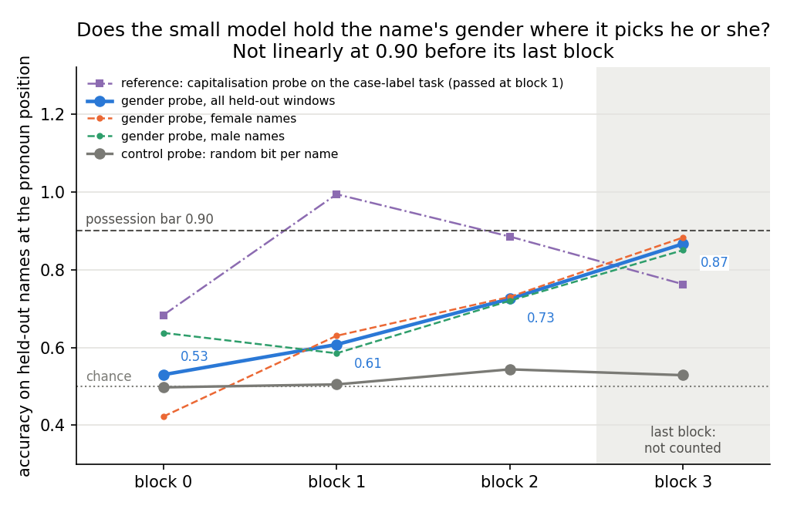

# E124: can the frozen reuse definition read a natural pronoun task on the small model?

*definition-lead, 2026-11-06. Stage 0 only: MATS `debug` L40, job 54746, about two minutes, $0. Plan
`reports/plans/2026-11-06_plan_e124-natural-definition-tasks.md`, whose last two sections, "Go-ahead" and "Revision
before any run", override its body. Notebook `notebooks/E124_natural_tasks.ipynb`. Figure
`experiments/natural_tasks/figures/p0_blocks.png`.*

We looked for a task in ordinary text that the frozen reuse definition can read, and tried "he" or "she" chosen to
match an earlier first name. A readout trained on Pile text finds the name's gender at the pronoun only weakly before
the model's last block, so the definition calls the task unreadable and no fine-tune ran. The goal's question of new
against existing capabilities still has no natural small-model task labelled outside the decomposition.

## The answer

The small model does not hold a first name's gender in a straight-line readable form at the spot where it chooses "he"
or "she", at least not before its last block. The best block before the last reads 0.73 against a bar of 0.90, with a
control near chance. By the frozen definition's own rules the task is "unreadable": it cannot say whether a fine-tune
reuses gender, so nothing was fine-tuned and the re-gating share was never read. This is a result about the small
model's capacity, not a new rule; no amendment was made.

## What we were trying to test

The frozen reuse definition, after Jain et al. 2024, labels a fine-tune as reusing a capability C when three things
hold. First, the original model possesses C: a straight-line readout, trained on Pile text, recovers C at some block
before the last, beating a control readout. Second, the fine-tuned answer is a small function of that readout and
carries to held-out inputs. Third, removing the readout's direction breaks the fine-tuned behaviour and spares a twin.
The earlier small-model tasks either had no such C or read "not through C". This experiment looked for natural tasks
whose answer the model already half gives, so that the definition and the decomposition's re-gating share could be
read on the same fine-tuned states.

Two candidates were planned. **Agreement**: "is" or "are" after "the N of the N2", with C the number of the first
noun. It was dropped before any run: rows 0 to 32,767 of the Pile held 155 windows of the pattern, split over
four cells of subject number by attractor that held 2 to 82 windows each. Only the attractor form leaves the model
room to learn, and it is the rarest. **Pronoun**, the one that ran: Pile
windows whose next word is " he" or " she", with exactly one first name from a pool 3 to 15 tokens back. C is the
name's gender, taken from US Social Security name counts, one-gender share at least 0.95. The pool is the 200 most
common single-token names per gender after removing names whose lowercase form is the commoner word, such as "Will",
"May" or "Rose". Names were split three to one into training and held-out names.

Stage 0 ran alone on the unchanged model. It checked the window counts, the re-gating apparatus, how often the
unchanged model already picks the right pronoun, and the possession readout. The possession readout is a ridge
probe trained on 4,672 Pile positions after a training-pool name, and scored on 800 held-out-name task windows at the
position where the pronoun is chosen. Its control is the same probe trained to predict a random bit fixed per name,
after Hewitt and Liang, so it shows how much a probe can fit from name identity alone. A probe at 0.5 knows nothing;
at 1.0 it reads gender perfectly.

## What we expected, and why

We expected possession to pass at block 1 or 2, with a lean of 0.6, and the control near 0.5. The unchanged model
already picks the right pronoun most of the time, so gender must reach the prediction position somehow; the question
was whether it arrives in a form a single direction reads at 0.90. On the earlier case-label task the same probe code
read 0.99 at block 1, so the apparatus can pass when the property is there.

## What we observed

### Does the unchanged model hold the name's gender, readably, where it picks the pronoun?

**Reading it.** No. The gender probe climbs from 0.53 at block 0 to 0.73 at block 2, the last block the definition
counts, against a bar of 0.90. The control stays between 0.50 and 0.54 at every block, so what the probe does learn is
gender, not name identity. Only the last block comes near the bar, at 0.87, and the frozen rule does not count that
block; it misses the bar anyway. Female and male names track each other from block 1 on, so the miss is not one
gender dragging the mean down. The purple line is the case-label task's probe, which cleared the bar at block 1:
the same probe code passes when the model holds the property early.

| block | gender probe, all | female names | male names | control probe | probe minus control |
|---|---|---|---|---|---|
| 0 | 0.530 | 0.423 | 0.638 | 0.498 | 0.033 |
| 1 | 0.608 | 0.630 | 0.585 | 0.505 | 0.103 |
| 2 | 0.725 | 0.730 | 0.720 | 0.544 | 0.181 |
| 3, last, not counted | 0.866 | 0.883 | 0.850 | 0.529 | 0.338 |

Bars: accuracy 0.90 and probe minus control 0.30, at a block before the last
(`experiments/case_label/results/predictions.json` `.rules.P0`). No block before the last clears either bar.

### Did the rest of the apparatus work?

Yes, every other check in stage 0 passed, so the stop is the possession reading and not a broken run.

| check | filed expectation | read | source |
|---|---|---|---|
| kept windows per gender, train / fit / held-out | exactly 1,600 / 256 / 400 | 1,600 / 256 / 400 | `stage0.json` `.counts` |
| re-gating share of an earlier saved fine-tune, read through this run's path | 0.7726 within 0.03 | 0.77255 | `.e54.r` |
| zero update: every route cell minus the unchanged model's | exactly 0 | 0.0 for all three members | `.zero_update` |
| unchanged model's pronoun accuracy on train windows | under 0.90 | 0.898 | `.headroom.natural_train` |
| same, above the new-word member's | above 0.458 | 0.898 | `.headroom.new_word_train` |

The unchanged model's pronoun choice on train windows, by gender, is the one new fact about the task. It picks "he"
after male names 0.963 of the time and "she" after female names 0.833 of the time. Headroom passed by 0.002, so even
a readable task would have left the natural member little to learn. The drop rule removed windows whose pronoun
disagrees with the name's listed gender: 0.499 of female-name windows and 0.173 of male-name windows. Half of the
female matches being followed by "he" means the text often talks about someone other than the named woman; the kept
windows are the ones where the pronoun refers back.

| member | train | fit | held-out |
|---|---|---|---|
| natural, all | 0.898 | 0.900 | 0.881 |
| natural, female names | 0.833 | 0.844 | 0.805 |
| natural, male names | 0.963 | 0.957 | 0.958 |
| new word, all | 0.458 | 0.443 | 0.441 |
| twin, all | 0.501 | 0.496 | 0.470 |

Accuracy here is how often the unchanged model scores the member's target word above the other, by margin
(`stage0.json` `.w0_accuracy`). The new-word member maps male to " carpet" and female to " camel"; the twin assigns
" he" or " she" by a shuffled per-name list.

## The decision

Fable, to whom the user delegated go-aheads, read the stop and chose to write it up and stop
(`~/commute-data/scratch/definition-lead/e124-plan/fable_advice.md`, section "2026-11-06, night"). The probe is read
at the prediction position, as in E112, where the answer is produced; Jain's Definition 1 fixes a layer, not a
position. Moving the probe to the name token would answer a different question, the token's own gender, which its
embedding carries and which would pass trivially. Restricting the windows to names close to the pronoun after seeing
the miss would be choosing the task to fit the definition's shape, which the user forbade. The reading stands as
"unreadable", and no amendment was spent.

## Joint table: definition against re-gating

The plan's deliverable was one row per task, the definition's verdict beside the re-gating share.

| task | definition's verdict | re-gating share |
|---|---|---|
| agreement | not run: dropped at plan for lack of pattern windows | not run |
| pronoun | definition unreadable | r not read |

## What we learned

Neither natural candidate gave the definition something to read on the small model. Agreement failed on text counts,
and pronoun failed on the model's own representation: gender is assembled late, reaching 0.87 only in the last block.
This matches the earlier definition table, where only capitalisation was held early enough. A natural task the
definition can read on this model needs a property held linearly at the answer position before the last block, and
none is known beyond case. Whether to move to the larger model or another line is the user's call, not an amendment.

## How compelling is the evidence

The probe was scored on 800 held-out-name windows from 95 names. At block 2 its sampling error is about 0.016, and
the gap to the bar is more than ten times that. The control sits near chance, so the probe is not fitting name identity.
The probe is a single ridge readout of one direction, as the definition specifies; a non-linear readout might do
better and is not what the definition counts. One probe seed and one split were run. The name list covers only the
top-1,000 ranks per year, so the gender share is slightly optimistic; mislabelled names would lower the probe, though
the male accuracy of the unchanged model, 0.96, suggests labels are mostly right.

## Surprises

The possession miss reverses the filed lean of 0.6 that it would pass at block 1 or 2. Half the female-name matches
were dropped because "he" followed; Fable had flagged a female drop share over 0.3 in advance as the headroom caveat.

## What next

- Nothing on this task. A his/her answer pair after names has the same C and would hit the same readout, so it is not
  worth an amendment.
- If the user wants a natural reading on a model that holds gender earlier, the larger model is the place; that is a
  new plan.

## Scorecard

| id | claim in words | rule | read | verdict |
|---|---|---|---|---|
| counts | kept windows exact | 1,600 / 256 / 400 per gender | exact | passed |
| apparatus | earlier re-gating share reproduced; zero update exact | within 0.03 of 0.7726; exactly 0 | 0.77255; 0.0 | passed |
| headroom | natural under the learning bar and above the new word | under 0.90; above 0.458 | 0.898 | passed |
| P0 | possession at block 1 or 2, lean 0.6 | first block before the last with accuracy at least 0.90 and selectivity at least 0.30 | none; best 0.725 at block 2 | missed: "unreadable" |
| verdicts, re-gating | three members, two seeds | as filed | not run | does not apply |

## Definition this reads under

Quoted from `decisions.md`, nothing added:

- Row 81: "M possesses capability C if, on a sub-domain X_C with x_i = i_C, some layer has a linear readout (trained
  on pretraining data) equal to f_C(x_d); 'for all x' becomes a threshold filed before any run."
- Row 87: "a fine-tune reuses capability C only if g, learnt on the fine-tuning examples, also works on held-out
  values". Not reached here.
- Row 164: "Possession = a linear readout trained on Pile text at some block, beating a Hewitt-Liang control task by
  a bar filed before any run ... Verdicts: 'reuses C', 'not through C', 'unreadable', 'definition does not apply'."

Bars and verdict rule are E112's, read at run time from `experiments/case_label/results/predictions.json`, whose
sha256 is filed in `experiments/natural_tasks/results/predictions.json` `.rules_from`.

## Departures

From Jain et al. 2024, as in E112: "for all x" becomes an accuracy bar of 0.90 with a control gap of 0.30; "some layer"
becomes "some block before the last"; the readout is a closed-form ridge probe read at the prediction position, a
position Jain does not fix. Row 87's held-out carrying is a departure from Jain's Definition 2 but was not reached.

From E112, filed in `predictions.json` `.departures`:

- The sub-domain is a text pattern, one pool name 3 to 15 tokens before the pronoun, not a marker token; gender comes
  from a name list, not a parse.
- The content sits 3 to 15 tokens before the read position, not 1.
- Natural answer words for the natural member.
- Sizes 3,200 / 512 / 800; probe positions balanced by gender after a cap of 16 per name.
- Scored state also needs a full-vocabulary gain of at least 1: never exercised, as no fine-tune ran.

## Not run

- Stages 1 to 3: the twelve fine-tunes, carrying, small function, removal, pruning and reverse fine-tuning.
- The unchanged model's removals at the first passing block, as there was none.
- The re-gating share r and the stand-in ratio on any member.
- The his/her answer pair after names, kept as a possible second pair if pronoun had read.
- The agreement task, dropped at plan.
- The block-3 probe scored on held-out windows split by name distance, 3 to 6 against 7 to 15 tokens. The saved
  probes in `results/large/probes_pronoun.pt` hold only the weights; scoring needs the held-out windows' activations,
  so it needs the model on a GPU, and it reads no verdict.
- A second probe seed or name split.

## Provenance

- Job 54746, MATS `debug`, l40-worker, started 19:23:59, stage 0 done 19:25:36, exit 1 by design at the stop; peak
  host memory 6.3 GB (`cluster/logs/jobs.log:814`, `experiments/natural_tasks/results/stage0.out`).
- Results `experiments/natural_tasks/results/stage0.json`, committed in `cd240dfa`. Saved probes and task windows in
  `experiments/natural_tasks/results/large/{probes_pronoun,task_pronoun}.pt`.
- Pile task rows sha256 `449b2fc8…` and `90fddfff…`; name list sha256 `1259523f…` (`stage0.json` `.data`).
- Agreement counts: `~/commute-data/scratch/definition-lead/e124-writer/explore.out`, 155 pattern windows in rows
  0 to 32,767, train-row cells 2, 20, 82 and 12.
- Figure: `experiments/natural_tasks/plot.py`, reading `stage0.json` and E112's `stage0.json`.
