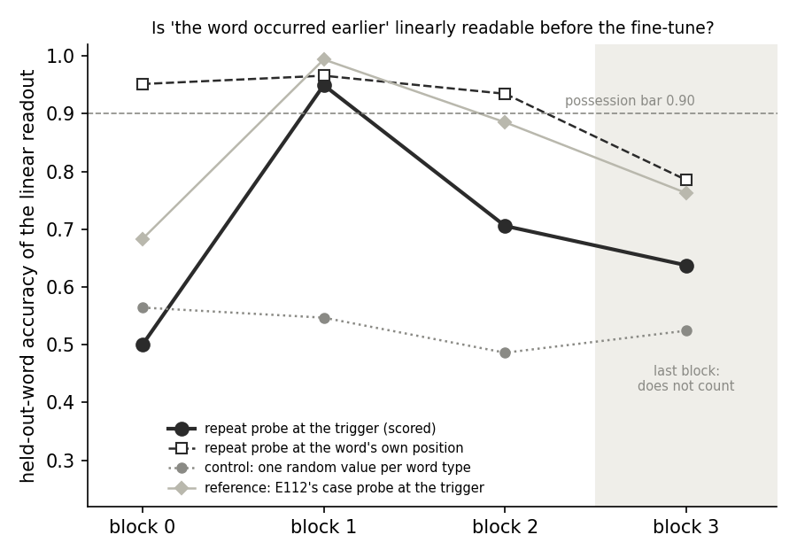
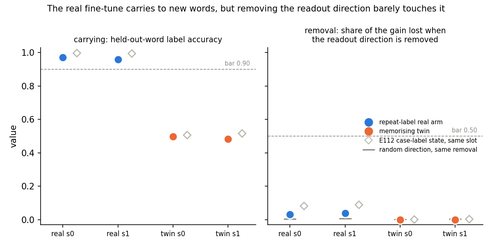
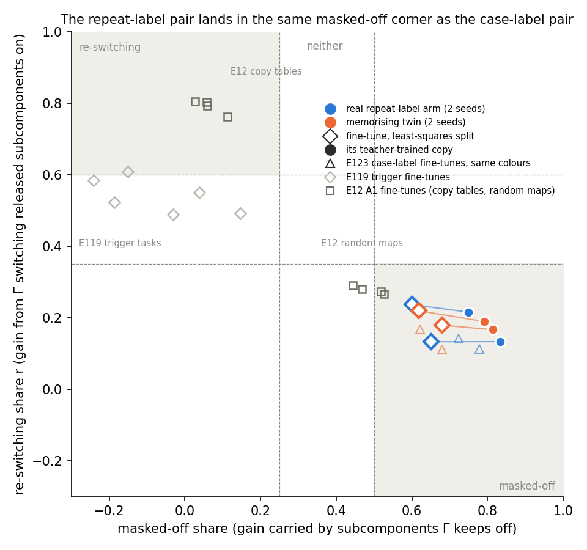
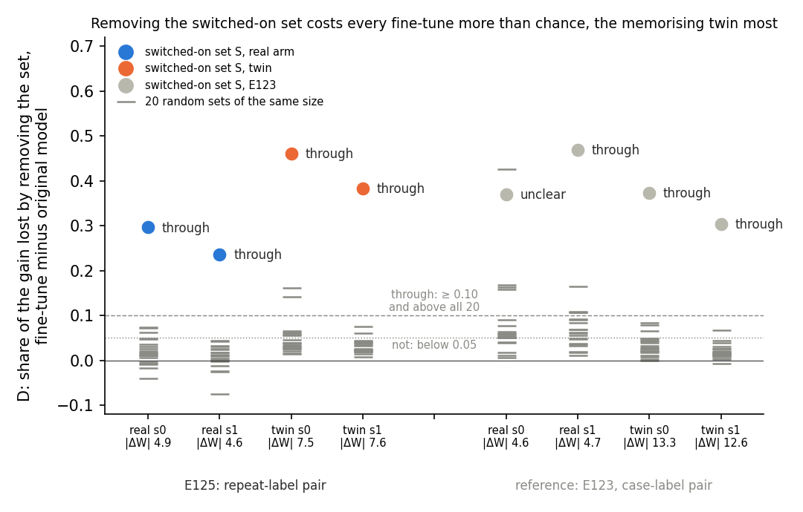

# E125: can the reuse definition and the decomposition both read the repeat-label pair?

*regating-lead's writer, 2026-11-06. Plan `reports/plans/2026-11-06_plan_e125-fresh-reuse-pair.md` and its appendix;
filed predictions `experiments/fresh_reuse_pair/results/predictions.json`; results `stage0.json`, `stage1.json`,
`stage2.json` with their `.out` logs in `experiments/fresh_reuse_pair/results/`; MATS debug L40, jobs 54841, 54877,
54880. Notebook `notebooks/E125_fresh_reuse_pair.ipynb`; figures `experiments/fresh_reuse_pair/figures/`. Provisional:
no independent check.*

We taught the small model a label for "this word already appeared in the passage", beside a twin that memorised
shuffled labels, and read both with the frozen reuse definition and with the decomposition. The model held the repeat
signal before training, but removing it barely touched the fine-tune, so the definition reads both arms "not through
C". The decomposition again gives the real fine-tune and its memorising twin the same labels, so on a second task no
reading tells reuse from memorising.

## The answer

The repeat-label pair fails the definition at the same clause as the case-label pair. The model holds "this word
occurred earlier" as a linear signal at the marker. The real fine-tune learns the label in 30 steps and carries it to
unseen words. But deleting that signal's direction takes away under 4 percent of its gain, against a bar of one half.
The decomposition puts all four fine-tunes in the corner where the gain rides on subcomponents that stay off. Removing
the switched-on ones costs all four more than chance, the memorising twin most. No 67M task yet has a reuse label to
check the decomposition against.

## What we were trying to test

E112's case-label pair could not reach "reuses C": its real fine-tune passed possession, carrying and the small-function
check, but removing the case readout's direction barely moved it. One suspected reason was that capitalisation is
written into each word's own token, so a fine-tune can read it from many token directions a single removal leaves
alone. E125 picks a property that no token carries: whether the word just before the marker already appeared earlier in
the 19-token passage. The model must compute it by attention.

The pair is built on E112's layout. A Pile passage is cut so that a pool word sits at position 19 and E112's marker
" \+" at position 20, the trigger. One earlier position is overwritten with the same word, so the word is repeated, or
with a different pool word, so it is not. Both classes carry one written word, and every word appears in both. The
pool is 400 single-token words drawn from 1,834 that qualify; 300 train and 100 are held out.

- **The real arm** learns to say " carpet" when the word is repeated and " camel" when it is not.
- **The twin** learns " carpet" or " camel" from a seeded shuffle per word, on the same passages. Only memory can learn
  it, and on held-out words it is at chance by construction. It rules out that any update teaching these two labels at
  this trigger reads the same way.

Each arm has two seeds and uses E112's fine-tune recipe, stopped at the first checkpoint where accuracy on training-word
passages reaches 0.90. The real arm stopped at step 30, the twin at step 100.

**The definition's side**, quoted in "The definition read under" below, has three checks on top of possession.
Possession: a ridge readout trained on natural Pile repeats must reach 0.90 accuracy at some block before the last,
beating a control readout by 0.30. The control assigns one random value per word type, so it scores about 0.5 here.
Carrying: the fine-tuned model's label accuracy on held-out words must reach 0.90. Small function: a threshold on the
readout's score must match the fine-tuned model's labels on held-out words 0.90 of the time. Removal: removing the
readout's direction at the trigger, at the passing block, must take away at least half of the fine-tune's gain $G$.
Here $G$ is the mean rise from the original model in the label margin, the logit of the window's own label minus the
other's. A random direction removed the same way is the noise floor.

**The decomposition's side** reads the same four states by three readings, all with filed lines and nothing new. The
quantity is the log-odds of the window's own label at the trigger, on 256 passages of training words that the
fine-tune never trained on.

- **The route split.** The fine-tune's log-odds gain is split into shares. The re-switching share $r$ is the part gained
  when Γ switches on released subcomponents it kept off before. The masked-off share is the part carried by
  subcomponents Γ still keeps off. A state reads "re-switching" when $r \ge 0.6$ and the masked-off share is at most
  0.25; "masked-off" when the masked-off share is at least 0.5 and $r \le 0.35$; otherwise "neither". It is read on the
  least-squares split beside the do-nothing reference.
- **Teacher training.** The decomposition's subcomponents train for 1,000 steps to copy each fine-tuned model, with Γ
  and Δ frozen, and the copy is read by the route split.
- **The removal test.** $S$ is the set of alive subcomponents whose mean mask at the trigger rises by more than 0.3.
  $D(S)$ is the share of the gain lost by removing $S$ from the fine-tuned model, minus the share lost by removing it
  from the original. "Through" needs $D(S) \ge 0.10$ and above all 20 random sets of the same size; "not" is
  $D(S) < 0.05$ or above fewer than 18; else "unclear".

The plan joins nothing by rule. Its table says that if the definition reads "not through C" on both arms, this is
E112's outcome again on a second shape, and the decomposition's labels are reported as E123 reported E112's.

## What we expected, and why

- **Possession** about even odds, at block 1 or 2. No readout of a property computed in context had been measured on
  this model.
- **The real arm** "reuses C", at a low lean of about one in three. The hope was that a fine-tune cannot read the
  repeat flag from token identity, so it might read the probe's own direction. The worry was E112's 0.08 from the same
  removal.
- **The twin** "not through C", with its update two to three times the real's, as in E112.
- **The route split** "neither" on all four, $r$ between 0.45 and 0.65 as on E119's trigger tasks, filed before E123
  found the case-label pair in the masked-off corner. Copies within 0.06 of their fine-tune's $r$.
- **The removal test** "not" or "unclear" on both arms, with the real arm's $D(S)$ above the twin's.

## Is the repeat signal there before the fine-tune?

**Reading it.** Yes, at block 1, and only there at the trigger. The readout reads 0.949 on held-out words at block 1,
against 0.547 for the per-type control, so it clears both bars. At block 0 it is at chance, and by blocks 2 and 3 it
falls to 0.71 and 0.64. At the word's own position, one token earlier, the same probe reads 0.95 already at block 0 and
stays above 0.93 through block 2. So the signal is computed at the word first and sits at the trigger strongly for one
block only. The positive control holds: the original model predicts the token that followed the earlier occurrence
4.6 nats better in repeated passages than in non-repeated ones, so it treats the written repeats as repeats.

| block | at the trigger | control | selectivity | at the word, beside |
|---|---|---|---|---|
| 0 | 0.500 | 0.564 | −0.064 | 0.951 |
| 1 | 0.949 | 0.547 | 0.402 | 0.966 |
| 2 | 0.706 | 0.486 | 0.219 | 0.934 |
| 3 | 0.638 | 0.524 | 0.113 | 0.785 |

From `stage0.json` → `P0.acc_repeat`, `acc_control`, `selectivity`, `beside_acc_at_word`; `l_star` 1. Induction gap
`induction_gap.fit.gap` 4.587 and `held.gap` 4.384 nats. The original model's held-out label accuracy is 0.491 on the
real task and 0.503 on the twin's, `w0_heldout_accuracy`. Removing the readout direction from the original model changes
its next-token loss by 0.0007 nats, the same as a random direction, `w0_removal`.

## Why does the definition read "not through C"?

**Reading it.** Only the removal clause fails, and by a wide margin. The real fine-tune labels 97 and 96 percent of
held-out words right, and a threshold on the readout matches its labels 0.94 and 0.93 of the time, all above 0.90.
Removing the readout's direction at block 1 at the trigger takes away 0.031 and 0.038 of its gain, against the bar of
0.50. A random direction takes away 0.004 and 0.007, so the readout direction does matter, five to eight times more
than chance, but carries a small part of the behaviour. The case-label pair read 0.083 and 0.091 on the same removal,
so the computed property did worse, not better. A candidate reason, the one the plan named and untested: the fine-tune
may read the flag at the word's own position or at a later block, where this one-site removal cannot reach. The twin
reads at chance on held-out words and loses nothing to the removal, as built.

| state | step | update size | carrying | small function | removal share | random direction | verdict |
|---|---|---|---|---|---|---|---|
| real s0 | 30 | 4.91 | 0.970 | 0.938 | 0.031 | 0.004 | not through C |
| real s1 | 30 | 4.61 | 0.960 | 0.929 | 0.038 | 0.007 | not through C |
| twin s0 | 100 | 7.47 | 0.496 | 0.564 | −0.001 | 0.001 | not through C |
| twin s1 | 100 | 7.55 | 0.482 | 0.480 | −0.001 | 0.003 | not through C |

From `stage1.json`: `states.<s>.step`, `.norm` (summed Frobenius norm of the update), `reads.<s>.P1`, `.P2`, `.P3`,
`.verdict`, `do_nothing.<s>.share`. The margin gains $G$ are 8.26, 4.66, 7.70 and 7.43 nats, `reads.<s>.gain`.

Beside, with no rule. Zeroing the 64 MLP units with the top pruning score drops real s0 from 0.970 to 0.919. Random
units of the same number leave it at 0.956 or more, `pruning.<s>.64`; on real s1 the drop is to 0.949. Reverse
fine-tuning on the passages' own next tokens takes the real arm's held-out accuracy to about 0.61 within 10 steps. It
reaches the 0.60 bar at steps 40 and 70, `reverse.<s>`. The twins start below that bar. No scratch baseline was run beside reverse
fine-tuning, so neither number can be read as revival.

## Where does each fine-tune carry its gain?

**Reading it.** All four fine-tunes and all four copies land in the masked-off corner, real and twin alike, beside the
case-label pair. The least-squares splits read $r$ 0.13 to 0.24 and masked-off shares 0.60 to 0.68, past the 0.5 line.
E119's trigger fine-tunes, the hollow grey diamonds, sat at $r$ 0.49 to 0.61. Each copy keeps at least 0.89 of its
fine-tune's log-odds gain and moves deeper into the corner, to masked-off shares of 0.75 to 0.83. The real and twin
splits sit within 0.11 of each other in $r$, so this reading does not separate them. The positive control held: E12
Amendment 1's four copy-table fine-tunes read re-switching and its four random-map fine-tunes read masked-off.

| state | log-odds gain | $r$ | masked-off share | share left in Δ | label | copy $r$, masked-off | copy gain ratio | copy label |
|---|---|---|---|---|---|---|---|---|
| real s0 | 22.46 | 0.133 | 0.650 | 0.183 | masked-off | 0.133, 0.834 | 0.892 | masked-off |
| real s1 | 18.84 | 0.237 | 0.602 | 0.122 | masked-off | 0.216, 0.750 | 0.966 | masked-off |
| twin s0 | 21.89 | 0.219 | 0.619 | 0.128 | masked-off | 0.189, 0.791 | 0.941 | masked-off |
| twin s1 | 21.25 | 0.179 | 0.681 | 0.112 | masked-off | 0.167, 0.814 | 0.926 | masked-off |

From `stage2.json` → `states.<s>.least_squares.gain`, `.shares.{r,e_gate,e_delta}`, `.ft_label`;
`student.a.shares`, `student.gain_ratio`, `student.label`; `control_e12_amend1`. The do-nothing reference reads the same
$r$, its masked-off share as $-r$ and all the gain in Δ, exactly: every identity check in `checks` reads 0. Every copy
keeps fit accuracy of 0.95 or more, `student.acc_fit`. On held-out words the real arm's copies agree with their
teachers 0.98 and 0.97 of the time. The twin's copies agree 0.72 and 0.86 of the time, on labels that are chance
outputs, `student.agree_with_teacher_held`. The original model's log-odds of
the label at the trigger is −14.29, `W0.real.T`.

## Does removing the switched-on set cost the fine-tune more than chance?

**Reading it.** Yes, on every state, and most on the memorising twin. Removing $S$ costs the real fine-tune 0.30 and
0.24 more of its gain than it costs the original model, against random maxima of 0.07 and 0.04. On the twin it costs
0.46 and 0.38, against random maxima of 0.16 and 0.08. All four read "through", above all 20 random sets. That is the
removal's reuse-like label on the real arm, where the definition reads "not through C", and on a twin built to
memorise. The case-label pair, in grey, read the same way on three of its four states.

| state | size of $S$ | share lost, fine-tune | share lost, original | $D(S)$ | random $D$, max | class |
|---|---|---|---|---|---|---|
| real s0 | 179 | 0.423 | 0.126 | 0.296 | 0.073 | through |
| real s1 | 221 | 0.366 | 0.129 | 0.237 | 0.044 | through |
| twin s0 | 253 | 0.563 | 0.102 | 0.461 | 0.161 | through |
| twin s1 | 225 | 0.503 | 0.120 | 0.383 | 0.076 | through |

From `stage2.json` → `states.<s>.removal.n_S`, `.rho_ft.S`, `.rho_0.S`, `.D.S`, `.D.random`, `.class`. The empty-set
change is 0 on every state.

## Does the twin's larger update explain anything?

E123 warned that its twin's update was about three times the real's, so any arm difference could be size. Here the gap
is smaller: the twin's summed update norm is 7.47 and 7.55 against the real's 4.91 and 4.61, about 1.6 times, after
100 steps against 30. The filed expectation of two to three times missed. The route split and the copies give both arms
the same label, so size cannot be producing a difference there. The removal's $D(S)$ is higher on the twin by 0.09 to
0.22, in the direction size would push. Across the eight states of both pairs, though, $D(S)$ does not rise with size:
E123's real states, at 4.6 and 4.7, read 0.37 and 0.47, and its twins, at 13.3 and 12.6, read 0.37 and 0.30. So size
is not a simple explanation, and it is not ruled out either.

## The definition read under, quoted, and its departures

- Row 81: "M possesses capability C if, on a sub-domain X_C with x_i = i_C, some layer has a linear readout (trained on
  pretraining data) equal to f_C(x_d) ... Def 2: fine-tuning reuses C if the post-trained map is g∘f_C ... Added: reuse
  needs a causal claim (ablating or patching the readout direction breaks the fine-tuned behaviour, and/or pruning a
  few neurons or a short reverse fine-tune revives the pretraining behaviour faster than a scratch baseline ...)".
- Row 87: "a fine-tune reuses capability C only if g, learnt on the fine-tuning examples, also works on held-out values".
- Row 164, which row 165 freezes: "the one added check = removing the readout's direction breaks the fine-tuned
  behaviour and spares a twin fine-tune at the same trigger, with pruning and reverse fine-tuning reported beside it."
- E112's bars and verdict code, unchanged: possession 0.90 and selectivity 0.30 before the last block; carrying and
  small function 0.90; removal 0.50; random direction at most 0.10; gain floor 0.1.

Departures from those rows in this run: none added. The standing departures from Jain et al. 2024 are listed below.

## What we learned

The repeat flag is a cleaner test of the removal clause than case was, and it fails it harder: 0.03 to 0.04 of the
gain against case's 0.08 to 0.09. So the clause's failure on the case-label pair was not only because case lives in
token identity. Two task families now read the same way on both sides. The definition says "not through C" on every
state. The route split and its copies say masked-off on every state. The removal says "through" on seven of eight.
None of the three decomposition readings gives the real fine-tune a different label from its memorising twin, on
either pair.

What that tells us about the masked-off corner: it is shared by everything the two pairs have in common, and does not
depend on what they differ in. They differ in the property, token identity against one computed in context, and in
whether the fine-tune reads a feature or memorises. They share the label words " carpet" and " camel", the marker, the
passage layout, the fine-tune recipe, and a label that starts near −14 log-odds at the trigger. So E123's suggestion
that the corner is a property of label tasks gains a second family. It cannot yet be told apart from a property of these
two label words or of starting from a log-odds near −14, since both pairs share them.

What it does not tell us: whether the decomposition can see reuse. No 67M state has been read "reuses C", so the
positive direction is still unchecked. The plan's third branch applies: a second shape fails the causal check, and at
this size the frozen removal clause is where every candidate has stopped.

## How compelling is the evidence

- Two seeds per arm, one task, one marker, one pair of label words, 256 read passages for the decomposition and 1,600
  held-out passages for carrying. Every check in stages 0 and 2 read exactly zero against its tolerance.
- The removal clause's noise floor is the random direction, 0.004 and 0.007 on the real arm; the read is 0.03 to 0.04,
  above the floor and far below the bar. Seeds agree to 0.007.
- The route split's batch-order noise is 0.002 in the masked-off share; the seed spread here is 0.10 in $r$ and 0.06 in
  the masked-off share, far from any label line.
- Blind spots. The definition's removal is linear, rank one, at one position and one block. It cannot see the flag read
  at the word's position or recomputed later. The route split reads one position and says where Γ sends the gain, not
  whether the parts are new; a new circuit made of old parts reads "elicited" to the decomposition. The removal test
  misses gain carried outside $S$ or spread under the 0.3 rise.
- The twin's update is about 1.6 times the real's and it trained 3.3 times longer, so the removal's arm difference
  carries that caveat.

## Surprises

- **The route split's filed lean reversed in kind, as it did on E123.** We filed "neither" with $r$ 0.45 to 0.65; all
  four read masked-off with $r$ 0.13 to 0.24. The lean was filed before E123's result, so this is a repeat, not new.
- **The removal test reads "through" on all four states, the twin highest.** We filed "not" or "unclear" with the real
  arm above the twin; both parts missed.
- **The removal clause failed harder on the computed property than on case**, against the plan's reason for hope.
- Smaller misses: the twin learned in 100 steps, not 300; its update is 1.6 times the real's, not two to three; the
  random direction read up to 0.007 against an expected 0.002, still far under its 0.10 stop; one copy kept 0.892 of
  the gain against a filed 0.90; the twin copies agree with their teachers on held-out words 0.72 and 0.86 of the time,
  against a filed 0.90, which their chance-level held-out labels explain.

## What next

- A label pair whose label words the original model already predicts somewhat at the trigger, on either property. If
  the route split leaves the masked-off corner, the corner was about the label's starting log-odds, not about label
  tasks. That is a new fine-tune and so its own plan.
- The definition at the word's own position, where the flag is strongest from block 0. The plan reports it beside with
  no rule; reading it under the verdict would be a definition change, so it is the user's call by a dated row.
- A size-matched twin, stopped near the real arm's update norm, to read whether the removal's arm difference is size.

## Scorecard

| id | claim in words | rule | read | verdict |
|---|---|---|---|---|
| P0 | the repeat readout passes at some block before the last | accuracy ≥ 0.90 and selectivity ≥ 0.30 | block 1: 0.949, 0.402 | held |
| real P1 | real arm carries to held-out words | ≥ 0.90 | 0.970, 0.960 | held |
| real P2 | a threshold on the readout matches the real arm's labels | ≥ 0.90 | 0.938, 0.929 | held |
| real P3 | removing the readout direction takes half the real arm's gain | ≥ 0.50 | 0.031, 0.038 | missed |
| real verdict | "reuses C" on both seeds | E112's rule | not through C ×2 | missed |
| twin P1-P3 | twin at chance, removal at most 0.05 | twin expectations | 0.496, 0.482; 0.564, 0.480; −0.001 ×2 | held, twin s0 P2 above 0.55 but under 0.65 |
| twin verdict | "not through C" on both seeds | E112's rule | not through C ×2 | held |
| do-nothing | random direction at most 0.10 on every state; expected at most 0.002 | stop rule | 0.0007-0.0071 | stop held; expectation missed on three states |
| route identities | do-nothing and least-squares identities exact | 1e-6 | 0 | held |
| route, fine-tunes | "neither", $r$ 0.45-0.65, arms within 0.15 | E119's label | masked-off ×4, $r$ 0.13-0.24, within 0.11 | label and range missed; closeness held |
| route, least-squares masked-off share | 0.05-0.45 | expectation | 0.60-0.68 | missed |
| copies | gain ratio 0.9-1.05, $r$ within 0.06, agreement ≥ 0.90, "neither" | E119's label | 0.892-0.966; within 0.03; 0.72-0.98; masked-off ×4 | $r$ held; ratio missed on real s0; agreement missed on twins; label missed |
| E12 A1 control | 4 re-switching, 4 masked-off | E119's label | 4 and 4 | held |
| removal | $S$ nonempty, empty-set change 0 | 1e-5 | 179-253; 0 | held |
| removal class | "not" or "unclear" on both arms; real $D(S)$ above twin | E38 A2's seed rule | through ×4; real 0.24-0.30 below twin 0.38-0.46 | missed |

Expected values outside the scored leans:

| expected | read | |
|---|---|---|
| original model's label accuracy 0.40-0.60 | 0.491, 0.503 | held |
| induction gap positive, about 1 nat or more | 4.59, 4.38 | held |
| readout at the word at or above the trigger, each block | 0.951/0.500, 0.966/0.949, 0.934/0.706, 0.785/0.638 | held |
| original model's loss change under either removal under 0.05 nats | 0.0007, 0.0007 | held |
| real arm at the bar by step 100 or 300 | 30 | faster |
| twin at step 300 | 100 | faster |
| twin update two to three times the real's | 1.52, 1.64 | missed |
| time about 3, 8 and 17 minutes | about 1, 2.5 and 9 | faster |

## Departures from the literature

- **Jain et al. 2024, Definition 1.** A binary ridge readout of one property in place of their probe; a per-type form of
  Hewitt and Liang's control task as the selectivity reference, one random value per word type.
- **Jain et al. 2024, Definition 2.** Row 87's held-out carrying, a dated departure; the added direction-removal check
  of rows 81 and 164.
- **The task.** Passages built by writing a word into Pile text, as E112 wrote a word and a marker; the readout is
  trained on natural repeats only.
- **The fine-tune.** E62's recipe, not a recipe from the paper.
- **VPD.** The route split, teacher training and the removal test are this project's measures, not the VPD paper's. Γ
  sees 41-token passages where it trained on rows of 512.
- **E34, E119 and E38 Amendment 2.** Arm-A copies only, on these passages; 256 read passages; the removal on training-word
  passages, with no null set, busy-set reading, all-position removal or census.

## Not run

- Any removal of the readout beyond the filed one-site form: every block, every position, iterative nullspace removal.
- The definition read at the word's own position under the verdict.
- A scratch baseline beside reverse fine-tuning.
- Arm B copies on Pile rows; a second copy seed.
- The route split on held-out-word passages, where the twin is at chance.
- A size-matched twin; a third seed; other markers or label words; teacher training on Pile text.
- Qwen: only if a 67M pair reads "reuses C".
- No independent check of this report.

## Provenance

MATS debug L40, $0. Stage 0: job 54841, 22:01 to 22:02 on 2026-11-06, peak host memory 11.3 GB. Stage 1: job 54877,
22:06 to 22:09, 6.1 GB. Stage 2: job 54880, 22:18 to 22:27, 8.0 GB. Logs `experiments/fresh_reuse_pair/results/stage<N>.out`
and `cluster/logs/commute-e125-<job>.out`. Updates in `results/large/dW_<state>.pt`, bf16, sha256 in `stage1.json`.
Code `experiments/fresh_reuse_pair/run.py` and `stage2.py` at commit 9b15978c; results commits b2e5bae1 and 99dc92ed.
Figures from `experiments/fresh_reuse_pair/plot.py`.
