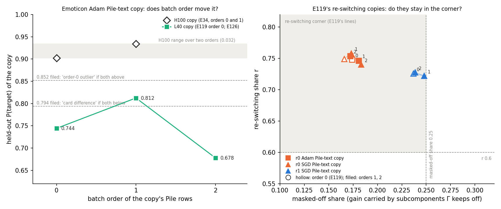

# Does a teacher-trained copy land in the same place when only its batch order changes?

*E126, 2026-11-06. Plan `reports/plans/2026-11-06_plan_e126-copy-reproducibility.md`; code
`experiments/copy_reproducibility/run.py`; figure `experiments/copy_reproducibility/figures/orders.png`; notebook
`notebooks/E126_copy_reproducibility.ipynb`.*

We rebuilt four teacher-trained copies on the same L40 card with new batch orders and nothing else changed. The one
copy that had stopped the earlier regeneration run moved a lot with batch order alone and stayed unreadable at every
order, while the three copies placed in the re-switching corner stayed there. So the earlier stop was one unstable
copy with no route reading, and the finding that some Pile-text copies carry their gain by switching subcomponents on
does not depend on batch order.

## The answer

The emoticon task's Pile-text copy of the Adam fine-tune read target probabilities of 0.744, 0.812 and 0.678 at
batch orders 0, 1 and 2 on the L40. That spread of 0.135 is four times the 0.032 its two orders showed on the H100.
At every order it reached 0.34 to 0.38 of its teacher's gain, under the 0.5 readability line. The three re-switching
copies kept their re-switching shares at 0.72 to 0.76 and their masked-off shares at 0.17 to 0.25 at both new
orders.

## What was run

As the teacher-route-split run (E119), on a MATS `debug` L40: each teacher is E31's arm-A fine-tune, seed 0, 1,000
steps; each copy is E34's Pile-text student, Adam 1e-5, batch 8 of Pile train rows 32,768-40,959, 1,000 steps; each
copy is read by the route split on its own state and labelled by E119's frozen lines. The only change is the
batch-order seed, as in E34 Amendment 4. The re-switching share $r$ is the share of the gain from Γ's new masks with
the original subcomponents; the masked-off share is the share carried by the subcomponents Γ keeps off. Re-switching
means $r \ge 0.6$ and masked-off share $\le 0.25$; unreadable means gain under half the teacher's.

## Controls

All passed. The four regenerated teachers matched E119's target probability and do-nothing gain with difference 0.
The emoticon Adam copy at order 0, run first, read 0.74415, E119's value exactly.

## Is the emoticon Adam Pile-text copy an order-0 outlier?

**Reading it.** No: batch order alone moves it, and the filed rule reads unstable. Order 1 read 0.812, above the
0.794 card-difference bar, and order 2 read 0.678, below it. Neither came near the 0.852 outlier bar. All three L40
orders sit at least 0.09 under both H100 orders, 0.902 and 0.934. With two H100 orders and three L40 orders, a lower
level on this card cannot be told apart from a larger order effect. The copy is unreadable at every order, so it
carries no route reading. The same code reproduced E119's other eleven copies within 0.016 and this copy exactly at
order 0, so a code fault is unlikely.

| order | card | P(target) | gain ratio | r | masked-off share | label |
|---|---|---|---|---|---|---|
| 0 (E34) | H100 | 0.902 | not read | not read | not read | not read |
| 1 (E34 A4) | H100 | 0.934 | not read | not read | not read | not read |
| 0 (E119, control here) | L40 | 0.744 | 0.359 | 0.354 | 0.579 | unreadable |
| 1 | L40 | 0.812 | 0.384 | 0.379 | 0.555 | unreadable |
| 2 | L40 | 0.678 | 0.339 | 0.360 | 0.580 | unreadable |

Teacher: P(target) 0.999, do-nothing gain 17.79 nats.

## Do E119's three re-switching copies stay in the corner?

**Reading it.** Yes, all three at both new orders. Re-switching shares moved by at most 0.01 from order 0, masked-off
shares by at most 0.02. The r1 SGD copy stays nearest the edge, with masked-off shares of 0.248 and 0.239 against
the 0.25 line.

| copy | order | P(target) | gain ratio | r | masked-off share | label |
|---|---|---|---|---|---|---|
| r0 Adam | 0 (E119) | 0.896 | 0.581 | 0.748 | 0.174 | re-switching |
| r0 Adam | 1 | 0.928 | 0.627 | 0.747 | 0.181 | re-switching |
| r0 Adam | 2 | 0.917 | 0.607 | 0.754 | 0.172 | re-switching |
| r0 SGD | 0 (E119) | 0.935 | 0.715 | 0.749 | 0.166 | re-switching |
| r0 SGD | 1 | 0.949 | 0.730 | 0.758 | 0.173 | re-switching |
| r0 SGD | 2 | 0.918 | 0.705 | 0.740 | 0.183 | re-switching |
| r1 SGD | 0 (E119) | 0.984 | 0.754 | 0.726 | 0.237 | re-switching |
| r1 SGD | 1 | 0.984 | 0.762 | 0.722 | 0.248 | re-switching |
| r1 SGD | 2 | 0.978 | 0.735 | 0.728 | 0.239 | re-switching |

## What this changes

E119's stop was this one cell's sensitivity to batch order on the L40, and that cell carries no route reading at any
order. E119's three re-switching placements are robust to batch order on this card. The emoticon Adam Pile-text copy's
target probability in E34 now carries a spread of 0.135 across orders, not 0.032; task-text copies stay the method
to cite.

## Surprises

The emoticon copy did not return to the H100's level at any order, against the expected 0.90 to 0.93. The r1 SGD
cell, expected a coin flip, held at both orders.

## Scorecard

Scored as filed; nothing refiled.

| id | claim | rule | read | verdict |
|---|---|---|---|---|
| C0 | teachers regenerate | P and gain within 0.005 of E119 | difference 0, all four | pass |
| C1 | order-0 control first | P within 0.005 of 0.74415 | 0.74415 | pass |
| P1 | emoticon Adam copy is an order-0 outlier | min of orders 1, 2 ≥ 0.852 outlier; max ≤ 0.794 card; else unstable | 0.812, 0.678; spread 0.135 | **unstable**; expected outlier, missed |
| P2 | re-switching corner holds, expected 2 of 3 | a cell holds if orders 1 and 2 both read re-switching | r0 Adam, r0 SGD, r1 SGD all hold | 3 of 3; expected 2, r1 SGD's coin flip held |

## Departures from the literature

None. The copy recipe, the route split and the labelling lines are E119's, unchanged.

## Not run

- The H100 at orders 1 and 2, so card and order are not fully separated for the emoticon cell.
- The route split of any H100 copy, so whether E34's 0.902 copy would have been readable is unknown.
- Orders past 2, a second teacher seed, and the task-text copies at new orders.

## Provenance

- Results `experiments/copy_reproducibility/results/copy_reproducibility.json`, commit 90716439; filed predictions
  `experiments/copy_reproducibility/results/predictions.json`; offsets and `run.log` in `results/large/`.
- MATS cluster `debug` QoS, NVIDIA L40, jobs 54763 (19:34) and 54772 (20:08 to 20:12:48, after the 26-min budget
  stop), 2026-11-06; $0; peak host RSS 6.1 GB. Copies 168-175 s each.
- References: E119 `experiments/teacher_route_split/results/teacher_route_split_*.json`; E34
  `experiments/teacher_training/results/teacher_training_emoticon.json` and `teacher_training_amend4.json`, H100.
