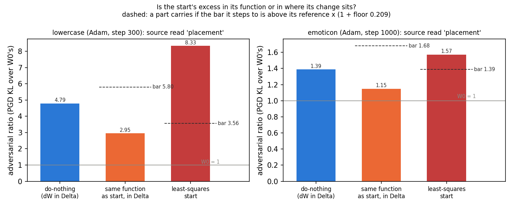
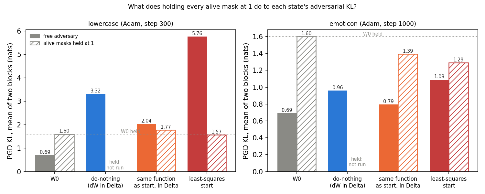
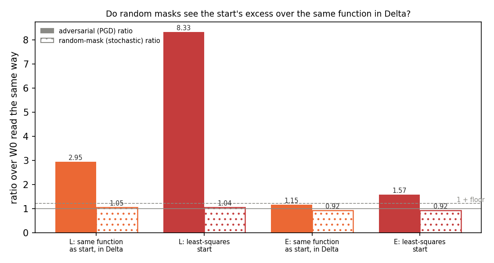
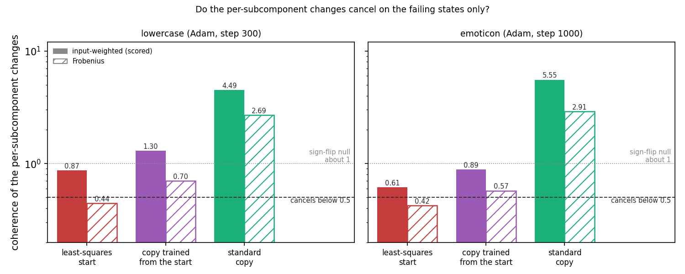

# E127: why does the least-squares start read worse than do-nothing under the adversarial check?

*2026-11-06, regating-lead's writer. Plan `reports/plans/2026-11-06_plan_e127-ls-start-faithfulness.md`; filed rules
`experiments/ls_start_faith/results/predictions.json`; code `experiments/ls_start_faith/run.py`; result
`experiments/ls_start_faith/results/ls_start_faith.json`; figures `experiments/ls_start_faith/figures/`; notebook
`notebooks/E127_ls_start_faith.ipynb`. MATS `debug` L40, two jobs: 54836 stopped at its time budget as planned,
and 54874 resubmitted and finished. About 31 min, $0. Provisional: no independent check, as the fast lane
allows for a run under the gate.*

We split the least-squares start's excess under the adversarial check into a part from its weight change and a
part from where that change sits, on two fine-tunes. On both, all of the excess comes from where the change sits, and
only the adversary sees it; holding the alive subcomponents fully on removes it.
For keeping a decomposition faithful along training, placing an update on the subcomponents is what costs; whether
the alive masks alone carry that waits on do-nothing read under the hold, since the hold also changed the adversary.

## The answer

The least-squares start is less faithful than do-nothing because of where its change sits, not because its weights
differ from the fine-tune. Its own weight change, left outside the subcomponents, reads better than do-nothing on both
tasks. Moved onto the alive subcomponents, the same change reads nearly three times worse on lowercase. Only the
adversary finds this; random masks read the two placements alike. Freezing the alive subcomponents fully on removes the
excess. It also removes most of the excess of a state whose change sits outside them, so that reading is not yet
specific.

## What we were trying to test

Each matrix of the released decomposition is $W = UV^\top + \Delta$: the alive subcomponents' write and read vectors
in $U, V$, the rest in $\Delta$. A fine-tune changes the weights by $\delta W$. Three states put a change in different
places:

- **do-nothing**: target $W_0 + \delta W$, with $\delta W$ in $\Delta$ and the subcomponents untouched;
- **least-squares start**: the least-squares split moves the alive subcomponents to $(U + dU, V + dV)$. Its weight
  change is $S = (U + dU)(V + dV)^\top - UV^\top$, and the target is $W_0 + S$. $S$ is not $\delta W$: the split's
  remainder, the part no change of the subcomponents reaches, is dropped;
- **same function in Δ**: target $W_0 + S$ with the subcomponents untouched, so $S$ sits in $\Delta$. It computes the
  same function as the start, but its change sits where do-nothing's does.

Each state is read by E34's adversarial check. An adversary with 20 sign steps sets every mask to maximise the KL
divergence from the target, on 256 Pile validation rows in two blocks. The ratio is
that KL over W₀'s, read the same way in the same job: 1 means the update did not make the decomposition easier to
break. The noise scale is the floor $f = 0.209$, W₀'s spread over three adversary seeds on the L40.

The comparison splits the start's excess over do-nothing into two parts that sum to it. The function part is the
same function in Δ minus do-nothing: what changes because $S$ is not $\delta W$. The placement part is the start minus
the same function in Δ: what changes when the same weights move from $\Delta$ onto the alive subcomponents.

Three further reads ask what carries the placement part:

- **the hold**: the same reads with every alive subcomponent's mask fixed at 1, so the adversary can move only the
  dead subcomponents and $\Delta$. A held ratio is over W₀ read under the same hold. If the placement part disappears,
  the adversary's freedom over the alive masks carries it. W₀ held against W₀ free is the positive control: a hold
  that changes nothing would leave them equal;
- **random masks**: the same states read by VPD's stochastic reconstruction with no adversary;
- **cancellation**: the coherence $\kappa = \|\sum_c D_c\|^2 / \sum_c \|D_c\|^2$ of the per-subcomponent changes
  $D_c = u'_c v'^\top_c - u_c v_c^\top$, input-weighted on the check's rows. Below 1, the changes cancel each other;
  a sign-flip null reads about 1. It is read on the start, on the copy teacher-trained from the start, and on the
  standard teacher-trained copy, which is faithful.

The two fine-tunes are E122's lowercase Adam step 300 and E121's emoticon Adam step 1000. Lowercase's excess was 3.5
ratio points, far beyond the floor; emoticon's was 0.18.

## What we expected, and why

- Lowercase's excess was expected to be placement, lean 0.5, with both parts 0.25 and function 0.15. The split keeps
  most of $\delta W$, so $S$ should damage Pile text about as much; the same function in Δ was expected at 4 to 6.
- Emoticon's whole excess was under the floor, so it was expected to read "within the floor", lean 0.6.
- If placement carried it, the hold was expected to remove it, lean 0.5. W₀ held was expected at 0.5 to 1.2 nats,
  from E20's reading of 1.08 nats with the alive subcomponents kept whole.
- Random masks were expected not to see it, lean 0.8, as E15 found for the step-10 split state.
- Cancellation was a coin toss. E17 read the step-10 least-squares split at 0.44 and component training at 2.8 to 3.5.

## Controls

Every control held, so the reads below are on the states E121 and E122 read.

| control | read | reference | verdict |
|---|---|---|---|
| W₀ mean block KL | 0.691743 | 0.691743 | exact |
| emoticon do-nothing ratio | 1.390022 | 1.390022 | exact |
| emoticon start ratio | 1.573282 | 1.573282 | exact |
| lowercase do-nothing ratio | 4.794234 | 4.794234 | exact |
| lowercase start ratio | 8.332889 | 8.332889 | exact |
| card | L40, both jobs | L40 | held |
| W₀'s first block reread by job 54874 | within 1e-6 | job 54836's | held |
| alive U, V equal E121's | equal | | held |

Source: `ls_start_faith.json` `controls.*.read` and `.ref`, and `jobs[].card`. The reread is not stored; the job stops
on a miss, and 54874 ended with exit 0.

## Is the excess in the start's function or in where its change sits?

**Reading it.** The excess is all placement on both tasks, and the function part goes the other way. On lowercase,
the start's own weight change left in Δ reads 2.95, well under do-nothing's 4.79. Moving those same weights onto the
alive subcomponents raises the ratio to 8.33. So the placement part is 5.39 ratio points, more than the whole excess
of 3.54. The weights the split drops are, if anything, the part that hurts under the check. Emoticon shows the same
shape at a smaller size: the same function in Δ reads 1.15, under do-nothing's 1.39, and the start reads 1.57.

| task | do-nothing | same function in Δ | start | function part | its bar | placement part | its bar | reading |
|---|---|---|---|---|---|---|---|---|
| lowercase | 4.794 | 2.946 | 8.333 | −1.848 | 1.001 | 5.387 | 0.615 | placement |
| emoticon | 1.390 | 1.149 | 1.573 | −0.241 | 0.290 | 0.424 | 0.240 | placement |

Source: `score.{L,E}.ratio.{nothing,nothing_start,start}` and `score.{L,E}.source`. A part's bar is $f$ times its
reference ratio; the parts are differences of those ratios.

**Emoticon's excess and the floor.** The start's whole excess over do-nothing on emoticon is 0.18. That is 13% of
do-nothing's ratio, under the floor of 20.9%, so the plan expected "within the floor". The filed rule does not test
the whole excess; it tests each part against its own bar. The function part is negative, so it does not carry. The
placement part is 0.42, above its bar of 0.24, so the rule reads "placement". This is the rule as filed and the
reading stands. Its weight is low: both parts are within about two floors from one adversary seed. The plan's power
line already said emoticon's held reads would be reported only, and this report treats emoticon's exposure and
random-mask readings that way.

## Does holding the alive masks at 1 remove the placement part?

**Reading it.** Yes on the filed rule, but the hold also flattens a state whose change is not on the alive
subcomponents, so the reading is not yet specific. On lowercase, the start reads 0.98 of W₀ held and the same function
in Δ reads 1.11. The held placement part is therefore slightly negative, and the share removed is 1.02 against the
filed bar of 0.75. Emoticon reads the same way, at 1.15.

**The hold changes the adversary a lot.** W₀ held reads 1.60 nats against 0.69 free, 2.3 times as much. The plan
expected 0.5 to 1.2, so the positive control passed by more than expected. Fixing a mask at 1 is one of the
settings a free adversary may choose, so a perfect free adversary would read at least 1.60 at W₀. The free
20-step adversary does not find it: it is a local search, and freeing the alive masks sends it somewhere weaker at W₀.
Held and free reads are therefore two different adversaries. The held ratios divide by 1.60 and the free ones by 0.69,
so a nat moves a held ratio less than half as far as a free one. Computed in nats instead of ratios, the share
removed is 1.06 on lowercase and 1.35 on emoticon, so the verdict does not depend on the denominators.

**Not specific yet.** The same function in Δ has its change outside the alive subcomponents, yet the hold removes most
of its excess too. On lowercase it reads 1.35 nats above W₀ free and 0.17 above W₀ held: the hold removes 87% of it.
Every other held state reads under W₀ held, by up to 0.31 nats. So there are two readings left
open. The hold may remove what the placement adds, as the filed rule reads it. Or the held adversary may sit in a
different optimum, driven by the dead and Δ masks, where every state looks like W₀. Under the second reading the hold
has no teeth for this question. Telling them apart needs do-nothing and a standard teacher-trained copy read under the
hold: if do-nothing keeps its excess there, the hold is specific. Neither was read; E127 Amendment 1 is coding them.

| state | lowercase free | lowercase held | emoticon free | emoticon held |
|---|---|---|---|---|
| W₀, nats | 0.692 | 1.601 | 0.692 | 1.601 |
| do-nothing, nats | 3.316 | not run | 0.962 | not run |
| same function in Δ, nats | 2.038 | 1.772 | 0.795 | 1.394 |
| start, nats | 5.764 | 1.567 | 1.088 | 1.290 |
| same function in Δ, ratio | 2.946 | 1.107 | 1.149 | 0.871 |
| start, ratio | 8.333 | 0.979 | 1.573 | 0.806 |
| share removed, filed (ratios) | 1.024 | | 1.153 | |
| share removed, in nats | 1.055 | | 1.355 | |

Source: `kl.*`, the mean of the two blocks; `score.{L,E}.ratio.*|hold`; `score.{L,E}.exposure`. The nats share is
computed here from `kl` with `jq`: one minus the held placement gap over the free placement gap, both in nats.

## Do random masks see the placement part?

**Reading it.** No: only the adversary sees it. Under random masks the start and the same function in Δ read within
1% of each other on both tasks, against an adversarial gap of 5.39 ratio points on lowercase. Every random-mask ratio
sits between 0.92 and 1.05, inside the 0.9 to 1.2 the plan expected. The floor used here is borrowed from the
adversarial check; the random read's own seed noise was not measured.

| task | same function in Δ, random | start, random | start over same, minus 1 | reading |
|---|---|---|---|---|
| lowercase | 1.049 | 1.039 | −0.009 | adversary only |
| emoticon | 0.919 | 0.924 | 0.005 | adversary only |

Source: `score.{L,E}.random_ratio`, `score.{L,E}.random`. Raw stochastic, CI-masked and unmasked KLs are in
`random.*`.

## Do the per-subcomponent changes cancel on the failing states only?

**Reading it.** No. Input-weighted, the start reads 0.87 on lowercase and 0.61 on emoticon, both above the cancelling
bar of 0.5. The copy trained from the start, which keeps the excess, reads 1.30 and 0.89, so it does not cancel at
all. The standard copy reads 4.49 and 5.55: its changes add up, as E17 found for component training. Frobenius
coherence gives the same verdict. There the start does cancel, at 0.44 and 0.42, matching E17's 0.44, but the copy
from the start still does not. So weight-side cancellation separates the start from the standard copy and fails to
separate the two failing states from it.

| task | state | input-weighted κ | its null | Frobenius κ | its null |
|---|---|---|---|---|---|
| lowercase | start | 0.873 | 0.992 | 0.443 | 0.990 |
| lowercase | copy from the start | 1.299 | 0.986 | 0.699 | 0.992 |
| lowercase | standard copy | 4.485 | 0.999 | 2.688 | 0.997 |
| emoticon | start | 0.614 | 0.956 | 0.424 | 0.974 |
| emoticon | copy from the start | 0.886 | 0.954 | 0.574 | 0.977 |
| emoticon | standard copy | 5.554 | 1.023 | 2.910 | 0.997 |

Source: `weights.{L,E}.coherence.{start,ls_copy,std_copy}.{weighted,frobenius}`.

**The start's weight change against the fine-tune's.** Input-weighted, $S$ has cosine 0.895 with $\delta W$ on
lowercase and 0.848 on emoticon. The distance relative to $\delta W$'s size is 0.449 and 0.530. Emoticon's distance is
inside the plan's 0.5 to 0.7. Source: `weights.{L,E}.S_vs_dW.{weighted,frobenius}`.

## What we learned

The least-squares start's poor faithfulness on these two fine-tunes is a placement effect. The same weights read
better than do-nothing when they sit in Δ, and worse once they ride on the alive subcomponents' masks. That fits the
plan's second premise check: in Δ a change shares one adversarial knob per matrix, while on the subcomponents it rides
thousands of separate masks. Only the adversary exploits this; random masks and weight-side cancellation do not track
it. For `GOALS.md`, this says placing an update by the least-squares split can make a decomposition easier to break
than leaving the update outside it, even when the weights are nearly the same. Whether the alive masks are uniquely to
blame stays open until do-nothing is read under the hold.

## How compelling is the evidence

- One adversary seed, one row set of 256 Pile rows, two tasks, one fine-tune each, one L40.
- Lowercase's placement part is 8.8 floors of its reference; emoticon's is 1.8. Emoticon is weak evidence.
- The hold is a different adversary from the free one, and it was read on two states per task and W₀ only. It cannot
  yet be told apart from a hold that flattens every state.
- The random-mask read's own noise floor was not measured.
- Cancellation is weight-side only.

## Surprises

- **The function part is negative on both tasks.** The split's dropped remainder makes the same function in Δ read
  better than do-nothing, by 1.85 ratio points on lowercase. The plan expected 4 to 6 for it; it read 2.95.
- **W₀ held reads 1.60 nats, above the expected 0.5 to 1.2.** The free adversary at W₀ finds less than a setting
  it is allowed to choose.
- Emoticon read "placement" where "within the floor" was expected; this is the rule scoring parts, not the whole.
- The standard copies' input-weighted coherence, 4.49 and 5.55, is above the expected 2 to 4.

## What next

- **E127 Amendment 1, being coded**: do-nothing and the standard teacher-trained copy read under the hold. If do-nothing
  keeps its excess under the hold, the hold is specific and the alive masks carry the placement part. If it reads like
  W₀ held, the hold has no teeth and the exposure reading is unreadable.
- A free adversary with more steps or restarts at W₀: if it reaches the held 1.60, the free check has been
  under-reading every state, and the ratios E34 used would change scale.

## Scorecard

| rule | what it says | rule as filed | read | lean | verdict |
|---|---|---|---|---|---|
| A, lowercase | function or placement | each part carries at f times its reference | function −1.848, placement 5.387 | placement 0.5 | placement; lean held |
| A, emoticon | same | same | function −0.241, placement 0.424 | within the floor 0.6 | placement; lean missed |
| B, lowercase | hold removes placement part | H ≥ 0.75 alive masks | H 1.024 | alive masks 0.5 | the alive masks; lean held; not yet specific |
| B, emoticon | same, report only per the plan | same | H 1.153 | none | the alive masks, reported only |
| C, lowercase | random masks see it | q ≥ f | q −0.009 | adversary only 0.8 | adversary only; held |
| C, emoticon | same | same | q 0.005 | same | adversary only; held |
| D, both | cancellation tracks failing states | start and copy from start κ < 0.5, standard not | 0.873, 1.299, 4.485; 0.614, 0.886, 5.554 | 0.5 / 0.5 | does not track |

Expected values filed beside the rules:

| expected | read | verdict |
|---|---|---|
| controls C1 to C8 | all exact or within tolerance | held |
| S against δW, emoticon, weighted distance 0.5 to 0.7 | 0.530 | held |
| lowercase same function in Δ 4 to 6 | 2.946 | missed, low |
| W₀ held 0.5 to 1.2 nats | 1.601 | missed, high |
| random-mask ratios 0.9 to 1.2 | 0.919 to 1.049 | held |
| κ weighted, start 0.3 to 0.6 | 0.873 and 0.614 | missed, high |
| κ weighted, standard copy 2 to 4 | 4.485 and 5.554 | missed, high |
| κ weighted, copy from the start 0.3 to 1.0 | 1.299 and 0.886 | lowercase missed, emoticon held |
| sign-flip nulls about 1 | 0.954 to 1.023 | held |
| about 30 min as two jobs | 26 min, then 5 min | held |

## Departures from the literature

- **The hold has no counterpart in the VPD paper.** The paper's adversary moves every mask. Here, for this question
  only, it wraps the authors' `interpolate_pgd_mask` so the alive subcomponents' masks read 1 with zero gradient. The
  held reads are a different adversary, as the hold section shows.
- **E34's check departs from the paper as E34 and E121 recorded:** the pass lines and the floor are ours, and the
  check uses one adversary per 128-row block where the paper shares one over its evaluation batch.
- **The coherence κ is ours, from E17**, not a published measure; its input-weighted form is new here.

## Not run

- **Do-nothing under the hold** on either task: the read that tells a specific hold from one that flattens every state.
  E127 Amendment 1.
- **Any standard teacher-trained copy under the hold**, and the copy from the start under the hold. E127 Amendment 1.
- Adversary seeds 1 and 2: emoticon's parts are not readable from one seed.
- A free adversary with more steps or restarts, to see whether it reaches the held 1.60 at W₀.
- A hold at the CI values, and a hold of a subset of the alive subcomponents.
- Pile set B; other rows.
- The start with target $W_0 + \delta W$ and the remainder in Δ.
- The random-mask read's own seed noise.

## Provenance

Result `experiments/ls_start_faith/results/ls_start_faith.json` (`done: true`); run log
`~/commute-data/results-large/ls_start_faith/run.log`; job logs `cluster/logs/commute-e127-54836.out` and
`commute-e127-54874.out`. Job 54836 ran from 21:35 and stopped at its 28-minute budget with exit 3. Job 54874 ran from 22:02 and
ended with exit 0 at 22:07. Each PGD read took 127 to 140 s (`seconds`). MATS `debug` QoS, L40, $0.
