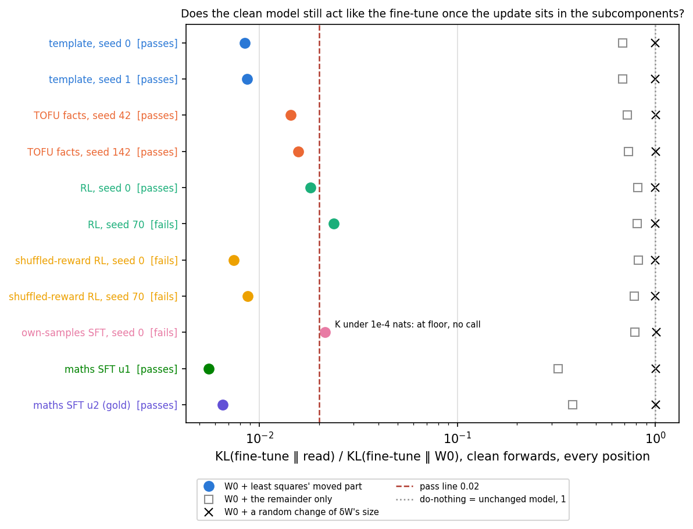
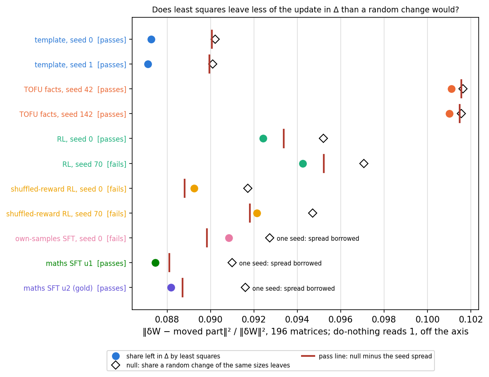
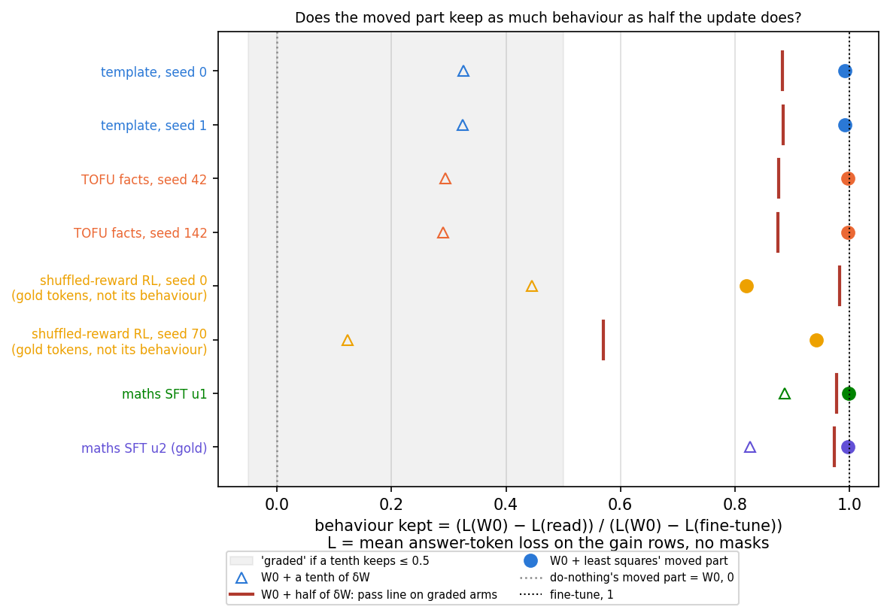
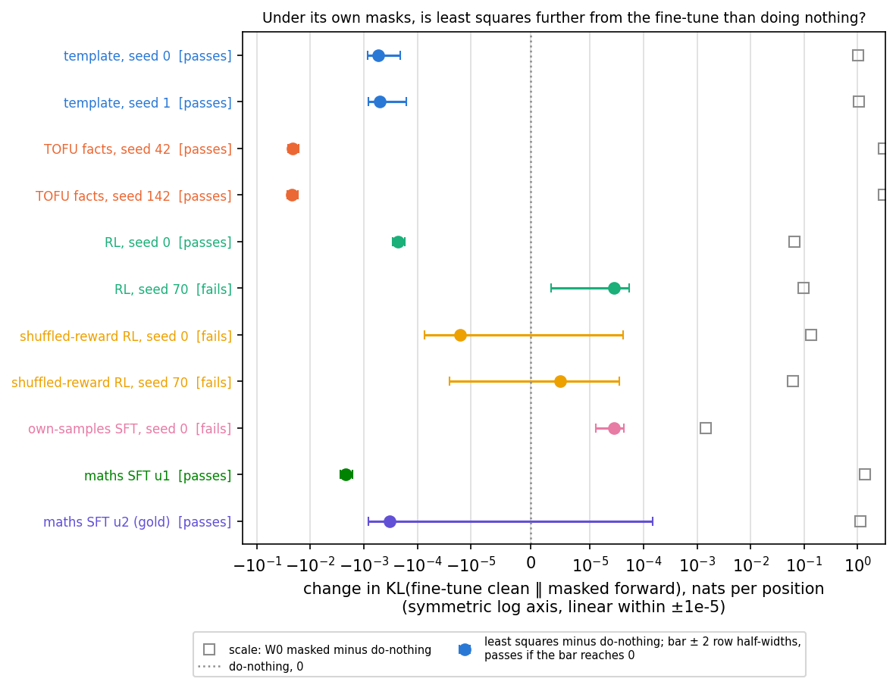
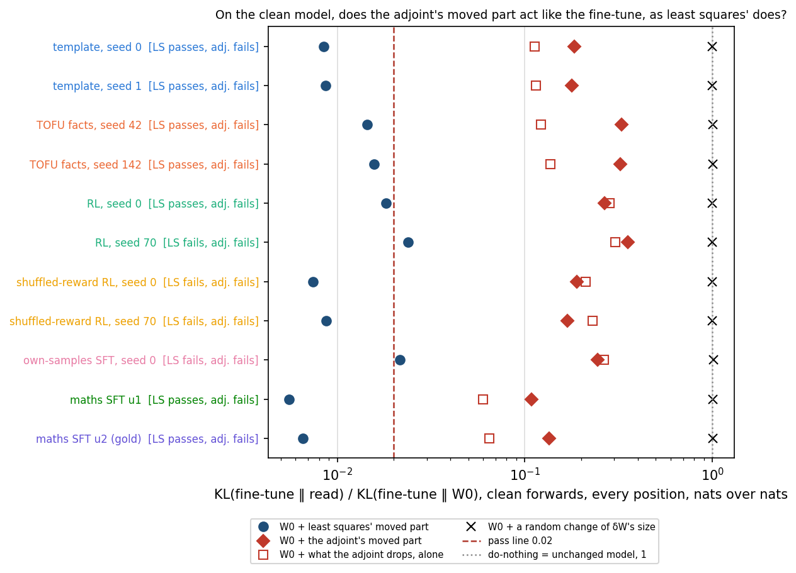
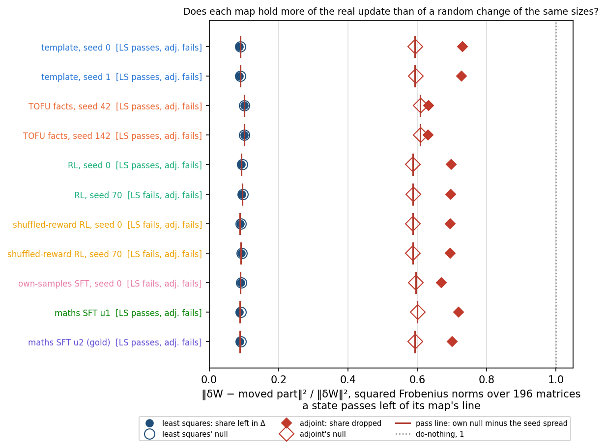
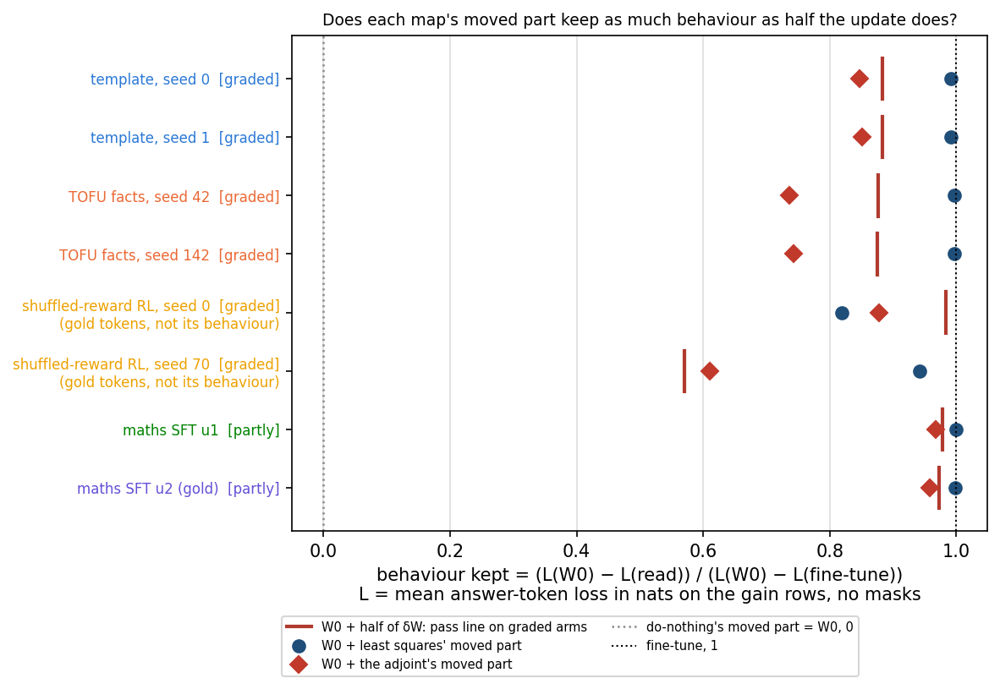
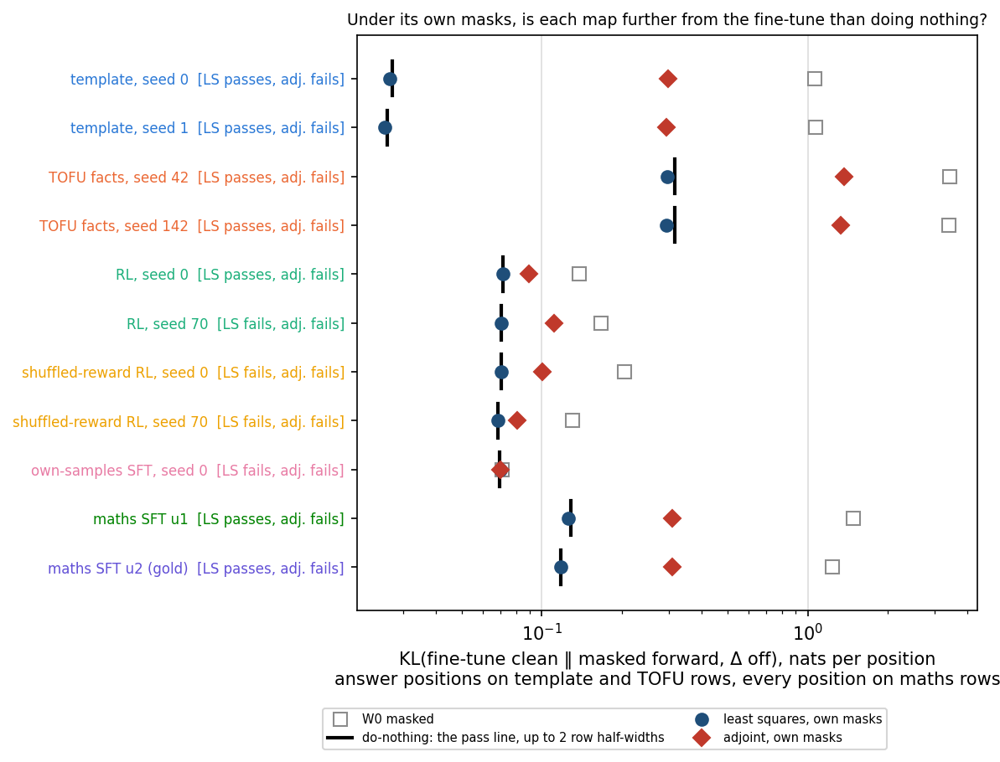

# Analysis: does least squares clear D1's first table on every saved fine-tune? (E93)

*2026-11-06, `qwen-decomp-lead`. Provisional: no independent check. Plan `reports/plans/2026-11-05_plan_e93-d1-table.md`;
code `experiments/qwen_d1_table/{run,rules,plot}.py`; filed rules `experiments/qwen_d1_table/results/predictions.json`;
notebook `notebooks/E93_qwen_d1_table.ipynb`. Amendment 1, the scaled adjoint split on the same table, is the last section.*

We split the full update of every saved Qwen3-1.7B fine-tune over the decomposition's subcomponents by least squares and read four filed checks on each. It passes every check on the template, TOFU facts and supervised maths fine-tunes, and misses narrowly on the three small reinforcement-learning maths updates. For `GOALS.md` this means one simple map already keeps the decomposition faithful, in the weak sense and without the adversary, on both updates the Qwen goal was framed on, but by the filed rule it fails the table as a whole.

## The answer

Not on every fine-tune, so by its filed rule least squares fails this table. On the template fine-tune, the TOFU facts fine-tune and both supervised maths fine-tunes it passes every check at every seed. It misses narrowly on the three small reinforcement-learning maths updates: one RL seed on the clean model and under masks, the shuffled-reward arm on the share left in Δ, and the own-samples arm on both. The misses are tiny in nats, but a filed miss stands. We had leaned towards a pass everywhere, and that lean reversed.

## What was run

D1 is a map on Qwen3-1.7B that keeps the decomposition faithful for a real update. The decomposition writes each weight matrix as rank-one subcomponents $UV^\top$ plus a leftover Δ; Γ picks per-position masks. The **least-squares split** is the least-norm $(dU, dV)$ with $dU\,V^\top + U\,dV^\top \approx \delta W$, and the **moved part** is $U'V'^\top - UV^\top = dU\,V^\top + U\,dV^\top + dU\,dV^\top$, rounded to fp32 as the forward applies it. The rest of $\delta W$ goes to Δ. **Do-nothing** puts all of $\delta W$ in Δ.

| arm | name in the plan | states | update size, fp64 | rows, 256 tokens |
|---|---|---|---|---|
| template fine-tune | anchor 1 | seeds 0, 1, step 100 | 0.487, 0.489 | 128 template rows |
| TOFU facts fine-tune | anchor 2 | seeds 42, 142, step 1250 | 18.11, 18.12 | 128 TOFU rows |
| RL, GRPO | RL | seeds 0, 70, step 100 | 0.351, 0.347 | 128 maths rows |
| shuffled-reward RL | null | seeds 0, 70, step 100 | 0.370, 0.335 | 128 maths rows |
| own-samples SFT | own-samples | seed 0, step 100 | 0.274 | 128 maths rows |
| first maths fine-tune | u1 | step 100, fp32 file | 3.38 | 128 maths rows |
| gold-answer maths fine-tune | u2 | step 100, bf16 | 2.86 | 128 maths rows |

Stage 0 ran first and alone, on the first maths fine-tune's step 10 and the earlier TOFU update. It reproduced every stored number to within a few parts in a million:

| control | read | stored |
|---|---|---|
| K of W0, read twice; fine-tune | 1.63511034, 1.63511034; 0 | 1.63511034; 0 |
| in-span, old form | 0.0091558 | 0.0091558 |
| share; its null | 0.0900173; 0.0939 | 0.0900173, under its null |
| masked K: W0, do-nothing, W0-weights masks, own masks | 1.37381, 0.104363, 1.29340, 0.103439 | the same |
| TOFU: W0 loss, ruler, kept by a tenth | 4.49295, 2.81688, 0.27906 | 4.49295, 2.81688, 0.27906 |

Every per-state stop also held: the norm against the record, t = 1 against the fine-tune, W0 read again, and the fine-tune's K at 0.

**Units.** K is $\mathrm{KL}(\text{fine-tune clean}\,\|\,\text{read})$ over the full next-token distribution, natural log, so nats per token position, averaged over the positions named. It is not squared. The share and the size are ratios of squared Frobenius norms, summed in fp64 over the 196 decomposed matrices. Behaviour kept is a ratio of mean answer-token losses in nats, 0 at W0 and 1 at the fine-tune.

## Verdicts

| state | arm | 1 clean | 2 share | 3 size | 4 kept clean | 5 masked K | 6 kept masked | verdict |
|---|---|---|---|---|---|---|---|---|
| template s0 | anchor 1 | holds | holds | holds | holds | holds | no room | passes |
| template s1 | anchor 1 | holds | holds | holds | holds | holds | no room | passes |
| TOFU s42 | anchor 2 | holds | holds | holds | holds | holds | no room | passes |
| TOFU s142 | anchor 2 | holds | holds | holds | holds | holds | no room | passes |
| RL s0 | RL | holds | holds | holds | no line | holds | no line | passes |
| RL s70 | RL | **misses** | holds | holds | no line | **misses** | no line | fails |
| shuffled s0 | null | holds | **misses** | holds | no line | holds | no line | fails |
| shuffled s70 | null | holds | **misses** | holds | no line | holds | no line | fails |
| own-samples s0 | own-samples | at floor | **misses**, spread borrowed | holds | no line | **misses** | no line | fails |
| first maths | u1 | holds | holds, spread borrowed | holds | not graded | holds | not graded | passes |
| gold maths | u2 | holds | holds, spread borrowed | holds | not graded | holds | not graded | passes |

Arms: template, TOFU facts, first maths and gold maths pass; RL, shuffled-reward and own-samples fail. Table: **fails**.

## The clean model

**Reading it.** Least squares passes on ten of eleven states and misses narrowly on RL seed 70. Its moved part sits 0.0023 nats from the fine-tune, where the line allows 0.0020. The whole update on that arm moves the model only 0.098 nats, so the miss is 0.0004 nats in absolute terms. The own-samples update moves the model 0.001 nats in all, so its moved part falls under the 0.0001-nat floor and gets no call. Random changes of the same size read 1.00 to 1.01 of W0's K and fail by E75's rule at every state, so the check has teeth.

K in nats per position, every position of the arm's 128 rows.

| state | K of W0 | K of the moved part | ratio, line < 0.02 | remainder alone | random | signs |
|---|---|---|---|---|---|---|
| template s0 | 0.3226 | 0.00273 | 0.00845 | 0.2204 | 0.3229 | 0.5329 |
| template s1 | 0.3279 | 0.00285 | 0.00869 | 0.2243 | 0.3282 | 0.5430 |
| TOFU s42 | 3.1208 | 0.04491 | 0.01439 | 2.2602 | 3.1478 | 3.9957 |
| TOFU s142 | 3.1586 | 0.04962 | 0.01571 | 2.3151 | 3.1850 | 4.1375 |
| RL s0 | 0.06431 | 0.00117 | 0.01816 | 0.05228 | 0.06443 | 0.07995 |
| RL s70 | 0.09769 | 0.00233 | **0.02382** | 0.07931 | 0.09779 | 0.12411 |
| shuffled s0 | 0.13490 | 0.00100 | 0.00743 | 0.11050 | 0.13499 | 0.17874 |
| shuffled s70 | 0.04867 | 0.000425 | 0.00874 | 0.03808 | 0.04870 | 0.07756 |
| own-samples s0 | 0.001019 | 0.0000219 | 0.0215, at floor | 0.000803 | 0.001032 | 0.001587 |
| first maths | 1.7184 | 0.00953 | 0.00554 | 0.5560 | 1.7245 | 2.7997 |
| gold maths | 1.3768 | 0.00902 | 0.00655 | 0.5266 | 1.3817 | 2.1541 |

The old in-span form, without the $dU\,dV^\top$ term, read 0.045114 on TOFU seed 42 against 0.044915 with it: the second-order term changes K by 0.0002 nats at the largest update.

## The share left in Δ

**Reading it.** Least squares leaves a little less than a random change on every state, but on three maths states not by enough to clear the line. The gap below the null is about 3% of the null on most arms and half a percent on TOFU facts. The shuffled-reward arm misses at both seeds, by gaps of 0.0025 and 0.0026 against its seed spread of 0.0029. Own-samples, with one seed, borrows that spread and misses at a gap of 0.0019. The spread is large because the null itself differs by 0.0030 between the two shuffled-reward seeds; the gap differs by only 0.0001. The filed line compares the gap with the spread of the share, and the misses stand. About nine tenths of any update of these sizes lies inside the subcomponents' span already, so the column barely separates a real update from a random one.

| state | share | null | null − share | line: seed spread | gap's own seed difference |
|---|---|---|---|---|---|
| template s0 | 0.087267 | 0.090208 | 0.002941 | 0.000151 | 0.000039 |
| template s1 | 0.087116 | 0.090096 | 0.002980 | 0.000151 | |
| TOFU s42 | 0.101097 | 0.101636 | 0.000539 | 0.000080 | 0.000012 |
| TOFU s142 | 0.101017 | 0.101568 | 0.000551 | 0.000080 | |
| RL s0 | 0.092418 | 0.095202 | 0.002785 | 0.001836 | 0.000028 |
| RL s70 | 0.094253 | 0.097067 | 0.002813 | 0.001836 | |
| shuffled s0 | 0.089234 | 0.091710 | **0.002476** | 0.002897 | 0.000095 |
| shuffled s70 | 0.092131 | 0.094701 | **0.002571** | 0.002897 | |
| own-samples s0 | 0.090839 | 0.092735 | **0.001896** | 0.002897, borrowed | one seed |
| first maths | 0.087451 | 0.090992 | 0.003541 | 0.002897, borrowed | one seed |
| gold maths | 0.088171 | 0.091607 | 0.003436 | 0.002897, borrowed | one seed |

The last column is computed here from the table, not filed, and no verdict reads it. On the first maths fine-tune the bf16 file gives the same share to five places, 0.087451, so the bf16 floor does not touch this column.

**Squared size**, the moved part's $\|\cdot\|^2 / \|\delta W\|^2$, reads 0.8996 to 0.9129, within 0.0007 of one minus the share on every state, as filed.

## Behaviour kept, clean

**Reading it.** Least squares keeps essentially all the behaviour on every arm that has one. On the template and TOFU facts fine-tunes the moved part keeps 0.99 to 1.00 against about 0.88 for half the update. Both read graded, since a tenth of the update keeps only about 0.3, so the line could have failed them. The supervised maths fine-tunes are not graded, because a tenth already keeps 0.83 to 0.89. The shuffled-reward arm's gold-token gain reads graded too, but it is not that arm's behaviour and is not scored.

| state | gain, nats | kept by a tenth | band | kept by half: line | kept by the moved part |
|---|---|---|---|---|---|
| template s0 | 0.851 | 0.326 | graded | 0.883 | 0.992 |
| template s1 | 0.853 | 0.325 | graded | 0.884 | 0.991 |
| TOFU s42 | 4.492 | 0.294 | graded | 0.877 | 0.997 |
| TOFU s142 | 4.493 | 0.290 | graded | 0.875 | 0.997 |
| first maths | 1.980 | 0.886 | partly | 0.978 | 0.999, not graded |
| gold maths | 1.986 | 0.826 | partly | 0.973 | 0.998, not graded |
| shuffled s0, gold tokens | 0.132 | 0.446 | graded | 0.983 | 0.819, unscored |
| shuffled s70, gold tokens | 0.827 | 0.124 | graded | 0.570 | 0.941, unscored |
| RL s0, RL s70, own-samples | -0.394, 0.031, 0.042 | | no call: gain under 0.05 nats | | |

The moved part's kept on the maths arms is computed here from each state's saved losses, not filed.

**Why the graded prediction missed.** The band reads graded on the template, the TOFU facts and the shuffled-reward arms. The prediction counted only arms with a behaviour line, so its miss is the template fine-tune alone. The template behaviour builds with update size much as the facts do. That means the behaviour check had teeth on two arms rather than one, and least squares cleared both with about 0.11 to spare. The shuffled-reward reading says the gold-token gain of an RL arm with no real reward also builds with size; it confirms that gain is not a behaviour line for these arms.

## Under the state's own masks

**Reading it.** Least squares is no worse than do-nothing on nine states, and slightly worse on RL seed 70 and own-samples. On TOFU facts it sits 0.021 nats closer to the fine-tune than do-nothing. RL seed 70 is worse by 0.0000286 nats against a line of 0.0000251, and own-samples by 0.0000279 against 0.0000148. Measured against the update's own effect under masks, the RL miss is 0.03% of it and the own-samples miss 1.9%. Both are about 2,400 times smaller than the decomposition's own masked error on maths rows, 0.0696 nats. They clear the row bootstrap's band, so by the filed rule they are not row noise, and they stand.

K in nats per position: answer positions with their question in the row on template and TOFU rows, every position on maths rows. "Update's effect" is W0 masked minus do-nothing.

| state | W0 masked | do-nothing | least squares | difference | line, 2 × half-width | update's effect |
|---|---|---|---|---|---|---|
| template s0 | 1.0622 | 0.027305 | 0.026771 | -0.000534 | 0.000325 | 1.0349 |
| template s1 | 1.0711 | 0.026207 | 0.025707 | -0.000500 | 0.000336 | 1.0449 |
| TOFU s42 | 3.4161 | 0.31741 | 0.29597 | -0.02144 | 0.00471 | 3.0986 |
| TOFU s142 | 3.3895 | 0.31660 | 0.29437 | -0.02223 | 0.00508 | 3.0729 |
| RL s0 | 0.13829 | 0.071579 | 0.071347 | -0.000232 | 0.0000599 | 0.0667 |
| RL s70 | 0.16688 | 0.070368 | 0.070396 | **0.0000286** | 0.0000251 | 0.0965 |
| shuffled s0 | 0.20526 | 0.070248 | 0.070233 | -0.0000158 | 0.0000579 | 0.1350 |
| shuffled s70 | 0.13041 | 0.068478 | 0.068483 | 0.0000049 | 0.0000304 | 0.0619 |
| own-samples s0 | 0.071043 | 0.069599 | 0.069627 | **0.0000279** | 0.0000148 | 0.00144 |
| first maths | 1.4884 | 0.12839 | 0.12622 | -0.00217 | 0.000554 | 1.3600 |
| gold maths | 1.2367 | 0.11812 | 0.11779 | -0.000331 | 0.000481 | 1.1185 |

**Kept under masks** read "no room" on the template and TOFU facts arms, both seeds: the ceiling, do-nothing's masks plus the whole update, sits only 0.0013 and 0.013 above do-nothing's 0.80 and 0.78. Least squares keeps 0.799 and 0.782 there.

**Printed, unscored.** With masks taken from W0's own forward, least squares keeps 0.011 of the behaviour on the template arm, -0.004 and -0.003 on TOFU facts, and 0.33 and 0.30 on the first and gold maths fine-tunes. Do-nothing under those masks is W0 masked, 0 by construction. So on the two example updates, none of the kept behaviour under the state's own masks comes from the moved subcomponents under W0's choice of masks.

## The misses, at the scale of the update

The lead's note says the misses are at the scale of the update's own tiny effect. That holds for own-samples, and for the clean miss on RL seed 70, but not for its masked miss.

| miss | read | line | excess | the update's own effect at that arm |
|---|---|---|---|---|
| RL s70, clean | 0.002327 nats | 0.001954 nats | 0.00037 nats | K of W0 0.0977 nats: excess 0.4% of it |
| RL s70, masked | 0.0000286 nats | 0.0000251 nats | 0.0000035 nats | masked 0.0965 nats: excess 0.004% of it |
| shuffled s0, share | gap 0.002476 | 0.002897 | 0.00042 short | null 0.0917, squared-norm ratio |
| shuffled s70, share | gap 0.002571 | 0.002897 | 0.00033 short | null 0.0947 |
| own-samples, share | gap 0.001896 | 0.002897, borrowed | 0.0010 short | null 0.0927 |
| own-samples, masked | 0.0000279 nats | 0.0000148 nats | 0.000013 nats | masked 0.00144 nats, clean 0.00102: excess about 1% |

These GSM8K updates have norm 0.27 to 0.37 and move the clean model 0.001 to 0.135 nats per position; the template update moves it 0.32 and TOFU facts 3.1. Every line was relative to that small effect or to a seed spread, and was filed so; the misses stand as filed.

## What we learned

Least squares keeps the decomposition faithful, by every filed check, on the template and TOFU facts fine-tunes at both seeds, with the behaviour check able to fail both, and on both supervised maths fine-tunes. Its misses are all on the three small reinforcement-learning maths updates, by margins of 0.0004 nats or less on the clean and masked checks. The share left in Δ hardly separates least squares from a random update on this decomposition, so its pass is weak evidence and its misses follow the seed spread of the null. By the plan's branches the table fails, teacher training follows, and a reversed lean goes to the user before anything runs.

## How compelling is the evidence

- Seeds: two on the template, TOFU facts, RL and shuffled-reward arms; one on own-samples and both supervised maths fine-tunes, which borrow the shuffled-reward spread.
- Rows: 128 per arm, 256 tokens each. Masked template and TOFU reads use whole-question answer positions; maths rows pool every position.
- Noise: a paired bootstrap over rows, 2,000 draws, for the clean teeth and the masked check; the seed spread for the share.
- Blind spots: no check fails a wrong placement inside the span, since the rarely-on half reads only 0.05 to 0.11 on the clean table in an earlier run. No adversary ran. The masked check passes do-nothing by construction, so it can penalise harm and cannot credit a placement.
- No independent check; the fast lane gives this run none, and no headline claim rests on it yet.

## Surprises

**Something unexpected happened that I cannot fully explain.** We leaned that least squares would pass every state, and it fails three maths arms. The share misses come from the null moving between seeds; the cause of the two masked misses is not named.

- The template update reads graded; we expected that of TOFU facts only.
- The shuffled-reward arm's gold-token gain reads graded too, unscored.
- RL seed 0, the state flagged as tight, passed at 0.0182; seed 70 missed at 0.0238.
- Under masks from W0's forward, least squares keeps about 0.01 of the behaviour on the two example updates and 0.3 on the supervised maths ones.

## What next

The plan's branch for a fail is teacher training, but the amended plan aims it at TOFU facts, which passed. The choice is the user's open ask 33, not decided here:

- **A, recommended by the lead:** teacher training on the cluster at $0, aimed at the maths updates that missed, RL, shuffled-reward and own-samples. A pass there shows a trained map beats least squares where least squares fails.
- **B:** teacher training towards TOFU facts, as the amended plan words it. Least squares already passes there, so the trained map can at best tie.
- **C:** no teacher training. Report the table as it reads and spend the days on the D3 readings, which go on meanwhile either way.

## Scorecard

| id | claim | rule | read | verdict |
|---|---|---|---|---|
| P1_size | squared size holds everywhere | ≤ 1 | 0.8996 to 0.9129 | holds |
| P2_share | share below null by more than the seed spread everywhere | null − share > spread, tie misses | N_s0 0.00248, N_s70 0.00257, F_s0 0.00190 against 0.00290 | misses |
| P3_clean | clean holds or at floor everywhere | ratio < 0.02; K ≤ 1e-4 at floor | R_s70 0.02382; F_s0 at floor | misses |
| P4_masked_K | masked K not above do-nothing by over 2 half-widths | diff ≤ 2w | R_s70 2.86e-5 vs 2.51e-5; F_s0 2.79e-5 vs 1.48e-5 | misses |
| P5_graded | only anchor 2 graded among behaviour arms | tenth ≤ 0.5 | anchor 1 0.326, 0.325 graded; u1 0.886, u2 0.826 partly | misses |
| P6_no_room | no room on anchor 2, both seeds | E72's room rule | ceiling − do-nothing 0.0129, 0.0133 under 0.1 | holds |
| P7_table | least squares passes every state, a lean | verdict | RL, null, own-samples fail | misses: lean reversed |

## Departures from the literature

- VPD decomposes a fixed model and scores it there. Here Γ reads weights it was not trained on, and the least-squares split moves the subcomponents; VPD has no such procedure.
- VPD's faithfulness includes its adversarial-mask loss. No adversary ran, by the user's choice on ask 31; E89's do-nothing fail on the earlier TOFU update stands beside this table as a stated limit.
- The 0.02 clean line, the share's Gaussian null, the seed-spread rule and the masked line are this project's, not VPD's.
- GRPO optimises answer accuracy; the gold-token gain read here is not its objective, so the RL arms carry no behaviour line.

## Not run

- The adversary.
- Teacher training.
- Matched-size and intermediate-step states.
- The share weighted by inputs.
- The rarely-on and often-on halves.
- Accuracy under masks.
- A second seed for own-samples and the two supervised maths fine-tunes.
- An independent check.

## Provenance

`experiments/qwen_d1_table/results/{table.json,control.json,run.log,edges.txt}`, `results/<state>/state.json`; figures `experiments/qwen_d1_table/figures/{clean,share,kept_clean,masked}.png`. MATS cluster L40, jobs 52875 control, 52901 TOFU facts, 53028 template and supervised maths, 53084 RL arms; about 4 h of card, $0. Peak card 42.5 GiB, host 95.6 GB. Commits 04e4e2b1, 0b784be4, 7964a410, ef5dbe90.

---

## Amendment 1 (2026-11-06): the scaled adjoint split beside least squares

*Plan `reports/plans/2026-11-05_plan_e93-d1-table.md`, section "Amendment 1"; filed leans `experiments/qwen_d1_table/results/predictions_amend1.json`; code `experiments/qwen_d1_table/amend1.py` with E93's `rules.py` unchanged; results `experiments/qwen_d1_table/results/amend1/`. Asked for by the user on ask 33 (`decisions.md`, 2026-11-06). Provisional: no independent check.*

We placed each of the eleven saved Qwen3-1.7B updates on the decomposition's subcomponents with the scaled adjoint split instead of least squares, and read the same six filed checks on the same rows. The adjoint split fails every state, and its clean model sits eleven to twenty-six times further from the fine-tune than least squares' does. For `GOALS.md` this means that of the two simple maps only least squares is a candidate for D1, and the adjoint split is a weak comparison column for teacher training to beat.

### The answer

No. The scaled adjoint split fails D1's first table on all eleven states, as we leaned. Its state does most of what the fine-tune does but leaves a tenth to a third of it undone on the clean model, where the line allows a fiftieth. Two weak leans reversed: we expected it to hold more of a real update than of a random one, and to do no harm under its own masks. It did neither, on any state.

### What was run

D1 is a map on Qwen3-1.7B that keeps the decomposition faithful for a real update. Everything in E93's table is held fixed: the eleven full updates, their rows, the six rules and their thresholds, and every read that does not depend on the map. Only the map changes.

- **The scaled adjoint split** (`GOALS.md` Terms) moves each matrix's subcomponents by $dU = c\,\delta W V$ and $dV = c\,\delta W^\top U$. The weight change this makes is $c\,K(\delta W)$, with $K(\delta W) = UU^\top\delta W + \delta W VV^\top$, plus the small second-order term $dU\,dV^\top$.
- **The scale** $c$ is fitted per matrix as $\arg\min_c \|(c\,K(\delta W) - \delta W)\,\Sigma^{1/2}\|$, where $\Sigma$ is the input covariance at W0 over 128 maths rows of 512 tokens. The same $\Sigma$ serves every arm.
- **Δ stays fixed.** Unlike least squares, nothing the map leaves out goes into Δ: it is dropped. So the state is W0 plus the **moved part** $U'V'^\top - UV^\top$, and its weights are not the fine-tuned ones.

What each rule reads for this map, and its units:

| rule | quantity | units |
|---|---|---|
| 1 clean | K of W0 + moved part over K of W0; line 0.02 | K is KL(fine-tune clean ‖ read), natural log, nats per position, every position, not squared; the rule reads a ratio of two K |
| 2 share | $\|\delta W - \text{moved}\|^2 / \|\delta W\|^2$, here the share dropped, against the same split of a Gaussian at each matrix's norm with its own $c$ | ratio of squared Frobenius norms, fp64, summed over 196 matrices |
| 3 size | $\|\text{moved}\|^2 / \|\delta W\|^2$ at or under 1 | ratio of squared Frobenius norms |
| 4 kept, clean | behaviour kept by W0 + moved part against half the update, on graded arms | ratio of mean answer-token losses in nats: 0 at W0, 1 at the fine-tune |
| 5 masked K | K under the state's own masks, Δ off, minus do-nothing's, against twice the row half-width | nats per position: answer positions on template and TOFU rows, every position on maths rows |
| 6 kept, masked | E93's room rule on stored references | ratio of losses, as rule 4 |

**Stage 0 ran first and alone** on the first maths fine-tune's step 10, job 53914. It reproduced every stored number it checked, inside its band of one part in a thousand:

| control | read | stored |
|---|---|---|
| masked K: W0, do-nothing | 1.37381065, 0.104362602 | the same, E93 |
| least squares' share | 0.0900173 | 0.0900173, E93 |
| least squares through the new state path: W0-weights masks, own masks | 1.29340265, 0.103438716 | the same, E93 |
| adjoint, old first-order form, clean K | 0.165671216 nats | 0.165671196, E86 |

Every per-state norm matched E93's record exactly, and card and host peaks stayed under their stops.

### What we expected, and why

We leaned strongly that the adjoint split misses the clean check everywhere, since an earlier run read its first-order form at 0.10 to 0.34 of the ruler on three updates. Hence a strong lean that every arm fails, and a medium lean that it fails the behaviour check on both example updates. We leaned weakly that it holds more of a real update than of a random one, reasoning that a fine-tune moves along high-variance inputs which $\Sigma$ weights. We leaned weakly that its own masks do no harm, since least squares held that check on nine of eleven states.

### On the clean model

**Reading it.** The adjoint split misses the clean check on all eleven states, by a wide margin. Its moved part leaves 0.11 to 0.35 of W0's distance to the fine-tune, where least squares leaves 0.006 to 0.024 and the line is 0.02. On most states what the adjoint drops, applied alone, sits about as close to the fine-tune as what it keeps, and on the template and TOFU arms closer. Random changes of the same size read about 1, so the check has teeth here too.

K in nats per position, every position of the arm's rows. "Dropped part alone" is W0 + δW − moved part.

| state | K of W0 | adjoint moved part | ratio, line < 0.02 | least squares' ratio | dropped part alone |
|---|---|---|---|---|---|
| template s0 | 0.3226 | 0.0594 | 0.184 | 0.0085 | 0.0363 |
| template s1 | 0.3279 | 0.0585 | 0.178 | 0.0087 | 0.0376 |
| TOFU s42 | 3.1208 | 1.0250 | 0.328 | 0.0144 | 0.3799 |
| TOFU s142 | 3.1586 | 1.0169 | 0.322 | 0.0157 | 0.4319 |
| RL s0 | 0.06431 | 0.01710 | 0.266 | 0.0182 | 0.01827 |
| RL s70 | 0.09769 | 0.03450 | 0.353 | 0.0238 | 0.02956 |
| shuffled s0 | 0.13490 | 0.02557 | 0.190 | 0.0074 | 0.02850 |
| shuffled s70 | 0.04867 | 0.00821 | 0.169 | 0.0087 | 0.01121 |
| own-samples s0 | 0.001019 | 0.000249 | 0.244 | 0.0215, at floor | 0.000268 |
| first maths | 1.7184 | 0.1865 | 0.109 | 0.0055 | 0.1032 |
| gold maths | 1.3768 | 0.1856 | 0.135 | 0.0066 | 0.0887 |

On own-samples the adjoint's K is above the 0.0001-nat floor, so unlike least squares it gets a call. Without the second-order term, the old form E86 read, TOFU s42 reads 1.024914 nats against 1.024952 with it.

### The share the adjoint drops

**Reading it.** The adjoint split drops more of a real update than of a random change of the same sizes, on every state, so it misses the share check everywhere. It drops 0.63 to 0.73 of the update's squared norm, against 0.59 to 0.61 for its Gaussian null. The excess is 0.02 on the TOFU arm and 0.07 to 0.14 elsewhere, against seed spreads of 0.0005 to 0.0021. Least squares sits just under its own null near 0.09 on the same axis. This was a weak lean, and it reversed.

| state | share dropped | its null | share − null | seed spread | squared size | input-weighted share reproduced |
|---|---|---|---|---|---|---|
| template s0 | 0.7303 | 0.5951 | 0.1352 | 0.0021 | 0.709 | 0.629 |
| template s1 | 0.7282 | 0.5953 | 0.1329 | 0.0021 | 0.715 | 0.629 |
| TOFU s42 | 0.6332 | 0.6101 | 0.0230 | 0.0014 | 0.364 | 0.373 |
| TOFU s142 | 0.6318 | 0.6100 | 0.0218 | 0.0014 | 0.373 | 0.377 |
| RL s0 | 0.6978 | 0.5880 | 0.1098 | 0.0012 | 0.715 | 0.552 |
| RL s70 | 0.6966 | 0.5882 | 0.1085 | 0.0012 | 0.701 | 0.595 |
| shuffled s0 | 0.6946 | 0.5880 | 0.1066 | 0.0005 | 0.710 | 0.594 |
| shuffled s70 | 0.6952 | 0.5876 | 0.1076 | 0.0005 | 0.737 | 0.608 |
| own-samples s0 | 0.6691 | 0.5963 | 0.0728 | 0.0005, borrowed | 0.661 | 0.591 |
| first maths | 0.7193 | 0.6011 | 0.1182 | 0.0005, borrowed | 0.621 | 0.539 |
| gold maths | 0.7010 | 0.5939 | 0.1071 | 0.0005, borrowed | 0.583 | 0.528 |

The last column is the squared $\Sigma$-weighted cosine of $c\,K(\delta W)$ with $\delta W$, summed over matrices with weights $\|\delta W\|^2_\Sigma$; it is printed by the run and not filed.

**What the miss means, and what the rule is blind to.** In the plain weight norm, the adjoint's state is further from a real fine-tune's weights than from those of a random change. The rule weighs every weight entry equally. The adjoint's scale is fitted on the input-weighted norm, where its weight change reproduces 0.37 to 0.63 of the update's energy. So the miss says nothing about which inputs the dropped part acts on, and it does not say the moved part sits on the wrong subcomponents. The cause of the reversal is not named here.

**Squared size** holds on every state, 0.36 to 0.74, as leaned. It is not one minus the share, since the adjoint's weight change is not orthogonal to what it drops. Share plus size exceeds 1 by up to 0.44, except on TOFU facts, where the two sum to 1.00.

### Behaviour kept, clean

**Reading it.** The adjoint's moved part keeps less behaviour than half the update does on both example updates, so it fails the behaviour check where one applies, as leaned. On the template fine-tune it keeps 0.85 against a line of 0.88; on TOFU facts 0.74 against 0.88. Least squares keeps 0.99 to 1.00 on both. On the supervised maths fine-tunes, which are not graded, it keeps 0.96 and 0.97, unscored.

| state | band | line: kept by half | adjoint | least squares |
|---|---|---|---|---|
| template s0 | graded | 0.8826 | **0.8474** | 0.9917 |
| template s1 | graded | 0.8836 | **0.8514** | 0.9914 |
| TOFU s42 | graded | 0.8766 | **0.7358** | 0.9967 |
| TOFU s142 | graded | 0.8752 | **0.7421** | 0.9970 |
| first maths | partly, not graded | 0.9777 | 0.9671 | 0.9989 |
| gold maths | partly, not graded | 0.9731 | 0.9577 | 0.9975 |
| shuffled s0, s70, gold tokens | unscored | 0.9833, 0.5703 | 0.8779, 0.6098 | 0.8192, 0.9414 |

Kept by the maths and shuffled-reward states is computed here from the saved losses, not filed. **Kept under masks**, rule 6, reads "no room" on both example updates, as in E93: its room depends only on the stored ceiling and do-nothing.

### Under the state's own masks

**Reading it.** Under its own masks the adjoint's state is further from the fine-tune than doing nothing, on every state, so it misses this check everywhere. The excess over do-nothing is 1.6 to 11 times the line. It is largest on TOFU facts, where the adjoint reads 1.37 nats against do-nothing's 0.32. Least squares sits on do-nothing's mark on the same axis. This was a weak lean, and it reversed.

K in nats per position. Template and TOFU rows use answer positions with their question in the row; maths rows use every position. Γ reads the adjoint state's weights, W0 plus its moved part, and its moved read vectors.

| state | W0 masked | do-nothing | least squares | adjoint | adjoint − do-nothing | line, 2 × half-width |
|---|---|---|---|---|---|---|
| template s0 | 1.0622 | 0.02731 | 0.02677 | 0.2978 | **0.2705** | 0.1026 |
| template s1 | 1.0711 | 0.02621 | 0.02571 | 0.2933 | **0.2671** | 0.1048 |
| TOFU s42 | 3.4161 | 0.3174 | 0.2960 | 1.3725 | **1.0551** | 0.0973 |
| TOFU s142 | 3.3895 | 0.3166 | 0.2944 | 1.3276 | **1.0110** | 0.0915 |
| RL s0 | 0.13829 | 0.07158 | 0.07135 | 0.08924 | **0.01766** | 0.00875 |
| RL s70 | 0.16688 | 0.07037 | 0.07040 | 0.11112 | **0.04075** | 0.01363 |
| shuffled s0 | 0.20526 | 0.07025 | 0.07023 | 0.10064 | **0.03039** | 0.00824 |
| shuffled s70 | 0.13041 | 0.06848 | 0.06848 | 0.08056 | **0.01208** | 0.00316 |
| own-samples s0 | 0.071043 | 0.069599 | 0.069627 | 0.070072 | **0.000473** | 0.000291 |
| first maths | 1.4884 | 0.12839 | 0.12622 | 0.30993 | **0.18153** | 0.01695 |
| gold maths | 1.2367 | 0.11812 | 0.11779 | 0.30959 | **0.19147** | 0.02177 |

**What the miss means, and what the rule is blind to.** The rule passes do-nothing by construction, so it can only penalise harm, never credit a placement. A miss compares two masked forwards. In one, Γ reads the adjoint's weights and masks its moved subcomponents. In the other, Γ reads the fine-tuned weights and masks W0's subcomponents, with the whole update parked in Δ. The first sits further from the fine-tune. The adjoint still closes 0.66 to 0.87 of the masked gap between W0 and do-nothing, computed here and unscored. So the miss is a shortfall against a strong baseline, not a collapse. The line comes from the row bootstrap of this difference, which is twenty to three hundred times wider for the adjoint than for least squares.

### Verdicts

| state | 1 clean | 2 share | 3 size | 4 kept clean | 5 masked K | 6 kept masked | adjoint | least squares |
|---|---|---|---|---|---|---|---|---|
| template s0, s1 | misses | misses | holds | **fails** | misses | no room | fails | passes |
| TOFU s42, s142 | misses | misses | holds | **fails** | misses | no room | fails | passes |
| RL s0 | misses | misses | holds | no line | misses | no line | fails | passes |
| RL s70 | misses | misses | holds | no line | misses | no line | fails | fails |
| shuffled s0, s70 | misses | misses | holds | no line | misses | no line | fails | fails |
| own-samples s0 | misses | misses, spread borrowed | holds | no line | misses | no line | fails | fails |
| first maths, gold maths | misses | misses, spread borrowed | holds | not graded | misses | not graded | fails | passes |

Every arm fails under the adjoint split, and the table fails.

### What we learned

The scaled adjoint split does not keep Qwen3-1.7B's decomposition faithful for any of the eleven saved updates, by the clean, share, behaviour or masked checks. Least squares, on the same rows and rules, misses only narrowly on three small reinforcement-learning arms. So of the two closed-form maps in `GOALS.md`, least squares is the one to carry forward. The adjoint split is a weak comparison column for teacher training: a trained map that beats it shows little. Its state still moves the clean model two-thirds to nine-tenths of the way to the fine-tune, so it is a partial map, not a broken one.

### How compelling is the evidence

- Every rule misses or fails by several times its line on most states; the narrowest is own-samples under masks, at 1.6 times. Nothing here rests on a tight margin.
- Seeds: two on the template, TOFU facts, RL and shuffled-reward arms; one on own-samples and both supervised maths fine-tunes, which borrow the shuffled-reward spread on the share.
- The map-free reads are E93's stored ones, and stage 0 reproduced the stored numbers to about one part in ten million. TOFU s142, read in both anchor jobs, gave the same moved-part K to nine digits.
- Blind spots: the share is plain-norm and blind to inputs; the masked check cannot credit a placement; no check fails a wrong placement inside the span; no adversary ran.
- One $\Sigma$, from maths rows, sets $c$ for every arm, including the template and TOFU arms whose own rows differ. A per-arm $\Sigma$ might set a different $c$.
- No independent check; no headline claim rests on this yet.

### Surprises

**Something unexpected happened that I cannot explain.** Two weak leans reversed on every state. We predicted the adjoint would drop less of a real update than of a random change; it drops more, by 0.02 to 0.14 of the squared norm. We predicted its own masks would do no harm beside do-nothing; they leave it 0.0005 to 1.06 nats further from the fine-tune. The cause of neither is named.

- What the adjoint drops, applied alone, sits closer to the fine-tune than what it keeps on seven of eleven states.
- Its fitted scale makes the plain squared size 0.36 to 0.74, never above 1.

### What next

- Teacher training, E111, runs on every arm with least squares as its comparison column; the adjoint's column sits beside it as the weaker baseline. A trained map that passes where least squares missed would change which map D1 uses.
- A per-arm $\Sigma$ for the template and TOFU arms, only if the adjoint's column is wanted at its best. A pass on the clean check there would reopen the adjoint; another miss at 0.1 to 0.3 of the ruler closes it.

### Scorecard

| id | claim | rule | read | verdict |
|---|---|---|---|---|
| A1_clean | misses everywhere; own-samples may sit at floor | ratio < 0.02; K ≤ 1e-4 at floor | 0.109 to 0.353; own-samples K 0.000249, called | holds |
| A2_share | holds everywhere, weak | null − share > spread | share above null on all 11, by 0.022 to 0.135 | misses: lean reversed |
| A3_size | holds everywhere | ≤ 1 | 0.364 to 0.737 | holds |
| A4_kept_clean | fails on both example updates; not graded or no line elsewhere | kept ≥ kept by half | template 0.847, 0.851 against 0.883; TOFU 0.736, 0.742 against 0.877 | holds |
| A5_masked_K | holds everywhere, weak | diff ≤ 2w | diff 1.6 to 11 times 2w on all 11 | misses: lean reversed |
| A6_no_room | no room on both example updates | E72's room rule | no room, both seeds of each | holds |
| A7_verdict | fails everywhere, strong | verdict | all 11 fail | holds |

### Departures from the literature

- VPD decomposes a fixed model and scores it there. Here Γ reads weights it was not trained on, and the adjoint split moves the subcomponents; VPD has no such procedure.
- VPD's faithfulness includes its adversarial-mask loss; no adversary ran.
- The adjoint split and its scale $c$ are this project's, from `GOALS.md` Terms, confirmed by the user on 2026-10-20; they have no outside source. Unlike the earlier first-order form, the second-order term is kept here; it changed K by 0.00004 nats on the largest update.
- The share check, its Gaussian null, the seed-spread rule, the 0.02 clean line and the masked line are this project's, carried over from E93 unchanged. For the adjoint the share counts what is dropped, since nothing goes into Δ.
- $\Sigma$ comes from maths rows for every arm, where the Terms' "on the data" would suggest each arm's own rows.

### Not run

- The adjoint with a per-arm $\Sigma$.
- The adjoint with its dropped part put into Δ.
- The adversary.
- Either map's share weighted by inputs, as a rule.
- A second seed for own-samples and the two supervised maths fine-tunes.
- An independent check.

### Provenance

`experiments/qwen_d1_table/results/amend1/{table.json,control.json,run.log,edges.txt,<state>.json}`; figures `experiments/qwen_d1_table/figures/amend1_{clean,share,kept,masked}.png` from `plot.py`. MATS cluster L40, `debug` QoS: job 53914 the control, 21 min; job 54583 the template and TOFU arms, stopped by its 30-minute limit after TOFU s142's gain read; job 54598 resumed them, 25 min; job 54656 the five RL-family states and both supervised maths states, 71 min. About 2.4 h of card, $0. Peak card 42.8 GiB, host 96.0 GB. Commits 81cdc1d4 code, 7229a4e7 control, ffb10e36 states.
