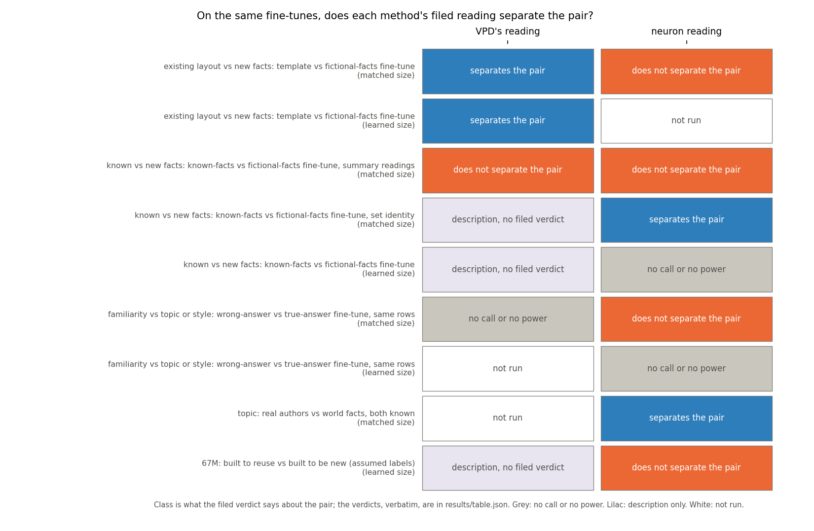
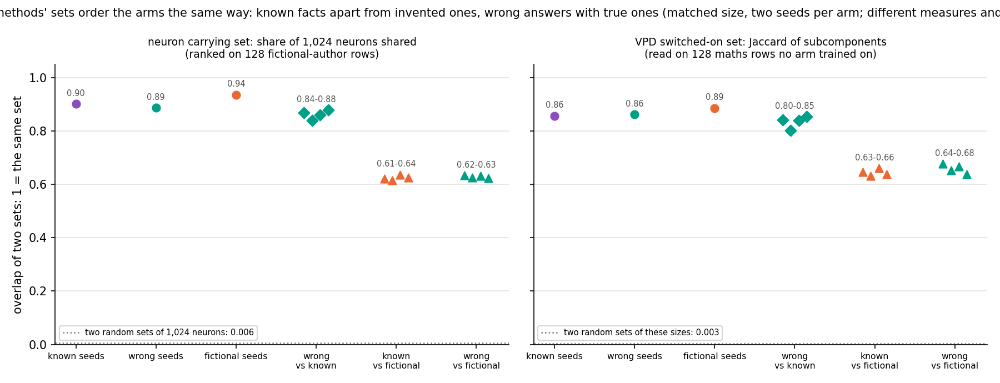

# Analysis: on the same Qwen fine-tunes, does a neuron reading tell new from existing any better or worse than VPD?

*2026-11-06, baseline-lead's table writer, for ask 24 option (a): the table as it stands, from existing reports, no
runs. Every cell is built by `experiments/neuron_vpd_table/build.py` from the result files named in its source column
and written to `experiments/neuron_vpd_table/results/table.json`; no verdict is re-scored. Provisional, like every
report it draws on. Independent check: holds with caveat
(`reports/reviews/2026-11-06_review_neurons-vs-vpd-table-independent-check.md`, commit a4f29839); its five fixes are
applied here. Provenance at the end.*

We set the neuron baseline's filed verdicts beside VPD's on the same saved Qwen3-1.7B fine-tunes, row by row, from
eight existing reports. At matched size VPD separates the layout fine-tune from the invented-facts one where the neuron
readings do not, but neither method follows whether the trained facts were already known. For `GOALS.md`, neither
method yet answers "new capability or strengthened one" on Qwen, and at the learned size neither reads the known or
wrong-answer pairs.

## The answer

Neither method tells new from existing on Qwen. At matched size VPD separates the layout fine-tune from invented
facts, where neurons do not, but a known-facts fine-tune reads on the invented side. Neurons separate known from
invented facts; VPD only descriptively. Wrong answers stay beside true ones, pointing to topic or style; VPD's is a
narrow no call. At the learned size neither reads them: no neuron power, VPD not yet run on the wrong-answer end
states, known-arm reads description.

## What the table compares

Three questions, each a pair of fine-tunes that differ in one label:

- **Existing layout against new facts.** The *template fine-tune* teaches a fixed answer layout that the unchanged
  model already produces under a system turn: built to bring out an existing behaviour. The *fictional-facts
  fine-tune* teaches invented authors' biographies from TOFU: built to add content. They also differ in rows, task,
  recipe and, at full length, 37 times in weight size.
- **Known against new facts.** The *known-facts fine-tune* uses the fictional one's task, sentence answers and recipe,
  on TOFU's 217 real-person and world-fact rows, which the unchanged model already answers. Only the content's novelty
  is meant to differ, but the topic, kind of entity and answer style differ too.
- **Familiarity against topic or style.** The *wrong-answer fine-tune* uses the known-facts rows and wording, with
  every stated answer swapped for a wrong one. Only agreement with what the model already says differs.

Two sizes. *Matched* is the step whose total weight change equals the template's, about 0.49; there the fictional arm
has not yet learned its facts, so per `decisions.md` row 152 it is a size control only. *Learned* is each run's end:
the fictional arm at step 1250, norm 18; the known and wrong arms at step 335, norm about 8.3.

**VPD's readings**, by qwen-decomp-lead, split each update over the subcomponents by least squares. The *outside share*
is the update's input-weighted energy outside the subcomponents. *Placement excess* is the split's share on
subcomponents already on, minus a random change's. The *switched-on set* holds the subcomponents the update turns on
that the unchanged model leaves off, on 128 maths rows no arm trained on. **The neuron readings**, by baseline-lead,
rank Qwen's 172,032 MLP neurons by first-order share of the update's gain. The top 1,024 form the *carrying set*. Its
*prompt overlap* is the share inside the neurons a system turn moves; its *engaged share* is how strongly they already
fired at the answers.

## The table

Verdicts in quotes are verbatim from the source; "class" is what the verdict says about the pair.

| question, size | VPD: verdict, reference | neurons: verdict, reference | source |
|---|---|---|---|
| layout vs new facts, matched | outside share and placement "counts", think overlap "does not count"; against the anchors' seed spread | prompt overlap "holds" against a random change, but the fictional arm reads 0.051, 0.052 beside the template's 0.056, 0.057, unscored; engaged share "misses"; job judge "no call" | E94 `table.json .comparisons.matched`; E102 `score.json`, `score_stageB.json .CB1_power_gate` |
| layout vs new facts, learned | outside, placement, think "counts"; random changes of both sizes: "does not count" | no filed comparison of the two | E94 `.comparisons.full` |
| known vs new facts, matched, summaries | outside "like anchor 2", f 0.90; placement "like anchor 2", f 0.65; think "no call: the anchors do not separate" | all four pair rules "level", each gap inside its band | E94 `table_amend1.json .sides.matched`; E103 `neurons_amend2.json .pair_rules_s142` |
| known vs new facts, matched, set identity | description only, on Jaccard: 0.632 to 0.660 across arms, 0.857 and 0.886 within; on shared-over-smaller the gap is inside the seed band, and the fictional sets are larger | "beyond seed noise" on both row sets; rows null "label" on both | E107 `amend1_sets.json .pairs`; E103 `.identity`; E105 `score.json` |
| known vs new facts, learned | description, not a filed verdict: outside "like anchor 2", placement "midway: no call", think "like anchor 2", reported only, sizes 2.2 times apart | "no power at this size": seeds share 0.652 | E94 `.sides.end`; E109 `score.json .tofu` |
| wrong vs true answers, matched | "no call": lowest pair 0.80303 against the line 0.80320 | "topic or style" on both row sets | E107 `amend1_sets.json .rule`; E107 `score.json .wrong` |
| wrong vs true answers, learned | not run: VPD not yet run on the wrong-answer end states, which E109 saved | "no call", "no power at this size" on both probes | E109 `score.json .tofu, .T` |
| real authors vs world facts, matched | not run | "topic moves the set" on the TOFU rows; "no call" on the real rows | E107 `score.json .topic` |
| 67M, built to reuse vs built to be new, assumed labels | description: VPD's r "separates" on all three rows both read, by E51's rule applied afterwards, not a filed verdict | separates one of three; filed "not a kind reader": "pass" | `method_table/results/table.json`; E98 `score.json .rows.P1` |

f places the known arm between the anchors' means, the template at 0 and the fictional arm at 1. E94's "anchor 2" is
the fictional-facts fine-tune.

## Does either method's reading separate the pairs?

**Reading it.** At matched size VPD separates the first pair and the neurons do not, but VPD's separation follows the training task,
not the label. VPD's outside share and placement count between the layout and invented-facts fine-tunes at both sizes;
the neurons' prompt overlap reads nearly the same for both at matched size, a reading from unscored numbers. The
known-facts fine-tune then lands with the invented one on VPD's two deciding readings: nine tenths and two thirds of
the way. The neurons' four summaries read it level. The neuron set separates known from invented facts by its filed
rule; VPD's set does so only as description. At the learned size only the layout pair separates, on VPD's side.

## Do the two methods' sets read the same thing?

**Reading it.** They place the arms in the same order, and neither shows familiarity. In both panels two seeds of one
arm share 0.86 to 0.94 of a set, and a known-facts and an invented-facts run share about 0.6. The wrong-answer run sits
with the true-answer run, as far from the invented run as the true one is. Random sets share under 0.01.

Three caveats keep this from being the same reading. The measures differ: share of the first set against Jaccard. On
the neurons' measure, VPD's known-against-invented gap falls inside its seed band. The invented arm's VPD sets are
larger, so part of its lower Jaccard is set size. The rows differ too.

On wrong against true answers, the neurons' filed verdict is "topic or style". VPD's is "no call": its lowest pair read
0.80303 against the line of 0.80320. Both tests had little room. At matched size the wrong and true updates differ by
about a seed, with weight cosine 0.825 against two seeds' 0.821. So the result points to topic or style; it does not
show it.

## What each reading is blind to

- **VPD's outside share and placement** describe where the weight change sits, not what it does; do-nothing reads the
  same outside share. At the matched size they compare two opening phases of training, and they follow task, format
  and recipe.
- **VPD's switched-on set** sees which subcomponents turn on, on maths rows, not how much each carries.
- **The neuron carrying set** is first-order and ranked on the rows it is scored on. At the learned size it does not
  reproduce across seeds.
- **Prompt overlap and engaged share** sit near their random references for every update. A judge naming neuron jobs
  failed its power check on biography neurons.
- **Both sets** are blind to a new circuit built from old parts, which reads as reuse (`decisions.md` row 121).

## Where neither reads

Familiarity at the learned size: VPD not yet run on the wrong-answer end states, and the neuron set lacks power there. Real
facts the model does not know, in the known arm's style. Known against invented facts at matched learning, since the
invented arm at matched size has learned nothing. The reinforcement-learning maths arms have VPD readings only; in
E104 they read like their shuffled-reward null on all three. E92's steering vector, a third cheap comparator, cannot be read
across the two anchors.

## What we learned

The neuron baseline does not beat VPD on the user's question, and VPD does not beat it either. Where they can be set
side by side on Qwen, they order the arms the same way. Summaries do not see whether facts were known. Set identity
points to the data's topic or style. Neither reads the known or wrong-answer pairs at the learned size. VPD's one extra separation, layout against invented facts, is
explained by task and format once the known-facts fine-tune is read. The 67M row, the only place VPD read further than
neurons, is description by a rule applied afterwards and rests on labels assumed from how each task was built.

## How compelling is the evidence

Two seeds per arm everywhere; one model, one decomposition. The matched size is a size control only. At it the
wrong-answer update differs from the true one by about a seed, so the familiarity test had little room in both methods.
The set comparison uses different measures and rows for the two methods. Every source report is provisional; E105 and
E107 have independent checks that hold with caveats.

## Surprises

None new; this report re-reads filed results. The closeness of the two methods' set overlaps was not filed anywhere and
is description.

## What next

1. **E109 Amendment 1**, a neuron ranking or set size whose seed overlap holds at the learned size, one free GPU job. If
   seeds reproduce, the familiarity row gets a neuron reading where facts are learned.
2. **Invented facts in the known arm's style**, a new plan. If known and invented facts still separate with style
   held, set identity reads novelty; if not, it reads style.
3. Running VPD's reads on E109's saved wrong-answer end states would give VPD the learned-size familiarity cell.

## Reads under, and departures

No verdict here is a reuse verdict, so `decisions.md` rows 81 and 87, Jain et al.'s definitions with held-out carrying,
do not apply. Row 152: "the matched step is a size control only: any claim that an update adds something new rests on
the full update, with its size stated." Row 121: "A new circuit built from old parts reads as reuse." Row 170 orders
this table first.

Departures from the literature: none new. The class column maps filed verdicts to a pair-level reading for display; it
adds no rule. Every reading is this project's measurement.

## Not run

- **E109 Amendment 1**, a stable ranking or set size at the learned size: next, per the user.
- **Invented new facts in the known arm's style**: next after it, per the user.
- VPD reads of the wrong-answer end states: VPD not yet run on them; E109 saved them as
  `experiments/larger_size/results/large/dW/WRONG_end{42,142}.safetensors`.
- VPD reads of the topic states.
- A neuron reading of the layout and invented-facts pair at the learned size.
- The neuron and VPD sets on the same rows with the same overlap measure.
- A fictional-facts state at norm 8.4, to size-match the learned-size comparison.
- VPD's switched-on set on the wrong-answer end states E109 saved (`experiments/larger_size/results/large/dW/WRONG_end{42,142}.safetensors`).

## Provenance

Built by `~/commute-agents/fleet/cpu-run python experiments/neuron_vpd_table/build.py`, CPU, seconds, $0. Inputs:
`experiments/qwen_d3_rows/results/{table,table_amend1,set_overlap}.json` (E94),
`experiments/qwen_carrying/results/{score,score_stageB}.json` (E102), `experiments/known_answer_pair/results/neurons_amend2.json`
(E103), `experiments/rows_null/results/score.json` (E105), `experiments/label_vs_style/results/{score,amend1_sets}.json`
(E107), `experiments/larger_size/results/score.json` (E109), `experiments/neuron_r/results/score.json` (E98),
`experiments/method_table/results/table.json`. Reports: `reports/analyses/2026-11-05_analysis_{e98-neuron-r,e92-comparators,e102-qwen-carrying}.md`,
`reports/analyses/2026-11-06_analysis_{e94-d3-rows,e103-known-answer-pair,e104-d3-gsm8k,e105-rows-null,e107-label-vs-style,e109-neurons-larger-size}.md`.
