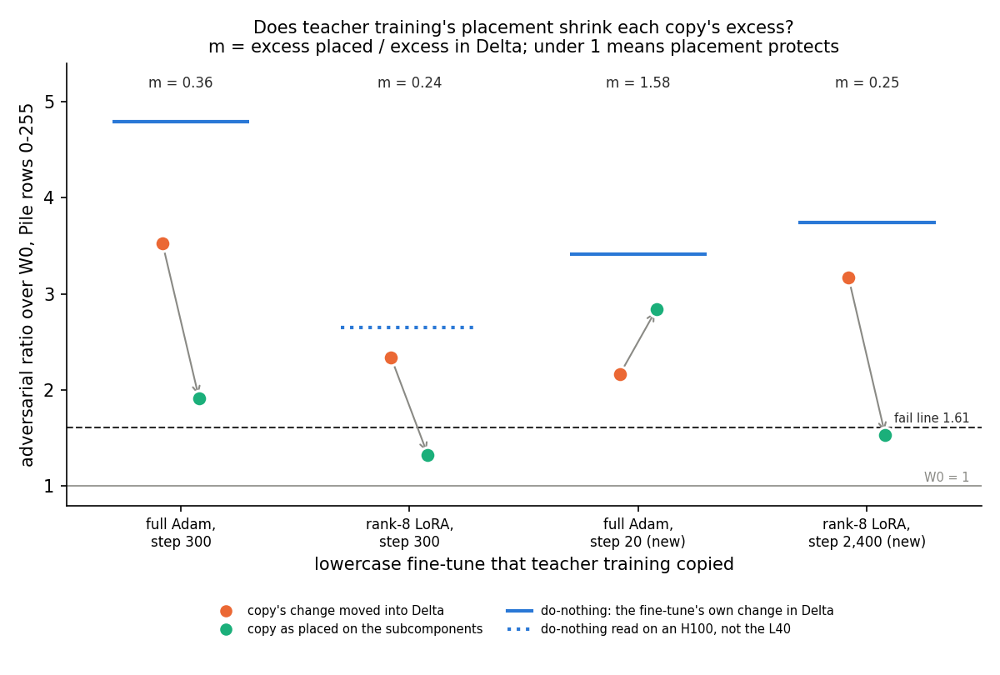

# E130: does teacher training's placement protect every copy it makes?

*2026-11-07, regating-lead's writer. Plan `reports/plans/2026-11-07_plan_e130-copy-protection.md`; filed rules
`experiments/copy_protection/results/predictions.json`; code `experiments/copy_protection/run.py`; result
`experiments/copy_protection/results/copy_protection.json`; figure `experiments/copy_protection/figures/placement.png`
from `experiments/copy_protection/plot.py`; notebook `notebooks/E130_copy_protection.ipynb`. MATS `debug` L40, job
55000, about 11 min of reads, $0, every control reproduced exactly. Design, rule and leans are Fable's
(`~/commute-data/scratch/regating-lead/fable-e128/advice.md`, written there as "E128"). Provisional: no independent
check, as the fast lane allows for a run under the gate.*

We took two more lowercase copies made by teacher training. We read each copy's own weight change twice under the
adversarial check: as teacher training placed it on the subcomponents, and moved into Δ. On one copy the placement
shrank the excess fourfold, as on the two copies read before, but on the other it made the excess larger. For
`GOALS.md`, teacher training's protective placement is not a fixed property of the recipe, so it cannot yet be relied
on to keep a decomposition faithful along training.

## The answer

No, the protection depends on which fine-tune is copied. The copy of the full Adam fine-tune stopped after 20 steps
reads 2.84 as placed and 2.17 with its own change moved into Δ, so its placement adds excess. The copy of a rank-8 LoRA
trained for 2,400 steps reads 1.53 placed and 3.17 in Δ, a fourfold cut like before. Across the four lowercase copies
read so far, the placed excess runs from a quarter to one and a half times the excess in Δ. Why is not known.

No reuse verdict is given, so `decisions.md` rows 81 and 87 are not read.

## What was tested

**Background.** Each matrix of the decomposition is $W = UV^\top + \Delta$, with Γ and Δ frozen. *Teacher training*
copies a fine-tuned model into the decomposition by training only the alive subcomponents' vectors $U, V$ on the KL
divergence from the fine-tuned model. *The check* is VPD's mask adversary on Pile validation rows 0-255: one seed-0
adversary of 20 sign steps per block of 128 rows. A state's **ratio** is its adversarial KL summed over the two blocks,
divided by W₀'s in the same job, so 1 means as hard to break as the released decomposition. E39's fail line sits at
1.61 and its pass line at 1.40. *Do-nothing* leaves the fine-tune's own weight change in Δ.

**What E127 found.** Its second amendment read two lowercase copies twice. A copy's weight change is
$S_c = U'V'^\top - UV^\top$. *As placed*, the subcomponents sit at the copy's $(U', V')$. *In Δ*, the target is
$W_0 + S_c$ with the subcomponents left at the released $(U, V)$. At full masks both are the same weights; only where
the change sits differs. The copy of the full Adam fine-tune read 1.91 placed and 3.53 in Δ. The copy of a rank-8 LoRA
fine-tune read 1.33 placed and 2.34 in Δ. So teacher training's placement divided the excess by 2.8 and 4.1.

**The question.** Is that division a constant of the recipe, or does it depend on what is copied? Two copies are not
enough to tell. E122 had made two more lowercase copies by the same recipe: Adam at $10^{-5}$, batch 8, 1,000 steps,
started from W₀'s $U, V$. Each copies a different fine-tune:

- **the step-20 Adam copy**, of the full Adam fine-tune stopped at step 20, chosen to match the LoRA's damage to plain
  text;
- **the step-2,400 LoRA copy**, of a rank-8 LoRA trained on to step 2,400 at a rate of $10^{-4}$, chosen to match the
  full Adam fine-tune's damage.

Each was read placed and in Δ, through E127's code path, on the same rows, card and adversary seed.

**The number.** The multiplier is $m = (\text{placed} - 1)/(\text{in Δ} - 1)$, the placed excess over the in-Δ
excess. Both reads divide by one W₀, so it is also the ratio of excesses in nats. $m = 1$ means placement does
nothing; under 1 it protects; over 1 it exposes. It is readable only when both excesses are at least the floor
$f = 0.209$, the spread of W₀'s own ratio over three adversary seeds.

**Controls, run first.** W₀ and both copies as placed must reproduce the stored readings within $10^{-3}$, relative.
The placed reads are E122's own readings of the same files, so they are the positive control for the path.

## What we expected, and why

Fable's claim was that the division is the recipe's: every copy trained from W₀'s start reads $m \le 0.5$. The null
was that it depends on the function: the step-20 Adam copy reads $m \ge 0.8$ while the LoRA copy stays recipe-like.

Fable leaned to the null, at 0.55. The step-20 Adam copy already looked unprotected: its placed excess is 76% of its
do-nothing's, against 24% for the standard Adam copy. And no copy's change in Δ had ever read more than 0.81 of its
fine-tune's do-nothing excess. If the step-20 copy obeyed that, its in-Δ ratio would sit at 2.7 to 2.9 and $m$ near 1.
The LoRA copy was expected at 2.4 to 3.1 in Δ, $m$ 0.25 to 0.4.

## What we observed

### Does teacher training's placement shrink each copy's excess?

**Reading it.** Not for every copy: on the step-20 Adam copy the placement makes the excess larger. Each orange point
is a copy's change in Δ, each green point the same change as placed, and the arrow runs from one to the other. On three
copies the arrow points down, to between a quarter and a third of the in-Δ excess. On the step-20 Adam copy it points
up: 2.17 in Δ becomes 2.84 placed, so $m$ is 1.58. All four in-Δ reads sit under their own do-nothing, the blue bar.
The step-20 copy's sits furthest under it, at 0.48 of do-nothing's excess where the others read 0.67 to 0.81. So
the step-20 copy carries a change that would read fairly well in Δ, and teacher training placed it where the adversary
finds more. One seed and one row set per copy.

| lowercase copy | fine-tune's damage, nats | placed | in Δ | do-nothing | $m$ | in-Δ share of do-nothing's excess |
|---|---|---|---|---|---|---|
| standard: full Adam, step 300 | 0.236 | 1.913 | 3.526 | 4.794 | 0.36 | 0.67 |
| rank-8 LoRA, step 300 | 0.121 | 1.326 | 2.336 | 2.653, H100 | 0.24 | 0.81, cards mixed |
| **new**: full Adam, step 20 | 0.126 | **2.842** | **2.165** | 3.409 | **1.58** | **0.48** |
| **new**: rank-8 LoRA, step 2,400 | 0.235 | **1.534** | **3.167** | 3.739 | **0.25** | **0.79** |

Sources: new rows `copy_protection.json` → `score.ratio`, `score.copies.*.m`, `score.copies.*["in-Delta share of
do-nothing excess"]`; earlier rows `ls_start_faith_amend2.json` → `score.ratio`, `score["R2 *"].m`; do-nothing
`damage_crossed.json` → `score.ratios["nothing_*|A"]` and, for the LoRA, `broad_fragility.json` →
`reads.nothing_lora.check`, read on an H100; damage from E122's table. Each ratio was recomputed from `kl` with `jq`
and agrees. In nats of excess over W₀, the step-20 copy reads 1.27 placed and 0.81 in Δ. The step-2,400 LoRA copy
reads 0.37 placed and 1.50 in Δ.

**Against Fable's leans.** Both verdicts and the headline came out as leaned. The values did not. The step-20 copy's
in-Δ ratio read 2.17, under the lean band of 2.7 to 2.9, and its $m$ of 1.58 sits over the band of 0.95 to 1.1. The
lean expected placement to do nothing for this copy; it made things worse. The LoRA copy's in-Δ ratio read 3.17, just
over its band's top of 3.1, and its $m$ of 0.246 just under the band's bottom of 0.25.

### Where the step-20 copy's excess sits

The ratio sums two blocks of 128 rows, each with its own adversary. Per block, over W₀'s block:

| state | rows 0-127 | rows 128-255 |
|---|---|---|
| step-20 Adam copy, placed | 1.22 | 4.35 |
| step-20 Adam copy, in Δ | 1.36 | 2.91 |
| step-2,400 LoRA copy, placed | 1.43 | 1.64 |
| step-2,400 LoRA copy, in Δ | 2.88 | 3.43 |

Source: `copy_protection.json` → `kl`, each block over `kl.W0`'s, with `jq`.

The step-20 copy's reversal comes from the second block. On rows 0-127 its placement still protects a little, a
per-block $m$ of 0.62. On rows 128-255 it reads 1.75. E122 found that block is where the step-20 copy failed and its
do-nothing read 5.34, against 1.33 on the first block. The LoRA copy protects on both blocks, at 0.23 and 0.26. So the
headline reversal rests on one block of 128 rows. It is large there: 3.35 ratio points of excess placed against 1.91 in
Δ.

### How far each copy's change sits from its fine-tune's

Report only, no rule. The input-weighted cosine of each copy's change to its own fine-tune's change is 0.58 for the
step-20 Adam copy and 0.59 for the LoRA copy. The Frobenius cosines are 0.34 and 0.29. On emoticon, E121's copies read
0.38 to 0.40 and a rerun of the fine-tune 0.83. Two copies at the same distance from their fine-tunes are placed with
opposite effects, so on these two the distance does not track the protection. Source: `copy_protection.json` →
`cosine`.

## What it means for the first gap

The first gap is why the copy of the broad lowercase Adam fine-tune fails the check. E127 had read it as an accounting
split: the copy's change fails in Δ, and teacher training's placement hides most but not all of it. That reading
leaned on the placement being protective by a steady factor, about three to four. It is not steady. Across the four
lowercase copies trained from W₀'s start, $m$ runs from 0.24 to 1.58.

As description only, one seed each: the two copies of rank-8 LoRA fine-tunes read 0.24 and 0.25. The two copies of
full-matrix Adam fine-tunes read 0.36 and 1.58. Damage to plain text does not order them. The two copies of fine-tunes
with damage near 0.12 read 0.24 and 1.58; the two near 0.24 read 0.25 and 0.36. Four points cannot say whether LoRA
versus full-matrix, the number of fine-tune steps, or something else sets $m$.

So "teacher training's placement divides the excess" is a finding about three of four copies, not a property of the
recipe. Teacher training's loss has no mask or adversary term, so nothing in it asks for a protective placement, and
here it did not always get one. A carrier for broad updates needs a placement that protects by design.

## How compelling is the evidence

- One adversary seed, one 20-step search, Pile rows 0-255 only, one L40.
- Every control reproduced to the last digit, so the path and the files are the ones E122 and E127 read.
- The step-20 copy's verdict is far from its edge. With its placed read fixed, "no protection" holds for any in-Δ
  ratio up to 3.30; it read 2.17, 5.4 floors under that. But the reversal rests on one block.
- The step-2,400 LoRA copy's placed excess is only 2.6 floors, so its $m$ is coarse. One floor either way on each
  read keeps it between 0.14 and 0.38, all under the 0.5 edge.
- The step-20 copy is a weaker copy than the others. It keeps 0.92 of its fine-tune's held-out gain, where the rest
  keep 0.96 to 1.01, and its damage to plain text is 1.07 times its fine-tune's.
- The LoRA copy of E127 has its do-nothing from an H100, so its in-Δ share mixes cards.

## Surprises

- **Placement made one copy worse.** We expected the step-20 copy's placement to do roughly nothing, $m$ near 1. It
  multiplied the excess by 1.58, like the least-squares start's placement does, though by less.
- The step-20 copy's change reads further under its do-nothing in Δ than any copy before, 0.48 of its excess. Its
  function looks less fragile in Δ than the other copies', yet its placed copy fails.
- A narrow lean miss: the LoRA copy's in-Δ ratio and $m$ each sat just outside their lean bands.

## What next

- **The step-20 copy on Pile rows 256-511, in Δ.** Placed, it reads 1.44 there. If in Δ reads under that, the reversal
  holds on a second row set; if over, it belongs to one block. About 3 min of L40, $0.
- **Where each change sits against Γ's causal importances**, on all four copies. The two new copies are at the same
  distance from their fine-tunes yet placed with opposite effect, so this read now has a contrast to explain.
- **Teacher training with a masked or adversarial term**, the synthesis' run for the first gap. This result makes it
  more needed: unaided placement protects three copies of four.

## Scorecard

| id | rule as filed | read | lean | verdict |
|---|---|---|---|---|
| C1 | W₀ mean block KL within 1e-3 of 0.691743 | 0.691743 | | exact |
| C2 | c1, c2 placed within 1e-3 of 2.842 and 1.534 | 2.842, 1.534 | | exact |
| C3 | card L40 | L40 | | held |
| C4 | a resubmitted job rereads W₀'s first block within 1e-6 | one job, no resubmission | | not exercised |
| C5 | alive U, V equal E121's; file sha256 equal E122's | load asserts passed, `done: true` | | held |
| R1 c1 | m = (placed − 1)/(in Δ − 1), both excesses ≥ f = 0.209 | excesses 1.842 and 1.165; m 1.581 | in Δ 2.7-2.9, m 0.95-1.1 | readable; in Δ 2.165 under the band, m over it |
| R2 c1 | m ≤ 0.5 recipe-like, ≥ 0.8 no protection, else partial | 1.581 | no protection 0.6 | **no protection**, as leaned |
| R1 c2 | as R1 c1 | excesses 0.534 and 2.167; m 0.246 | in Δ 2.4-3.1, m 0.25-0.4 | readable; in Δ 3.167 just over the band, m just under |
| R2 c2 | as R2 c1 | 0.246 | recipe-like 0.7 | **recipe-like**, as leaned |
| R3 | both recipe-like → recipe constant; any no protection → function-dependent; else partial; suffix if an in-Δ ratio exceeds its do-nothing | c1 no protection; in-Δ 2.165 < 3.409, 3.167 < 3.739 | function-dependent 0.55 | **function-dependent**, no suffix, as leaned |
| descriptive | in-Δ excess over its do-nothing's excess; known copies 0.67-0.81 | c1 0.484, c2 0.791 | | c1 under the known range, c2 inside |
| cosine | report only | weighted 0.576, 0.587 to own fine-tune; 0.239, 0.431 to the step-300 Adam fine-tune | none | reported |

## Departures from the literature

- **The check.** The VPD paper reports the adversarial loss, not pass lines. The lines, the floor and one adversary per
  128-row block are ours. The lines were set from W₀'s floor on an H100 and are used here on an L40, as in E122.
- **Reading a copy's change in Δ** at the same weights is ours, to compare placements; the paper reads one
  decomposition with its own Δ. The multiplier $m$ is ours.
- **Teacher training is not VPD's component training**, which trains Γ with faithfulness, stochastic and minimality
  losses. Its KL loss also departs from Hinton et al. 2015: temperature 1, no hard-label term.

## Not run

- Adversary seeds 1 and 2, and Pile rows 256-511, for the in-Δ reads.
- Where any copy's change sits against Γ's causal importances.
- The weight cosine of E127's two copies to their fine-tunes.
- The rank-8 LoRA's own do-nothing on the L40.
- More copies, or more seeds of these copies; copies of other tasks. Emoticon's copies have about 0.005 nats of
  excess, nothing to divide.
- Teacher training with any mask or adversary term.
- An independent check of this report.

## Provenance

Job 55000, MATS `debug`, NVIDIA L40, started 2026-11-07 00:21. Five PGD reads of 127-128 s each and the cosine in
14 s. Result `experiments/copy_protection/results/copy_protection.json`, `done: true`. Copy files
`~/commute-data/results-large/damage_crossed/tt_c1.pt` sha256 `3f2cb87e…` and `tt_c2.pt` `8304ffb3…`, checked at load.
