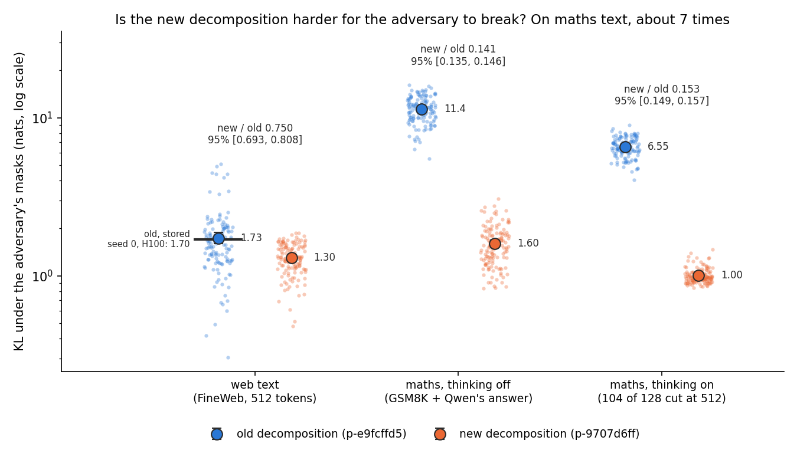
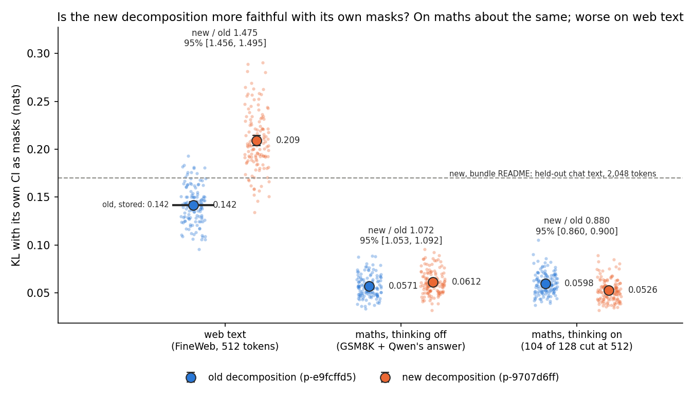
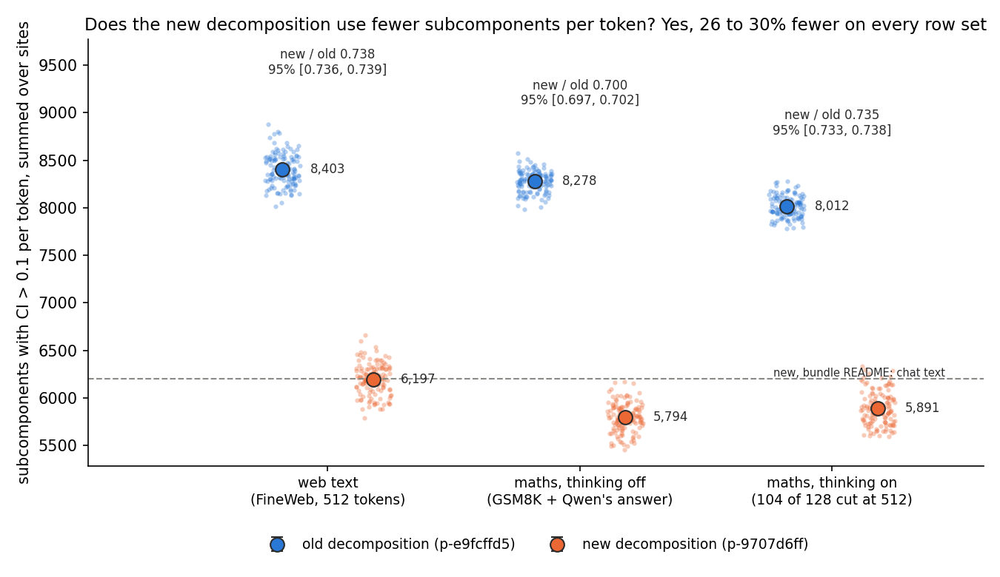

# E131: is Goodfire's new Qwen3-1.7B decomposition more faithful on reasoning text?

We loaded Goodfire's second decomposition of Qwen3-1.7B into our code, checked it against the authors' library, and compared it with the old one on web text and on GSM8K answers Qwen wrote itself. On the maths text the new decomposition is about seven times harder for VPD's mask adversary to break and about as faithful with its own masks, while on web text, outside its training data, it is less faithful with its own masks. Since the readings `GOALS.md` asks for rest on faithfulness on GSM8K text, the new decomposition looks the better base, provisionally: one adversary seed, 128 rows per set, no independent check.

**The answer.** Yes under the adversary, not with its own masks. The new decomposition loads and runs in our code, matching the authors' library. On GSM8K solutions written by Qwen itself, VPD's mask adversary pushes the old decomposition about seven times further from the model than the new one, with thinking on or off. With its own causal importance as masks the two are about equally faithful on maths. On web text the new one is less faithful with its own masks. It switches on about 30% fewer subcomponents per token.

Notebook: `notebooks/E131_new_decomposition.ipynb`. Plan: `reports/plans/2026-11-07_plan_e131-new-decomposition.md`. User request (2026-11-07): "download it, ensure it works and maybe run a quick check to see how it compares with the older decomposition, especially around reasoning tasks."

## What we were trying to test

The user was given a second decomposition of Qwen3-1.7B, run p-9707d6ff, said to be more faithful on reasoning tasks. Every Qwen reading so far used the first one, run p-e9fcffd5. Below they are **the new decomposition** and **the old decomposition**. Both write each weight matrix of the model as a sum of rank-one subcomponents, $W \approx \sum_c V_{:,c} U_{c,:}$, and both come with a learned causal importance function Γ that gives each subcomponent a value $g$ between 0 and 1 at every token: 0 means the subcomponent can be dropped there, 1 means it is needed.

The two were trained on different text. The old one saw a text mix called firestock3, in windows of 512 tokens. The new one saw chat-formatted text in windows of 2,048 tokens, 30% of it written by Qwen3-1.7B itself, some in thinking mode.

Both decompositions were read on the same three row sets, each of 128 rows of at most 512 tokens:

- **web text**: the 128 FineWeb rows of `experiments/qwen_adversary/results/tokens.json`, 512 tokens each;
- **maths, thinking off**: the first 128 GSM8K test prompts in Qwen's chat template with the GSM8K baseline's instruction, followed by Qwen3-1.7B's own greedy answer; 7 rows were cut at 512 tokens, mean length 307;
- **maths, thinking on**: the same prompts with thinking on; 104 of 128 rows were cut at 512 tokens, mean length 500.

Three numbers were read per row, each a mean over the row's tokens, then averaged over rows with rows weighted equally:

1. **KL with its own masks**: the KL divergence from the model's next-token distribution to the decomposed model's, when each subcomponent is multiplied by its own $g$ and the residual Δ is left out. 0 means the masked model predicts exactly like the model.
2. **KL under the adversary**: the same KL, with the masks moved by VPD's configured evaluation adversary. Each mask is $g + (1-g)s$ with one source $s \in [0,1]$ per matrix shared by all rows and tokens, plus one scalar for Δ. The sources start at random and take 20 sign steps of 0.1 up the row set's token-weighted KL. One random start, seed 0, the same for both decompositions. A large number means the decomposition is easy to break.
3. **Active count**: how many subcomponents have $g > 0.1$ at a token, summed over all 196 matrices.

There is no do-nothing reference: the old decomposition is the reference for the new one, row for row. Each comparison is the ratio of the new mean to the old mean on the same rows, with a 95% interval from 10,000 resamples of the 128 row indices, the same indices for both.

## What we expected, and why

The new decomposition was trained on chat text that includes Qwen's own answers, so we expected it to be more faithful than the old one on both maths row sets, by both KL numbers. Four predictions were filed before the run: on each maths row set, the new mean below the old, with the whole 95% interval of the ratio below 1. Web text and the active count were reported without a prediction.

## Does the port work?

Yes, every control passed before any reading ran (`results/controls.json`, `results/jax_reference.json`).

| control | read | bound |
|---|---|---|
| new subcomponents rebuild each of the 196 matrices, worst relative Frobenius error | 0.005499, `layers.27.mlp.up_proj` | 0.0055, the bundle's own check; largest gap to its csv 8.6e-7 |
| our Γ against the JAX library 7d2e5aee8 on 8 rows, both fed JAX's residual inputs: share of values off by more than 0.1 | 1.2e-5 of 1.68e9 | 1e-4; the old port read 2.4e-5 |
| the same, our code end to end | 2.5e-5 | reported beside it |
| active count per row, our Γ vs JAX | within 21 on every row, JAX 6,124 to 7,061 | reported |
| KL with own masks per row, our fp32 vs JAX bf16 | within 0.0023 on every row | reported |
| old decomposition through the new code, KL with own masks on web text | 0.141659 | stored 0.141671, within 2%: off by 0.008% |

The old decomposition's KL under the adversary on web text, 1.734, sits within 2% of the 1.70 stored by `experiments/qwen_adversary` for the same seed on an H100. The new decomposition's active count on web text, 6,197, matches the bundle README's 6,200 on chat text.

## Is the new decomposition harder for the adversary to break on maths text?

| row set | old | new | new / old | 95% interval | rows lower on new |
|---|---|---|---|---|---|
| web text | 1.734 | 1.301 | 0.750 | [0.693, 0.808] | 103 of 128 |
| maths, thinking off | 11.360 | 1.596 | 0.141 | [0.135, 0.146] | 128 of 128 |
| maths, thinking on | 6.554 | 1.002 | 0.153 | [0.149, 0.157] | 128 of 128 |

Per-row ranges: old 5.49 to 16.08 and new 0.83 to 3.07 on maths with thinking off; old 4.03 to 9.01 and new 0.84 to 1.47 with thinking on. The token-weighted values the adversary climbed were old 10.92, new 1.47 with thinking off; old 6.53, new 1.00 with thinking on.

**Reading it.** Yes, by a wide margin on maths text. The adversary pushes the old decomposition to a KL of 11.4 nats on maths with thinking off and 6.6 with thinking on. The new one stays at 1.6 and 1.0. That is a ratio of 0.14 to 0.15, and every one of the 256 maths rows reads lower on the new decomposition: the clouds do not overlap. On web text the new one is also harder to break, at 1.3 against 1.7, with a fifth of the rows going the other way. The old decomposition's weakness on maths is large in its own terms too: four to seven times its web-text value. The interval covers the rows only; with one adversary start it says nothing about seed-to-seed spread, which was 19% on web text before.

## Is the new decomposition more faithful with its own masks?

| row set | old | new | new / old | 95% interval | rows lower on new |
|---|---|---|---|---|---|
| web text | 0.1417 | 0.2090 | 1.475 | [1.456, 1.495] | 0 of 128 |
| maths, thinking off | 0.0571 | 0.0612 | 1.072 | [1.053, 1.092] | 34 of 128 |
| maths, thinking on | 0.0598 | 0.0526 | 0.880 | [0.860, 0.900] | 110 of 128 |

**Reading it.** Not on maths with thinking off, a little on maths with thinking on, and no on web text. With thinking off the new decomposition reads 0.061 nats against the old one's 0.057, 7% higher, and only 34 of 128 rows are lower on the new one: the filed prediction missed. With thinking on it reads 0.053 against 0.060, 12% lower. On web text the new one reads 0.209 against 0.142, about half again as much, and higher on every row. The bundle README gives 0.17 for the new decomposition on its own held-out chat text at 2,048 tokens; web text at 512 tokens is outside that training distribution. Both decompositions read far lower on maths than on web text. Part of that is the rows themselves: the maths answers are Qwen's own greedy output, so the model is confident on them and there is less of its distribution to get wrong.

## Does the new decomposition use fewer subcomponents per token?

| row set | old | new | new / old | 95% interval |
|---|---|---|---|---|
| web text | 8,403 | 6,197 | 0.738 | [0.736, 0.739] |
| maths, thinking off | 8,278 | 5,794 | 0.700 | [0.697, 0.702] |
| maths, thinking on | 8,012 | 5,891 | 0.735 | [0.733, 0.738] |

**Reading it.** Yes: the new decomposition switches on 26 to 30% fewer subcomponents per token on every row set, and fewer on every row. On web text it reads 6,197, the same as the bundle README's 6,200 on chat text. Both decompositions have 688,128 subcomponents in all, so the new one explains each token with a sparser set while, on maths, staying about as faithful with its own masks.

## What we learned

`GOALS.md` asks whether a decomposition stays interpretable along post-training, and our Qwen updates are fine-tunes on GSM8K. Every reading of such an update rests on the decomposition being faithful on the update's own text. On that text the old decomposition is four to seven times easier for the adversary to break than on web text, and the new one is not. With its own masks the two are about equal on maths, and the new one is sparser. So the new decomposition looks the better base for later Qwen readings on maths text, provisionally, and readings on web text would lose some faithfulness with it.

## How compelling is the evidence

The adversary gap is large and consistent: every maths row, both thinking settings, ratios near 0.15 with narrow intervals. What it rests on is narrow. There was one adversary start, so seed-to-seed spread is not measured. There are 128 rows per set, all from the first 128 GSM8K test prompts. The thinking-on rows are mostly cut at 512 tokens, so they show the start of a thinking trace and rarely its end. The KL numbers say how close the masked model's distribution stays, not whether the masked model still solves the problem: no task accuracy was measured with the masks. Web text lies outside the new decomposition's training data, so the web-text readings say how it carries over, not how good it is. None of this says the subcomponents mean anything: the bundle has no labels. This is a fast-lane reading: the lead read and labelled it, with no independent check.

## Surprises

The filed prediction for maths with thinking off missed: the new decomposition is 7% less faithful with its own masks there, not more. Only the adversary separates the two on maths. The size of the old decomposition's weakness on maths was not anticipated either: 11.4 nats against 1.7 on web text.

## What next

- **Move the GSM8K readings to the new decomposition.** A card for the user; the next Qwen reading waits on it.
- **Task accuracy with the masks.** GSM8K answers with each decomposition's own masks. If the new one keeps the answers right and the old one does not, the adversary gap shows up in behaviour too.
- **Three adversary seeds on maths**, if the adversary gap goes into a write-up's answer paragraph: that makes it a headline claim, which needs an independent check.

## Scorecard

Rule (`results/predictions.json`, `score.py`): the ratio of the new mean to the old mean over the same 128 rows, with a 95% interval from 10,000 row resamples, numpy seed 0; pass when the ratio and the interval's upper end are both below 1; unreadable on fewer than 2 rows, unequal counts, a non-finite value or a zero old mean.

| id | claim in words | read: ratio [95% interval] | verdict |
|---|---|---|---|
| P1 | new more faithful with its own masks, maths thinking off | 1.072 [1.053, 1.092] | miss |
| P2 | new more faithful under the adversary, maths thinking off | 0.141 [0.135, 0.146] | pass |
| P3 | new more faithful with its own masks, maths thinking on | 0.880 [0.860, 0.900] | pass |
| P4 | new more faithful under the adversary, maths thinking on | 0.153 [0.149, 0.157] | pass |

Reported without a prediction: web text for all three numbers, and the active count on every row set (tables above). No reuse verdict is read here, so `decisions.md` rows 81 and 87 do not apply.

## Not run

- More than one adversary start; seed-to-seed spread on maths.
- Task accuracy on GSM8K with either decomposition's masks.
- Rows past 512 tokens; most thinking traces were cut.
- More than 128 rows per set, or maths outside GSM8K.
- Chat text like the new decomposition's training data, other than the maths rows.
- Any labelling of the new subcomponents.
- An independent check of any number.

## Departures from the literature

The build departures accepted in the plan, each against its source:

- **Adversary starts.** VPD's configured evaluation adversary is used as written, one random start, seed 0. The earlier Qwen adversary run reported the mean of three starts, 1.62 on web text, of which seed 0 read 1.70. Three starts would not fit the 2 h `debug` limit.
- **Per-row adversary values.** The adversary's sources are shared by all rows of a row set, as the config does. Per-row values are read at the final sources of that one pooled attack, so the row resampling does not cover seed spread.
- **JAX comparison.** The check of our Γ against the authors' JAX library feeds both the same JAX residual-stream inputs, as the old port's check did. Run end to end, the share off by more than 0.1 is 2.5e-5, also under the bound.
- **Rows.** Every row is cut at 512 tokens, the old decomposition's training length, while the new one was trained at 2,048. The maths answers are the first 128 GSM8K test prompts, generated in bf16, greedy, in batches of 64.

## Provenance

Results in `experiments/qwen_new_decomp/results/`: `controls.json`, `jax_reference.json`, `rows.json`, `measure_{new,old}_{T,G,G-think}.json` (T web text, G maths thinking off, G-think thinking on), `score.json`; filed rules in `predictions.json`. Code `run.py`, `score.py`, `convert.py`, `jax_reference.py` at commit 8f084d29; figures by `plot.py`. MATS `debug` L40 jobs 55508 (download), 55531 (conversion), 55532 (JAX reference), 55535 (controls), 55537 to 55542 (one per decomposition and row set), run between 10:32 and 15:56 UTC on 2026-11-07, $0. Adversary stages took 26 to 39 min each. Converted Γ at `~/commute-data/artifacts/qwen3-1.7b-p-9707d6ff-torch`; bundle at `~/commute-data/artifacts/p-9707d6ff-share/`.
