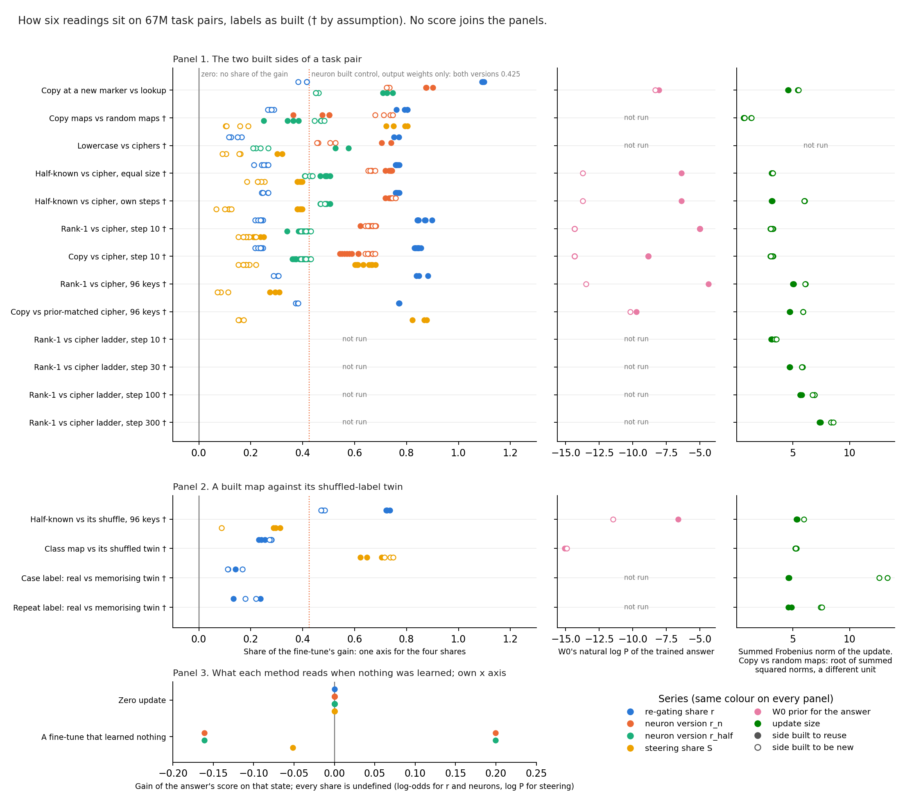

# Scorecard: what each method reads on the 67M task pairs, as it stands

*2026-11-09, cell P2.2, compare-lead's writer. From saved results only: no new run, no GPU, no model loaded, $0. Built by
`experiments/method_table/scorecard.py`, which writes `experiments/method_table/results/scorecard.json` and
`experiments/method_table/figures/scorecard.png`.*

We gathered the saved readings of five methods on every 67M task pair into one table and one figure. Three methods are
shares of the fine-tune's gain, and two are numbers about the answer or the update that need no decomposition. For the paper's second part this is the record to compare against, with no verdict, because the
definition of reused against new is under revision.

## What is in the table

**Labels.** Every pair keeps the labels it was built with, because the definition of reused against new is under revision
in the paper plan's first part. Most pairs carry the mark † from `table.json`: labelled only by assumption, as built, with no causal check.
The one exception is copy at a new marker against lookup, labelled by a causal check, whose copy side is not settled as
filed. The two label pairs at the end are not in `table.json`; their twin labels are as built, and they carry † too. No
number, band or threshold in this report reads a verdict off the figure.

**Methods, one column each, defined once here.** Each share is the part of the fine-tune's gain that the method
recovers on the original model.

- **r, the re-gating share.** The gain that appears when the original subcomponents are kept and only Γ's causal
  importances change on the fine-tuned activations. It is 0 for none of the gain and 1 for all of it. Values above 1
  are possible and saved.
- **r_n, the neuron version with whole-width firing.** W0's weights run on every MLP neuron's fine-tuned firing, as a
  share of the gain.
- **r_half, the neuron version with only the input changed.** Both MLP matrices stay W0's and only their input changes.
  E98 filed both neuron readings, so both are shown and neither is picked.
- **S, the steering share.** One mean residual shift, added to the original model, as a share of the gain.
- **W0 prior.** The original model's probability of the trained answer, before any fine-tune. Most rows save it as a
  geometric mean P. Two rows save it as a mean ln P, marked in the cell. The figure draws all of them as ln P.
- **Update size.** The summed Frobenius norm of the update, the sum over matrices of ‖δW‖. The copy-maps row is instead the
  root of the summed squared matrix norms, and is marked.

**Criteria, one panel each.** The panels are the criteria the saved numbers allow.

1. **The two built sides of a task pair.** Each method on the side built to reuse and the side built to be new, on ten
   pairs.
2. **A built map against its shuffled-label twin.** Four pairs whose second side keeps the words and answers but shuffles
   the link between them.
3. **A state where nothing was learned.** What each method reads on a zero update and on a fine-tune that learned
   nothing. Every share is undefined there, so the panel plots the gain, or the largest change to W0's log-odds.

The do-nothing placement of the update, which leaves δW in Δ, is also read and has its own row. Its r equals the
least-squares split's r on all eight states read, so it adds no separate reference for r.

**Left out, in one line.** Qwen3-1.7B rows and the 3M minGPT counting rows are left out, because part two is the 67M only.

The cell names five methods, so `table.json`'s other columns stay in `table.json`: the stand-in ratio, distance, MLP
share, weight statistics, neuron patching, prompting, pruning, reverse fine-tuning, the readouts, sparsity and the probe.

## The table

Cells read reuse side / new side, as a minimum to maximum over seeds or states. Square brackets give the source and m-numbers the marks on
that cell, both listed under the table. † means labelled only by assumption, as
built.

| pair | re-gating r | neuron r_n | neuron r_half | steering S | W0 prior | update size |
|---|---|---|---|---|---|---|
| **Built pairs: built to reuse / built to be new** | | | | | | |
| Copy at a new marker vs lookup | 1.09 to 1.10 / 0.38 to 0.42 [1] m1 | 0.87 to 0.90 / 0.72 to 0.73 [2] | 0.71 to 0.75 / 0.45 to 0.46 [3] | not run | 3.2e-04 / 2.4e-04 [4] | 4.57 to 4.62 / 5.45 to 5.50 [5] |
| Copy maps vs random maps † | 0.76 to 0.80 / 0.27 to 0.29 [6] | 0.36 to 0.50 / 0.68 to 0.75 [7] | 0.25 to 0.38 / 0.45 to 0.48 [8] | 0.72 to 0.80 / 0.10 to 0.19 [9] | not run | 0.68 to 0.69 / 0.75 to 1.34 [10] m2 |
| Lowercase vs ciphers † | 0.75 to 0.77 / 0.12 to 0.17 [11] | 0.70 to 0.74 / 0.45 to 0.53 [12] | 0.53 to 0.58 / 0.21 to 0.27 [13] | 0.30 to 0.32 / 0.09 to 0.16 [14] m3 | not run | not run |
| Half-known vs cipher, equal size † | 0.76 to 0.77 / 0.21 to 0.27 [15] | 0.72 to 0.74 / 0.65 to 0.68 [16] m4 | 0.47 to 0.50 / 0.41 to 0.44 [17] m4 | 0.38 to 0.40 / 0.18 to 0.25 [18] m5 | 1.7e-03 / 1.1e-06 [19] | 3.14 to 3.21 / 3.18 to 3.25 [20] |
| Half-known vs cipher, own steps † | 0.76 to 0.77 / 0.24 to 0.27 [21] | 0.72 to 0.74 / 0.75 to 0.76 [22] m6 | 0.47 to 0.50 / 0.47 to 0.48 [23] m6 | 0.38 to 0.40 / 0.07 to 0.13 [24] m7 | 1.7e-03 / 1.1e-06 [25] | 3.14 to 3.21 / 6.00 to 6.05 [26] |
| Rank-1 vs cipher, step 10 † | 0.84 to 0.90 / 0.22 to 0.25 [27] | 0.62 to 0.68 / 0.64 to 0.68 [28] m4 | 0.34 to 0.42 / 0.39 to 0.43 [29] m4 | 0.18 to 0.25 / 0.15 to 0.22 [30] | -5.00 / -14.32 [31] m8 | 3.10 to 3.19 / 3.03 to 3.26 [32] |
| Copy vs cipher, step 10 † | 0.83 to 0.86 / 0.22 to 0.25 [33] | 0.54 to 0.61 / 0.64 to 0.68 [34] m4 | 0.36 to 0.42 / 0.39 to 0.43 [35] m4 | 0.60 to 0.68 / 0.15 to 0.22 [36] | -8.85 / -14.32 [37] m8 | 3.09 to 3.15 / 3.03 to 3.26 [38] |
| Rank-1 vs cipher, 96 keys † | 0.84 to 0.88 / 0.29 to 0.31 [39] | not run | not run | 0.27 to 0.31 / 0.07 to 0.11 [40] | 1.3e-02 / 1.4e-06 [41] | 5.02 to 5.08 / 6.10 to 6.13 [42] |
| Copy vs prior-matched cipher, 96 keys † | 0.77 / 0.37 to 0.38 [43] | not run | not run | 0.82 to 0.88 / 0.15 to 0.17 [44] | 5.9e-05 / 3.7e-05 [45] | 4.70 to 4.77 / 5.90 to 5.92 [46] |
| Rank-1 vs cipher, steps 10-300 † | not run | not run | not run | not run | not run | step 10: 3.10 to 3.18 / 3.42 to 3.55; step 30: 4.71 to 4.76 / 5.78 to 5.86; step 100: 5.65 to 5.78 / 6.74 to 6.93; step 300: 7.34 to 7.47 / 8.34 to 8.57 [47] |
| **Shuffled-label twins: built map / twin** | | | | | | |
| Half-known vs its shuffle, 96 keys † | 0.72 to 0.74 / 0.47 to 0.48 [48] | not run | not run | 0.29 to 0.31 / 0.09 [49] m9 | 1.3e-03 / 1.0e-05 [50] | 5.31 to 5.39 / 5.97 [51] m9 |
| Class map vs its shuffled twin † | 0.23 to 0.25 / 0.27 to 0.28 [52] | not run | not run | 0.62 to 0.70 / 0.72 to 0.75 [53] | 2.8e-07 / 3.3e-07 [54] | 5.20 to 5.28 / 5.23 to 5.32 [55] |
| Case label: real vs memorising twin † | 0.11 to 0.14 / 0.11 to 0.17 [56] m10 | not run | not run | not run | not run | 4.60 to 4.68 / 12.61 to 13.33 [57] m10 |
| Repeat label: real vs memorising twin † | 0.13 to 0.24 / 0.18 to 0.22 [58] m11 | not run | not run | not run | not run | 4.61 to 4.91 / 7.47 to 7.55 [59] m11 |
| **Do-nothing states: the gain or change read on that state, except the placement row, which reads r** | | | | | | |
| Zero update | 0.00 [60] m12 | 0.00 [61] m13 | 0.00 [62] m13 | 0.00 [63] m14 | not run | not run |
| A fine-tune that learned nothing | not run | -0.16 to 0.20 [64] m15 | -0.16 to 0.20 [65] m16 | -0.05 [66] m17 | not run | not run |
| Do-nothing placement of the update | 0.11 to 0.24 [67] m18 | not run | not run | not run | not run | not run |

**Sources.** One line per numbered cell: file, then the JSON key; "sibling keys" are the same key on the other seeds or states.

- [1] `experiments/induction_cue/results/run.json` ["score"]["r_copy"] and 1 sibling keys
- [2] `experiments/neuron_r/results/cells.json` ["rows"]["e62_copy_s0"]["r_n"] and 5 sibling keys
- [3] `experiments/neuron_r/results/cells.json` ["rows"]["e62_copy_s0"]["r_half"] and 5 sibling keys
- [4] `experiments/induction_cue/results/run.json` ["stage_b"]["prior_copy"] and 1 sibling keys
- [5] `experiments/induction_cue/results/run.json` ["states"]["copy_s0"]["norm"] and 5 sibling keys
- [6] `experiments/regating_truth_table/results/table.json` ["runs"]["e46/ident32_s0"]["r"]["value"] and 7 sibling keys
- [7] `experiments/neuron_r/results/cells.json` ["rows"]["ident32_s0"]["r_n"] and 7 sibling keys
- [8] `experiments/neuron_r/results/cells.json` ["rows"]["ident32_s0"]["r_half"] and 7 sibling keys
- [9] `experiments/baseline_neurons/results/baseline_neurons.json` ["b3"]["ident32_s0"]["S"] and 7 sibling keys
- [10] `experiments/method_table/results/table.json` ["rows"]["3"]["cells"]["labeller"]["reading"]["new"] and 1 sibling keys
- [11] `experiments/regating_truth_table/results/table.json` ["runs"]["e53/broad_cipher_s0"]["r"]["value"] and 5 sibling keys
- [12] `experiments/neuron_r/results/cells.json` ["rows"]["broad_cipher_s0"]["r_n"] and 5 sibling keys
- [13] `experiments/neuron_r/results/cells.json` ["rows"]["broad_cipher_s0"]["r_half"] and 5 sibling keys
- [14] `experiments/regating_truth_table/results/table.json` ["runs"]["e53/broad_cipher_s0"]["S"]["value"] and 5 sibling keys
- [15] `experiments/keydependent_patch/results/job1.json` ["states"]["cipher_s0"]["r"] and 9 sibling keys; also `experiments/keydependent_patch/results/job2.json`
- [16] `experiments/neuron_r/results/cells.json` ["rows"]["cipher_s0"]["r_n"] and 9 sibling keys
- [17] `experiments/neuron_r/results/cells.json` ["rows"]["cipher_s0"]["r_half"] and 9 sibling keys
- [18] `experiments/keydependent_patch/results/job1.json` ["states"]["cipher_s0"]["S"] and 9 sibling keys; also `experiments/keydependent_patch/results/job2.json`
- [19] `experiments/keydependent_patch/results/job2.json` ["stage0"]["cipher"]["rate"] and 1 sibling keys
- [20] `experiments/keydependent_elicit/results/stage2.json` ["finetunes"]["cipher_s0"]["norm"] and 9 sibling keys; also `experiments/keydependent_patch/results/job2.json`
- [21] `experiments/keydependent_patch/results/job1.json` ["states"]["cipher_own_s0"]["r"] and 9 sibling keys; also `experiments/keydependent_patch/results/job2.json`
- [22] `experiments/neuron_r/results/cells.json` ["rows"]["cipher_own_s0"]["r_n"] and 6 sibling keys
- [23] `experiments/neuron_r/results/cells.json` ["rows"]["cipher_own_s0"]["r_half"] and 6 sibling keys
- [24] `experiments/keydependent_patch/results/job1.json` ["states"]["cipher_own_s0"]["S"] and 9 sibling keys; also `experiments/keydependent_patch/results/job2.json`
- [25] `experiments/keydependent_patch/results/job2.json` ["stage0"]["cipher"]["rate"] and 1 sibling keys
- [26] `experiments/keydependent_elicit/results/stage2.json` ["finetunes"]["cipher_own_s0"]["norm"] and 9 sibling keys; also `experiments/keydependent_patch/results/job2.json`
- [27] `experiments/open_pair_instruments/results/run.json` ["columns"]["r"]["cipher"] and 1 sibling keys
- [28] `experiments/neuron_r/results/cells.json` ["rows"]["c3_cipher_s0"]["r_n"] and 15 sibling keys
- [29] `experiments/neuron_r/results/cells.json` ["rows"]["c3_cipher_s0"]["r_half"] and 15 sibling keys
- [30] `experiments/open_pair_instruments/results/run.json` ["columns"]["S"]["cipher"] and 1 sibling keys
- [31] `experiments/open_pair_instruments/results/run.json` ["columns"]["prior"]["cipher"] and 1 sibling keys
- [32] `experiments/open_pair_instruments/results/run.json` ["columns"]["norm"]["cipher"] and 1 sibling keys
- [33] `experiments/open_pair_instruments/results/run.json` ["columns"]["r"]["cipher"] and 1 sibling keys
- [34] `experiments/neuron_r/results/cells.json` ["rows"]["c3_cipher_s0"]["r_n"] and 15 sibling keys
- [35] `experiments/neuron_r/results/cells.json` ["rows"]["c3_cipher_s0"]["r_half"] and 15 sibling keys
- [36] `experiments/open_pair_instruments/results/run.json` ["columns"]["S"]["cipher"] and 1 sibling keys
- [37] `experiments/open_pair_instruments/results/run.json` ["columns"]["prior"]["cipher"] and 1 sibling keys
- [38] `experiments/open_pair_instruments/results/run.json` ["columns"]["norm"]["cipher"] and 1 sibling keys
- [39] `experiments/open_pair/results/amend3.json` ["reads"]["rank1@30"]["r"] and 5 sibling keys; also `experiments/open_pair/results/amend4.json`
- [40] `experiments/open_pair/results/amend3.json` ["reads"]["rank1@30"]["S"] and 5 sibling keys; also `experiments/open_pair/results/amend4.json`
- [41] `experiments/open_pair/results/amend7.json` ["prior_beside_r"]["cipher"]["w0_geo_p_trained"] and 1 sibling keys
- [42] `experiments/open_pair/results/amend3.json` ["reads"]["rank1@30"]["norm"] and 5 sibling keys; also `experiments/open_pair/results/amend4.json`
- [43] `experiments/open_pair/results/amend3.json` ["reads"]["copy@30"]["r"] and 5 sibling keys; also `experiments/open_pair/results/amend4.json`; also `experiments/open_pair/results/amend6.json`
- [44] `experiments/open_pair/results/amend3.json` ["reads"]["copy@30"]["S"] and 5 sibling keys; also `experiments/open_pair/results/amend4.json`; also `experiments/open_pair/results/amend6.json`
- [45] `experiments/open_pair/results/amend6.json` ["prior_beside_r"]["copy"]["w0_geo_p_trained"] and 1 sibling keys
- [46] `experiments/open_pair/results/amend3.json` ["reads"]["copy@30"]["norm"] and 5 sibling keys; also `experiments/open_pair/results/amend4.json`; also `experiments/open_pair/results/amend6.json`
- [47] `experiments/open_pair_instruments/results/ladder.json` ["ladder"]["cipher_s0_t10"]["norm"] and 23 sibling keys
- [48] `experiments/open_pair/results/amend7.json` ["prior_beside_r"]["elicit"]["r30"] and 1 sibling keys
- [49] `experiments/open_pair/results/amend3.json` ["reads"]["elicit@30"]["S"] and 3 sibling keys; also `experiments/open_pair/results/amend4.json`
- [50] `experiments/open_pair/results/amend7.json` ["prior_beside_r"]["elicit"]["w0_geo_p_trained"] and 1 sibling keys
- [51] `experiments/open_pair/results/amend3.json` ["reads"]["elicit@30"]["norm"] and 3 sibling keys; also `experiments/open_pair/results/amend4.json`
- [52] `experiments/open_pair/results/amend7.json` ["reads"]["class_map_s0@30"]["r"] and 5 sibling keys
- [53] `experiments/open_pair/results/amend7.json` ["reads"]["class_map_s0@30"]["S"] and 5 sibling keys
- [54] `experiments/open_pair/results/amend7.json` ["prior_beside_r"]["class_map"]["w0_geo_p_trained"] and 1 sibling keys
- [55] `experiments/open_pair/results/amend7.json` ["reads"]["class_map_s0@30"]["norm"] and 5 sibling keys
- [56] `experiments/case_label_both/results/case_label_both.json` ["routes"]["real_s0"]["least_squares"]["shares"]["r"] and 3 sibling keys
- [57] `experiments/case_label/results/stage1.json` ["states"]["real_s0"]["norm"] and 3 sibling keys
- [58] `experiments/fresh_reuse_pair/results/stage2.json` ["states"]["real_s0"]["least_squares"]["shares"]["r"] and 3 sibling keys
- [59] `experiments/fresh_reuse_pair/results/stage1.json` ["states"]["real_s0"]["norm"] and 3 sibling keys
- [60] `experiments/induction_cue/results/run.json` ["zero_route"]["gain"]
- [61] `experiments/neuron_r/results/stage0.json` ["rows"]["w0/broad_cipher"]["max_abs"] and 13 sibling keys
- [62] `experiments/neuron_r/results/stage0.json` ["rows"]["w0/broad_cipher"]["max_abs"] and 13 sibling keys
- [63] `experiments/regating_truth_table/results/stage0.json` ["rows"]["zero/e46/ident32"]["G"] and 4 sibling keys
- [64] `experiments/neuron_r/results/stage0.json` ["rows"]["do_nothing/elicit"]["G"] and 1 sibling keys
- [65] `experiments/neuron_r/results/stage0.json` ["rows"]["do_nothing/elicit"]["G"] and 1 sibling keys
- [66] `experiments/baseline_neurons/results/baseline_neurons.json` ["code_step10"]["G"]
- [67] `experiments/case_label_both/results/case_label_both.json` ["routes"]["real_s0"]["nothing"]["shares"]["r"] and 7 sibling keys; also `experiments/fresh_reuse_pair/results/stage2.json`

**Marks on cells.**

- m1. Unscored as filed: verdict copy_not_elicitation, r_scored False.
- m2. Different unit from the other rows' summed norm. table.json computed it from baseline_weights .states.<n>.per_matrix.*.norm2.
- m3. Steering's fit and score halves are neighbouring windows of the same documents.
- m4. Unscored by the neuron run's own rule: held-out P(target) under its learned bar.
- m5. Log-odds share beside it, key S_lo: elicit 0.25, cipher 0.18 to 0.24. table.json shows S_lo for the matched row.
- m6. The neuron run read cipher seeds 0 and 1 only.
- m7. Log-odds share beside it, key S_lo: elicit 0.25, cipher 0.04 to 0.08. table.json shows S_lo for the matched row.
- m8. Saved as ln P, not P; one value repeated per seed.
- m9. Shuffle: seed 0 only.
- m10. Real at step 30, twin at step 300.
- m11. Real at step 30, twin at step 100.
- m12. E62's two tasks: gain 0, so r is undefined.
- m13. Read on the unchanged model on 14 tasks; a share is undefined here.
- m14. Five tasks: gain 0, so the share is undefined.
- m15. Share is nan: the gain is under the floor of 1. Its numerator reads -0.060 and 0.095.
- m16. Share is nan: the gain is under the floor of 1. Its numerator reads -0.048 and 0.087.
- m17. A separate state, the code fine-tune. S itself was not read.
- m18. The update left in Delta. Case-label states then repeat-label states; each equals that state's least-squares split value.

## The figure

Symbols are defined above, once. Each dot is one seed or state. Filled dots are the side built to reuse, and hollow dots
the side built to be new. In panels 1 and 2 the four shares share one axis, with a vertical line at a share of 0. The
dotted line is E98's built neuron control at 0.425. That control's update changes only output weights, and both neuron
versions read it the same. The prior and the update size
have their own axes because they are not shares of a gain. Panel 3 has its own axis because every share there is
undefined. Rows with no number say "not run".

**Reading it.** On the built pairs, r sits higher on the side built to reuse on all nine where it was read. The neuron
readings do not follow it on every pair. On copy maps against random maps both sit lower on the side built to reuse. On
the rank-1 pair at step 10 both neuron readings overlap across sides. On the copy pair at step 10, r_n sits lower on
the reuse side and r_half overlaps. Steering sits apart on the copy maps and the prior-matched copy, and its sides
overlap on rank-1 at step 10. The prior is far higher on the reuse side
except on the two pairs built to match it, where it differs by less than a factor of two. Update size matches where it
was built to match and differs elsewhere, with the new side usually the larger. These are positions on an axis, not a
label under any wording of the definition.

**The shuffled twins.** r reads 0.72 to 0.74 on the half-known map and 0.47 to 0.48 on its shuffle. On the class map it
reads 0.23 to 0.25 and the twin 0.27 to 0.28. On the two label pairs the sides overlap. Steering's class-map side reads
0.62 to 0.70 against 0.72 to 0.75. On the case-label pair the twin's update is about three times the real's, at steps 30
and 300.

**Nothing learned.** On the zero update every reading is 0 and no share is defined. On the fine-tune that learned nothing,
the neuron readings' gain is −0.16 and 0.20, under the floor of 1, so their shares are nan. The steering read beside it,
the code fine-tune, has a gain of −0.05 in log probability per token, a different state.

## Where two numbers sit side by side

- **Steering on the half-known pair.** `table.json` shows the log-odds share, elicit 0.25 against cipher 0.18 to 0.24, in
  the steering column. The log-probability share read from the same files is 0.38 to 0.40 against 0.18 to 0.25. Both are in
  the cell, the marks say which is which, and neither is picked.
- **The neuron patch at full width.** `table.json`'s neuron-patching column reads the copy maps at 0.50 to 0.71 against
  random maps at 0.76 to 0.97, scored in log probability. E98's r_n reads them at 0.36 to 0.50 against
  0.68 to 0.75, in log-odds. r_n is the column here. E98's stage-0 check matched E56's full-width share when r_n was rescored in log probability on the score half.
- **Own-step steering.** `table.json` reads two cipher seeds, 0.07 to 0.11. The five seeds saved by E56's jobs read 0.07
  to 0.13, and those are shown.
- **Unscored ciphers.** E98 scored only states that reached its learned bar. Its matched-size and step-10 ciphers are
  below that bar, so their r_n and r_half are saved, shown and marked, but E98's filed reading does not use them.

## Surprises

Nothing here reversed a filed prediction, since this report files none. Two things stood out while building it. The
do-nothing placement reads the same r as the least-squares split on all eight states read, to 1e-9, so it is no floor
for r. The neuron readings on copy maps against random maps sit in the opposite order to r.

## Departures from the literature

None: this report reads saved numbers and adds no procedure. The neuron readings and shares are this project's, as defined
in `experiments/neuron_r` and `GOALS.md`.

## Not run

Everything marked "not run" in the table, namely 35 of its 102 cells. Grouped:

- r on the rank-1 and cipher ladder and on the fine-tune that learned nothing.
- r_n and r_half on the 96-key pairs, the ladder, the shuffled twins and the do-nothing placement.
- Steering on the copy-at-a-marker pair, the ladder, the two label pairs and the do-nothing placement.
- The prior on copy maps, lowercase and ciphers, the ladder, the two label pairs, and on any do-nothing state.
- Update size on lowercase against ciphers and on every do-nothing state.
- A combined score across the panels: not computed. Whether to join the readings into one overall verdict is a question already put to the user and still unanswered.
- Any reading on a state with a causal label for both sides: only one pair has a causal label, and its copy side is not
  settled as filed.
