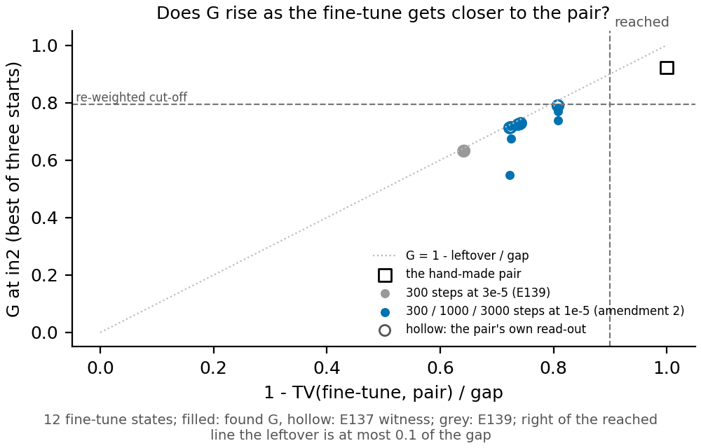

# Do ordinary fine-tunes that imitate a hand-made change read as that change's label?

*2026-11-10 · cell P1.4 · experiment E139 and its two amendments · cluster `debug` L40, $0 · provisional, no independent
check, no wording adopted · results `experiments/reuse_variable_finetune/results/`*

We trained ordinary fine-tunes of every weight of the small model to copy the outputs of four hand-made changes whose
labels we knew, and read each fine-tune with the second wording's two shares. The fine-tunes that copy the rewired table
change read rewired on every seed; those that copy the re-weighted change read rewired too, and training them ten
times longer moved them towards the re-weighted label without crossing it. The share that separates the labels follows
how closely the fine-tune copies the change's outputs, so on fine-tunes the wording reads closeness as much as it reads
what happened inside the model.

## What was done

Each hand-made change from the first test sets a four-direction variable at the input of block 2. Always on sets it to
a fixed value and counts as re-weighted. Cue sets it from a read-out of one rare token and Table from a map of 32 keys;
both count as rewired. XOR sets it from an XOR of random bits and counts as built. For each change, three seeds of an
ordinary fine-tune of all weights were trained for 300 steps to match the changed model's next-token output.

Each fine-tune was read with two shares, each 0 when nothing of the change is explained and 1 when all of it is. The
re-weighted share G is how much of the change an affine map of a found four-direction variable explains. The rewired
share H is the same for an affine map of everything the model computed at that point. The label rule was filed before
any run. G at or above 0.794 with H at or above 0.476 reads re-weighted. G below 0.794 with H at or above 0.476 reads
rewired. H below 0.476 reads no map found. A change takes the label two of its three seeds share.

## Results

| Change and how it was built | Fine-tune | G | H | Label |
|---|---|---|---|---|
| Always on: variable set to a fixed value; the hand-made change itself | none | 0.922 | 0.976 | re-weighted |
| Always on | seed 0, 300 steps | 0.638 | 0.505 | rewired |
| Always on | seed 1, 300 steps | 0.627 | 0.450 | no map found |
| Always on | seed 2, 300 steps | 0.637 | 0.483 | rewired |
| Always on, amendment 2 | seed 0, 3000 steps | 0.769 | 0.580 | rewired |
| Always on, amendment 2 | seed 1, 3000 steps | 0.781 | 0.581 | rewired |
| Always on, amendment 2 | seed 2, 3000 steps | 0.737 | 0.562 | rewired |
| Table: variable set by a map of 32 keys; the hand-made change itself | none | -0.027 | 0.995 | rewired |
| Table | seed 0, 300 steps | 0.024 | 0.718 | rewired |
| Table | seed 1, 300 steps | -0.026 | 0.714 | rewired |
| Table | seed 2, 300 steps | -0.023 | 0.724 | rewired |
| Cue: variable set by a read-out of one rare token | seeds 0 to 2 | not read | not read | stopped at step 10 by a wrongly directed check |
| XOR: variable set by an XOR of random bits | seeds 0 to 2 | not read | not read | not learned, so no reading |

G is the best over four sites and three search starts; H the best over five sites. The hand-made rows are the first
test's readings, given for reference. By the filed rule Table reads rewired, its own label, on all three seeds. Always on
reads rewired at 300 steps, two seeds of three, and is not its own label.

**Amendment 1: the change's own read-out against the fine-tunes.** The first test's found read-out of Always on, which
explains the hand-made change with G 0.922, was read against the three 300-step fine-tunes with no new search. It read
0.632, 0.631 and 0.631, inside the band the triangle inequality allows and level with the search's own best. So the
search was not short of a better map. The low G is set by how far the fine-tune sits from the change's outputs: its
leftover distance was about a third of the change's size.

**Amendment 2: the same fine-tunes trained to a tenth of the change's size.** The same Always on fine-tunes were
retrained for 3000 steps at a third of the first peak rate, read at steps 300, 1000 and 3000. Neither filed prediction
can be called, because no seed was reached. Reached meant the leftover distance at step 3000 at most 0.1 of the
change's size, and every seed ended at 0.192. Prediction (a), that G passes the re-weighted cut-off once reached, is no
call; so is prediction (b), that the reversion stays low. Read as they stand, best G rose to between 0.737 and 0.781,
still under 0.794, and the change's own read-out rose to 0.789 on every seed. The reversion stayed at 0.243 to 0.260,
far from the hand-made change's 0.938. The reversion is the share of the change undone when only the four found
coordinates at the last position are set back.

**Reading it.** G rises as the fine-tune copies the change more closely, and every state stays under the re-weighted
cut-off. The figure puts each Always on state at its closeness, one minus the leftover over the change's size. The
change's own read-out, hollow, sits on the dotted line where G equals that closeness, and the search's G sits on or a
little under it. No state reaches the dashed line at 0.9 that the amendment needed, so this run cannot say whether a
closer copy would cross.

## What it means for the definition

The ordinary fine-tunes read as their change's label for Table only. For Always on, the earlier explanation in the log
card, that a fine-tune spreads the change over many weights so no small variable carries it, is replaced. The first
amendment shows the low G came from the imitation leftover, not from what the fine-tune did inside. This is what G is
blind to: it reads outputs only, so a fine-tune that copies the change closely must read near the change's own G,
whatever is inside it. Table's imitators sit at 0.842 closeness and read G near zero, far below what that closeness
allows, so their label is not set by the leftover. Always on's label is, and the cut-off sits close to the ceiling the
leftover sets. Only the reversion looks inside, and it stayed low on every Always on state.

## Scorecard

| Id | Claim | Read | Verdict |
|---|---|---|---|
| P1 | Always on imitators read re-weighted | rewired, two seeds of three | fails, reported earlier |
| P2 | Cue imitators read rewired | stopped on all seeds | no reading |
| P3 | Table imitators read rewired | rewired, three seeds of three | holds |
| P4 | XOR imitators never re-weighted or rewired | not learned | holds |
| Amend. 2 (a) | G passes 0.794 once the leftover is at most 0.1 of the gap | no seed reached | no call |
| Amend. 2 (b) | reversion at in2 under 0.569 on reached seeds | no seed reached | no call |

## Not run

- Cue: no reading. Every seed stopped at a step-10 check that compared two different directions of the divergence;
  the cell's three runs are spent, so it was not rerun.
- XOR: the fine-tunes did not learn the XOR, so nothing was read.
- A fine-tune of Always on with a leftover under 0.192 of the change's size: longer or different training was not tried, so
  whether G crosses the cut-off once reached is unknown.
- No independent check of any number on this page.
- Departures from the literature: none here; the shares, cut-offs and label rule are this project's own, filed in
  `reports/plans/2026-11-09_plan_reuse-variable-first-test.md`.
