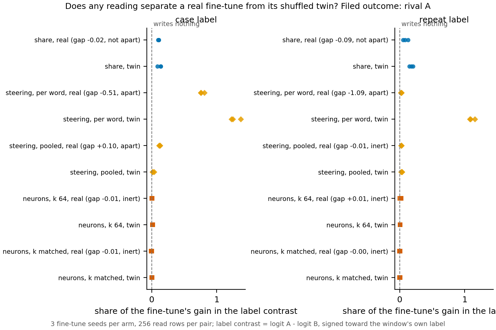

# Can steering or neurons tell a real fine-tune from its shuffled-label twin?

*E140, cell P2.4, compare-lead, 2026-11-10. Provisional: one run, no independent check. Labels are as each pair was built; no
verdict on reuse. Plan `reports/plans/2026-11-10_plan_e140-real-vs-twin.md`; rule `experiments/real_vs_twin/results/predictions.json`.*

**The answer.** We read three methods on two pairs of fine-tunes, each a real rule and its shuffled-label twin, three copies of each.
Per-word steering separated real from twin on both pairs by a wide margin, and pooled steering did so on one pair by a hair. The
re-gating share and the neuron version did not, and the neuron version wrote almost nothing. The steering gaps have plain causes
in how the vectors are built and in the twins' larger updates, so they do not yet show that steering sees what the label taught.

## What we were trying to test

Each pair is two fine-tunes of the 67M on the same windows. After a marker token the model must say one of two label words. The real
fine-tune learns a rule about the word before the marker: "capitalised or not" on the case-label pair, "this word already occurred
earlier in the window" on the repeat-label pair. Its twin sees the same words with labels shuffled per word, so it can only memorise.
Seeds 0 and 1 were saved by earlier runs; seed 2 was trained in this job by the same function and settings.

Every number is read on the 256 rows the share was read on, in the contrast between the two labels: logit of label A minus logit of
label B, signed toward the window's own label. A method's share is its change in that contrast over the fine-tune's own gain in it.
Zero means the method writes nothing; one means it reproduces the whole gain.

- **The re-gating share** keeps the decomposition's original subcomponents and changes only which ones Γ switches on.
- **Steering** adds a vector to the original model's block input at the marker. The vector is the fine-tune's mean change there, over
  all its training windows (pooled) or over the training windows of one word (per word). Layer and strength are chosen on training windows.
- **The neuron version** keeps each block's MLP firing only on a top set of neurons, chosen from the fine-tune's firing or the
  original's, and reads the difference. The set holds 64 neurons per block, or as many as the decomposition switches on.

A method "separates" the arms when the gap between the real and twin means is at least 0.1 and at least twice its standard error over
the three seeds per side. A method whose six shares are all under 0.05 in size is called inert: it makes no call.

## What we expected

The share was expected to read real and twin alike, as it does in log-odds. Per-word steering was expected to separate the arms on the
repeat pair only. There the real label changes from window to window within a word, so a per-word vector averages it away, while each
twin label is fixed per word. Pooled steering was expected to be inert, and the neuron version to read the arms alike.

## What we observed

**Reading it.** Steering separates the arms and the other two methods do not. Per-word steering reads 0.776 of the gain on case real
against 1.282 on its twin, and 0.023 on repeat real against 1.109 on its twin. Pooled steering reads its case gap of 0.101 at eleven
standard errors, real above twin, and is inert on the repeat pair. The share's gaps are 0.018 and 0.090, both under the bar, twin
above real. No neuron share is larger than 0.021 in size. Three things could make the steering gaps without steering seeing the rule:

- *The key hands over the answer.* A twin's label is a fixed function of the word, so a per-word vector fitted on that word's training
  windows carries the answer itself; the 256 read rows use the same training words. The real case label is also a function of the
  word, and it reads 0.776; the real repeat label is not, and its per-word share is near 0, as filed.
- *The twins wrote larger changes.* On the case pair the twin trained to step 300 against the real's 30, and its update is about 13
  in summed norm against 4.6. Shrunk to the real's norm, a case twin keeps only 0.14 to 0.18 of its contrast gain. On both pairs every
  twin's per-word vector was chosen at strength 4, twice the real's, and every twin's per-word share is above 1: the vector overshoots the twin's own gain.
  *Correction 2026-11-10 (card writer, checked against stage1.json):* the larger-update point holds on the case pair only; on the repeat pair the seed-2 twin's summed norm (7.7) is about the real's (7.5), so "the twins' larger updates" in the summary and the reading applies to the case pair.
- *The pooled gap is at the bar.* 0.101 against a bar of 0.1 is one rounding from the other side, though its spread is small.

The real fine-tunes' per-word vectors read on the twin's labels write 0.13 to 0.15 of the twin's gain on the case pair. So the case
vectors do carry the arm's own labels, which is what a per-word answer key would also do.

## Predictions, held or missed

- Share not apart on either pair: **held**.
- Per-word steering apart on the repeat pair, twin above real: **held**.
- Per-word steering not apart on the case pair: **missed**, it separated them with the twin above.
- Pooled steering inert on both pairs: **missed on the case pair**, which read apart, real above; held on the repeat pair.
- Neuron version not apart at both counts: **missed**; it read inert, so it made no call.
- Card outcome rival A, from repeat per-word steering only: rival A **held**, but from three readings, not one.

## What we learned

Under the filed rule steering tells the arms apart and the share does not, so the card reads rival A. The best-supported reading of the
gaps is the per-word key and the twins' larger updates, not a reading of what the label taught. The neuron version, as the share's
operation on top sets, writes almost nothing in the label contrast on these pairs, so it cannot compare the arms here.

## How compelling is the evidence

Three seeds per side and two pairs; the controls held. A zero update read exactly 0 through every method, and the share of real seed 0
reproduced its saved value exactly on both pairs. Steering is blind to whether a vector writes the label the fine-tune's way. Every gap
is blind to both arms moving together. The selection picks the largest rise, so a vector may overshoot its fine-tune's gain.

## Surprises

The seed-2 real fine-tune on the repeat pair stopped at step 100, not 30, with a summed norm of 7.5 against 4.6 to 4.9 for its seeds 0
and 1. It passed its filed check, so it stays in the reading. Its per-word share, 0.018, sits with the other real seeds.

## Departures from the literature

None beyond E135's fair form of steering: vectors are fitted on the fine-tune's training windows, the user's option a.

## Not run

- Steering at a strength matched between real and twin, or capped at the fine-tune's gain.
- Per-word steering with each word's vector fitted on windows its fine-tune never saw.
- Twins stopped at the real's step or norm; the vector norms per arm were not saved.
- The neuron version at larger top sets, or at the marker position only.
- Held-out-word windows. Any reuse verdict.

Provenance: jobs 57740 (stopped in stage 0 on a code error, fixed in 70962483) and 57752, debug L40, $0. Results
`experiments/real_vs_twin/results/stage{0,1,2,3}.json`; second figure `experiments/real_vs_twin/figures/numerator_gain.png`.
