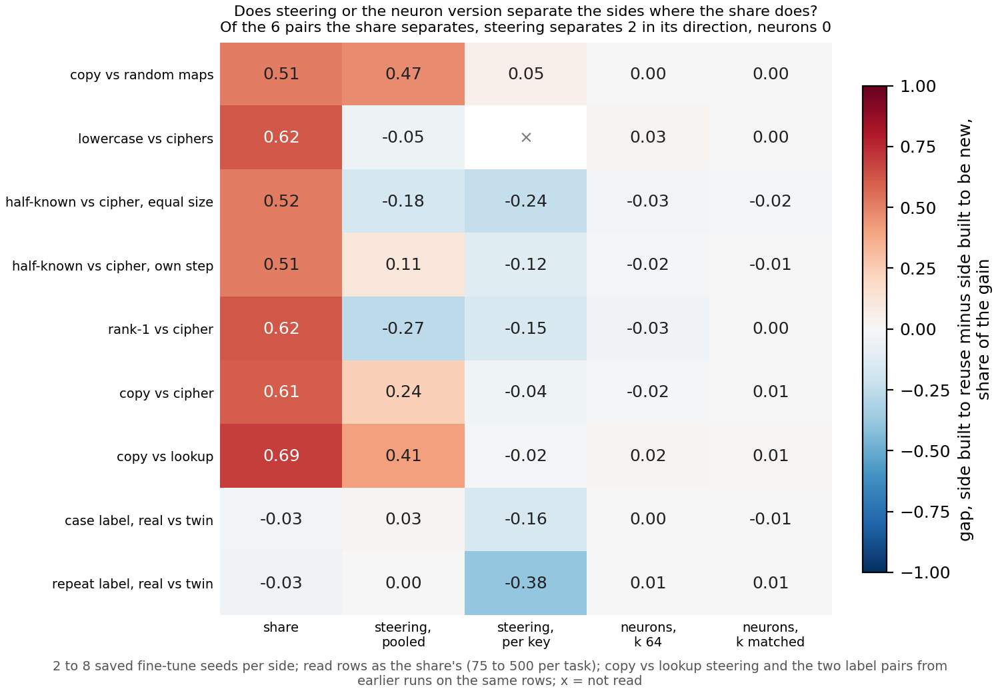

# Do steering and a neuron reading separate the built pairs where the share does?

*E143, cell P2.10, compare-lead, 2026-11-10. Provisional: one run, no independent check. Sides are named as each pair was built;
no verdict on reuse, since the definition is under revision. Plan `reports/plans/2026-11-10_plan_E143-holes.md`; card
`reports/plans/2026-11-10_plan_p2-10-card.md`; rule `experiments/holes_fill/results/predictions.json` and `experiments/holes_fill/rules.py`.*

We read steering and a neuron reading on the seven saved task pairs that lacked them, on the same rows as the re-gating share.
The share set the two built sides apart on every pair, while steering did so in the same direction on only two and the opposite way
on three, and the neuron reading wrote almost nothing. So on these fine-tunes the cheaper readings do not reproduce what the share
separates, which bears on the method comparison but gives no verdict on reuse.

**The answer.** On six built pairs, steering in its fairest form separated the two sides in the share's direction on two pairs. On three
more it separated them the other way, with the side built to be new reading higher. Vectors fitted per key read close to the whole gain on
both sides of every pair, because each key fixes its answer. The neuron reading stayed under 0.05 of the gain on every fine-tune, so it
made no call. The share separated every pair, as before.

## What we were trying to test

Part 2 of the plan compares the re-gating share against cheaper readings on the 67M model. Earlier runs left holes. On seven built pairs
with saved fine-tunes on both sides the neuron reading was never taken. On six of them steering existed only in an older, weaker form.
This run fills those holes and nothing else.

A built pair is two sets of fine-tunes of the 67M on matching windows. One side is built to reuse something the model already does, such
as copying a token from the window. The other is built to be new, such as a random map or a cipher. The pairs, with saved seeds per side:

- copy vs random maps, 4 and 4;
- lowercase vs ciphers, 2 and 4;
- half-known vs cipher at equal update size, 5 and 5, and at the cipher's own step, 5 and 2;
- rank-1 vs cipher and copy vs cipher, both at step 10, 8 and 8 with the cipher side shared;
- copy vs lookup, 3 and 3, neurons only, since its steering was read in the earlier steering run.

Every number is read on the rows the share was read on, 75 to 500 per task, in the log-odds of each row's target at the read position over
the whole vocabulary. Let $T_1 - T_0$ be the fine-tune's gain, its change in that log-odds against the original model. Each reading is a
change in the same log-odds over that gain: 0 means the reading writes nothing, 1 the whole gain.

- **The share** keeps the decomposition's subcomponents and changes only which ones Γ switches on. Its values are the earlier
  untrained-decomposition run's, on the same rows, unchanged.
- **Steering** adds a vector to the original model's block input at the read position. The vector is the fine-tune's mean change there
  over every training window, pooled, or over the training windows of each key, per key. The key is the token at the read position. Layer
  and strength are chosen on up to 512 training windows. Eight random vectors of the same norm are the null.
- **The neuron reading** keeps each block's MLP firing in the original model on its top neurons by size, chosen from the fine-tune's firing
  or the original's, and reads the difference. The top set holds 64 neurons per block, or as many as the decomposition switches on: 15, 3,
  6 and 30.

On every pair but lowercase vs ciphers the target is a fixed function of the key, so a per-key vector is handed the answer on both sides.
On lowercase vs ciphers no token in the window fixes the answer, so only the pooled vector was read there.

**The rule, filed before the run.** For one reading on one pair, the gap is the mean on the side built to reuse minus the mean on the side
built to be new. The pair separates when the gap is at least 0.1 in size and larger than the wider range inside either side. A reading
whose every value is under 0.05 in size is inert and separates nothing. Steering counts per pair as the wider-gap of its two kinds; the
neuron reading as the wider of its two set sizes. A family reads "as the share" when it separates, in the share's direction, at least as
many pairs as the share does.

## What we expected

Steering was expected to separate fewer pairs than the share. The older pooled reading had missed the two pairs built at equal update
size by gaps of 0.03 and 0.04. The per-key vector, being handed the answer, should raise both sides alike. The neuron reading was expected
to write almost nothing, as it had on the two label pairs. Per-key vectors were expected to read above pooled ones on most fine-tunes.

## Controls

All passed before any fine-tune was read. A zero update read exactly 0 through both neuron readings and through steering at every layer,
strength and kind. Strength 0 on a real update changed no logit. The share of two saved fine-tunes reproduced the earlier run's 0.80244
and 1.09456 exactly. The earlier label-pair run's neuron reading, 0.0091816, also reproduced exactly through this run's code.

## What we observed

**Reading it.** The share's column is the only one that is red down the built pairs. The share separates all seven, with gaps of 0.51 to
0.69 and ranges inside a side of at most 0.06. Pooled steering separates copy vs random maps by 0.47 and copy vs cipher by 0.24, both in
the share's direction. On the two pairs built at equal update size it separates the other way: rank-1 vs cipher by 0.27 and half-known vs
cipher by 0.18, the cipher side higher. At the cipher's own step it reads 0.11 in the share's direction, just over the bar. On lowercase
vs ciphers its gap is 0.05, inside a range of 0.22. The bottom two rows are the label pairs from the earlier run, for reference.

**The per-key vector reads the whole gain on both sides.** Every one of 44 fine-tunes on the key-value pairs reads between 0.87 and 1.26
of its gain with its per-key vector. So the per-key gaps are small against their ranges, except on half-known vs cipher. There the cipher
side reads higher at both steps, by 0.24 and 0.12. Since a key fixes its answer, this reading says the fine-tune's mean change per key
carries the answer, which is true on both sides by construction.

**The neuron reading writes almost nothing.** No fine-tune reads more than 0.047 of its gain at either set size, under the 0.05 bar, so it
is inert on every pair. The masked original model is far from the original itself: keeping only the top neurons moves the target's
log-odds by up to 2.9 below and 3.4 above. The largest reading, 0.047, is a lowercase fine-tune at 64 neurons per block.

**Counting by the filed rule.** The steering family, taking per pair the wider of its two kinds, separates two pairs in the share's
direction and three the other way. The neuron family is inert on all seven. The share separates six of the six steered pairs and seven of
seven for neurons.

### Full table

Means per side are shares of each fine-tune's own gain. The share's side means are the earlier run's values on these rows. "Range" is the
wider max minus min inside a side.

| pair | reading | seeds | reuse side | new side | gap | range | call |
|---|---|---|---|---|---|---|---|
| copy vs random maps | share | 4 / 4 | 0.79 | 0.28 | 0.51 | 0.04 | separates |
| copy vs random maps | steering, pooled | 4 / 4 | 0.74 | 0.27 | 0.47 | 0.14 | separates |
| copy vs random maps | steering, per key | 4 / 4 | 1.06 | 1.01 | 0.05 | 0.17 | does not |
| copy vs random maps | neurons, k 64 | 4 / 4 | 0.01 | 0.01 | 0.00 | 0.01 | inert |
| copy vs random maps | neurons, k matched | 4 / 4 | 0.01 | 0.01 | 0.00 | 0.01 | inert |
| lowercase vs ciphers | share | 2 / 4 | 0.76 | 0.14 | 0.62 | 0.05 | separates |
| lowercase vs ciphers | steering, pooled | 2 / 4 | 0.70 | 0.75 | -0.05 | 0.22 | does not |
| lowercase vs ciphers | neurons, k 64 | 2 / 4 | 0.04 | 0.01 | 0.03 | 0.01 | inert |
| lowercase vs ciphers | neurons, k matched | 2 / 4 | 0.01 | 0.00 | 0.00 | 0.01 | inert |
| half-known vs cipher, equal size | share | 5 / 5 | 0.76 | 0.25 | 0.52 | 0.06 | separates |
| half-known vs cipher, equal size | steering, pooled | 5 / 5 | 0.31 | 0.49 | -0.18 | 0.13 | separates |
| half-known vs cipher, equal size | steering, per key | 5 / 5 | 0.91 | 1.15 | -0.24 | 0.21 | separates |
| half-known vs cipher, equal size | neurons, k 64 | 5 / 5 | 0.00 | 0.03 | -0.03 | 0.01 | inert |
| half-known vs cipher, equal size | neurons, k matched | 5 / 5 | 0.00 | 0.02 | -0.02 | 0.01 | inert |
| half-known vs cipher, own step | share | 5 / 2 | 0.76 | 0.25 | 0.51 | 0.02 | separates |
| half-known vs cipher, own step | steering, pooled | 5 / 2 | 0.31 | 0.20 | 0.11 | 0.05 | separates |
| half-known vs cipher, own step | steering, per key | 5 / 2 | 0.91 | 1.03 | -0.12 | 0.06 | separates |
| half-known vs cipher, own step | neurons, k 64 | 5 / 2 | 0.00 | 0.02 | -0.02 | 0.01 | inert |
| half-known vs cipher, own step | neurons, k matched | 5 / 2 | 0.00 | 0.01 | -0.01 | 0.01 | inert |
| rank-1 vs cipher | share | 8 / 8 | 0.86 | 0.24 | 0.62 | 0.06 | separates |
| rank-1 vs cipher | steering, pooled | 8 / 8 | 0.21 | 0.47 | -0.27 | 0.08 | separates |
| rank-1 vs cipher | steering, per key | 8 / 8 | 0.99 | 1.14 | -0.15 | 0.19 | does not |
| rank-1 vs cipher | neurons, k 64 | 8 / 8 | 0.00 | 0.03 | -0.03 | 0.01 | inert |
| rank-1 vs cipher | neurons, k matched | 8 / 8 | 0.01 | 0.01 | 0.00 | 0.02 | inert |
| copy vs cipher | share | 8 / 8 | 0.84 | 0.24 | 0.61 | 0.03 | separates |
| copy vs cipher | steering, pooled | 8 / 8 | 0.71 | 0.47 | 0.24 | 0.08 | separates |
| copy vs cipher | steering, per key | 8 / 8 | 1.10 | 1.14 | -0.04 | 0.11 | does not |
| copy vs cipher | neurons, k 64 | 8 / 8 | 0.01 | 0.03 | -0.02 | 0.01 | inert |
| copy vs cipher | neurons, k matched | 8 / 8 | 0.02 | 0.01 | 0.01 | 0.02 | inert |
| copy vs lookup | share | 3 / 3 | 1.09 | 0.40 | 0.69 | 0.03 | separates |
| copy vs lookup | neurons, k 64 | 3 / 3 | 0.04 | 0.02 | 0.02 | 0.01 | inert |
| copy vs lookup | neurons, k matched | 3 / 3 | 0.02 | 0.01 | 0.01 | 0.01 | inert |

Copy vs lookup's steering is the earlier steering run's, on its 100 score rows: a pooled gap of 0.41 and a per-key gap of 0.02 the other
way, both in the figure.

### Readings reported but not scored

- **Random vectors.** The filed expectation was a mean within 0.1 of 0 on each fine-tune. Pooled random vectors missed it on 4 of 50
  fine-tunes, all on lowercase vs ciphers, by at most 0.16. Per-key random vectors missed it on 20 of 44, every one on a side built to
  reuse: all five half-known fine-tunes, seven of eight rank-1 and all eight copy fine-tunes at step 10. All 20 read below zero, and one
  copy seed read 0.75 below. A random vector of the per-key norm at the chosen setting lowers the target there, so the per-key share on
  those sides sits on a reference below zero.
- **Cross-application.** A side's vector read on the other side's rows, between same-numbered seeds, lowers the other side's target on
  every key-value pair: pooled means 0.09 to 0.34 below zero, per-key 0.49 to 0.93 below. On lowercase vs ciphers the pooled vectors
  cross over at 0.28 above zero, so there both sides' vectors push a shared direction.
- Cosines between pooled vectors per layer, off-target KL, and the per-state gains are in `stage1.json` and are not read here.

## Predictions, held or missed

| id | claim | rule | read | verdict |
|---|---|---|---|---|
| P1 | steering separates fewer of the six pairs than the share | `score.compare.steering.verdict == 'rival B'` | rival B: 2 in the share's direction against 6; 3 the other way | **held** |
| P2 | the neuron reading writes almost nothing: no call or fewer pairs, never as many | verdict in `('no call: inert', 'rival B')` | no call: inert on all 7 | **held** |
| P3 | per-key share above pooled on most key-value fine-tunes | count over 44 above 22 | 44 of 44 | **held** |

Card outcome by `rules.outcome`: rival B, and the card's stop condition holds as filed: each family separates fewer pairs than the share,
or none, and neither separates a pair the share does not.

## What we learned

On the seven built pairs with saved fine-tunes, neither activation reading reproduces the share's separation. Pooled steering agrees with
the share on the two copy pairs, and just over the bar on half-known vs cipher at its own step. It reverses on both pairs built at equal update size, a sign this run does not explain. The per-key vector is no test on key-value pairs, as filed: it reads the whole gain on both sides. The neuron reading as built
here cannot compare the sides, because the masked model is far from either fine-tune.

## How compelling is the evidence

Two to eight seeds a side, seven pairs, one run, all controls passed. Steering cannot say whether a vector writes the answer the
fine-tune's way, and the per-key vector is told the answer. The neuron reading misses any change outside its top sets and in attention.
Every gap is blind to both sides moving together. The lowercase fine-tunes gained only about 1.6 log-odds, just above the floor of 1, so
their shares are the noisiest. The per-key random reference sits well below zero on the reuse sides of three pairs, which could move
those pairs' per-key gaps by about the size of that reference.

## Surprises

Steering separated three pairs in the direction opposite to the share, with the side built to be new reading higher. Nothing was filed
about sign; the prediction only counted pairs in the share's direction, and it held. The two pairs built at equal update size reverse under
pooled steering, where the older reading had called them not apart by 0.03 and 0.04. One per-key random reference, copy seed 0 at step 10,
read 0.75 below zero against 0.16 to 0.19 below for its seven siblings; it was not run down.

## Departures from the literature

- Steering adds a mean difference at one layer, as in activation addition. Fitting it on the fine-tune's training windows, the per-key
  vectors, the strength grid and the choice on training windows are this project's additions, the user's fair form of 2026-11-09.
- The neuron reading as top sets of MLP firing, and the share, are this project's own measures, not taken from a paper.

## Not run

- Any verdict on reuse; the definition is under revision.
- The four 96-key pairs and the step ladder: no saved fine-tunes on both sides.
- Per-key steering on lowercase vs ciphers: no token fixes the answer there.
- Per-key vectors fitted on keys the fine-tune never trained on, so not handed the answer.
- Steering at a strength matched between sides or capped at the fine-tune's gain.
- The neuron reading at larger top sets, at the read position only, or with attention.
- The cause of the per-key random references below zero, and of copy seed 0's outlier.
- Any Qwen pair.

Provenance: job 57802, debug L40, about 12 minutes, $0. Results `experiments/holes_fill/results/stage0.json` and `stage1.json`; log
`cluster/logs/commute-holes-fill-57802.out`; figure `experiments/holes_fill/figures/gaps.png` from `experiments/holes_fill/plot.py`.
