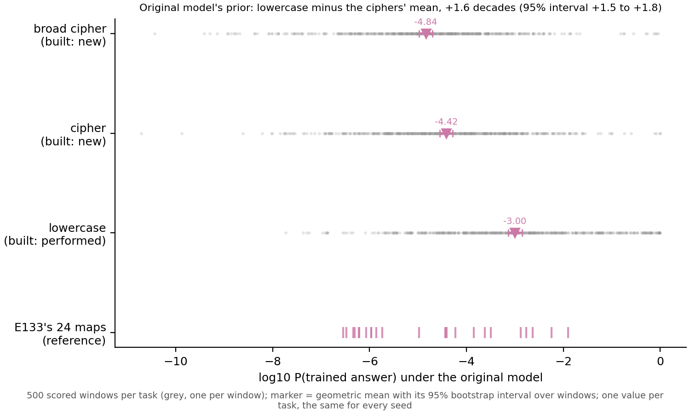

# Does the original model already favour lowercase's answer over the ciphers'? E145

*E145, cell P2.13, `experiments/prior_lowercase/`, written 2026-11-10. Plan `reports/plans/2026-11-10_plan_prior-lowercase.md`;
rules `results/predictions.json`, filed before the run; results `results/stage0.json`, `results/stage1.json`; figure
`figures/prior.png` from `plot.py`. Sides are labelled as E53 built them; no verdict of reused or new (cell P1.1).*

## In plain words

We measured how likely the original model already finds the trained next word, on the lowercase task and on two word-swap
ciphers. The original model rates the lowercase answer about forty times higher than the ciphers' answers, far beyond the
spread between windows. For `GOALS.md` this fills the last empty prior cell of the method comparison. On this pair the
prior points the same way as the re-gating share, so the prior alone already separates it.

**Reading it.** The lowercase prior sits 1.63 decades above the mean of the two ciphers'. Its 95% interval over resampled
windows runs from 1.46 to 1.80, so the filed rule reads the lowercase side higher. For lowercase, the original model gives
the answer about one chance in a thousand, a log10 of -3.00. The cipher reads -4.42 and the broad cipher -4.84, each inside
the band filed beforehand. The prior belongs to the original model, so it is one value per task, shared by both seeds.
Its spread is therefore given across the 500 windows. Single windows vary widely, with a standard deviation of 1.65 decades
on lowercase. Yet each task's mean is pinned to an interval about 0.3 decades wide. This gap is close to the
copy-against-random pair's 1.48, and well under the half-known pairs' 3.20. Both controls passed first. E133's forward
re-read one of its own priors exactly. The rebuilt windows gave E53's saved original-model scores to within 0.003 nats, so
they are the windows E53 read.

## Not run

No spread across seeds, since there is none to read. No fine-tuned state, no share, no new windows. Nothing about reuse.

*Provenance: MATS L40, debug QoS, job 57937, $0; log `cluster/logs/commute-prior-lowercase-57937.out`.*
