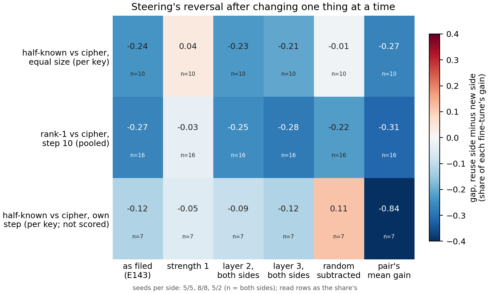

# Why does steering read the new side higher on three built pairs?

*E146, cell P2.14, compare-lead, 2026-11-10. Provisional: one run, no independent check. Sides are named as each pair was built;
no verdict on reuse, since the definition is under revision. Plan `reports/plans/2026-11-10_plan_steering-reversal.md`; card
`reports/plans/2026-11-10_plan_p2-14-card.md`; rule `experiments/steering_reversal/results/predictions.json` and
`experiments/steering_reversal/rules.py`.*

We re-read steering on the saved fine-tunes of the pairs where it disagreed with the share, changing one setting at a time.
The disagreement comes from how strongly the vector is added: at the fine-tune's own size of change the two sides read about
the same, and only the search over larger multiples lets the cipher side pull ahead. So steering's reversed cells in the method
comparison reflect how its strength was chosen, not a reading that the side built to be new changed the model more.

**The answer.** Adding each fine-tune's mean activation change as it is, at strength 1, removes the reversal on both scored
pairs. The side built to reuse stops gaining once its vector is doubled, while the cipher keeps gaining up to four or eight
times, and the filed strength search picks those larger multiples. Fixing the layer, subtracting the random baseline and
changing the denominator each left at least one pair reversed. At strength 1 steering separates neither pair in either
direction.

## What we were trying to test

E143 read steering on built pairs of fine-tunes of the 67M model, beside the share (how much of the gain comes from changing which subcomponents Γ switches on). Steering adds a vector to the
original model's block input at the answer position. The vector is the fine-tune's mean change there over its training
windows, either pooled over all windows or averaged separately per key. It is added at a chosen layer and a chosen multiple,
the strength. E143 chose both by the largest rise on 512 training windows, over strengths up to 8. The reading is the rise in
the log-odds of each read row's target, as a share of the fine-tune's own gain on those rows: 0 writes nothing, 1 the whole
gain.

On three pairs the side built to be new read higher under steering, where the share reads the side built to reuse higher:

- half-known map against a cipher at equal update size, 5 and 5 seeds, read per key as the method table reads it;
- rank-1 against a cipher at step 10, 8 and 8 seeds, read pooled;
- half-known against the cipher at the cipher's own step, 5 and 2 seeds. Two seeds cannot resolve the gap, so this pair is
  reported and not scored.

This run kept E143's states, rows, vectors and code and changed one thing per reading:

- **strength 1**: the fine-tune's mean change is added at its own size; the layer is still chosen by the filed rule;
- **layer 2, layer 3**: both sides at the same layer; the strength is still chosen by the filed rule;
- **random subtracted**: each fine-tune's mean reading from eight random vectors of the same size is subtracted. On E143's
  per-key reading these random vectors sat below zero on the reuse sides;
- **pair's mean gain**: the denominator is the mean gain over both sides, not each fine-tune's own.

A change counts as a cause only if it removes the reversal on both scored pairs and also shrinks the gap relative to the
sides' mean by at least half. The second condition means a change that only scales both sides down does not count. The
reversal is removed when the gap no longer clears the bar of 0.1 and the range within each side, or when it changes sign.

## What we expected, and why

We expected strength 1 to remove the reversal. That expectation came from a look at E143's saved strength search before
filing, recorded under "seen_before_filing" in the predictions file. On the training windows, the reuse side peaked at
strength 2 and the cipher side kept rising, and at strength 1 the two rose about equally. We had not seen any of this run's
reads on the read rows. We expected the rank-1 pair to be the close call. We expected both common layers to leave the
reversal standing. We expected subtracting the random baseline to remove it on the per-key pair only, and the common
denominator to change nothing. The last two are arithmetic on numbers E143 had already reported.

## Controls

Both passed before any fine-tune was read. A zero update changed no logit at any layer, strength or kind. The two reference
states reproduced E143's shares exactly. In the main stage, every fine-tune's reading at E143's setting matched E143's, and
the reversal held on both scored pairs at that setting. Random vectors at strength 1 stayed within 0.055 of zero on every
fine-tune, in both kinds.

## What we observed

**Reading it.** Only the strength-1 column loses the blue down the scored rows.
- **Half-known vs cipher at equal size, per key:** the gap goes from -0.24 to 0.04, inside a range of 0.03 within a side.
- **Rank-1 vs cipher, pooled:** the gap goes from -0.27 to -0.03, inside a range of 0.07.
- **Half-known vs cipher at the cipher's own step (not scored):** per key, the gap shrinks from -0.12 to -0.05. Pooled, the
  reuse side was already higher, and the gap grows from 0.11 to 0.19.
- **The kind not scored on the two scored pairs:** pooled on the equal-size pair goes from -0.18 to 0.06. Per key on rank-1
  goes from -0.15 to -0.01.

**Why the strength search reverses it.** Take the best layer at each strength and average over seeds. The per-key half-known
reading is 0.91 of the gain at strength 2 and stays there, while its cipher is 1.02 at strength 2 and 1.15 at strength 8.
Pooled, rank-1 reaches 0.20 at strength 2 and goes no higher, while its cipher goes from 0.36 at strength 2 to 0.47 at
strength 4. At strength 0.5 the reuse sides read as high as their ciphers or higher. The two sides' mean changes write about
equally per unit added. What differs is that the reuse side stops gaining once its vector is doubled.

**The other changes leave the reversal.** At layer 2 the reversal holds on both pairs. At layer 3 it holds on rank-1. On the
per-key equal-size pair the gap stays close to its filed size, at -0.21, but the within-side range is 0.22, so by the filed rule the reversal
is no longer clear there. Subtracting the random baseline removes the reversal per key on the equal-size pair and leaves
rank-1 pooled reversed. The pair's mean gain leaves both reversed.

### Full table (scored pairs, kind as the method table reads it)

| pair | reading | reuse side | new side | gap | range | reversal |
|---|---|---|---|---|---|---|
| half-known vs cipher, equal size | as filed | 0.91 | 1.15 | -0.24 | 0.21 | holds |
| | strength 1 | 0.71 | 0.67 | 0.04 | 0.03 | removed |
| | layer 2 | 0.84 | 1.07 | -0.23 | 0.13 | holds |
| | layer 3 | 0.91 | 1.12 | -0.21 | 0.22 | removed, inside range |
| | random subtracted | 1.12 | 1.13 | -0.01 | 0.20 | removed |
| | pair's mean gain | 0.90 | 1.17 | -0.27 | 0.21 | holds |
| rank-1 vs cipher, step 10 | as filed | 0.21 | 0.47 | -0.27 | 0.08 | holds |
| | strength 1 | 0.14 | 0.17 | -0.03 | 0.07 | removed |
| | layer 2 | 0.20 | 0.45 | -0.25 | 0.08 | holds |
| | layer 3 | 0.19 | 0.47 | -0.28 | 0.10 | holds |
| | random subtracted | 0.21 | 0.44 | -0.22 | 0.12 | holds |
| | pair's mean gain | 0.19 | 0.50 | -0.31 | 0.11 | holds |

The gap relative to the sides' mean, under strength 1, fell to about a quarter of its filed value on both pairs. Every
reading of every pair, in both kinds, is in `stage1.json` under `score.pairs`.

## Predictions, held or missed

| id | claim | rule | read | verdict |
|---|---|---|---|---|
| P1 | strength 1 is a named cause | `score.named.strength1` | true | **held** |
| P2 | both common layers leave the reversal on both pairs | layer 2 and layer 3 `reversal == 'holds'` on both | layer 3 on the per-key equal-size pair: gap -0.21 inside a range of 0.22 | **missed, narrowly** |
| P3 | the random baseline removes it per key, not pooled, so it is not named | as filed | removed on the equal-size pair, holds on rank-1, not named | **held** |
| P4 | the pair's mean gain does not remove it | as filed | holds on both | **held** |
| outcome | rival A | `score.outcome` | rival A | **held** |

The layer prediction missed by the range clause, with the gap close to its filed size. Layer 3 is not named, because it leaves rank-1 reversed.

## What this means for the method comparison

The steering cells for these three pairs in E133's table stay as filed. They should be read with this caveat: their sign
comes from the strength search, and at the fine-tune's own size of change steering does not separate the two scored pairs
in either direction. Strength 1 on the pairs where steering agreed with the share (copy vs random maps, copy vs cipher) was
not read, so whether a strength-1 column would keep those agreements is open. The lead decides how steering enters the
part 2 figure. This run gives no reason to read the reversal as evidence about either side.

## How compelling is the evidence

Five and eight seeds a side on the scored pairs, one run, all controls passed. The cause rests on two pairs. Both involve a
cipher, so a different new task could behave differently. Steering cannot tell whether a vector writes the answer the way
the fine-tune does, and a per-key vector is handed the answer on both sides. The strength-1 gaps sit within each side's
range, so "not apart" is the reading, not "equal".

## Surprises

The layer prediction missed narrowly at layer 3 on the per-key equal-size pair: the gap stayed close to its filed size and the range within a side grew.
Nothing else.

## Not run

- Strength 1, or any strength cap, on the pairs where steering agreed with the share, so a full strength-1 column for
  part 2.
- Splitting read rows by whether the original model already answers a key, the direct test of whether the half-known map's
  known half is why its gain stops at strength 2.
- Steering at positions other than the answer.
- Strengths matched by vector size across sides.
- Any edit to E133's filed cells or to `plot_final.py`; any Qwen pair; any verdict on reuse.

Provenance: job 57949, debug L40, under 2 min of reading after model load, $0. Results
`experiments/steering_reversal/results/stage0.json`, `stage1.json`; log `cluster/logs/commute-steering-reversal-57949.out`;
figure `experiments/steering_reversal/figures/reversal.png` from `experiments/steering_reversal/plot.py`.
