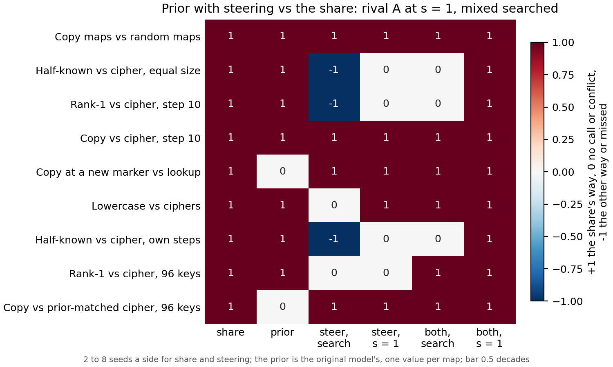

# Do the original model's prior and steering, together, call the built pairs the way the share does?

*E149, cell P2.15, compare-lead, 2026-11-10. Provisional: one run, no independent check. Sides are named as each pair was
built; no verdict on reuse, since the definition is under revision. Plan `reports/plans/2026-11-10_plan_prior-steering.md`;
card `reports/plans/2026-11-10_plan_p2-15-card.md`; rule `experiments/prior_steering/results/predictions.json` and
`experiments/prior_steering/rules.py`.*

We asked whether two cheap readings, the original model's prior for each task's answer and steering with the fine-tune's
own mean change, between them call every built pair the way the re-gating share does. With steering added at the
fine-tune's own size, they do, on all nine built pairs, while each one alone misses at least one pair. For the paper's
comparison this means that, on which side reads higher, the built pairs no longer show the share seeing something both
cheap readings miss; whether the share adds anything must now be argued from gap sizes or new pairs.

**The answer.** On direction across the nine built pairs, the prior and steering at its natural size together reproduce the
share's call on every pair, and neither does alone. Where the prior is matched, steering carries the pair; where steering
fails, the prior does. With steering's searched strength, three pairs instead have the two readings pointing opposite ways.
This reads direction only, not how far apart the sides are, and the share puts the side built to reuse higher on all nine.

## What we were trying to test

The share is the part of a fine-tune's gain that comes from changing which subcomponents the decomposition switches on.
On each of the nine built pairs (two families of fine-tunes of the 67M model, one built to reuse what the model already
does, one built to be new) the share reads the reuse side higher, beyond the spread between seeds. Earlier runs compared
cheaper readings with it one at a time, and each failed somewhere. The question left open on the method comparison card
was whether two of them, together, would track it.

The two readings:

- **The prior**: the original model's log10 probability of each task's trained answer, one value per map. It calls a pair
  when the sides differ by at least half a decade (0.5), a bar set above the spread between maps built the same way.
- **Steering**: each fine-tune's mean change of activation at the answer position is added to the original model, and the
  rise in the answer's log-odds is read as a share of the fine-tune's own gain. Read in two forms: as filed, with the
  multiple of the vector chosen by a search up to eight times, and at strength 1, the change added as it is. Each pair is
  called by the method comparison's rule on its seeds, in the vector kind its filed cell uses.

Each reading votes per pair: the share's way, no call, or the other way. A pair is **tracked** when one votes the share's
way and neither votes against; a **conflict** when they point opposite ways; **missed** when neither votes the share's way.
No weight is fitted, so leaving a pair out changes only the pair set. Two pairs test the combination hardest: copy vs lookup
and copy vs the prior-matched cipher, where the prior gaps are 0.12 and 0.20 decades, under the bar, so steering alone
decides them.

A zero update steered nothing on either code path, and every saved reading this run recomputed (the method comparison's
selection rises, the earlier strength-1 shares, the copy-vs-lookup filed share) reproduced exactly.

## What we expected, and why

- As filed, a mix: the three pairs where steering's search reverses the sign conflict with the prior, every other pair is
  tracked. This was arithmetic on cells already seen.
- At strength 1, every pair tracked. The reversals were known to vanish at strength 1, leaving the prior to carry those
  pairs; on the selection rows, copy at a new marker rose more per unit added than lookup did.
- At strength 1, steering separates both matched-prior pairs the share's way. This was the prediction that could fail.
- At strength 1, steering separates none of the three pairs where it had reversed.

## What we observed

**Reading it.** The last column is the share's way on every row: prior and strength-1 steering together track all nine
pairs. The fifth column shows the searched form leaving three rows at conflict, where steering's search reverses the sign
and the prior does not. The prior column alone has two rows with no call (the matched pairs), and each steering column has
rows with no call, so neither reading alone tracks every pair.

**The matched-prior pairs.** At strength 1 steering separates copy from lookup by 0.31 of the gain and copy from the
prior-matched cipher by 0.44. Under the search the gaps were 0.41 and 0.59: the search widens them but does not make them.

**The reversed pairs.** At strength 1 neither half-known pair nor rank-1 vs cipher at step 10 is separated by steering;
the prior, above the bar on all three, carries them. Lowercase vs ciphers, no call under the search, separates the share's
way at strength 1 (0.18). Rank-1 vs cipher at 96 keys is not separated by steering in either form (0.05 at strength 1) and
is tracked by the prior.

Leaving any one pair out gives the same outcome in both forms.

### Full table (gaps: steering as a share of the gain, reuse minus new; prior in decades)

| pair | prior gap | steering searched | steering strength 1 | together, searched | together, strength 1 |
|---|---|---|---|---|---|
| copy maps vs random maps | 1.48 | 0.47 | 0.45 | tracked | tracked |
| half-known vs cipher, equal size | 3.20 | -0.24 | 0.04 (no call) | conflict | tracked |
| rank-1 vs cipher, step 10 | 3.72 | -0.27 | -0.03 (no call) | conflict | tracked |
| copy vs cipher, step 10 | 2.12 | 0.24 | 0.27 | tracked | tracked |
| copy at a new marker vs lookup | 0.12 (matched) | 0.41 | 0.31 | tracked | tracked |
| lowercase vs ciphers | 1.63 | -0.05 (no call) | 0.18 | tracked | tracked |
| half-known vs cipher, own steps | 3.20 | -0.12 | -0.05 (no call) | conflict | tracked |
| rank-1 vs cipher, 96 keys | 3.96 | 0.03 (no call) | 0.05 (no call) | tracked | tracked |
| copy vs prior-matched cipher, 96 keys | 0.20 (matched) | 0.59 | 0.44 | tracked | tracked |

Every value with its seeds is in `experiments/prior_steering/results/stage1.json` under `score.pairs`.

## Predictions, held or missed

| id | claim | read | verdict |
|---|---|---|---|
| P1 | searched: mixed, conflicts on the two half-known pairs and rank-1 vs cipher at step 10 | exactly those three, none missed | **held** (seen before filing) |
| P2 | strength 1: every pair tracked | all nine tracked | **held** |
| P3 | strength 1: steering separates both matched-prior pairs the share's way | both separate | **held** |
| P4 | strength 1: steering separates none of the three reversed pairs | none separates | **held** |

**Seen before filing.** Every cell of the method table and the 96-key refits' filed steering calls, so the first prediction
restates known cells. The earlier strength-1 reads on two reversed pairs made the fourth nearly certain. The selection-row
rises at strength 1 pointed toward the third on copy vs lookup. Not seen: any read-row value at strength 1 on the six pairs
not read before, including both matched-prior pairs.

## What this means for the method comparison

The method comparison card says: "every rival fails somewhere, but no single pair rules out all of them at once. The prior
plus steering together could in principle track the share. We have not tested that." It is now tested for these two: on the
nine built pairs, the prior and steering at strength 1 together give the share's direction on every pair, so on direction
the built pairs cannot show that the share adds something beyond them. With the searched strength the pair of readings
conflicts on three pairs, so the share's edge over steering in that form rests on how the strength is chosen, as the
premise checker suspected. What remains open is whether the share tracks how far apart the sides are where the two cheap
readings do not, and whether a new pair can be built with the prior matched and steering at strength 1 flat.

## How compelling is the evidence

One run, all controls passed. Two to eight seeds a side for steering; the prior has no seed spread, and its bar sits above
the measured spread between maps. The test is weak in one way that matters: the share calls all nine pairs the same way,
so "tracked" asks only whether two coarse readings between them cover each pair, not whether they follow the share. The
combination rule is generous: either reading may carry a pair. Steering per key is handed the answer on both sides. All
nine pairs are built on the 67M model; four involve a cipher.

## Surprises

None against the filed predictions. Lowercase vs ciphers turning from no call to the share's way at strength 1 was
expected from the selection rows, not filed.

## Not run

- A comparison of gap sizes: whether the share's gaps follow the prior's or steering's across pairs.
- Effective rank, neurons or the untrained readings in the combination; effective rank on the 96-key refits.
- Any other combination rule, weight or strength; strengths matched by vector size.
- The twin pairs; any Qwen pair; any new pair built with the prior matched.
- Any edit to the method table or `plot_final.py`; any verdict on reuse.

Provenance: job 58001, debug L40, $0; results `experiments/prior_steering/results/stage0.json`, `stage1.json` (commit
f4f5b4b6); figure `experiments/prior_steering/figures/votes.png` from `experiments/prior_steering/plot.py`.
