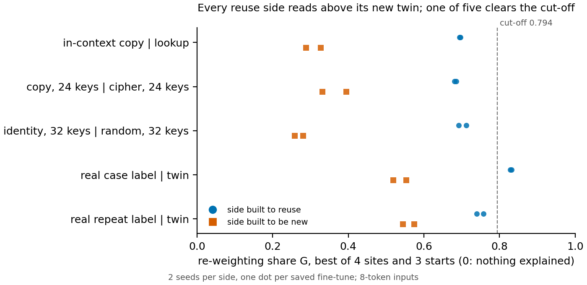

# Can the second wording of reuse serve as the working definition? The gate page

*2026-11-10, definition-lead. Reading and writing only; nothing was run for this page. Adopted tentatively by the user
the same day, with rounded cut-offs: see "Adopted 2026-11-10" below and the last row of `decisions.md`. Decision card:
`reports/decisions/2026-11-10_decision_gate-working-definition.md`.*

We read one wording of reuse on 67M fine-tunes whose labels were fixed when they were built. Its labels follow
construction on the hand-made changes and the table copies, call nearly every other ordinary fine-tune rewired, and rank
the reuse side above its new twin in all five matched pairs. No built control has yet read new cleanly: the clearest
reuse case read just under the cut-off, and the search reads only 0.84 even on an exact edit. For the goal, it separates
strengthening from new capability within a matched pair, not yet as an absolute label.

## Adopted 2026-11-10

The user adopted this wording tentatively as the working definition of reuse. The condition, in the user's words: "if it
cant detect built, then it will have to be revised however." The user also rounded the two cut-offs of the filed rule. The
re-weighting share's cut-off goes from 0.794 to 0.8, and the rewiring share's from 0.476 to 0.5, because a cut-off of
0.476 would look tuned in a paper. The rule is otherwise unchanged. Every item was re-labelled from its saved results
at the rounded cut-offs, and one label moved. The third seed of the 300-step copies of the hand-made Always on change
has a rewiring share of 0.48. It now reads no map found where it read rewired, so two of that copy's three seeds read
no map found and the copy as a whole does too. No old 67M task moved. Apart from lowercase, which already read no map
found, every old-task reuse side has a rewiring share of 0.58 or more, so none turns negative at 0.5. Only the real
case label, at 0.83, clears the re-weighting cut-off, as before. The within-pair comparison does not use a cut-off and
is unchanged. Full table: `experiments/old_task_labels/results/labels_cut_0p8_0p5.json`.

## Update 2026-11-12: a memorised fact, and the tentative reading

On 2026-11-12 the user asked to explore a tentative reading, "new means not re-weighted", under which a memorised fact
counts as new. The adopted wording is unchanged. This section reads one new layout under both, from saved results.

**What was read.** A 67M fine-tune memorised a random one-bit fact per number token and pushed the output when the last
number's bit was 1. Its twin made the same push when the last number is odd, a fact the original already reads, on the
same inputs, push and prior. Each was trained on two seeds. Beside them sit three edits written into the original. The
planted odd edit is an exact re-weighting by construction. The planted fact edit is the same with the random bit. The
planted floor keys the push on a bit per pair of numbers, which no map of one token reaches.

| Item | $G$ | $H$ | Adopted wording | Tentative reading |
|---|---|---|---|---|
| Planted odd edit | 0.63 | 0.99 | rewired | new |
| Planted fact edit | 0.48 | 0.98 | rewired | new |
| Planted floor | -0.15 | 0.00 | no map found | new |
| Twin, last number odd, 2 seeds | 0.39, 0.40 | 0.47, 0.46 | no map found | new |
| Memorised fact, 2 seeds | 0.10, 0.12 | 0.36, 0.37 | no map found | new |

**What each reading labels the memorised fact.** Under the adopted wording it reads no map found, a search limit, and so
does its twin. Under the tentative reading it reads new. But every item on this layout reads new, the twin and the
planted odd edit included, so only the ranking within the pair separates them. Each fact seed sits about 0.28 under the
twin's mean, the same order as in all five old matched pairs.

**Where the wording gives no reading here.** The planted odd edit is an exact re-weighting, yet its re-weighting share
reads only 0.63, under the 0.8 cut-off. So on this layout an absolute "re-weighted" label cannot be read, and "not
re-weighted" carries no information. The planted fact and odd edits sit 0.14 apart, inside the 0.17 the filed rule
needed, so even the ranking does not separate the planted pair.

No change to the wording is recommended here; the user decides at the gate. Sources:
`reports/analyses/2026-11-12_analysis_memorised-fact.md`, `experiments/memorised_fact/results/readings.json`, E168.

## The wording

Take the original model and a fine-tune of it, and a set of inputs fixed in advance: where the new behaviour shows,
where it does not, and far from the training data. The gap is the mean total variation between the two models'
next-token distributions over that set.

A variable is a few directions of the activations at one layer. It *splits* the behaviour when two swaps both work.
Given the fine-tune's value, the original acts like the fine-tune. Given the original's value, the fine-tune reverts.
The label then asks how the fine-tune sets that variable.

- **Re-weighted:** by a fixed affine map of the variable's own value, with at most four directions, on a variable the
  original acts on. Turned up, on by default, shifted: the reuse the safety claims assert.
- **Rewired:** by a fixed affine map of everything the original computed up to that layer. A new connection from old parts.
- **Built:** neither. The fine-tune needs a quantity the original had not computed. "Computed" is stipulated to mean
  affinely readable from the original's activations.

Measured, each label becomes the share of the gap closed by the best map a search finds, 0 for nothing and 1 for all.
The re-weighting share $G$ maps a four-direction variable from its own value. The rewiring share $H$ maps it from
everything before it. The rule reads re-weighted when $G$ is at least 0.8 and $H$ at least 0.5. With $H$ above
its cut-off and $G$ below, it reads rewired. With $H$ under 0.5 it reads **no map found**, a search limit never read as
built. The filed cut-offs were midpoints between the hand-made changes, set before any ordinary fine-tune was read.
The user rounded them on adoption. On the user's decision of today, this page reports $G$ within matched pairs, and an
absolute cut-off is listed as open.

## Every item, beside the label it was built with

Shares per seed, seed 0 first. A dash means no reading. Labels are at the adopted cut-offs, 0.8 and 0.5.

| Item | Built as | $G$ | $H$ | Label as read | Matched twin |
|---|---|---|---|---|---|
| **Hand-made changes**, one each | | | | | |
| Always on: a fixed push on a variable | re-weighted | 0.92 | 0.98 | re-weighted | none |
| Cue: the push set by one rare token | rewired | 0.67 | 0.96 | rewired | none |
| Table: the push set by 32 keys | rewired | -0.03 | 0.99 | rewired | none |
| XOR: the push set by an XOR of random bits | built | -0.03 | -0.01 | no map found | none |
| **Ordinary fine-tunes copying them**, 3 seeds | | | | | |
| Always on, 300 steps | re-weighted | 0.64, 0.63, 0.64 | 0.50, 0.45, 0.48 | no map found, was rewired | none |
| Always on, 3000 steps | re-weighted | 0.77, 0.78, 0.74 | 0.58, 0.58, 0.56 | rewired | none |
| Table | rewired | 0.02, -0.03, -0.02 | 0.72, 0.71, 0.72 | rewired | none |
| Cue | rewired | – | – | no reading: stopped at step 10 | none |
| XOR | built | – | – | no reading: not learned | none |
| **Old 67M tasks**, 2 seeds | | | | | |
| In-context copy | reuse | 0.70, 0.69 | 0.59, 0.58 | rewired | lookup |
| Lookup on the same inputs | new | 0.33, 0.29 | 0.69, 0.67 | rewired | in-context copy |
| Copy, 24 keys | reuse | 0.68, 0.68 | 0.63, 0.66 | rewired | cipher, 24 keys |
| Cipher, 24 keys | new | 0.39, 0.33 | 0.63, 0.62 | rewired | copy, 24 keys |
| Identity, 32 keys | reuse | 0.69, 0.71 | 0.64, 0.61 | rewired | random, 32 keys |
| Random map, 32 keys | new | 0.28, 0.26 | 0.61, 0.63 | rewired | identity, 32 keys |
| Real case label | reuse | 0.83, 0.83 | 0.79, 0.85 | re-weighted | its twin |
| Case twin, labels per word | new | 0.52, 0.55 | 0.70, 0.71 | rewired | real case label |
| Real repeat label | reuse | 0.76, 0.74 | 0.77, 0.78 | rewired | its twin |
| Repeat twin, labels per word | new | 0.54, 0.57 | 0.75, 0.76 | rewired | real repeat label |
| Sharpen the top guess per key | reuse | 0.64, 0.61 | 0.75, 0.73 | rewired | none |
| Lowercase text | reuse | 0.36, 0.35 | 0.45, 0.43 | no map found | none |
| Map to lower guesses per key | open | 0.66, 0.58 | 0.74, 0.75 | rewired | none |
| One-pair map | new | 0.92 | 0.88 | no reading: one seed | none |
| Word cipher, 50 words | new | 0.08, 0.07 | 0.16, 0.14 | no map found | none |
| Word cipher, 500 words | new | 0.19, 0.16 | 0.32, 0.30 | no map found | none |
| Emoticon push | existing behaviour | 0.87, 0.88 | 0.01, 0.06 | no map found | none |

The hand-made rows set the cut-offs, so they agree with construction by design. Of the rest, labels follow construction
for the table copies and for the real case label against its twin. The 300-step copies of Always on read no map found
at the rounded cut-offs, and the longer copies read rewired. Every other reuse side reads rewired, like its twin, except
lowercase, which reads no map found.

The memorised fact and its twin, read 2026-11-12, are not in this table: see the update section.

## The within-pair comparison

**Reading it.** In all five matched pairs, every reuse seed has a higher $G$ than every seed of its new twin. The
narrowest margin is the repeat label, 0.17 from the lowest reuse seed to the highest twin seed. Only the real case label
clears the dashed cut-off, so as absolute labels the pairs give one contrast in five. Three pairs share their inputs; the
two key-table pairs were read on separate inputs drawn the same way.

## Where it gives no reading, and why

- **Built is never read.** A low $H$ only says this search found no map. The hand-made XOR reads so because it was chosen
  to be affinely unreadable, which checks the construction more than the wording. Reading low $H$ as built would be a
  rule only the user adds.
- **The scale's top is not 1.** On an edit built to be exactly reachable the search reads 0.84, and fine-tunes that do
  not make exactly their target push are capped near 0.72. A reading under 0.5 can come from the scale, not from new
  structure. Whether two sites in order count as one map is a wording question the user owns.
- **Fine-tunes that never showed the behaviour.** The first XOR copies did not learn it; the Cue copies stopped at a
  wrongly directed early check.
- **One seed.** The one-pair map has a single saved fine-tune; a task label needs both seeds to agree.
- **Long-text tasks on 8-token inputs:** the two word ciphers and lowercase. The emoticon's $H$ sits near zero under a
  high $G$, which the wording rules out, since $H$ can always do what $G$ does.
- **Search limits.** Found $H$ is under found $G$ in 10 of 33 old-task readings; taking the larger changes only the emoticon.
- **"The original acts on it" excludes nothing here.** All 100 random directions at every site moved the output. Only
  the four directions and the affine map separate re-weighted from rewired.
- **$G$ and $H$ read outputs only.** The Always on copies' $G$ rose as they matched the change more closely. The change's
  own variable and map explained 0.632 of a 300-step copy. Only the reversion looks inside: it stayed from 0.24 to 0.26 on
  the 3000-step copies. The hand-made change read 0.938.
- **Absolute labels on ordinary fine-tunes.** The cut-off sits above four of five reuse sides. Open, by today's decision.

## The built control, as run

The user's condition needs, on one task, a built arm (the original lacks the variable) reading $H$ under 0.5 beside a
reuse arm (the original holds it) reading at or above 0.5. Four runs on 11-11 tried; none gave that contrast.

- **Two-key XOR.** The plain 67M and a taught original were each fine-tuned toward the same push. Both learned it and
  both read no map found: $H$ 0.08 and 0.09 on the plain arm, 0.02 on both taught seeds. The taught original held the
  bit only weakly, a linear read of 0.588 where chance is 0.50, so its arm was not a fair reuse case.
- **Parity of a sum.** Stopped before any fine-tune: the plain 67M already reads the sum's parity at 0.61, over the
  filed bar of 0.55, so the built arm would not have been built.
- **A strongly taught original.** Stopped: the plain XOR fine-tune holds the bit almost exactly, but a second push on it
  moved the output by only 0.12, under the filed floor of 0.15.
- **Last number odd.** The positive control alone: a push on a fact the plain 67M reads exactly. The fine-tune learned
  it, yet $H$ read 0.466 and 0.459, under the cut-off, so the built arms did not run. Table copies, also of an exactly held variable, read 0.72.
- **Why it stops there.** Given the exact target edit to reproduce, the search reads 0.84, not 1, and a map that made
  that edit exactly would read 0.72 on these fine-tunes, which do not make exactly their target push. A smaller ridge
  penalty or a map at every position changes nothing. Two sites written in order put the control at 0.60 and 0.58.

So the wording has not yet detected built, and under one site it reads no map found on its clearest reuse case.

## What would make us drop it

- On a matched pair not used to set anything, such as the Qwen test set, the reuse side reads at or below its twin.
- In a clean built control, the reuse arm also reads low $H$: "no map found" would then carry no information. Both
  reuse arms run so far read low, but neither was clean.
- Two fine-tunes with the same outputs but known different insides read alike on every number, the reversion included.
  The wording would then not look inside the model. Nothing yet says how the Always on copies were built, so their low
  reversion cannot be scored.
- The search failing known answers. It reached 0.922, 0.961 and 0.995 against a bar of 0.9.

**Open question for the gate**, from the premise check, put without a recommendation: "What value of H would the
wording assign to an edit known to be exactly linear, and how were the 0.5 and 0.9 cut-offs chosen relative to that
value?" The label cut-offs, $G$ 0.8 and $H$ 0.5, were set by the user in the 2026-11-10 rows of `decisions.md`.

## What the evidence supports

As a measurement, the wording recovers known answers and orders every matched pair of old tasks by construction. As a
labeller with cut-offs from hand-made changes, it calls ordinary fine-tunes rewired whatever their history, or finds no
map where the rewiring share falls under 0.5. Its "built"
has no reading yet, and its claim to look inside rests on the reversion alone.

**Departures from the literature.** Jain et al. 2024 define possession by a probe for a named function at one layer and
position. Here any value counts, by any affine map from all earlier layers, on a mixed input set. Prakash et al. 2024 patch
named heads one way and score task accuracy; here a searched variable is patched both ways and scored per input. Geiger
et al. 2025 already call adapter-tuning an intervention on parameters. Cut-offs and label rule are this project's own;
the cut-offs are rounded from filed midpoints.

**Not run.** A built control with a clean reuse arm. A Cue copy and a learned XOR copy. An Always on copy with a leftover under 0.192 of the
change. Longer inputs for long-text tasks. A stronger rewiring search. Any absolute cut-off. A fresh matched pair or a
Qwen reading. An independent check of any number here.

*Sources: wording `~/commute-data/scratch/definition-session/2026-11-09_reuse-at-a-variable_v2.md`; hand-made E137/E138
`experiments/reuse_variable_test/results/`; copies E139 `experiments/reuse_variable_finetune/results/`; old tasks E142
`experiments/old_task_labels/results/labels.json`; built control E148-E156 `reports/analyses/2026-11-11_analysis_built-control-xor2.md`,
`...built-control-attempts.md`, `...h-diagnosis.md`;
premise checks `~/commute-data/premise/P1.3.md`, `P1.4.md`, `P1.7.md`; figure `experiments/old_task_labels/plot_gate.py`.*
