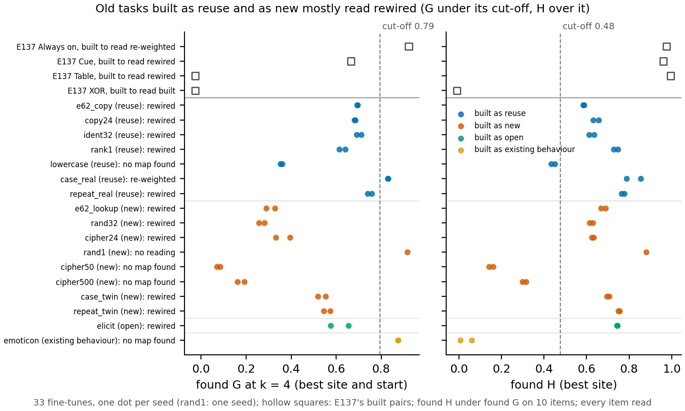

# Do the second wording's labels follow how the old 67M tasks were built?

*2026-11-10. Cell `P1.7`, experiment `E142`, run 1 of 2. Plan `reports/plans/2026-11-10_plan_old-task-labels.md`, filed
rules `experiments/old_task_labels/results/predictions.json`. Every label here is provisional: no wording of reuse is
adopted, and the label rule, cut-offs and wording are unchanged from the earlier fine-tune run.*

**The answer.** We read the saved fine-tunes of the 17 old tasks with the blind search and filed rule used on the
hand-made pairs. The labels do not follow how the tasks were built. Five tasks built to reuse and five built to be new
all read rewired. The re-weighting share does order every matched group by construction, but the filed cut-off sits
above nearly all of them. For `GOALS.md`, the second wording with these cut-offs does not yet separate strengthening
from new capability on real tasks.

## What we were trying to test

Each old task has saved fine-tunes of the 67M model, two seeds per task and one for the one-pair map. Each fine-tune's
weight change was added to the original model, and the result was read on short inputs where the fine-tune shows its
behaviour and where it does not. The search measured two numbers per fine-tune, both shares of the change in outputs that
it can explain, where 0 means nothing explained and 1 means all of it:

- the **re-weighting share**, called G: how much is explained when one 4-dimensional variable of the original model is
  set by an affine map of its own value, at the best of four sites and three starts;
- the **rewiring share**, called H: how much is explained when that variable is set by an affine map of everything the
  original computed there, at the best of five sites.

The filed rule turns the two into a label. Both shares at or above their cut-offs read re-weighted. The rewiring share
at or above its cut-off with the re-weighting share under its own reads rewired. A rewiring share under its cut-off reads
no map found, which is a limit of the search and never "built". A task takes the label both its seeds hold, else no
reading. The cut-offs, 0.79 for G and 0.48 for H, are copied from the earlier fine-tune run, which set them between the
four hand-made pairs. Those pairs are the reference: the pair built to read re-weighted had G at 0.92, and the highest
pair built to read rewired had G at 0.67.

The tasks come in four groups by how they were built. Seven were built to reuse something the model does, such as copying
a token or labelling a word's case. Eight were built to be new, such as random key tables and shuffled twins of the
reuse tasks. One, the lower-guess map, was left open. One, the emoticon, pushes an existing behaviour. Four groups are matched: reuse tasks and new tasks
read on the same inputs.

The control ran first and passed. A zero weight change through the loader moved no output on any task's inputs. The
loader matched the old evaluation path exactly on two tasks. A finished fine-tune from the earlier run, re-read through
the new path, matched its earlier shares to the sixth decimal place.

## What we expected

We filed a label for each task before the run. Key tables, ciphers and shuffled twins were expected to read rewired,
like the hand-made table pair. Copy and identity tasks were also expected to read rewired, because a token identity
needs more than four dimensions. Only lowercase and the emoticon were expected to read re-weighted: each is a fixed push
along something the model already tracks. So the summary prediction was that the labels would not follow construction.

## What we observed

**Reading it.** Tasks built to reuse and tasks built to be new mostly land in the same place: re-weighting share under
its cut-off, rewiring share over it. Of the seven tasks built to reuse, five read rewired, one reads re-weighted and one
reads no map found. Of the eight built to be new, five read rewired, two read no map found and one has a single seed.
The hollow squares are the hand-made pairs, which do land where they were built to. Within each matched group every reuse
side has a higher re-weighting share than every new side. The reuse sides read from 0.68 to 0.83, the new sides from
0.26 to 0.57. This
ordering is an observation, not a label: the filed cut-off sits above every reuse side but the real case label.

The four no map found tasks are the two text ciphers, lowercase and the emoticon. The text ciphers and lowercase were
trained on long text, and here they are read on 8 tokens. Lowercase's rewiring share sits just under its cut-off on
both seeds. The emoticon's rewiring share is near zero while its re-weighting share is high, which the definition rules
out, as the next section explains.

### Label table

Earlier reading: the saved-number reading in `reports/plans/2026-11-09_plan_definition-page-appendix.md`, under the first
wording. G and H per seed, seed 0 first.

| Task | Built as | Earlier reading | Predicted | Label (per seed) | G | H |
|---|---|---|---|---|---|---|
| e62_copy | reuse | not settled: needs the frozen-body training | rewired | **rewired** (rewired, rewired) | 0.70, 0.69 | 0.59, 0.58 |
| copy24 | reuse | not settled: needs the frozen-body training | rewired | **rewired** (rewired, rewired) | 0.68, 0.68 | 0.63, 0.66 |
| ident32 | reuse | not settled: needs an unseen-key read and the frozen-body training | rewired | **rewired** (rewired, rewired) | 0.69, 0.71 | 0.64, 0.61 |
| rank1 | reuse | new, against how it was built | rewired | **rewired** (rewired, rewired) | 0.64, 0.61 | 0.75, 0.73 |
| lowercase | reuse | does not apply | re-weighted | **no map found** (no map found, no map found) | 0.36, 0.35 | 0.45, 0.43 |
| case_real | reuse | not settled: needs the frozen-body training | rewired | **re-weighted** (re-weighted, re-weighted) | 0.83, 0.83 | 0.79, 0.85 |
| repeat_real | reuse | not settled: needs the frozen-body training | rewired | **rewired** (rewired, rewired) | 0.76, 0.74 | 0.77, 0.78 |
| e62_lookup | new | new | rewired | **rewired** (rewired, rewired) | 0.33, 0.29 | 0.69, 0.67 |
| rand32 | new | new | rewired | **rewired** (rewired, rewired) | 0.28, 0.26 | 0.61, 0.63 |
| cipher24 | new | new | rewired | **rewired** (rewired, rewired) | 0.39, 0.33 | 0.63, 0.62 |
| rand1 | new | does not apply | no reading | **no reading** (re-weighted) | 0.92 | 0.88 |
| cipher50 | new | new | rewired | **no map found** (no map found, no map found) | 0.08, 0.07 | 0.16, 0.14 |
| cipher500 | new | new | rewired | **no map found** (no map found, no map found) | 0.19, 0.16 | 0.32, 0.30 |
| case_twin | new | new | rewired | **rewired** (rewired, rewired) | 0.52, 0.55 | 0.70, 0.71 |
| repeat_twin | new | new | rewired | **rewired** (rewired, rewired) | 0.54, 0.57 | 0.75, 0.76 |
| elicit | open | new | rewired | **rewired** (rewired, rewired) | 0.66, 0.58 | 0.74, 0.75 |
| emoticon | existing behaviour | does not apply | re-weighted | **no map found** (no map found, no map found) | 0.87, 0.88 | 0.01, 0.06 |

Matched groups: e62_copy with e62_lookup, copy24 and ident32 with rand32 and cipher24, case_real with case_twin,
repeat_real with repeat_twin. Every fine-tune had a reading: the smallest output gap was 0.20 against the floor of 0.02.
Per-item sites, setter mismatch and reversion are in `experiments/old_task_labels/results/labels.json`.

## What the reading is blind to: a rewiring share under the re-weighting share

The rewiring map can do anything the re-weighting map can, so the true rewiring share is never below the true
re-weighting share. A found rewiring share under the found re-weighting share is therefore a limit of the rewiring
search, as in the earlier fine-tune run. There the limit came from the leftover of imitating a hand-made pair; here the
fine-tune is the saved one itself, so there is no such leftover.

Ten of the 33 fine-tunes have found H under found G: both seeds of e62_copy, copy24, ident32 and the emoticon, the one
rand1 seed, and seed 0 of case_real. Reading H as the larger of the two would change only the emoticon: both seeds, and
the task, would read re-weighted, the label predicted for it. The other eight keep their labels. This is a note on what
the search misses, not a reading; the emoticon's label stays no map found. Its rewiring map is fitted on 584 windows
against 36,864 columns, which the plan expected to over-fit.

## What we learned

On the old tasks, the second wording's labels with the filed cut-offs do not track how the tasks were built: both kinds
read rewired. The re-weighting share itself carries the construction in all four matched groups, so the number is not
blind to it; the cut-off, set from four hand-made pairs, sits in the wrong place for ordinary fine-tunes. Whether to
move it is a definition change that only the user makes. The case-label pair is the one place the label splits the
real task from its twin.

## How compelling is the evidence

Two seeds per task, and they agree on every task's label. The shares are lower bounds: a search that misses reads low.
The inputs are 8 tokens, so behaviour that needs longer context is not seen; the three long-text tasks are the ones
most exposed. The seed-to-seed spread of G is up to 0.08, on the lower-guess map, smaller than the pair orderings above.

## Surprises

- **The real case label reads re-weighted; we predicted rewired.** Both seeds clear both cut-offs. It is the only
  two-seed task to read re-weighted, and the only matched pair the label separates.
- **The two tasks predicted re-weighted both read no map found.** Lowercase's rewiring share is just under its cut-off;
  the emoticon's is near zero beside a high re-weighting share.
- **The text ciphers read no map found, not rewired.** Their rewiring shares are low, possibly from the 8-token inputs.

## What next

- A user decision on whether the cut-off may be set again from ordinary fine-tunes. If yes, the pair ordering above
  would give labels that follow construction on these tasks; if no, these labels stand as provisional.
- The cell's second run, if any, would read the long-text tasks on longer inputs, to see whether no map found is the
  input length.

## Scorecard

| Prediction | Rule | Read | Verdict |
|---|---|---|---|
| 11 tasks predicted rewired that read rewired | label held by both seeds | rewired | hit, 11 tasks |
| rand1: no reading | one seed | no reading | hit |
| rand1's one item rewired | item label | re-weighted | miss |
| cipher50, cipher500: rewired | label held by both seeds | no map found | miss, 2 tasks |
| lowercase: re-weighted | label held by both seeds | no map found | miss |
| case_real: rewired | label held by both seeds | re-weighted | miss |
| emoticon: re-weighted | label held by both seeds | no map found | miss |
| Summary: 14 of 16 two-seed tasks rewired, re-weighted only lowercase and emoticon | count | 11 of 16 rewired, re-weighted only case_real | miss on the counts; its point holds, labels do not follow construction |

Task predictions: 12 of 17 hit.

## Departures

- **Inputs of 8 tokens**, the user's choice: the rewiring search regresses on every position, and the tasks' own
  context lengths would need far more memory than one card. The earlier runs read their pairs on the pairs' own inputs.
- **Two seeds per task**, one for rand1, where the earlier fine-tune run had three per pair. The rule's "held by at
  least 2 seeds" here means both seeds agree.
- **Departures from the literature:** none beyond those of the second wording, listed in the earlier plan's appendix.

## Not run

- The cell's second run.
- Longer inputs for the long-text tasks.
- A third seed for any task.
- A stronger rewiring search, which would settle the ten fine-tunes with found H under found G.
- Any change of cut-off, label rule or wording.
- The frozen-body training the earlier reading asked for.

## Provenance

Control and 9 items: cluster jobs 57762, 57772, 57773 and 57774, debug queue. The other 24 items: RunPod pods
`commute-E142-1` to `commute-E142-6`. Item results `experiments/old_task_labels/results/<task>_s<seed>.json`, control
`results/control.json`, labels `results/labels.json`, figure and its CSV `experiments/old_task_labels/figures/`, all
from `experiments/old_task_labels/plot.py`.
