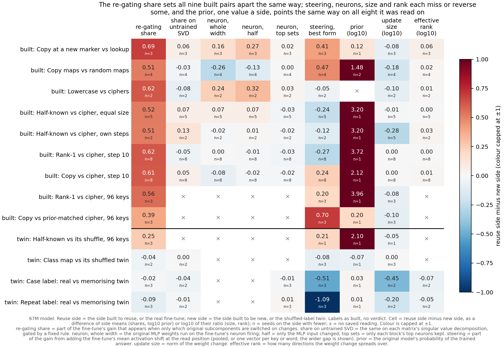

# How the share compares with simple baselines on the 67M task pairs

*2026-11-10, cell P2.11, compare-lead's writer. No run, no GPU, $0: saved results only. Built by
`experiments/method_table/plot_final.py`, which writes `experiments/method_table/results/final.json` and
`experiments/method_table/figures/final.png`. Sides are labelled as each pair was built; no verdict of reused or new is
given, because the definition is under revision in cell P1.1.*

We put every saved reading of the re-gating share and of eight simpler methods side by side on thirteen pairs of
fine-tunes of the 67M model. The share sets all nine pairs built to differ apart in the same direction. Each simpler method
misses or reverses some pairs, except the original model's prior, which points the same way but has one value per side.
For the aim in `GOALS.md`, the share carries a signal about how the sides were built that no single baseline gives on every
pair, but nothing here shows that the signal is reuse.

**The answer.** On the nine built pairs the share always reads higher on the side built to reuse. Steering agrees on five
and reverses on three. The neuron readings agree on at most three, and one form of them writes almost nothing. Update size
never agrees: where it separates the sides, the new side's update is larger. The original model's prior points the same
way on every pair it was read on, but two pairs nearly match it and the share still separates them. On real fine-tunes
against shuffled-label twins the share separates one pair of four clearly, and reads the other three within 0.1.

## The pairs

A **built pair** is two sets of fine-tunes of the 67M model on matching windows. One side is built to reuse something the
model already does, such as copying a token from the window or a map it half knows. The other is built to be new, such as a
random map or a cipher. There are nine, with two to eight saved seeds per side. A **twin pair** is a real fine-tune against
one trained on the same text with the labels shuffled, so the twin can only memorise. There are four. The labels are the
builders' intentions, not findings.

Every share below is a part of the fine-tune's **gain**: the change in the log-odds of the trained answer between the
fine-tuned and the original model. A share of 0 means the method reproduces none of the gain, and 1 means all of it.

## The methods we compare, and why each was chosen

**The re-gating share, the method under test.** It keeps the original model's subcomponents and weights. It changes only
which subcomponents Γ switches on and how strongly, to what Γ reads on the fine-tuned model's activations. The share is the
part of the gain that this alone reproduces. It is blind to whether the subcomponents it switches on are interpretable, and
like every column here to both sides moving together.

**The share on an untrained decomposition.** This is the same reading on each matrix's singular value decomposition. A
fixed rule switches components on: at each position, keep as many of the largest contributors as the trained
decomposition switches on. It stands for the rival "the share comes from the decomposition's training, not from the
model". It is blind to whether a better switching rule would recover the gap, since this rule reproduces the original model
less closely than the trained decomposition does.

**Three neuron readings.** They stand for "the decomposition adds nothing over neurons". The whole-width reading runs the
original MLP weights on the fine-tune's neuron firing. The half reading changes only the MLP's input. The top-set reading
keeps each block's firing only on its largest neurons, 64 or as many as the decomposition switches on. All three miss
anything the fine-tune changed in attention. The top-set masking moves the original model's answer by up to 3.4 in
log-odds, so it is far from either fine-tune.

**Steering.** Add the fine-tune's mean activation change at the read position to the original model. The vector is pooled
over all windows, or there is one per key or per word; layer and strength are chosen on training windows. It stands for "a single
direction in activations would do as well". The figure shows, per pair, the kind with the wider gap, the rule two of the
steering runs filed. Steering is blind to whether the vector writes the answer the fine-tune's way. On key-value pairs a
per-key vector is handed the answer, since each key fixes it. Four pairs have only an older one-vector reading.

**The prior.** The original model's probability of the trained answer before any fine-tune, one value per task map. It
stands for "the share only reflects how likely the answer already was". With one value a side it has no spread, so it gives
a direction but no call.

**Update size.** The summed norm of the weight change over all matrices. It stands for "the share only reflects how big the
update was". It is blind to the update's direction.

**Effective rank of the update.** How many directions the weight change spreads over, from its singular values. It stands
for "the share only reflects how spread out the update is". It is blind to which directions those are.

## How they compare

Each cell is the side built to reuse minus the side built to be new. Shares and the prior's log10 are differences of side
means; size and rank are log10 of the ratio of side means. Colour is capped at one, and the number in the cell is exact.

**What "apart" means here.** Where a run filed its own per-pair call, that call is used: the label-pair run, the
update-spectrum run and the holes run each filed one. Elsewhere two sides are apart when their seed ranges do not overlap.
No band is added, so a small gap with tiny spreads counts as apart; the numbers in the cells show how small.

**Counts on the nine built pairs.** "Same" means apart in the share's direction.

| method | same | opposite | no call | not run |
|---|---|---|---|---|
| re-gating share | 9 apart | — | 0 | 0 |
| share on untrained decomposition | 2 | 1 | 4 | 2 |
| neuron, whole width | 3 | 3 | 1 | 2 |
| neuron, half | 3 | 1 | 3 | 2 |
| neuron, top sets | 0 | 0 | 7 | 2 |
| steering, wider kind | 5 | 3 | 1 | 0 |
| prior | 1, plus 7 one value a side, all positive | 0 | 0 | 1 |
| update size | 0 | 6 | 3 | 0 |
| effective rank | 3 | 0 | 4 | 2 |

**The untrained decomposition.** Its gaps run from 0.08 below zero to 0.13 above. The share's run from 0.39 to 0.69. Its two
agreements are small: 0.06 on copy against lookup and 0.13 on the half-known map against the cipher at its own step.

**Neurons.** The whole-width reading reverses on copy maps against random maps, by 0.26. Its other two reversals are 0.02 and
0.08. Its own run read only two cipher seeds on the first and left the cipher side of the second unscored. The half
reading agrees on the same three pairs and reverses only on copy maps, by 0.13. The
top-set reading is inert on every pair: no fine-tune reads more than 0.05 of its gain.

**Steering.** It agrees on copy against lookup, copy maps against random maps and copy against cipher at step 10, with gaps
of 0.24 to 0.47. It also agrees on both 96-key pairs, in its older form. It reverses on the two pairs built at equal update
size and on the half-known map at the cipher's own step. That reversal is
unexplained: on rank-1 against cipher, pooled steering reads the cipher 0.27 higher. On the half-known pair at its own step
the pooled vector agrees by 0.11, but the per-key vector reverses by 0.12 and is the wider.

**Prior.** Every built pair it was read on has the reuse side's answer more likely to start with. The prior-vs-share run
found the share follows the log prior across 24 maps, with a rank correlation of 0.85. But on copy against lookup the prior
differs by a factor of only 1.3, and the share's gap is 0.69. On copy against the prior-matched cipher it differs by a factor
of 1.6, and the share's gap is 0.39.

**Update size and rank.** Where size separates the sides, the new side's update is the larger, on six pairs. On the three
pairs whose sides have about the same update size, size and rank both read no gap, and the share's gaps are 0.52 to 0.62.

**Twin pairs.** The share separates the half-known map from its shuffle, by 0.25. On the class map it reads the twin 0.04
higher, apart by seed ranges with tiny spreads. On the two label pairs it reads no gap. There per-word steering, update size
and rank all separate the sides, the twin higher each time. The label-pair run traced the steering gaps to the per-word
vector carrying the answer and the case twin training ten times longer. So these readings bear on how the twins were trained
as much as on what they learned.

### What the share adds

The share is the only reading that sets all nine built pairs apart in one direction. Each rival is ruled out on some pair:

- **The prior** is nearly matched on copy against lookup and on the prior-matched cipher pair, and the share still separates
  both.
- **Size and rank** are matched on the three equal-size pairs, and the share separates all three.
- **Steering** reverses on three pairs, and the share does not.
- **Neurons and the untrained decomposition** read small or no gaps on most pairs.

On rank-1 against cipher at step 10 no reading with a spread agrees with the share; only the prior, one value a side,
points the same way. But no single pair rules out every rival at once. On both prior-matched pairs, pooled steering also
separates the sides, by 0.41 and 0.70. So a combination of rivals, such as the prior where it differs and steering where it
does not, could track the share on these pairs; that combination was not tested.

## Unexplained

- Steering reads the side built to be new higher on three built pairs.
- The class map's share and steering both read its twin slightly higher.
- On the label pairs the twin's update spreads over more directions than the real one's.

## Where a newer run replaced an older cell

- **The share** on seven built pairs is the untrained-decomposition run's re-read of the trained share, which reproduced the
  saved values exactly. On the half-known map at the cipher's own step that run kept two cipher seeds, not five.
- **The share on the label pairs** is the label-pair run's, three seeds, in the contrast between the two label words.
- **The share on the class map** is read on two regenerated seeds; the older reading on three seeds also put the twin higher.
- **The prior** is the prior-vs-share run's on every pair, replacing the scorecard's.
- **Steering** on six built pairs is the holes run's fair form, on copy against lookup the steering run's, and on the label
  pairs the label-pair run's.
- **Update size** on lowercase against ciphers comes from the spectrum run, as the root of summed squared norms.

Each cell's source file and field are in `final.json` under `source` and `replaces`.

## Departures from the literature

None added here. The runs read carry their own, each stated in its report. Steering is fitted on the fine-tune's training
windows and has a per-key form. The untrained stand-in is a singular value decomposition with a fixed switching rule. The
neuron readings and the share are this project's own measures.

## Not run

- Any verdict of reused or new; the definition is under revision.
- A combined score over the columns.
- Neuron readings and the untrained decomposition on the four 96-key pairs, which kept no fine-tunes on both sides.
- Steering in its fair form on those four pairs; they keep only the older one-vector reading.
- The prior on lowercase against ciphers.
- The step ladder of rank-1 against cipher, with update size only; left out of the figure.
- Cell P2.6, parked.
- Any Qwen pair.
