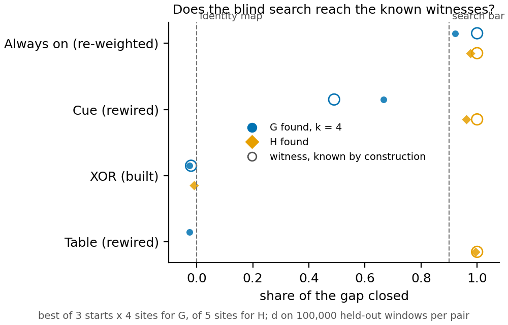

# Does a blind search recover the reuse labels of four hand-made pairs?

*2026-11-10. Cell `P1.3`, experiment `E137`, completed by its repair run `E138`. Jobs 57142 and 57208 on the cluster's
debug queue, $0. Plan `reports/plans/2026-11-09_plan_reuse-variable-first-test.md`. No verdict on any saved fine-tune.*

We added one small piece to the 67M model in four ways whose label is known by construction. A search that was not
told the answer then measured how much of each change it could explain. It reached the known answers, and its two
shares put the pairs in the order of their labels. For `GOALS.md` this shows the second wording of reuse can be
measured on known cases; it says nothing yet about real fine-tunes.

**Where the two wordings differ.** The first wording calls a change reuse when the two models agree once some old
variable is set. The second asks how the fine-tune sets that variable. An affine map of the variable itself is
re-weighted. An affine map of everything the original computed is rewired. Anything else is built. The XOR pair is
built by construction, and the first wording's exact checks hold on it, so that wording says reuse. The second wording
does not, because the XOR's setting is far from any affine map of the old value. At the known subspace the setter
mismatch is 0.65, where 0 is a perfect fit. Only the second wording matches the label. The first also fails its
other test. All 100 random directions at every site change the output, and the activations on ordinary text fill all
768 directions. So its "built" cannot apply anywhere here. For the same reason the second wording's clause "the
original acts on it" excludes nothing on this input set.

**Reading it.** The search recovers every known answer it was set. Hollow circles are the witnesses, the known
subspace and map. Always on's found re-weighting share is 0.922 against a witness of 1. The rewiring share found is
0.961 on Cue and 0.995 on Table. All three clear the 0.9 bar. The re-weighting share orders the pairs: Always on
above Cue at 0.666. The XOR and Table sit just below zero, at 0.026 and 0.027 below it. The rewiring share is high on
the three pairs that are not built, 0.976 on Always on. On the XOR it is 0.009 below zero. With no cut-offs in this
run these are orderings, not labels, and they follow the labels by construction.

**Can the XOR be built at all?** Yes, on this input set. An affine read of the true XOR bit from the original scores
0.506 on held-out windows. Shuffled bits score 0.502, and the filed bar was 0.55. The original's activations have
rank about 30,600 of 30,720 columns over 34,000 windows.

**Caveats.**
- Built cannot occur on a small closed input set. This XOR is hand-made, and it says nothing about whether a model
  pretrained without a skill reads built.
- A found read-out and map give a lower bound on each share. Failing to find one is not evidence of built.
- The user's last repairs to the second wording are unreviewed. The distance, the dimension 4, the input set and the
  bars were fixed before any reading, not from saved runs.

**A limit of the search.** The rewiring fit is a ridge regression, then 200 steps on the output divergence. Those
steps ended worse than their start at 19 of 20 sites and were discarded. So the rewiring share is in effect the ridge
fit. The plan said the fit at the unembedding's input is convex and reaches its optimum. There Always on's rewiring
share is 0.382, while its witness at block 2 reads 1. A low share at a late site is a limit of this search, not
evidence that no map exists. The cause is not established.

**Fixes before the completed run.** The default solver refused both rank methods. The rank then moved to a last step
on another solver, commits 4bc054d7 and 429c7040. A card then ran out of memory at the unembedding's input. Now the
ridge matrix is freed before the solve, and the time is checked before each site, commit d29b519a.

**Scorecard.** Identity at the start: exact on all four pairs. Gap floor 0.02: all above. Search bars: three of three
passed. Card rule: rival A, Always on's G at least 0.1 above each other pair's. Capacity: built possible.

**Departures from the literature.** Those listed in the plan's appendix; the run adds none.

**Not run.** Any saved or ordinary fine-tune, which is the next cell. Cut-offs that turn the shares into labels. A
model pretrained without a skill. A second seed for the pieces. The "how existing" number beside random subspaces.
A stronger optimiser for the rewiring fit.
