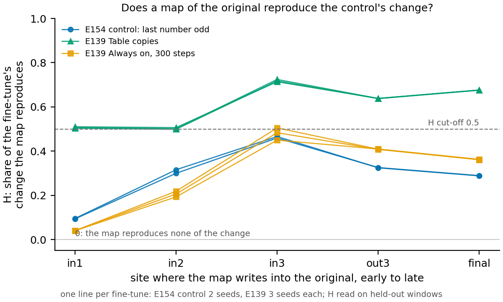

# Can the reuse search find a variable the original model holds exactly?

*2026-11-11. Three built-control runs on rung L1.4: experiments E150, cell P1.10; E153, cell P1.11; E154, cell
P1.12. Cluster debug queue, one L40, $0. Plans `reports/plans/2026-11-11_plan_built-control-sum.md` and
`reports/plans/2026-11-11_plan_built-control-strong.md`; filed rules `experiments/built_control_sum/results/predictions_amend1.json`.
Provisional: no independent check.*

## The answer

The search did not certify reuse even for a variable the plain 67M reads exactly. We fine-tuned the model to act on
whether the last number in a window is odd, a fact a linear read takes from it perfectly. The fine-tune learned its
target, but the best affine map of the original reproduced just under half of its change, below the 0.5 cut-off. So on
this layout a low score cannot tell a built skill from a reuse the search missed. The user's condition for revising
the wording now bears on reuse, not only on built.

## What we were trying to test

The user adopted a working wording of reuse on 11-10, tentatively. It says a fine-tune reused a variable when an affine
map of the original's own activations can stand in for what the fine-tune changed. The number it reads is $H$. We fit an
affine map from the original's activations up to one site, at the last position. We write the map's output into the
original at that site and ask how much of the fine-tune's change in next-token output this reproduces:
$H = 1 - d / \text{gap}$. Here $d$ is the mean total-variation distance from the edited original to the fine-tune. The
gap is the same distance from the unedited original. $H$ is 0 when the map reproduces none of the change and 1 when it
reproduces all of it. The search takes the best $H$ over five sites, from the input of block 1 to the final residual,
against a cut-off of 0.5.

Two more numbers are read beside $H$ but are not part of it. The mismatch is how far the map lands from the fine-tune's
own activation, as a share of that activation's variance. The reversion is how much of the change goes away when the
original's value is written into the fine-tune.

The user's condition was: "if it cant detect built, then it will have to be revised". A test of that needs two things on
one task. A built arm, where the plain model lacks the variable, should read under 0.5. A positive control, where the
original holds the variable, should read at or above 0.5. Without the control, a low reading on the built arm says
nothing, because the search may simply fail on the task.

Yesterday's run on the exclusive-or of two keyed bits found no map on either of its arms. Its positive control was weak:
a linear read of the bit from its taught original scored 0.588, where chance is 0.50. Today's three runs each tried to
get a clean positive control.

**First, the parity of a sum.** Windows end in two numbers from 0 to 99, each one token. The built arm fine-tunes the
plain 67M to push its output whenever the sum of the two is odd. The control fine-tunes it to push whenever the last
number is odd, which needs no teaching. The run first checks that the plain model does not already hold the sum's parity.

**Second, a strongly taught original.** Yesterday's plain fine-tune holds the exclusive-or almost exactly by a linear
read. This run used it as the original and fine-tuned it further, toward itself plus the same push.

**Third, the sum rerun.** The same as the first, with the bar for "the plain model lacks the variable" raised to 0.9 at
the user's request. The control runs first and alone; if it fails, nothing else runs.

## What we expected

The control should read well above the cut-off. The Table copies of the earlier fine-tune study, where the original held
the variable exactly, read 0.72, so the control was filed at 0.6 to 0.8. The sum's arm should read low, as yesterday's
plain arm did at 0.08. The filed rival was that the control reads under 0.5 on both seeds: the search fails on this layout,
and the built control says nothing.

## What we observed

### Does the plain model already hold the sum's parity?

Partly, and enough to stop the first run. A linear read of "the sum is odd" from the plain 67M, taken on number pairs
held out from its fit, scored 0.61 where shuffled labels score 0.50. The filed bar was 0.55. Each number's own parity
reads at 1.0 at every site, so the model holds both parts exactly and their combination weakly. A side reading came from
the same job: yesterday's plain fine-tune holds the exclusive-or at 0.9997, so a full-strength fine-tune does teach such
a variable linearly.

### Can a strongly taught original be pushed further?

No. With yesterday's plain fine-tune as the original, adding the same push again moved the outputs by a total-variation
gap of 0.12. The filed floor was 0.15, so the run stopped before any fine-tune. The model's output on these windows is
already near where the push takes it, and a second push of the same size has little left to move.

### Does the search find the map for the no-teaching control?

**Reading it.** No: the control's best $H$ was 0.466 on seed 0 and 0.459 on seed 1, both under the 0.5 cut-off. The
blue lines are the control's two seeds; both peak at the input of block 3 and sit under the dashed cut-off at every
site. The green lines are the earlier Table copies, where the original also held the variable exactly; they clear the
cut-off at every site and reach 0.72. The orange lines are the earlier Always on fine-tunes, a re-weighted change, and
they track the control closely.

The fine-tune itself learned its target. On held-out pairs its KL divergence from the target was 0.04 of that of a model
given half the push. Its output gap from the original was 0.26. So the low reading is not a fine-tune that failed to
learn.

The per-site parts show where the reading stops. At the input of block 3 the reversion is 0.72 and the mismatch 0.04.
Yet the map reproduces only 0.47 of the change there. At the final residual the reversion is 0.93 and the mismatch
0.06, but $H$ is 0.29. A map that is close by variance still misses more than half of what the fine-tune does
to the output. Why is not established here.

## What this says about the definition

The wording's positive control failed on the clearest reuse case this layout offers. A fact the plain model holds
exactly, read by a fine-tune that learned it, scored under the cut-off on both seeds. A built arm reading under 0.5 on
this layout therefore cannot be counted as "built": the search would read the same on a reuse it missed. The filed
outcome is the rival, the built control is uninformative, and the plain and taught arms did not run.

Near-0.5 readings on clear reuse cases are not new. The earlier Always on fine-tunes read 0.45 to 0.58 across their
seeds and lengths. Only the Table copies have cleared the cut-off by a wide margin. The user's condition was about built;
this result moves the same doubt to reuse. Whether and how the wording changes is the user's call.

## Surprises

The control's reading reversed its filed prediction: expected 0.6 to 0.8, read under 0.5 on both seeds. The two seeds
agree to within 0.01, so this is not seed noise.

## How compelling is it

Two seeds, one task, one layout. $H$ reads only the fine-tune's outputs at the last position, and only through an affine
map from the original's activations; a nonlinear map was not tried. The cut-off is the user's, and the control misses it
by 0.03 to 0.04. The seed spread of $H$ on the earlier Always on fine-tunes was 0.028, so the miss is one to one and a
half spreads. A reading of 0.47 does not say the search is blind to this variable; it says the search does not certify it.

## Scorecard

| id | claim | rule | read | verdict |
|---|---|---|---|---|
| E150 S0c | plain 67M lacks the sum's parity | sum read under 0.55 | 0.61 | stop |
| E153 S1 | the second push leaves room | target gap above 0.15 | 0.12 | stop |
| E154 P1 | control reads as reuse | best H at least 0.5, both seeds | 0.466, 0.459 | miss |
| E154 P2 | plain arm reads under 0.5 | best H under 0.5, both seeds | not run | no reading |
| E154 P3 | taught arm reads as reuse | best H at least 0.5, both seeds | not run | no reading |
| E154 P4 | outcome rival a | control above, plain below | control below | rival b |

## Departures from the literature

None beyond the earlier wording test's list: the same wording, searches and cut-offs. The 0.9 bar for "the plain
model lacks the variable" replaces the filed 0.55 at the user's request; it is the bar the run already used to say an
original holds a variable.

## Not run

- The plain and taught arms of the sum rerun, and $G$ on the control's seed 1.
- A nonlinear map, a map from more than the last position, or a site inside a block.
- A diagnosis of why a map that is close by variance reproduces under half the output change.
- A third seed of the control.
- Any revision of the wording or its cut-offs.

*Provenance: `experiments/built_control_sum/results/stage0.json` (first run, job 58711),
`experiments/built_control_strong/results/stage0.json` and `stage1.json` (second run),
`experiments/built_control_sum/results/amend1_stage0.json`, `amend1_stage1.json`, `amend1_control_s0.json`,
`amend1_control_s1.json`, `amend1_readings.json` (third run, job 58754, 3284 s). Earlier fine-tunes:
`experiments/reuse_variable_finetune/results/table_s*.json`, `always_on_s*.json`, `amend2_always_on_s*.json`. Figure
`experiments/built_control_sum/figures/amend1_h_by_site.png`, drawn by
`~/commute-data/scratch/definition-lead/builtpage/h_by_site.py` through `commute.figures`, numbers in its CSV. H code:
`src/commute/variable_read.py` (`read_pair`, `h_fit`, `h_refine`) and `experiments/reuse_variable_finetune/amend2.py`
line 136.*
