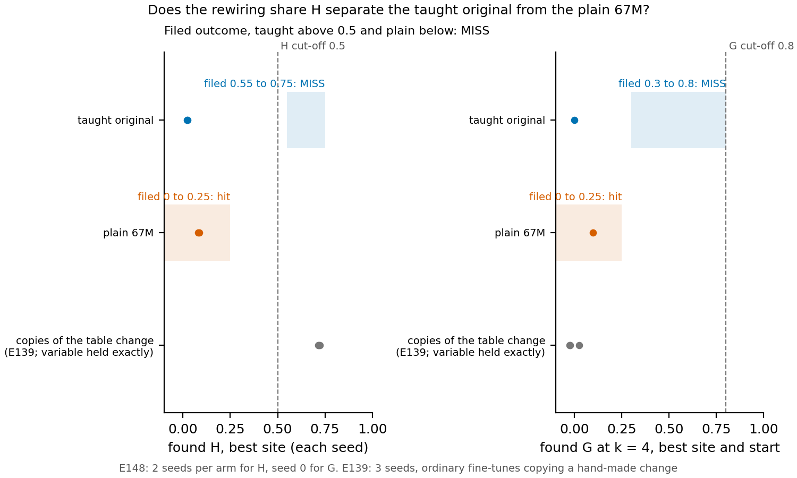

# Can the reuse search tell a newly built skill from one the original already had?

*2026-11-11. The built control on two-key XOR: experiment E148, cell P1.9. Jobs 57970 and 58002 on the cluster's debug
queue, one L40, $0. Plan `reports/plans/2026-11-10_plan_built-control-xor2.md`; filed rules
`experiments/built_control/results/predictions.json`; card `experiments/built_control/card.txt`.*

We taught the 67M model one new skill, the exclusive-or of two keyed bits, from the plain model and from a copy first
trained to hold it in part. The reuse search found no map in either case, and it read the copy that already held the
skill lower than the plain model. By the user's condition the working definition must be revised, though the copy held
the skill too weakly to show whether the search fails in general.

## The answer

The working definition of reuse did not detect a built skill on this task. Both sets of fine-tunes learned their target,
yet the rewiring share stayed near zero on both, far under its 0.5 cut-off. The arm meant to read as reuse came out
lowest. The catch is the control itself: a linear read of the skill from the taught original scored only 0.588, where
chance is 0.50. Every case where the search has worked so far had a variable the original held exactly.

## What ran

**The task.** 128 plain key tokens, each given a random bit. Most 8-token windows end in two keys. The target model is
the 67M plus a fixed push at block 2's input, at the last position, whenever the two keys' bits differ. A quarter of the
key pairs are held out, and every reading uses only those, so passing needs a mechanism rather than memory of pairs.

**Two arms, one target.** The plain arm fine-tunes the 67M toward the target, 300 steps, two seeds. The taught arm first
trains a "taught original": the 67M moved toward the 67M plus a third of the push. Then it fine-tunes that original
toward the same target, with the same recipe and seeds. The taught original already computes the exclusive-or, so its
fine-tune only has to turn that up, and it should read as reuse. The plain model does not, so its fine-tune should read
as built.

**The readings**, each against the fine-tune's own original:
- the rewiring share $H$: how much of the fine-tune's change in output is explained by an affine map of everything the
  original computed at one site. It is the best of five sites; 0 explains nothing, 1 explains all of it;
- the re-weighting share $G$: the same from one four-direction variable of the original, seed 0 only;
- the capacity read: a ridge fit from the original's activations to the true bit, scored as held-out accuracy; 0.50 is
  chance.

Under the adopted definition, $H$ under 0.5 reads "no map found"; $G$ at least 0.8 reads re-weighted.

## What we expected

The plain fine-tunes should read $H$ under 0.25: the plain model holds no linear trace of the bit. The taught fine-tunes
should read $H$ between 0.55 and 0.75, where ordinary fine-tunes copying a hand-made table change read. If the taught arm
read above 0.5 and the plain arm below, built would be visible as a contrast. Both on one side means the wording needs
revising, and the card stops there.

## What we observed

**Reading it.** The search found no map on either arm, so the filed outcome missed. The taught fine-tunes read $H$ of
0.02 on both seeds, under the plain ones at 0.08 and 0.09. Both sit far left of the 0.5 cut-off. The grey points are
ordinary fine-tunes that copied a hand-made table change, read by the same search in an earlier run: they reach 0.72. The
re-weighting share was about zero on the taught arm and 0.10 on the plain one. The two fine-tune arms differ by about two
seed standard deviations of 0.028, which we do not read as a difference.

**Both arms learned.** The learned check divides the fine-tune's distance to the target by that of a model with half the
push. It read 0.10 on the taught arm and 0.15 on the plain one, against a bar of 0.9. A low share is not a fine-tune that
learned nothing.

**Was the taught original a fair control?** Weakly. Its linear read of the bit was 0.588 at the late sites, just over the
0.55 bar; the plan expected above 0.9. In 300 steps it covered about half the way to its own target, from a divergence of
0.18 to 0.09. Its distance to the final target was 0.30, more than the plain model's 0.26. The plan aimed at 0.2. So it
moved elsewhere about as much as it moved toward the push, and its fine-tune still had most of the skill to build.

**Where the search has worked.** On the hand-made pairs it found the known rewiring answer: 0.961 on the cue pair and
0.995 on the table pair. Ordinary fine-tunes copying the table change read 0.72, copies of the always-on change 0.45 to
0.50. In every one of those the variable is, by construction, an exact linear read of the original's activations. Between
that and a read of 0.588 nothing has been tested, so the earlier runs do not settle how strong a variable must be.

## What this says about the definition

The user's condition was "if it cant detect built, then it will have to be revised however". So the wording needs
revising: on this task it cannot tell a built skill from one that was half there. Two readings remain open:
- the search misses reuse in general on ordinary fine-tunes of a computed variable, and the wording must change;
- the search only misses weak variables, and a well-taught original would read above 0.5.

A strongly taught arm on the same task separates them. The decision card
`reports/decisions/2026-11-11_decision_built-control-result.md` puts the choice.

## Surprises

The taught arm read lower than the plain one, though both are near zero and within noise. The taught original ended
further from the target than the plain model, against a planned distance of 0.2.

## How compelling is it

Two seeds per arm for $H$, one for $G$, one task. The shares read outputs only: a fine-tune that matches the target reads
the target's values whatever is inside. The capacity read is linear and cannot see a nonlinear code.

## Scorecard

| id | claim | read | verdict |
|---|---|---|---|
| stops | zero-step gap 0; capacity replay of E137 exact; plain gap 0.26 over 0.15; plain capacity 0.468 under 0.55; taught capacity 0.588; taught gap 0.30; plain learned 0.15 | all passed | ran |
| P1 | plain arm $H$ under 0.5, expected under 0.25; $G$ under 0.25 | 0.08, 0.09; $G$ 0.10 | hit |
| P2 | taught arm $H$ at least 0.5, expected 0.55 to 0.75; $G$ 0.3 to 0.8 | 0.02, 0.02; $G$ about zero | miss |
| P3 | outcome: taught above, plain below | both below | miss: the wording needs revising |

## Departures from the literature

None beyond E137's and E139's lists: the same wording, searches and cut-offs.

## Not run

- A strongly taught original, with a linear read near 1, on the same task.
- The 3000-step rungs for either original or fine-tune; a third seed per arm; $G$ on seed 1.
- A nonlinear capacity read, or a nonlinear map in the search.
- Any revision of the wording.

*Provenance: results in `experiments/built_control/results/`: `stage0.json`, `stage1.json`, `taught_s*.json`,
`plain_s*.json`, `readings.json`. Figure by `plot.py --scored`. Logs `cluster/logs/commute-e148-57970.out` and
`cluster/logs/commute-e148-58002.out`; job 2 took 5422 s.*
