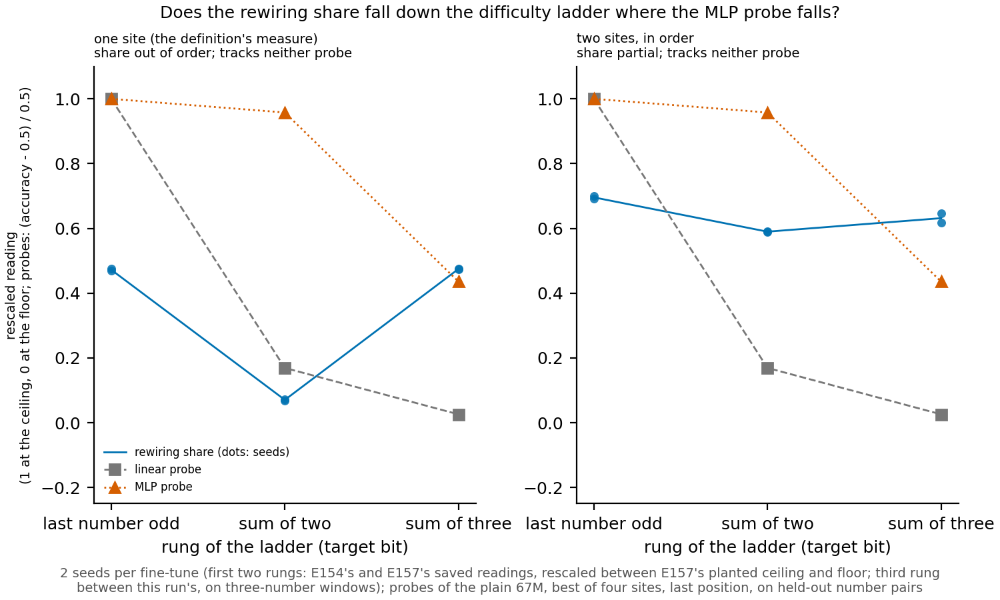

# P1.15 (E159): does the rewiring share fall as the target gets harder for the plain model?

We read the rewiring share of three fine-tunes of the plain 67M model, toward parities of one, two and three numbers,
beside a linear and a small non-linear probe of the plain model for each target. The share fell and then rose back at
one site, and fell and then held level with two sites, so it followed neither probe. On this ladder the share does not
behave as a graded measure of how hard a target is for the plain model, and no label or verdict follows.

## What we were trying to test

Each rung of the ladder is a fine-tune of the plain 67M toward a target model. The target is the plain model with a
fixed push added at block 2's input, at the last position, on the windows where the target bit is 1. The three bits say
whether the last number is odd, whether the sum of the last two is odd, and whether the sum of the last three is odd. The push and its size are the
same on every rung, and each rung has two seeds.

The rewiring share of a fine-tune is one minus a distance over a gap. The gap is the total variation distance at the
last position between the fine-tuned model and the plain model. The distance is what is left between them once the best
affine map is written into the plain model's activations. The map sits at one site, or at two sites in order. A share of 1 means
a map reproduces the whole change, and 0 means a map does no better than leaving the plain model alone.

Each rung's share is rescaled between two planted edits of the same gap on that rung's windows. The planted ceiling is
exactly affine in the plain model's input to block 2, so the map can reach it. The planted floor is one no map can
reach. After rescaling, the ceiling reads 1 and the floor reads 0.

Beside each rung, two probes ask whether the plain model holds the target bit at all. Both read the residual stream at
the last position, at four sites, and the best held-out accuracy is kept. The linear probe is logistic regression. The
small MLP has one hidden layer of 100 units, so it can read a parity the linear probe cannot. Chance is one half. A
probe trained on shuffled labels is the do-nothing reference for the probes.

The question is which probe the share follows down the ladder. The MLP probe says how hard the target is for the plain
model to compute; the linear probe says only what an affine read finds.

## What differs between the rungs

The first two rungs were not run again. They are the saved readings of earlier runs, rescaled by the sum-parity run
before this one; only the third rung is new. So the third step of the ladder changes more than the target bit.

| | last number odd | sum of two | sum of three |
|---|---|---|---|
| fine-tunes | the earlier control's two seeds, saved | the sum-parity run's two seeds, saved | this run's two seeds |
| windows | two numbers at the end | two numbers at the end | a third number, drawn from all 100, before the same pair |
| ceiling and floor | the sum-parity run's, on two-number windows | the same | this run's, calibrated again on three-number windows |
| training | same recipe, 300 steps | same recipe, 300 steps | same recipe, 300 steps |
| learned check: KL to target over KL of a half push | 0.04 | 0.089 | 0.57 |
| distance from the fine-tune to its target, total variation | 0.07 | 0.11 | 0.25 |
| distance from the plain model to the target | 0.22 | 0.23 | 0.23 |
| best single site of the share | in3 | in2 | out3 |

The learned check divides the fine-tune's KL to its target by that of the plain model pushed by half the push on every
window, the best a model blind to the bit can do. Both seeds of a rung give the same values to the precision shown. The
check passes at or under 0.9, so all six fine-tunes count as learned. Yet the sum-of-three fine-tunes ended about as far
from their target as the plain model is. The other two rungs closed more than half that distance.

## What we expected, and why

The planted ceiling on the new windows should read close to 1 at block 2's input, as on the old windows. The planted
floor should read about zero at one site and below zero with two sites. A map that moves the model away from
the target reads below zero, because the share is one minus a distance over the gap.

The probes were expected to read the last number's parity perfectly and the sum of two only weakly with a linear read.
The MLP readings were left open.

The filed rule calls each step a fall or a rise when the rescaled share moves by at least 0.1, and level otherwise. For
the probes the same rule uses a bar measured from the shuffled-label probes, at least 0.05. At one site the plan
expected a fall and then a level step. The sum of two already sat close to the floor, so a second fall would need the
sum of three to read below it. Two sites was where a fall at both steps could show.

## What we observed

### Do the controls hold?

**Reading it.** Yes. The planted ceiling built in the sum-parity run, rebuilt through this run's moved code, gave the
same two-site share of 0.9843 exactly. On the three-number windows the new planted ceiling read 0.983 at block 2's
input. With two sites it read 0.982. The new planted floor read -0.005 at one site and -0.28 with two sites, as the filed
expectation said. Both probes read the last number's parity at 1.0. The shuffled-label probes stayed close to chance,
so the probe bar is its minimum of 0.05.

### What do the probes say about the plain model?

| target | linear probe | MLP probe |
|---|---|---|
| last number odd | 1.0 | 1.0 |
| sum of two odd | 0.58 | 0.98 |
| sum of three odd | 0.51 | 0.72 |

**Reading it.** The two probes split the ladder at different steps. The linear probe falls at both steps. It reads the
sum of two only a little above chance, and the sum of three barely above it. The MLP probe reads the sum of two almost
perfectly, so the plain model holds that bit at the last position, but not linearly. The MLP probe falls only at the
second step. By
the probes, the sum of three is the one target the plain model holds poorly.

### Does the rewiring share follow either probe?

| reading | last number odd | sum of two | sum of three | steps |
|---|---|---|---|---|
| one site | 0.47 | 0.07 | 0.47 | fall, then rise |
| two sites in order | 0.70 | 0.59 | 0.63 | fall, then level |

**Reading it.** No. At one site the share falls from the first rung to the second. It then rises back to the first rung's
level on the sum of three. With two sites it falls at the first step and holds level at the second. The
linear probe falls at both steps and the MLP probe only at the second, so neither matches the share at either reading.
The two sum-of-three seeds agree to within 0.001 at one site and 0.03 with two sites.

## Surprises

At one site the share went against the filed expectation. The plan expected a fall and then a level step, read as a
floor effect. What was read is a rise at the second step. The sum of three is the target the plain model holds worst by
both probes, yet it reads the same share as the last number's parity, which the plain model holds exactly. The filed reading stands as it
is and is not refiled. The cause is not known. These are the candidates, each open, with the check that would separate it.

- **The sum-of-three fine-tunes learned their target least.** Their learned-check ratio is about six times the sum of
  two's. They ended as far from their target as the plain model is. The share reads the whole change a fine-tune
  makes, so a change that is mostly not the target bit could read high. Check: train the sum-of-three arm longer, at
  the 3000-step rung, until its ratio matches the other rungs, and read its share again.
- **The third rung sits on other windows, between its own ceiling and floor.** The new ceiling and floor read almost
  the same as the old ones. So the rescaling itself moved the third rung little. The windows still differ, with a third
  number before the pair. Check: fine-tune the first two targets on the three-number windows and read all three rungs
  between one ceiling and floor.
- **The share may not grade with difficulty on this ladder at all.** Check: a ladder whose rungs share windows,
  rescaling and fit to the target, so that only the bit changes.

The best single site also moved. The sum of three reads best at the output of block 3. The other two rungs read best
at the input of a block. This is recorded, not offered as a cause.

## What it means

The ladder asked whether the rewiring share is graded by how hard the target is for the plain model to compute. On these three rungs it does not follow the MLP probe,
and it does not mirror the linear probe either. The comparison across the third step is weakened by the differences in
the table above, which include the sum-of-three fine-tunes' weak fit to their target. No label is given, no verdict under
any wording of the definition, and no wording change is proposed. The 0.5 cut-off was set aside for this cell.

## How compelling is the evidence

Two seeds per rung, one push direction and size, one planted target each for ceiling and floor per layout. "Tracks" is
the agreement of two step signs, not a correlation. The probes read the last position only, one site at a time, with
one standard small MLP; a wider or deeper probe may read more. The two seeds of a rung differ by 0.03 at most. That
is well under the step bar of 0.1, so the one-site rise is not seed noise. The comparison across the third step rests on
rungs that differ in more than the bit, as set out above.

## Scorecard

| id | claim in words | rule | read | verdict |
|---|---|---|---|---|
| P1 | the new planted ceiling reads close to 1 at block 2's input | at least 0.9; stop under 0.5 | 0.983 | as expected |
| P2 | the new planted floor is about zero at one site, below zero at two | descriptive | -0.005; -0.28 | as expected |
| P3 | last-number-odd probes about 1.0; sum of two linear at most 0.61 | descriptive | 1.0; 0.58 | as expected |
| P4 | the share falls at both steps where the MLP probe falls (rival a), against flat, out of order or linear only (rival b) | step bar 0.1 on the share, 0.05 on the probes | one site: fall, rise, out of order, tracks neither; two sites: fall, level, tracks neither | one site rival b; two sites neither |
| P4 expected | at one site, fall then level as a floor effect | as filed | fall, rise | not as expected |

## Not run

- No label under either wording of the definition, and no reading against the 0.5 cut-off, set aside for this cell.
- The first two rungs on the three-number windows: their saved readings stand.
- The sum-of-three arm at the 3000-step rung: both seeds passed the learned check at 300 steps.
- A wider, deeper or every-position probe; probes of the fine-tuned models.
- A second planted target for ceiling or floor; more than two seeds.

## Departures from the literature

- The probes use scikit-learn's `MLPClassifier` defaults, with torch's default weight initialisation in place of
  scikit-learn's Glorot initialisation, and inputs standardised on the fit set. The settings are otherwise the library's.
- Other departures are those already on the working definition's page.

Results: `experiments/difficulty_ladder/results/readings.json` (from `plot.py`); raw readings in `repeat.json`,
`probes.json`, `target3.json`, `ceiling.json`, `floor.json`, `sum3_s0.json`, `sum3_s1.json`. Jobs: 59016 ran all
stages; 59051 and 59052 ran each seed's two-site reading in parallel. All exited 0, on cluster debug, one L40, $0.
